<a id="top"></a>

# 1장. 사용자 수에 따른 규모 확장성

작은 상품 판매 서비스가 커진다고 가정한다. 서버 한 대에서 시작해, 문제가 생길 때마다 구성을 하나씩 바꾸며 이유와 동작을 따라간다. 책 1장의 흐름을 바탕으로 재구성한 학습 노트다.

앞부분은 요청이 어떤 경로로 처리되는지 이해하는 본문이다. 그 뒤의 질문별 심화는 그 구성에서 더 궁금해지는 이유와 실패 사례를 다룬다. 설명·그림·복습 답안은 이 README 안에서 함께 볼 수 있다.

<a id="contents"></a>

## 목차

- [서비스가 커지는 흐름 따라 읽기](#core-concepts)
- [질문 01 · NoSQL](#q1)
- [질문 02 · 쓰기 폭주](#q2)
- [질문 03 · 읽기 복제본](#q3)
- [질문 04 · 부하 분산](#q4)
- [질문 05 · DB와 캐시 일관성](#q5)
- [스스로 답하기 · 답안 토글](#review)
- [책 대조 범위와 출처](#sources)

---


<a id="core-concepts"></a>

## 사용자가 늘어날 때 구성을 하나씩 바꿔 보기

상품을 조회하고 주문하는 작은 서비스를 만든다고 가정한다. 처음에는 서버 한 대로 시작한다. 사용자가 늘면서 요청 처리가 느려지면, 어디에서 시간이 걸리는지 확인하고 그 부분의 구성을 바꾼다. 이렇게 앞 단계에서 남은 문제를 따라가며 1장의 내용을 살펴본다.

### 1. 서버 한 대에서 시작한다

처음에는 웹 애플리케이션과 DB를 한 서버에서 실행한다. 웹 애플리케이션은 상품 조회와 주문 같은 요청을 처리하고, DB는 상품·회원·주문 데이터를 저장한다. 사용자가 적을 때는 설치와 운영이 단순한 구성이 편리하다.

사용자가 브라우저에 서비스 주소를 입력한 뒤 상품을 보는 과정을 따라가 본다.

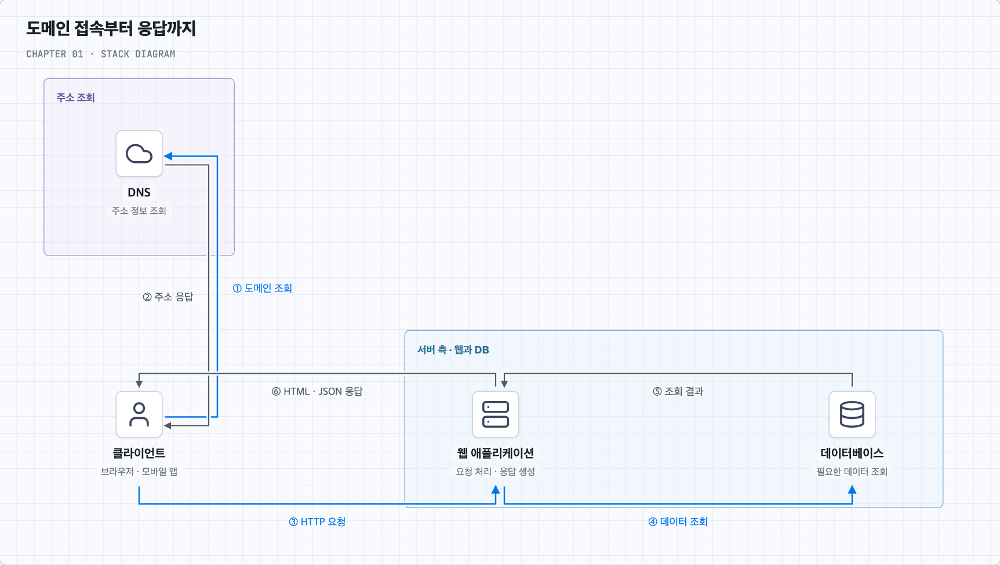

먼저 브라우저는 도메인 이름에 해당하는 접속 주소를 확인한다. 이때 이용하는 시스템이 **DNS**다. 주소를 알아낸 뒤에는 그 주소의 서버에 상품 조회를 요청한다. 요청과 응답을 주고받는 규약이 HTTP이며, HTTPS는 이 통신을 TLS로 보호한다.

요청을 받은 웹 애플리케이션은 DB에서 상품을 읽고 화면에 필요한 결과를 만든다. 브라우저에는 HTML을, API를 사용하는 웹·모바일 앱에는 JSON 같은 데이터를 반환할 수 있다. JSON은 데이터를 주고받는 표현 형식이다.

그림에서 DNS로 향하는 ①–②와 서버로 향하는 ③·⑥을 구분하면 된다. DNS는 주소를 찾을 때 이용하고, 상품 요청은 웹 서버가 처리한다. 주소가 DNS 캐시에 남아 있으면 조회를 생략할 수 있다. 연결 설정 등의 세부 과정은 그림에서 생략했다. 책 p.1–4, 그림 1-1–1-3 참고.

이 구성에 사용자가 늘면 웹 애플리케이션과 DB가 같은 CPU·메모리·디스크를 두고 경쟁한다. 요청 처리에 필요한 자원이 부족해지는 것이다. 이를 줄이는 첫 변경은 웹과 DB를 서로 다른 서버로 옮기는 것이다.

### 2. 웹 서버와 DB 서버를 나눈다

상품 설명 페이지를 만드는 작업과 주문 데이터를 저장하는 작업은 성격이 다르다. 서버를 나누면 웹에는 요청 처리에 필요한 자원을, DB에는 데이터 저장·조회에 필요한 자원을 따로 배정할 수 있다. 이후 웹 서버만 늘리거나 DB 서버의 메모리만 키우기도 쉬워진다.

이제 웹 서버는 DB 서버와 네트워크로 통신한다. 외부 사용자가 접속하는 주소와 내부 서버끼리 통신하는 주소를 구분할 수 있다. 인터넷에서 라우팅하는 주소를 공인 IP, 내부 네트워크용 주소를 사설 IP라고 부른다. 실제 접근 허용 범위는 방화벽과 인증 등으로 함께 관리한다.

DB를 고를 때는 서비스가 데이터를 어떻게 읽고 바꿀지 생각한다. 주문에는 회원·상품·결제 정보가 연결된다. 이런 관계와 제약을 다루고 여러 변경을 한 단위로 묶는 데 관계형 DB를 활용할 수 있다. 여러 변경을 모두 반영하거나 모두 취소하는 식으로 작업 단위를 다루는 장치가 트랜잭션이다.

반면 ‘사용자 ID로 설정 하나를 가져온다’처럼 접근이 단순한 데이터도 있다. 키로 값을 찾는 키-값 DB나, 관련 정보를 한 문서로 저장하는 문서 DB를 검토할 수 있다. 이런 비관계형 DB들을 묶어 NoSQL이라고 부른다. 관계를 따라 탐색하는 그래프 DB, 키로 구분한 데이터 묶음 안에서 여러 열의 값을 다루는 와이드 컬럼 DB도 이 범주에 들어간다.

중요한 것은 이름보다 작업 방식이다. 데이터의 관계, 조회할 범위, 함께 바뀌어야 하는 정보를 먼저 정하고 DB를 선택한다. JSON으로 데이터를 주고받는 서비스도 관계형 DB를 사용할 수 있다. 데이터를 저장·전송할 표현으로 바꾸는 직렬화와 DB 선택은 별개의 문제이기 때문이다.

웹과 DB를 분리했어도 각 서버가 처리할 수 있는 양에는 한계가 있다. 다음에는 서버 한 대의 성능을 키울지, 여러 대에 일을 나눌지 결정해야 한다.

### 3. 더 큰 서버를 쓸까, 서버 수를 늘릴까?

웹 서버의 CPU가 부족하다면 CPU가 더 좋은 서버로 바꿀 수 있다. DB의 메모리가 부족하면 메모리를 늘릴 수 있다. 이렇게 한 대의 자원을 키우는 방법을 **수직 확장**이라고 부른다. 기존 구성을 크게 바꾸지 않고 시작하기 쉽다.

하지만 서버 한 대에 넣을 수 있는 자원에는 한계가 있다. 고사양 장비의 비용도 커진다. 게다가 그 한 대가 멈추면 서비스를 대신할 서버가 없을 수 있다.

그래서 웹 서버를 두 대로 늘리고, 각 서버가 요청의 일부를 처리하게 할 수 있다. 이것이 **수평 확장**이다. 일을 나눌 수 있다면 전체 처리량을 늘리고 한 대의 장애에도 대응할 여지가 생긴다.

| 방법 | 실제 변경 | 다음에 생각할 문제 |
| --- | --- | --- |
| 수직 확장 | 웹 서버 한 대의 성능을 높인다 | 더 키울 수 있는가? 멈추면 누가 대신하는가? |
| 수평 확장 | 웹 서버를 여러 대 둔다 | 요청을 어떻게 나누고 상태를 어떻게 공유하는가? |

여기서 지연시간과 처리량을 구분해 두면 도움이 된다. 상품 요청 하나가 돌아오는 데 걸리는 시간이 지연시간(Latency)이고, 초당 처리하는 요청 수가 처리량(Throughput)이다. 여러 서버가 서로 다른 요청을 처리하면 처리량이 늘 수 있지만, 요청 하나의 계산 시간이 반드시 짧아지는 것은 아니다.

이제 웹 서버가 두 대라고 하자. 사용자의 요청을 두 서버 중 어디로 보낼까?

### 4. 로드 밸런서로 요청을 나눈다

사용자에게 웹 서버 두 대의 주소를 각각 알려 주는 대신, 앞에 공통 진입점을 둔다. 이 진입점이 요청을 받아 처리할 웹 서버를 선택한다. 이 역할을 하는 것이 **로드 밸런서**다.

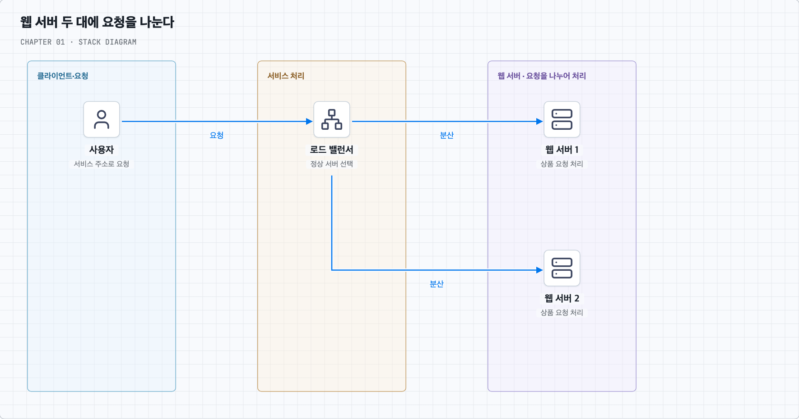

사용자는 로드 밸런서의 주소로 접속한다. 로드 밸런서는 첫 요청을 웹 서버 1에, 다음 요청을 웹 서버 2에 보내는 식으로 분산할 수 있다. 순서대로 배정하는 이 방식이 라운드 로빈이다. 서버 성능에 차이가 있으면 더 강한 서버에 높은 가중치를 줄 수도 있다.

웹 서버 1이 고장 나면 그쪽으로 요청을 계속 보내서는 안 된다. 로드 밸런서는 서버가 정상 응답하는지 확인하고, 문제가 생긴 서버를 배정 대상에서 제외할 수 있다. 이런 상태 확인을 **헬스 체크**라고 부른다. 요청을 어디로 나눌지와 정상 서버인지 판단하는 일은 함께 필요하다.

이 구성에서는 웹 서버 2가 남은 요청을 감당할 수 있어야 한다. 로드 밸런서 자체도 멈추지 않도록 구성해야 한다. 한 지점의 장애가 기능 전체를 멈추게 한다면 그 지점을 단일 장애 지점(SPOF)이라고 부른다.

웹 서버의 일이 나뉘었다고 서비스의 모든 부하가 나뉜 것은 아니다. 두 웹 서버가 같은 DB에서 상품을 읽는다면, DB는 여전히 두 서버의 조회를 모두 처리한다. 다음에는 이 읽기 부하를 나눠 본다.

### 5. DB의 읽기를 복제본에 나눈다

상품 가격을 바꾸는 요청보다 상품을 구경하는 요청이 훨씬 많은 서비스를 생각해 보자. DB에 같은 데이터의 사본을 만들고, 상품 조회 일부를 사본에서 처리하면 원본 DB의 읽기 부담을 줄일 수 있다. 같은 데이터를 다른 서버에 유지하는 것이 **복제**다.

책의 구성에서는 변경을 받는 주 DB와, 변경을 전달받아 조회를 처리하는 읽기 복제본을 둔다.

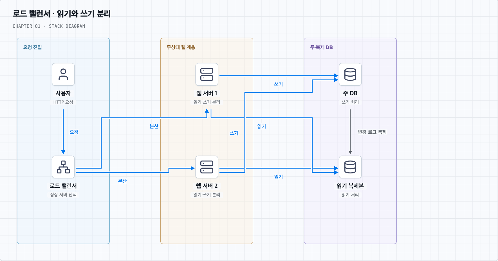

상품 가격 변경은 주 DB로 보낸다. 주 DB는 변경을 기록하고 복제본에 전달한다. 웹 서버는 상품 상세 조회를 복제본으로 보낼 수 있다. 그림에서 실선 쓰기와 파란 점선 읽기를 따라가면 두 웹 서버가 같은 규칙으로 접근함을 알 수 있다. 책 p.6–10의 구성을 참고했으며 교차선은 서로 연결되지 않는다.

사본은 원본을 따라가는 데 시간이 걸릴 수 있다. 주 DB에서 가격이 12,000원으로 바뀌었는데 복제본에는 잠시 10,000원이 남는 상황이다. 이 시간 차이가 **복제 지연**이다. 상품 설명 조회에서 어느 정도의 지연을 허용할지, 변경 직후 반드시 새 값을 보여 줘야 하는 요청은 무엇인지 정해야 한다.

주 DB가 복제본 반영을 기다리지 않고 커밋할 수 있는 방식을 비동기 복제라고 한다. 정해진 복제 확인을 기다리는 방식은 동기 복제다. 무엇을 몇 개의 복제본에서 확인하는지에 따라 쓰기 지연과 장애 시 동작이 달라진다. 자신의 변경을 바로 읽어야 하는 요청은 주 DB를 읽거나 복제 적용을 확인하는 방법을 검토한다.

주 DB가 멈추면 복제본이 새 주 DB 역할을 맡게 할 수도 있다. 이 전환에는 쓰기 권한과 연결 대상 변경이 필요하며, 아직 전달되지 않은 변경이 있는지도 확인해야 한다. 잘못 삭제한 데이터도 복제될 수 있으므로 과거 상태를 복구할 백업은 따로 필요하다.

복제본을 두어도 매번 같은 상품을 DB에서 다시 읽는 일은 남는다. 자주 보는 상품 정보를 더 가까운 곳에 잠시 보관하면 이 반복 조회를 줄일 수 있다.

### 6. 반복해서 읽는 상품 정보를 캐시에 둔다

인기 상품의 설명이 한 시간 동안 거의 바뀌지 않는데 수많은 사용자가 조회한다고 하자. DB는 매번 비슷한 조회를 반복한다. 첫 조회 결과를 빠르게 읽을 수 있는 저장소에 보관하고 다음 요청에 재사용하면 DB에 가는 횟수를 줄일 수 있다. 이런 재사용용 저장소가 **캐시**다.

DB는 상품의 원본을 보관하고, 캐시는 자주 쓰는 일부 결과를 보관한다. 예를 들어 `product:42`라는 이름으로 상품 42의 설명과 표시 가격을 저장할 수 있다. 이 이름이 캐시 키이고, 그 아래 저장한 상품 정보가 값이다.

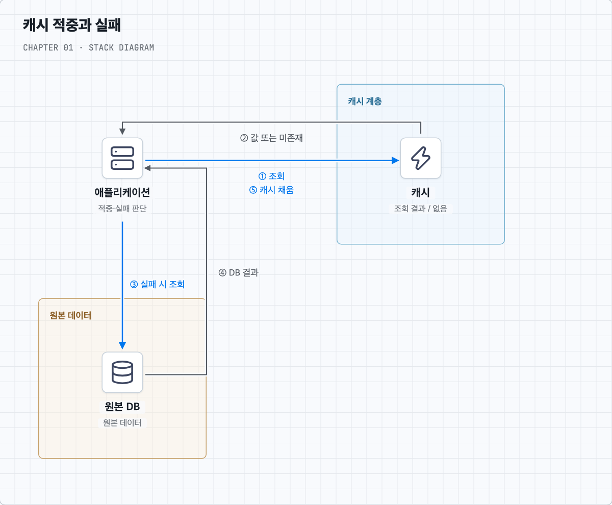

처음 조회할 때 캐시에 상품이 없으면 앱이 DB를 읽는다. 읽은 값을 캐시에 저장하고 사용자에게 반환한다. 이후 같은 상품 요청에서는 캐시에 저장된 값을 반환한다. 사용할 값을 찾으면 적중(Hit), 찾지 못하면 실패(Miss)라고 부른다. 그림에서 DB로 내려가는 ③–④는 miss일 때만 필요하다. 책 p.11, 그림 1-7 참고.

이 방식에서는 앱이 캐시 확인, DB 조회, 캐시 채움을 담당한다. 이 책임 배치를 **Cache Aside**라고 부른다. 이름부터 외우기보다 방금 따라온 세 작업을 앱이 한다고 기억하면 된다.

#### 상품 가격이 바뀌면 캐시는 어떻게 할까?

원본 가격을 12,000원으로 바꿔도 캐시에 10,000원이 남아 있으면 다음 사용자에게 과거 가격이 보인다. 따라서 변경된 캐시를 지우고 다음 조회가 DB에서 새 값을 채우게 할 수 있다. 이처럼 더 이상 유효하지 않은 값을 사용하지 않도록 만드는 일이 **무효화**다.

오래된 값이 계속 남지 않도록 유효 기간을 줄 수도 있다. 예를 들어 60초 동안만 재사용하게 하는 설정이 TTL이다. 길게 두면 DB 조회는 줄어들 수 있지만 오래된 값을 보여 줄 가능성이 커진다. 짧게 두면 원본 조회가 자주 발생한다.

캐시 공간이 부족해서 항목을 제거하는 일은 **퇴거**다. 시간이 지나 만료되는 것, 원본 변경으로 무효화하는 것, 공간을 확보하려고 퇴거하는 것은 이유가 다르다. 최근에 쓰지 않은 항목부터 지우는 LRU, 사용 빈도가 낮은 항목을 지우는 LFU, 먼저 넣은 항목을 지우는 FIFO 같은 정책을 구분할 수 있다. 실제 제공 정책은 제품마다 확인한다. [Redis 퇴거 정책](https://redis.io/docs/latest/develop/reference/eviction/)

#### 무엇을 캐시에 저장할지 정한다

상품 설명처럼 반복 조회되고 잠깐 오래되어도 되는 정보는 좋은 후보가 된다. 반면 재고를 실제로 확보하거나 결제 금액을 확정하는 일은 권위 있는 원본에서 판정해야 한다. 화면에 보여 줄 재고와 구매에 성공할 수 있는 재고는 서로 다른 책임이다.

또한 한국어 상품 설명과 영어 설명이 다르면 키도 이를 구분해야 한다. 권한이나 통화에 따라 결과가 바뀌는 경우도 마찬가지다. 결과가 다른데 같은 키를 쓰면 다른 값을 재사용하게 된다.

#### 캐시가 비었을 때의 부하도 살핀다

인기 상품의 캐시가 만료되면 여러 요청이 한꺼번에 DB를 읽을 수 있다. 같은 조회를 하나로 합치거나, 한 요청만 값을 채우게 하는 방식으로 부하를 조절할 수 있다. 여러 항목의 만료 시각을 조금씩 다르게 두는 방법도 있다.

존재하지 않는 상품 번호가 반복 조회되면 ‘없음’이라는 결과를 짧게 저장해 DB 접근을 줄일 수 있다. 캐시 서버가 고장 났을 때는 모든 요청을 제한 없이 DB로 우회시키기보다 DB가 감당할 유입량을 정해야 한다. 캐시가 비어 있는 재시작 상태를 콜드 스타트라고 부르며, 이때도 같은 문제가 생긴다. 캐시에도 복제본이나 대체 서버를 둘 수 있지만 전환 중의 지연과 원본 부하를 함께 살핀다. 퇴거가 너무 잦다면 적중률·저장 값의 크기·메모리 용량도 확인한다.

<details>
<summary>같은 캐시를 사용하는 다른 방식은 무엇일까? — Read Through와 쓰기 방식</summary>

위 예시에서는 앱이 직접 캐시를 채웠다. 앱 대신 조회를 담당하는 라이브러리나 별도 계층이 캐시를 확인하고, 없을 때 DB 조회까지 맡을 수도 있다. 이 방식이 **Read Through**다. 앱은 상품을 요청하고, 조회 계층이 등록된 원본 조회 함수를 호출해 값을 준비한다. 캐시 서버가 DB 구조를 알아서 추론한다는 뜻은 아니다.

읽기에서 누가 채우는지와 별도로, 쓰기 성공을 언제 응답할지도 정할 수 있다. **Write Through**는 쓰기 계층이 DB와 캐시 반영을 처리하고 정한 성공 조건을 만족한 뒤 응답하도록 구성한다. **Write Behind**는 변경을 받아 먼저 응답하고 DB 반영을 뒤로 미룬다. 후자는 쓰기를 모을 수 있지만 미반영 변경의 보존·순서·재시도가 필요하다.

앞의 둘은 주로 읽기 책임을, 뒤의 둘은 쓰기 흐름을 설명한다. 네 방식 중 반드시 하나만 선택해야 하는 관계는 아니다. 쓰기 계층이 두 저장소를 갱신한다고 해서 두 저장소가 자동으로 같은 트랜잭션에 참여하는 것도 아니다.

</details>

캐시를 도입한 뒤에는 DB와 캐시의 값이 어긋날 수 있다는 새 문제가 생긴다. [질문 05](#q5)에서는 가격 변경 중간에 요청이 겹치거나 프로세스가 중단되는 경우를 그림으로 따라간다.

상품 데이터의 반복 조회는 줄였지만, 브라우저에 상품 사진을 보내는 비용은 아직 남아 있다. 다음에는 이 파일 전달을 줄여 본다.

### 7. 상품 사진과 정적 파일은 CDN으로 전달한다

상품 상세 페이지에는 설명뿐 아니라 사진, CSS, JavaScript, 폰트 파일도 필요하다. 사용자가 멀리 떨어져 있으면 원본 서버에서 큰 사진을 매번 받는 데 시간이 걸린다. 같은 파일을 계속 보내는 일도 원본 서버의 네트워크를 사용한다.

여러 지역의 거점에 파일 사본을 보관하고 사용자에게 제공하면 이 부담을 줄일 수 있다. 이 전달 네트워크가 **CDN**이다. 원본 파일을 가져오는 서버를 Origin, 사용자 요청을 처리하는 분산 거점을 Edge 또는 PoP라고 부른다.

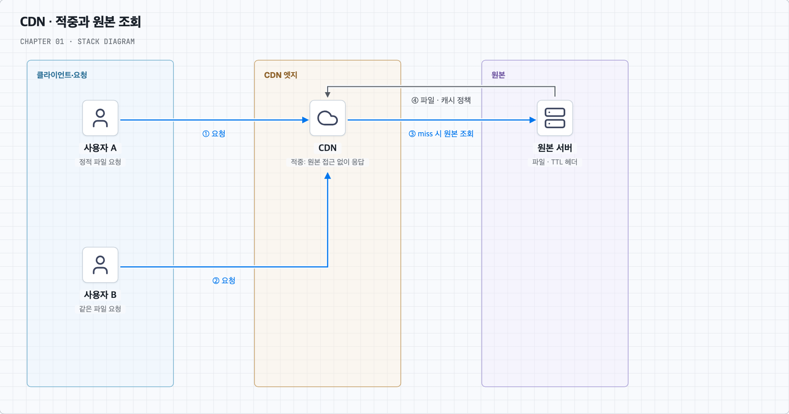

사용자 A가 상품 사진을 요청했는데 엣지에 사본이 없다면, CDN은 원본 서버에서 사진을 가져온다. 정책에 따라 이를 저장한 뒤 응답한다. 사용자 B가 같은 엣지에 같은 파일을 요청하면 유효한 사본으로 응답할 수 있다. 두 번째 요청은 원본 서버에 가지 않아도 된다. 그림에서 사용자 응답선은 생략했다. 책 p.13–17 참고.

앞의 캐시는 앱이 DB를 반복 조회하는 비용을 줄였다. CDN은 주로 HTTP 응답과 파일의 전달 비용을 줄인다. 서로 다른 구간을 다루므로 함께 사용할 수 있다.

#### 파일을 바꿨는데 이전 사진이 보이면?

엣지에 예전 사진이 남아 있으면 원본 파일만 바꿔도 바로 새 사진이 보이지 않을 수 있다. 유효 기간을 짧게 두거나, 해당 경로를 무효화하거나, 새 파일 이름을 사용하는 방법을 검토한다.

예를 들어 `photo.a1.jpg`를 `photo.b2.jpg`로 바꾸고 새 페이지가 새 주소를 참조하게 하면 서로 다른 파일로 취급된다. 이것이 버전 URL을 사용하는 방법이다. 이전 페이지를 보고 있는 사용자도 있으므로 이전 파일을 필요한 동안 유지한다. 엣지 무효화는 브라우저에 저장된 사본까지 모두 제거하지는 않는다. [무효화와 버전 파일](https://docs.aws.amazon.com/AmazonCloudFront/latest/DeveloperGuide/Invalidation.html)

#### 어떤 요청끼리 같은 파일을 재사용할까?

CDN도 재사용할 응답을 구분하는 캐시 키가 필요하다. 언어·쿼리·쿠키에 따라 결과가 달라지면 이를 정책에 반영해야 한다. 사용자별 주문 내역을 누구에게나 같은 사본으로 보내면 안 된다. 반대로 결과와 무관한 정보까지 키에 넣으면 같은 파일도 여러 사본으로 나뉘어 적중률이 떨어진다. [캐시 키 정책](https://docs.aws.amazon.com/AmazonCloudFront/latest/DeveloperGuide/controlling-the-cache-key.html)

정적 파일은 여러 사용자가 같은 결과를 받기 쉬워 CDN에 적합하다. 동적 응답도 조건에 따라 캐싱할 수 있지만, 변경 주기와 개인화 여부를 먼저 정해야 한다.

<details>
<summary>CDN의 유효 기간과 HTTP 헤더는 어떻게 연결될까?</summary>

원본은 HTTP 응답 헤더로 캐시 정책을 전달할 수 있다. 다음 표는 이를 읽기 위한 기본 구분이다.

| 설정 | 의미 |
| --- | --- |
| `Cache-Control: max-age=60` | 해당 응답의 신선도 수명 지정 |
| `s-maxage=300` | 공유 캐시에 적용할 신선도 수명 지정 |
| `private` | 공유 캐시에 저장하지 않도록 지정 |
| `no-cache` | 재사용 전에 원본 확인 필요 |
| `no-store` | 저장하지 않도록 지정 |
| `ETag` / `Last-Modified` | 변경 여부를 확인할 때 사용할 식별자·수정 시각 |
| `Vary` | 특정 요청 헤더에 따라 표현 구분 |

유효 기간이 끝나면 원본에 변경 여부를 확인할 수 있다. 여전히 같은 파일이라면 `304 Not Modified`로 본문을 다시 보내지 않고, 달라졌다면 새 본문을 받는 방식이다. 엣지의 공간이 부족하면 TTL 이전에 퇴거될 수도 있다. [CloudFront 만료와 재검증](https://docs.aws.amazon.com/AmazonCloudFront/latest/DeveloperGuide/Expiration.html)

실제 적용은 CDN 설정과 함께 확인한다. 예를 들어 CloudFront의 최소 TTL이 원본 헤더보다 우선하는 설정이 있다. `no-cache`는 저장 금지와 다르고 쿠키가 있다고 자동으로 공유 캐싱이 금지되는 것도 아니다. [MDN HTTP 캐싱](https://developer.mozilla.org/en-US/docs/Web/HTTP/Guides/Caching)

</details>

CDN에도 요청·전송 비용이 들고 장애가 생길 수 있다. 거의 조회되지 않는 파일까지 캐싱할 이익이 있는지 살핀다. CDN 장애 시 원본으로 우회한다면 늘어난 요청을 원본이 감당할 수 있어야 한다.

캐시와 CDN으로 반복 작업을 줄였으니, 다시 여러 웹 서버로 돌아간다. 이제 어느 서버가 요청을 받아도 로그인한 사용자를 알아볼 수 있어야 한다.

### 8. 로그인 상태를 특정 웹 서버에만 두지 않는다

사용자가 웹 서버 1에서 로그인했고, 서버 1의 메모리에 로그인 정보를 저장했다고 하자. 다음 요청을 로드 밸런서가 서버 2로 보내면 서버 2는 이 정보를 모를 수 있다. 사용자는 방금 로그인했는데 다시 로그인하라는 화면을 보게 된다.

사용자의 여러 요청에 걸쳐 유지하는 인증 맥락 등을 세션이라고 부른다. 세션을 여러 웹 서버가 접근할 수 있는 저장소에 두면 서버 2도 로그인 상태를 확인할 수 있다. 이렇게 다음 요청을 특정 웹 서버에 의존시키지 않는 구성을 **무상태 웹 계층**이라고 한다.

사용자에게 상태가 없어진 것이 아니라 상태를 보관하는 위치가 달라진 것이다. 웹 서버 1을 교체해도 다른 웹 서버가 공유 저장소를 통해 요청을 이어서 처리할 수 있다. 대신 이 공유 저장소의 가용성도 중요해진다.

같은 사용자를 계속 같은 서버로 보내는 세션 고정(Sticky Session)도 가능하다. 다만 그 서버가 멈추었을 때의 세션 처리는 여전히 해결해야 한다. 공통으로 검증하는 토큰을 사용하는 방법도 있지만 만료·폐기·키 관리가 필요하다.

여기까지는 한 지역의 서버 장애를 주로 생각했다. 데이터 센터 전체의 전원이나 네트워크에 문제가 생기면 어떻게 할까?

### 9. 다른 데이터 센터에서도 서비스할 수 있게 한다

한 데이터 센터에 웹 서버가 여러 대 있어도 데이터 센터 전체가 중단되면 함께 영향을 받는다. 다른 지역에도 서비스를 두면 한 지역이 중단될 때 다른 지역이 요청을 받을 수 있다. 사용자와 가까운 지역에서 응답해 지연을 줄일 수도 있다.

이때는 요청을 보낼 지역을 정해야 한다. GeoDNS는 사용자 위치 등의 정보를 참고해 다른 주소를 반환하는 방식이다. 이미 DNS 응답을 캐싱한 클라이언트는 한동안 이전 주소를 사용할 수 있으므로 전환 시간을 고려한다.

주소만 바꾸면 충분한 것은 아니다. 다른 지역에도 필요한 데이터가 있어야 하고, 그 지역이 새 요청을 감당해야 한다. 쓰기 역할을 넘긴다면 어느 DB가 주 DB인지도 명확해야 한다. 두 지역이 서로 다른 주 DB라고 판단해 독립적으로 쓰는 문제를 Split Brain이라고 부른다.

그래서 지역 간 데이터 복제, 전환 후 처리 용량, 쓰기 권한 이전, 테스트와 배포를 함께 준비한다. 장애 시 역할을 다른 노드나 지역으로 넘기는 과정이 장애 전환(Failover)이다.

복구 목표를 구체화할 때는 허용할 데이터 손실 범위를 나타내는 RPO와 목표 복구시간인 RTO를 사용할 수 있다. 이는 1장의 장애 대응을 이해하기 위한 추가 용어다. 목표를 정했다면 실제 전환 훈련으로 확인해야 한다.

여러 지역에 서버를 두었어도 요청 안에서 오래 걸리는 일을 모두 끝낼 필요는 없다. 다음에는 작업을 접수하는 일과 실행하는 일을 분리한다.

### 10. 오래 걸리는 일은 큐에 넣고 따로 처리한다

상품 판매자가 큰 사진을 올렸다고 하자. 서버는 작은 썸네일을 만들고 파일을 저장해야 한다. 이 작업이 끝날 때까지 모든 업로드 요청을 붙잡아 두면 웹 서버가 바빠지고 사용자는 오래 기다린다.

웹 서버가 작업을 안전하게 접수한 뒤, 별도의 작업 서버가 사진을 변환하게 할 수 있다. 둘 사이에서 작업을 받아 보관하고 전달하는 것이 **메시지 큐**다.

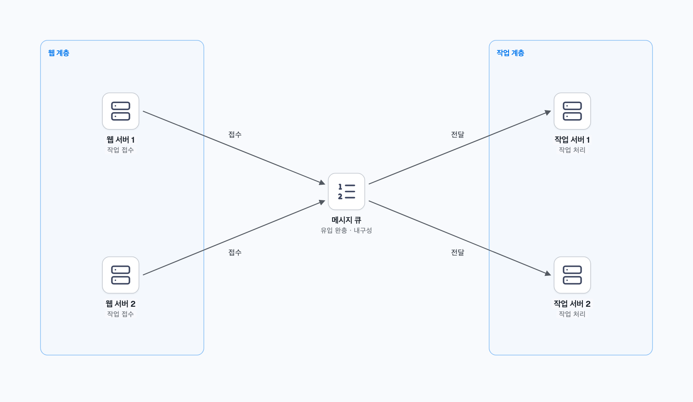

사진 업로드를 받은 웹 서버는 ‘사진 42의 썸네일을 만들라’는 작업을 넣는다. 이쪽이 생산자(Producer)다. 작업 서버는 큐에서 작업을 받아 실행하며 소비자(Consumer)라고 부른다. 작업이 밀리면 작업 서버를 늘리고, 접수 요청이 늘면 웹 서버를 늘릴 수 있다. 책 p.23–25, 그림 1-18·1-19 참고. 그림은 작업을 나누는 구성의 예시이며 한 작업을 모든 소비자가 실행한다는 뜻은 아니다.

#### 접수 완료와 처리 완료를 나눈다

큐에 기록한 순간에는 아직 썸네일이 없을 수 있다. 따라서 사용자에게 ‘업로드 접수 완료’와 ‘이미지 처리 완료’를 구분해 알려야 한다. 큐가 접수한 작업을 장애에도 유지할 수 있는 성질을 내구성이라고 부른다. 사용하는 큐와 설정이 어떤 보장을 제공하는지 확인한다.

작업 서버가 처리 완료를 알리는 확인을 ack라고 부른다. 작업 결과를 저장하기 전에 완료를 알리면 이후 중단될 때 작업을 잃을 수 있다. 반대로 결과를 저장한 뒤 완료를 알리기 전에 중단되면 같은 작업을 다시 받을 수 있다.

그래서 재시도해도 같은 썸네일이나 주문을 중복 생성하지 않도록 설계한다. 같은 작업을 여러 번 실행해도 의도한 효과가 중복 발생하지 않는 성질이 **멱등성**이다. 요청 ID와 DB 제약 등을 활용할 수 있다.

#### 큐가 계속 길어지면 처리 속도를 살핀다

큐는 순간적인 유입과 처리 속도의 차이를 흡수한다. 하지만 초당 들어오는 작업이 처리하는 작업보다 계속 많으면 대기시간이 늘어난다. 이때는 처리기를 늘리거나 접수량을 줄이고 대기열 상한을 정해야 한다. 처리 속도에 맞춰 유입을 제어하는 것을 Backpressure라고 부른다.

계속 실패하는 작업은 별도로 모아 조사·재처리할 수 있다. 그 대기열이 DLQ다. 여러 소비자가 병렬로 실행하면 완료 순서가 달라질 수 있으므로 순서가 중요한 업무는 보장 단위를 확인한다. 선착순 이벤트의 재고 확정은 [질문 02](#q2)에서 따로 다룬다.

서버와 작업이 늘었으니 이제 어느 지점이 느리고 실패하는지 알아볼 수 있어야 한다.

### 11. 로그와 수치로 병목을 찾고 반복 작업을 자동화한다

사용자가 ‘주문이 느리다’고 알려 왔다고 하자. 웹 서버가 바쁜지, DB 잠금을 기다리는지, 큐에 쌓여 있는지에 따라 해결 방법이 다르다. 서버 수부터 늘리기 전에 처리 과정의 기록과 수치를 봐야 한다.

**로그**는 특정 요청에서 어떤 일이 일어났는지 알려 준다. 주문 ID나 요청 ID를 남기면 여러 서버에 흩어진 관련 기록을 연결할 수 있다. **메트릭**은 요청량·오류율·지연시간 같은 수치가 시간에 따라 어떻게 바뀌는지 보여 준다. 요청이 여러 서비스를 거친 구간별 경로와 시간을 보는 추적(Trace)도 함께 활용할 수 있다.

| 확인할 위치 | 먼저 볼 수 있는 수치 | 이해하려는 상황 |
| --- | --- | --- |
| 웹 서버 | 요청량, 오류율, 지연시간, CPU | 요청 처리량이 부족한가? |
| DB | 조회시간, 잠금 대기, 복제 지연 | 데이터 접근에서 기다리는가? |
| 캐시 | 적중률, 퇴거, 무효화 지연 | DB 조회가 갑자기 늘었는가? |
| 큐 | 적체량, 가장 오래 기다린 작업의 시간 | 작업 실행이 접수를 따라잡는가? |

평균만 보면 일부 사용자의 긴 대기가 가려질 수 있다. 지연시간을 작은 값부터 나열했을 때 95%의 요청이 그 값 이하인 지점을 p95, 99%의 지점을 p99라고 한다. 타임아웃과 오류율도 함께 본다. 일간 활성 사용자(DAU), 매출, 재방문 유지율 같은 업무 지표는 기술적 변화가 실제 서비스 결과와 어떻게 연결되는지 확인하는 데 사용한다.

서버가 많아지면 같은 프로그램을 배포하고 설정하는 작업도 반복된다. 자동 테스트와 배포·서버 구성 자동화는 이 과정의 오류를 줄인다. 변경을 자주 통합하며 자동 검증하는 과정을 CI라고 부른다. 점진 배포와 되돌리기 절차를 준비하면 문제가 생겼을 때 영향을 줄일 수 있다.

측정해 보니 DB 한 대가 담는 데이터와 쓰기 부담 자체가 한계라면, 읽기 복제와 캐시만으로는 충분하지 않을 수 있다. 마지막으로 원본 데이터도 나누어 본다.

### 12. DB 한 대의 데이터를 여러 샤드에 나눈다

읽기 복제본은 같은 데이터의 사본이다. 원본 데이터가 너무 커서 한 서버에 담기 어렵다면, 사본을 늘려도 각 서버는 여전히 같은 전체 데이터를 담아야 한다. 이때는 원본 데이터 자체를 나누는 방법을 생각한다.

사용자 0–7의 정보를 네 DB에 나누어 본다. 사용자 ID를 4로 나눈 나머지가 0이면 첫 DB, 1이면 두 번째 DB에 저장하는 규칙을 만들 수 있다. 각 DB가 전체의 일부를 담당하는 구성이 **샤딩**이다.

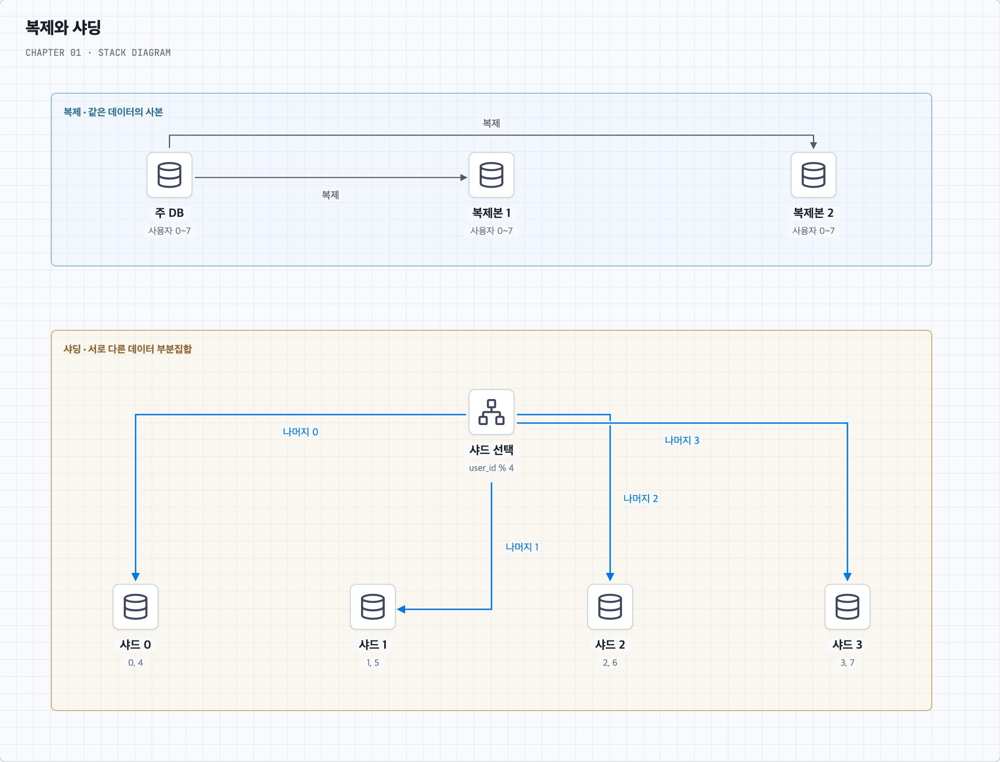

그림의 샤딩 구성에서 사용자 5를 찾는 요청은 `5 % 4 = 1`이므로 샤드 1로 간다. 데이터 위치를 결정하는 사용자 ID가 이 예시의 **샤드 키**다. 문맥에 따라 파티션 키라고도 부른다. 책 p.8·27의 복제·샤딩 그림을 참고했다.

이제 각 서버가 일부 데이터와 요청을 담당한다. 다만 사용자 수가 비슷해도 인기 사용자 한 명에게 요청이 집중되면 그 사용자의 샤드가 바빠질 수 있다. 이런 부하 집중을 핫스팟, 집중 대상인 키를 핫키라고 부른다. 저장량과 요청량이 모두 잘 나뉘는지 봐야 한다.

#### 서버 수를 바꾸면 데이터 위치도 바뀔 수 있다

나머지 연산에서 4를 5로 바꾸면 많은 사용자의 저장 위치가 달라진다. 새 규칙에 맞춰 데이터를 옮기고 이동 중 요청도 처리해야 한다. 이 재분할·재배치가 Resharding이다. 일관된 해싱은 노드 변경 때 키 재배치 범위를 줄이는 방법이지만, 한 키에 몰리는 부하까지 자동 해결하지는 않는다.

#### 나눈 데이터를 다시 함께 다룰 때 비용이 생긴다

같은 DB 안에서는 주문과 회원 정보를 조인하기 쉬웠더라도, 서로 다른 샤드에 있으면 여러 서버를 조회해 합쳐야 할 수 있다. 여러 샤드의 변경을 하나의 트랜잭션으로 확정하려면 서버 간 조정도 필요하다. 이를 지원하는 제품을 쓰거나, 자주 함께 처리할 데이터가 같은 샤드에 놓이도록 모델링한다.

자주 함께 읽는 값을 중복 저장해 조회를 단순하게 만들 수도 있다. 이를 비정규화라고 부르며, 조회 대신 중복된 값의 갱신을 관리하는 비용을 갖는다.

이 절의 샤딩은 행 집합을 나누는 수평 분할의 예다. 열이나 기능을 나누는 수직 분할, 한 DB 안에서 나누는 파티셔닝과도 구분한다. 각 샤드에 복제본을 두면 데이터 분산과 장애 대응을 함께 구성할 수 있다.

### 13. 확장 과정을 다시 이어 본다

처음에는 한 서버에서 요청을 받고 데이터를 저장했다. 사용자가 늘자 웹과 DB를 나누고, 웹 서버 여러 대 앞에 로드 밸런서를 두었다. DB 조회는 복제본에 나누고 반복 조회는 캐시에서, 사진과 파일 전달은 CDN에서 줄였다.

웹 서버를 자유롭게 추가·교체하려고 세션을 공유했다. 지역 장애에 대비해 다른 데이터 센터를 준비하고, 오래 걸리는 작업은 큐와 작업 서버로 분리했다. 로그와 메트릭으로 병목을 확인하며, 원본 데이터와 쓰기를 더 나눌 필요가 있을 때 샤딩을 검토했다.

앞 단계가 모든 문제를 해결하지 못했기 때문에 다음 구성을 검토한 것이다. 실제 서비스에서는 측정한 병목과 비용·일관성 요구에 따라 필요한 것부터 선택한다. 이 장의 복습에서는 각 기술의 이름보다 **무슨 문제가 생겨서 추가했고, 무엇이 개선되며, 어떤 문제가 남았는지** 설명해 본다.

### 14. 이해한 흐름에서 질문을 더한다

- [질문 01: NoSQL의 지연시간·대용량·확장](#q1)
- [질문 02: 선착순 이벤트의 쓰기 폭주](#q2)
- [질문 03: 읽기 복제본 수와 비용](#q3)
- [질문 04: 정적·동적 부하 분산](#q4)
- [질문 05: DB·캐시 일관성과 Facebook 논문](#q5)
- [토글 복습 문제](#review) · [책 범위와 출처](#sources)

[목차로 돌아가기](#contents)

---


<a id="q1"></a>

## 01. NoSQL은 왜 낮은 지연시간·대용량 저장·규모 확장에 유리하다고 할까?

상품 조회가 느려지고 데이터가 계속 늘어나면 다른 DB를 검토하게 된다. 책 p.5도 낮은 지연시간이나 대용량 저장이 필요한 경우 NoSQL을 고려할 수 있다고 설명한다. 이 말을 이해하려면 ‘NoSQL이라서’보다 **어떤 일을 줄이고 어떻게 나누는가**를 보면 된다.

### 1. 화면 하나를 만들 때 필요한 작업을 줄인다

상품 상세 화면에서 상품 설명과 판매자 소개를 함께 보여 준다고 하자. 관계형 DB에서 두 정보를 별도 테이블로 관리한다면 조인해서 가져올 수 있다. 반면 문서 DB에서는 함께 읽는 정보를 하나의 문서에 넣어 한 번에 가져오도록 설계할 수 있다.

같은 화면을 만드는 데 필요한 조회와 통신이 줄어들면 응답에 유리할 수 있다. 그 대신 판매자 소개를 여러 상품 문서에 복사했다면 소개가 바뀔 때 여러 사본을 고쳐야 한다. 읽기를 단순하게 만든 만큼 갱신 책임이 생긴다.

관계형 DB도 인덱스를 사용하거나 함께 읽는 데이터를 합쳐 저장할 수 있다. 따라서 이 예시의 이점은 데이터 모델과 접근 패턴에서 나온다. 모든 NoSQL 제품이 같은 방식으로 동작하는 것은 아니다.

DynamoDB처럼 키로 단일 항목을 지정하는 작업에 낮은 지연시간을 제공하는 제품도 있다. 다만 서비스 내부 평균 지연과 사용자가 느끼는 전체 시간은 다르다. 후자에는 네트워크·연결 설정·재시도 등이 더해진다. [AWS 지연시간 설명](https://docs.aws.amazon.com/amazondynamodb/latest/developerguide/TroubleshootingLatency.html)

### 2. 한 서버가 모든 데이터를 담지 않게 한다

상품과 사용자 데이터가 늘어나면 한 서버의 디스크만 문제가 되는 것은 아니다. 데이터를 찾는 인덱스도 커지고, 메모리 적중률과 디스크 접근, 백업·복구 시간도 달라진다.

데이터를 여러 서버에 나누면 각 서버가 일부만 담당할 수 있다. 일부 분산 NoSQL은 이런 파티션 관리와 요청 전달을 제품의 기본 기능으로 제공한다. DynamoDB는 저장 공간과 설정 처리량 등에 맞춰 추가 파티션을 관리한다. [AWS 파티션 관리](https://docs.aws.amazon.com/amazondynamodb/latest/developerguide/HowItWorks.Partitions.html)

여기서 복제와 구분한다. 전체 데이터의 사본을 추가하면 읽기를 나눌 수 있지만, 각 사본은 여전히 전체 데이터를 담아야 한다. 데이터 자체를 나누는 샤딩은 서버별 저장 부담을 나누는 방법이다.

### 3. 노드를 추가한 뒤의 일을 제품이 맡아 주면 확장이 편해진다

서버를 한 대 더 두었다고 데이터가 저절로 옮겨지지는 않는다. 어떤 키를 어디에 둘지 결정하고, 필요한 데이터를 옮기고, 이후 요청을 올바른 서버에 보내야 한다. 장애가 난 데이터의 사본도 찾아야 한다.

분산 기능을 제공하는 제품은 이런 운영 작업의 일부를 맡아 준다. 그래서 개발자가 분산 저장 계층을 직접 만드는 부담을 줄일 수 있다. 관련 작업이 같은 키 주변에서 끝나도록 모델링하면 서버 사이의 조정도 줄일 수 있다.

예를 들어 독립적인 사용자들의 설정은 여러 서버에 나누기 쉽다. 반면 모든 사용자가 같은 상품 재고 하나를 바꾸면 그 키에 요청이 집중된다. 키 하나의 부하까지 서버 추가만으로 나뉘는 것은 아니다. [AWS 키·부하 분산 설계](https://docs.aws.amazon.com/amazondynamodb/latest/developerguide/bp-partition-key-design.html)

### 선택할 때는 같은 작업을 비교한다

관계형 DB도 샤딩할 수 있고 분산 SQL 제품도 있다. 다만 여러 서버의 조인·유일성·트랜잭션에는 조정 비용이 생긴다. NoSQL도 여러 파티션을 조회하거나 엄격한 일관성을 요구하면 비용이 달라진다.

따라서 비교할 때는 같은 데이터, 같은 조회, 같은 내구성·일관성 조건을 놓고 본다. ‘트랜잭션이 없어서 빠르다’, ‘메모리에 저장하므로 빠르다’, ‘스키마가 유연해서 확장이 쉽다’만으로 설명하기는 어렵다.

읽은 뒤에는 이렇게 연결해 본다. **조회할 일을 줄이면 지연시간에, 데이터를 나누면 용량에, 분산 기능을 제품이 제공하면 운영 부담에 이점이 생길 수 있다.** 그 조건이 내 서비스에서도 성립하는지 확인한다.

[목차로 돌아가기](#contents)

---


<a id="q2"></a>

## 02. 선착순 이벤트처럼 쓰기가 짧은 시간에 몰리면?

상품은 평소에 조회가 많지만, 선착순 판매가 시작되는 순간에는 구매 요청이 한꺼번에 몰릴 수 있다. 읽기 복제본을 늘리는 구성만으로는 같은 재고를 바꾸려는 쓰기를 처리하기 어렵다. 여기서는 ‘재고 100개를 초과 판매하지 않는다’는 요구부터 생각한다.

### 1. 재고를 읽고 나중에 줄이면 무슨 일이 생길까?

재고가 마지막 1개라고 하자. 요청 A가 재고 1을 읽은 직후 요청 B도 재고 1을 읽으면, 두 요청이 모두 구매 가능하다고 판단할 수 있다. 조회와 차감 사이에 다른 요청이 끼어든 것이다.

이때는 DB가 조건 확인과 변경을 함께 처리하도록 만든다. 다음은 PostgreSQL의 조건부 갱신 예시다. `event_id`가 한 행을 유일하게 식별하고 `remaining`은 음수가 아닌 정수라고 가정한다.

```sql
UPDATE event_stock
SET remaining = remaining - 1
WHERE event_id = :event_id
  AND remaining > 0
RETURNING remaining;
```

행이 반환되면 재고 차감에 성공했다. PostgreSQL의 Read Committed에서는 같은 행의 동시 갱신을 기다린 뒤 변경된 행에 조건을 다시 평가한다. [동시 갱신 동작](https://www.postgresql.org/docs/current/transaction-iso.html)

재고만 줄고 발급 기록이 남지 않아도 문제가 된다. 따라서 차감과 발급 기록 저장을 같은 트랜잭션에 넣고, 사용자별 중복 발급은 유일성 제약 등으로 막는다. 응답을 못 받아 다시 요청한 경우에는 요청 ID로 기존 결과를 돌려줄 수 있게 한다.

### 2. 정확하게 처리해도 기다리는 요청은 많아질 수 있다

조건부 갱신으로 초과 판매를 막아도 모든 요청이 같은 재고 행을 바꾸면 차례를 기다리게 된다. DB가 감당할 속도보다 요청이 빠르게 들어올 때는 유입량도 제어해야 한다.

대기열이나 요청 제한을 거쳐 접수하고, 내구성 있는 큐에 작업을 넣은 뒤 제한된 수의 처리기가 DB에서 발급을 확정하는 구성을 검토할 수 있다.


큐에 안전하게 기록한 시점에는 ‘접수 완료’를, DB에 발급 결과를 커밋한 뒤에는 ‘발급 확정’을 알려 준다. 중간에 실패해 다시 처리하더라도 같은 사람에게 두 번 발급하지 않아야 한다.

큐는 순간적인 몰림을 기다리게 할 수 있지만 DB의 지속 처리 속도를 자동으로 높이지는 않는다. 접수 속도가 계속 더 빠르면 대기열이 늘어나므로 상한과 마감 정책도 필요하다.

### 3. 무엇을 선착순으로 볼지 정한다

사용자가 버튼을 누른 순서, 서버에 도착한 순서, 큐에 기록한 순서는 다를 수 있다. 여러 처리기가 동시에 작업하면 처리 완료 순서도 달라진다. 먼저 어떤 순서를 기준으로 당첨자를 정할지 합의해야 한다.

예를 들어 Kafka를 사용한다면 파티션 단위 순서를 고려한다. 여러 파티션에 나눈 것만으로 이벤트 전체 순서가 보장되지는 않는다. [Kafka 설계](https://kafka.apache.org/41/design/design/)

서로 다른 이벤트의 재고는 분산하기 쉽지만, 하나의 재고에 대한 엄격한 판정은 조정이 필요하다. 재고를 여러 곳에 미리 할당하면 경합을 나눌 수 있는 대신 남은 재고의 재배분·장애·공정성을 새로 설계해야 한다.

이 문제는 **정확한 재고 확보 → 중복 방지 → 유입 제어 → 선착순 기준**으로 나누어 생각한다. 부하 시험에서도 처리량뿐 아니라 초과·중복 발급, 대기시간, 중단 후 복구 결과를 확인한다.

[목차로 돌아가기](#contents)

---


<a id="q3"></a>

## 03. 읽기 복제본은 많을수록 좋은가?

상품 조회가 몰려 읽기 복제본을 한 대에서 여러 대로 늘렸다고 하자. 조회를 나누기는 쉬워졌지만, 주 DB에서 가격을 바꿀 때는 더 많은 사본에 변경을 전달해야 한다. ‘복제본이 늘면 그만큼 쓰기도 기다리는가?’라는 질문이 생긴다.

### 1. 먼저 쓰기가 무엇을 기다리는지 본다

주 DB가 가격 변경을 기록한 뒤, 복제본의 반영을 기다리지 않고 성공을 응답할 수 있다. 비동기 복제가 이런 방식이다. 복제본은 변경 로그를 전달받아 뒤따라 적용한다. 이 경우 사본 수만큼 반영 시간을 순서대로 더해서 기다리는 구조는 아니다.

반대로 정해진 복제 확인을 기다린 뒤 성공을 응답하도록 할 수도 있다. 이때는 기다리는 복제본 수와 위치, 확인 단계가 쓰기 지연에 영향을 준다. 이것이 동기 복제에서 확인할 부분이다. 모든 사본을 기다리는지, 로그 저장과 조회 반영 중 어느 단계까지 확인하는지 설정을 봐야 한다. [PostgreSQL 복제](https://www.postgresql.org/docs/current/warm-standby.html)

### 2. 기다리지 않는다고 전달 비용이 사라지지는 않는다

가격 변경 로그를 보낼 곳이 늘면 네트워크·연결·저장 비용이 늘어난다. 각 복제본도 조회를 처리하면서 변경을 적용해야 한다. 무거운 조회가 자원을 사용하면 복제 반영이 늦어질 수 있다.

따라서 복제본별 지연, 적용 속도, 조회시간과 자원 사용량을 본다. DB에 따라 오래 실행되는 조회와 복제 적용이 충돌해 조회가 취소될 수 있고, 뒤처진 복제본을 위해 로그를 오래 보존해야 할 수도 있다. 복제본이 다시 다른 복제본에 전달하는 계단식 구성은 직접 전송 부담을 나누지만 추가 전달 경로를 만든다.

### 3. 조회 여러 개를 나누는 것과 쿼리 하나를 빠르게 하는 것은 다르다

서로 다른 사용자의 상품 조회를 여러 복제본에 나누면 대기하는 요청을 줄일 수 있다. 이것은 전체 처리량을 늘리는 효과다. 쿼리 하나의 계산을 여러 사본이 나누어 실행한다는 뜻은 아니다.

아직 여유가 있는 복제본을 계속 늘려도 비용만 늘 수 있다. 반대로 복제본이 부족해 요청이 기다리는 상황이라면 증설이 도움이 될 수 있다. 현재의 대기와 자원 포화를 기준으로 결정한다.

### 4. 방금 바꾼 값을 어디서 읽을지도 정한다

판매자가 가격을 바꾸고 바로 확인했는데 복제본이 아직 이전 가격을 반환할 수 있다. 이 요청은 주 DB로 보내거나 해당 변경이 복제본에 적용되었음을 확인하는 방식을 검토한다. 잠깐 오래된 값이어도 되는 일반 조회와 같은 기준을 적용할 필요는 없다.

주 DB 장애 시에는 어느 복제본을 새 주 DB로 만들지, 이전 주 DB가 다시 쓰지 못하게 할지도 정해야 한다. 읽기 서버 수를 늘리는 일과 안전한 장애 전환은 연결되지만 별도로 준비할 작업이다.

복제본 증설은 **나눌 조회의 양, 변경 전달 비용, 허용할 오래된 읽기**를 함께 보고 결정한다.

[목차로 돌아가기](#contents)

---


<a id="q4"></a>

## 04. 정적·동적 부하 분산은 어떻게 다른가?

웹 서버가 두 대이고 모두 정상이라고 하자. 첫 요청을 서버 1에, 다음 요청을 서버 2에 보내면 간단하게 나눌 수 있다. 그런데 서버 1이 받은 요청은 3초 걸리는 이미지 작업이고 서버 2의 요청은 금방 끝난다면 어떻게 될까? 요청 개수를 똑같이 나눠도 남아 있는 일은 달라질 수 있다.

### 1. 미리 정한 규칙으로 나누는 정적 방식

라운드 로빈은 서버를 순서대로 선택한다. 요청마다 현재 얼마나 바쁜지 측정하지 않고도 동작한다. 서버 성능이 다르면 정해진 가중치로 더 많은 요청을 보내는 방식도 가능하다.

IP 해시는 클라이언트 IP를 기준으로 서버를 선택한다. 같은 IP의 요청을 같은 서버로 보낼 수 있지만, 공인 IP를 공유하는 사용자가 많으면 한 서버에 몰릴 수 있다.

이처럼 배정할 때 현재 부하를 반영하기보다 미리 정한 기준을 사용하는 방식을 정적으로 분류한다.

### 2. 관측한 상태를 반영하는 동적 방식

앞의 긴 이미지 작업 때문에 서버 1에 활성 연결이 많이 남아 있다면, 새 요청을 연결이 적은 서버 2로 보내도록 할 수 있다. 이것이 최소 연결 방식이다. 관측한 응답시간 등을 사용하는 방법도 있다.

여기서는 관측하는 수치가 실제 일을 잘 나타내는지 확인해야 한다. 연결 하나가 계속 많은 일을 할 수도 있고 잠시 아무 일도 하지 않을 수도 있다. NGINX의 최소 연결은 활성 연결 수를 보는 것이며 서버 CPU를 직접 재는 것과는 다르다. [NGINX 부하 분산](https://nginx.org/en/docs/http/load_balancing.html)

원리를 이해한 뒤 표로 비교하면 다음과 같다.

| 분류 | 예시 | 선택 기준 |
| --- | --- | --- |
| 정적 | 라운드 로빈 | 순서 |
| 정적 | 고정 가중치 | 미리 정한 비율 |
| 정적 | IP 해시 | 클라이언트 IP |
| 동적 | 최소 연결 | 현재 활성 연결 수 |
| 동적 | 응답시간 기반 | 관측한 지연시간 등 |

### 3. 정상 여부와 부하 정도를 나누어 본다

서버가 죽었다면 어떤 방식이든 요청을 보내지 않아야 한다. 헬스 체크는 정상 여부를 확인하고, 배정 알고리즘은 정상 서버 중 어디를 고를지 정한다. 따라서 정적 방식도 장애 서버를 제외하도록 구성할 수 있다.

같은 사용자를 같은 서버로 보내는 세션 고정은 또 다른 요구다. 세션이 특정 서버에만 있으면 필요할 수 있지만, 장애와 서버 교체까지 편하게 하려면 상태를 공유하는 구조도 검토한다.

동적 방식은 상태를 관측하는 만큼 측정 지연과 변동의 영향도 받는다. 짧고 비슷한 요청을 처리한다면 단순한 규칙으로 충분할 수 있다. 작업 차이가 크면 진행 중 요청이나 연결 수가 더 유용할 수 있다. ‘동적인가’보다 **무엇을 측정해 실제 부하를 나누는가**를 묻는다.

이 글은 책 p.6–7의 로드 밸런서 설명에, 사용자가 언급한 『주니어 백엔드 개발자가 반드시 알아야 할 실무 지식』의 정적·동적 분류를 연결한 추가 학습이다. 후자의 원문은 제공되지 않아 표현을 대조하지 않았다.

[목차로 돌아가기](#contents)

---


<a id="q5"></a>

## 05. DB와 캐시를 한 트랜잭션으로 바꾸지 못하면 일관성을 어떻게 다룰까?

상품 가격을 10,000원에서 12,000원으로 바꿨다고 하자. DB에는 새 가격이 저장되었는데 사용자는 계속 10,000원을 본다. 캐시에 이전 가격이 남아 있기 때문이다. DB 변경과 캐시 처리가 서로 다른 작업이라는 점에서 문제가 시작된다.

먼저 정상 동작을 따라가고, 그 사이에 중단이나 다른 요청이 끼어들면 어떻게 달라지는지 살펴본다. 책 p.12의 일관성 문제와 [「Scaling Memcache at Facebook」](https://www.usenix.org/system/files/conference/nsdi13/nsdi13-final170_update.pdf)을 연결한 추가 학습이다.

### 1. 가격 변경과 캐시 삭제 사이에서 앱이 멈춘다면?

앞에서 사용한 구성은 DB의 가격을 바꾼 뒤 캐시를 지운다. 다음 조회가 DB에서 새 가격을 읽어 캐시를 채우게 하는 방식이다.

```text
DB의 상품 가격을 12,000원으로 변경하고 COMMIT
캐시에 남은 상품 정보 삭제
```

두 작업이 모두 성공하면 기존 캐시를 다시 사용하는 일은 줄어든다. 하지만 DB 커밋 직후 앱이 중단되면 두 번째 줄은 실행되지 않을 수 있다. 원본은 바뀌었는데 캐시는 그대로 남는다.

이때 필요한 성질이 원자성이다. 정한 작업 단위가 모두 반영되거나 모두 반영되지 않아야 한다는 뜻이다. DB의 트랜잭션은 참여하는 DB 작업을 묶지만 별도 캐시의 삭제까지 자동으로 포함하지는 않는다. 같은 함수에서 연달아 실행하는 것만으로는 중간의 실패를 없애지 못한다.

그러면 두 작업을 모두 실행하는 데 성공하면 충분할까? 요청이 겹치면 다른 문제가 생길 수 있다.

### 2. 다른 읽기 요청이 이전 값을 늦게 넣는다면?

아래 그림의 v1은 이전 가격, v2는 새 가격이라고 생각하면 된다. 처음에는 캐시가 비어 있다.

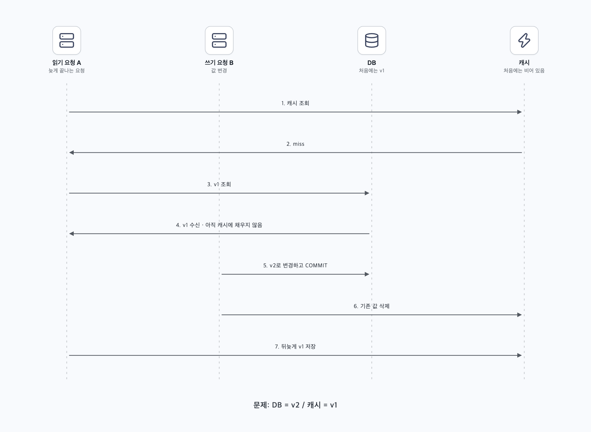

읽기 요청 A가 캐시에서 값을 못 찾아 DB의 v1을 읽는다. 아직 캐시에 넣기 전에 쓰기 요청 B가 DB를 v2로 바꾸고 캐시를 지운다. 여기까지는 B의 두 작업이 모두 성공했다.

그런데 A가 뒤늦게 자신이 받아 둔 v1을 캐시에 넣으면, DB는 v2인데 캐시는 다시 v1이 된다. 이런 **오래된 값의 재삽입**을 stale set이라고 부른다. 삭제를 빠뜨린 첫 문제와 달리, 이번에는 이미 진행 중이던 읽기를 제어해야 한다.

이 절에서 다루는 일관성은 사용자가 캐시에서 읽는 값이 원본의 변경을 올바르게 반영하는가에 관한 문제다. 모든 순간 최신이어야 하는 요청인지, 잠시 차이가 있다가 따라잡아도 되는 요청인지에 따라 해결할 범위도 달라진다.

Meta의 후속 글도 캐시 채움과 무효화의 경쟁을 설명한다. 버전 비교가 도움이 될 수 있지만 최신 버전 정보 자체가 퇴거되면 판단 근거를 잃을 수 있다. [Cache made consistent, 2022](https://engineering.fb.com/2022/06/08/core-infra/cache-made-consistent/)

### 3. Facebook 논문에서 참고할 세 가지 장치

앞의 두 문제에서 출발한다. 먼저 과거 값의 재삽입을 막고, 다음으로 빠뜨린 삭제를 복구하며, 마지막으로 다른 지역의 DB가 늦게 따라오는 경우를 살펴본다.

#### Lease — 이전에 받은 채움 권한을 확인한다

A가 캐시를 채울 때 허가증을 내도록 한다. 이것을 키에 묶인 토큰으로 표현한다. 중간에 삭제가 발생하면 이전 토큰을 무효화한다.

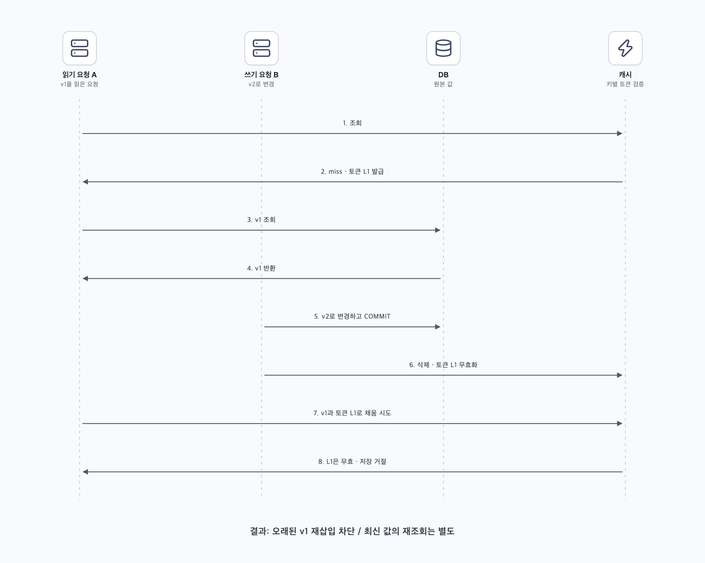

A가 v1과 토큰 L1을 제출해도 캐시는 L1이 무효이므로 저장을 거절한다. 이 채움 권한이 lease다. 발급 빈도 제한은 동시 miss의 DB 집중도 완화한다. 일반적인 모든 memcached 배포에 자동 제공되는 기능은 아니다.

#### MCSqueal — 커밋한 뒤 지울 키를 로그에 남긴다

앱이 중단되어 삭제를 빠뜨리는 상황을 생각한다. DB 변경에 무효화할 키 정보를 포함하고 커밋 로그에서 이를 처리하면 삭제를 다시 전파할 근거가 남는다.

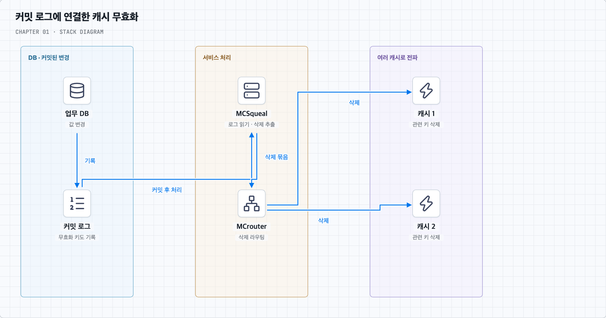

별도로 실행되는 MCSqueal이 로그에서 삭제를 추출한다. MCrouter는 이를 목적지 캐시로 전달한다. 로그 재생이 누락 복구에 도움이 되지만 캐시 삭제까지 DB 커밋과 원자적인 것은 아니다.

#### Remote marker — 아직 뒤처진 지역의 DB를 피한다

다른 지역의 복제 DB가 아직 v1이라면 캐시를 지워도 v1을 다시 읽어 채울 수 있다. 이 경우에는 읽을 DB의 위치도 판단해야 한다.

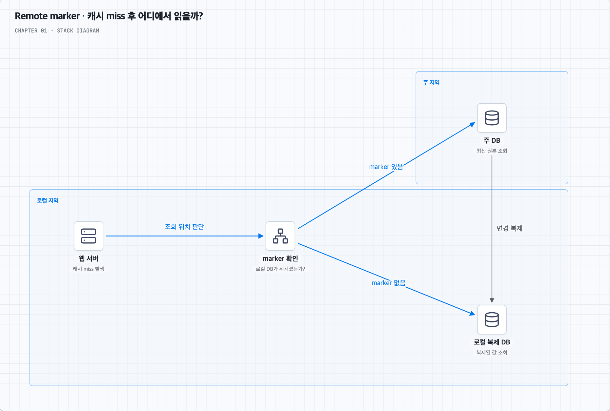

로컬 DB가 뒤처질 수 있음을 marker로 표시하고, 표시가 있으면 주 지역을 조회한다. 복제 적용과 연계한 무효화도 사용한다. marker의 퇴거·동시 변경에는 한계가 있으며, 논문은 best-effort eventual consistency를 설명한다.

위 내용은 2013년 논문의 §3.2.1·§4.1·§5를 단순화한 것이다. [논문 원문](https://www.usenix.org/system/files/conference/nsdi13/nsdi13-final170_update.pdf)

### 4. 일반 서비스에 적용할 수 있는 방법들

논문의 로그 기반 무효화는 커밋한 변경을 나중에 처리할 근거를 남겼다. 일반 서비스에서도 전달 의도를 DB에 기록하는 방법을 검토할 수 있다. 먼저 단순한 재시도를 보고, 그 기록을 어떻게 안전하게 남길지 Outbox로 이어서 살펴본다.

#### A. 커밋 후 삭제 + 실패 재시도 + TTL

가격을 바꾼 뒤 캐시 삭제가 실패했다면 다시 삭제하도록 만들 수 있다. 쓰기 성공 후 기존 캐시를 지우고, 실패하면 재시도하는 방식이다. TTL도 함께 두면 특정 실패가 영구히 남는 위험을 완화할 수 있다. 다만 메모리 안의 재시도 목록은 프로세스 중단 때 사라질 수 있으므로 중요한 재시도는 내구성 있게 기록한다.

캐시를 먼저 지우고 DB를 바꾸면 그 사이의 읽기가 이전 DB 값으로 캐시를 채울 수 있다. 순서를 바꾼다고 경쟁 자체가 사라지지는 않는다.

#### B. Transactional Outbox — DB 변경과 알림 의도를 함께 커밋한다

**Outbox는 DB 안에 두는 ‘보낼 일 목록’이다.** 상품을 바꾼 뒤 캐시도 지워야 한다면, DB에 상품 변경과 ‘이 상품의 캐시를 지워야 한다’는 기록을 함께 남긴다. 독립적인 전달기가 그 목록을 읽어 나중에 처리한다. 앱이 커밋 직후 중단되어도 목록은 DB에 남는다.

##### 먼저 실패하는 구성을 떠올린다

상품 가격을 10,000원에서 12,000원으로 바꾼 뒤, 메시지 브로커에 ‘캐시를 지워라’는 이벤트를 보낸다고 가정한다. 브로커는 전달할 메시지를 내구성 있게 받아 두고 소비자에게 전달하는 시스템이다.

```text
DB 가격 변경 성공 → 앱 중단 → 메시지 전송 실패
```

가격은 바뀌었지만 삭제 요청은 어디에도 남지 않는다. 앱 코드에서 두 줄을 연달아 실행해도 이 틈은 생긴다.

##### ① 같은 DB 안에서 두 기록을 함께 커밋한다

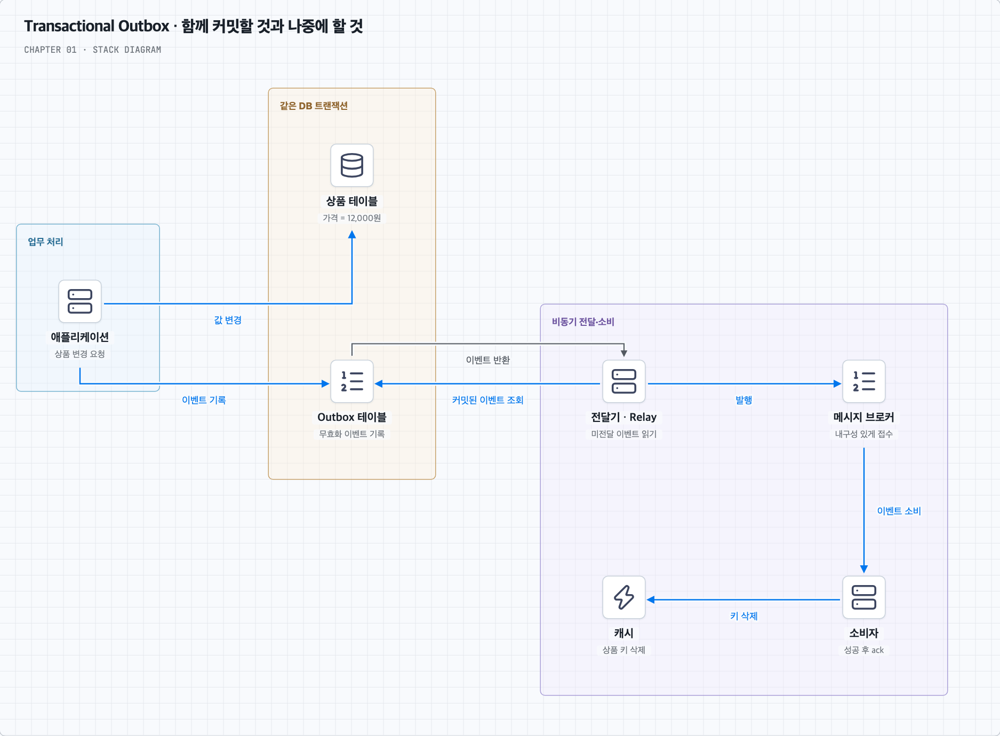

이 그림의 위쪽 DB 박스가 원자적 범위다. 아래 전달·캐시 삭제는 커밋 후 별도로 실행된다. 상품·Outbox가 같은 DB 트랜잭션에 참여하고 커밋된 데이터를 내구성 있게 보존한다고 가정한다.

설명을 위한 테이블 예시는 다음과 같다.

| 저장 위치 | 남기는 내용 |
| --- | --- |
| `products`의 상품 42 | `price=12000`, `version=2` |
| `outbox`의 이벤트 E123 | 상품 42의 캐시 무효화, `version=2`, 아직 미전달 |

```text
BEGIN
  상품 42의 가격과 버전 변경
  Outbox에 이벤트 E123 기록
COMMIT
```

둘 중 하나라도 실패하면 둘 다 롤백한다. 성공하면 상품 변경과 전달 의도가 함께 남는다. 아직 캐시가 지워진 것은 아니다.

##### ② 전달기가 커밋된 목록을 읽어 발행한다

전달기(Relay)는 앱 요청과 독립적으로 실행되는 프로그램이다. 미전달 이벤트를 읽고 브로커에 발행한 뒤, 브로커의 접수 확인을 받아 전달 진행을 기록한다. 접수 확인 전에 전달 완료로 표시하면 메시지가 유실될 수 있다. 여러 전달기를 실행한다면 같은 작업을 어떻게 가져갈지도 정해야 한다.

소비자(Consumer)는 브로커에서 이벤트를 받아 `product:42`를 삭제하고, 성공을 확인한 뒤 처리 완료를 알린다. 캐시 삭제가 실패하면 완료로 처리하지 않고 재시도한다. 캐시 삭제 성공과 소비자의 완료 기록도 별도 동작이므로 재실행을 고려해야 한다.

##### ③ 중단 지점별로 결과를 확인한다

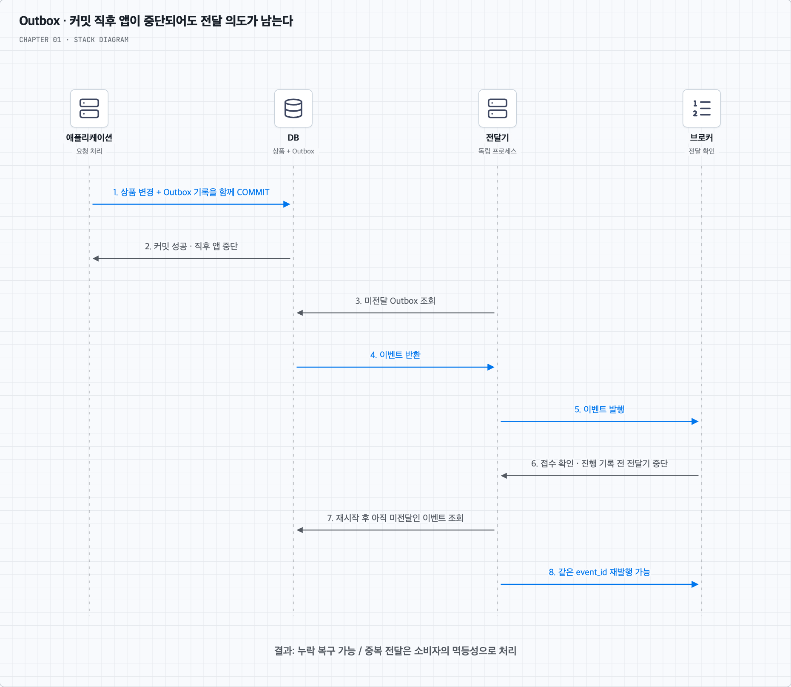

그림의 앞부분은 앱 중단 후에도 전달기가 진행하는 경우이고, 뒷부분은 브로커 접수 후 전달기가 중단되어 같은 이벤트를 다시 발행하는 경우다.

| 중단 시점 | 남는 상태 | 복구 시 고려할 것 |
| --- | --- | --- |
| DB 커밋 전 | 상품과 Outbox 모두 롤백 | 업무 요청 재시도 |
| DB 커밋 후, 발행 전 | 상품과 미전달 이벤트가 남음 | 전달기가 발행 |
| 브로커 접수 후, 전달 완료 기록 전 | 이벤트가 이미 발행되었지만 미전달로 보일 수 있음 | 같은 이벤트 재발행 가능 |
| 소비자의 캐시 삭제 전 | 캐시가 아직 오래될 수 있음 | 소비자 재시도 |
| 캐시 삭제 후, 처리 완료 확인 전 | 삭제했지만 다시 전달될 수 있음 | 중복 실행에 안전하게 처리 |

이 때문에 `event_id`로 같은 이벤트를 식별하고 **멱등성**을 설계한다. 멱등성은 같은 처리를 반복해도 의도한 업무 효과가 중복 발생하지 않는 성질이다. 캐시 삭제는 반복 실행하기 비교적 쉽지만, 늦은 중복 삭제가 새로 채운 캐시도 제거해 적중률을 낮출 수 있다. 이벤트가 돈을 지급하는 작업이라면 중복 실행의 영향이 훨씬 크다.

##### Outbox가 해결하는 범위와 남는 문제

원자적으로 묶는 것은 **업무 DB 변경과 알림 의도 기록**이다. 이중 쓰기에서 알림 의도가 사라지는 틈을 줄이는 패턴이며, 외부 캐시까지 하나의 트랜잭션에 참여시키지는 않는다. 전파 중에는 이전 값이 보일 수 있고, 앞의 stale set도 별도로 다뤄야 한다.

같은 상품의 이벤트는 버전·순서와 함께 처리하고, 미전달 이벤트의 나이·재시도 횟수·적체를 관측한다. 계속 실패하는 이벤트의 조사·재처리와 처리 완료 항목의 정리 기준도 필요하다. Outbox 테이블을 만들기만 하고 전달기를 감시하지 않으면 알림은 계속 쌓일 수 있다.

**CDC**(Change Data Capture)는 커밋 로그 등에서 변경을 포착하는 방식이다. Outbox는 ‘보낼 의도를 어디에 남기는가’에 관한 패턴이고 CDC는 변경을 포착하는 방법이므로 같은 말이 아니다. 전달기가 테이블을 조회하는 대신 CDC로 Outbox의 새 기록을 포착할 수도 있다. 실제 캐시 키로 변환하는 규칙은 별도로 정한다.

위 그림과 중단 시나리오는 상품 캐시 무효화에 적용한 설계 예시다. 일반 패턴과 이중 쓰기의 근거는 [AWS Transactional Outbox](https://docs.aws.amazon.com/prescriptive-guidance/latest/cloud-design-patterns/transactional-outbox.html)를 참고한다. Facebook 논문이 이 Outbox 예시를 그대로 사용했다는 뜻은 아니다.

#### C. 버전·세대·삭제 표시를 원자적으로 확인한다

캐시 값이 `(version=2, value=v2)`라면 늦게 도착한 `version=1`을 거절하는 방식이다. 단순히 버전을 읽고 나중에 저장하면 그 사이에 상태가 달라질 수 있으므로 검사와 저장이 원자적이어야 한다.

항목을 지울 때 버전 정보도 모두 지우면 늦은 과거 값을 최신인지 판단하지 못할 수 있다. 삭제 표시(tombstone)나 별도의 세대 번호를 필요한 기간 보존하는 설계를 검토한다. 보존 기간은 지연·재시도·복구 범위와 관련된다. 한 키의 세대 검증은 여러 키·여러 저장소의 트랜잭션을 대신하지 않는다.

#### D. 잠금과 지연 이중 삭제는 어디까지 도움이 되는가?

여러 요청이 같은 값을 조회할 때 한 요청만 DB를 읽고 결과를 공유하게 하면 중복 조회를 줄일 수 있다. 이 방식을 single-flight라고 부른다. 키별 잠금도 이런 조정에 사용할 수 있다. 하지만 **읽기 쪽만 잠그면 쓰기와의 경쟁은 남는다.** 모든 관련 경로가 같은 규약을 지켜야 하며, 분산 잠금은 만료 후에도 늦게 실행되는 보유자를 다뤄야 한다. fencing token은 오래된 보유자의 작업을 수신 측에서 거절하는 방법으로 검토할 수 있다.

DB 변경 전후에 캐시를 지우고 일정 시간 뒤 다시 삭제하는 ‘지연 이중 삭제’도 특정 경쟁 확률을 줄일 수 있다. 그러나 오래 걸린 읽기나 복제 지연이 대기시간을 넘으면 재발한다. 안전한 상한을 모르는 상황에서 고정 sleep을 강한 일관성의 근거로 삼지 않는다.

#### E. 엄격한 판단은 권위 있는 상태에서 확정한다

결제·재고 확보·권한 확인처럼 오래된 값으로 결정하면 안 되는 작업은 캐시만 믿고 확정하지 않는다. 권위 있는 DB에서 적절한 트랜잭션·조건부 갱신·제약조건으로 판정한다. 캐시 우회가 모든 동시성 문제를 없애지는 않으며, DB 격리 수준과 접근하는 복제본도 중요하다.

#### 지금까지 살펴본 방법 비교

| 방법 | 해결하려는 문제 | 남는 한계 |
| --- | --- | --- |
| DB 커밋 후 캐시 삭제 | 일반 쓰기 후 기존 값 제거 | 삭제 실패·stale set 가능 |
| TTL | 오래된 항목의 장기 잔존 완화 | 즉시 최신성 보장 아님; 오래된 값 재삽입 가능 |
| 키별 lease·세대 검증 | 무효화 전에 시작한 읽기의 뒤늦은 채움 | 원자적 검증과 세대 정보 보존 필요 |
| Outbox / CDC | 커밋 후 변경 알림·무효화 누락 복구 | 전파 지연, 순서, 중복, 운영 필요 |
| 버전 비교와 tombstone | 역순 도착한 값·이벤트의 적용 방지 | 최신 버전·삭제 표시의 보존 필요 |
| 최신성이 필요한 읽기만 캐시 우회 | 오래된 값으로 결정하는 위험 감소 | DB 부하, 읽기 격리·복제 지연도 확인 |

### 5. 요구사항별 시작점 — 설계 제안

- 상품 설명 등 잠깐 오래되어도 되는 조회: Cache Aside, TTL, 커밋 후 삭제와 재시도를 시작점으로 검토한다.
- 변경 이벤트 누락이 큰 문제: Outbox·CDC로 내구성 있는 무효화 경로를 만든다.
- 동시 읽기·쓰기에서 과거 값 재삽입이 문제: lease·세대·버전 검증을 더한다.
- 자신의 변경을 바로 봐야 하는 요청: 주 DB 읽기나 변경 반영 확인을 검토한다.
- 엄격한 재고·결제 확정: DB의 업무 정합성 경계에서 결정한다.

이는 측정과 실패 모델에 따라 조합하는 방법이며, 단일 제품의 설정 하나로 전부 얻는 보장이 아니다.

### 6. 구현을 검증할 시나리오

| 시험 | 확인할 결과 |
| --- | --- |
| DB 커밋 직후 프로세스 중단 | 무효화 의도가 남고 재처리되는가? |
| A의 오래된 DB 응답을 지연시키고 B 갱신 후 재개 | A의 과거 값이 캐시에 들어가지 않는가? |
| 같은 무효화 이벤트 중복·역순 전달 | 값이 과거로 돌아가거나 상태가 손상되지 않는가? |
| 캐시 값·버전·marker 퇴거 | 판단 근거가 사라져도 안전한가? |
| 읽기 복제 지연과 캐시 miss 동시 발생 | 오래된 복제본 값으로 재충전하지 않는가? |
| 무효화 전달기가 장시간 중단 | 지연을 감지하고 복구·재생할 수 있는가? |

### 내 말로 정리

DB와 캐시의 이중 쓰기는 실패 사이의 틈과 동시 실행 순서 때문에 깨질 수 있다. 무효화 누락, 오래된 값 재삽입, 복제 지연을 따로 다뤄야 한다. Facebook 논문은 이 문제들을 완화하는 실제 장치의 사례이고, 모든 읽기를 최신으로 만드는 단일 트랜잭션의 대체물은 아니다.

[목차로 돌아가기](#contents)

---


<a id="review"></a>

## 스스로 답하기 — 답안 토글

먼저 스스로 설명하고 질문을 눌러 답안을 확인한다. 정의뿐 아니라 조건과 반례까지 답해 본다.

[개념 노트](#core-concepts) · [근거](#sources)

<details>
<summary>01. 복제와 샤딩은 무엇을 다르게 해결하는가?</summary>

복제는 같은 데이터를 여러 서버에 유지해 읽기 분산과 장애 대응의 기반을 만든다. 샤딩은 데이터를 나누어 저장해 서버별 저장량과 처리 부하를 분산한다. 전체 복제본 추가만으로 주 DB의 쓰기 처리량이나 서버별 저장 한계가 해결되지는 않는다.

**기억할 문장:** 복제 = 같은 데이터 / 샤딩 = 나눈 데이터

</details>

<details>
<summary>02. 웹 서버를 늘려도 처리량이 늘지 않는 이유는 무엇인가?</summary>

모든 요청이 같은 DB, 외부 API, 공유 잠금 등에 집중되면 그 지점이 전체 처리량을 제한한다. 예를 들어 웹 서버가 10대여도 같은 재고 행의 갱신이 직렬화되면 쓰기 병목이 남는다. 서버 수를 늘리기 전에 지연과 자원 포화를 측정해야 한다.

**기억할 문장:** 전체 성능은 공유 병목의 영향을 받는다.

</details>

<details>
<summary>03. 캐시 값과 DB 값이 달라도 되는 요청은 무엇인가?</summary>

잠깐 오래된 값이어도 업무상 허용되는 조회다. 예를 들어 상품 설명이나 인기 목록은 일정 시간 차이를 허용할 수 있다. 허용 범위는 요구사항으로 정한다. 반면 실제 결제 금액이나 재고 확보 판정은 오래된 캐시 값만으로 확정하면 안 된다. 화면 표시와 최종 판정을 구분한다.

**기억할 문장:** 최신성 요구는 요청별로 다르다.

</details>

<details>
<summary>04. 웹 서버 한 대가 사라져도 로그인 상태를 유지하려면?</summary>

세션을 해당 서버의 메모리에만 두지 않고 다른 서버도 확인할 수 있는 공유 저장소 등에 둔다. 모든 서버가 세션을 같은 방식으로 검증하고, 공유 저장소도 장애에 대비해야 한다. 토큰을 활용하는 방식도 가능하지만 만료·폐기·키 관리가 필요하다. 무상태는 상태가 없다는 뜻이 아니다.

**기억할 문장:** 특정 웹 서버에 다음 요청을 의존시키지 않는다.

</details>

<details>
<summary>05. 큐에 접수한 것과 작업에 성공한 것은 어떻게 다른가?</summary>

접수는 요청을 큐에 안전하게 기록한 상태이고, 성공은 실제 업무 결과가 확정된 상태다. 접수 뒤에도 처리 실패나 재시도가 가능하다. 요청 ID로 상태를 조회할 수 있게 하고, 중복 전달 시에도 발급이나 결제가 중복되지 않도록 처리한다. 접수 응답을 발급 확정 응답으로 표현하면 안 된다.

**기억할 문장:** 접수 완료 ≠ 업무 완료

</details>

<details>
<summary>06. 데이터가 고르게 나뉘었는데도 핫스팟이 생기는 이유는?</summary>

저장된 데이터의 개수와 요청 분포는 다르기 때문이다. 사용자 수가 고르게 나뉘어도 특정 유명 사용자나 인기 상품에 요청이 몰리면 그 샤드가 포화될 수 있다. 읽기는 캐시나 복제로 완화할 수 있고, 같은 값에 몰리는 쓰기는 분할 가능한 업무인지부터 검토해야 한다.

**기억할 문장:** 저장 균등과 부하 균등은 다르다.

</details>

<details>
<summary>07. 평균 응답시간이 정상인데 사용자가 느리다고 할 수 있는 이유는?</summary>

일부 요청만 매우 느려도 다수의 빠른 요청에 가려 평균이 낮게 나올 수 있다. 예를 들어 99건이 10ms, 1건이 5초면 평균은 약 59.9ms지만 한 사용자는 5초를 기다린다. p95·p99와 타임아웃·오류율을 함께 보고, 느린 요청의 경로를 로그 등으로 확인한다.

**기억할 문장:** 평균과 꼬리 지연을 함께 본다.

</details>

<details>
<summary>08. 장애 대응에서 트래픽 전환과 데이터 복구를 따로 생각해야 하는 이유는?</summary>

요청을 정상 지역으로 보내더라도 그곳에 최신 데이터가 없거나 쓰기 권한을 안전하게 넘기지 못하면 정상 서비스를 제공할 수 없다. 트래픽 전환, 복제 지연, DB 승격, 두 주 서버가 동시에 쓰는 상황 방지 등을 함께 준비한다. 허용 데이터 손실량(RPO)과 목표 복구시간(RTO)을 정하고 실제 전환을 검증한다.

**기억할 문장:** 요청 도착과 올바른 데이터 처리는 별개의 조건이다.

</details>

<details>
<summary>09. DNS와 로드 밸런서는 각각 어떤 단계에서 동작하는가?</summary>

DNS는 도메인에 대한 접속 주소 등의 정보를 반환한다. 이후 클라이언트는 해당 주소로 요청을 보내며 로드 밸런서는 처리할 서버를 고른다. DNS가 매 HTTP 요청의 중계자가 되는 것은 아니고 DNS 결과는 캐싱될 수 있다.

**기억할 문장:** 주소 찾기와 요청 분산을 구분한다.

</details>

<details>
<summary>10. 수직 확장과 수평 확장은 어떻게 다른가?</summary>

수직 확장은 서버 한 대의 자원을 키우고, 수평 확장은 서버 수를 늘린다. 전자는 장비 한계·비용이 있고 후자는 상태 공유·분산 조정이 필요하다. 공유 DB 병목이 남으면 웹 서버만 늘려도 효과가 제한된다.

**기억할 문장:** 분산 가능한 작업과 공유 병목을 먼저 찾는다.

</details>

<details>
<summary>11. NoSQL이 낮은 지연시간과 확장에 유리할 수 있는 조건은?</summary>

키 기반 접근, 함께 읽는 데이터의 저장, 여러 서버로의 고른 부하 분산과 제품의 자동 파티션 관리가 도움이 될 수 있다. 복잡한 여러 파티션 연산이나 핫키가 있으면 이점이 줄어든다. RDB도 빠른 키 조회와 분산 확장이 가능하다.

**기억할 문장:** DB 분류보다 접근 패턴·일관성·분산 기능을 비교한다.

</details>

<details>
<summary>12. 정적 부하 분산이면 장애 서버를 제외할 수 없는가?</summary>

아니다. 정상 여부를 확인하는 헬스 체크와 정상 서버 중 어디로 배정할지 정하는 알고리즘은 별개다. 라운드 로빈도 헬스 체크와 함께 사용할 수 있다. 동적 방식도 선택한 지표가 실제 부하를 잘 나타내는지 확인해야 한다.

**기억할 문장:** 헬스 체크와 배정 규칙은 다른 판단이다.

</details>

<details>
<summary>13. 동기 복제라면 모든 복제본에서 방금 쓴 값을 즉시 읽을 수 있는가?</summary>

그렇게 단정할 수 없다. 몇 개의 복제본을 기다리는지, 수신·디스크 기록·조회 적용 중 어느 단계의 확인을 기다리는지에 따라 다르다. 최신성이 필요한 읽기는 대상 복제본의 적용 상태나 주 DB 읽기 정책을 확인한다.

**기억할 문장:** 무엇을 어디까지 기다리는 동기인지 명시한다.

</details>

<details>
<summary>14. Cache Aside에서 캐시 miss가 나면 누가 DB를 조회하는가?</summary>

애플리케이션이 DB를 조회하고 결과를 캐시에 채운다. 캐시 서버가 자동으로 DB를 대신 조회하는 것은 아니다. Read Through에서는 캐시 접근 계층이 그 책임을 맡는다.

**기억할 문장:** 조회·채움 책임의 위치를 구분한다.

</details>

<details>
<summary>15. TTL, 무효화, 퇴거는 어떻게 다른가?</summary>

TTL은 유효 기간이고, 무효화는 원본 변경 같은 사건으로 항목을 사용하지 않게 만드는 동작이며, 퇴거는 메모리 확보 등을 위한 제거다. 항목이 사라진 이유가 서로 다르다. TTL만으로 원본 변경을 즉시 반영하지는 못한다.

**기억할 문장:** 시간·변경 사건·공간 확보를 구분한다.

</details>

<details>
<summary>16. LRU, LFU, FIFO는 어떤 기준으로 제거하는가?</summary>

LRU는 최근에 사용하지 않은 항목, LFU는 사용 빈도가 낮은 항목, FIFO는 먼저 들어온 항목을 기준으로 한다. 실제 제품의 근사 구현과 제공 정책은 다를 수 있다. 오래전에 들어왔더라도 자주 쓰는 항목은 정책에 따라 결과가 달라진다.

**기억할 문장:** 최근성·빈도·입력 순서의 차이다.

</details>

<details>
<summary>17. 인기 키가 만료될 때 DB 부하가 폭증하면?</summary>

동일 값을 읽는 작업을 합치거나 키별 lease·락으로 재충전을 조절한다. 여러 키의 동시 만료는 TTL 편차 등으로 분산한다. 캐시 장애 시 무제한 DB 우회를 허용하면 연쇄 장애가 생길 수 있으므로 유입 제한도 검토한다.

**기억할 문장:** 적중률보다 miss가 몰리는 순간도 본다.

</details>

<details>
<summary>18. DB 커밋 후 캐시를 삭제해도 stale set이 가능한 이유는?</summary>

A가 캐시 miss 후 DB의 v1을 읽고 지연되는 사이 B가 DB를 v2로 커밋하고 캐시를 지울 수 있다. 이후 A가 v1을 캐시에 채우면 다시 오래된 값이 들어간다. 삭제 실패와 별개로 진행 중인 과거 읽기를 제어해야 한다.

**기억할 문장:** 쓰기 순서를 정해도 읽기와의 경쟁은 남는다.

</details>

<details>
<summary>19. Facebook 논문의 lease는 무엇을 막으며 무엇까지 보장하지 않는가?</summary>

miss 때 발급한 키별 토큰을 채움 시 검증해 무효화 이전에 시작한 읽기의 stale set을 거절한다. 발급을 제한해 동시 원본 조회도 완화한다. 여러 저장소의 원자적 트랜잭션이나 모든 지역의 즉시 최신성을 보장하는 장치는 아니다.

**기억할 문장:** 채움 권한 검증과 전체 일관성 보장은 다르다.

</details>

<details>
<summary>20. Outbox가 DB와 캐시를 같은 트랜잭션으로 묶는가?</summary>

아니다. 업무 DB 변경과 이벤트 의도를 같은 DB 트랜잭션에 기록한다. 별도 전달기와 소비자가 캐시를 무효화하므로 전파 지연·중복·순서·재시도 처리가 남는다. 진행 중인 오래된 읽기의 재삽입은 별도로 막아야 한다.

**기억할 문장:** 원자적인 것은 DB 변경과 알림 의도의 기록이다.

</details>

<details>
<summary>21. Remote marker가 필요한 이유와 한계는?</summary>

지역 간 복제 지연 중 로컬 DB에서 오래된 값을 읽어 캐시에 다시 채우는 위험을 줄이기 위해 읽기 위치 판단에 쓴다. 논문 사례에서는 표시가 있으면 주 지역을 조회한다. marker 자체의 퇴거나 동시 변경 한계가 있으므로 강한 일관성이라고 단정하지 않는다.

**기억할 문장:** 캐시뿐 아니라 값을 채우는 DB의 최신성도 확인한다.

</details>

<details>
<summary>22. CDN hit와 miss는 원본 서버에 어떤 차이를 만드는가?</summary>

유효한 사본에 hit하면 엣지에서 응답해 원본 요청을 줄인다. miss면 원본에서 가져와 반환하고 정책에 따라 저장한다. 여러 엣지의 동시 miss나 원본 장애도 고려해야 한다. CDN은 주로 HTTP 전달 구간, DB 캐시는 조회·계산 구간을 줄인다.

**기억할 문장:** CDN 적중은 원본 왕복을 줄인다.

</details>

<details>
<summary>23. CDN 캐시 키에 언어·쿠키·쿼리를 왜 신중히 포함해야 하는가?</summary>

결과가 달라지는 정보를 빼면 서로 다른 응답을 같은 키로 공유할 수 있다. 반대로 불필요한 정보를 모두 포함하면 같은 결과가 여러 키로 나뉘어 적중률이 떨어진다. 개인화·권한별 응답은 공유 여부와 정책을 특히 구분한다.

**기억할 문장:** 정확한 구분과 재사용 범위의 균형을 잡는다.

</details>

<details>
<summary>24. no-cache와 no-store는 어떻게 다른가?</summary>

no-cache는 저장한 응답을 재사용하기 전에 검증하도록 하는 지시이고, no-store는 저장하지 않도록 하는 지시다. no-cache를 저장 금지로 해석하면 안 된다. 공유 캐시·브라우저·제품별 정책도 함께 확인한다.

**기억할 문장:** 재검증 요구와 저장 금지는 다르다.

</details>

<details>
<summary>25. CDN 무효화와 버전 URL은 어떻게 다른가?</summary>

무효화는 기존 경로의 엣지 사본을 제거하지만 브라우저 사본까지 모두 없애지는 않는다. 버전 URL은 새 경로를 사용해 별도 객체로 취급한다. 새 HTML이 새 경로를 참조하게 하고 이전 파일은 필요한 동안 유지한다.

**기억할 문장:** 객체 제거와 객체 식별자 변경을 구분한다.

</details>

<details>
<summary>26. 샤드를 늘리면 핫키 문제도 자동으로 해결되는가?</summary>

한 키가 여전히 한 샤드에 속한다면 해당 키의 요청은 같은 서버에 집중된다. 데이터 분할과 부하 분산을 별도로 확인한다. 캐시·복제·업무상 분할 등을 검토하되 같은 값의 정확한 쓰기는 조정이 필요하다.

**기억할 문장:** 노드 수보다 부하가 나뉘는 단위가 중요하다.

</details>

<details>
<summary>27. 재시도 가능한 소비자는 ack를 언제 보내야 하는가?</summary>

업무 결과가 내구성 있게 확정된 뒤 ack하는 방식을 검토한다. 그 전에 ack하면 작업 유실 가능성이 있고, DB 확정 후 ack 전 중단되면 재전달될 수 있으므로 멱등성도 필요하다. 정확한 의미는 사용하는 큐의 프로토콜과 함께 확인한다.

**기억할 문장:** ack 시점과 중복 처리를 함께 설계한다.

</details>

<details>
<summary>28. 로그, 메트릭, 추적은 어떤 질문에 답하는가?</summary>

로그는 어떤 사건이 왜 일어났는지 맥락을, 메트릭은 요청량·오류·지연·자원의 추세를, 추적은 요청이 여러 서비스의 어느 구간에서 시간을 썼는지 보여준다. 요청 ID 등으로 연결하면 원인을 좁히기 쉽다.

**기억할 문장:** 사건·추세·분산 경로를 연결한다.

</details>


Facebook 사례 관련 답안의 근거와 추가 설계 구분은 [질문 05](#q5)를 참고한다.

[목차로 돌아가기](#contents)

---


<a id="sources"></a>

## 범위와 근거

### 책 대조 범위

제공된 『가상 면접 사례로 배우는 대규모 시스템 설계 기초』 1장 이미지의 인쇄 p.1–30을 기준으로 주제 누락을 확인했다. 원문 이미지나 장 전체 전사는 저장소에 넣지 않았다. 본문은 독립적인 학습 설명이며 세부 설계 제안은 책의 주장과 구분한다.

| 책의 주제 | 인쇄 쪽수 | 저장소에서 읽을 곳 |
| --- | --- | --- |
| 단일 서버, DNS, 요청 흐름 | 1–3 | 핵심 개념 §1 |
| DB와 DB 선택 | 4–5 | 핵심 개념 §2, 질문 01 |
| 수직·수평 확장 | 5–6 | 핵심 개념 §3 |
| 로드 밸런서 | 6–7 | 핵심 개념 §4, 질문 04 |
| 데이터베이스 다중화 | 7–10 | 핵심 개념 §5, 질문 02·03 |
| 캐시 계층과 고려사항 | 11–13 | 핵심 개념 §6, 질문 05 |
| CDN과 고려사항 | 13–17 | 핵심 개념 §7 |
| 무상태 웹 계층 | 17–20 | 핵심 개념 §8 |
| 데이터 센터 | 20–22 | 핵심 개념 §9 |
| 메시지 큐 | 22–23 | 핵심 개념 §10, 질문 02 |
| 로그·메트릭·자동화 | 23–25 | 핵심 개념 §11 |
| DB 수직 확장·샤딩 | 25–28 | 핵심 개념 §12, 질문 01 |
| 확장 구성과 핵심 원칙 | 29–30 | 핵심 개념 §13 |

개념과 추가 학습은 장별 README 한 문서에 모았다. 현재 완성 범위는 **1장**이며 다른 장의 요약 완료를 뜻하지 않는다.

### 외부 자료 — 2026-11-02 확인

- [Scaling Memcache at Facebook — USENIX 논문](https://www.usenix.org/system/files/conference/nsdi13/nsdi13-final170_update.pdf): 2013년 사례. §2의 look-aside와 삭제, §3.2.1의 lease, §4.1의 로그 기반 무효화, §5의 다중 지역·marker·일관성 모델. 현재의 모든 Meta 시스템에 일반화하지 않는다.
- [Cache made consistent — Meta, 2022](https://engineering.fb.com/2022/06/08/core-infra/cache-made-consistent/): 캐시 채움·무효화 경쟁, 버전 정보 퇴거, 운영상 일관성 관측.
- [Transactional outbox — AWS](https://docs.aws.amazon.com/prescriptive-guidance/latest/cloud-design-patterns/transactional-outbox.html): 이중 쓰기, 이벤트 의도와 업무 데이터의 DB 트랜잭션, 중복·순서, CDC.
- [Redis key eviction](https://redis.io/docs/latest/develop/reference/eviction/): 메모리 한도와 퇴거 정책. FIFO를 Redis 제공 정책이라고 서술한 것이 아니다.
- [HTTP caching — MDN](https://developer.mozilla.org/en-US/docs/Web/HTTP/Guides/Caching): 공유·개인 캐시, 헤더, 재검증.
- [CloudFront expiration](https://docs.aws.amazon.com/AmazonCloudFront/latest/DeveloperGuide/Expiration.html): TTL, 재검증, 조기 퇴거와 제품별 정책.
- [CloudFront invalidation](https://docs.aws.amazon.com/AmazonCloudFront/latest/DeveloperGuide/Invalidation.html): 무효화와 버전 파일의 차이.
- [CloudFront cache key](https://docs.aws.amazon.com/AmazonCloudFront/latest/DeveloperGuide/controlling-the-cache-key.html): 요청의 구분 정보와 적중률.
- [PostgreSQL replication](https://www.postgresql.org/docs/current/warm-standby.html): 동기·비동기·계단식 복제.
- [PostgreSQL transaction isolation](https://www.postgresql.org/docs/current/transaction-iso.html): 조건부 갱신과 동시 실행.
- [DynamoDB latency](https://docs.aws.amazon.com/amazondynamodb/latest/developerguide/TroubleshootingLatency.html): 단건 작업 지연과 실제 요청 지연의 구분.
- [DynamoDB partitions](https://docs.aws.amazon.com/amazondynamodb/latest/developerguide/HowItWorks.Partitions.html): 자동 파티션 관리.
- [DynamoDB partition keys](https://docs.aws.amazon.com/amazondynamodb/latest/developerguide/bp-partition-key-design.html): 키·부하 분산.
- [NGINX load balancing](https://nginx.org/en/docs/http/load_balancing.html): 알고리즘과 활성 연결.
- [Kafka design](https://kafka.apache.org/41/design/design/): 파티션·소비·전달과 순서 관련 설명.

### 그림

책의 관계를 참고해 새로 배치한 설명용 개념도다. 원본 도판의 복제나 실제 서비스 배포도는 아니다. [stack-diagram](https://github.com/caru-ini/stack-diagram) 템플릿과 Lucide 아이콘으로 만들었다. DB 읽기를 파란 점선으로 표시한 범례와 순서도의 세로 점선은 각 그림의 설명 규칙이다. 점선이 비동기라는 뜻은 아니다.

Outbox·CDC·버전·TTL의 조합, 재고 처리 예시와 장애 시험 항목은 이 저장소의 추가 학습·설계 제안이다. 이를 모두 Facebook 논문의 구현으로 소개하지 않는다.

[목차로 돌아가기](#contents)

---
