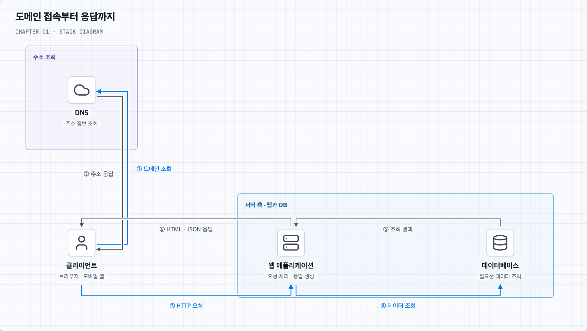
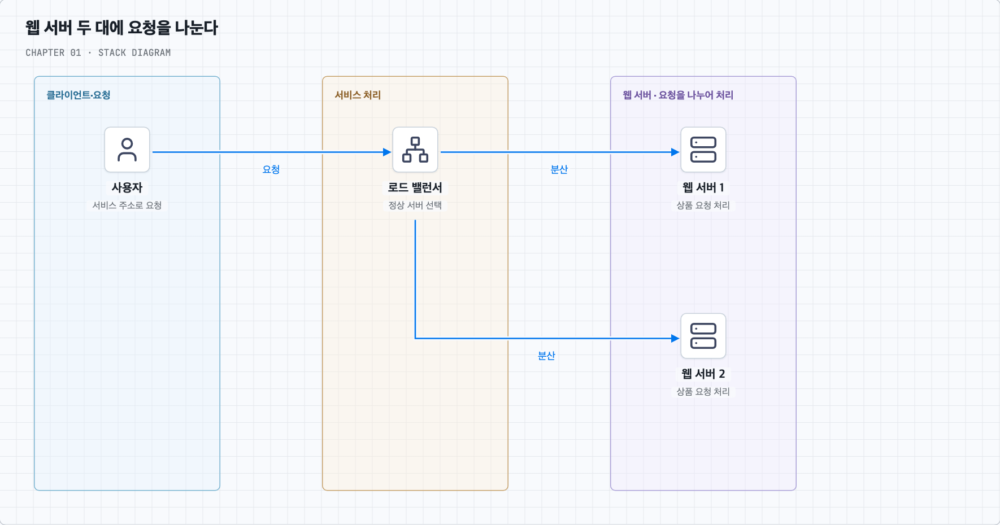
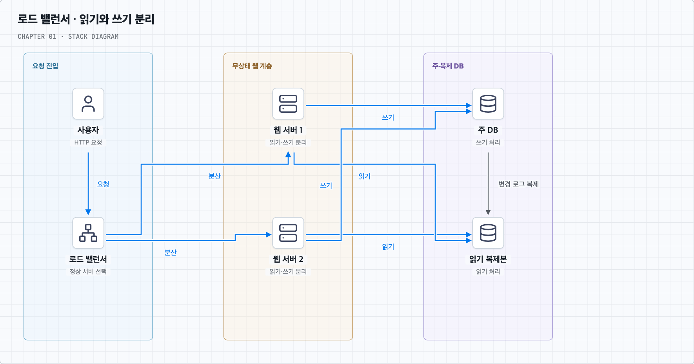
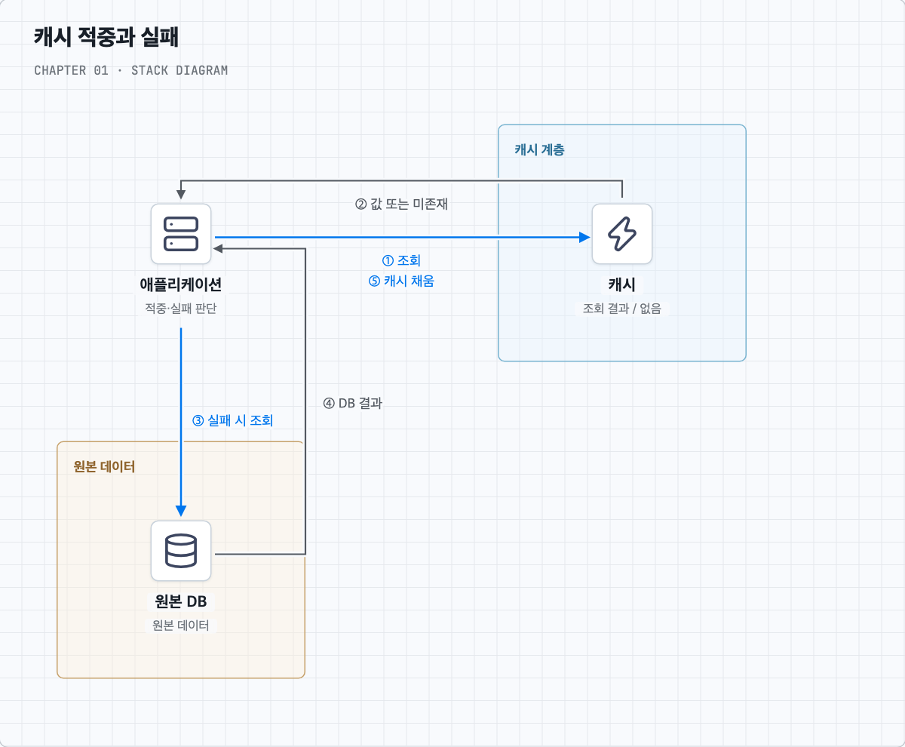
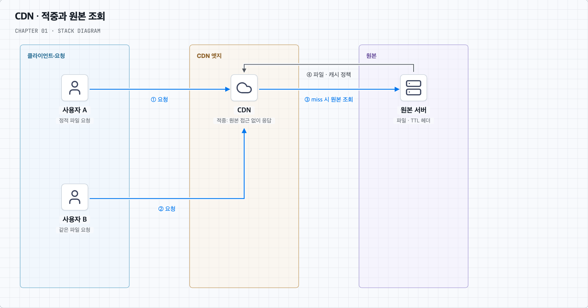
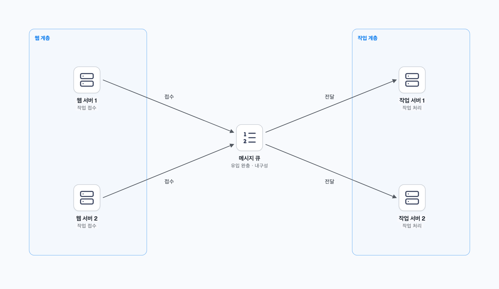
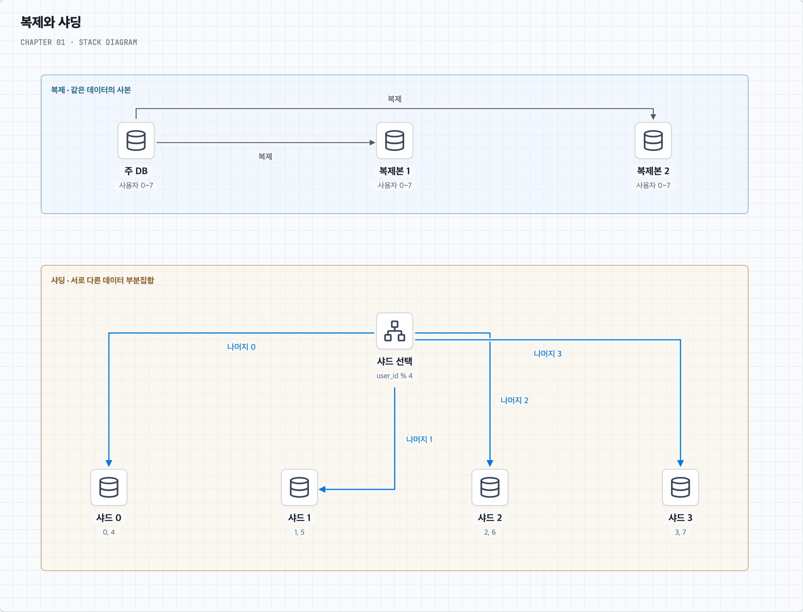

# 사용자가 늘어날 때 구성을 하나씩 바꿔 보기

상품을 조회하고 주문하는 작은 서비스를 만든다고 가정한다. 처음에는 서버 한 대로 시작한다. 사용자가 늘면서 요청 처리가 느려지면, 어디에서 시간이 걸리는지 확인하고 그 부분의 구성을 바꾼다. 이렇게 앞 단계에서 남은 문제를 따라가며 1장의 내용을 살펴본다.

## 1. 서버 한 대에서 시작한다

처음에는 웹 애플리케이션과 DB를 한 서버에서 실행한다. 웹 애플리케이션은 상품 조회와 주문 같은 요청을 처리하고, DB는 상품·회원·주문 데이터를 저장한다. 사용자가 적을 때는 설치와 운영이 단순한 구성이 편리하다.

사용자가 브라우저에 서비스 주소를 입력한 뒤 상품을 보는 과정을 따라가 본다.

먼저 브라우저는 도메인 이름에 해당하는 접속 주소를 확인한다. 이때 이용하는 시스템이 **DNS**다. 주소를 알아낸 뒤에는 그 주소의 서버에 상품 조회를 요청한다. 요청과 응답을 주고받는 규약이 HTTP이며, HTTPS는 이 통신을 TLS로 보호한다.

요청을 받은 웹 애플리케이션은 DB에서 상품을 읽고 화면에 필요한 결과를 만든다. 브라우저에는 HTML을, API를 사용하는 웹·모바일 앱에는 JSON 같은 데이터를 반환할 수 있다. JSON은 데이터를 주고받는 표현 형식이다.

그림에서 DNS로 향하는 ①–②와 서버로 향하는 ③·⑥을 구분하면 된다. DNS는 주소를 찾을 때 이용하고, 상품 요청은 웹 서버가 처리한다. 주소가 DNS 캐시에 남아 있으면 조회를 생략할 수 있다. 연결 설정 등의 세부 과정은 그림에서 생략했다. 책 p.1–4, 그림 1-1–1-3 참고.

이 구성에 사용자가 늘면 웹 애플리케이션과 DB가 같은 CPU·메모리·디스크를 두고 경쟁한다. 요청 처리에 필요한 자원이 부족해지는 것이다. 이를 줄이는 첫 변경은 웹과 DB를 서로 다른 서버로 옮기는 것이다.

## 2. 웹 서버와 DB 서버를 나눈다

상품 설명 페이지를 만드는 작업과 주문 데이터를 저장하는 작업은 성격이 다르다. 서버를 나누면 웹에는 요청 처리에 필요한 자원을, DB에는 데이터 저장·조회에 필요한 자원을 따로 배정할 수 있다. 이후 웹 서버만 늘리거나 DB 서버의 메모리만 키우기도 쉬워진다.

이제 웹 서버는 DB 서버와 네트워크로 통신한다. 외부 사용자가 접속하는 주소와 내부 서버끼리 통신하는 주소를 구분할 수 있다. 인터넷에서 라우팅하는 주소를 공인 IP, 내부 네트워크용 주소를 사설 IP라고 부른다. 실제 접근 허용 범위는 방화벽과 인증 등으로 함께 관리한다.

DB를 고를 때는 서비스가 데이터를 어떻게 읽고 바꿀지 생각한다. 주문에는 회원·상품·결제 정보가 연결된다. 이런 관계와 제약을 다루고 여러 변경을 한 단위로 묶는 데 관계형 DB를 활용할 수 있다. 여러 변경을 모두 반영하거나 모두 취소하는 식으로 작업 단위를 다루는 장치가 트랜잭션이다.

반면 ‘사용자 ID로 설정 하나를 가져온다’처럼 접근이 단순한 데이터도 있다. 키로 값을 찾는 키-값 DB나, 관련 정보를 한 문서로 저장하는 문서 DB를 검토할 수 있다. 이런 비관계형 DB들을 묶어 NoSQL이라고 부른다. 관계를 따라 탐색하는 그래프 DB, 키로 구분한 데이터 묶음 안에서 여러 열의 값을 다루는 와이드 컬럼 DB도 이 범주에 들어간다.

중요한 것은 이름보다 작업 방식이다. 데이터의 관계, 조회할 범위, 함께 바뀌어야 하는 정보를 먼저 정하고 DB를 선택한다. JSON으로 데이터를 주고받는 서비스도 관계형 DB를 사용할 수 있다. 데이터를 저장·전송할 표현으로 바꾸는 직렬화와 DB 선택은 별개의 문제이기 때문이다.

웹과 DB를 분리했어도 각 서버가 처리할 수 있는 양에는 한계가 있다. 다음에는 서버 한 대의 성능을 키울지, 여러 대에 일을 나눌지 결정해야 한다.

## 3. 더 큰 서버를 쓸까, 서버 수를 늘릴까?

웹 서버의 CPU가 부족하다면 CPU가 더 좋은 서버로 바꿀 수 있다. DB의 메모리가 부족하면 메모리를 늘릴 수 있다. 이렇게 한 대의 자원을 키우는 방법을 **수직 확장**이라고 부른다. 기존 구성을 크게 바꾸지 않고 시작하기 쉽다.

하지만 서버 한 대에 넣을 수 있는 자원에는 한계가 있다. 고사양 장비의 비용도 커진다. 게다가 그 한 대가 멈추면 서비스를 대신할 서버가 없을 수 있다.

그래서 웹 서버를 두 대로 늘리고, 각 서버가 요청의 일부를 처리하게 할 수 있다. 이것이 **수평 확장**이다. 일을 나눌 수 있다면 전체 처리량을 늘리고 한 대의 장애에도 대응할 여지가 생긴다.

| 방법 | 실제 변경 | 다음에 생각할 문제 |
| --- | --- | --- |
| 수직 확장 | 웹 서버 한 대의 성능을 높인다 | 더 키울 수 있는가? 멈추면 누가 대신하는가? |
| 수평 확장 | 웹 서버를 여러 대 둔다 | 요청을 어떻게 나누고 상태를 어떻게 공유하는가? |

여기서 지연시간과 처리량을 구분해 두면 도움이 된다. 상품 요청 하나가 돌아오는 데 걸리는 시간이 지연시간(Latency)이고, 초당 처리하는 요청 수가 처리량(Throughput)이다. 여러 서버가 서로 다른 요청을 처리하면 처리량이 늘 수 있지만, 요청 하나의 계산 시간이 반드시 짧아지는 것은 아니다.

이제 웹 서버가 두 대라고 하자. 사용자의 요청을 두 서버 중 어디로 보낼까?

## 4. 로드 밸런서로 요청을 나눈다

사용자에게 웹 서버 두 대의 주소를 각각 알려 주는 대신, 앞에 공통 진입점을 둔다. 이 진입점이 요청을 받아 처리할 웹 서버를 선택한다. 이 역할을 하는 것이 **로드 밸런서**다.

사용자는 로드 밸런서의 주소로 접속한다. 로드 밸런서는 첫 요청을 웹 서버 1에, 다음 요청을 웹 서버 2에 보내는 식으로 분산할 수 있다. 순서대로 배정하는 이 방식이 라운드 로빈이다. 서버 성능에 차이가 있으면 더 강한 서버에 높은 가중치를 줄 수도 있다.

웹 서버 1이 고장 나면 그쪽으로 요청을 계속 보내서는 안 된다. 로드 밸런서는 서버가 정상 응답하는지 확인하고, 문제가 생긴 서버를 배정 대상에서 제외할 수 있다. 이런 상태 확인을 **헬스 체크**라고 부른다. 요청을 어디로 나눌지와 정상 서버인지 판단하는 일은 함께 필요하다.

이 구성에서는 웹 서버 2가 남은 요청을 감당할 수 있어야 한다. 로드 밸런서 자체도 멈추지 않도록 구성해야 한다. 한 지점의 장애가 기능 전체를 멈추게 한다면 그 지점을 단일 장애 지점(SPOF)이라고 부른다.

웹 서버의 일이 나뉘었다고 서비스의 모든 부하가 나뉜 것은 아니다. 두 웹 서버가 같은 DB에서 상품을 읽는다면, DB는 여전히 두 서버의 조회를 모두 처리한다. 다음에는 이 읽기 부하를 나눠 본다.

## 5. DB의 읽기를 복제본에 나눈다

상품 가격을 바꾸는 요청보다 상품을 구경하는 요청이 훨씬 많은 서비스를 생각해 보자. DB에 같은 데이터의 사본을 만들고, 상품 조회 일부를 사본에서 처리하면 원본 DB의 읽기 부담을 줄일 수 있다. 같은 데이터를 다른 서버에 유지하는 것이 **복제**다.

책의 구성에서는 변경을 받는 주 DB와, 변경을 전달받아 조회를 처리하는 읽기 복제본을 둔다.

상품 가격 변경은 주 DB로 보낸다. 주 DB는 변경을 기록하고 복제본에 전달한다. 웹 서버는 상품 상세 조회를 복제본으로 보낼 수 있다. 그림에서 실선 쓰기와 파란 점선 읽기를 따라가면 두 웹 서버가 같은 규칙으로 접근함을 알 수 있다. 책 p.6–10의 구성을 참고했으며 교차선은 서로 연결되지 않는다.

사본은 원본을 따라가는 데 시간이 걸릴 수 있다. 주 DB에서 가격이 12,000원으로 바뀌었는데 복제본에는 잠시 10,000원이 남는 상황이다. 이 시간 차이가 **복제 지연**이다. 상품 설명 조회에서 어느 정도의 지연을 허용할지, 변경 직후 반드시 새 값을 보여 줘야 하는 요청은 무엇인지 정해야 한다.

주 DB가 복제본 반영을 기다리지 않고 커밋할 수 있는 방식을 비동기 복제라고 한다. 정해진 복제 확인을 기다리는 방식은 동기 복제다. 무엇을 몇 개의 복제본에서 확인하는지에 따라 쓰기 지연과 장애 시 동작이 달라진다. 자신의 변경을 바로 읽어야 하는 요청은 주 DB를 읽거나 복제 적용을 확인하는 방법을 검토한다.

주 DB가 멈추면 복제본이 새 주 DB 역할을 맡게 할 수도 있다. 이 전환에는 쓰기 권한과 연결 대상 변경이 필요하며, 아직 전달되지 않은 변경이 있는지도 확인해야 한다. 잘못 삭제한 데이터도 복제될 수 있으므로 과거 상태를 복구할 백업은 따로 필요하다.

복제본을 두어도 매번 같은 상품을 DB에서 다시 읽는 일은 남는다. 자주 보는 상품 정보를 더 가까운 곳에 잠시 보관하면 이 반복 조회를 줄일 수 있다.

## 6. 반복해서 읽는 상품 정보를 캐시에 둔다

인기 상품의 설명이 한 시간 동안 거의 바뀌지 않는데 수많은 사용자가 조회한다고 하자. DB는 매번 비슷한 조회를 반복한다. 첫 조회 결과를 빠르게 읽을 수 있는 저장소에 보관하고 다음 요청에 재사용하면 DB에 가는 횟수를 줄일 수 있다. 이런 재사용용 저장소가 **캐시**다.

DB는 상품의 원본을 보관하고, 캐시는 자주 쓰는 일부 결과를 보관한다. 예를 들어 `product:42`라는 이름으로 상품 42의 설명과 표시 가격을 저장할 수 있다. 이 이름이 캐시 키이고, 그 아래 저장한 상품 정보가 값이다.

처음 조회할 때 캐시에 상품이 없으면 앱이 DB를 읽는다. 읽은 값을 캐시에 저장하고 사용자에게 반환한다. 이후 같은 상품 요청에서는 캐시에 저장된 값을 반환한다. 사용할 값을 찾으면 적중(Hit), 찾지 못하면 실패(Miss)라고 부른다. 그림에서 DB로 내려가는 ③–④는 miss일 때만 필요하다. 책 p.11, 그림 1-7 참고.

이 방식에서는 앱이 캐시 확인, DB 조회, 캐시 채움을 담당한다. 이 책임 배치를 **Cache Aside**라고 부른다. 이름부터 외우기보다 방금 따라온 세 작업을 앱이 한다고 기억하면 된다.

### 상품 가격이 바뀌면 캐시는 어떻게 할까?

원본 가격을 12,000원으로 바꿔도 캐시에 10,000원이 남아 있으면 다음 사용자에게 과거 가격이 보인다. 따라서 변경된 캐시를 지우고 다음 조회가 DB에서 새 값을 채우게 할 수 있다. 이처럼 더 이상 유효하지 않은 값을 사용하지 않도록 만드는 일이 **무효화**다.

오래된 값이 계속 남지 않도록 유효 기간을 줄 수도 있다. 예를 들어 60초 동안만 재사용하게 하는 설정이 TTL이다. 길게 두면 DB 조회는 줄어들 수 있지만 오래된 값을 보여 줄 가능성이 커진다. 짧게 두면 원본 조회가 자주 발생한다.

캐시 공간이 부족해서 항목을 제거하는 일은 **퇴거**다. 시간이 지나 만료되는 것, 원본 변경으로 무효화하는 것, 공간을 확보하려고 퇴거하는 것은 이유가 다르다. 최근에 쓰지 않은 항목부터 지우는 LRU, 사용 빈도가 낮은 항목을 지우는 LFU, 먼저 넣은 항목을 지우는 FIFO 같은 정책을 구분할 수 있다. 실제 제공 정책은 제품마다 확인한다. [Redis 퇴거 정책](https://redis.io/docs/latest/develop/reference/eviction/)

### 무엇을 캐시에 저장할지 정한다

상품 설명처럼 반복 조회되고 잠깐 오래되어도 되는 정보는 좋은 후보가 된다. 반면 재고를 실제로 확보하거나 결제 금액을 확정하는 일은 권위 있는 원본에서 판정해야 한다. 화면에 보여 줄 재고와 구매에 성공할 수 있는 재고는 서로 다른 책임이다.

또한 한국어 상품 설명과 영어 설명이 다르면 키도 이를 구분해야 한다. 권한이나 통화에 따라 결과가 바뀌는 경우도 마찬가지다. 결과가 다른데 같은 키를 쓰면 다른 값을 재사용하게 된다.

### 캐시가 비었을 때의 부하도 살핀다

인기 상품의 캐시가 만료되면 여러 요청이 한꺼번에 DB를 읽을 수 있다. 같은 조회를 하나로 합치거나, 한 요청만 값을 채우게 하는 방식으로 부하를 조절할 수 있다. 여러 항목의 만료 시각을 조금씩 다르게 두는 방법도 있다.

존재하지 않는 상품 번호가 반복 조회되면 ‘없음’이라는 결과를 짧게 저장해 DB 접근을 줄일 수 있다. 캐시 서버가 고장 났을 때는 모든 요청을 제한 없이 DB로 우회시키기보다 DB가 감당할 유입량을 정해야 한다. 캐시가 비어 있는 재시작 상태를 콜드 스타트라고 부르며, 이때도 같은 문제가 생긴다. 캐시에도 복제본이나 대체 서버를 둘 수 있지만 전환 중의 지연과 원본 부하를 함께 살핀다. 퇴거가 너무 잦다면 적중률·저장 값의 크기·메모리 용량도 확인한다.

같은 캐시를 사용하는 다른 방식은 무엇일까? — Read Through와 쓰기 방식

위 예시에서는 앱이 직접 캐시를 채웠다. 앱 대신 조회를 담당하는 라이브러리나 별도 계층이 캐시를 확인하고, 없을 때 DB 조회까지 맡을 수도 있다. 이 방식이 **Read Through**다. 앱은 상품을 요청하고, 조회 계층이 등록된 원본 조회 함수를 호출해 값을 준비한다. 캐시 서버가 DB 구조를 알아서 추론한다는 뜻은 아니다.

읽기에서 누가 채우는지와 별도로, 쓰기 성공을 언제 응답할지도 정할 수 있다. **Write Through**는 쓰기 계층이 DB와 캐시 반영을 처리하고 정한 성공 조건을 만족한 뒤 응답하도록 구성한다. **Write Behind**는 변경을 받아 먼저 응답하고 DB 반영을 뒤로 미룬다. 후자는 쓰기를 모을 수 있지만 미반영 변경의 보존·순서·재시도가 필요하다.

앞의 둘은 주로 읽기 책임을, 뒤의 둘은 쓰기 흐름을 설명한다. 네 방식 중 반드시 하나만 선택해야 하는 관계는 아니다. 쓰기 계층이 두 저장소를 갱신한다고 해서 두 저장소가 자동으로 같은 트랜잭션에 참여하는 것도 아니다.

캐시를 도입한 뒤에는 DB와 캐시의 값이 어긋날 수 있다는 새 문제가 생긴다. [질문 05](questions/05-cache-consistency.md)에서는 가격 변경 중간에 요청이 겹치거나 프로세스가 중단되는 경우를 그림으로 따라간다.

상품 데이터의 반복 조회는 줄였지만, 브라우저에 상품 사진을 보내는 비용은 아직 남아 있다. 다음에는 이 파일 전달을 줄여 본다.

## 7. 상품 사진과 정적 파일은 CDN으로 전달한다

상품 상세 페이지에는 설명뿐 아니라 사진, CSS, JavaScript, 폰트 파일도 필요하다. 사용자가 멀리 떨어져 있으면 원본 서버에서 큰 사진을 매번 받는 데 시간이 걸린다. 같은 파일을 계속 보내는 일도 원본 서버의 네트워크를 사용한다.

여러 지역의 거점에 파일 사본을 보관하고 사용자에게 제공하면 이 부담을 줄일 수 있다. 이 전달 네트워크가 **CDN**이다. 원본 파일을 가져오는 서버를 Origin, 사용자 요청을 처리하는 분산 거점을 Edge 또는 PoP라고 부른다.

사용자 A가 상품 사진을 요청했는데 엣지에 사본이 없다면, CDN은 원본 서버에서 사진을 가져온다. 정책에 따라 이를 저장한 뒤 응답한다. 사용자 B가 같은 엣지에 같은 파일을 요청하면 유효한 사본으로 응답할 수 있다. 두 번째 요청은 원본 서버에 가지 않아도 된다. 그림에서 사용자 응답선은 생략했다. 책 p.13–17 참고.

앞의 캐시는 앱이 DB를 반복 조회하는 비용을 줄였다. CDN은 주로 HTTP 응답과 파일의 전달 비용을 줄인다. 서로 다른 구간을 다루므로 함께 사용할 수 있다.

### 파일을 바꿨는데 이전 사진이 보이면?

엣지에 예전 사진이 남아 있으면 원본 파일만 바꿔도 바로 새 사진이 보이지 않을 수 있다. 유효 기간을 짧게 두거나, 해당 경로를 무효화하거나, 새 파일 이름을 사용하는 방법을 검토한다.

예를 들어 `photo.a1.jpg`를 `photo.b2.jpg`로 바꾸고 새 페이지가 새 주소를 참조하게 하면 서로 다른 파일로 취급된다. 이것이 버전 URL을 사용하는 방법이다. 이전 페이지를 보고 있는 사용자도 있으므로 이전 파일을 필요한 동안 유지한다. 엣지 무효화는 브라우저에 저장된 사본까지 모두 제거하지는 않는다. [무효화와 버전 파일](https://docs.aws.amazon.com/AmazonCloudFront/latest/DeveloperGuide/Invalidation.html)

### 어떤 요청끼리 같은 파일을 재사용할까?

CDN도 재사용할 응답을 구분하는 캐시 키가 필요하다. 언어·쿼리·쿠키에 따라 결과가 달라지면 이를 정책에 반영해야 한다. 사용자별 주문 내역을 누구에게나 같은 사본으로 보내면 안 된다. 반대로 결과와 무관한 정보까지 키에 넣으면 같은 파일도 여러 사본으로 나뉘어 적중률이 떨어진다. [캐시 키 정책](https://docs.aws.amazon.com/AmazonCloudFront/latest/DeveloperGuide/controlling-the-cache-key.html)

정적 파일은 여러 사용자가 같은 결과를 받기 쉬워 CDN에 적합하다. 동적 응답도 조건에 따라 캐싱할 수 있지만, 변경 주기와 개인화 여부를 먼저 정해야 한다.

CDN의 유효 기간과 HTTP 헤더는 어떻게 연결될까?

원본은 HTTP 응답 헤더로 캐시 정책을 전달할 수 있다. 다음 표는 이를 읽기 위한 기본 구분이다.

| 설정 | 의미 |
| --- | --- |
| `Cache-Control: max-age=60` | 해당 응답의 신선도 수명 지정 |
| `s-maxage=300` | 공유 캐시에 적용할 신선도 수명 지정 |
| `private` | 공유 캐시에 저장하지 않도록 지정 |
| `no-cache` | 재사용 전에 원본 확인 필요 |
| `no-store` | 저장하지 않도록 지정 |
| `ETag` / `Last-Modified` | 변경 여부를 확인할 때 사용할 식별자·수정 시각 |
| `Vary` | 특정 요청 헤더에 따라 표현 구분 |

유효 기간이 끝나면 원본에 변경 여부를 확인할 수 있다. 여전히 같은 파일이라면 `304 Not Modified`로 본문을 다시 보내지 않고, 달라졌다면 새 본문을 받는 방식이다. 엣지의 공간이 부족하면 TTL 이전에 퇴거될 수도 있다. [CloudFront 만료와 재검증](https://docs.aws.amazon.com/AmazonCloudFront/latest/DeveloperGuide/Expiration.html)

실제 적용은 CDN 설정과 함께 확인한다. 예를 들어 CloudFront의 최소 TTL이 원본 헤더보다 우선하는 설정이 있다. `no-cache`는 저장 금지와 다르고 쿠키가 있다고 자동으로 공유 캐싱이 금지되는 것도 아니다. [MDN HTTP 캐싱](https://developer.mozilla.org/en-US/docs/Web/HTTP/Guides/Caching)

CDN에도 요청·전송 비용이 들고 장애가 생길 수 있다. 거의 조회되지 않는 파일까지 캐싱할 이익이 있는지 살핀다. CDN 장애 시 원본으로 우회한다면 늘어난 요청을 원본이 감당할 수 있어야 한다.

캐시와 CDN으로 반복 작업을 줄였으니, 다시 여러 웹 서버로 돌아간다. 이제 어느 서버가 요청을 받아도 로그인한 사용자를 알아볼 수 있어야 한다.

## 8. 로그인 상태를 특정 웹 서버에만 두지 않는다

사용자가 웹 서버 1에서 로그인했고, 서버 1의 메모리에 로그인 정보를 저장했다고 하자. 다음 요청을 로드 밸런서가 서버 2로 보내면 서버 2는 이 정보를 모를 수 있다. 사용자는 방금 로그인했는데 다시 로그인하라는 화면을 보게 된다.

사용자의 여러 요청에 걸쳐 유지하는 인증 맥락 등을 세션이라고 부른다. 세션을 여러 웹 서버가 접근할 수 있는 저장소에 두면 서버 2도 로그인 상태를 확인할 수 있다. 이렇게 다음 요청을 특정 웹 서버에 의존시키지 않는 구성을 **무상태 웹 계층**이라고 한다.

사용자에게 상태가 없어진 것이 아니라 상태를 보관하는 위치가 달라진 것이다. 웹 서버 1을 교체해도 다른 웹 서버가 공유 저장소를 통해 요청을 이어서 처리할 수 있다. 대신 이 공유 저장소의 가용성도 중요해진다.

같은 사용자를 계속 같은 서버로 보내는 세션 고정(Sticky Session)도 가능하다. 다만 그 서버가 멈추었을 때의 세션 처리는 여전히 해결해야 한다. 공통으로 검증하는 토큰을 사용하는 방법도 있지만 만료·폐기·키 관리가 필요하다.

여기까지는 한 지역의 서버 장애를 주로 생각했다. 데이터 센터 전체의 전원이나 네트워크에 문제가 생기면 어떻게 할까?

## 9. 다른 데이터 센터에서도 서비스할 수 있게 한다

한 데이터 센터에 웹 서버가 여러 대 있어도 데이터 센터 전체가 중단되면 함께 영향을 받는다. 다른 지역에도 서비스를 두면 한 지역이 중단될 때 다른 지역이 요청을 받을 수 있다. 사용자와 가까운 지역에서 응답해 지연을 줄일 수도 있다.

이때는 요청을 보낼 지역을 정해야 한다. GeoDNS는 사용자 위치 등의 정보를 참고해 다른 주소를 반환하는 방식이다. 이미 DNS 응답을 캐싱한 클라이언트는 한동안 이전 주소를 사용할 수 있으므로 전환 시간을 고려한다.

주소만 바꾸면 충분한 것은 아니다. 다른 지역에도 필요한 데이터가 있어야 하고, 그 지역이 새 요청을 감당해야 한다. 쓰기 역할을 넘긴다면 어느 DB가 주 DB인지도 명확해야 한다. 두 지역이 서로 다른 주 DB라고 판단해 독립적으로 쓰는 문제를 Split Brain이라고 부른다.

그래서 지역 간 데이터 복제, 전환 후 처리 용량, 쓰기 권한 이전, 테스트와 배포를 함께 준비한다. 장애 시 역할을 다른 노드나 지역으로 넘기는 과정이 장애 전환(Failover)이다.

복구 목표를 구체화할 때는 허용할 데이터 손실 범위를 나타내는 RPO와 목표 복구시간인 RTO를 사용할 수 있다. 이는 1장의 장애 대응을 이해하기 위한 추가 용어다. 목표를 정했다면 실제 전환 훈련으로 확인해야 한다.

여러 지역에 서버를 두었어도 요청 안에서 오래 걸리는 일을 모두 끝낼 필요는 없다. 다음에는 작업을 접수하는 일과 실행하는 일을 분리한다.

## 10. 오래 걸리는 일은 큐에 넣고 따로 처리한다

상품 판매자가 큰 사진을 올렸다고 하자. 서버는 작은 썸네일을 만들고 파일을 저장해야 한다. 이 작업이 끝날 때까지 모든 업로드 요청을 붙잡아 두면 웹 서버가 바빠지고 사용자는 오래 기다린다.

웹 서버가 작업을 안전하게 접수한 뒤, 별도의 작업 서버가 사진을 변환하게 할 수 있다. 둘 사이에서 작업을 받아 보관하고 전달하는 것이 **메시지 큐**다.

사진 업로드를 받은 웹 서버는 ‘사진 42의 썸네일을 만들라’는 작업을 넣는다. 이쪽이 생산자(Producer)다. 작업 서버는 큐에서 작업을 받아 실행하며 소비자(Consumer)라고 부른다. 작업이 밀리면 작업 서버를 늘리고, 접수 요청이 늘면 웹 서버를 늘릴 수 있다. 책 p.23–25, 그림 1-18·1-19 참고. 그림은 작업을 나누는 구성의 예시이며 한 작업을 모든 소비자가 실행한다는 뜻은 아니다.

### 접수 완료와 처리 완료를 나눈다

큐에 기록한 순간에는 아직 썸네일이 없을 수 있다. 따라서 사용자에게 ‘업로드 접수 완료’와 ‘이미지 처리 완료’를 구분해 알려야 한다. 큐가 접수한 작업을 장애에도 유지할 수 있는 성질을 내구성이라고 부른다. 사용하는 큐와 설정이 어떤 보장을 제공하는지 확인한다.

작업 서버가 처리 완료를 알리는 확인을 ack라고 부른다. 작업 결과를 저장하기 전에 완료를 알리면 이후 중단될 때 작업을 잃을 수 있다. 반대로 결과를 저장한 뒤 완료를 알리기 전에 중단되면 같은 작업을 다시 받을 수 있다.

그래서 재시도해도 같은 썸네일이나 주문을 중복 생성하지 않도록 설계한다. 같은 작업을 여러 번 실행해도 의도한 효과가 중복 발생하지 않는 성질이 **멱등성**이다. 요청 ID와 DB 제약 등을 활용할 수 있다.

### 큐가 계속 길어지면 처리 속도를 살핀다

큐는 순간적인 유입과 처리 속도의 차이를 흡수한다. 하지만 초당 들어오는 작업이 처리하는 작업보다 계속 많으면 대기시간이 늘어난다. 이때는 처리기를 늘리거나 접수량을 줄이고 대기열 상한을 정해야 한다. 처리 속도에 맞춰 유입을 제어하는 것을 Backpressure라고 부른다.

계속 실패하는 작업은 별도로 모아 조사·재처리할 수 있다. 그 대기열이 DLQ다. 여러 소비자가 병렬로 실행하면 완료 순서가 달라질 수 있으므로 순서가 중요한 업무는 보장 단위를 확인한다. 선착순 이벤트의 재고 확정은 [질문 02](questions/02-write-bursts.md)에서 따로 다룬다.

서버와 작업이 늘었으니 이제 어느 지점이 느리고 실패하는지 알아볼 수 있어야 한다.

## 11. 로그와 수치로 병목을 찾고 반복 작업을 자동화한다

사용자가 ‘주문이 느리다’고 알려 왔다고 하자. 웹 서버가 바쁜지, DB 잠금을 기다리는지, 큐에 쌓여 있는지에 따라 해결 방법이 다르다. 서버 수부터 늘리기 전에 처리 과정의 기록과 수치를 봐야 한다.

**로그**는 특정 요청에서 어떤 일이 일어났는지 알려 준다. 주문 ID나 요청 ID를 남기면 여러 서버에 흩어진 관련 기록을 연결할 수 있다. **메트릭**은 요청량·오류율·지연시간 같은 수치가 시간에 따라 어떻게 바뀌는지 보여 준다. 요청이 여러 서비스를 거친 구간별 경로와 시간을 보는 추적(Trace)도 함께 활용할 수 있다.

| 확인할 위치 | 먼저 볼 수 있는 수치 | 이해하려는 상황 |
| --- | --- | --- |
| 웹 서버 | 요청량, 오류율, 지연시간, CPU | 요청 처리량이 부족한가? |
| DB | 조회시간, 잠금 대기, 복제 지연 | 데이터 접근에서 기다리는가? |
| 캐시 | 적중률, 퇴거, 무효화 지연 | DB 조회가 갑자기 늘었는가? |
| 큐 | 적체량, 가장 오래 기다린 작업의 시간 | 작업 실행이 접수를 따라잡는가? |

평균만 보면 일부 사용자의 긴 대기가 가려질 수 있다. 지연시간을 작은 값부터 나열했을 때 95%의 요청이 그 값 이하인 지점을 p95, 99%의 지점을 p99라고 한다. 타임아웃과 오류율도 함께 본다. 일간 활성 사용자(DAU), 매출, 재방문 유지율 같은 업무 지표는 기술적 변화가 실제 서비스 결과와 어떻게 연결되는지 확인하는 데 사용한다.

서버가 많아지면 같은 프로그램을 배포하고 설정하는 작업도 반복된다. 자동 테스트와 배포·서버 구성 자동화는 이 과정의 오류를 줄인다. 변경을 자주 통합하며 자동 검증하는 과정을 CI라고 부른다. 점진 배포와 되돌리기 절차를 준비하면 문제가 생겼을 때 영향을 줄일 수 있다.

측정해 보니 DB 한 대가 담는 데이터와 쓰기 부담 자체가 한계라면, 읽기 복제와 캐시만으로는 충분하지 않을 수 있다. 마지막으로 원본 데이터도 나누어 본다.

## 12. DB 한 대의 데이터를 여러 샤드에 나눈다

읽기 복제본은 같은 데이터의 사본이다. 원본 데이터가 너무 커서 한 서버에 담기 어렵다면, 사본을 늘려도 각 서버는 여전히 같은 전체 데이터를 담아야 한다. 이때는 원본 데이터 자체를 나누는 방법을 생각한다.

사용자 0–7의 정보를 네 DB에 나누어 본다. 사용자 ID를 4로 나눈 나머지가 0이면 첫 DB, 1이면 두 번째 DB에 저장하는 규칙을 만들 수 있다. 각 DB가 전체의 일부를 담당하는 구성이 **샤딩**이다.

그림의 샤딩 구성에서 사용자 5를 찾는 요청은 `5 % 4 = 1`이므로 샤드 1로 간다. 데이터 위치를 결정하는 사용자 ID가 이 예시의 **샤드 키**다. 문맥에 따라 파티션 키라고도 부른다. 책 p.8·27의 복제·샤딩 그림을 참고했다.

이제 각 서버가 일부 데이터와 요청을 담당한다. 다만 사용자 수가 비슷해도 인기 사용자 한 명에게 요청이 집중되면 그 사용자의 샤드가 바빠질 수 있다. 이런 부하 집중을 핫스팟, 집중 대상인 키를 핫키라고 부른다. 저장량과 요청량이 모두 잘 나뉘는지 봐야 한다.

### 서버 수를 바꾸면 데이터 위치도 바뀔 수 있다

나머지 연산에서 4를 5로 바꾸면 많은 사용자의 저장 위치가 달라진다. 새 규칙에 맞춰 데이터를 옮기고 이동 중 요청도 처리해야 한다. 이 재분할·재배치가 Resharding이다. 일관된 해싱은 노드 변경 때 키 재배치 범위를 줄이는 방법이지만, 한 키에 몰리는 부하까지 자동 해결하지는 않는다.

### 나눈 데이터를 다시 함께 다룰 때 비용이 생긴다

같은 DB 안에서는 주문과 회원 정보를 조인하기 쉬웠더라도, 서로 다른 샤드에 있으면 여러 서버를 조회해 합쳐야 할 수 있다. 여러 샤드의 변경을 하나의 트랜잭션으로 확정하려면 서버 간 조정도 필요하다. 이를 지원하는 제품을 쓰거나, 자주 함께 처리할 데이터가 같은 샤드에 놓이도록 모델링한다.

자주 함께 읽는 값을 중복 저장해 조회를 단순하게 만들 수도 있다. 이를 비정규화라고 부르며, 조회 대신 중복된 값의 갱신을 관리하는 비용을 갖는다.

이 절의 샤딩은 행 집합을 나누는 수평 분할의 예다. 열이나 기능을 나누는 수직 분할, 한 DB 안에서 나누는 파티셔닝과도 구분한다. 각 샤드에 복제본을 두면 데이터 분산과 장애 대응을 함께 구성할 수 있다.

## 13. 확장 과정을 다시 이어 본다

처음에는 한 서버에서 요청을 받고 데이터를 저장했다. 사용자가 늘자 웹과 DB를 나누고, 웹 서버 여러 대 앞에 로드 밸런서를 두었다. DB 조회는 복제본에 나누고 반복 조회는 캐시에서, 사진과 파일 전달은 CDN에서 줄였다.

웹 서버를 자유롭게 추가·교체하려고 세션을 공유했다. 지역 장애에 대비해 다른 데이터 센터를 준비하고, 오래 걸리는 작업은 큐와 작업 서버로 분리했다. 로그와 메트릭으로 병목을 확인하며, 원본 데이터와 쓰기를 더 나눌 필요가 있을 때 샤딩을 검토했다.

앞 단계가 모든 문제를 해결하지 못했기 때문에 다음 구성을 검토한 것이다. 실제 서비스에서는 측정한 병목과 비용·일관성 요구에 따라 필요한 것부터 선택한다. 이 장의 복습에서는 각 기술의 이름보다 **무슨 문제가 생겨서 추가했고, 무엇이 개선되며, 어떤 문제가 남았는지** 설명해 본다.

## 14. 이해한 흐름에서 질문을 더한다

- [질문 01: NoSQL의 지연시간·대용량·확장](questions/01-nosql.md)
- [질문 02: 선착순 이벤트의 쓰기 폭주](questions/02-write-bursts.md)
- [질문 03: 읽기 복제본 수와 비용](questions/03-read-replicas.md)
- [질문 04: 정적·동적 부하 분산](questions/04-load-balancing.md)
- [질문 05: DB·캐시 일관성과 Facebook 논문](questions/05-cache-consistency.md)
- [토글 복습 문제](review.md) · [책 범위와 출처](sources.md)
