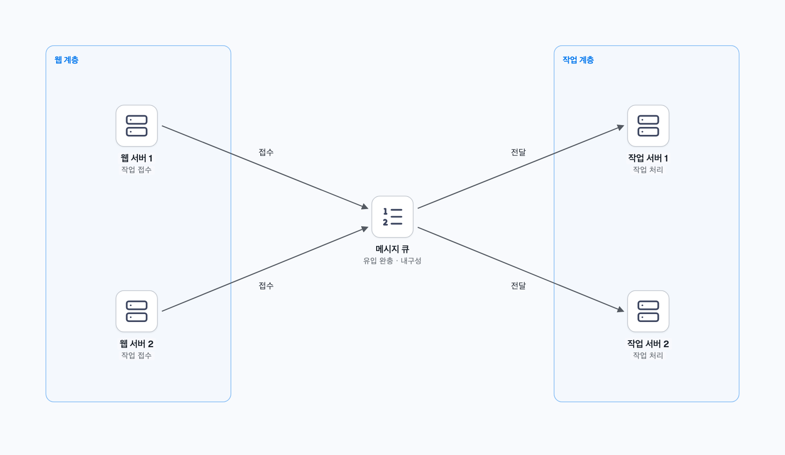

# 02. 선착순 이벤트처럼 쓰기가 짧은 시간에 몰리면?

상품은 평소에 조회가 많지만, 선착순 판매가 시작되는 순간에는 구매 요청이 한꺼번에 몰릴 수 있다. 읽기 복제본을 늘리는 구성만으로는 같은 재고를 바꾸려는 쓰기를 처리하기 어렵다. 여기서는 ‘재고 100개를 초과 판매하지 않는다’는 요구부터 생각한다.

## 1. 재고를 읽고 나중에 줄이면 무슨 일이 생길까?

재고가 마지막 1개라고 하자. 요청 A가 재고 1을 읽은 직후 요청 B도 재고 1을 읽으면, 두 요청이 모두 구매 가능하다고 판단할 수 있다. 조회와 차감 사이에 다른 요청이 끼어든 것이다.

이때는 DB가 조건 확인과 변경을 함께 처리하도록 만든다. 다음은 PostgreSQL의 조건부 갱신 예시다. `event_id`가 한 행을 유일하게 식별하고 `remaining`은 음수가 아닌 정수라고 가정한다.

```sql
UPDATE event_stock
SET remaining = remaining - 1
WHERE event_id = :event_id
  AND remaining > 0
RETURNING remaining;
```

행이 반환되면 재고 차감에 성공했다. PostgreSQL의 Read Committed에서는 같은 행의 동시 갱신을 기다린 뒤 변경된 행에 조건을 다시 평가한다. [동시 갱신 동작](https://www.postgresql.org/docs/current/transaction-iso.html)

재고만 줄고 발급 기록이 남지 않아도 문제가 된다. 따라서 차감과 발급 기록 저장을 같은 트랜잭션에 넣고, 사용자별 중복 발급은 유일성 제약 등으로 막는다. 응답을 못 받아 다시 요청한 경우에는 요청 ID로 기존 결과를 돌려줄 수 있게 한다.

## 2. 정확하게 처리해도 기다리는 요청은 많아질 수 있다

조건부 갱신으로 초과 판매를 막아도 모든 요청이 같은 재고 행을 바꾸면 차례를 기다리게 된다. DB가 감당할 속도보다 요청이 빠르게 들어올 때는 유입량도 제어해야 한다.

대기열이나 요청 제한을 거쳐 접수하고, 내구성 있는 큐에 작업을 넣은 뒤 제한된 수의 처리기가 DB에서 발급을 확정하는 구성을 검토할 수 있다.



큐에 안전하게 기록한 시점에는 ‘접수 완료’를, DB에 발급 결과를 커밋한 뒤에는 ‘발급 확정’을 알려 준다. 중간에 실패해 다시 처리하더라도 같은 사람에게 두 번 발급하지 않아야 한다.

큐는 순간적인 몰림을 기다리게 할 수 있지만 DB의 지속 처리 속도를 자동으로 높이지는 않는다. 접수 속도가 계속 더 빠르면 대기열이 늘어나므로 상한과 마감 정책도 필요하다.

## 3. 무엇을 선착순으로 볼지 정한다

사용자가 버튼을 누른 순서, 서버에 도착한 순서, 큐에 기록한 순서는 다를 수 있다. 여러 처리기가 동시에 작업하면 처리 완료 순서도 달라진다. 먼저 어떤 순서를 기준으로 당첨자를 정할지 합의해야 한다.

예를 들어 Kafka를 사용한다면 파티션 단위 순서를 고려한다. 여러 파티션에 나눈 것만으로 이벤트 전체 순서가 보장되지는 않는다. [Kafka 설계](https://kafka.apache.org/41/design/design/)

서로 다른 이벤트의 재고는 분산하기 쉽지만, 하나의 재고에 대한 엄격한 판정은 조정이 필요하다. 재고를 여러 곳에 미리 할당하면 경합을 나눌 수 있는 대신 남은 재고의 재배분·장애·공정성을 새로 설계해야 한다.

이 문제는 **정확한 재고 확보 → 중복 방지 → 유입 제어 → 선착순 기준**으로 나누어 생각한다. 부하 시험에서도 처리량뿐 아니라 초과·중복 발급, 대기시간, 중단 후 복구 결과를 확인한다.
