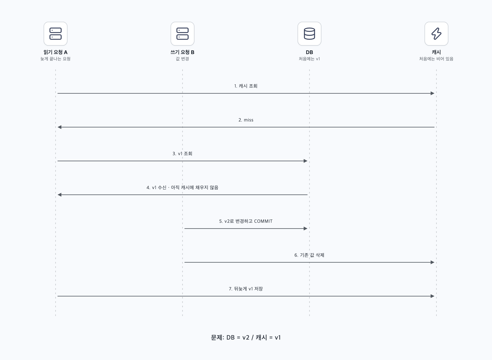
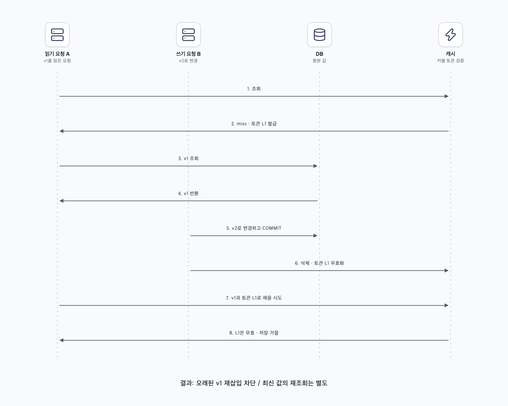
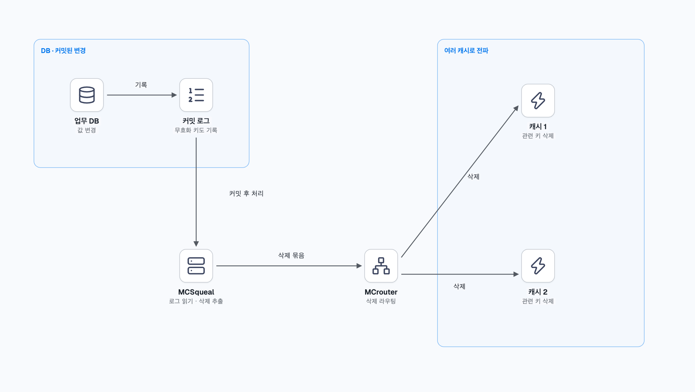
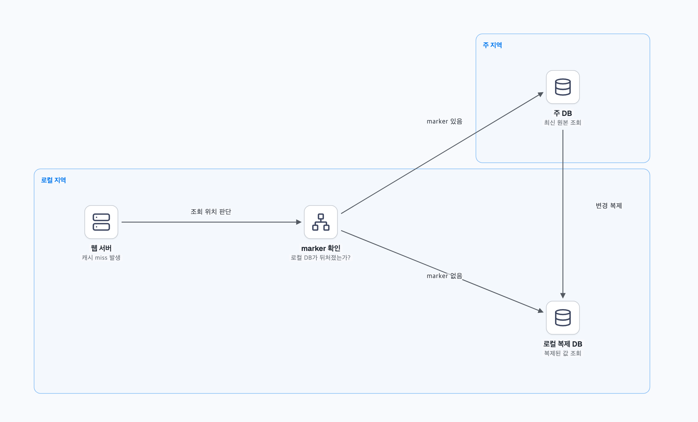
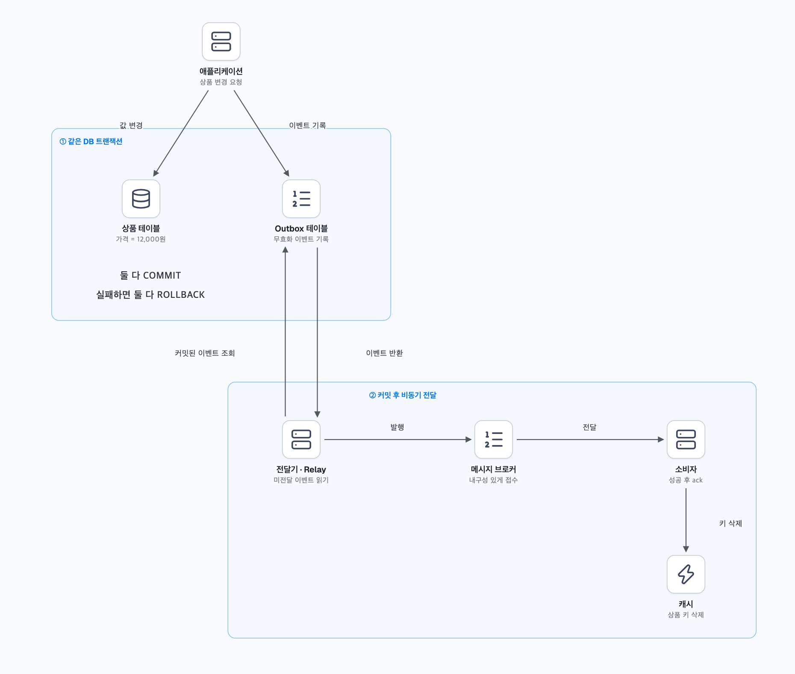
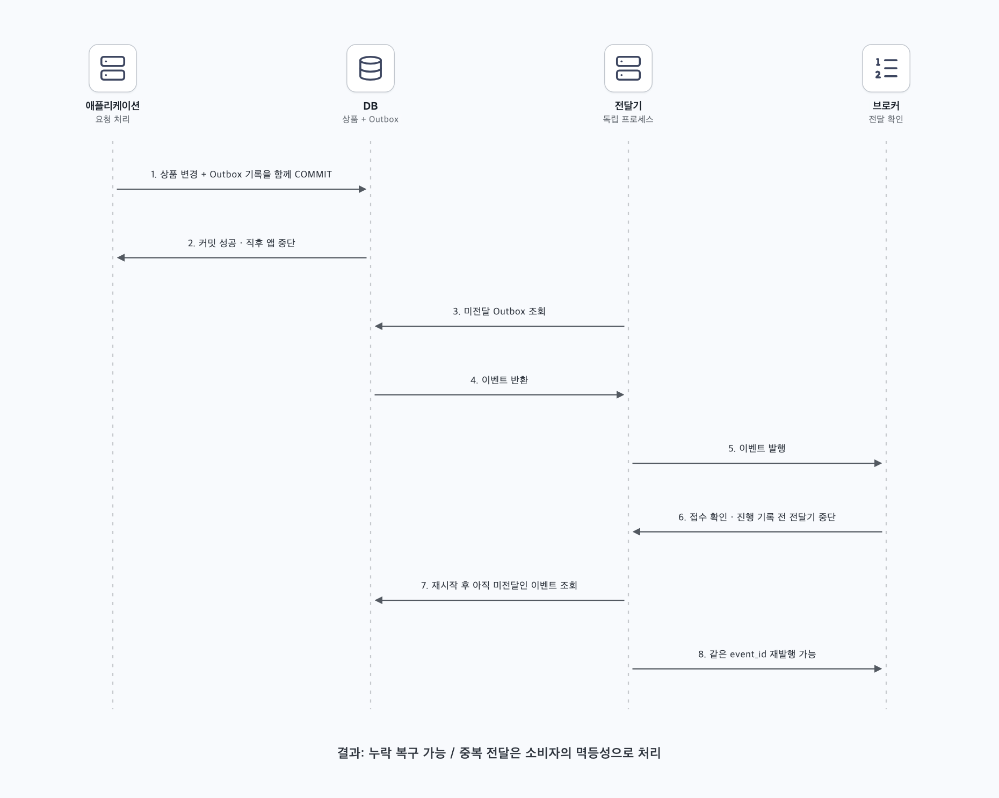

# 05. DB와 캐시를 한 트랜잭션으로 바꾸지 못하면 일관성을 어떻게 다룰까?

## 책의 맥락과 질문

책 p.12는 원본 저장소와 캐시를 갱신하는 연산이 하나의 트랜잭션이 아니면 일관성이 깨질 수 있다고 설명하고, 대규모 사례로 [「Scaling Memcache at Facebook」](https://www.usenix.org/system/files/conference/nsdi13/nsdi13-final170_update.pdf)을 연결한다.

여기서 **일관성**은 캐시에서 관측한 값이 원본의 변경을 올바르게 반영하는가를 뜻한다. 원본이 바뀐 바로 그 순간 모든 사본이 같아야 한다는 강한 요구와, 변경 전파 후 결국 따라잡으면 된다는 요구는 다르다.

## 1. DB 트랜잭션만으로 외부 캐시까지 원자적이지는 않다

다음 코드를 하나의 서비스 메서드에 넣어도 DB와 별도 캐시가 같은 트랜잭션에 참여하는 것은 아니다.

```text
DB에서 상품 이름 변경 후 COMMIT
캐시의 product:42 삭제
```

DB 커밋 후 프로세스가 중단되면 캐시 삭제가 수행되지 않을 수 있다. DB 트랜잭션을 롤백할 수 없고 기존 캐시는 남는다. 반대로 먼저 캐시를 바꾸고 DB 변경이 실패하면 커밋되지 않은 값이 노출될 수 있다.

쓰기 작업을 순서대로 실행하는 것과 두 저장소를 원자적으로 변경하는 것은 다르다. 사용하는 프레임워크의 DB 트랜잭션 표시가 외부 캐시까지 자동으로 포함한다고 가정하지 않는다.

## 2. 순서를 정하는 것만으로 해결되지 않는 경쟁 조건

아래는 문제를 설명하기 위해 만든 타임라인이다. DB의 초기 값은 `v1`이다.



그림은 위에서 아래로 읽는다. A가 v1을 받은 뒤 캐시 저장을 미루는 동안 B가 v2를 커밋하고 캐시를 지운다. 마지막에 A가 v1을 넣으면 캐시가 다시 오래된 상태가 된다.

| 순서 | 읽기 요청 A | 쓰기 요청 B | 최종 상태 |
| --- | --- | --- | --- |
| 1 | 캐시 miss | | 캐시 비어 있음 |
| 2 | DB에서 v1 조회, 응답 지연 | | |
| 3 | | DB를 v2로 바꾸고 커밋 | DB=v2 |
| 4 | | 캐시 삭제 | 캐시 비어 있음 |
| 5 | 뒤늦게 v1을 캐시에 저장 | | DB=v2, 캐시=v1 |

이처럼 **늦게 끝난 읽기가 오래된 값으로 캐시를 다시 채우는 것**이 stale set이다. “DB를 바꾸고 캐시를 삭제한다”만으로는 이 경쟁을 막지 못한다. 원본이 아닌 지연된 읽기 복제본에서 채우면 다른 형태의 오래된 값 재삽입도 발생한다.

Meta의 후속 글은 캐시 채움과 무효화가 같은 항목의 상태를 바꾸며 경쟁한다는 점을 설명한다. 버전을 비교해 과거 값의 덮어쓰기를 막을 수 있지만 최신 버전 정보 자체가 퇴거되면 판단 근거도 사라질 수 있다. 버전 필드를 붙이는 것만으로 끝나는 문제가 아니다. [Cache made consistent, 2022](https://engineering.fb.com/2022/06/08/core-infra/cache-made-consistent/)

## 3. Facebook 논문에서 참고할 세 가지 장치

아래는 **2013년 논문**의 메커니즘 요약이다. 현재 Meta 전체 시스템의 동작이라고 일반화하지 않는다. PDF를 읽을 때는 §2, §3.2.1, §4.1, §5를 찾아보면 된다. [논문 원문 — USENIX](https://www.usenix.org/system/files/conference/nsdi13/nsdi13-final170_update.pdf)

### Lease — 오래된 캐시 채움을 거절한다



토큰은 이 요청이 캐시를 채울 권한이 있는지 확인하는 값이다. 캐시 miss 때 키에 묶인 토큰을 발급하고, 채울 때 검증한다. 중간에 삭제가 발생하면 토큰을 무효화해 이전 읽기의 저장을 거절한다. 토큰 발급 빈도를 제한해 동시 miss의 DB 집중도 줄인다. 일반적인 memcached의 모든 배포에 자동 제공되는 기능은 아니다.

### MCSqueal — 무효화를 커밋 로그와 연결한다



데몬은 사용자 요청과 별도로 계속 실행되는 프로그램이다. DB 변경에 무효화할 키 정보를 포함하고, 커밋된 로그를 처리하는 데몬이 삭제를 전파한다. MCrouter가 배치된 삭제를 목적지로 전달한다. 로그를 재생할 수 있어 누락 복구에 도움이 되지만 캐시 삭제 완료까지 DB 커밋과 원자적인 것은 아니다.

### Remote marker — 지역 복제 지연을 고려한다



marker는 이 키의 로컬 DB 값이 아직 오래되었을 수 있다는 표시다. 로컬 복제본이 뒤처질 수 있음을 표시하고, 캐시 miss 때 표시가 있으면 주 지역을 조회한다. 복제 적용과 연계한 무효화로 너무 이른 재충전을 줄인다. 동시 갱신이나 marker 퇴거의 한계가 있으며, 논문은 성능·가용성을 중시한 best-effort eventual consistency를 설명한다.

### 이 사례에서 가져갈 설계 관점

각 장치의 목적을 구분한다. 오래된 읽기의 캐시 채움을 제어하는 것, 커밋 후 무효화를 빠뜨리지 않는 것, 뒤처진 복제본을 피하는 것은 서로 다른 문제다. 한 가지 장치가 모든 실패를 해결한다고 판단하면 안 된다.

## 4. 일반 서비스에 적용할 수 있는 방법들

아래는 논문을 그대로 구현하라는 의미가 아니라, 문제 유형을 나누어 구성한 추가 설계 제안이다.

| 방법 | 해결하려는 문제 | 남는 한계 |
| --- | --- | --- |
| DB 커밋 후 캐시 삭제 | 일반 쓰기 후 기존 값 제거 | 삭제 실패·stale set 가능 |
| TTL | 오래된 항목의 장기 잔존 완화 | 즉시 최신성 보장 아님; 오래된 값 재삽입 가능 |
| 키별 lease·세대 검증 | 무효화 전에 시작한 읽기의 뒤늦은 채움 | 원자적 검증과 세대 정보 보존 필요 |
| Outbox / CDC | 커밋 후 변경 알림·무효화 누락 복구 | 전파 지연, 순서, 중복, 운영 필요 |
| 버전 비교와 tombstone | 역순 도착한 값·이벤트의 적용 방지 | 최신 버전·삭제 표시의 보존 필요 |
| 최신성이 필요한 읽기만 캐시 우회 | 오래된 값으로 결정하는 위험 감소 | DB 부하, 읽기 격리·복제 지연도 확인 |

### A. 커밋 후 삭제 + 실패 재시도 + TTL

단순한 시작점이다. 쓰기 성공 후 기존 캐시를 지우고, 실패하면 재시도한다. TTL도 함께 두면 특정 실패가 영구히 남는 위험을 완화할 수 있다. 다만 메모리 안의 재시도 목록은 프로세스 중단 때 사라질 수 있으므로 중요한 재시도는 내구성 있게 기록한다.

캐시를 먼저 지우고 DB를 바꾸면 그 사이의 읽기가 이전 DB 값으로 캐시를 채울 수 있다. 순서를 바꾼다고 경쟁 자체가 사라지지는 않는다.

### B. Transactional Outbox — DB 변경과 알림 의도를 함께 커밋한다

**Outbox는 DB 안에 두는 ‘보낼 일 목록’이다.** 상품을 바꾼 뒤 캐시도 지워야 한다면, DB에 상품 변경과 ‘이 상품의 캐시를 지워야 한다’는 기록을 함께 남긴다. 독립적인 전달기가 그 목록을 읽어 나중에 처리한다. 앱이 커밋 직후 중단되어도 목록은 DB에 남는다.

#### 먼저 실패하는 구성을 떠올린다

상품 가격을 10,000원에서 12,000원으로 바꾼 뒤, 메시지 브로커에 ‘캐시를 지워라’는 이벤트를 보낸다고 가정한다. 브로커는 전달할 메시지를 내구성 있게 받아 두고 소비자에게 전달하는 시스템이다.

```text
DB 가격 변경 성공 → 앱 중단 → 메시지 전송 실패
```

가격은 바뀌었지만 삭제 요청은 어디에도 남지 않는다. 앱 코드에서 두 줄을 연달아 실행해도 이 틈은 생긴다.

#### ① 같은 DB 안에서 두 기록을 함께 커밋한다



이 그림의 위쪽 DB 박스가 원자적 범위다. 아래 전달·캐시 삭제는 커밋 후 별도로 실행된다. 상품·Outbox가 같은 DB 트랜잭션에 참여하고 커밋된 데이터를 내구성 있게 보존한다고 가정한다.

설명을 위한 테이블 예시는 다음과 같다.

| 저장 위치 | 남기는 내용 |
| --- | --- |
| `products`의 상품 42 | `price=12000`, `version=2` |
| `outbox`의 이벤트 E123 | 상품 42의 캐시 무효화, `version=2`, 아직 미전달 |

```text
BEGIN
  상품 42의 가격과 버전 변경
  Outbox에 이벤트 E123 기록
COMMIT
```

둘 중 하나라도 실패하면 둘 다 롤백한다. 성공하면 상품 변경과 전달 의도가 함께 남는다. 아직 캐시가 지워진 것은 아니다.

#### ② 전달기가 커밋된 목록을 읽어 발행한다

전달기(Relay)는 앱 요청과 독립적으로 실행되는 프로그램이다. 미전달 이벤트를 읽고 브로커에 발행한 뒤, 브로커의 접수 확인을 받아 전달 진행을 기록한다. 접수 확인 전에 전달 완료로 표시하면 메시지가 유실될 수 있다. 여러 전달기를 실행한다면 같은 작업을 어떻게 가져갈지도 정해야 한다.

소비자(Consumer)는 브로커에서 이벤트를 받아 `product:42`를 삭제하고, 성공을 확인한 뒤 처리 완료를 알린다. 캐시 삭제가 실패하면 완료로 처리하지 않고 재시도한다. 캐시 삭제 성공과 소비자의 완료 기록도 별도 동작이므로 재실행을 고려해야 한다.

#### ③ 중단 지점별로 결과를 확인한다



그림의 앞부분은 앱 중단 후에도 전달기가 진행하는 경우이고, 뒷부분은 브로커 접수 후 전달기가 중단되어 같은 이벤트를 다시 발행하는 경우다.

| 중단 시점 | 남는 상태 | 복구 시 고려할 것 |
| --- | --- | --- |
| DB 커밋 전 | 상품과 Outbox 모두 롤백 | 업무 요청 재시도 |
| DB 커밋 후, 발행 전 | 상품과 미전달 이벤트가 남음 | 전달기가 발행 |
| 브로커 접수 후, 전달 완료 기록 전 | 이벤트가 이미 발행되었지만 미전달로 보일 수 있음 | 같은 이벤트 재발행 가능 |
| 소비자의 캐시 삭제 전 | 캐시가 아직 오래될 수 있음 | 소비자 재시도 |
| 캐시 삭제 후, 처리 완료 확인 전 | 삭제했지만 다시 전달될 수 있음 | 중복 실행에 안전하게 처리 |

이 때문에 `event_id`로 같은 이벤트를 식별하고 **멱등성**을 설계한다. 멱등성은 같은 처리를 반복해도 의도한 업무 효과가 중복 발생하지 않는 성질이다. 캐시 삭제는 반복 실행하기 비교적 쉽지만, 늦은 중복 삭제가 새로 채운 캐시도 제거해 적중률을 낮출 수 있다. 이벤트가 돈을 지급하는 작업이라면 중복 실행의 영향이 훨씬 크다.

#### Outbox가 해결하는 범위와 남는 문제

원자적으로 묶는 것은 **업무 DB 변경과 알림 의도 기록**이다. 이중 쓰기에서 알림 의도가 사라지는 틈을 줄이는 패턴이며, 외부 캐시까지 하나의 트랜잭션에 참여시키지는 않는다. 전파 중에는 이전 값이 보일 수 있고, 앞의 stale set도 별도로 다뤄야 한다.

같은 상품의 이벤트는 버전·순서와 함께 처리하고, 미전달 이벤트의 나이·재시도 횟수·적체를 관측한다. 계속 실패하는 이벤트의 조사·재처리와 처리 완료 항목의 정리 기준도 필요하다. Outbox 테이블을 만들기만 하고 전달기를 감시하지 않으면 알림은 계속 쌓일 수 있다.

**CDC**(Change Data Capture)는 커밋 로그 등에서 변경을 포착하는 방식이다. Outbox는 ‘보낼 의도를 어디에 남기는가’에 관한 패턴이고 CDC는 변경을 포착하는 방법이므로 같은 말이 아니다. 전달기가 테이블을 조회하는 대신 CDC로 Outbox의 새 기록을 포착할 수도 있다. 실제 캐시 키로 변환하는 규칙은 별도로 정한다.

위 그림과 중단 시나리오는 상품 캐시 무효화에 적용한 설계 예시다. 일반 패턴과 이중 쓰기의 근거는 [AWS Transactional Outbox](https://docs.aws.amazon.com/prescriptive-guidance/latest/cloud-design-patterns/transactional-outbox.html)를 참고한다. Facebook 논문이 이 Outbox 예시를 그대로 사용했다는 뜻은 아니다.

### C. 버전·세대·삭제 표시를 원자적으로 확인한다

캐시 값이 `(version=2, value=v2)`라면 늦게 도착한 `version=1`을 거절하는 방식이다. 단순히 버전을 읽고 나중에 저장하면 그 사이에 상태가 달라질 수 있으므로 검사와 저장이 원자적이어야 한다.

항목을 지울 때 버전 정보도 모두 지우면 늦은 과거 값을 최신인지 판단하지 못할 수 있다. 삭제 표시(tombstone)나 별도의 세대 번호를 필요한 기간 보존하는 설계를 검토한다. 보존 기간은 지연·재시도·복구 범위와 관련된다. 한 키의 세대 검증은 여러 키·여러 저장소의 트랜잭션을 대신하지 않는다.

### D. 잠금과 지연 이중 삭제는 어디까지 도움이 되는가?

키별 잠금이나 single-flight는 같은 값의 중복 조회를 줄이는 데 유용하다. 하지만 **읽기 쪽만 잠그면 쓰기와의 경쟁은 남는다.** 모든 관련 경로가 같은 규약을 지켜야 하며, 분산 잠금은 만료 후에도 늦게 실행되는 보유자를 다뤄야 한다. fencing token은 오래된 보유자의 작업을 수신 측에서 거절하는 방법으로 검토할 수 있다.

DB 변경 전후에 캐시를 지우고 일정 시간 뒤 다시 삭제하는 ‘지연 이중 삭제’도 특정 경쟁 확률을 줄일 수 있다. 그러나 오래 걸린 읽기나 복제 지연이 대기시간을 넘으면 재발한다. 안전한 상한을 모르는 상황에서 고정 sleep을 강한 일관성의 근거로 삼지 않는다.

### E. 엄격한 판단은 권위 있는 상태에서 확정한다

결제·재고 확보·권한 확인처럼 오래된 값으로 결정하면 안 되는 작업은 캐시만 믿고 확정하지 않는다. 권위 있는 DB에서 적절한 트랜잭션·조건부 갱신·제약조건으로 판정한다. 캐시 우회가 모든 동시성 문제를 없애지는 않으며, DB 격리 수준과 접근하는 복제본도 중요하다.

## 5. 요구사항별 시작점 — 설계 제안

- 상품 설명 등 잠깐 오래되어도 되는 조회: Cache Aside, TTL, 커밋 후 삭제와 재시도를 시작점으로 검토한다.
- 변경 이벤트 누락이 큰 문제: Outbox·CDC로 내구성 있는 무효화 경로를 만든다.
- 동시 읽기·쓰기에서 과거 값 재삽입이 문제: lease·세대·버전 검증을 더한다.
- 자신의 변경을 바로 봐야 하는 요청: 주 DB 읽기나 변경 반영 확인을 검토한다.
- 엄격한 재고·결제 확정: DB의 업무 정합성 경계에서 결정한다.

이는 측정과 실패 모델에 따라 조합하는 방법이며, 단일 제품의 설정 하나로 전부 얻는 보장이 아니다.

## 6. 구현을 검증할 시나리오

| 시험 | 확인할 결과 |
| --- | --- |
| DB 커밋 직후 프로세스 중단 | 무효화 의도가 남고 재처리되는가? |
| A의 오래된 DB 응답을 지연시키고 B 갱신 후 재개 | A의 과거 값이 캐시에 들어가지 않는가? |
| 같은 무효화 이벤트 중복·역순 전달 | 값이 과거로 돌아가거나 상태가 손상되지 않는가? |
| 캐시 값·버전·marker 퇴거 | 판단 근거가 사라져도 안전한가? |
| 읽기 복제 지연과 캐시 miss 동시 발생 | 오래된 복제본 값으로 재충전하지 않는가? |
| 무효화 전달기가 장시간 중단 | 지연을 감지하고 복구·재생할 수 있는가? |

## 내 말로 정리

DB와 캐시의 이중 쓰기는 실패 사이의 틈과 동시 실행 순서 때문에 깨질 수 있다. 무효화 누락, 오래된 값 재삽입, 복제 지연을 따로 다뤄야 한다. Facebook 논문은 이 문제들을 완화하는 실제 장치의 사례이고, 모든 읽기를 최신으로 만드는 단일 트랜잭션의 대체물은 아니다.
