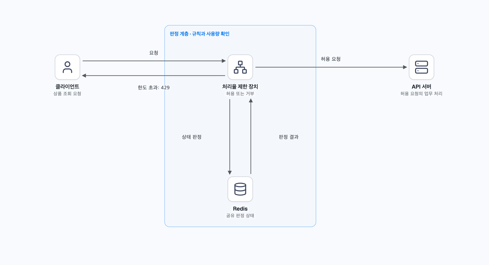
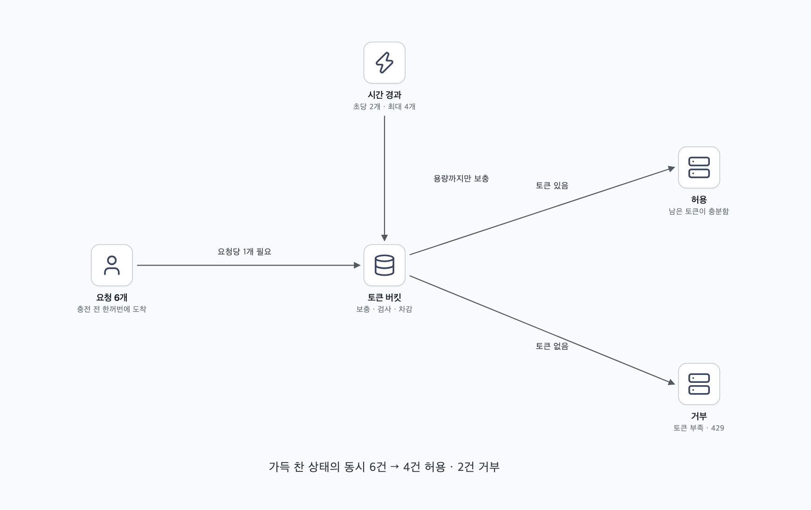
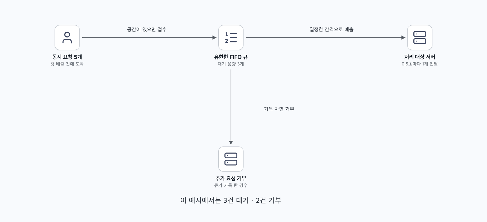
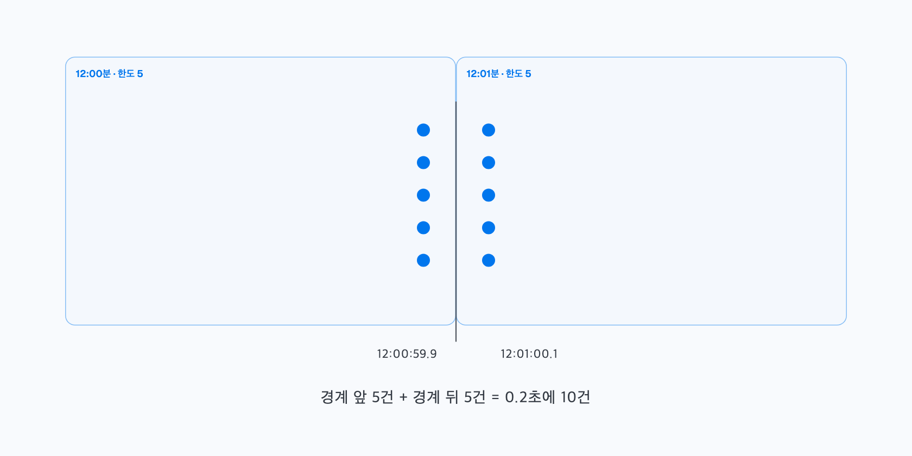
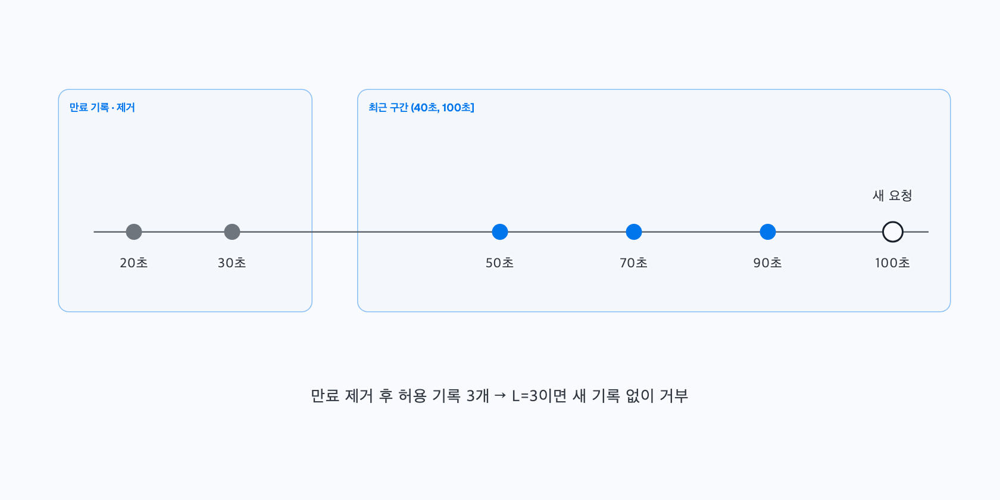
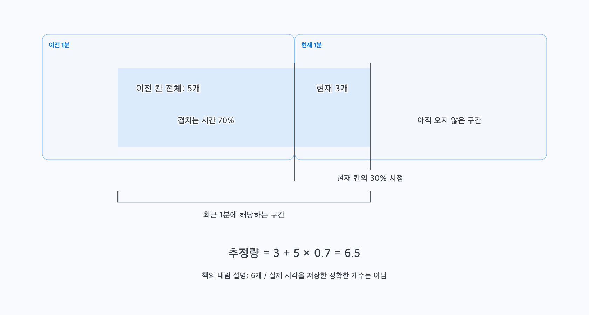
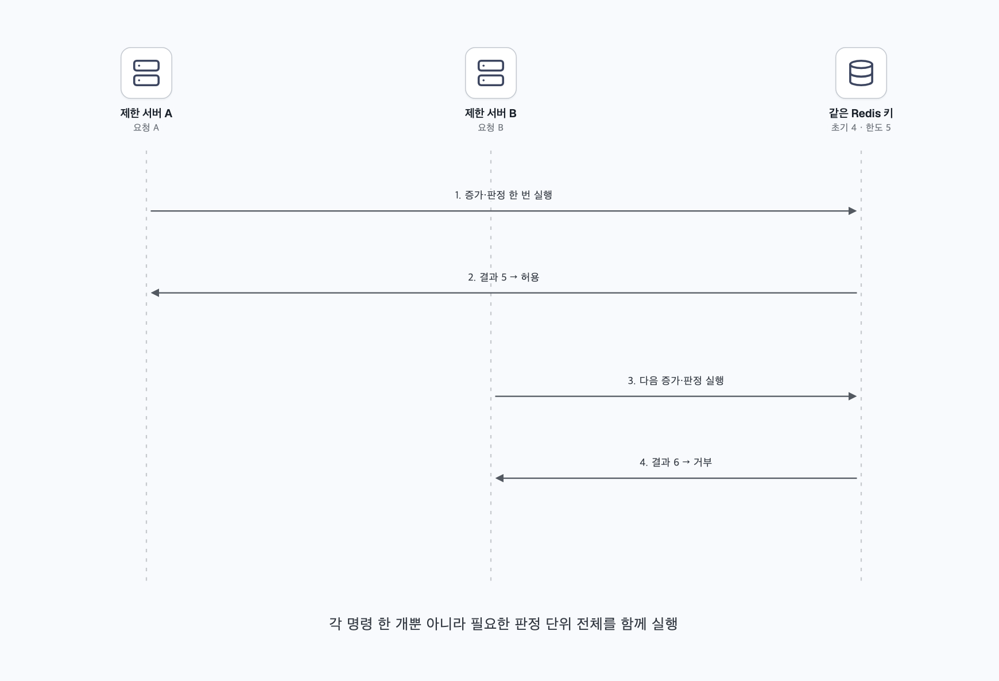
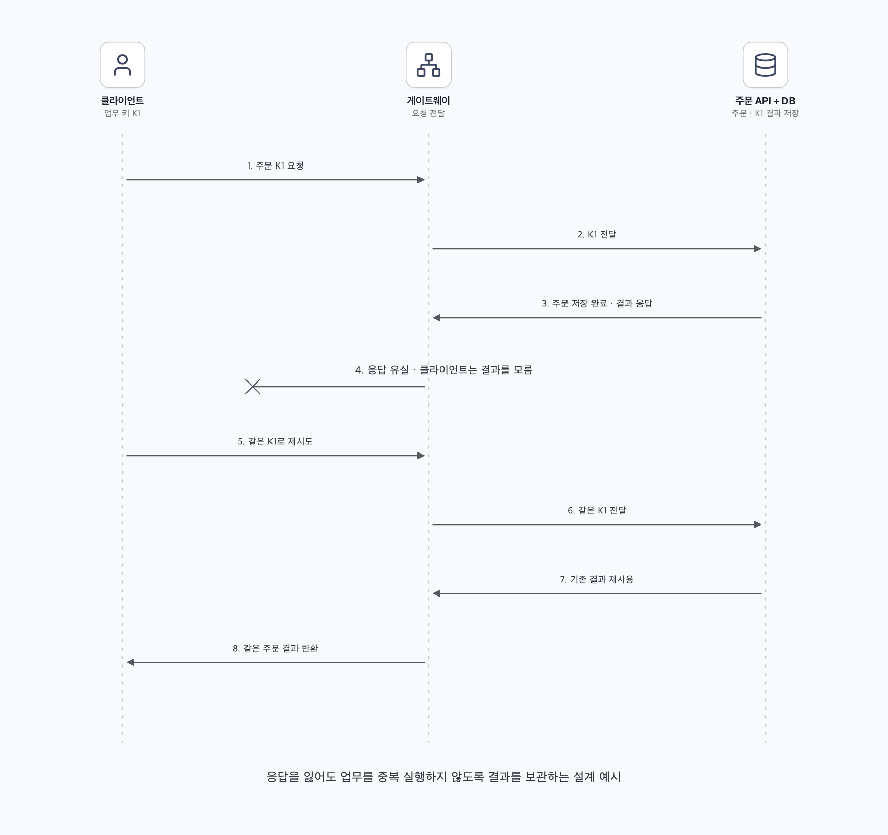

<a id="top"></a>

# 4장. 처리율 제한 장치의 설계

상품 API에 요청이 몰리는 상황에서 출발해, 어디서 무엇을 세고 언제 허용할지 따라간다. 사용자가 제공한 메모와 책 4장의 흐름을 바탕으로 정리한 학습 노트다.

기본 알고리즘 뒤에는 토큰 차감의 동시성, Redis의 원자적 판정, 게이트웨이·큐 중간의 통신 실패를 따로 살펴본다. 설명·그림·복습 답안을 이 문서에서 함께 읽는다.

<a id="contents"></a>

## 목차

- [요청을 제한하는 흐름 따라 읽기](#core-concepts)
- [질문 01 · 토큰 버킷의 버스트와 동시성](#q1)
- [질문 02 · Lua와 정렬 집합의 원자적 판정](#q2)
- [질문 03 · 중간 통신 실패와 재시도](#q3)
- [스스로 답하기 · 답안 토글](#review)
- [책과 추가 설명의 범위](#sources)

---


<a id="core-concepts"></a>

## 한 사용자의 요청이 서비스를 압도하지 않게 한다

상품 판매 서비스의 서버를 늘리고 캐시도 붙였다. 그런데 한 사용자의 프로그램이 상품 조회 API를 초당 수천 번 호출하면 정상 사용자의 요청까지 느려질 수 있다. 서버를 계속 늘리기 전에 **일정한 기준으로 들어올 요청의 양을 제한**할 필요가 생긴다. 이것이 처리율 제한 장치의 역할이다.

### 1. 무엇을 지키려는 장치인가?

우선 ‘사용자별 상품 조회를 분당 60회까지 허용한다’는 규칙을 생각한다. 요청을 받은 장치는 누가 어느 API를 얼마나 호출했는지 확인하고, 한도를 넘는 요청은 업무 서버로 보내지 않는다.

비싼 조회와 외부 API 호출을 줄이면 서버·외부 서비스 비용을 낮출 수 있다. 봇이나 잘못 작성한 반복 호출이 자원을 차지하는 것도 완화한다. 의도적으로 서비스를 마비시키는 DoS 공격에 의한 자원 고갈을 막는 데도 도움이 된다. 다만 네트워크 대역폭이 먼저 포화되는 대규모 공격까지 API 제한 장치 하나로 해결할 수 있는 것은 아니다.

이 장의 목표는 서버 측 API를 위한 제한 장치다. 사용자·IP·API별로 다른 규칙을 둘 수 있어야 하고, 서버가 여러 대여도 같은 규칙을 적용해야 한다. 판정 자체가 느리거나 메모리를 너무 많이 쓰면 보호하려던 시스템의 새 병목이 된다. 거부했을 때는 이유와 재시도 기준을 알려 주며, 장치 장애가 전체 장애로 번지지 않도록 정책을 정한다.

여기서 처리율은 보통 단위 시간에 허용하는 요청 수다. ‘분당 60회’와 ‘동시에 처리 중인 요청 10개’는 다른 제한이다. 처리 시간이 길거나 요청마다 비용이 크게 다르면 동시 실행 수나 요청 비용도 함께 관리할 수 있다.

### 2. 요청이 비싼 작업을 시작하기 전에 판정한다

클라이언트 앱에서 호출 횟수를 줄이면 유입을 완화할 수 있다. 하지만 외부 사용자는 앱을 바꾸거나 API를 직접 호출할 수 있다. 서버 자원을 보호할 판정은 서버가 통제하는 위치에서 해야 한다.

웹 서버 안에서 업무 코드 실행 전에 판정할 수도 있고, API 게이트웨이·미들웨어처럼 앞단에서 판정할 수도 있다. 다음 그림에서는 역할을 쉽게 보기 위해 제한 장치를 따로 그렸다.



사용자의 상품 요청이 도착하면 장치는 적용할 규칙과 현재 상태를 확인한다. 허용이면 API로 전달하고, 초과라면 사용자에게 제한 응답을 돌려준다. 판정 상태를 여러 서버가 함께 사용하기 위해 Redis 같은 저장소를 둘 수 있다. 규칙과 상태의 저장 방식은 뒤에서 나누어 설명한다.

이미 인증·IP 허용목록 같은 접근 정책을 처리하는 게이트웨이가 있다면 그 위치에 제한 기능을 추가하는 것이 운영상 자연스러울 수 있다. 자체 구현은 업무별 알고리즘을 선택하기 쉽고, 관리형 게이트웨이는 도입 시간을 줄일 수 있다. 현재 스택·인력·배포 방식·지연 목표와 제공 기능을 놓고 결정한다.

여러 요청이 같은 사용자의 것인지 판별할 수 있어야 하므로 인증된 사용자 ID나 API 키 등을 활용한다. IP만으로 제한하면 공인 IP를 공유하는 여러 사용자가 함께 제한될 수 있다. IP 헤더도 신뢰할 프록시 경계에서 해석해야 한다.

이제 판정 위치를 정했다. 다음 문제는 ‘얼마나 호출했는가’를 어떤 방식으로 계산할지다.

### 3. 토큰 버킷 — 남겨 둔 호출 권한으로 순간 몰림을 받아 준다

사용자별로 최대 4개의 토큰을 담는 통을 둔다고 하자. 요청 한 번에 토큰 하나를 사용하고, 매초 토큰 두 개를 공급한다. 통이 가득 차면 더 공급된 토큰은 쌓이지 않는다.



처음 통이 가득 차 있을 때 요청 6개가 한꺼번에 도착하면, 충전이 일어나지 않는 짧은 순간에는 4개를 허용하고 2개를 거부한다. 0.5초 뒤에는 연속 충전 기준으로 토큰 하나가 생겨 다음 요청 하나를 받을 수 있다. 이 예시는 버킷 용량 4, 공급률 초당 2라는 두 설정으로 동작한다.

이것이 짧은 시간의 집중 요청을 허용한다는 뜻이다. 사용하지 않고 남겨 둔 권한을 한 번에 쓰는 것이며, 토큰보다 많은 요청까지 모두 받아 준다는 뜻은 아니다. 연속 충전 모형에서 길이 T인 구간의 허용량은 시작 시 남은 토큰과 그동안 공급한 토큰의 합에 의해 제한된다. 최대치는 대략 `용량 B + 공급률 r × T`로 이해할 수 있다.

주기적으로 모든 버킷에 토큰을 넣는 작업을 실행할 필요도 없다. 마지막 갱신 시각과 남은 토큰을 저장한 뒤 다음 요청 때 경과 시간만큼 보충했다고 계산할 수 있다.

```text
보충 후 토큰 = min(용량, 기존 토큰 + 경과 시간 × 공급률)
보충 후 토큰이 1 이상이면 1 차감하고 허용
부족하면 거부
```

저장할 상태는 토큰 수와 갱신 시각 정도라 작다. 대신 용량을 크게 잡으면 순간적으로 많은 요청을 통과시키고, 작게 잡으면 정상 사용자의 짧은 몰림도 거부할 수 있다. 공급률은 장기적인 유입을 제한한다. 두 값을 함께 튜닝한다.

버킷은 API마다 하나로 고정된 것이 아니다. 규칙에 따라 ‘사용자와 API의 조합’, ‘사용자 전체’, ‘서비스 전체’ 등의 기준으로 둔다. 사용자별 규칙과 전체 규칙을 함께 적용할 때는 둘 다 만족해야 하는지, 부분 차감은 어떻게 처리할지도 정해야 한다.

**버스트를 허용하는 원리와 동시성 제어는 별개다.** 마지막 토큰 하나를 요청 두 개가 동시에 보고 모두 통과하지 않도록 보충·검사·차감을 한 작업으로 묶어야 한다. [토큰 버킷과 동시성](#q1)에서 이어서 본다.

### 4. 누출 버킷 — 받아 둔 요청을 일정한 속도로 내보낸다

이번에는 외부 재고 시스템이 초당 2개의 요청만 안정적으로 처리한다고 하자. 앞단에서 요청을 잠시 줄 세우고 0.5초마다 하나씩 꺼내 보내면 출력 속도를 고르게 만들 수 있다. 이 장에서는 이런 FIFO 큐 형태의 누출 버킷을 살펴본다.



대기 공간이 3개이고 첫 배출 전 요청 5개가 동시에 오면 3개를 넣고 2개는 거부한다. 받아 둔 요청은 먼저 들어온 순서대로 꺼낸다. 대기 공간이 크면 순간 몰림을 더 받아 주지만 사용자가 더 오래 기다릴 수 있다. 대략적인 최대 대기는 큐 길이와 배출률의 비율에 영향을 받으며 실제 처리시간도 따로 더해진다.

토큰 버킷은 권한이 남으면 여러 요청을 즉시 통과시킬 수 있다. 이 누출 버킷은 받아 둔 요청의 **배출 속도**를 고르게 한다. 큐 용량과 배출률을 조절하고, HTTP 연결의 대기시간을 넘기지 않는지도 확인한다. 저장 공간이 유한하므로 한 큐의 메모리는 제한되지만, 큐 개수와 요청 크기까지 합산해야 한다.

Shopify 공식 문서도 대부분의 API 제한을 leaky bucket으로 설명한다. 다만 API별 비용·복원률 기반 판정까지 포함하는 비유이며, 모든 요청을 실제 FIFO 큐에 넣어 고정 간격으로 실행한다는 의미는 아니다. 어떤 API의 어떤 정책인지 따로 확인한다. [Shopify 제한 설명](https://shopify.dev/docs/api/usage/limits)

### 5. 고정 윈도 카운터 — 정해진 시간 칸마다 센다

이제 시간을 `[12:00, 12:01)`, `[12:01, 12:02)`처럼 나누고 각 칸에서 5개까지 허용해 보자. 요청이 오면 그 칸의 카운터를 증가시키고 1~5번째는 허용, 6번째부터 거부한다. 다음 칸은 별도 카운터로 다시 센다.



구현과 상태가 단순하다. 서비스가 정한 시간 경계에서 사용량을 새로 시작하는 정책도 표현하기 쉽다. 다만 12:00:59.9에 5개, 12:01:00.1에 5개가 들어오면 각 칸은 한도를 지켰어도 0.2초 동안 10개가 통과한다.

즉 ‘각 달력 분에 5개’와 ‘어느 시점에서든 최근 60초에 5개’는 다르다. 경계 직전·직후의 집중까지 막고 싶다면 최근 구간을 직접 보는 방법이 필요하다.

### 6. 이동 윈도 로그 — 최근 구간에 들어온 시각을 직접 보관한다

최근 60초에 허용한 요청이 3개까지만 있어야 한다고 하자. 요청의 시각을 보관하고, 현재 시각에서 60초보다 오래된 기록을 지운 뒤 남은 개수를 확인하면 된다.



현재가 100초라면 검사 구간을 `(40초, 100초]`로 정할 수 있다. 20·30초의 기록은 지우고 50·70·90초의 허용 기록 3개가 남았다면 새 요청은 거부한다. 50초 기록이 구간 밖으로 나간 뒤에는 빈자리가 생긴다. 경계 포함 방식은 구현에서 일관되게 정한다.

책은 새 요청의 시각을 먼저 추가하고 개수를 판단하는 형태를 설명하며, 거부된 기록도 남아 메모리를 쓴다는 점을 지적한다. 이 노트의 구현 예시는 **허용 요청만 기록하는 변형**을 사용한다. 이미 한도에 도달했으면 추가하지 않으므로 한 대상의 활성 로그를 대략 한도 L개로 제한할 수 있다. 두 방식은 ‘시도 횟수’를 제한할지 ‘허용 횟수’를 제한할지부터 다르다. 거부한 시도도 계속 남기면 재시도 트래픽이 이후 판정에도 영향을 주므로 정상 호출이 다시 허용되는 시점과 메모리 정책을 함께 확인한다.

어느 쪽이든 정확한 개별 시각을 저장하므로 단순 카운터보다 상태가 크다. 허용 기록만 보관하는 경우에도 활성 대상 수가 K이면 저장량은 대략 `K × L`에 비례한다. 모든 시도를 보관하면 시도율과 윈도 길이에 비례해 커질 수 있다.

Redis 정렬 집합은 시각을 점수로 넣고 오래된 구간을 지우기 편하다. 하지만 자료구조를 고르는 것만으로 동시성이 해결되지는 않는다. 만료 제거·개수 확인·새 기록 추가를 함께 실행하는 방법은 뒤에서 다룬다.

### 7. 이동 윈도 카운터 — 기록을 줄이는 대신 최근 구간을 추정한다

로그가 너무 크다면 개별 시각 대신 이전 칸과 현재 칸의 개수만 남길 수 있다. 최근 1분에 걸쳐 있는 이전 칸의 비중을 계산해 그 개수의 일부를 더하는 방식이다.



책의 예시처럼 이전 1분에 5개, 현재 1분에 이미 3개가 있고 현재 칸의 30% 지점이라면, 최근 1분에는 이전 칸의 70%가 걸친다.

```text
추정량 = 현재 칸의 개수 + 이전 칸의 개수 × 이전 칸이 겹치는 비율
       = 3 + 5 × 0.7
       = 6.5
```

책은 소수점을 버려 6개로 설명한다. 계산값 자체는 6.5이고 실제 요청 시각을 복원한 수가 아니라 추정치다. 직전 칸의 5개가 고르게 분포했다고 보고 70%를 가져왔기 때문이다.

이전 5개가 모두 경계 바로 전에 몰렸다면 실제 최근 구간에는 5개가 전부 남을 수 있다. 반대로 모두 앞쪽이었다면 이미 빠졌을 수 있다. 따라서 이동 윈도 로그와 같은 정확한 상한을 제공하지는 않는다. 대신 상태가 작고 고정 윈도의 갑작스러운 경계 효과를 완화한다.

구현할 때는 현재 요청을 더하기 전후 중 언제 검사하는지와 소수점 처리도 명시한다. 예를 들어 ‘새 요청까지 포함한 추정량이 L 이하일 때만 허용’하면 위 상태에서 새 요청을 더한 값은 7.5가 되어 L=7에서는 거부한다. 책의 6이라는 설명과 비교할 때 이 판정 규칙까지 구분해야 한다.

### 8. 다섯 알고리즘을 무엇을 지키려는지로 비교한다

| 방식 | 남기는 상태 | 잘 드러나는 성질 | 기억할 비용·한계 |
| --- | --- | --- | --- |
| 토큰 버킷 | 남은 토큰·시각 | 남은 권한으로 버스트 허용 | 용량·공급률 튜닝, 원자적 차감 |
| 누출 버킷의 큐 모형 | 대기 요청 | 배출 속도 평탄화 | 대기시간, 큐가 차면 거부 |
| 고정 윈도 | 시간 칸별 개수 | 단순한 구간별 한도 | 경계 직전·직후 몰림 |
| 이동 윈도 로그 | 개별 요청 시각 | 최근 구간을 직접 검사 | 대상별 기록 수·정리 비용 |
| 이동 윈도 카운터 | 이전·현재 개수 | 작은 상태로 최근 양 추정 | 분포 가정에 따른 오차 |

상품 조회처럼 정상 사용자의 짧은 몰림을 허용할지, 외부 시스템 호출처럼 출력 속도를 일정하게 할지 먼저 정한다. ‘최근 60초’를 정확히 지킬지, 추정으로 충분한지도 선택 기준이다. 모든 API에 같은 알고리즘과 숫자를 적용할 필요는 없다.

한도를 넘은 요청을 반드시 거부하는 엄격한 제한(hard limit)을 둘 수도 있고, 정해 둔 조건에서는 일시적인 초과를 허용하는 유연한 제한(soft limit)을 둘 수도 있다. 후자를 선택한다면 초과를 얼마나, 얼마 동안 허용할지 정해야 한다. 토큰 버킷이 정해진 용량 안에서 버스트를 허용하는 것과, 설정한 한도 자체를 예외적으로 넘기는 정책은 구분한다.

이제 알고리즘을 골랐다고 하자. 여러 서버에서 같은 사용자를 어떻게 함께 셀까?

### 9. 규칙과 판정 상태를 나누어 저장한다

‘사용자별 상품 조회는 분당 60회’는 규칙이고, ‘사용자 42가 현재 17회 사용했다’는 수시로 바뀌는 상태다. 둘은 갱신 주기와 복구 방법이 다르다.

규칙은 설정 파일이나 DB 같은 내구성 있는 저장소에 버전과 함께 보관할 수 있다. 작업 프로세스가 검증한 규칙을 배포하고, 판정 서버는 메모리에 캐시해 매 요청마다 디스크를 읽지 않게 한다. 새 설정을 읽지 못했을 때 사용할 마지막 정상 버전과, 서버별 버전 차이를 어떻게 감지할지도 정한다.

판정 상태는 매 요청에 빠르게 읽고 바꿔야 한다. Redis 같은 메모리 저장소와 만료 기능을 활용할 수 있다. DB가 원리상 불가능한 것은 아니지만 높은 요청량에서 매번 원격 트랜잭션을 수행할 지연과 비용을 따져야 한다. 여기서는 Redis를 공유 판정 지점으로 사용한다.

키에는 규칙과 대상을 구분할 정보를 넣는다. 예를 들어 `rl:product-read:user:42`와 `rl:product-read:ip:...`는 다른 제한이다. 오래 사용하지 않는 상태는 만료시키되, 토큰 버킷을 너무 빨리 지워 매번 가득 찬 것으로 초기화하지 않도록 알고리즘에 맞게 보존 기간을 정한다. 무작위 식별자를 계속 만드는 공격도 전체 키 수와 메모리를 늘릴 수 있다.

### 10. 원격 저장소를 공유해도 판정 전체는 함께 실행해야 한다

서버 A와 B가 같은 Redis에서 사용량 4를 읽고 각자 ‘5 미만이니 허용’한 뒤 5를 저장하면 두 요청이 모두 통과하고 하나의 증가가 사라진다. 데이터가 한 곳에 있어도 읽기와 갱신이 나뉘면 생기는 경쟁 조건이다.

Redis의 `INCR` 한 번은 원자적으로 증가한다. 하지만 `GET → 비교 → SET`이나 `INCR → 조건부 EXPIRE`라는 여러 호출이 자동으로 하나의 판정이 되지는 않는다. Lua 스크립트로 필요한 명령과 조건 판단을 Redis 안에서 함께 실행할 수 있다. [Redis INCR](https://redis.io/docs/latest/commands/incr/)와 [Lua 실행](https://redis.io/docs/latest/develop/programmability/eval-intro/)을 근거로, [동시성 심화](#q2)에서 구체적인 흐름과 코드를 본다.

여러 제한 서버가 같은 사용자 키의 권위 있는 Redis 노드에서 이 판정을 수행하면 서로의 사용량을 함께 반영할 수 있다. 모든 사용자를 물리 서버 한 대에서 처리해야 한다는 뜻은 아니다. 키를 여러 샤드에 나누어 확장할 수 있지만 한 키의 판단은 같은 위치로 모아야 한다. 여러 키를 하나의 스크립트로 다룰 때는 Redis Cluster의 같은 해시 슬롯 제약도 확인한다.

### 11. 거부한 요청에는 무엇을 알려 줄까?

한도를 넘었다면 API 처리 대신 HTTP `429 Too Many Requests`를 반환할 수 있다. `Retry-After`로 다시 시도할 때까지 기다릴 시간을 알려 줄 수 있다. 아래의 나머지 헤더는 이 서비스가 정한 예시이며 모든 API에 공통인 표준 형식이라고 가정하지 않는다.

```http
HTTP/1.1 429 Too Many Requests
Retry-After: 2
X-RateLimit-Limit: 60
X-RateLimit-Remaining: 0
Content-Type: application/json

{"error":"rate_limit_exceeded","retry_after_seconds":2}
```

`Remaining`은 무슨 규칙의 잔여량인지, `Reset`을 사용한다면 절대 시각인지 남은 시간인지 문서화한다. 책의 `X-Ratelimit-Retry-After` 같은 예시 헤더와 HTTP의 `Retry-After`는 구분한다. 429와 Retry-After의 근거는 [RFC 6585 §4](https://www.rfc-editor.org/rfc/rfc6585.html#section-4)다.

한도를 넘는 요청을 버리지 않고 큐에 넣을 수도 있다. 다만 ‘거부하고 429를 보냄’과 ‘비동기 작업으로 접수하고 나중에 처리함’은 다른 계약이다. 후자는 작업 ID, 내구성 있는 접수, 대기열 상한, 완료 조회와 마감 정책이 필요하다. 접수했다면 예를 들어 202 응답을 사용하고, 아직 끝나지 않은 일을 성공한 업무 결과처럼 알려 주지 않는다.

### 12. 여러 지역과 장애까지 생각한다

세계 여러 지역의 제한 서버가 매 요청마다 먼 한 지역의 Redis를 조회하면 응답이 느려질 수 있다. 가까운 에지에서 일부를 판정하거나 지역별 예산을 나누면 왕복을 줄일 수 있다. 하지만 한도 L을 각 지역이 독립적으로 전부 허용하면 전체는 L을 넘는다.

지역별 사용량을 나중에 합치는 최종 일관성 방식은 지연과 가용성에 이점이 있을 수 있지만, 그동안 생기는 초과 허용을 받아들여야 한다. 전 세계의 정확한 한도를 요구한다면 권위 있는 판정 위치로 모으거나 지역에 총합이 제한된 예산을 할당하는 등의 조정이 필요하다. 통신 단절 시 정확성과 계속 접수할 수 있는 정도 사이의 선택을 명시한다.

Redis 자체의 장애도 구분한다. 요청이 스크립트에 서로 끼어들지 않는 원자성과, 장애 후 모든 판정 기록이 보존되는 내구성은 다르다. Redis의 비동기 복제에서는 장애 전환 때 일부 최신 상태를 잃을 수 있다. [Redis 복제](https://redis.io/docs/latest/operate/oss_and_stack/management/replication/)

제한 저장소를 못 읽을 때 무조건 통과시키는 fail-open은 서비스 이용을 이어 가지만 과부하 위험이 있다. 무조건 거부하는 fail-closed는 자원을 지키지만 정상 요청도 막는다. API 중요도에 따라 짧은 타임아웃, 제한적인 로컬 비상 예산, 회로 차단과 마지막 정상 설정 등을 조합한다. 로컬 비상 예산이 전역 정확성을 보장하는 것은 아니다.

장치의 실패는 보통 429로 확정한 초과와도 다르다. 상태를 알 수 없는 의존성 장애라면 503 같은 별도 오류 정책을 정해 클라이언트가 구분할 수 있게 한다. ‘제한 장치 장애가 전체를 멈추게 하지 않는다’는 요구는 장애를 없앤다는 뜻보다 이런 전파 범위와 동작을 설계한다는 뜻이다.

### 13. 재시도와 관측까지 한 흐름으로 묶는다

사용자가 429를 받고 즉시 같은 요청을 반복하면 제한 장치 자체의 부하도 커진다. 클라이언트는 응답의 대기 지침을 따르고, 재시도 간격을 늘리는 백오프와 임의 편차인 지터를 적용할 수 있다. 캐시할 수 있는 조회를 재사용하고 불필요한 반복 호출도 줄인다.

네트워크 오류로 결과를 못 받았을 때는 더 주의한다. 실제 주문은 끝났는데 응답만 유실되었을 수 있기 때문이다. 동일한 업무를 중복 실행하지 않도록 멱등성을 설계한다. 다만 중복 주문을 막아도 재시도 요청의 네트워크·인증·제한 판정 비용은 생긴다. 이 내용은 [중간 통신 실패와 접수 보장](#q3)에서 이어진다.

운영 중에는 허용·거부 비율, 판정 지연의 p95·p99, Redis 오류·만료·퇴거, 핫키, 큐의 대기시간과 설정 버전 차이를 살핀다. 정상 사용자가 막히거나 보호하려던 API가 계속 과부하라면 키·규칙·버스트 크기·비용 단위를 다시 검토한다.

이 장은 **무엇을 제한할지 → 어디서 판정할지 → 어떤 시간 모형으로 셀지 → 함께 판정할 상태를 어디에 둘지 → 실패와 재시도를 어떻게 처리할지**의 순서로 복기한다. 알고리즘을 골랐다는 사실만으로 분산 환경의 정확성과 장애 대응이 완성되지는 않는다.

[목차로 돌아가기](#contents)

---


<a id="q1"></a>

## 01. 토큰 버킷은 버스트를 어떻게 허용하며 동시성은 어떻게 처리할까?

### 먼저 ‘즉시 받아 줄 수 있는 양’을 본다

용량 4, 초당 2개 충전인 버킷이 가득 차 있다고 하자. 충전이 일어나지 않는 짧은 순간에 요청 6개가 들어오면 4개가 각각 토큰 하나를 사용하고 2개는 거부된다. 잠깐 사용하지 않은 권한을 모아 두었다가 쓰기 때문에 평소 공급률보다 빠른 순간 몰림을 받을 수 있다.


받아 준 4개가 끝날 때까지 다음 토큰을 기다리는 구조는 아니다. 남은 토큰과 충전 시간으로 다음 요청을 판정한다. 출력 속도를 일정하게 만드는 누출 버킷의 큐 모형과 여기서 차이가 난다.

### 동시 요청은 마지막 토큰을 함께 볼 수 있다

이제 토큰이 하나뿐일 때 A와 B가 동시에 도착했다고 하자.

| 순서 | A | B |
| --- | --- | --- |
| 1 | 남은 토큰 1 조회 | |
| 2 | | 남은 토큰 1 조회 |
| 3 | 통과시키고 0 저장 | |
| 4 | | 통과시키고 0 저장 |

마지막 값은 0이지만 요청은 두 개가 통과했다. 버스트를 허용한 것이 아니라 공유 상태를 잘못 바꾼 것이다.

필요한 판정 단위는 ‘시간에 따라 보충량 계산 → 상한 적용 → 충분한지 확인 → 차감 → 상태 저장’ 전체다. 이를 한 번에 실행하면 A가 토큰을 쓴 뒤 B는 갱신된 상태를 보고 거부된다.

한 프로세스 안에서만 쓰는 상태라면 그 프로세스의 동기화 수단으로 보호할 수 있다. 여러 서버가 같은 사용자의 버킷을 공유한다면 각 서버 안의 락만으로는 부족하다. 같은 키의 권위 있는 저장소에서 원자적으로 판정하거나, 해당 키를 한 처리 주체가 직렬로 다루는 등의 방식이 필요하다. Redis Lua는 그 구현 선택지 중 하나다.

### 주기적인 충전 작업 없이도 계산할 수 있다

토큰이 0이고 마지막 판정 이후 0.5초가 지났다면, 초당 2개 충전 설정에서는 1개가 생겼다고 계산한다. 용량 이상은 버린다. 이처럼 요청 시점에 갱신하면 활성 버킷마다 타이머를 실행할 필요가 없다.

시간 단위와 정밀도는 일관되게 정하고 서버마다 제각각인 클라이언트 시각을 신뢰하지 않는다. 시계가 뒤로 움직이거나 상태가 너무 일찍 만료되어 버킷이 가득 찬 것으로 초기화되는 경우도 다뤄야 한다. 비용이 다른 API라면 요청마다 토큰을 하나가 아닌 다른 양만큼 쓰게 할 수도 있다.

### 튜닝할 두 숫자는 서로 다른 역할을 한다

공급률은 지속적으로 허용할 속도에, 용량은 저장해 둘 수 있는 순간 여유에 영향을 준다. 공급률이 같아도 용량을 늘리면 더 큰 버스트가 통과한다. 보호할 API가 실제로 감당할 순간 처리량과 정상 사용자의 행동을 측정해 정한다.

토큰 판정이 올바르더라도 통과한 요청들이 모두 오래 걸리면 동시에 실행 중인 작업은 많아질 수 있다. 필요하면 처리율 제한과 동시 실행 수 제한을 함께 둔다. 토큰 버킷은 후자의 자동 대체물이 아니다.

[목차로 돌아가기](#contents)

---


<a id="q2"></a>

## 02. Lua와 정렬 집합은 경쟁 조건을 정확히 어떻게 줄일까?

### 공유 저장소와 원자적 판정은 다른 문제다

두 제한 서버가 같은 Redis를 쓰더라도 `GET → 비교 → SET` 사이에는 다른 요청이 끼어들 수 있다. 현재 4이고 한도가 5일 때 두 서버가 모두 4를 읽고 5를 쓰면 두 개가 통과한다. 저장 위치는 공유했지만 판단과 갱신을 함께 수행하지 않은 것이다.



Redis Lua 스크립트는 실행 중 다른 명령이 그 판정 사이에 끼어들지 않도록 할 수 있다. 그림에서 A의 판정·갱신이 끝난 뒤 B가 새 상태를 확인한다. 대신 긴 스크립트는 같은 Redis 노드의 다른 작업도 오래 기다리게 하므로 짧고 유한하게 유지한다. [Redis Lua 실행 보장](https://redis.io/docs/latest/develop/programmability/eval-intro/)

아래는 원리를 설명하는 학습용 예시다. 신뢰한 서버 코드가 올바른 키와 검증된 규칙을 넘긴다고 가정한다. 인증, 전역 장애 복구, 여러 규칙의 동시 적용까지 완성한 배포용 장치는 아니다.

### 1. 고정 윈도에서는 증가와 만료 설정을 함께 실행한다

`INCR` 자체는 원자적이다. 두 요청이 함께 실행되어도 서로 다른 증가 결과를 받으므로, **증가한 결과가 L 이하인지**로 허용 여부를 판단할 수 있다. 앞에서 읽은 값으로 각자 판단할 필요가 없다.

하지만 첫 증가 후 만료를 설정하기 전에 프로세스가 중단되면 만료 없는 키가 남을 수 있다. 다음 예시는 두 작업을 Lua 안에서 함께 수행한다.

```lua
-- KEYS[1]: 대상과 고정 시간 칸을 포함한 키
-- ARGV[1]: 양의 정수 한도, ARGV[2]: 양의 정수 보존 기간(ms)
local limit = tonumber(ARGV[1])
local ttl = tonumber(ARGV[2])
assert(limit and limit >= 1 and limit == math.floor(limit))
assert(ttl and ttl >= 1 and ttl == math.floor(ttl))

local count = redis.call('INCR', KEYS[1])
if count == 1 then
    redis.call('PEXPIRE', KEYS[1], ttl)
end
local allowed = 0
if count <= limit then allowed = 1 end
return {allowed, count}
```

예를 들어 키에 `사용자 42 + 상품 조회 + 12:00분`을 넣고 다음 분에는 다른 키를 쓴다. 이 예시는 거부한 시도도 카운터에 포함한다. 만료는 저장 공간 정리용이며 고정 윈도의 경계는 키에 포함한 시간 칸으로 정한다. 늦게 도착한 첫 요청부터 TTL만 세고 같은 키를 재사용하면 다른 시간 모형이 된다.

시간 칸을 고르는 기준도 여러 제한 서버가 일치시켜야 한다. 서버 간 시계 차이가 크면 경계에서 서로 다른 키를 쓸 수 있다. 신뢰할 시각 기준과 경계 규칙을 정하고 시험한다. 원자적인 `INCR`와 조건부 만료 설정 문제는 [Redis INCR 문서](https://redis.io/docs/latest/commands/incr/)에서도 다룬다.

### 2. 이동 윈도 로그에서는 세 단계를 함께 실행한다

정렬 집합은 요청마다 고유한 멤버를 넣고 점수로 시각을 저장한다. `ZREMRANGEBYSCORE`로 구간 밖의 기록을 지우고 `ZCARD`로 개수를 확인하며 `ZADD`로 기록을 넣을 수 있다.

그런데 이 세 호출을 각각 보내면 A와 B가 모두 ‘한 자리 남음’을 확인한 뒤 둘 다 추가할 수 있다. 자료구조 하나나 각 명령의 원자성만으로 전체 판정이 원자적이 되지는 않는다.

다음은 허용 요청만 기록하는 변형이다. Redis의 시각으로 `(현재-W, 현재]`를 검사하고, 이미 한도이면 새 기록을 넣지 않는다.

```lua
-- KEYS[1]: 한 대상의 로그 키
-- ARGV[1]: 윈도 길이(ms), ARGV[2]: 허용 한도
-- ARGV[3]: 이 판정 시도마다 새로 만든 고유 ID
local window = tonumber(ARGV[1])
local limit = tonumber(ARGV[2])
local member = ARGV[3]
assert(window and window >= 1 and window == math.floor(window))
assert(limit and limit >= 1 and limit == math.floor(limit))
assert(member and #member > 0)

local t = redis.call('TIME')
local now = tonumber(t[1]) * 1000 + math.floor(tonumber(t[2]) / 1000)
redis.call('ZREMRANGEBYSCORE', KEYS[1], '-inf', now - window)
local count = redis.call('ZCARD', KEYS[1])
if count >= limit then return {0, count} end
redis.call('ZADD', KEYS[1], now, member)
redis.call('PEXPIRE', KEYS[1], window)
return {1, count + 1}
```

여기서는 마지막 허용 요청 이후 윈도 길이가 지나면 그 대상의 활성 기록도 모두 구간 밖이 되므로 키를 만료시킬 수 있다. 거부 요청마다 TTL을 갱신하지 않아도 된다.

동시에 도착한 두 요청이 같은 밀리초일 수 있으므로 **시각만을 멤버로 사용하지 않는다.** 정렬 집합의 같은 멤버를 다시 `ZADD`하면 기존 항목을 갱신하기 때문이다. 이 예시는 각 판정 시도마다 고유한 ID를 요구하며, 업무 재시도에 쓰는 동일 멱등성 키를 그대로 재사용하는 예시가 아니다. [ZADD의 멤버 동작](https://redis.io/docs/latest/commands/zadd/)

### 3. Lua가 해결하지 않는 범위도 남긴다

- 네트워크 타임아웃이 나도 스크립트가 이미 토큰이나 카운터를 사용했을 수 있다. 재시도 시 한도를 다시 차감할지, 같은 판정 결과를 보존할지는 별도 정책이다.
- 여러 키를 한 번에 바꾸는 스크립트는 Redis Cluster의 같은 해시 슬롯 제약을 고려한다. 사용자 한도와 전역 한도를 서로 다른 샤드에 두면 전체를 단일 Lua 판정으로 묶기 어렵다. [Cluster 다중 키](https://redis.io/docs/latest/operate/oss_and_stack/reference/cluster-spec/)
- Lua가 원자적으로 실행된다는 것은 DB처럼 실행 오류 시 모든 이전 쓰기가 롤백된다는 뜻은 아니다. 입력과 자료형을 먼저 검증하고 오류 경로를 설계한다. [Redis 트랜잭션의 오류·롤백 설명](https://redis.io/docs/latest/develop/using-commands/transactions/)
- 비동기 복제의 장애 전환, 시계 후퇴, 상태 퇴거로 인한 한도 초기화는 실행 중 경쟁 조건과 다른 문제다. 엄격한 한도가 필요한 서비스라면 이 실패 모델까지 정해야 한다.

이 장에서 필요한 핵심은 **같은 대상의 상태를 공유하는 것**과 **그 상태의 판정·갱신을 함께 실행하는 것**을 모두 만족시키는 일이다.

[목차로 돌아가기](#contents)

---


<a id="q3"></a>

## 03. 게이트웨이·미들웨어·큐 중간에서 통신이 끊기면 어떻게 할까?

클라이언트가 주문 요청을 게이트웨이에 보냈고, 이후 타임아웃을 받았다고 하자. 요청이 API에 도착하지 않았을 수도 있고, 주문이 DB에 저장된 뒤 응답만 유실되었을 수도 있다. 클라이언트가 같은 오류만 보고 둘을 구분하기는 어렵다.

**중간 계층에 도착한 사실과 업무가 완료된 사실은 다르다.** 한 번의 통신으로 중단과 지연을 완벽하게 구분할 수 있다고 가정하지 않고, 확인·재시도·중복 방지로 복구한다.

### 1. 동기 요청은 결과가 불명확한 상태를 허용해야 한다



클라이언트는 주문 하나에 요청 키 K1을 정하고, 네트워크 오류로 다시 보낼 때도 같은 키를 사용한다. API는 해당 키의 처리 결과를 내구성 있게 보관하고, 같은 키와 같은 업무 내용이 오면 기존 결과를 재사용할 수 있다. 같은 키로 서로 다른 주문 내용이 오면 충돌로 처리하는 등의 규칙도 필요하다.

서버가 키만 먼저 기록하고 ‘처리됨’으로 응답하면 주문이 저장되지 않았는데 성공처럼 보일 수 있다. 가능한 범위에서는 업무 변경과 중복 방지 상태를 같은 DB 트랜잭션으로 확정한다. 아직 진행 중인 요청, 외부 결제가 포함된 요청, 보관 기간이 지난 재시도는 별도 정책이 필요하다. ‘키를 붙이면 정확히 한 번’으로 끝나는 기능은 아니다. [멱등 API와 재시도](https://aws.amazon.com/builders-library/making-retries-safe-with-idempotent-APIs/)

조회는 재시도하기 쉬운 경우가 많지만, 주문·결제 같은 변경 요청은 이런 업무 의미를 먼저 정한다. 실패했다고 생각해 여러 게이트웨이가 각자 무제한 재시도하면 오히려 부하가 커질 수 있다. 재시도 주체와 횟수를 정하고 요청 전체의 시간 예산을 유지한다.

### 2. 비동기 접수라면 먼저 내구성 있게 기록한다

중간 서버의 메모리에 잠깐 받은 상태에서 ‘접수 성공’을 돌려주고 중단되면 작업이 사라질 수 있다. 큐에 접수하는 방식이라면 요구한 내구성 조건으로 저장되었다는 확인을 받은 뒤 사용자에게 접수 완료를 알린다.

| 확인 | 보통 의미하는 것 | 아직 의미하지 않는 것 |
| --- | --- | --- |
| 브로커의 발행 접수 확인 | 브로커가 요구한 조건으로 메시지를 받아 둠 | 소비자가 업무를 완료함 |
| 소비자의 ack | 소비자가 처리 완료를 확인하는 프로토콜 동작 | 모든 외부 부작용과 자동으로 같은 트랜잭션 |
| 사용자의 완료 조회 | 서비스가 보관한 업무 결과를 반환 | 과거의 접수 응답만으로 성공이 확정됨 |

브로커가 접수했는데 확인 응답이 유실되면 발행자가 같은 메시지를 다시 보낼 수 있다. 소비자가 DB에 저장한 뒤 ack 전에 중단되면 재전달될 수 있다. 따라서 메시지 ID와 멱등한 소비도 필요하다. [RabbitMQ의 발행 확인·소비 확인](https://www.rabbitmq.com/docs/confirms)

업무 DB 변경과 큐 발행을 모두 해야 한다면 둘 사이에도 실패의 틈이 생긴다. 1장에서 다룬 [트랜잭션 아웃박스](../01-scaling/README.md#q5)처럼 업무와 전달 의도를 함께 기록한 뒤 재발행하는 방법을 검토할 수 있다. 브로커 설정의 복제·지속성·라우팅 조건까지 맞춰야 하며 유실 가능성을 모든 장애에서 0으로 만든다고 표현하지 않는다.

### 3. 제한 판정도 업무 완료와 구분한다

제한 장치에서 허용했다는 것은 그 요청에 권한을 사용했다는 뜻이다. 이후 API가 중단되었다고 주문이 성공한 것은 아니며, 실패한 업무의 토큰을 자동으로 돌려줘야 하는 것도 아니다. ‘요청 시도’를 세는지 ‘업무 성공’을 세는지 먼저 정한다.

판정 결과 응답만 유실되어 같은 요청이 다시 제한 장치를 지나면 한도를 한 번 더 사용할 수 있다. 중복 판정 결과를 요청 ID로 일정 기간 재사용하는 설계도 가능하지만 추가 상태·만료·요청 내용 검증이 필요하다. 업무 멱등성과 제한 카운터의 중복 차감은 서로 다른 문제다.

### 4. 재시도는 기다렸다가 제한적으로 수행한다

응답을 못 받았다고 즉시 계속 보내면 장애 지점의 부하를 키운다. 먼저 타임아웃과 전체 마감 시간을 두고, 가능한 재시도 횟수 안에서 대기 간격을 늘린다. 여러 클라이언트가 같은 순간에 다시 몰리지 않도록 지터를 넣을 수 있다. 429의 `Retry-After`도 존중한다. [AWS 타임아웃·백오프·지터](https://aws.amazon.com/builders-library/timeouts-retries-and-backoff-with-jitter/)

멱등성은 중복 업무 결과를 줄인다. 요청 자체를 없애지는 않으므로 클라이언트 캐시, 호출 병합, 백오프와 함께 사용한다. 보호 장치의 허용 응답, 큐의 접수 확인, 업무 DB의 완료 기록을 각각 관측할 수 있어야 중간 실패를 추적하기 쉽다.

[목차로 돌아가기](#contents)

---


<a id="review"></a>

## 스스로 답하기

먼저 상황과 숫자를 설명한 뒤 답안을 펼쳐 확인한다.

<details>
<summary>01. 처리율 제한과 동시 실행 수 제한은 어떻게 다른가?</summary>

처리율은 일정 시간에 들어오는 허용량이고 동시 실행 수는 아직 끝나지 않은 작업 수다. 요청이 오래 걸리면 낮은 유입률에서도 실행 중 작업이 쌓일 수 있다.

**기억할 문장:** 시간당 유입과 현재 진행 중인 일을 구분한다.

</details>

<details>
<summary>02. 클라이언트에서 호출 횟수를 제한하면 서버 측 제한을 생략해도 되는가?</summary>

클라이언트는 바꾸거나 우회할 수 있다. 호출 감소에는 도움이 되지만 보호할 자원에 대한 권한 있는 판정은 서버가 통제하는 위치에서 수행한다.

**기억할 문장:** 신뢰할 수 있는 경계에서 제한한다.

</details>

<details>
<summary>03. 게이트웨이와 앱 코드 중 어디에 두어야 하는가?</summary>

기존 게이트웨이의 인증·접근 정책, 제공 알고리즘, 지연·운영 목표와 팀의 구현 시간을 비교한다. 논리적인 역할과 실제 배포 위치는 나누어 생각한다.

**기억할 문장:** 위치보다 기존 구조와 요구사항을 연결한다.

</details>

<details>
<summary>04. 용량 4, 초당 2개인 토큰 버킷에 즉시 6개가 오면?</summary>

가득 찬 상태이고 충전이 일어나지 않는 짧은 순간이면 4개를 허용하고 2개를 거부한다. 소진 후 0.5초가 지나면 연속 충전 기준으로 토큰 하나가 생긴다.

**기억할 문장:** 버스트는 남겨 둔 권한을 한 번에 쓰는 것이다.

</details>

<details>
<summary>05. 토큰이 하나 남았을 때 동시에 온 두 요청은 어떻게 해야 하는가?</summary>

보충·검사·차감·저장을 같은 판정 단위로 실행한다. 첫 요청이 차감한 뒤 두 번째가 갱신된 상태를 보게 해야 둘 다 같은 토큰을 쓰는 일을 막는다.

**기억할 문장:** 버스트 허용과 동시성 제어는 별개다.

</details>

<details>
<summary>06. 요청마다 버킷에 토큰을 넣는 타이머가 필요한가?</summary>

마지막 갱신 시각과 토큰 수를 보관하고 다음 요청에서 경과 시간만큼 보충했다고 계산할 수 있다. 용량 상한과 일관된 시각·정밀도도 필요하다.

**기억할 문장:** 경과 시간으로 보충을 계산할 수 있다.

</details>

<details>
<summary>07. 토큰 버킷과 FIFO 누출 버킷의 출력은 어떻게 다른가?</summary>

토큰이 충분하면 토큰 버킷은 여러 요청을 즉시 통과시킬 수 있다. 이 장의 FIFO 누출 버킷은 받아 둔 요청을 일정한 간격으로 꺼내 보낸다.

**기억할 문장:** 저장한 권한의 사용과 요청의 평탄한 배출을 구분한다.

</details>

<details>
<summary>08. 누출 버킷의 큐를 크게 잡으면 무엇이 달라지는가?</summary>

더 많은 몰림을 대기시킬 수 있지만 메모리와 대기시간이 늘어난다. 배출률이 같다면 오래 기다리는 요청이 늘 수 있으므로 HTTP 마감 시간이나 비동기 접수 계약도 확인한다.

**기억할 문장:** 유입을 보관한 비용은 대기시간으로 나타난다.

</details>

<details>
<summary>09. 고정 윈도의 분당 5회가 최근 60초 5회와 다른 이유는?</summary>

경계 직전 5개와 직후 5개는 서로 다른 시간 칸에서 허용된다. 각 칸은 한도를 지키지만 0.2초 같은 짧은 구간에는 10개가 몰릴 수 있다.

**기억할 문장:** 고정된 시간 칸과 움직이는 최근 구간은 다르다.

</details>

<details>
<summary>10. 이동 윈도 로그는 어떤 기록을 지우는가?</summary>

현재가 100초이고 구간을 (40초, 100초]로 정했다면 40초까지의 기록을 제거한다. 경계 포함 여부와 시각 기준을 일관되게 정한다.

**기억할 문장:** 최근 구간 밖의 기록을 제거하고 판정한다.

</details>

<details>
<summary>11. 거부 요청도 이동 윈도 로그에 넣어야 하는가?</summary>

책은 먼저 추가하고 판단하는 방식을 설명한다. 허용량만 제한하려면 이미 한도에 도달한 경우 추가하지 않는 변형도 가능하다. 시도 횟수와 허용 횟수 중 무엇을 세는지 정해야 한다.

**기억할 문장:** 카운트 대상이 다르면 제한의 의미도 달라진다.

</details>

<details>
<summary>12. 이동 윈도 로그에서 시각을 멤버 ID로만 쓰면?</summary>

같은 시각에 온 요청들이 같은 멤버가 되어 기존 항목을 갱신할 수 있다. 시각은 점수로 저장하고 각 판정 시도에는 고유한 멤버를 준다.

**기억할 문장:** 동시에 같은 시각이어도 서로 다른 기록이어야 한다.

</details>

<details>
<summary>13. 이전 5개, 현재 3개, 현재 칸의 30% 시점이면 추정량은?</summary>

3 + 5 × 0.7 = 6.5다. 책은 소수점을 버려 6으로 설명한다. 실제 분포를 아는 수가 아니며 현재 요청을 포함할지와 소수점 판정 규칙도 따로 정한다.

**기억할 문장:** 6.5는 비율로 계산한 추정치다.

</details>

<details>
<summary>14. 이동 윈도 카운터의 오차는 왜 생기는가?</summary>

이전 시간 칸의 요청이 균등하게 분포했다고 보고 겹친 시간 비율만 반영하기 때문이다. 요청이 경계 쪽에 몰렸다면 실제 최근 개수와 차이가 생길 수 있다.

**기억할 문장:** 시간 비율이 요청의 비율과 항상 같지는 않다.

</details>

<details>
<summary>15. Redis를 공유하면 GET·비교·SET 경쟁도 해결되는가?</summary>

아니다. 서버들이 같은 값을 읽고 각자 허용할 수 있다. 같은 키를 공유하는 것과 판정·갱신을 하나의 원자적 동작으로 만드는 것을 모두 만족해야 한다.

**기억할 문장:** 공유 위치만으로 판정 전체가 원자적이지는 않다.

</details>

<details>
<summary>16. INCR가 원자적인데 Lua를 쓰는 이유는?</summary>

증가 결과로 한도를 판단할 수 있지만 조건부 만료 설정 같은 추가 단계도 필요할 수 있다. Lua는 필요한 명령과 조건을 한 실행에 묶는다. 복잡한 스크립트의 긴 실행과 오류 처리는 따로 고려한다.

**기억할 문장:** 한 명령의 원자성과 여러 단계의 원자성을 구분한다.

</details>

<details>
<summary>17. 정렬 집합만 쓰면 동시에 빈자리를 확인하는 문제도 없어지는가?</summary>

만료 제거·개수 확인·추가를 각각 호출하면 둘 다 같은 빈자리를 볼 수 있다. 세 단계를 같은 Lua 실행 등으로 묶어야 한다.

**기억할 문장:** 자료구조와 동시성 규약은 다른 선택이다.

</details>

<details>
<summary>18. Lua 판정 응답이 유실되면 토큰이 사용되지 않았다고 볼 수 있는가?</summary>

이미 판정은 끝났는데 응답만 잃었을 수 있다. 같은 재시도가 다시 차감될지 결과를 보존해 재사용할지는 별도 정책이다.

**기억할 문장:** 타임아웃은 미실행의 증거가 아니다.

</details>

<details>
<summary>19. 여러 지역에서 L씩 독립 허용하면 전역 한도도 L인가?</summary>

각 지역이 L을 따로 허용하면 합계는 L을 넘을 수 있다. 지연 동기화의 초과를 허용하거나 권위 있는 판정·총합이 제한된 지역 예산 등으로 조정한다.

**기억할 문장:** 로컬 한도의 합과 전역 한도를 구분한다.

</details>

<details>
<summary>20. 공유 Redis 장애 시 무조건 통과시키면 안전한가?</summary>

이용을 이어 가는 데 도움이 되지만 보호 대상이 과부하될 수 있다. 반대로 무조건 차단하면 정상 요청도 막는다. API별로 비상 예산·타임아웃·오류 응답과 정확성 손실을 정한다.

**기억할 문장:** 가용성과 보호 수준을 실패 상황에서도 선택한다.

</details>

<details>
<summary>21. 429에 Retry-After가 있으면 클라이언트는 어떻게 해야 하는가?</summary>

안내한 대기 지침을 따르고 재시도 횟수와 전체 시간 예산을 제한한다. 백오프·지터로 요청이 다시 한꺼번에 몰리는 것도 줄인다.

**기억할 문장:** 즉시 반복 호출로 제한과 장애를 키우지 않는다.

</details>

<details>
<summary>22. 한도 초과 요청을 큐에 넣고 429를 주면 되는가?</summary>

거부한 요청인지 비동기 접수한 작업인지 계약을 구분한다. 접수한다면 내구성 있는 기록·작업 ID·대기열 상한·완료 조회가 필요하다. 아직 완료되지 않은 일을 성공한 업무로 알리지 않는다.

**기억할 문장:** 거부·접수·완료는 서로 다른 상태다.

</details>

<details>
<summary>23. 브로커 접수 확인과 소비자 ack는 무엇이 다른가?</summary>

발행 확인은 브로커가 요구한 조건으로 메시지를 받아 둔 것을, 소비자 확인은 소비 측 완료 절차를 뜻한다. 어느 하나만으로 외부 업무의 원자적 완료를 보장하지 않는다.

**기억할 문장:** 누가 어떤 단계의 완료를 확인했는지 본다.

</details>

<details>
<summary>24. 재시도에 멱등성 키를 넣으면 처리율 제한 비용도 사라지는가?</summary>

동일 업무 결과의 중복을 줄일 수 있지만 요청·인증·제한 판정 비용은 남는다. 제한 차감의 중복 방지와 업무 멱등성도 구분해 설계한다.

**기억할 문장:** 중복 업무 방지와 호출량 감소는 다른 효과다.

</details>

[목차로 돌아가기](#contents)

---


<a id="sources"></a>

## 책과 추가 설명의 범위

사용자가 제공한 4장 메모와 책의 인쇄 p.51–74를 바탕으로 흐름을 재구성했다. 본문은 원문 전사가 아니며 그림도 새로 그린 학습용 설명이다. 숫자와 상품 API 예시는 원리를 따라가기 위한 가정이다.

| 책의 흐름 | 인쇄 쪽수 | 이 문서의 연결 |
| --- | --- | --- |
| 목적·요구사항·제한 위치 | 51–56 | 본문 §1–2 |
| 토큰 버킷·누출 버킷 | 56–60 | 본문 §3–4, 질문 01 |
| 고정·이동 윈도 | 60–65 | 본문 §5–8 |
| 공유 상태·규칙·거부 응답·아키텍처 | 65–69 | 본문 §9–11 |
| 경쟁 조건·공유 판정·성능·모니터링 | 69–73 | 본문 §10·12–13, 질문 02 |
| 재시도 등 추가 고려사항 | 74 | 본문 §13, 질문 03 |

### 메모를 읽을 때 구분한 내용

- 토큰 버킷의 버스트는 남은 권한의 즉시 사용이다. 보충·검사·차감의 동시성은 따로 보장한다.
- Shopify의 leaky bucket 설명을 모든 API의 실제 FIFO 대기 구현으로 일반화하지 않는다.
- 이동 윈도 로그는 책의 ‘추가 후 검사’와 이 노트의 ‘허용 요청만 기록’ 변형을 구분한다.
- 이동 윈도 카운터의 계산값은 6.5이며 책의 내림 설명과 현재 요청을 포함하는 판정 규칙을 구분한다.
- Redis의 공유·명령별 원자성·판정 전체의 원자성·장애 후 내구성을 각각 구분한다.
- HTTP의 `Retry-After`, 서비스별 `X-RateLimit-*` 예시, 접수와 완료의 의미를 구분한다.
- 에지의 낮은 지연과 전역 한도의 정확성을 동시에 당연히 얻는다고 설명하지 않는다.

### 공식 자료 — 2026-11-03 확인

- [Redis Lua 실행](https://redis.io/docs/latest/develop/programmability/eval-intro/): 스크립트 실행의 원자성과 실행 중 대기.
- [Redis INCR](https://redis.io/docs/latest/commands/incr/): 카운터 증가와 조건부 만료 설정의 경쟁 사례.
- [Redis ZADD](https://redis.io/docs/latest/commands/zadd/): 고유 멤버와 점수 갱신의 의미.
- [Redis 트랜잭션](https://redis.io/docs/latest/develop/using-commands/transactions/): 명령 실행·오류·롤백의 구분.
- [Redis Cluster 사양](https://redis.io/docs/latest/operate/oss_and_stack/reference/cluster-spec/): 여러 키와 해시 슬롯, 권위 있는 노드로의 라우팅.
- [Redis 복제](https://redis.io/docs/latest/operate/oss_and_stack/management/replication/): 비동기 복제와 장애 전환 관련 한계.
- [Shopify API limits](https://shopify.dev/docs/api/usage/limits): API별 제한과 leaky bucket 설명.
- [HTTP 429 — RFC 6585 §4](https://www.rfc-editor.org/rfc/rfc6585.html#section-4): 제한 응답과 Retry-After.
- [AWS 멱등 API와 재시도](https://aws.amazon.com/builders-library/making-retries-safe-with-idempotent-APIs/): 요청 식별과 중복 업무 처리 방지.
- [AWS 타임아웃·백오프·지터](https://aws.amazon.com/builders-library/timeouts-retries-and-backoff-with-jitter/): 실패 시 재시도의 시간·부하 관리.
- [RabbitMQ 확인 응답](https://www.rabbitmq.com/docs/confirms): 발행 접수 확인과 소비 확인의 구분.

fail-open·로컬 비상 예산·다중 지역 예산과 중간 통신 실패의 업무 예시는 이 노트의 추가 설계 설명이다. 실제 정책은 보호할 자원과 실패 시 허용할 손실을 정한 뒤 선택한다.

### 검증과 한계

버킷·윈도 경계·이동 로그·가중 카운터의 숫자 예시를 계산으로 확인했다. Lua 예제는 로컬 모의 Redis와 Lua 실행 환경에서 100개 동시 판정 중 한도 7개만 허용하는지, 만료와 저장 상태가 맞는지 확인했다. 실제 Redis 클러스터의 부하·통신 단절·복제 장애를 시험했다는 뜻은 아니다. 코드는 판정 원리를 위한 학습용이다.

그림은 [stack-diagram](https://github.com/caru-ini/stack-diagram) 템플릿과 Lucide 아이콘을 사용했다. 알고리즘의 시간 그림은 별도 표시가 없는 한 개념적 배치이며 실제 요청 분포를 측정한 자료가 아니다.

[목차로 돌아가기](#contents)

---
