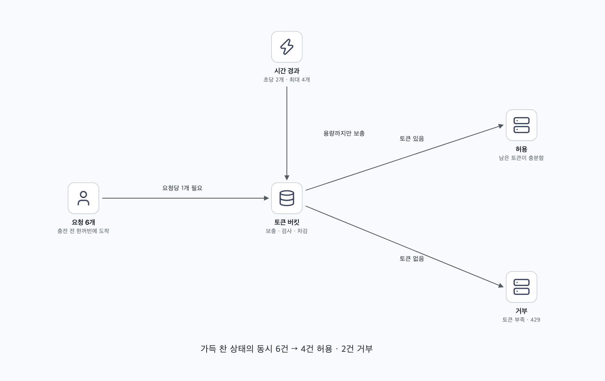

# 01. 토큰 버킷은 버스트를 어떻게 허용하며 동시성은 어떻게 처리할까?

## 먼저 ‘즉시 받아 줄 수 있는 양’을 본다

용량 4, 초당 2개 충전인 버킷이 가득 차 있다고 하자. 충전이 일어나지 않는 짧은 순간에 요청 6개가 들어오면 4개가 각각 토큰 하나를 사용하고 2개는 거부된다. 잠깐 사용하지 않은 권한을 모아 두었다가 쓰기 때문에 평소 공급률보다 빠른 순간 몰림을 받을 수 있다.

받아 준 4개가 끝날 때까지 다음 토큰을 기다리는 구조는 아니다. 남은 토큰과 충전 시간으로 다음 요청을 판정한다. 출력 속도를 일정하게 만드는 누출 버킷의 큐 모형과 여기서 차이가 난다.

## 동시 요청은 마지막 토큰을 함께 볼 수 있다

이제 토큰이 하나뿐일 때 A와 B가 동시에 도착했다고 하자.

| 순서 | A | B |
| --- | --- | --- |
| 1 | 남은 토큰 1 조회 | |
| 2 | | 남은 토큰 1 조회 |
| 3 | 통과시키고 0 저장 | |
| 4 | | 통과시키고 0 저장 |

마지막 값은 0이지만 요청은 두 개가 통과했다. 버스트를 허용한 것이 아니라 공유 상태를 잘못 바꾼 것이다.

필요한 판정 단위는 ‘시간에 따라 보충량 계산 → 상한 적용 → 충분한지 확인 → 차감 → 상태 저장’ 전체다. 이를 한 번에 실행하면 A가 토큰을 쓴 뒤 B는 갱신된 상태를 보고 거부된다.

한 프로세스 안에서만 쓰는 상태라면 그 프로세스의 동기화 수단으로 보호할 수 있다. 여러 서버가 같은 사용자의 버킷을 공유한다면 각 서버 안의 락만으로는 부족하다. 같은 키의 권위 있는 저장소에서 원자적으로 판정하거나, 해당 키를 한 처리 주체가 직렬로 다루는 등의 방식이 필요하다. Redis Lua는 그 구현 선택지 중 하나다.

## 주기적인 충전 작업 없이도 계산할 수 있다

토큰이 0이고 마지막 판정 이후 0.5초가 지났다면, 초당 2개 충전 설정에서는 1개가 생겼다고 계산한다. 용량 이상은 버린다. 이처럼 요청 시점에 갱신하면 활성 버킷마다 타이머를 실행할 필요가 없다.

시간 단위와 정밀도는 일관되게 정하고 서버마다 제각각인 클라이언트 시각을 신뢰하지 않는다. 시계가 뒤로 움직이거나 상태가 너무 일찍 만료되어 버킷이 가득 찬 것으로 초기화되는 경우도 다뤄야 한다. 비용이 다른 API라면 요청마다 토큰을 하나가 아닌 다른 양만큼 쓰게 할 수도 있다.

## 튜닝할 두 숫자는 서로 다른 역할을 한다

공급률은 지속적으로 허용할 속도에, 용량은 저장해 둘 수 있는 순간 여유에 영향을 준다. 공급률이 같아도 용량을 늘리면 더 큰 버스트가 통과한다. 보호할 API가 실제로 감당할 순간 처리량과 정상 사용자의 행동을 측정해 정한다.

토큰 판정이 올바르더라도 통과한 요청들이 모두 오래 걸리면 동시에 실행 중인 작업은 많아질 수 있다. 필요하면 처리율 제한과 동시 실행 수 제한을 함께 둔다. 토큰 버킷은 후자의 자동 대체물이 아니다.
