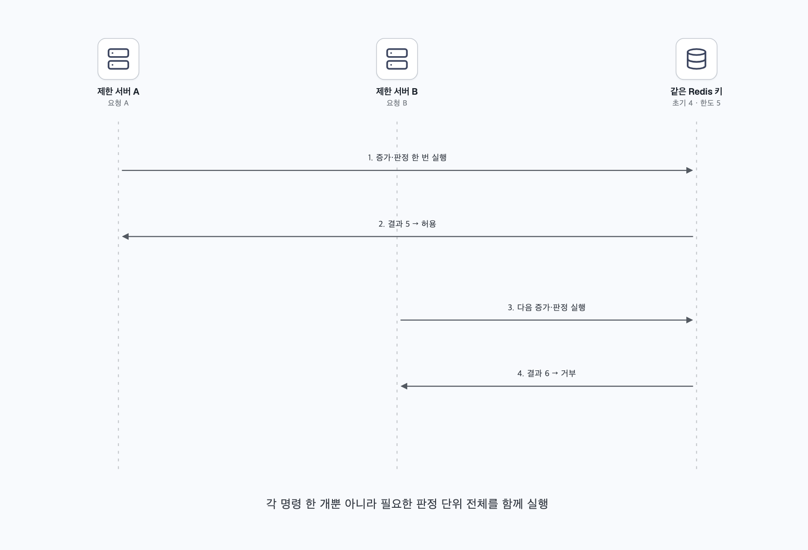

# 02. Lua와 정렬 집합은 경쟁 조건을 정확히 어떻게 줄일까?

## 공유 저장소와 원자적 판정은 다른 문제다

두 제한 서버가 같은 Redis를 쓰더라도 `GET → 비교 → SET` 사이에는 다른 요청이 끼어들 수 있다. 현재 4이고 한도가 5일 때 두 서버가 모두 4를 읽고 5를 쓰면 두 개가 통과한다. 저장 위치는 공유했지만 판단과 갱신을 함께 수행하지 않은 것이다.



Redis Lua 스크립트는 실행 중 다른 명령이 그 판정 사이에 끼어들지 않도록 할 수 있다. 그림에서 A의 판정·갱신이 끝난 뒤 B가 새 상태를 확인한다. 대신 긴 스크립트는 같은 Redis 노드의 다른 작업도 오래 기다리게 하므로 짧고 유한하게 유지한다. [Redis Lua 실행 보장](https://redis.io/docs/latest/develop/programmability/eval-intro/)

아래는 원리를 설명하는 학습용 예시다. 신뢰한 서버 코드가 올바른 키와 검증된 규칙을 넘긴다고 가정한다. 인증, 전역 장애 복구, 여러 규칙의 동시 적용까지 완성한 배포용 장치는 아니다.

## 1. 고정 윈도에서는 증가와 만료 설정을 함께 실행한다

`INCR` 자체는 원자적이다. 두 요청이 함께 실행되어도 서로 다른 증가 결과를 받으므로, **증가한 결과가 L 이하인지**로 허용 여부를 판단할 수 있다. 앞에서 읽은 값으로 각자 판단할 필요가 없다.

하지만 첫 증가 후 만료를 설정하기 전에 프로세스가 중단되면 만료 없는 키가 남을 수 있다. 다음 예시는 두 작업을 Lua 안에서 함께 수행한다.

```lua
-- KEYS[1]: 대상과 고정 시간 칸을 포함한 키
-- ARGV[1]: 양의 정수 한도, ARGV[2]: 양의 정수 보존 기간(ms)
local limit = tonumber(ARGV[1])
local ttl = tonumber(ARGV[2])
assert(limit and limit >= 1 and limit == math.floor(limit))
assert(ttl and ttl >= 1 and ttl == math.floor(ttl))

local count = redis.call('INCR', KEYS[1])
if count == 1 then
    redis.call('PEXPIRE', KEYS[1], ttl)
end
local allowed = 0
if count <= limit then allowed = 1 end
return {allowed, count}
```

예를 들어 키에 `사용자 42 + 상품 조회 + 12:00분`을 넣고 다음 분에는 다른 키를 쓴다. 이 예시는 거부한 시도도 카운터에 포함한다. 만료는 저장 공간 정리용이며 고정 윈도의 경계는 키에 포함한 시간 칸으로 정한다. 늦게 도착한 첫 요청부터 TTL만 세고 같은 키를 재사용하면 다른 시간 모형이 된다.

시간 칸을 고르는 기준도 여러 제한 서버가 일치시켜야 한다. 서버 간 시계 차이가 크면 경계에서 서로 다른 키를 쓸 수 있다. 신뢰할 시각 기준과 경계 규칙을 정하고 시험한다. 원자적인 `INCR`와 조건부 만료 설정 문제는 [Redis INCR 문서](https://redis.io/docs/latest/commands/incr/)에서도 다룬다.

## 2. 이동 윈도 로그에서는 세 단계를 함께 실행한다

정렬 집합은 요청마다 고유한 멤버를 넣고 점수로 시각을 저장한다. `ZREMRANGEBYSCORE`로 구간 밖의 기록을 지우고 `ZCARD`로 개수를 확인하며 `ZADD`로 기록을 넣을 수 있다.

그런데 이 세 호출을 각각 보내면 A와 B가 모두 ‘한 자리 남음’을 확인한 뒤 둘 다 추가할 수 있다. 자료구조 하나나 각 명령의 원자성만으로 전체 판정이 원자적이 되지는 않는다.

다음은 허용 요청만 기록하는 변형이다. Redis의 시각으로 `(현재-W, 현재]`를 검사하고, 이미 한도이면 새 기록을 넣지 않는다.

```lua
-- KEYS[1]: 한 대상의 로그 키
-- ARGV[1]: 윈도 길이(ms), ARGV[2]: 허용 한도
-- ARGV[3]: 이 판정 시도마다 새로 만든 고유 ID
local window = tonumber(ARGV[1])
local limit = tonumber(ARGV[2])
local member = ARGV[3]
assert(window and window >= 1 and window == math.floor(window))
assert(limit and limit >= 1 and limit == math.floor(limit))
assert(member and #member > 0)

local t = redis.call('TIME')
local now = tonumber(t[1]) * 1000 + math.floor(tonumber(t[2]) / 1000)
redis.call('ZREMRANGEBYSCORE', KEYS[1], '-inf', now - window)
local count = redis.call('ZCARD', KEYS[1])
if count >= limit then return {0, count} end
redis.call('ZADD', KEYS[1], now, member)
redis.call('PEXPIRE', KEYS[1], window)
return {1, count + 1}
```

여기서는 마지막 허용 요청 이후 윈도 길이가 지나면 그 대상의 활성 기록도 모두 구간 밖이 되므로 키를 만료시킬 수 있다. 거부 요청마다 TTL을 갱신하지 않아도 된다.

동시에 도착한 두 요청이 같은 밀리초일 수 있으므로 **시각만을 멤버로 사용하지 않는다.** 정렬 집합의 같은 멤버를 다시 `ZADD`하면 기존 항목을 갱신하기 때문이다. 이 예시는 각 판정 시도마다 고유한 ID를 요구하며, 업무 재시도에 쓰는 동일 멱등성 키를 그대로 재사용하는 예시가 아니다. [ZADD의 멤버 동작](https://redis.io/docs/latest/commands/zadd/)

## 3. Lua가 해결하지 않는 범위도 남긴다

- 네트워크 타임아웃이 나도 스크립트가 이미 토큰이나 카운터를 사용했을 수 있다. 재시도 시 한도를 다시 차감할지, 같은 판정 결과를 보존할지는 별도 정책이다.
- 여러 키를 한 번에 바꾸는 스크립트는 Redis Cluster의 같은 해시 슬롯 제약을 고려한다. 사용자 한도와 전역 한도를 서로 다른 샤드에 두면 전체를 단일 Lua 판정으로 묶기 어렵다. [Cluster 다중 키](https://redis.io/docs/latest/operate/oss_and_stack/reference/cluster-spec/)
- Lua가 원자적으로 실행된다는 것은 DB처럼 실행 오류 시 모든 이전 쓰기가 롤백된다는 뜻은 아니다. 입력과 자료형을 먼저 검증하고 오류 경로를 설계한다. [Redis 트랜잭션의 오류·롤백 설명](https://redis.io/docs/latest/develop/using-commands/transactions/)
- 비동기 복제의 장애 전환, 시계 후퇴, 상태 퇴거로 인한 한도 초기화는 실행 중 경쟁 조건과 다른 문제다. 엄격한 한도가 필요한 서비스라면 이 실패 모델까지 정해야 한다.

이 장에서 필요한 핵심은 **같은 대상의 상태를 공유하는 것**과 **그 상태의 판정·갱신을 함께 실행하는 것**을 모두 만족시키는 일이다.
