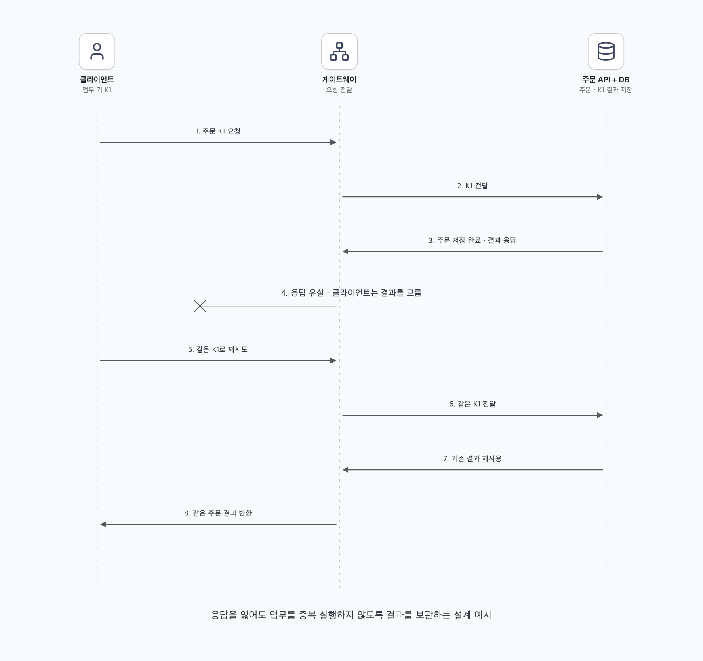

# 03. 게이트웨이·미들웨어·큐 중간에서 통신이 끊기면 어떻게 할까?

클라이언트가 주문 요청을 게이트웨이에 보냈고, 이후 타임아웃을 받았다고 하자. 요청이 API에 도착하지 않았을 수도 있고, 주문이 DB에 저장된 뒤 응답만 유실되었을 수도 있다. 클라이언트가 같은 오류만 보고 둘을 구분하기는 어렵다.

**중간 계층에 도착한 사실과 업무가 완료된 사실은 다르다.** 한 번의 통신으로 중단과 지연을 완벽하게 구분할 수 있다고 가정하지 않고, 확인·재시도·중복 방지로 복구한다.

## 1. 동기 요청은 결과가 불명확한 상태를 허용해야 한다

클라이언트는 주문 하나에 요청 키 K1을 정하고, 네트워크 오류로 다시 보낼 때도 같은 키를 사용한다. API는 해당 키의 처리 결과를 내구성 있게 보관하고, 같은 키와 같은 업무 내용이 오면 기존 결과를 재사용할 수 있다. 같은 키로 서로 다른 주문 내용이 오면 충돌로 처리하는 등의 규칙도 필요하다.

서버가 키만 먼저 기록하고 ‘처리됨’으로 응답하면 주문이 저장되지 않았는데 성공처럼 보일 수 있다. 가능한 범위에서는 업무 변경과 중복 방지 상태를 같은 DB 트랜잭션으로 확정한다. 아직 진행 중인 요청, 외부 결제가 포함된 요청, 보관 기간이 지난 재시도는 별도 정책이 필요하다. ‘키를 붙이면 정확히 한 번’으로 끝나는 기능은 아니다. [멱등 API와 재시도](https://aws.amazon.com/builders-library/making-retries-safe-with-idempotent-APIs/)

조회는 재시도하기 쉬운 경우가 많지만, 주문·결제 같은 변경 요청은 이런 업무 의미를 먼저 정한다. 실패했다고 생각해 여러 게이트웨이가 각자 무제한 재시도하면 오히려 부하가 커질 수 있다. 재시도 주체와 횟수를 정하고 요청 전체의 시간 예산을 유지한다.

## 2. 비동기 접수라면 먼저 내구성 있게 기록한다

중간 서버의 메모리에 잠깐 받은 상태에서 ‘접수 성공’을 돌려주고 중단되면 작업이 사라질 수 있다. 큐에 접수하는 방식이라면 요구한 내구성 조건으로 저장되었다는 확인을 받은 뒤 사용자에게 접수 완료를 알린다.

| 확인 | 보통 의미하는 것 | 아직 의미하지 않는 것 |
| --- | --- | --- |
| 브로커의 발행 접수 확인 | 브로커가 요구한 조건으로 메시지를 받아 둠 | 소비자가 업무를 완료함 |
| 소비자의 ack | 소비자가 처리 완료를 확인하는 프로토콜 동작 | 모든 외부 부작용과 자동으로 같은 트랜잭션 |
| 사용자의 완료 조회 | 서비스가 보관한 업무 결과를 반환 | 과거의 접수 응답만으로 성공이 확정됨 |

브로커가 접수했는데 확인 응답이 유실되면 발행자가 같은 메시지를 다시 보낼 수 있다. 소비자가 DB에 저장한 뒤 ack 전에 중단되면 재전달될 수 있다. 따라서 메시지 ID와 멱등한 소비도 필요하다. [RabbitMQ의 발행 확인·소비 확인](https://www.rabbitmq.com/docs/confirms)

업무 DB 변경과 큐 발행을 모두 해야 한다면 둘 사이에도 실패의 틈이 생긴다. 1장에서 다룬 [트랜잭션 아웃박스](../../01-scaling/README.md#q5)처럼 업무와 전달 의도를 함께 기록한 뒤 재발행하는 방법을 검토할 수 있다. 브로커 설정의 복제·지속성·라우팅 조건까지 맞춰야 하며 유실 가능성을 모든 장애에서 0으로 만든다고 표현하지 않는다.

## 3. 제한 판정도 업무 완료와 구분한다

제한 장치에서 허용했다는 것은 그 요청에 권한을 사용했다는 뜻이다. 이후 API가 중단되었다고 주문이 성공한 것은 아니며, 실패한 업무의 토큰을 자동으로 돌려줘야 하는 것도 아니다. ‘요청 시도’를 세는지 ‘업무 성공’을 세는지 먼저 정한다.

판정 결과 응답만 유실되어 같은 요청이 다시 제한 장치를 지나면 한도를 한 번 더 사용할 수 있다. 중복 판정 결과를 요청 ID로 일정 기간 재사용하는 설계도 가능하지만 추가 상태·만료·요청 내용 검증이 필요하다. 업무 멱등성과 제한 카운터의 중복 차감은 서로 다른 문제다.

## 4. 재시도는 기다렸다가 제한적으로 수행한다

응답을 못 받았다고 즉시 계속 보내면 장애 지점의 부하를 키운다. 먼저 타임아웃과 전체 마감 시간을 두고, 가능한 재시도 횟수 안에서 대기 간격을 늘린다. 여러 클라이언트가 같은 순간에 다시 몰리지 않도록 지터를 넣을 수 있다. 429의 `Retry-After`도 존중한다. [AWS 타임아웃·백오프·지터](https://aws.amazon.com/builders-library/timeouts-retries-and-backoff-with-jitter/)

멱등성은 중복 업무 결과를 줄인다. 요청 자체를 없애지는 않으므로 클라이언트 캐시, 호출 병합, 백오프와 함께 사용한다. 보호 장치의 허용 응답, 큐의 접수 확인, 업무 DB의 완료 기록을 각각 관측할 수 있어야 중간 실패를 추적하기 쉽다.
