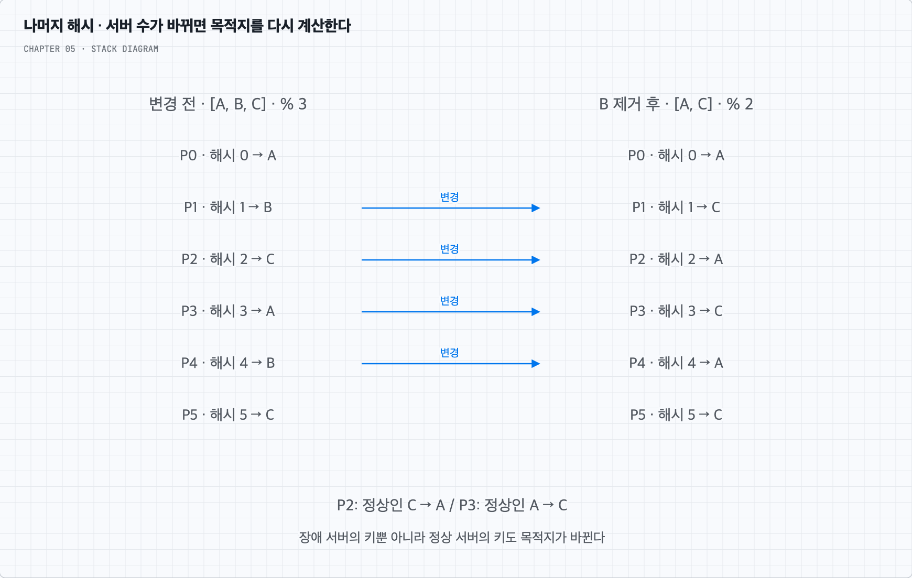
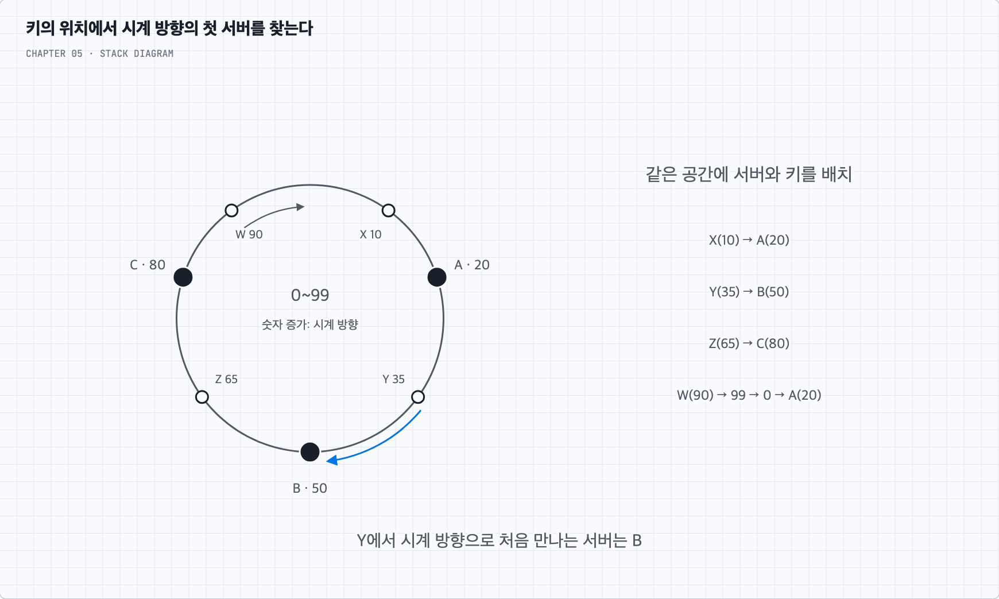
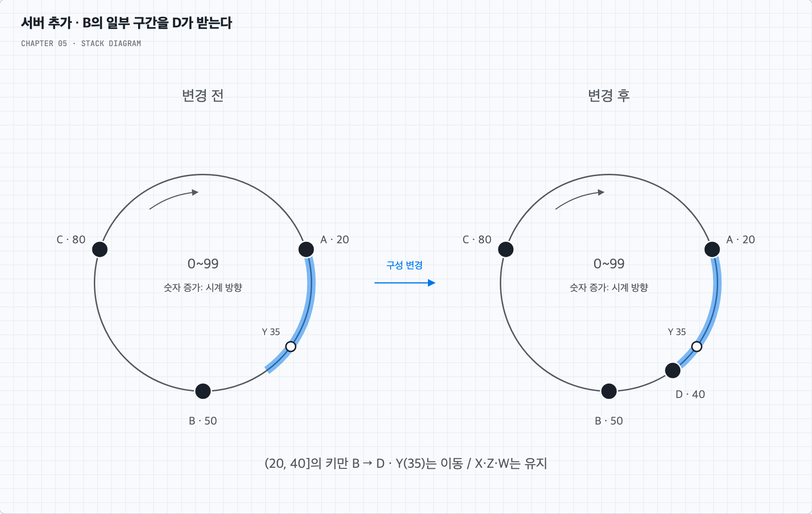
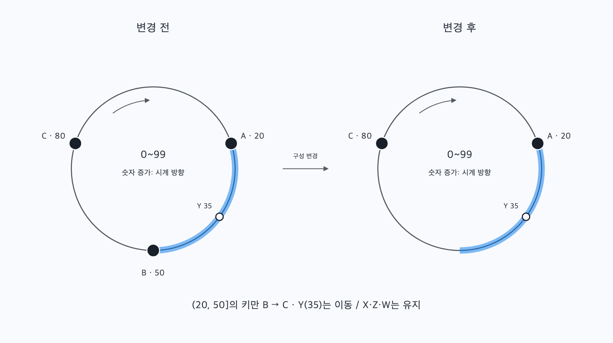
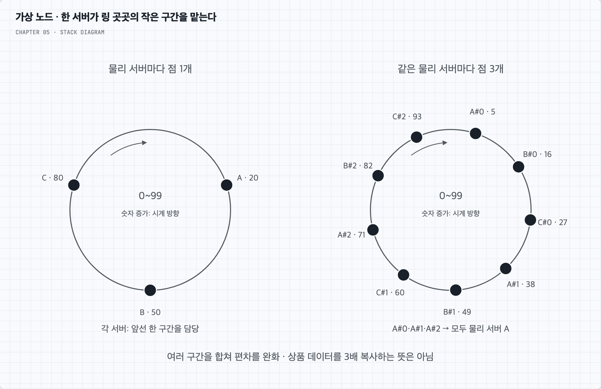

# 서버가 늘어도 대부분의 키는 제자리에 둔다

## 1. 상품 캐시를 어느 서버에서 찾을까?

상품 상세 조회가 많아 캐시 서버 A·B·C 세 대를 사용한다고 하자. 같은 상품의 요청은 같은 캐시로 보내야 한 번 저장한 값을 다시 활용할 수 있다. 서버를 매번 무작위로 고르면 값이 다른 서버에 있어도 캐시 미스가 난다.

간단한 방법은 상품 키를 해시한 뒤 서버 수로 나눈 나머지를 사용하는 것이다.

```text
serverIndex = hash(key) % N
```

해시 함수는 같은 입력에 같은 값을 반환한다. 그 값을 서버 목록의 인덱스로 바꾸면 클라이언트마다 별도 위치표를 저장하지 않고도 담당 서버를 계산할 수 있다. 모든 클라이언트가 같은 해시 함수와 같은 순서의 서버 목록을 사용해야 한다.

설명을 위해 여섯 상품 키의 해시값이 각각 0–5라고 하자. 실제 해시 결과를 작게 줄인 예시다. 서버 목록이 `[A, B, C]`이면 다음처럼 나뉜다.

| 상품 키 | 해시값 | `% 3` | 담당 서버 |
| --- | --- | --- | --- |
| P0 | 0 | 0 | A |
| P1 | 1 | 1 | B |
| P2 | 2 | 2 | C |
| P3 | 3 | 0 | A |
| P4 | 4 | 1 | B |
| P5 | 5 | 2 | C |

서버 목록이 고정되어 있고 해시 결과가 고르게 퍼진다면 키를 나누기 쉽다. 다만 키의 수가 비슷하다는 것이 저장 바이트 수나 요청량까지 비슷하다는 뜻은 아니다. 이 차이는 가상 노드를 설명한 뒤 다시 살펴본다.

## 2. 서버 한 대를 빼도 다른 서버의 키까지 바뀐다

B가 장애로 빠져 서버 목록을 `[A, C]`로 바꿨다고 하자. 이제 `% 2`를 계산한다. 인덱스 1이 가리키는 서버도 B에서 C로 바뀐다.



| 키 | 변경 전 `% 3`의 서버 | 변경 후 `% 2`의 서버 | 결과 |
| --- | --- | --- | --- |
| P0 | A | A | 유지 |
| P1 | B | C | 변경 |
| P2 | C | A | 변경 |
| P3 | A | C | 변경 |
| P4 | B | A | 변경 |
| P5 | C | C | 유지 |

장애가 난 B의 키만 바뀌는 것이 아니다. 정상인 C에 있던 P2도 이제 A로 가고, A에 있던 P3도 C로 간다. 그곳에는 아직 해당 값이 없으므로 캐시 미스가 늘고 원본 DB로 조회가 몰릴 수 있다. 서버를 추가해도 나눗수가 달라지므로 같은 문제가 생긴다.

키가 고르게 퍼졌더라도 서버 수가 바뀔 때의 대규모 재매핑은 남는다. 따라서 필요한 것은 ‘서버 구성이 바뀌어도 관련 없는 키의 목적지는 유지하는 방법’이다.

## 3. 나머지 대신 고정된 해시 공간 위에서 위치를 찾는다

안정 해시(consistent hashing)는 키와 서버를 같은 고정된 공간 위에 배치한다. 책은 SHA-1의 출력 범위인 `0`부터 `2^160 - 1`까지를 예로 든다. 마지막 다음에 다시 0이 온다고 생각하면 원형의 해시 링이 된다. SHA-1을 반드시 사용해야 한다는 뜻은 아니다. 여기서는 보안 용도가 아니라 위치를 설명하는 예시다.

서버 이름이나 식별자를 해시해 서버의 위치를 정하고, 상품 키도 해시해 링 위의 위치를 정한다. 서버가 추가되어도 공간 자체의 크기는 바꾸지 않는다. `% 서버 수`를 다시 계산하던 방식과의 핵심 차이다.

이후의 예시는 계산을 눈으로 따라갈 수 있도록 `0~99`인 링을 사용한다. 숫자가 커지는 방향이 시계 방향이고 99 다음은 0이다. 서버는 `A=20, B=50, C=80`에 놓는다. 이 좌표는 설명을 위해 지정한 값이다.



키의 위치에서 시계 방향으로 이동해 처음 만나는 서버가 담당 서버다. 키와 서버의 위치가 정확히 같으면 그 서버를 선택하는 규칙으로 정한다.

- 상품 X의 위치가 10이면 A(20)로 간다.
- 상품 Y의 위치가 35이면 B(50)로 간다.
- 상품 Z의 위치가 65이면 C(80)로 간다.
- 상품 W의 위치가 90이면 99에서 0으로 돌아가 A(20)로 간다.

이때 B는 바로 전 서버 A부터 자기 위치까지인 `(20, 50]` 구간을 맡는다. 왼쪽 괄호는 20을 제외하고 오른쪽 대괄호는 50을 포함한다는 뜻이다. A는 링의 끝을 걸치는 `(80, 20]`을 맡는다. 이는 `80 초과~99`와 `0~20`을 이어 붙인 구간이다.

그림의 시계 방향 탐색은 담당 서버를 정하는 계산 규칙이다. 요청이 실제로 모든 서버를 차례로 방문해야 한다는 뜻은 아니다. 클라이언트나 라우터가 정렬된 서버 위치표에서 키 이상의 첫 위치를 찾고 바로 그 서버로 요청할 수 있다.

## 4. 새 서버가 들어오면 한 구간만 나누어 맡는다

상품 조회가 늘어 D를 위치 40에 추가한다고 하자. A(20)와 B(50) 사이에 D(40)가 생긴다. 이전에 B가 맡던 `(20, 50]` 중 `(20, 40]`의 키만 D로 바뀐다.



Y(35)는 이제 D를 먼저 만나므로 B에서 D로 바뀐다. X(10)는 여전히 A, Z(65)는 C, W(90)는 A로 간다. 새 위치가 45인 키도 D를 이미 지나쳤으므로 계속 B를 담당 서버로 찾는다. 기존 서버의 위치와 키의 위치는 그대로다.

이를 일반화하면 새 서버 S의 바로 전 서버를 P, 바로 다음 서버를 Q라고 할 때 `(P, S]`가 Q에서 S로 이동한다. 키를 찾는 방향은 시계 방향이고, 이동 범위의 시작 P를 찾을 때는 S에서 반시계 방향의 이웃을 확인한다.

책의 그림에서 S4의 반시계 방향 이웃이 S3이므로 그 사이를 찾는 것이다. 서버 이름의 숫자가 연속이라는 이유로 S3을 고르는 것이 아니다. 또한 반시계 방향으로 살펴본다는 설명이 ‘키를 반시계 방향 서버에 배정한다’는 뜻도 아니다.

이 예시의 D가 차지하는 범위는 링의 20%다. 키가 고르게 분포한다면 약 20%가 바뀐다. ‘서버가 네 대가 되었으니 반드시 25% 이동한다’고 계산하면 안 된다. 실제 이동량은 배치된 위치에 따라 달라진다.

## 5. 서버를 제거하면 그 서버의 구간을 다음 서버가 받는다

이번에는 D를 추가하기 전의 A·B·C 링으로 돌아가 B(50)를 제거하자. B가 맡던 `(20, 50]`은 다음 서버 C(80)가 받는다. Y(35)는 이제 C를 처음 만난다. X·Z·W의 담당은 바뀌지 않는다.



제거되는 서버 S의 바로 전 위치를 P, 다음 서버를 Q라고 하면 `(P, S]`의 담당이 S에서 Q로 바뀐다. 가상 노드가 없는 이 구성에서는 Q에 그만큼의 추가 부하가 몰린다.

여기서 ‘재배치’는 우선 키를 보낼 목적지가 달라진다는 뜻이다. 안정 해시가 캐시 값을 자동으로 옮겨 주지는 않는다. 빈 목적지 캐시는 원본에서 다시 채우거나 미리 워밍해야 한다. 원본 데이터를 저장하는 시스템이라면 실제 데이터 전송과 복제·복구 절차가 추가로 필요하다.

### 평균 k/n개만 이동한다는 말의 조건

키가 k개이고, 같은 용량의 서버들이 충분히 균형 있게 분할되어 있다고 하자. 현재 n대 중 한 대를 제거하면 그 서버가 맡던 평균 `k/n`개가 이동한다. 반면 현재 n대에서 한 대를 추가하면 새 서버가 최종적으로 맡을 기대량은 `k/(n+1)`개다. 최종 서버 수를 n이라고 부르면 추가의 경우도 `k/n`으로 쓸 수 있다.

이 수치는 균형과 분포에 관한 평균이다. 특정 링의 실제 이동량, 복제본까지 포함한 전송량, 모든 서버의 재시도 트래픽이 정확히 그 값이라는 보장은 아니다. 가상 노드를 쓰면 링의 위치 수와 물리 서버 수도 달라지므로 n이 무엇을 세는지 먼저 밝혀야 한다.

## 6. 적게 옮긴다고 고르게 나뉘는 것은 아니다

A·B·C를 각각 20·50·80에 놓았을 때 담당 공간의 비율은 40%·30%·30%다. 서버를 해시한 위치는 원하는 간격으로 나오지 않는다. 몇 점이 한쪽에 몰리면 어느 서버는 아주 짧은 구간을, 다른 서버는 긴 구간을 맡는다. 삭제 후에는 간격이 더 벌어질 수 있다.



키의 해시값이 고르게 나와도 서버가 맡은 공간 크기가 다르면 키의 개수가 달라진다. 또 공간 크기가 같아도 키가 적거나 해시 결과가 편향되어 있으면 실제 키 개수는 다를 수 있다. 이를 완화하려면 한 서버가 링의 여러 작은 구간을 나누어 맡게 한다.

## 7. 한 물리 서버를 여러 가상 노드로 나타낸다

물리 서버 A를 하나의 점 대신 `A#0, A#1, A#2`처럼 여러 식별자로 나타내고 각각 해시한다. 이 점들을 가상 노드라고 한다. 조회한 키에서 시계 방향으로 처음 만나는 가상 노드를 찾은 뒤, 그 가상 노드가 가리키는 물리 서버로 요청한다.

위 그림 오른쪽은 차이를 쉽게 보이도록 세 서버의 점을 번갈아 배치한 예시다. 실제 무작위 해시가 반드시 이렇게 정렬해 주는 것은 아니다. A는 A의 가상 노드들에 앞선 여러 구간을 합쳐 맡는다. 한 점이 우연히 큰 구간을 받아도 다른 점의 작은 구간과 함께 합산되므로, 충분한 가상 노드와 고른 해시 분포를 전제로 서버별 편차를 줄일 수 있다.

물리 서버를 추가하면 그 서버의 여러 점이 링 곳곳에 들어가 여러 기존 서버의 구간을 조금씩 가져온다. 제거할 때도 그 서버의 모든 가상 노드가 빠지므로 각각의 다음 점을 소유한 서버들이 구간을 받는다. 모두가 정확히 같은 양을 받는 것은 아니다.

가상 노드 수를 늘리면 링에 저장하는 ‘위치 → 물리 서버’ 메타데이터와 변경 관리 비용이 커진다. 상품 데이터를 가상 노드 수만큼 복사하는 비용을 말하는 것이 아니다. 정렬된 위치 배열을 사용하고 전체 가상 노드 수가 V개라면, 일반적인 이진 탐색 조회는 `O(log V)`, 위치표 저장 공간은 `O(V)`다. 가상 노드 수는 균형과 관리 비용을 함께 보며 정한다.

용량이 큰 서버에 더 많은 가상 노드를 주는 방식으로 비중을 조정할 수도 있다. 이를 도입할 때도 서버별 실제 사용량을 관찰해야 한다. [Dynamo 논문](https://www.allthingsdistributed.com/files/amazon-dynamo-sosp2007.pdf)의 §4.2는 가상 노드와 서버 용량에 따른 할당을 설명한다.

### 가상 노드는 데이터 복제본과 다르다

책은 가상 노드를 replica라고도 부른다. 여기서는 한 물리 서버를 링에 여러 번 나타내는 의미로 읽어야 한다. A의 가상 노드를 세 개 만든 것만으로 상품 Y의 복사본이 세 개 생기지는 않는다.

데이터 복제는 같은 상품 값을 서로 다른 물리 서버에도 저장하는 별도의 설계다. 링의 다음 몇 점을 후보로 삼더라도 같은 물리 서버의 가상 노드가 연속될 수 있다. 독립된 복사본이 필요하다면 서로 다른 물리 서버를 골라야 하며, 가용 영역 같은 장애 영역도 고려한다. 복제본 선택과 읽기·쓰기 일관성은 안정 해시의 목적지 계산에 자동으로 따라오는 기능이 아니다.

## 8. 균등한 키 개수와 균등한 부하를 구분한다

A와 B가 상품을 각각 1만 개씩 맡더라도, A에 인기 상품 하나의 조회가 집중되면 A만 바쁠 수 있다. 가상 노드를 늘려도 같은 키는 여전히 같은 담당을 찾는다. 인기 키 하나의 요청을 자동으로 쪼개 주지 않는다.

또 상품 설명 하나가 1KB이고 다른 상품의 부가 데이터가 1MB라면 키 개수만 같아도 저장량은 다르다. 따라서 키 개수, 저장 바이트 수, 요청 수와 지연을 따로 관찰해야 한다. 상황에 따라 인기 항목 복제, 애플리케이션의 가까운 캐시, 요청 병합 등이 추가로 필요할 수 있다. 각각은 캐시 무효화와 중복 저장 비용을 함께 검토한다.

| 바라는 성질 | 안정 해시·가상 노드가 하는 일 | 별도로 필요한 일 |
| --- | --- | --- |
| 증설·제거 시 변경 최소화 | 관련 구간의 목적지만 바꾼다 | 실제 데이터 이동·캐시 워밍 |
| 서버별 키 분포 완화 | 여러 작은 구간을 합쳐 편차를 줄인다 | 바이트·요청량 측정과 용량 조정 |
| 서버 장애 대응 | 새 서버 목록에서 다음 담당을 계산한다 | 장애 감지·목록 배포·복제와 복구 |
| 인기 상품의 과부하 대응 | 여러 키를 나누는 기본 배치를 제공한다 | 인기 키 자체의 요청 분산 정책 |

## 9. 모든 요청 주체가 같은 링을 알아야 한다

클라이언트 1은 B가 살아 있다고 보고 클라이언트 2는 제거되었다고 보면 같은 키를 서로 다른 서버로 보낸다. 해시 함수가 같아도 서버 목록이나 가상 노드 위치표가 다르면 결과가 달라진다. 서버 식별자·가상 노드 생성 규칙·해시 함수·구성 버전을 맞춰야 한다.

운영에서는 구성 변경을 배포하고, 이전 담당과 새 담당이 공존하는 동안 읽기와 쓰기를 어떻게 처리할지 정한다. 캐시라면 일부 미스를 허용하고 점진적으로 채우는 선택이 가능하다. 원본 저장소라면 데이터를 옮기기 전에 새 담당으로만 전환하면 누락이 생길 수 있으므로 전송·전환·복구 순서가 필요하다.

안정 해시는 이 과정에서 바뀌어야 하는 범위를 줄인다. 장애 감지, 모든 클라이언트의 동시 전환, 데이터 내구성과 일관성을 대신 구현하지는 않는다. 1장의 샤딩이 ‘나누어 저장한다’는 큰 구조였다면, 이 장은 그 안에서 ‘구성이 변할 때 목적지를 얼마나 적게 바꿀 것인가’를 다룬다.
