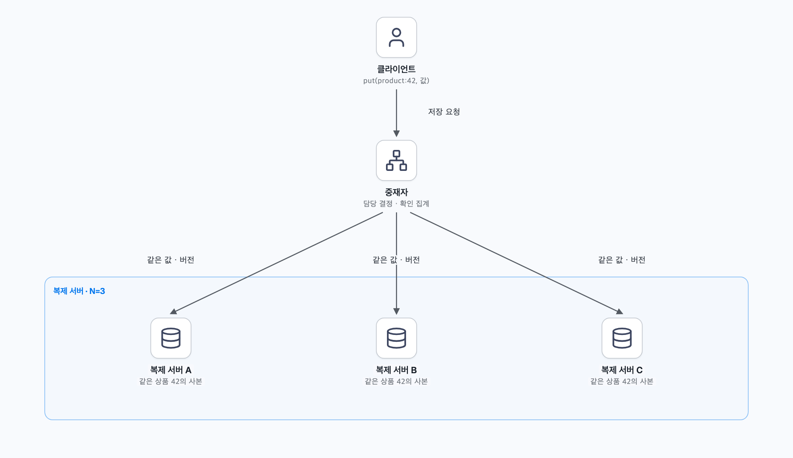
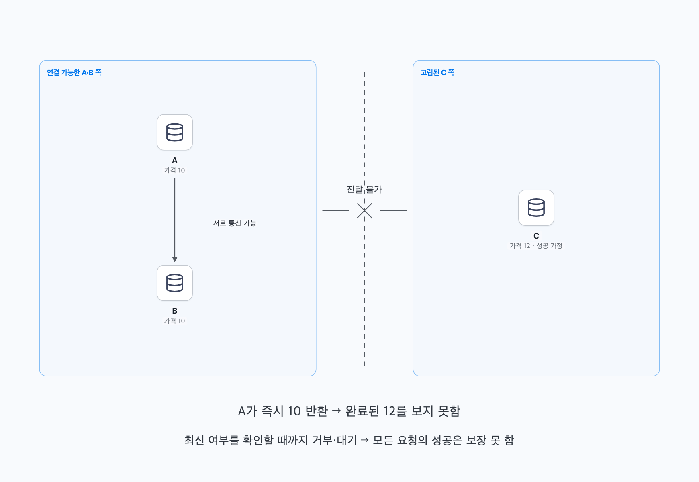
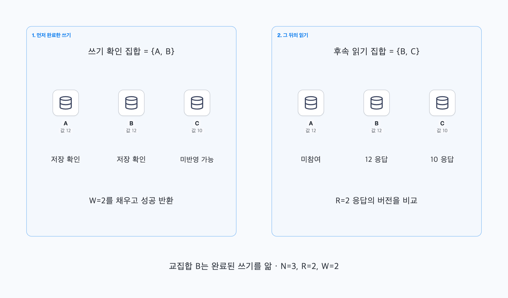
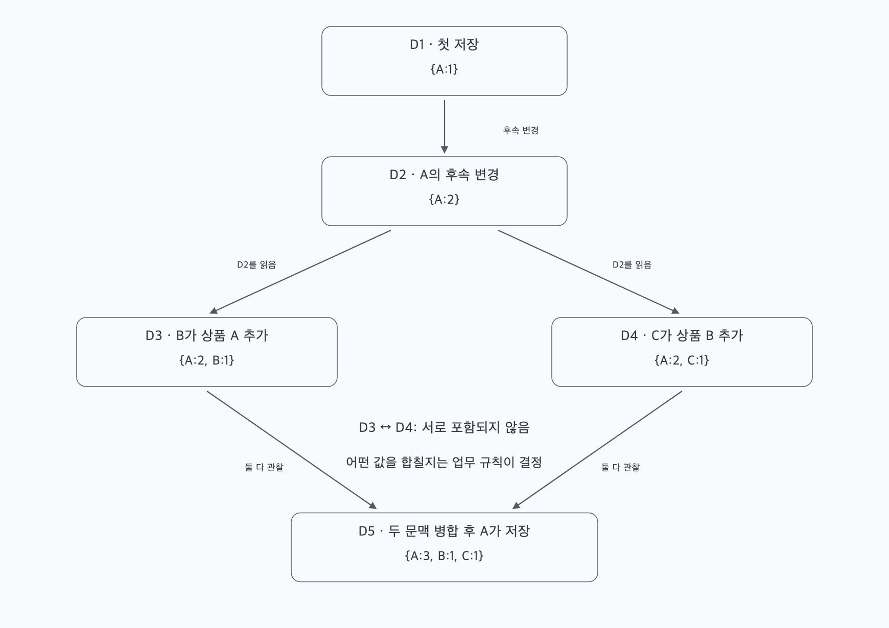
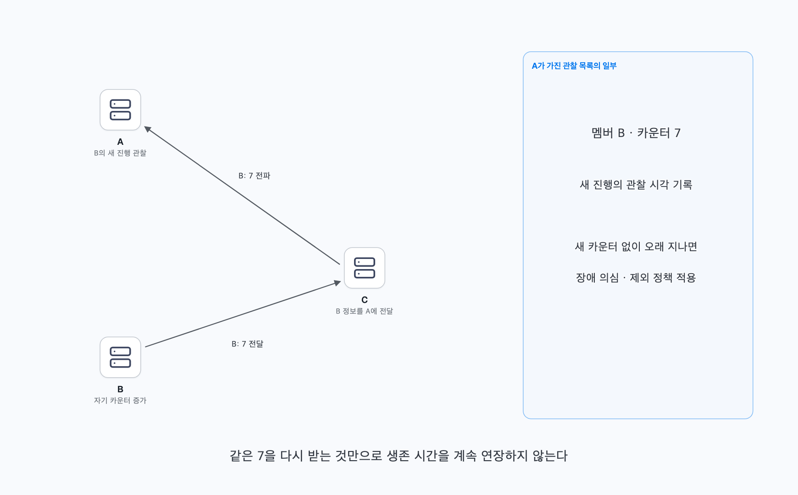
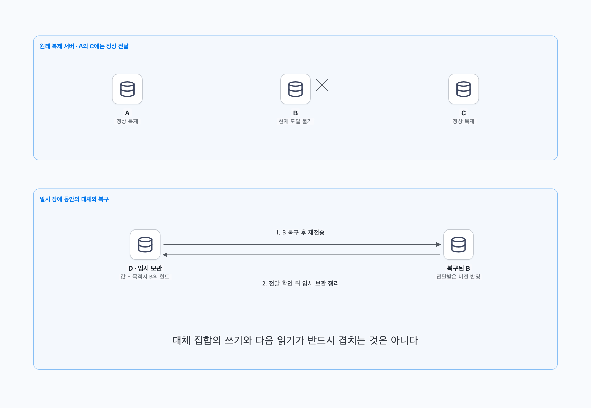
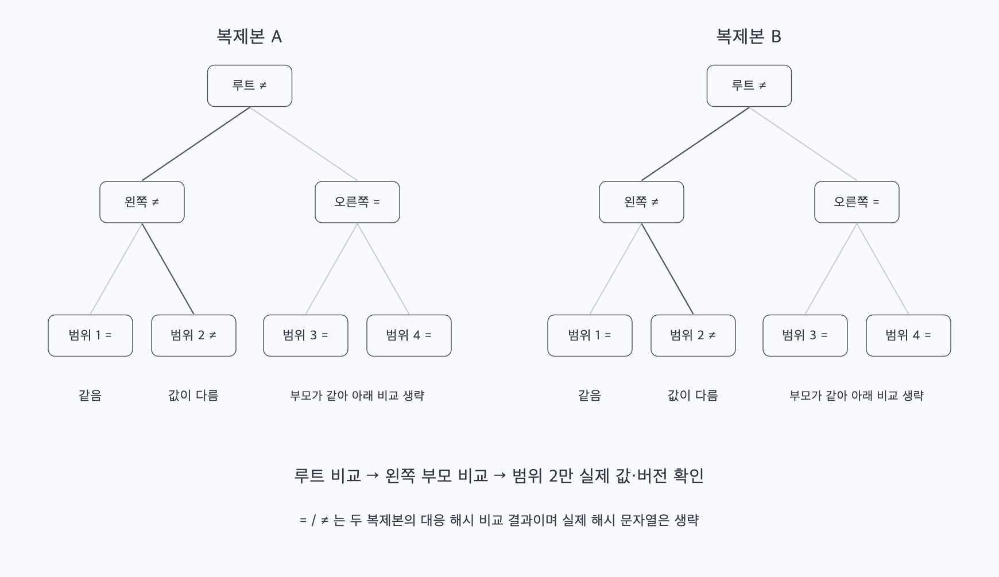
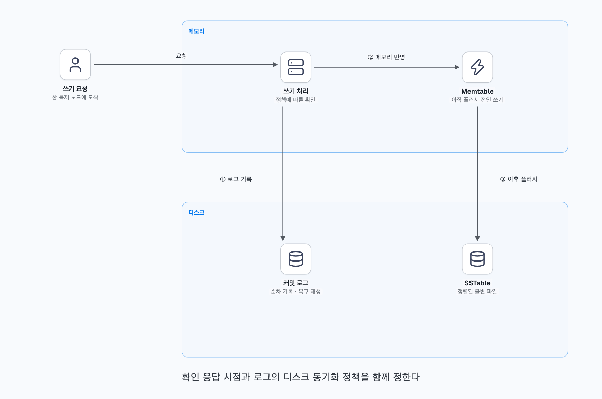
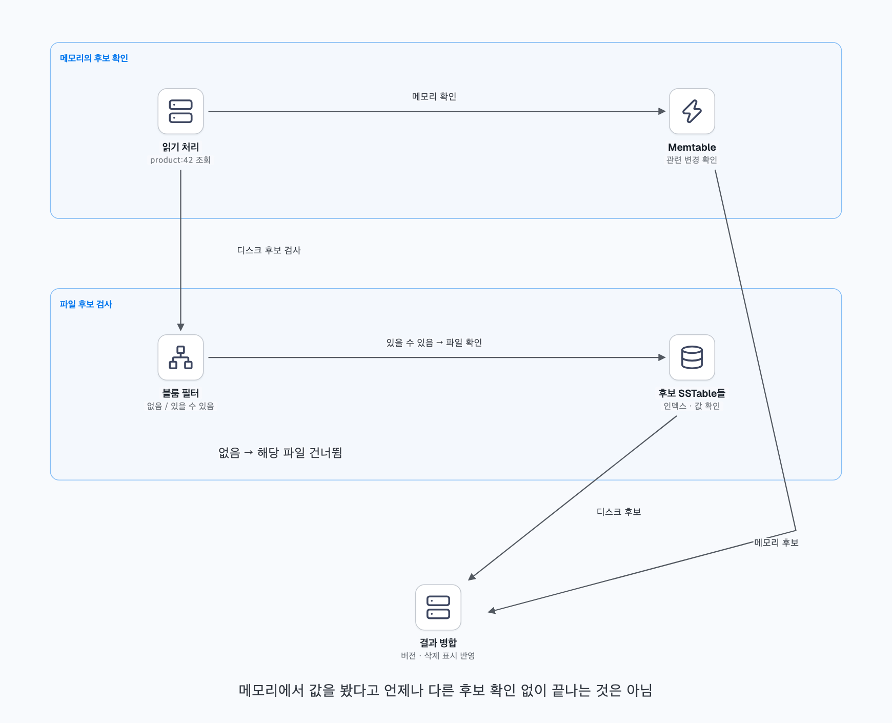

# 한 서버의 해시 테이블에서 분산 저장소까지

## 1. 저장소가 값의 의미를 몰라도 되는 이유

상품 서비스가 `product:42`라는 키로 상품 정보를 저장한다고 하자. 가장 단순한 인터페이스는 `put(key, value)`로 저장하고 `get(key)`로 꺼내는 것이다. 문자열·JSON·직렬화한 객체 등을 값으로 넣을 수 있다.

‘값으로 무엇이 와도 상관하지 않는다’는 말은 저장소가 상품 이름이나 가격의 의미를 해석하지 않고 값을 취급한다는 뜻이다. 아무 크기나 어떤 프로그래밍 언어의 객체든 변환 없이 넣는다는 뜻은 아니다. 전달할 바이트 형식, 크기 제한과 유효성은 정해야 한다. 이 장에서는 키-값 쌍이 10KB 이하이고 키로 저장·조회하는 범위를 설계한다. 값 안의 가격 조건 검색이나 여러 키를 묶은 트랜잭션까지 기본 기능으로 가정하지 않는다.

총 데이터는 많고 계속 늘어난다. 서버 한 대가 고장 나도 서비스를 계속하고, 트래픽에 따라 서버를 늘리거나 줄이며, 일관성과 응답시간의 균형을 조정할 수 있어야 한다. 모든 데이터가 항상 최신이면서 모든 장애 중에도 즉시 응답한다는 조건을 동시에 약속하기는 어렵다. 우선 한 서버에서 시작해 어디서 그 한계가 나타나는지 본다.

## 2. 메모리 해시 테이블은 빠르지만 용량과 복구에 한계가 있다

한 서버의 메모리에 키-값 쌍을 해시 테이블로 넣으면 키를 빠르게 찾을 수 있다. 적절한 해시와 부하율을 전제로 조회·갱신의 평균 비용은 작다. 다만 모든 데이터와 자료구조의 부가 공간이 메모리에 들어가야 한다.

데이터를 압축하면 공간을 아낄 수 있지만 압축·해제에 CPU를 쓴다. 자주 쓰는 데이터만 메모리에 두고 나머지를 디스크에 보관하면 용량은 늘릴 수 있으나 디스크 조회 경로가 필요하다. 메모리 내용은 프로세스나 서버가 꺼지면 사라질 수 있으므로 영구 보관이 목적이라면 로그와 디스크 복구도 필요하다.

개선을 해도 한 서버의 용량·처리량을 넘거나 그 서버가 고장 나면 다른 서버가 대신해야 하는 시점이 온다. 데이터를 여러 서버로 나누는 분산 키-값 저장소로 확장하자. 이 장에서는 키를 해시하여 담당을 찾는 분산 해시 테이블 형태를 다룬다. 모든 분산 키-값 제품이 같은 내부 구조를 갖는다는 뜻은 아니다.

## 3. 데이터를 나누고, 같은 데이터의 복사본도 둔다

5장의 안정 해시로 키의 담당 서버를 찾는다. 서버가 추가·제거될 때 관련 구간의 담당만 바뀌므로 전체 데이터를 다시 나누는 일을 줄일 수 있다. 가상 노드 수로 서버의 용량 비중을 조정할 수도 있다. 그러나 트래픽 관찰, 증설 결정, 서버 합류, 데이터 전송과 전환 절차는 별도로 구현해야 한다. 안정 해시 자체가 자동 확장을 실행하지는 않는다.

이제 A가 상품 42를 맡는다고 하자. A만 그 값을 보관하면 A 장애 때 읽을 수 없다. 같은 값을 B와 C에도 보관하자. 이렇게 한 키를 N개의 서로 다른 물리 서버에 저장하는 것이 데이터 다중화, 즉 복제다. 여기서 N은 전체 클러스터 서버 수가 아니라 그 키의 복제본 수다.

클라이언트 요청을 받아 담당 복제 서버에 전달하고 응답을 모으는 노드를 중재자(coordinator)라고 한다. 그림의 중재자는 설명을 위해 따로 그린 역할이다. 실제로는 저장 노드가 요청마다 그 역할을 맡을 수 있다. 가상 노드를 순서대로 고를 때 같은 물리 서버를 중복 선택하지 않아야 N대에 복사본이 생긴다. 데이터 센터 장애에 대비한다면 서로 다른 장애 영역에 배치한다.

분할은 서로 다른 키를 나누는 일이고, 복제는 같은 키의 값을 여러 곳에 두는 일이다. 복제 요청을 여러 서버로 보낸다고 항상 전부의 완료를 기다릴 필요는 없다. 일부 응답 후 성공을 알리고 나머지는 늦게 반영할 수도 있다. 그렇다면 성공 직후 다른 복제본을 읽으면 무엇을 보게 될까? 여기서 일관성 문제가 시작된다.

## 4. 연결이 끊긴 동안 무엇을 보장할까? — CAP

A·B·C가 모두 상품 가격 10을 저장했다고 하자. C 쪽과 A·B 쪽의 통신이 끊겼지만 각 서버 자체는 살아 있고 양쪽에 클라이언트가 접속할 수 있다. 이런 네트워크 분할은 단순히 서버 프로세스가 종료된 상황과 다르다. 서로의 최신 상태를 확인할 수 없다는 것이 문제다.

C 쪽에서 가격을 12로 바꾸는 쓰기가 성공했다고 답했다고 가정하자. 그 뒤 A 쪽에서 읽기를 요청하면 A는 그 쓰기를 알 수 없다. A가 즉시 10을 반환하면 이미 성공한 쓰기보다 오래된 값을 보게 된다. 반대로 최신 여부를 확인할 수 있을 때까지 결과를 주지 않으면 A 쪽 요청은 계속 성공하지 못한다.

CAP 정리는 이런 분할 중에 다음의 C와 A를 함께 보장할 수 없음을 말한다.

- C(일관성)는 여기서 선형화 가능성이라는 강한 의미다. 모든 연산이 요청과 응답 사이의 한 시점에 일어난 것처럼 보이며, 완료된 쓰기 이후의 읽기는 그 쓰기 또는 그 뒤의 쓰기를 관찰해야 한다.
- A(가용성)는 고장 나지 않은 노드에 도착한 모든 요청이 결국 해당 연산의 결과를 받는다는 의미다. 모든 요청에 오류만 반환하는 것으로 만족시키지 못한다. 일상적인 서비스 가동률 수치나 짧은 지연시간과도 구분한다.
- P(분할 감내)는 노드 사이 메시지가 전달되지 않는 상황까지 다룬다는 전제다. 네트워크 분할을 선택적으로 켜는 기능으로 보기보다 고장 모델로 이해한다.

일관성을 우선하면 최신 상태를 안전하게 결정할 수 없는 쪽의 연산을 거부하거나 기다리게 할 수 있다. 반대쪽이 정족수를 확보했다면 그쪽은 계속 처리할 수도 있다. 모든 노드에서 모든 요청을 중단해야 한다는 뜻은 아니다. 앞의 ‘고립된 C가 쓰기 성공을 반환’하는 행동 자체도 일관성을 지키는 설계에서는 허용되지 않을 수 있다.

가용성을 우선하면 양쪽이 요청을 계속 처리할 수 있지만 오래된 읽기와 서로 다른 쓰기 결과를 감당해야 한다. 연결이 돌아온 뒤 자동으로 한쪽 값이 정답이 되는 것은 아니다. 전달과 충돌 해소가 필요하다. 상품 설명이나 장바구니처럼 기능별로 허용할 불일치와 병합 방법을 먼저 정한다.

CP·AP라는 이름은 이 선택을 요약한 것이다. ‘항상 셋 중 아무 두 개를 고른다’는 암기보다 분할 중의 동작을 설명하는 것이 정확하다. 분할이 없을 때 C와 A를 함께 제공하는 설계는 가능하다. CA는 분할을 전제에서 제외한 모델로 이해할 수 있으나, 실제 다중 서버 설계에서 네트워크가 절대 끊기지 않는다는 보장으로 사용할 수 없다. [Gilbert·Lynch의 CAP 해설](https://groups.csail.mit.edu/tds/papers/Gilbert/Brewer2.pdf)을 함께 참고한다.

## 5. 복제본 몇 개의 응답을 기다릴까? — N·W·R

평상시에도 복제본의 반영 속도는 같지 않다. 중재자가 모든 복제본에 쓰기를 보내되 몇 개가 저장했다고 답하면 클라이언트에게 성공을 반환할지 정한다. 읽기도 몇 개의 응답을 모아 결과를 정할지 선택한다.

- N: 한 키를 보관하는 복제 서버 수다.
- W: 쓰기 성공에 필요한 서로 다른 복제 서버의 확인 응답 수다.
- R: 읽기 결과를 결정하기 위해 필요한 서로 다른 복제 서버의 응답 수다.

중재자가 복제본도 보관한다면 자기 서버의 저장 확인을 W에 포함할 수 있다. 요청을 보낸 횟수나 같은 서버의 중복 응답을 세는 것이 아니다.

N=3, W=2에서 A·B가 가격 12 저장을 확인하고 성공을 반환했다고 하자. 그 뒤 R=2로 B·C에서 읽으면 B가 쓰기 결과를 알고 있다. 응답을 단순히 다수결하는 것이 아니라 버전 등을 비교해 새 버전 또는 충돌 여부를 판단한다. 같은 세 복제본 중 임의의 두 개를 읽으면 앞서 확인한 두 개와 최소 하나가 겹친다.

일반적으로 같은 고정 복제 집합에서 `R + W > N`이면 읽기 집합과 완료된 쓰기의 확인 집합이 겹친다. 이 교집합이 정족수(quorum) 설명의 출발점이다. 그러나 정족수 응답을 모으는 것과 여러 쓰기의 순서를 합의하는 프로토콜은 같은 말이 아니다. 식 하나만으로 모든 상황의 강한 일관성을 증명하지는 못한다.

특히 동시 쓰기, 버전 비교 방법, 일부에만 저장된 실패한 쓰기, 구성 변경과 응답 유실을 함께 다뤄야 한다. 쓰기 집합끼리의 교집합 조건인 `2W > N`을 추가하더라도 그것만으로 선형화 가능성 전체가 구현되는 것은 아니다. 뒤에서 볼 느슨한 정족수는 원래 복제 집합 밖의 서버를 사용할 수 있어 단순 교집합 계산의 전제도 달라진다.

왜 교집합만으로 부족할까? — 일부에만 반영된 쓰기 예시

N=3, R=W=2이고 A·B·C가 처음에 모두 10을 저장했다고 하자. 읽기는 받은 버전 중 새 것을 고르지만 사본을 고쳐 쓰지는 않는 구현으로 가정한다.

1. 12를 쓰는 도중 A만 반영했고 나머지 전달이 늦어 W=2를 채우지 못했다.
2. 첫 읽기가 A·B에서 응답을 받아 새 버전 12를 반환한다.
3. 그 읽기가 끝난 뒤 두 번째 읽기가 B·C에서 응답을 받아 10을 반환한다.

R+W=4>3인데도 클라이언트는 12를 읽은 뒤 다시 10을 읽는다. 앞의 교집합 논리는 **완료된 쓰기**의 확인 집합에 대한 것이며 이 쓰기는 아직 W를 채우지 못했다. 읽기가 노출한 버전을 다른 읽기도 관찰하게 하는 절차와 쓰기 순서 등의 설계가 더 필요하다. 이 예시는 복구나 추가 조정이 없는 단순한 구현의 한계를 보이는 것으로, 모든 정족수 프로토콜이 이 동작을 한다는 뜻은 아니다.

R과 W를 높이면 더 많은 확인이 필요해 느린 복제본이나 장애에 영향을 받을 수 있다. 낮추면 적은 응답으로 처리할 수 있지만 오래된 읽기나 소수 복제본 유실의 영향을 더 받는다. 응답한 서버가 확인을 보냈다는 것과 전원 장애에도 남도록 디스크에 동기화했다는 것도 구분해야 한다. 타임아웃으로 W를 채우지 못했어도 일부 서버에는 값이 남을 수 있다. 실패 응답을 모든 저장의 취소로 해석하지 말고 재시도와 버전 처리도 정한다.

| 설정 예시 | 동작의 중심 | 함께 생각할 비용 |
| --- | --- | --- |
| N=3, R=1, W=3 | 읽기는 한 복제본, 쓰기는 모두의 확인 | 쓰기가 모든 복제본에 의존 |
| N=3, R=3, W=1 | 쓰기는 한 확인, 읽기는 모두의 응답 | 읽기가 모든 복제본에 의존, 쓰기 직후 보존 위험 |
| N=3, R=2, W=2 | 읽기·쓰기 집합이 겹침 | 버전·동시성·장애 처리도 필요 |
| N=3, R=1, W=1 | 적은 응답으로 처리 | 서로 안 겹쳐 낡은 값을 읽을 수 있음 |

엄격한 정족수도 한 대가 죽었다고 무조건 읽기·쓰기를 금지하지 않는다. 고정된 세 복제본에서 R=W=2라면 두 대가 도달 가능할 때 계속 처리할 수 있다. 각 연산에 필요한 응답 수를 채울 수 없을 때 그 연산이 실패하거나 기다린다.

## 6. 어느 정도의 일관성을 API로 약속할까?

일관성 모델은 여러 복제본이 잠시 다른 값을 갖는 동안 클라이언트가 무엇을 관찰할 수 있는지에 관한 약속이다. 단순히 내부 복제 방식의 이름이 아니다.

강한 일관성은 이 장에서 앞의 선형화 가능성 의미로 사용한다. 가격 12의 쓰기가 완료된 뒤 시작한 읽기가 과거의 10을 반환하지 않아야 한다. 동시에 겹친 연산은 가능한 하나의 순서를 정해야 한다. 모든 키의 모든 읽기·쓰기를 항상 전역 잠금으로 막는 것이 유일한 구현 방법은 아니다. 다만 필요한 통신이 불가능한 분할 중에는 모든 요청의 성공을 보장할 수 없다.

약한 일관성은 최신 쓰기를 항상 바로 보장하지 않는 넓은 범주다. 최종 일관성은 새 갱신이 멈추고 필요한 통신·복구와 충돌 해소가 진행되면 사본들이 결국 같은 결과로 수렴한다는 모델이다. ‘잠시 기다리면 어떤 장애 중에도 무조건 최신 값이 나타난다’는 뜻은 아니다. 모든 사용자가 바로 자기 쓰기를 읽는다는 보장이나 정해진 시간 안의 수렴도 이름만으로 따라오지 않는다.

이제부터는 가용성을 높이기 위해 여러 곳에서 쓰기를 받아 나중에 맞추는 설계를 중심으로 본다. 이때 다른 값을 오래된 버전으로 버려도 되는지, 서로 다른 변경을 함께 보존해야 하는지 구분할 정보가 필요하다.

## 7. 값이 다르면 무조건 마지막 시간의 값을 고르면 될까?

두 사용자가 같은 장바구니를 읽고 각각 상품 A와 상품 B를 추가했다고 하자. 각자 본 이전 값은 같지만 서로의 추가는 보지 못했다. 나중에 처리된 쓰기 하나만 남기면 한 사용자의 추가가 사라질 수 있다. 서버의 시계가 다를 수도 있다.

버저닝은 값과 함께 어떤 버전에서 파생했는지에 관한 정보를 남기는 것이다. 벡터 시계(vector clock)는 그 인과관계를 표현하는 한 방법이다. 실제 시각 대신 `{노드: 카운터}`로 이전 변경을 얼마나 관찰했는지 기록한다. 없는 항목은 0으로 본다.

예시를 그림과 함께 따라가 보자.

1. D1의 시계는 `{A:1}`이다. A가 이 문맥을 바탕으로 다시 쓰면 D2는 `{A:2}`가 된다.
2. B가 D2를 읽고 상품 A를 추가하면 D3는 `{A:2, B:1}`이다.
3. C도 D2를 읽었지만 D3는 모른 채 상품 B를 추가하면 D4는 `{A:2, C:1}`이다.
4. D3와 D4를 모두 읽고 병합한 뒤 A가 저장하면 항목별 최댓값에 A의 증가를 반영한 D5는 `{A:3, B:1, C:1}`이 된다.

X의 모든 카운터가 Y 이하이고 적어도 하나가 작으면 X는 Y에 인과적으로 앞선다. 오래된 X를 Y가 대체할 수 있다. 모든 항목이 같으면 같은 시계다. D3와 D4는 B 항목에서는 D3가, C 항목에서는 D4가 크므로 어느 쪽도 다른 쪽에 포함되지 않는다. 두 변경은 동시적이며 단순히 하나를 오래된 값으로 버릴 수 없다.

벡터 시계가 상품 A와 B를 합쳐 주는 것은 아니다. 장바구니에 무엇을 남길지, 삭제와 추가가 겹치면 어떻게 할지 같은 의미적 병합 규칙은 애플리케이션이 정한다. Dynamo식 인터페이스에서는 여러 충돌 버전과 문맥을 읽은 클라이언트가 병합 결과를 써서 가지를 합칠 수 있다. 다른 시스템은 서버에서 정한 규칙을 쓸 수도 있다.

많은 노드가 같은 객체의 쓰기에 참여하면 항목 수와 비교 비용이 늘어난다. 오래된 항목을 잘라 크기를 제한하면 인과관계를 판별할 정보도 사라질 수 있다. 2007년 Dynamo 논문에서 당시 운영상 해당 문제가 관찰되지 않았다는 보고는 모든 서비스에서 안전하다는 보장은 아니다. 벡터 시계는 여러 버저닝 방법 중 하나이며 모든 제품이 채택하는 방식은 아니다. 특히 Cassandra가 Dynamo의 아이디어를 참고했다고 해서 벡터 시계까지 그대로 사용한다고 보면 안 된다. [Cassandra의 Dynamo 관련 문서](https://cassandra.apache.org/doc/stable/cassandra/architecture/dynamo.html)는 타임스탬프를 이용한 마지막 쓰기 우선 방식과 원래 Dynamo의 벡터 시계를 구분한다.

## 8. 응답이 늦다는 것과 서버가 죽었다는 것을 구분한다

복제본 B가 응답하지 않을 때 중재자는 B가 종료된 것인지, 통신이 끊긴 것인지, 단지 느린지 즉시 확정할 수 없다. 분산 시스템의 장애 감지는 보통 관찰을 바탕으로 한 의심이다. 여러 노드의 관찰을 이용하면 한 관찰자의 문제를 줄일 수 있지만 ‘두 대가 보고하면 반드시 실제 장애’라는 보편 규칙은 없다.

가십 프로토콜은 각 노드가 알고 있는 상태를 주기적으로 몇몇 무작위 이웃과 교환하여 퍼뜨린다. 한 예로 멤버 ID, 하트비트 카운터, 마지막으로 진행을 관찰한 로컬 시각을 관리한다.

각 노드는 자기 카운터를 올리고 목록을 보낸다. 받은 노드는 더 큰 카운터를 반영하고 새 진행을 본 시각을 갱신한다. 같은 오래된 카운터를 전달받았다고 매번 생존 시간을 연장하면 이미 멈춘 노드를 계속 살아 있다고 오해할 수 있다. 일정 시간 새 진행이 없으면 의심하거나 사용 대상에서 제외하는 정책을 적용한다.

모든 쌍이 매 주기 서로 통신하는 구조보다 연결 부담을 줄일 수 있지만, 전파에는 시간이 걸리고 관측이 서로 다를 수 있다. 타임아웃을 짧게 잡으면 빠르게 대응하는 대신 일시 지연도 장애로 볼 위험이 커진다. 장기적인 멤버십 변경과 데이터 재배치는 순간적인 의심만으로 무조건 실행하지 않도록 설계한다.

## 9. 일시적으로 못 쓰는 복제본은 다른 서버가 맡는다

원래 상품 42의 복제본은 A·B·C인데 B에 잠시 연결할 수 없다고 하자. 정해진 원래 복제본만 사용하는 엄격한 정족수에서는 도달 가능한 응답이 W 또는 R에 못 미칠 때 해당 연산을 완료할 수 없다. 다른 서버 D가 살아 있어도 원래 집합에 속하지 않으면 그 수에 바로 포함하지 않는다.

가용성을 더 우선하면 링의 선호 목록에서 도달 가능한 대체 서버 D가 B 몫의 데이터를 임시로 맡게 할 수 있다. 이처럼 정상 복제 집합을 느슨하게 적용하는 것이 느슨한 정족수(sloppy quorum)다.

D는 값과 함께 ‘원래 B에 전달해야 할 데이터’라는 단서(hint)를 남긴다. B가 돌아오면 전달하고, 성공을 확인한 뒤 임시 보관을 정리한다. 이를 단서 후 임시 위탁(hinted handoff)이라고 한다. 대체 서버를 쓰지 않고 힌트만 보관하는 제품도 있으므로 용어가 비슷하다고 동작까지 같다고 가정하지 않는다.

이 정책은 성공 가능한 요청을 늘리지만, 다음 읽기가 반드시 D를 만난다는 보장은 없다. 원래 A·B·C를 전제로 한 `R + W > N`만으로 최신 값 관찰을 증명할 수 없어진다. 힌트의 보존 기간, 임시 서버의 장애, 재전송 중복과 버전 병합도 다뤄야 한다. 임시 위탁은 즉시 강한 일관성을 제공하는 기능도, 모든 영구 손상을 복구하는 유일한 장치도 아니다.

## 10. 놓친 차이는 복제본끼리 비교해 고친다 — 머클 트리

B가 오래 내려가 힌트가 사라졌거나, 어떤 복제본만 갱신을 놓쳤다고 하자. 한 번의 재전송만으로 사본이 같아졌다고 가정하기 어렵다. 담당 데이터 범위가 같은 사본끼리 주기적으로 비교하고 차이를 복구하는 절차를 반-엔트로피(anti-entropy)라고 한다.

모든 값을 매번 상대에게 보내면 비싸다. 키 공간을 같은 범위로 나누고 범위마다 데이터의 요약 해시를 계산하자. 그 해시들을 다시 묶어 부모 해시를 만들고 이를 반복하면 루트 하나로 이어지는 머클 트리(Merkle tree)가 된다. 리프가 개별 키일 수도 있고 이 장의 예처럼 키 범위일 수도 있다.

두 루트가 같으면 같은 규칙으로 요약한 데이터가 같다고 판단한다. 다르면 자식 해시를 비교하고, 다른 가지로만 내려간다. 그림에서 오른쪽 두 범위의 부모가 같으면 그 아래 값들은 비교 대상에서 제외하고 왼쪽의 차이 난 범위만 좁혀 본다. 실제 차이 구간을 찾은 뒤 값과 버전을 전송·병합한다. 해시는 차이를 찾는 요약이지 원본 값을 복원하는 정보가 아니다.

양쪽은 같은 범위·정렬·직렬화 규칙으로 해시해야 한다. 트리를 만들고 유지하는 비용도 있으며 차이 난 범위 안에는 일부 같은 데이터가 함께 전송될 수 있다. 해시 충돌 가능성이 충분히 낮다는 전제도 필요하다. 머클 트리는 어떤 버전이 업무상 옳은지 결정하지 않고, 상대가 악의적이지 않다는 사실도 혼자 증명하지 않는다. 신뢰할 수 있는 루트나 인증 등 없이 ‘보안상 안전하다’고 일반화하지 않는다.

데이터 자체를 지워야 할 때는 삭제 표시도 복제·복구 정책에 포함해야 한다. 사본 하나에 남은 옛 값을 새 값으로 오인해 되살리지 않도록 보존 기간과 복구 주기를 맞춘다.

## 11. 데이터 센터가 통째로 사라지면?

A·B·C가 모두 같은 센터에 있으면 서버 한 대의 장애에는 버텨도 그 센터의 정전이나 네트워크 단절에는 함께 영향을 받는다. 복제본을 여러 센터에 나누고, 살아남은 센터로 클라이언트 요청을 보낼 수 있어야 한다.

다른 센터에 사본이 있다는 것만으로 모든 요청의 성공이 보장되지는 않는다. 예를 들어 세 복제본 중 두 개를 잃으면 W=2인 쓰기는 원래 집합으로 성공할 수 없다. 센터 간 복제 지연과 장애 시 잃을 수 있는 최근 쓰기, 필요한 응답 수, 트래픽 전환도 정해야 한다. 지리적으로 먼 응답까지 기다리면 지연이 늘 수 있으므로 어느 범위의 응답을 성공 조건에 포함하는지 명확히 한다.

## 12. 지금까지의 구성으로 한 번의 요청을 따라간다

클라이언트가 `put(product:42, value)`를 보낸다. 요청을 받은 중재자는 링과 복제 정책에서 담당을 찾고, 새 값과 버전 정보를 전달한다. W개의 저장 확인을 모으면 정한 정책에 따라 성공을 반환한다. 나머지 반영·복구는 계속될 수 있다.

`get(product:42)`에서는 R개의 응답을 모으고 버전을 비교한다. 인과적으로 오래된 사본은 정리 대상으로 삼고, 독립적인 충돌 버전은 병합 정책에 따라 처리한다. 읽기 중 차이를 발견해 사본을 맞추는 읽기 복구(read repair)를 둘 수도 있지만, 읽히지 않는 키의 차이까지 고치려면 주기적 복구도 필요하다.

앞의 구조 그림에서 특정 서버만 중재할 수 있는 것은 아니다. 여러 저장 노드가 중재 역할을 맡고, 멤버십·장애 상태·복제·저장 기능을 갖는 대칭 구조를 설계할 수 있다. 전용 마스터 한 대에 대한 의존은 줄어든다. 그래도 ‘모든 노드가 같은 책임이므로 시스템 어디에도 SPOF가 없다’고 결론 내리면 안 된다. 진입 경로, 구성 배포, 공유 네트워크와 실제 복제 배치에도 단일 장애 지점이 없는지 확인해야 한다.

이제 분산된 서버 사이의 흐름은 갖췄다. 남은 질문은 ‘각 복제 서버 안에서는 쓰고 읽는 일을 어떻게 빠르고 안전하게 하는가’다.

## 13. 한 노드 안의 쓰기 경로 — 로그·Memtable·SSTable

메모리에서만 값을 바꾸면 응답 직후 서버가 꺼졌을 때 사라질 수 있다. 반대로 디스크의 정렬된 큰 파일을 매 쓰기마다 제자리 수정하면 비용이 크다. 책은 Cassandra의 구조를 참고해 로그와 메모리를 함께 쓰고, 나중에 정렬된 파일로 내보내는 경로를 설명한다.

노드는 변경을 순차적인 커밋 로그(commit log)에 기록하고 메모리의 Memtable에도 반영한다. Memtable은 단순히 다시 채우면 되는 읽기 캐시와 달리 아직 SSTable로 내보내지 않은 쓰기를 담는 메모리 구조다. 장애 후에는 남아 있는 로그를 재생하여 이 내용을 복원할 수 있다.

Memtable이 임계치 등에 도달하면 내용을 정렬된 디스크 파일 SSTable(Sorted String Table)로 플러시한다. 만들어진 SSTable은 불변 파일로 두고, 이후 갱신은 새 Memtable과 새 SSTable에 쌓는다. 오래된 로그는 그 로그가 맡던 데이터가 안전하게 파일로 반영된 뒤 정리할 수 있다.

로그에 추가했다는 것과 전원 장애에도 보존되도록 동기화했다는 것은 다르다. 쓰기 확인을 언제 주는지와 로그 동기화 정책이 내구성을 좌우한다. 분산 시스템의 W개 확인도 각 복제 노드가 어떤 저장 상태에서 확인을 보내는지와 함께 해석해야 한다.

SSTable이 늘어나면 같은 키의 여러 버전이나 삭제 표시가 여러 파일에 흩어진다. 백그라운드에서 파일을 합치는 컴팩션(compaction)이 이를 정리한다. 순차적인 쓰기의 장점 대신 읽기 병합과 추가 디스크 작업 비용이 생기는 것이다. 이 흐름은 [Cassandra 저장 엔진 문서](https://cassandra.apache.org/doc/stable/cassandra/architecture/storage-engine.html)를 참고한 개념도이며 모든 키-값 저장소의 공통 구현은 아니다.

## 14. 한 노드 안의 읽기 경로 — 후보 파일을 줄이고 결과를 병합한다

상품 42가 메모리에 있는지 확인한다. 하지만 ‘메모리에 뭔가 있으니 항상 그것만 반환’하거나 ‘SSTable 하나에서 찾았으니 종료’하면 되는 것은 아니다. 요청한 데이터의 일부·버전·삭제 정보가 메모리와 여러 파일에 나뉠 수 있기 때문이다.

노드는 필요한 메모리 구조를 확인하고, 디스크 접근이 필요하면 SSTable별로 메모리에 유지하는 블룸 필터(Bloom filter)로 그 키가 없다는 것을 빠르게 판별한다. 블룸 필터가 ‘없음’이면 그 파일을 건너뛸 수 있다. ‘있을 수 있음’은 실제 값을 찾았다는 뜻이 아니므로 인덱스와 파일을 확인한다. 거짓 양성은 가능하지만 올바르게 만들어 유지한 필터는 저장된 키를 없다고 판정하지 않는다.

그렇게 얻은 후보 데이터와 버전·삭제 표시를 병합해 요청 범위의 결과를 만든다. 데이터와 요청 조건에 따라 메모리만으로 충분할 수도 있지만, 일반적인 읽기 경로를 반드시 메모리 적중/실패 두 갈래로만 단정하지 않는다. 블룸 필터는 값이나 최신 버전을 반환하지 않으며 노드 간의 일관성 문제도 해결하지 않는다. 이 읽기 흐름과 필터의 역할은 [Cassandra 블룸 필터 문서](https://cassandra.apache.org/doc/stable/cassandra/managing/operating/bloom_filters.html)를 참고한다.

이 장의 설계는 두 층으로 복습하면 좋다. 서버 사이에서는 담당·복제·확인 수·충돌과 복구를 정하고, 한 서버 안에서는 로그·메모리·파일과 읽기 병합을 정한다. 낮은 지연시간과 높은 가용성은 이 장치들을 실제 부하와 장애 조건에 맞게 함께 구성해서 얻는다.
