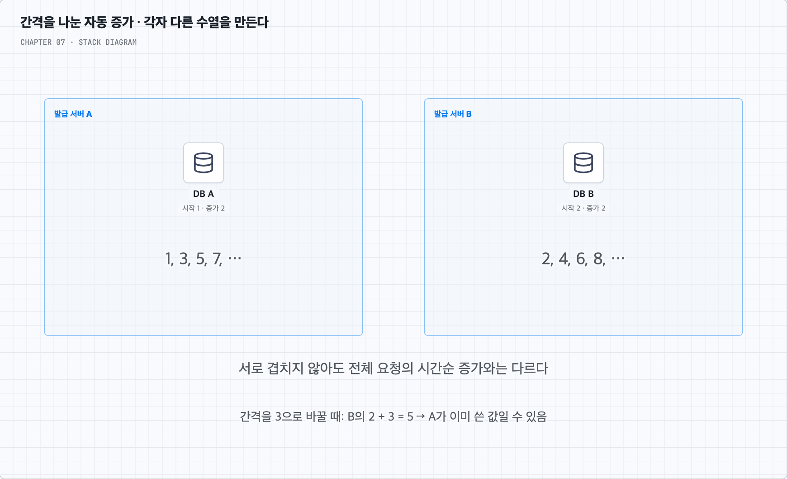
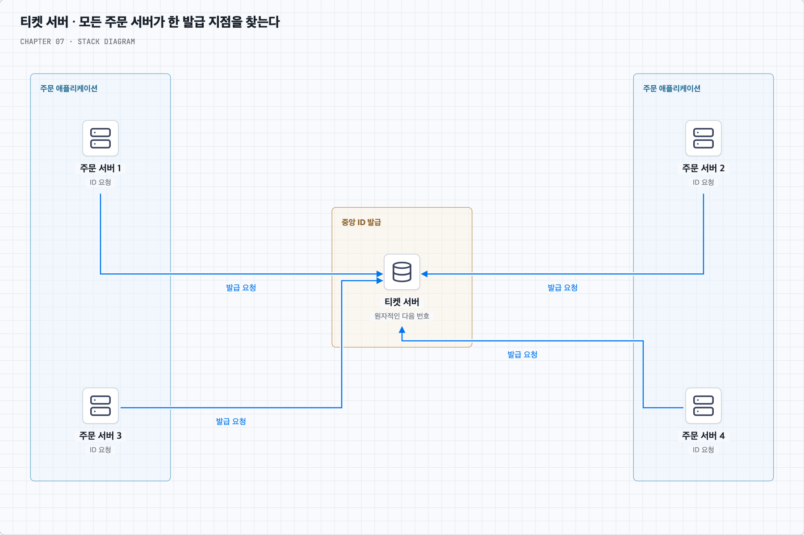
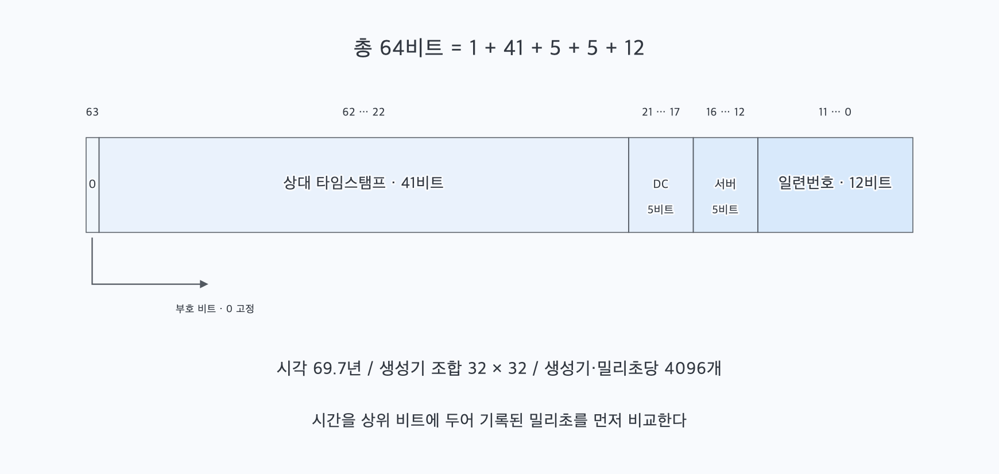
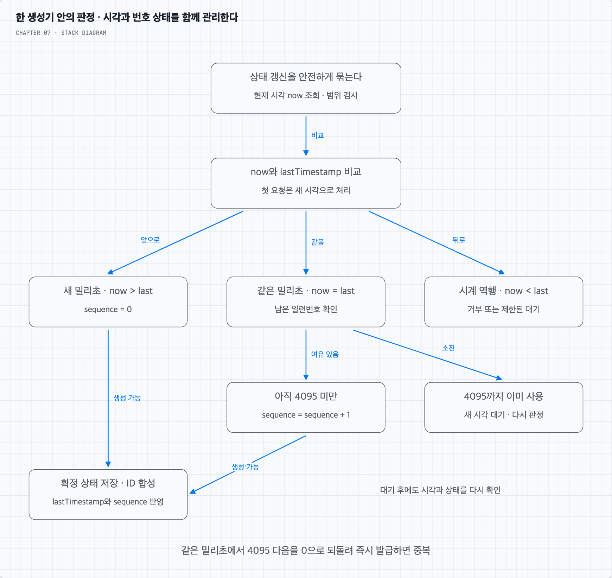
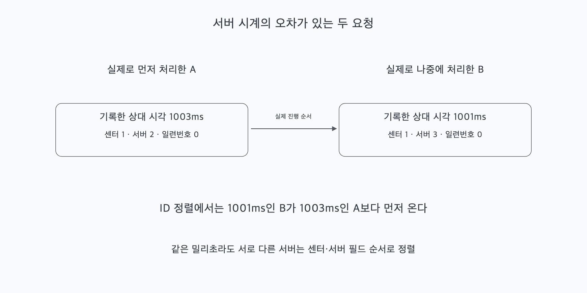
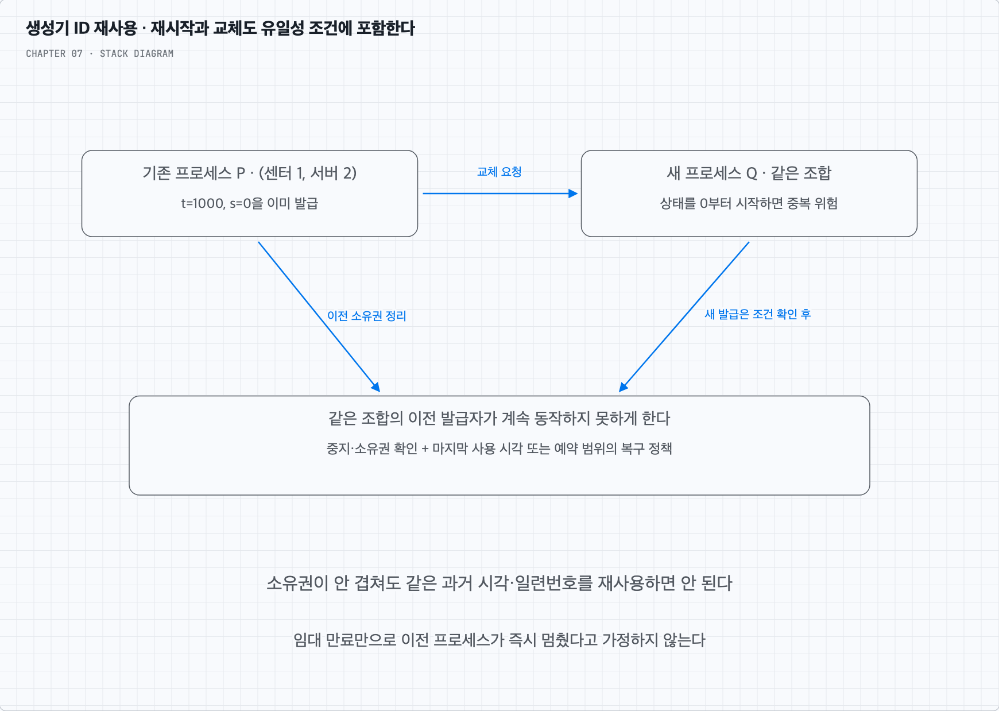

<a id="top"></a>

# 7장. 분산 시스템을 위한 유일 ID 생성기 설계

여러 주문 서버가 서로 겹치지 않는 ID를 만드는 문제에서 출발한다. 후보들을 비교한 뒤 64비트의 역할을 나누고, 같은 밀리초·시계 이상·재시작 때도 유일성의 조건을 지키는 과정을 따라간다.

책 7장과 제공된 메모를 바탕으로 재구성했다. 개념·그림·복습 답안을 이 README에서 함께 읽는다.

<a id="contents"></a>

## 목차

- [후보 비교에서 스노우플레이크와 운영 조건까지](#core-concepts)
- [스스로 답하기 · 답안 토글](#review)
- [책과 추가 설명의 범위](#sources)

---


<a id="core-concepts"></a>

## 서버마다 발급해도 겹치지 않는 ID를 만든다

### 1. 주문 서버가 여러 대라면 누가 번호를 정할까?

주문을 저장할 때마다 ID가 필요하다고 하자. 한 DB의 `auto_increment`를 사용하면 그 DB가 번호를 정한다. 하지만 주문 데이터를 여러 DB로 나누고 각 DB가 독립적으로 1, 2, 3을 만들면 서로 다른 주문에 같은 번호가 붙을 수 있다. 한 DB로 번호 발급을 모으면 다시 그곳에 요청과 장애 영향이 모인다.

그렇다고 자동 증가 기능이 본질적으로 초당 10,000개를 못 만든다는 뜻은 아니다. 처리량은 장비·구현·부하에 따라 다르다. 이 장의 문제는 여러 서버와 센터에서 낮은 지연으로 발급하면서 유일성과 정렬 요구를 만족하는 구조를 정하는 것이다.

요구사항은 다음과 같다.

- 서로 다른 발급 결과의 ID가 유일해야 한다.
- 숫자로 표현하고 64비트 안에 들어가야 한다.
- 발급 날짜·시간을 기준으로 정렬할 수 있어야 한다.
- 전체 서비스에서 초당 10,000개를 발급할 수 있어야 한다.

번호가 반드시 1씩 이어질 필요는 없다. 먼저 유일성, 연속성, 정렬 가능성을 구분하자. 1·3·5와 2·4·6을 나누어 만들면 번호가 겹치지 않아도 전체 요청의 시간순으로 1·2·3이 발급되는 것은 아니다. 실패나 예약 때문에 중간 번호가 비는 것도 유일성 위반이 아니다.

### 2. 각 DB가 서로 다른 나머지의 번호를 만들면?

책의 첫 후보는 다중 마스터 구성에서 자동 증가의 간격을 나누는 방식이다. 발급 서버가 두 대라면 A는 홀수, B는 짝수를 만든다. 각 서버는 이전 값에 k=2를 더하고 시작 위치를 다르게 둔다.



일반적으로 k대가 서로 다른 시작 나머지를 갖고 같은 증가 간격 k를 사용하면 겹치지 않는 수열을 만들 수 있다. MySQL에서는 자동 증가의 간격과 시작 위치를 설정할 수 있다. 복제 자체가 같은 ID의 충돌을 자동 해결하는 것은 아니다. [MySQL 설정 문서](https://dev.mysql.com/doc/refman/8.4/en/replication-options-source.html)를 참고한다.

발급을 여러 DB에 분산할 수 있지만 전체 시간순 증가를 보장하지 않는다. A가 101을 만든 뒤 B가 20을 만들 수도 있다. 또 서버를 세 대로 늘릴 때 증가 간격만 3으로 바꾸면 기존 수열과 새 수열이 겹칠 수 있다. 예를 들어 A가 과거에 5를 만들었는데 B가 2 다음에 새 간격 3을 더하면 다시 5가 나온다. 기존 값과 새 소유 구간을 고려한 전환이 필요하다.

여러 센터에서 같은 설정을 안전하게 관리하고 서버 추가·삭제에 맞춰 수열을 재조정하는 일도 남는다. ‘서버 수를 늘리면 생산량이 늘어난다’는 장점만으로 이번 요구를 모두 만족하지는 않는다.

### 3. 조율 없이 만드는 UUID는 어떨까?

다음 후보는 각 주문 서버가 UUID를 만드는 것이다. 대표적인 무작위 UUIDv4는 중앙 DB에서 다음 번호를 받을 필요가 없고, 올바른 난수 생성 등을 전제로 충돌 확률이 매우 작다. 대신 확률이 작다는 것과 수학적으로 충돌이 불가능하다는 것은 다르다.

UUID는 128비트다. 흔히 보이는 영문자와 하이픈은 그 비트를 16진수 문자열로 표시한 형식이다. 10진수로 표시해도 64비트로 줄어들지는 않는다. 앞이나 뒤 64비트만 잘라 쓰면 원래 UUID와 같은 식별 공간·성질을 유지한다고 가정할 수도 없다.

책의 ‘시간순 정렬 불가’는 무작위 UUID를 기준으로 이해한다. UUID 전체에 적용되는 말은 아니다. RFC 9562에는 시간 정보를 앞부분에 둔 UUIDv7도 있다. 이번에는 여전히 128비트라는 점 때문에 요구에 맞지 않는다. UUIDv4·v7의 차이는 [RFC 9562 §5.4·§5.7](https://www.rfc-editor.org/rfc/rfc9562.html#section-5.7)을 참고한다.

### 4. 번호 발급만 담당하는 티켓 서버를 두면?

업무 DB와 별도로 티켓 서버를 두고 모든 주문 서버가 새 번호를 요청하게 할 수 있다. 티켓 서버 내부에서 원자적인 자동 증가를 사용하면 한곳에서 숫자 ID를 관리하기 쉽다.



번호 발급과 주문 저장을 분리할 수 있지만 ID 하나를 받을 때 원격 왕복이 필요하다. 한 대뿐인 티켓 서버가 멈추면 새 번호를 받지 못한다. 복제본으로 넘길 때 이미 발급한 번호까지 상태가 보존되었는지 확인해야 하며, 여러 대를 독립적으로 켜면 충돌 방지 규칙이 다시 필요하다.

책은 이 단순한 구성을 후보로 비교한다. 실제 [Flickr의 티켓 서버 사례](https://code.flickr.net/2010/02/08/ticket-servers-distributed-unique-primary-keys-on-the-cheap/)는 두 서버에 홀수·짝수를 나누었다. 따라서 티켓 서버라는 이름만으로 반드시 한 대여야 하는 것은 아니다. 그렇게 확장하면 앞에서 본 수열 관리와 전체 시간순 정렬 문제를 다시 검토해야 한다.

### 5. 다음 번호를 공유하는 대신 각 필드가 서로를 구분하게 한다

지금까지의 후보를 비교하면 필요한 변화가 보인다. 중앙 번호에 매번 접근하지 않으면서, 어느 생성기가 언제 만든 번호인지 ID 안에서 구분하면 어떨까?

| 후보 | 유일성을 만드는 방법 | 이번 요구에서 남는 문제 |
| --- | --- | --- |
| 간격을 나눈 자동 증가 | 서버마다 겹치지 않는 수열 | 서버 수 변경, 전체 시간순 정렬 |
| UUIDv4 | 충분히 큰 무작위 공간 | 128비트, 시간 정보로 정렬되지 않음 |
| 티켓 서버 한 대 | 중앙에서 다음 번호 결정 | 원격 왕복과 단일 발급 지점 의존 |
| 스노우플레이크 방식 | 시간·생성기 식별자·일련번호 조합 | 시계·생성기 소유권·동시성 관리 |

스노우플레이크 방식은 64비트를 여러 역할로 나눈다. 이 장에서는 책과 같은 `1 + 41 + 5 + 5 + 12` 배치를 사용한다. 동일한 이름의 모든 구현이 이 배치를 쓰는 것은 아니다.



맨 위 1비트는 0으로 고정해 부호 있는 64비트 정수에서도 음수가 되지 않게 한다. 나머지는 다음처럼 사용한다.

| 필드 | 비트 수 | 값의 범위·역할 |
| --- | --- | --- |
| 상대 타임스탬프 | 41 | 기준 시각 이후의 밀리초, 0–2^41−1 |
| 데이터센터 ID | 5 | 0–31, 논리적 센터 구분 |
| 서버 ID | 5 | 센터 안에서 0–31, 생성기 구분 |
| 일련번호 | 12 | 같은 생성기의 같은 밀리초 안에서 0–4095 |

데이터센터와 서버 필드를 합치면 10비트여서 최대 1,024개의 생성기 식별 조합이 있다. 같은 서버 ID라도 데이터센터 ID가 다르면 구분된다. 여기서 ‘서버’는 ID를 발급하는 생성기의 정체성이다. 물리 머신 수나 CPU 코어 수와 자동으로 일치하지 않는다.

### 6. 네 필드를 어떻게 정수 하나로 합칠까?

모든 생성기가 같은 기준 시각(epoch)과 비트 배치를 사용한다고 하자. 현재 시각에서 기준 시각을 뺀 밀리초를 t, 데이터센터 ID를 d, 서버 ID를 w, 일련번호를 s라고 두면 다음처럼 합친다.

```text
ID = (t << 22) | (d << 17) | (w << 12) | s
```

`<<`는 값을 왼쪽으로 옮겨 아래쪽 비트 자리를 비우는 연산이고, `|`는 겹치지 않는 필드들을 합치는 비트 OR다. 시간이 위쪽에 있고 생성기와 일련번호가 아래쪽에 있으므로 시간 필드가 커지면 아래 필드의 조합과 관계없이 더 큰 정수가 된다.

예를 들어 기준 시각 이후 t=1000ms, d=1, w=2인 생성기는 다음 값을 만든다.

| 상대 시간 t | d | w | s | 만들어진 ID |
| --- | --- | --- | --- | --- |
| 1000 | 1 | 2 | 0 | 4194443264 |
| 1000 | 1 | 2 | 1 | 4194443265 |
| 1000 | 1 | 2 | 4095 | 4194447359 |
| 1001 | 1 | 2 | 0 | 4198637568 |

반대로 시간을 확인하려면 `t = ID >> 22`로 아래 22비트를 제거하고 기준 시각을 더한다. 다른 필드도 이동 후 마스크로 꺼낼 수 있다.

```text
t = ID >> 22
d = (ID >> 17) & 31
w = (ID >> 12) & 31
s = ID & 4095
발급 시각 = epoch + t 밀리초
```

각 필드는 범위를 먼저 검사한다. t가 41비트를 넘거나 w가 31을 넘는데 단순히 합치면 옆 필드에 영향을 주거나 잘라내기 때문에 원래 유일성 논리가 깨진다.

### 7. 같은 밀리초 안에서는 일련번호를 올린다

생성기는 마지막으로 발급한 타임스탬프 `lastTimestamp`와 그 시각의 `sequence`를 관리한다. 처음 요청이 오거나 시간이 앞으로 바뀌면 0부터 시작하고, 같은 밀리초의 다음 요청이면 1을 더한다. 모든 밀리초마다 백그라운드 타이머가 카운터를 초기화할 필요는 없다. 요청을 처리하며 시각이 바뀌었는지 확인하면 된다.



필요한 판정 순서는 다음과 같다.

1. 현재 시각이 기준 시각 이후이고 표현 범위 안인지 검사한다.
2. 마지막 발급 시각보다 뒤면 일련번호를 0으로 둔다.
3. 마지막 발급 시각과 같으면 일련번호를 증가시킨다.
4. 이미 4095까지 썼으면 같은 밀리초에서 다시 0을 발급하지 않는다. 다음 밀리초를 기다리거나 제한된 시간 후 실패를 반환하는 정책을 둔다.
5. 현재 시각이 마지막 발급 시각보다 과거라면 시계 역행 정책을 적용한다.
6. 확정한 시각과 일련번호를 상태에 반영하고 ID를 만든다.

같은 프로세스의 여러 스레드가 2–6의 상태를 따로 읽고 갱신하면 둘 다 같은 번호를 고를 수 있다. 시각 비교·증가·상태 반영을 한 임계 구역으로 묶거나 동등한 원자적 상태 전이를 구현해야 한다. 카운터 증가 하나만 원자적이라고 전체 과정이 안전해지는 것은 아니다.

락을 사용한다면 번호 공간이 찬 동안 무한히 락을 잡고 바쁘게 반복하지 않도록 대기·타임아웃 정책을 정한다. 복수 프로세스는 프로세스 안의 락을 공유하지 않는다. 서로 다른 생성기 ID를 주거나 하나의 안전한 상태 관리 경로를 공유해야 한다. [원래 Twitter 구현](https://github.com/twitter-archive/snowflake/blob/snowflake-2010/src/main/scala/com/twitter/service/snowflake/IdWorker.scala)은 동기화된 생성, 번호 소진 후 대기, 역행 시 오류 처리를 확인할 수 있는 참고 자료다.

### 8. 유일성과 시간순 정렬은 어떤 조건에서 성립할까?

먼저 유일성을 보자. 두 ID의 시간·센터·서버·일련번호 중 하나라도 다르면 다른 정수가 된다. 서로 다른 생성기는 센터·서버 조합으로 구분하고, 같은 생성기는 같은 시각 안에서 일련번호를 재사용하지 않으면 된다. 같은 생성기가 과거 시각으로 돌아가 이미 사용한 일련번호를 다시 쓰는 일을 막아야 한다.

정렬에서는 타임스탬프의 비중이 가장 크다. 두 ID에 기록된 밀리초가 다르면 시간이 작은 ID가 먼저 온다. 같은 밀리초에서는 센터·서버 ID가 먼저 비교되고 일련번호가 그 다음이다. 따라서 서로 다른 생성기의 같은 밀리초 요청은 실제 도착 순서가 아니라 필드 값으로 순서가 정해진다.



시계가 빠른 A가 실제로 먼저 발급한 ID에 1003ms를 기록하고, 조금 뒤 B가 1001ms를 기록할 수 있다. 정수로 정렬하면 B의 ID가 앞선다. 생성 직후 네트워크 응답이 늦어져 도착 순서가 바뀌는 일도 있다. 시간 정보를 담는다는 것과 모든 서버의 실제 사건 순서·응답 순서를 엄격하게 보장한다는 것은 구분한다.

이 장의 해석은 기록된 시간으로 대략적인 시간순 정렬을 하는 것이다. 전역의 엄격한 발급 순서가 필요하다면 추가 조율과 그에 따른 지연·가용성 비용을 설계해야 한다. 날짜별 조회나 구분이 중요하면 별도의 생성 시각도 함께 저장해 업무에서 요구하는 시간의 의미를 분명히 할 수 있다.

### 9. 시계가 뒤로 가면 무엇을 할까?

같은 생성기가 t=1000, s=0을 이미 만들었는데 시간이 999로 돌아갔다고 하자. 일련번호를 단순히 0으로 초기화하면 나중에 1000에 도달했을 때 과거의 조합을 다시 만들 수 있다. 프로세스를 껐다 켜서 시각 상태를 잃는 경우도 비슷한 위험이 있다.

NTP 등으로 서버 간 시각 오차를 줄이는 것과 생성기의 안전 조건은 별도로 다룬다. 시계 조정·가상 머신 복원·재시작 중의 동작도 생각해야 한다. 여러 코어는 공유 상태의 동시성 문제이고, 여러 서버의 시각 차이와 역행은 시계 문제다.

가장 이해하기 쉬운 정책은 역행을 감지하면 새 번호를 거부하고 시계가 따라잡을 때까지 기다리는 것이다. 짧은 역행만 제한적으로 기다릴 수도 있다. 이 선택은 중복 방지를 위해 가용성을 일부 포기한다. 단순히 로그만 남기고 계속 발급하면 유일성 조건을 지키지 못한다.

다른 선택으로 시각을 `max(현재 시각, 마지막 논리 시각)`처럼 관리할 수 있다. 이 경우에도 같은 논리 밀리초의 4096개 한도, 실제 시각과의 차이, 재시작 상태 복구를 함께 다뤄야 한다. 논리 시각을 쓰기만 하면 문제가 끝나는 것은 아니다. 이 노트의 검증 예시는 이해를 단순하게 하기 위해 역행 시 거부하는 정책을 사용한다.

### 10. 서버 ID는 시작할 때 정하지만 소유권은 계속 지켜야 한다

센터 1의 생성기 2라는 조합을 두 프로세스에 동시에 주면 둘 다 t=1000, s=0을 만들 수 있다. 머신이 다르거나 컨테이너가 새로 생성되었다는 사실은 ID의 비트에 포함되지 않는다.



고정 설정을 쓰든 할당 서비스를 쓰든 같은 조합의 활성 소유자가 겹치지 않아야 한다. 할당을 임대로 관리한다면 만료된 이전 프로세스가 뒤늦게 돌아와 계속 발급하지 못하게 하는 절차도 필요하다. 단순히 새 프로세스에 같은 ID를 주었다는 사실만으로 이전 프로세스가 멈추지는 않는다.

유일한 소유자 한 명을 보장해도 재시작 때 상태를 지우고 같은 밀리초에 s=0부터 다시 발급하면 중복될 수 있다. 마지막 사용 시각·예약 범위를 내구성 있게 보존하거나, 이전에 사용한 시간 구간을 확실히 지난 뒤 재사용하는 등 복구 정책이 필요하다. 시계가 앞서 있었던 이전 프로세스의 값도 고려해야 하므로 ‘그냥 1ms 쉬면 안전’으로 고정하지 않는다.

정상 발급마다 중앙 서버와 통신하지 않는 장점은 유지할 수 있다. 대신 시작·교체·확장 시점의 할당과 소유권 관리는 없어지는 것이 아니다. 여러 생성기로 고가용성을 높이되 시계 이상이나 안전한 소유권을 확인할 수 없는 상황에서는 해당 생성기의 발급을 중단하는 경계도 둔다.

### 11. 비트 예산으로 처리량과 수명을 계산한다

12비트 일련번호는 0–4095의 4096개다. 따라서 이 배치의 생성기 한 개는 같은 밀리초에 4096개까지 표현한다. 매 밀리초를 계속 채운다고 계산하면 초당 4,096,000개라는 **번호 공간의 이론적 상한**이 나온다. 실제로 그 속도로 처리한다는 성능 측정 결과는 아니다.

요구사항의 초당 10,000개는 평균으로 1ms당 10개다. 비트 공간은 충분해 보여도 요청이 특정 생성기의 한 밀리초에 5000개 몰리면 4096개 뒤에 대기나 실패가 필요하다. 서버별 편중, 락과 시각 조회, 네트워크, 응답시간까지 포함해 실제 부하로 확인한다.

41비트 시간은 0–2^41−1ms를 담는다. 기원 이후 약 69.7년의 범위이며 다음 값인 2^41ms는 표현하지 못한다. 서비스 운영을 시작한 날이 아니라 선택한 epoch부터 수명이 계산된다. 1년을 365일로 잡은 근사 계산은 다음과 같다.

```text
(2^41 - 1) / (1000 × 60 × 60 × 24 × 365) ≈ 69.73년
```

시간 비트를 늘리려면 고정된 64비트 예산 안에서 다른 필드를 줄여야 한다. 예를 들어 일련번호를 10비트로 줄이고 시간을 43비트로 늘리면 한 밀리초의 수용량은 1024개로 줄고 시간 범위는 약 네 배가 된다. 전체 트래픽이 적다는 사실만 보지 말고 생성기별 순간 최대량을 기준으로 결정한다.

기존 epoch만 새 날짜로 바꾸어 값이 0부터 다시 나오게 하면 과거 ID와 겹칠 수 있다. 새 체계의 구분 방법, 기존 데이터와의 비교·해석, 중복 방지와 점진 전환을 포함해 만료 전에 이관을 준비해야 한다.

<details>
<summary>64비트 정수를 브라우저나 JSON으로 전달할 때도 같은 값일까?</summary>

64비트에 들어가도 모든 언어의 기본 숫자형이 그 정수를 정확하게 표현하지는 못한다. JavaScript의 `Number`는 2^53−1까지만 안전한 정수 범위이므로 큰 ID를 숫자로 파싱하면 정밀도를 잃을 수 있다. API에서 10진수 문자열로 전달하고 필요한 곳에서 `BigInt`나 64비트 정수로 다루는 방식을 정할 수 있다. 문자열 전달은 ID의 논리적 값이 숫자라는 요구와 별개인 전송 형식의 선택이다. [ECMAScript의 안전한 정수 범위](https://tc39.es/ecma262/#sec-number.max_safe_integer)를 참고한다.

</details>

### 12. 설계를 마무리할 때 확인할 흐름

요청을 받은 생성기는 자기 센터·서버 조합의 소유권을 확인한 상태에서, 시각과 일련번호를 안전하게 갱신하고 필드를 합쳐 반환한다. 정상 경로는 다른 생성기의 다음 번호를 조회하지 않는다. 한 생성기가 내려가면 다른 유효한 생성기로 요청을 보낼 수 있다.

이때 관찰할 것은 초당 발급량만이 아니다. 생성기별 한 밀리초의 최대량, 번호 소진 대기와 지연, 시계 역행·편차, 중복된 소유권, 할당 실패와 재시작도 확인한다. ID를 새로 발급해 주는 것과 주문 자체를 정확히 한 번 실행하는 것은 별개의 문제다. 재시도할 때 같은 주문이 중복 생성되지 않도록 하는 정책은 4장에서 다룬 멱등성과 함께 설계한다.

복습할 때는 ‘시간 + 생성기 + 일련번호가 서로 다른 요청을 구분한다’는 원리와 그 조건부터 말해 보자. 비트 수 암기 뒤에는 같은 밀리초·역행·재시작·교체 때 그 구분이 유지되는지 확인해야 한다.

[목차로 돌아가기](#contents)

---


<a id="review"></a>

## 스스로 답하기

먼저 답을 말하거나 비트 배치와 분기를 직접 그린 뒤 답안을 연다. 유일성과 정렬을 설명할 때는 시계·동시성·소유권 조건도 함께 말한다.

<details>
<summary>01. 여러 DB가 각각 auto_increment를 쓰면 무엇이 문제인가?</summary>

서로 독립적인 DB가 같은 번호를 발급할 수 있다. 한곳에 발급을 모으면 그 지점의 지연·부하·장애 의존을 검토해야 한다. 자동 증가 자체가 항상 초당 10,000개를 못 만든다는 뜻은 아니다.

</details>

<details>
<summary>02. 이번 설계의 요구사항 다섯 가지는?</summary>

유일한 값, 숫자 표현, 64비트 이내, 발급 날짜·시간 기준 정렬, 전체 서비스에서 초당 10,000개 발급이다. 1씩 빠짐없이 이어지는 연속성은 요구하지 않는다.

</details>

<details>
<summary>03. 간격 k로 발급할 때 무엇을 서버마다 다르게 해야 하는가?</summary>

시작 나머지를 다르게 하고 같은 증가 간격 k를 써야 한다. k=2이면 한쪽은 1·3·5, 다른 쪽은 2·4·6처럼 나눌 수 있다. 복제 자체가 그 구분을 대신하지 않는다.

</details>

<details>
<summary>04. 간격을 나누면 전체 시간순 증가도 보장되는가?</summary>

아니다. 먼저 A가 101을 발급하고 나중에 B가 20을 발급할 수 있다. 서버마다 수열이 증가하는 것과 전체 발급 순서는 다르다.

</details>

<details>
<summary>05. 서버가 늘었다고 증가 간격만 2에서 3으로 바꾸면 안전한가?</summary>

아니다. B가 2 다음에 3을 더해 5를 만들 때 A가 과거에 이미 5를 발급했을 수 있다. 기존 값과 새 수열을 함께 고려한 전환이 필요하다.

</details>

<details>
<summary>06. UUID의 영문자를 10진수로 바꾸면 64비트가 되는가?</summary>

아니다. UUID는 128비트이며 표기만 달라진다. 일부 64비트를 잘라 쓰면 원래 공간과 충돌 특성을 유지한다고 가정할 수도 없다.

</details>

<details>
<summary>07. UUID는 전부 시간순 정렬이 불가능한가?</summary>

아니다. 무작위 UUIDv4와 시간 정보를 앞에 둔 UUIDv7은 다르다. 다만 UUIDv7도 128비트여서 이번 64비트 요구와 맞지 않는다.

</details>

<details>
<summary>08. 무작위 UUIDv4의 충돌 확률이 작다는 말의 조건은?</summary>

올바른 난수 생성과 구현을 전제로 충분히 큰 식별 공간을 쓰므로 확률이 매우 작다는 뜻이다. 충돌이 수학적으로 불가능하다는 보장은 아니다.

</details>

<details>
<summary>09. 티켓 서버 한 대의 장점과 한계는?</summary>

숫자 ID를 중앙에서 원자적으로 관리하기 쉽다. 대신 발급마다 원격 요청이 필요하고 한 대의 장애에 발급이 의존한다. 복제·확장 시에도 이미 발급한 번호의 재사용을 막아야 한다.

</details>

<details>
<summary>10. 실제 Flickr 사례도 티켓 서버가 반드시 한 대였는가?</summary>

아니다. 두 서버가 홀수·짝수를 나누는 방식을 사용했다. 티켓 서버라는 역할과 물리 서버가 한 대라는 구현은 구분한다.

</details>

<details>
<summary>11. 스노우플레이크의 64비트 배치는?</summary>

최상위 1비트는 0, 상대 타임스탬프 41비트, 데이터센터 5비트, 서버 5비트, 일련번호 12비트다. 이 장에서 선택한 배치이며 모든 구현의 고정 표준은 아니다.

</details>

<details>
<summary>12. 센터·서버 조합은 몇 개까지 가능한가?</summary>

각각 0–31의 32개이므로 32×32=1024개다. 생성기 식별 조합 수이며 물리 서버나 코어가 자동으로 같은 수라는 뜻은 아니다.

</details>

<details>
<summary>13. 상대 타임스탬프와 epoch는 어떤 관계인가?</summary>

상대 타임스탬프 t는 공통 기준 시각 epoch 이후의 밀리초다. 모든 생성기가 같은 배치와 기준을 사용해야 같은 숫자를 해석하고 비교할 수 있다.

</details>

<details>
<summary>14. 네 필드를 정수 하나로 합치는 식은?</summary>

ID = (t << 22) | (d << 17) | (w << 12) | s다. 각 필드가 범위 안에 있을 때 서로 겹치지 않는 자리를 차지한다.

</details>

<details>
<summary>15. t=1000, d=1, w=2, s=0일 때 ID는?</summary>

4194443264다. 같은 시각·생성기에서 s=1이면 4194443265가 된다. 다음 밀리초 t=1001의 s=0은 4198637568이다.

</details>

<details>
<summary>16. ID에서 시각과 일련번호를 어떻게 꺼내는가?</summary>

상대 시각은 ID >> 22, 일련번호는 ID & 4095다. 시각에 epoch의 밀리초를 더하면 기록한 발급 시각을 해석할 수 있다. 센터와 서버는 각각 이동 후 31로 마스크한다.

</details>

<details>
<summary>17. 매 밀리초마다 초기화 타이머가 필요한가?</summary>

아니다. 요청 시 현재 시각을 마지막 발급 시각과 비교해 시간이 앞으로 바뀌었으면 일련번호를 0으로 둔다. 같은 밀리초일 때만 증가시킨다.

</details>

<details>
<summary>18. 같은 밀리초에서 4095 다음 요청은 어떻게 하는가?</summary>

같은 시각의 0을 다시 발급하지 않는다. 새 밀리초를 기다린 뒤 다시 판정하거나 제한된 시간 후 실패를 반환한다. 대기·취소와 지연 정책을 정한다.

</details>

<details>
<summary>19. 카운터 증가 한 번만 원자적으로 만들면 안전한가?</summary>

충분하지 않다. 시각 비교·초기화·증가·상태 저장을 함께 안전하게 처리해야 한다. 여러 호출이 같은 시각과 번호를 동시에 선택하지 못하게 해야 한다.

</details>

<details>
<summary>20. 프로세스 안의 락이 다른 프로세스의 같은 서버 ID도 보호하는가?</summary>

아니다. 독립 프로세스는 그 락과 상태를 공유하지 않는다. 서로 다른 생성기 식별 조합을 주거나 안전한 공통 상태 경로를 사용해야 한다.

</details>

<details>
<summary>21. 유일성을 유지하는 핵심 조건은?</summary>

활성 생성기의 센터·서버 조합이 겹치지 않고, 같은 생성기가 같은 시간·일련번호 조합을 재사용하지 않아야 한다. 시계 역행·재시작·교체도 그 조건에 포함된다.

</details>

<details>
<summary>22. 시간 비트가 높으면 전역 실제 발생 순서가 보장되는가?</summary>

아니다. 기록한 밀리초 값의 정렬을 제공한다. 서버 시각 오차가 있거나 같은 밀리초의 서로 다른 생성기라면 실제 발생 순서와 다를 수 있다. 네트워크 응답 순서도 별개다.

</details>

<details>
<summary>23. 같은 밀리초에 서로 다른 서버가 만든 ID는 무엇으로 정렬되는가?</summary>

시간이 같으면 데이터센터 ID, 서버 ID, 일련번호 순으로 값이 비교된다. 모든 서버의 요청 도착 순서를 공동으로 센 결과가 아니다.

</details>

<details>
<summary>24. NTP를 쓰면 시계 역행 처리는 없어도 되는가?</summary>

아니다. 시각 오차를 줄이는 일과 역행 때 안전하게 발급하는 일은 다르다. 역행을 거부·대기하거나 논리 시각으로 처리하는 정책과 상태 복구가 필요하다.

</details>

<details>
<summary>25. 논리 시각을 마지막 값 이상으로 잡으면 모든 문제가 끝나는가?</summary>

아니다. 같은 논리 밀리초의 4096개 한도, 실제 시각과의 차이, 재시작 때 상태 유지까지 다뤄야 한다. 별도 정책 없이 무한히 발급할 수는 없다.

</details>

<details>
<summary>26. 이전 프로세스를 멈췄다면 같은 생성기 ID를 즉시 재사용해도 되는가?</summary>

그것만으로 충분하지 않다. 같은 시각에 일련번호를 0부터 다시 쓰면 과거 ID와 중복될 수 있다. 마지막 사용 시각·예약 상태의 복구나 안전한 재사용 시각을 보장해야 한다.

</details>

<details>
<summary>27. 임대가 만료되었다고 이전 생성기가 자동으로 멈추는가?</summary>

아니다. 중지되었다 돌아온 프로세스가 계속 발급하지 못하도록 이전 소유자를 차단하는 절차가 필요하다. 소유권 판단과 실제 발급 중지를 연결해야 한다.

</details>

<details>
<summary>28. 12비트의 초당 4,096,000개는 실제 성능 보장인가?</summary>

아니다. 한 생성기가 밀리초마다 4096개를 모두 사용하는 번호 공간의 이론적 상한이다. 락·시각 조회·네트워크·편중과 지연은 실제 부하로 확인해야 한다.

</details>

<details>
<summary>29. 초당 10,000개라면 한 밀리초의 소진을 걱정하지 않아도 되는가?</summary>

아니다. 평균은 밀리초당 10개지만 순간적으로 특정 생성기에 5000개가 몰릴 수 있다. 평균과 생성기별 순간 최대량은 구분해야 한다.

</details>

<details>
<summary>30. 41비트 시간의 수명은 언제부터 계산하는가?</summary>

선택한 epoch부터 약 69.7년이다. 서비스 시작일부터가 아니다. 최댓값은 2^41−1ms이며 다음 값은 범위 밖이다.

</details>

<details>
<summary>31. 일련번호를 10비트로 줄이고 시간을 43비트로 늘리면?</summary>

같은 밀리초의 번호 공간은 1024개로 줄고 시간 범위는 약 네 배가 된다. 전체 평균뿐 아니라 생성기별 버스트와 운용 기간을 보고 결정한다.

</details>

<details>
<summary>32. 기존 epoch만 새 날짜로 바꾸면 수명을 연장할 수 있는가?</summary>

새 체계의 값이 과거와 겹칠 수 있으므로 그것만으로 안전하지 않다. 체계 구분·기존 값의 해석·비교·중복 방지와 이관 절차가 필요하다.

</details>

<details>
<summary>33. 64비트 ID를 JavaScript Number로 보내면 늘 정확한가?</summary>

아니다. 안전한 정수 범위는 2^53−1까지다. 10진수 문자열로 전달하고 필요한 곳에서 BigInt나 64비트 정수로 읽는 등 API 형식을 정할 수 있다.

</details>

<details>
<summary>34. 다른 생성기로 재시도해 새 ID를 받으면 주문 중복도 해결되는가?</summary>

아니다. ID 유일성과 업무 멱등성은 별개다. 같은 주문 요청이 다시 실행되는 문제는 업무 키·기존 결과 재사용 같은 정책으로 다뤄야 한다.

</details>

[목차로 돌아가기](#contents)

---


<a id="sources"></a>

## 책과 추가 설명의 범위

### 책을 대조한 범위

『가상 면접 사례로 배우는 대규모 시스템 설계 기초 1』 7장 「분산 시스템을 위한 유일 ID 생성기 설계」의 117–125쪽을 확인했다. 요구사항, 간격을 나누는 자동 증가, UUID, 티켓 서버, 스노우플레이크의 필드·시간·일련번호, 시계 동기화·비트 배분·가용성을 본문 흐름에 반영했다.

주문 서비스, 상대 시각 1000ms, 비트 합성 결과와 생성기 교체 상황은 독립적으로 만든 예시다. 도식은 책의 비교·비트 구조를 참고해 새로 구성했으며 원본 그림을 스캔해 넣지 않았다.

### 덧붙인 조건

- 자동 증가의 실제 처리 한계를 측정 없이 단정하지 않았다. 여러 발급 지점의 유일성·확장·지연 문제로 설명했다.
- UUIDv4와 UUIDv7을 구분했다. 128비트라는 크기와 16진수 문자열 표기 형식도 구분했다.
- 티켓 서버의 단순한 한 대 구성과 Flickr의 홀수·짝수 두 대 사례를 구분했다.
- 시간 정보로 정렬하는 것과 전역의 실제 발생·응답 순서는 다를 수 있음을 보완했다.
- 일련번호의 원자적 갱신, 소진, 시계 역행, 생성기 ID 소유권과 재시작·교체를 유일성의 조건으로 설명했다.
- 4096개/ms는 번호 공간의 상한이며 실제 성능 보장이 아니다. 69.7년은 epoch부터의 범위다.
- epoch만 바꾸는 것은 안전한 이관이 아님을 덧붙였다. 큰 정수의 전송 형식은 선택해서 읽을 수 있도록 접어 두었다.

### 추가 원문

- [Twitter의 원래 Snowflake IdWorker](https://github.com/twitter-archive/snowflake/blob/snowflake-2010/src/main/scala/com/twitter/service/snowflake/IdWorker.scala): 비트 이동과 생성 상태, 동기화, 소진 시 대기와 역행 시 거부를 대조한 과거 구현이다. 현재 사용을 권장하는 운영 라이브러리 목록은 아니다.
- [RFC 9562 — UUID](https://www.rfc-editor.org/rfc/rfc9562.html): §5.4의 무작위 UUIDv4와 §5.7의 시간 기반 UUIDv7을 확인했다.
- [MySQL — Replication Source Options and Variables](https://dev.mysql.com/doc/refman/8.4/en/replication-options-source.html): 자동 증가의 간격·시작 위치 설정을 참고했다.
- [Flickr — Ticket Servers (2010)](https://code.flickr.net/2010/02/08/ticket-servers-distributed-unique-primary-keys-on-the-cheap/): 티켓 발급과 홀수·짝수 두 서버 구성을 비교했다.
- [ECMAScript — Number.MAX_SAFE_INTEGER](https://tc39.es/ecma262/#sec-number.max_safe_integer): 전송 시 정수 정밀도에 관한 추가 설명의 근거다.
- [stack-diagram](https://stacks.caru.moe/): 기존 장과 같은 HTML·PNG 제작 형식을 참고했다. 비트와 생성 분기는 설명에 맞춰 직접 배치했다.

### 검증 범위

본문의 정수 합성·분해, 필드 최댓값과 64비트 범위, 같은 밀리초의 일련번호·소진, 역행 시 거부, 생성기 구분, 시간순 해석과 epoch 범위를 독립적인 검증 모형으로 확인한다. 여러 스레드가 같은 상태를 안전하게 갱신하는 예시도 확인한다. 이는 문서의 계산과 안전 조건을 확인하는 것으로, 운영용 ID 서버를 구현하거나 실제 초당 발급량·장애 복구를 측정한 결과는 아니다.

이미지·복습 답안 토글·내부 링크·모바일 렌더링과 마크다운 표기도 검사한다.

[목차로 돌아가기](#contents)

---
