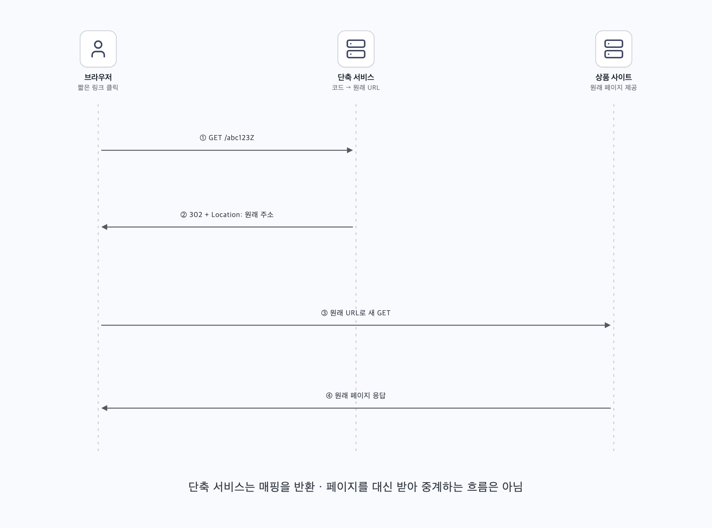
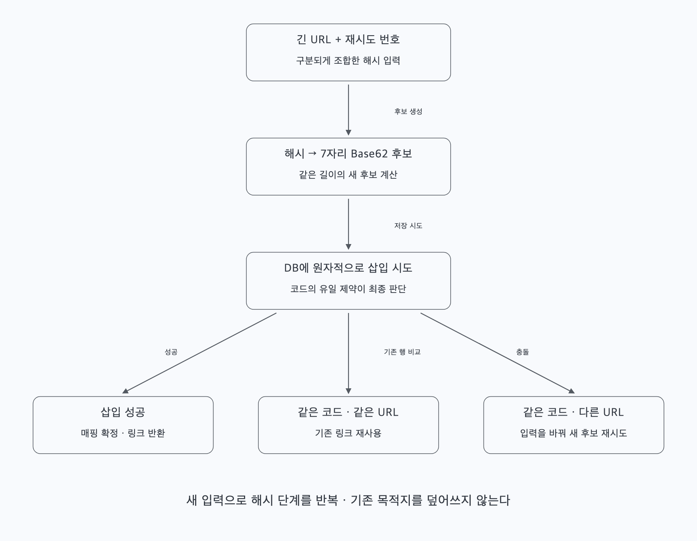
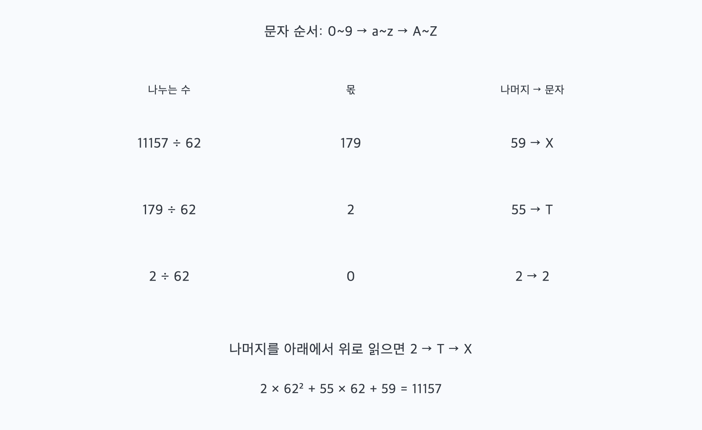
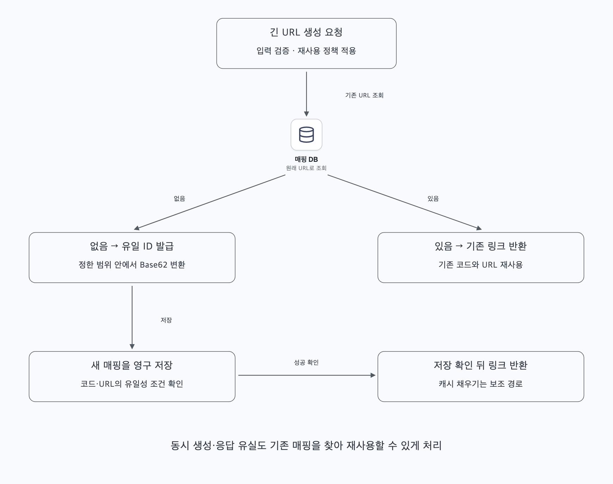
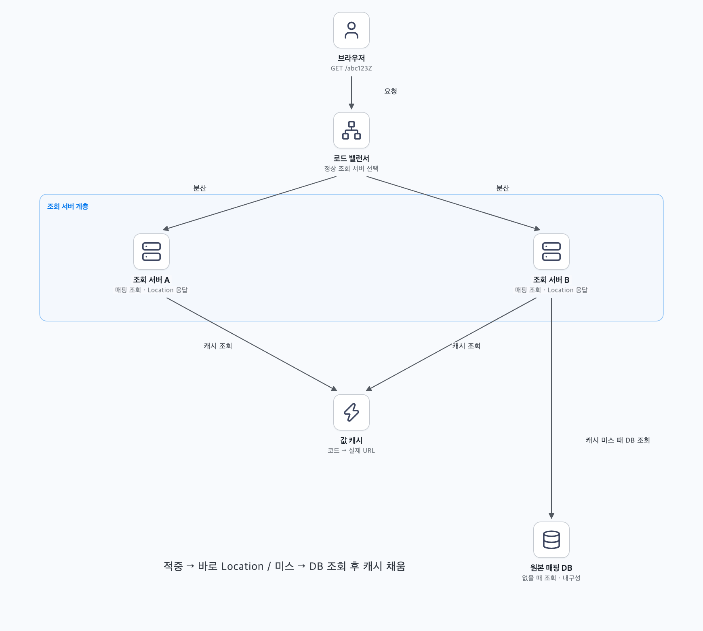
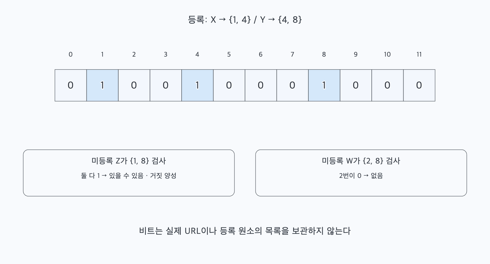
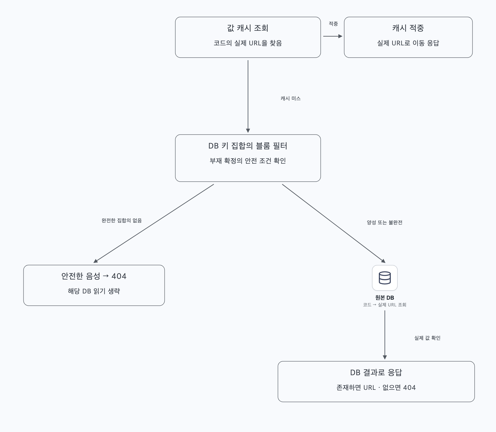
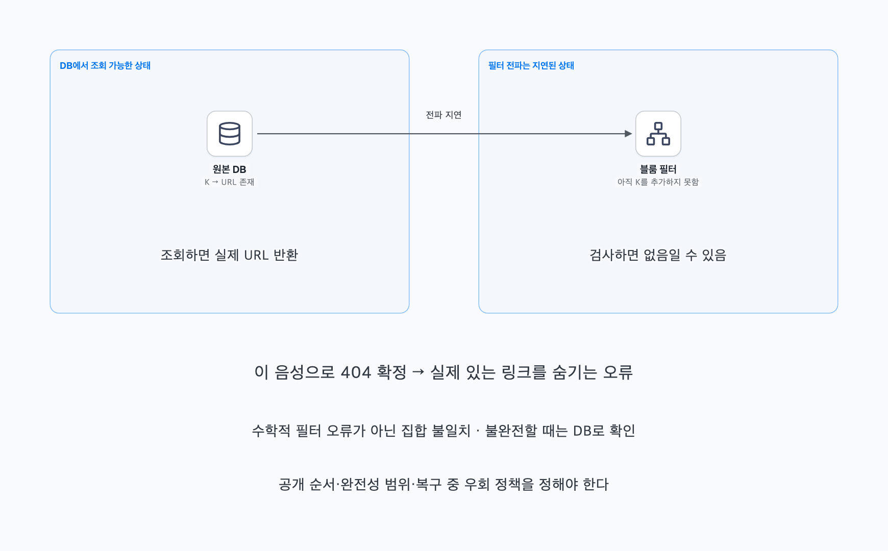

<a id="top"></a>

# 8장. URL 단축기 설계

상품 페이지의 긴 주소를 등록해 짧은 링크를 만들고, 그 링크를 누른 사용자를 원래 페이지로 보내는 과정을 따라간다. 코드 생성·매핑 저장·캐시 조회를 설명한 뒤 블룸 필터의 활용과 한계를 살펴본다.

책 8장과 제공된 메모를 바탕으로 재구성했다. 개념·그림·심화 질문·복습 답안을 이 README에서 함께 읽는다.

<a id="contents"></a>

## 목차

- [생성과 리다이렉션의 흐름 따라 읽기](#core-concepts)
- [질문 01 · 블룸 필터로 DB를 얼마나 대신할 수 있을까?](#q1)
- [스스로 답하기 · 답안 토글](#review)
- [책과 추가 설명의 범위](#sources)

---


<a id="core-concepts"></a>

## 긴 주소를 한 번 저장하고 짧은 코드로 다시 찾는다

### 1. 무엇을 짧게 만들고 무엇을 그대로 둘까?

상품 행사 페이지의 긴 URL을 메시지에 넣으려고 한다. 사용자는 긴 주소를 등록해 짧은 링크를 받고, 그 링크를 누른 사람은 원래 상품 페이지로 이동해야 한다. 이 서비스가 원래 페이지의 내용을 대신 저장하는 것은 아니다. ‘짧은 코드 → 원래 URL’의 대응 관계를 보관하고 찾는다.

이 장의 요구사항은 매일 1억 개 생성, 숫자·영문자만 사용하는 짧은 코드, 리다이렉션, 높은 가용성·확장성·장애 감내다. 발급한 매핑은 사용자가 수정하거나 삭제하지 못한다. 긴 URL에도 숫자·영문자만 허용한다는 뜻은 아니다. 제한 대상은 서비스가 만드는 단축 코드다.

같은 긴 주소를 다시 등록할 때 새 링크를 만들지, 기존 링크를 돌려줄지도 정해야 한다. 책의 생성 흐름을 따라 여기서는 같은 URL 문자열이면 기존 링크를 재사용하는 정책으로 설명한다. 행사별 클릭을 따로 집계해야 한다면 재사용 범위를 바꿀 수 있다. 이 선택은 코드 유일성과는 별개의 제품 정책이다.

### 2. 하루 1억 개를 10년 저장하면 얼마나 커질까?

1년을 365일로 계산하면 생성량과 저장량의 기준은 다음과 같다. 단순화를 위해 생성 요청마다 새 매핑 하나가 생긴다고 보수적으로 잡는다.

| 항목 | 계산 | 결과 |
| --- | --- | --- |
| 평균 생성 요청 | 1억 ÷ 86,400초 | 약 1,157회/초, 책에서는 약 1,160 |
| 10년의 매핑 수 | 1억 × 365 × 10 | 3,650억 개 |
| 긴 URL 본문만의 저장량 | 3,650억 × 평균 100바이트 | 36.5TB |

여기서 TB는 10^12바이트로 계산했다. 평균 100자는 언제나 100바이트인 것은 아니다. 책의 추정처럼 저장된 URL이 평균 100바이트라고 가정한 값이다. 실제 용량에는 키·ID·행·인덱스·복제본·백업과 여유 공간을 더해야 한다. 예를 들어 같은 URL 본문을 세 벌 보관하는 것만으로 109.5TB다.

리다이렉션은 읽기다. 책은 읽기:쓰기를 10:1로 가정해 평균 읽기를 약 11,600회/초로 추정한다. 이 비율은 요구사항에서 자동으로 나오는 사실이 아니다. 실제 클릭 패턴과 순간 최대량을 따로 확인한다. 인기 링크 하나가 퍼지면 평균보다 훨씬 많은 읽기가 특정 코드에 집중될 수 있다.

### 3. 생성과 이동을 서로 다른 API로 나눈다

생성 요청은 긴 주소를 받아 매핑을 저장하고 짧은 주소를 반환한다. 이동 요청은 코드로 원래 주소를 읽어 리다이렉션 응답을 보낸다.

```http
POST /api/v1/shorten
Content-Type: application/json

{"longUrl":"https://shop.example/products/42?campaign=summer"}
```

생성 성공 시 `https://s.example/abc123Z`처럼 서비스 도메인과 코드를 합친 링크를 반환한다. 도메인 길이도 전체 링크 길이에 포함되므로 코드 길이와 전체 URL 길이는 구분한다.

```http
GET /abc123Z

HTTP/1.1 302 Found
Location: https://shop.example/products/42?campaign=summer
Cache-Control: no-store
```

위 응답은 클릭 때마다 서비스에서 요청을 관찰하려는 정책의 한 예다. 실제로 없는 코드면 404를, URL 형식이나 허용한 스킴이 아니면 생성 단계에서 오류를 반환할 수 있다. 조회 중 DB 장애가 났다는 사실을 코드가 없다는 404와 혼동하지 않는다.

### 4. 리다이렉션은 서버가 페이지를 대신 가져오는 동작이 아니다

브라우저는 짧은 주소로 요청한다. 단축 서비스는 코드를 찾고 `Location`에 긴 주소를 담아 응답한다. 그 응답을 받은 브라우저가 원래 사이트로 새 요청을 보낸다.



단축 서비스가 원래 페이지의 HTML을 받아 브라우저에 중계하는 프록시 구조와 구분한다. 원래 사이트의 장애까지 단축 서비스가 없애 주는 것도 아니다. 이 서비스가 보장할 수 있는 것은 보관한 매핑을 찾아 올바른 이동 응답을 주는 경로다.

#### 301과 302는 어떤 선택일까?

301은 영구 이동을 나타내며 별도 지시가 없으면 휴리스틱하게 캐시될 수 있다. 캐시에 유효한 이동 응답이 남아 있으면 이후 요청은 단축 서비스를 다시 거치지 않을 수 있다. 부하를 줄일 수 있지만 ‘첫 요청만 오고 이후에는 반드시 영원히 안 온다’는 보장은 아니다. 캐시 만료·클라이언트 동작·헤더에 따라 달라진다.

302는 일시 이동을 나타낸다. 클릭 때마다 단축 서비스에서 관찰하려는 정책에 더 잘 맞출 수 있지만 302라는 이유만으로 캐시가 불가능한 것은 아니다. 이 장의 예시는 `Cache-Control: no-store`를 함께 사용한다. 상태 코드의 의미와 저장·재사용 정책은 [HTTP 의미 규정](https://www.rfc-editor.org/rfc/rfc9110.html#section-15.4.2)과 [HTTP 캐시 규정](https://www.rfc-editor.org/rfc/rfc9111.html#section-5.2.2.5)을 함께 본다.

또 요청 수와 사람의 클릭 수는 다르다. 미리보기·봇·재시도도 요청을 만들고, 지역·기기 정보도 수집 방식에 따라 제한이 있다. 302를 쓰는 것만으로 정확한 사용자별 클릭 분석이 완성되는 것은 아니다.

### 5. 매핑은 영구 저장하고 인기 링크만 캐시한다

처음에는 해시 테이블에 `코드 → 긴 URL`을 넣는 방식으로 이해할 수 있다. 그러나 수천억 건을 모두 프로세스 메모리에만 두면 용량·비용뿐 아니라 재시작 후 복구도 문제가 된다. 영구 저장소에 원본 매핑을 두고, 메모리 캐시는 자주 찾는 일부 값을 맡게 한다.

책은 관계형 DB에 ID·단축 코드·긴 URL을 저장하는 모델을 사용한다. 코드 조회와 중복 방지에 필요한 인덱스·제약을 두기 쉽기 때문이다. 이 선택이 한 DB 서버에 3,650억 행을 무조건 넣을 수 있다는 뜻은 아니다. 파티셔닝·샤딩·복제와 운영 비용은 별도로 설계한다. 키-값 저장소를 택한다면 그에 맞는 유일성·일관성 조건을 검토할 수도 있다.

| 논리 필드 | 역할 |
| --- | --- |
| id | 저장 레코드의 식별자, Base62 방식에서는 코드의 원본 숫자로 쓸 수 있음 |
| short_code | 대소문자를 구분하는 조회 키, 서로 다른 URL이 같은 코드를 차지하지 않게 함 |
| long_url | 리다이렉션할 원래 주소 |

기존 URL을 재사용하려면 긴 URL로 기존 행을 찾는 조회 경로도 필요하다. 어떤 문자열을 같은 URL로 볼지 먼저 정한다. 쿼리 파라미터 순서나 경로의 대소문자를 무조건 바꾸면 다른 주소를 하나로 합칠 수 있다. 여기서는 입력을 검증한 뒤 보존한 문자열의 동일성을 기준으로 삼는다.

원래 URL의 요약 해시를 검색 키로 사용할 수도 있지만 같은 해시라는 이유만으로 원문도 같다고 확정하지 않는다. 후보 행의 실제 URL을 비교한다. 이 구분은 다음의 단축 코드 충돌과도 연결된다.

### 6. 숫자·영문자 7개면 충분할까?

알파벳을 `0~9`, `a~z`, `A~Z` 순서로 정하면 가능한 문자가 62개다. 정확히 n자리 코드는 `62^n`개다. 3,650억 개보다 큰 공간을 찾으면 다음과 같다.

| 길이 | 코드 수 |
| --- | --- |
| 6 | 56,800,235,584 |
| 7 | 3,521,614,606,208 |

따라서 전체 공간을 고르게 사용할 수 있다면 7자리로 수량을 표현할 여유가 있다. 코드 길이가 7이라고 모든 생성 방법이 이 공간을 다 쓰는 것은 아니다. 또한 공간이 충분하다는 것과 무작위·해시 후보의 충돌이 없다는 것도 다르다.

이제 두 방식을 비교한다. 첫째는 긴 URL에서 후보 코드를 만들고 충돌을 해결하는 방법이다. 둘째는 이미 유일한 숫자를 발급한 다음 Base62로 표기하는 방법이다.

### 7. 방법 A — URL을 해시한 뒤 겹치면 새 후보를 만든다

긴 URL을 해시해서 7자리 후보를 만든다. 그 코드가 비어 있으면 저장하고, 이미 있다면 저장된 원래 URL과 비교한다. 같은 URL이면 기존 링크를 쓰고 다른 URL이면 새 후보를 만든다.



책은 CRC32·MD5·SHA-1을 예로 든다. 여기서 표시 형식에 주의해야 한다. MD5·SHA-1의 16진수 문자열을 앞 7글자만 자르면 사용 문자는 16종이므로 공간은 `16^7 = 268,435,456`개다. 이를 `62^7`의 공간으로 계산하면 안 된다. CRC32도 전체가 32비트라서 3,650억 개를 유일하게 표현할 공간은 부족하다. 표현 문자열이 길다고 실제 정보량까지 큰 것은 아니다.

독립적인 예시로 충분한 폭의 해시 바이트를 정수로 해석하고 `62^7` 공간의 후보를 정한 뒤 왼쪽을 0으로 채운 7자리 Base62로 나타낼 수 있다. 이때도 충돌은 검사해야 한다. 충돌 시에는 원래 URL과 재시도 번호 등을 구분되게 합친 **입력**을 바꾸어 다시 해시한다. 이미 나온 7자리 코드 뒤에 문자를 계속 붙이는 방법과 다르며, 코드는 정한 길이를 유지한다.

‘존재하지 않는지 조회 → 삽입’ 두 단계를 다른 요청이 끼어들 수 있게 수행하면 둘 다 비었다고 판단할 수 있다. 최종 소유권은 DB의 유일 제약과 원자적인 삽입 결과로 정한다. 먼저 저장한 다른 URL을 덮어쓰면 이미 배포한 링크의 목적지가 바뀌므로 허용하면 안 된다. [유일 제약의 의미](https://www.postgresql.org/docs/current/ddl-constraints.html#DDL-CONSTRAINTS-UNIQUE-CONSTRAINTS)를 참고한다.

블룸 필터로 불필요한 사전 조회를 줄일 수는 있다. 하지만 필터는 코드 예약이나 원자적 삽입을 대신하지 않는다. 자세한 활용 범위는 [블룸 필터 심화](#q1)에서 생성·조회별로 살펴본다.

### 8. 방법 B — 유일한 숫자를 Base62로 표기한다

Base62는 숫자의 표기법이다. 서로 다른 정수에 같은 표현이 생기지 않게 문자 순서와 변환 규칙을 고정하면, 유일성은 숫자 ID가 제공한다. 원래 URL을 해시하는 과정과 다르다.



이 장의 문자 순서는 `0~9` → `a~z` → `A~Z`다. 나머지 10은 a, 35는 z, 36은 A, 61은 Z가 된다. 이 변환 예시는 불필요한 앞의 0을 붙이지 않는 최소 길이 표기이며 숫자 0은 문자 0으로 나타낸다. 숫자를 62로 반복해서 나누고 나머지를 역순으로 읽는다.

```text
11157 ÷ 62 = 179, 나머지 59 → X
  179 ÷ 62 =   2, 나머지 55 → T
    2 ÷ 62 =   0, 나머지  2 → 2

역순으로 읽으면 2TX
2 × 62^2 + 55 × 62 + 59 = 11157
```

문자 순서를 바꾸면 결과도 달라진다. 대문자·소문자를 동일하게 취급하는 인덱스나 URL 라우팅을 사용하면 Base62의 62개 문자를 온전히 구분하지 못하므로 저장·비교·조회 경로를 맞춰야 한다.

숫자 ID가 유일하고 정한 범위 안에 있으면 코드끼리의 해시 충돌 해결은 필요 없다. 그 대신 ID 생성기와 번호 범위 관리가 필요하다. 연속된 숫자는 변환해도 추측하기 쉬운 관계가 남는다. 링크를 안다고 접근 권한까지 얻어야 하는 것은 아니므로 비공개 콘텐츠는 원래 서비스의 인증·인가 정책을 유지한다.

#### 7장의 64비트 ID를 그대로 넣으면 항상 7자리일까?

아니다. 7자리 Base62는 `0 ≤ id < 62^7`의 범위를 표현한다. 부호 있는 64비트 양수 범위 전체를 표현하려면 최대 11자리가 필요하다. 스노우플레이크의 시간 필드가 상위에 있으므로 실제 생성 개수가 적어도 숫자 값은 금방 7자리 범위를 넘을 수 있다.

7자리를 고정하려면 그 공간 안의 숫자를 유일하게 할당하는 범위 예약 등 별도 설계를 하거나, 7자리보다 긴 코드를 허용해야 한다. ID를 `62^7`로 나눈 나머지만 쓰면 서로 다른 숫자가 다시 같은 코드가 되므로 원래 유일성 보장은 사라진다. 짧을수록 좋다는 목표와 생성기의 실제 값 범위를 함께 결정한다.

### 9. 생성 요청이 왔을 때 저장까지 완료하고 응답한다

책의 Base62 흐름을 바탕으로 생성 경로를 따라가 보자.

1. 긴 URL을 검증하고 재사용 정책에 맞는 기존 매핑을 찾는다.
2. 있으면 기존 짧은 링크를 반환한다.
3. 없으면 유일한 숫자 ID를 발급받아 정한 Base62 규칙으로 코드를 만든다.
4. 코드·ID·원래 URL을 영구 저장소에 저장한다.
5. 저장 성공을 확인한 뒤 링크를 반환한다. 캐시 채우기는 원본을 대신하지 않는다.



두 요청이 같은 긴 URL을 동시에 등록하면 1단계에서 둘 다 없다고 볼 수 있다. 같은 URL에 같은 링크를 돌려주기로 했다면 코드의 유일성과 별도로 재사용 키의 유일성도 강제하거나 해당 키의 생성 경로를 조율해야 한다. 한 요청이 먼저 저장하면 다른 요청은 기존 결과를 다시 찾아 반환할 수 있다. URL 재사용을 요구하지 않는 정책이라면 두 링크를 만드는 것도 가능하다.

샤딩한 저장소에서는 한 샤드의 유일 제약이 전체 시스템의 유일성을 자동 보장하지 않는다. 같은 코드의 쓰기가 같은 권위 있는 저장 지점으로 모이게 하거나 전역 ID 할당 등 일관된 설계를 해야 한다. URL로 재사용을 찾는 경로와 코드로 읽는 경로가 달라지는 비용도 고려한다.

ID를 발급받은 뒤 저장이 실패하면 그 번호가 비어도 괜찮다. 저장은 성공했지만 응답을 잃었을 때는 URL 재사용 조회나 요청의 멱등성 키로 기존 결과를 찾을 수 있게 한다. 같은 요청을 재시도했다는 사실과 같은 URL을 여러 사용자가 등록했다는 사실은 구분한다.

### 10. 클릭 요청은 캐시에서 빠르게 찾고 없으면 DB를 읽는다

리다이렉션은 읽기 비중이 크므로 `short_code → long_url` 캐시를 둔다. 로드 밸런서는 여러 조회 서버에 요청을 나누고, 조회 서버는 캐시 적중 시 바로 Location을 만든다. 캐시 미스면 영구 저장소에서 읽고 캐시를 채운다.



매핑이 수정되지 않아도 캐시에서는 용량 때문에 항목이 밀려나거나 TTL로 만료될 수 있다. 캐시에서 없다는 것은 DB에도 없다는 뜻이 아니다. 캐시 장애 시 DB로 우회할 수 있지만 모든 요청이 한꺼번에 DB로 몰리지 않게 한도·동시성·요청 병합 등을 고려한다. 인기 코드가 동시에 만료되는 상황도 같은 문제다.

없는 코드의 반복 조회에는 짧은 음성 캐시나 블룸 필터를 쓸 수 있다. 새로 만든 코드가 아직 반영되지 않은 복제 DB를 읽고 404를 반환하는 일도 막아야 한다. 생성 직후에는 권위 있는 DB로 읽거나 일관성 정책을 정한다. 잘못된 404를 길게 캐시하면 새 링크가 계속 없는 것처럼 보일 수 있다.

### 11. 운영 기능은 핵심 매핑 경로와 연결해 설계한다

생성 API에는 계정·IP 등 기준의 처리율 제한을 두어 번호 공간·저장 용량과 쓰기 자원을 보호한다. 읽기에도 무작위 코드 탐색이나 급증에 대비할 한도와 보호 경로가 필요하다. 4장의 제한 장치는 요청을 줄이는 도구이며 용량 계획을 대신하지 않는다.

분석을 한다면 리다이렉션 경로에서 관찰한 이벤트를 큐로 보내 별도 소비자가 집계할 수 있다. 그럴 때 분석 전달 실패를 이유로 이동 자체를 막을지, 일부 분석 유실을 허용할지 정한다. 재전송으로 생긴 중복 이벤트를 어떻게 셀지도 정해야 한다. 단축 서비스에 오지 않은 캐시된 이동은 이 경로에서 관찰할 수 없다.

매핑의 내구성·복제·백업·복구를 준비하고, 생성 성공 직후 조회와 장애 전환에서도 같은 목적지를 돌려주는지 확인한다. 서비스가 매핑을 지우지 않는다고 캐시·필터·분석 데이터까지 모두 무기한 보관해야 하는 것은 아니다. 각 자료의 목적과 재생성 방법을 구분한다.

복습할 때는 긴 주소가 어디에 보관되고, 코드는 어떻게 유일해지며, 클릭 한 번에 어느 저장소를 읽는지부터 말해 보자. 블룸 필터가 들어가도 값과 진실의 기준은 여전히 별도로 필요하다.

[목차로 돌아가기](#contents)

---


<a id="q1"></a>

## 블룸 필터를 DB 앞에 두면 무엇을 줄일 수 있을까?

### 1. 먼저 ‘어떤 집합에 들어 있는지’를 정한다

책의 ‘DB에 그 URL이 있는지 검사’하는 단계에도 블룸 필터를 넣을 수 있다. 다만 질문을 두 가지로 나누어야 한다. 생성에서 긴 URL의 재사용 여부를 묻는 것과, 클릭에서 짧은 코드의 매핑을 묻는 것은 다른 집합 조회다.

| 사용 위치 | 필터에 넣는 원소 | 필터가 줄일 수 있는 일 |
| --- | --- | --- |
| 해시 후보의 사전 검사 | 이미 사용한 단축 코드 | 확실히 빈 후보의 사전 SELECT |
| 같은 긴 URL의 재사용 조회 | 저장된 긴 URL의 동일성 키 | 아직 등록되지 않은 URL의 사전 SELECT |
| 캐시 미스 후 리다이렉션 조회 | DB에 존재하는 단축 코드 | 존재하지 않는 코드의 DB 읽기 |

서로 다른 집합은 별도 필터로 관리하거나 명확한 구분자를 둔다. 캐시에 들어 있는 키의 집합과 DB 전체 키의 집합도 다르다. 캐시에 없다는 판정으로 DB에도 없다고 결론 내리면 안 된다.

### 2. 왜 ‘있을 수 있음’과 ‘확실히 없음’만 대답할까?

블룸 필터는 비트 배열과 여러 해시 함수를 사용한다. 원소 하나를 추가하면 그 원소로 계산한 위치들의 비트를 1로 켠다. 조회할 때 어느 위치라도 0이면 그 원소를 넣지 않았다는 것을 알 수 있다. 모두 1이어도 다른 원소들이 그 비트들을 켜 두었을 수 있다.



그림에서는 X가 1·4번, Y가 4·8번을 켰다. 등록되지 않은 Z가 우연히 1·8번을 검사하면 둘 다 1이므로 ‘있을 수 있음’으로 판정된다. 이것이 거짓 양성(false positive)이다. W가 2·8번을 검사하면 2번이 0이므로 ‘없음’이다.

올바르게 추가한 원소를 같은 규칙의 손상되지 않은 필터에서 조회할 때는 거짓 음성이 없다. 이 보장은 **그 필터에 반영된 집합**에 대한 것이다. DB의 새 키가 아직 필터에 추가되지 않았다면 그 DB 키의 존재까지 보장하지 않는다. 자료구조의 성질과 데이터 동기화는 별개의 조건이다. [블룸 필터의 원리와 수식](https://pages.cs.wisc.edu/~cao/papers/summary-cache/node8.html)을 참고한다.

### 3. 생성에서 기존 URL 확인을 줄이는 방법

생성 요청의 긴 URL을 필터에 묻는다. 필터가 DB의 전체 등록 집합을 빠짐없이 반영하고 ‘없음’이면 기존 URL을 찾는 SELECT를 생략하고 새 매핑 저장을 시도할 수 있다. ‘있을 수 있음’이면 실제 DB에서 URL을 확인해 기존 단축 코드를 가져온다.

필터는 기존 코드 값을 돌려주지 않는다. 같은 URL이 맞는지 정확히 확인하거나 기존 링크를 반환하려면 저장소 조회가 필요하다. 또 ‘없음’이라고 본 직후 다른 요청이 같은 URL을 저장할 수 있다. 기존 URL 재사용을 강제하는 경우 DB의 유일 제약이나 해당 키를 조율하는 경로는 남겨야 한다.

해시 후보를 검사할 때도 마찬가지다. ‘없음’은 사전 SELECT를 줄일 수 있지만 최종 INSERT를 생략하지는 못한다. 곧바로 원자적인 삽입을 시도하고 충돌 결과를 처리하는 방식보다 필터 조회를 하나 더 하는 것이 이득인지 측정해야 한다. 필터를 원격 서비스로 두면 그 호출도 지연과 장애 경로가 된다.

### 4. 조회에서는 캐시 미스 중 없는 코드를 걸러 낸다

캐시 적중이면 이미 긴 URL을 얻었으므로 바로 이동 응답을 만들면 된다. 캐시 미스일 때 DB 키 집합의 블룸 필터를 확인한다. 안전하게 부재 판정을 사용할 수 있는 완전한 필터의 ‘없음’이면 DB 조회 없이 404를 만들 수 있다. ‘있을 수 있음’이면 DB에서 값을 읽는다.



예를 들어 캐시 미스 100만 건 중 실제 존재하는 코드가 10%, 나머지 90%가 미등록 코드이며 거짓 양성률 p=1%라고 하자. 동기화 조건을 만족한다면 DB로 가는 양은 대략 `10% + 90% × 1% = 10.9%`, 약 10만 9천 건이다. 모든 요청의 89.1%가 줄어든다는 뜻이 아니라 이 가정의 **캐시 미스 집합**에서 계산한 것이다.

반대로 대부분의 미스가 실제 존재하는 새 링크라면 필터는 거의 전부 ‘있을 수 있음’이라고 하므로 DB 조회는 그대로다. 값 캐시의 적중률, 미등록 키의 비중, 필터 유지 비용을 함께 봐야 한다.

### 5. DB에 썼는데 필터에는 아직 없으면?

DB가 새 코드 K의 저장을 완료하고 성공을 반환했다. 필터 갱신은 비동기로 늦어졌다고 하자. 사용자가 바로 K를 클릭했는데 캐시에도 없고 필터가 ‘없음’이라고 하여 404를 반환하면 실제로 있는 링크를 잃어버린 것처럼 보인다.



이것은 필터가 자기 집합에 대해 거짓 음성을 만든 것이 아니라, DB 집합과 필터 집합이 달라 생긴 오류다. 다음과 같은 운영 조건을 선택해야 한다.

- DB에서 조회 가능해지는 키가 부재 판정에 쓰는 모든 관련 필터에 먼저 포함되도록 공개 순서를 조율할 수 있다. 저장이 나중에 실패해 필터에만 남은 키는 불필요한 DB 조회를 만들지만 실제 있는 키를 숨기지는 않는다. 분산된 필터 전파까지 맞추는 비용은 남는다.
- 완전성이 확인된 버전·범위에만 부재 최적화를 적용하고, 최신 쓰기가 아직 포함되지 않은 범위는 DB에서 확인할 수 있다.
- 필터 장애·재시작·복구·스냅샷 재생 중에는 부재 확정을 중단하고 DB 조회로 돌아간다. 이때도 DB 과부하를 막는 한도가 필요하다.

단지 ‘DB에 쓴 다음 필터에 추가’하는 두 명령을 호출했다고 그 사이의 실패나 지연이 사라지지는 않는다. 이 장의 핵심 설계에서는 필터를 필수 정답 저장소로 만들지 않고, 안전 조건이 확인될 때만 쓰는 보조 최적화로 둔다.

### 6. DB·캐시와 비교한 이점과 비용

DB는 키와 실제 URL의 원본을 보관하고 정확한 조회·제약을 제공한다. 값 캐시는 일부 키의 실제 URL을 빠르게 돌려준다. 블룸 필터는 집합 소속 가능성을 작은 공간으로 요약할 뿐이다. 어느 원소가 들어 있는지 목록을 복원하거나 긴 URL을 꺼내지 못한다.

| 자료 | 보관하는 것 | 적중·양성 시 얻는 것 | 없는 경우의 의미 |
| --- | --- | --- | --- |
| 원본 DB | 코드와 실제 URL | 실제 매핑 | 권위 있는 읽기의 결과로 부재 판단 |
| 값 캐시 | 일부 코드와 실제 URL | 실제 매핑 | 퇴출·만료된 DB 키일 수도 있음 |
| 블룸 필터 | 집합의 비트 요약 | 있을 가능성 | 포함 집합의 완전성·동기화 조건 안에서 부재 |

블룸 필터는 원본 URL을 저장하지 않으므로 매핑 DB를 대체할 수 없다. 자주 쓰는 실제 값을 반환하지도 못하므로 값 캐시도 통째로 대체하지 못한다. 일반적인 캐시-DB 구조에서도, 없는 키로 DB를 계속 두드리는 캐시 관통을 줄이는 층으로 함께 사용할 수 있다. DB를 읽을지 결정하는 힌트와 DB에서 읽을 값은 다른 역할이다.

비용은 거짓 양성 때문에 남는 DB 조회, 해시 계산, 필터 메모리, 갱신·배포·복구와 정합성 관리다. 새 원소가 예상보다 많아지면 고정 크기 필터의 거짓 양성률이 올라간다. 낮은 오차율을 원하면 더 큰 공간이 필요하다. 기본 블룸 필터에서는 다른 키가 함께 쓰는 비트를 지울 수 없어 임의 삭제도 안전하게 처리할 수 없다. 이 장의 삭제 없는 매핑은 이 점에 유리하지만 캐시 TTL처럼 필터의 일부를 마음대로 비우면 안 된다.

<details>
<summary>3,650억 개를 담는 필터도 정말 작은가?</summary>

이상적인 해시 분포를 전제로 원소 수 n, 목표 거짓 양성률 p에 필요한 비트 수는 근사적으로 `m = -n × ln(p) / (ln 2)^2`다. p=1%이면 원소당 약 9.59비트이고 해시 횟수의 최적 근사는 `(m/n) × ln 2`, 약 7회다.

3,650억 개라면 약 3.50조 비트, 약 437GB의 비트 배열이 필요하다. 이는 값 전체를 저장하는 것보다 작아도 모든 서버가 부담 없이 한 벌씩 보관할 수 있는 크기는 아니다. 실제 자료구조 부가 공간과 복제본은 추가다. 샤드·범위별 필터와 확장·재구축 계획이 필요하다. 이 계산은 앞서 설명한 연구 자료의 수식을 사용한 독립 예시이며 실제 제품의 메모리를 측정한 값이 아니다.

</details>

복습할 때는 ‘필터가 어느 집합을 요약하는가’, ‘없다는 판정을 지금 안전하게 쓸 수 있는가’, ‘있을 때 실제 값을 어디서 가져오는가’의 세 질문으로 설명해 보자.

[목차로 돌아가기](#contents)

---


<a id="review"></a>

## 스스로 답하기

생성·조회 경로를 직접 그린 뒤 답안을 연다. 블룸 필터는 어느 집합을 검사하는지와 부재 판정의 조건까지 함께 답한다.

<details>
<summary>01. URL 단축기가 보관하는 핵심 데이터는?</summary>

짧은 코드와 원래 URL의 매핑이다. 원래 페이지의 HTML을 대신 보관하고 중계하는 서비스를 기본으로 가정하지 않는다.

</details>

<details>
<summary>02. 숫자·영문자 제한은 긴 URL에도 적용하는가?</summary>

이 장에서는 생성하는 단축 코드에 적용한다. 입력한 긴 URL의 스킴·형식은 별도로 검증한다. 단축 URL 전체에는 도메인·슬래시 등도 포함된다.

</details>

<details>
<summary>03. 하루 1억 개 생성의 평균 QPS는?</summary>

1억을 86,400초로 나누면 약 1,157회/초다. 책에서는 약 1,160으로 잡는다. 순간 최대량은 이 평균만으로 알 수 없다.

</details>

<details>
<summary>04. 10년의 3,650억 레코드와 36.5TB는 어떤 가정인가?</summary>

하루 1억 개가 모두 새 매핑이고 1년을 365일로 잡는다. URL 평균 100바이트만 곱한 십진 단위 용량이며 키·행·인덱스·복제·백업 등은 별도다. 100자가 언제나 100바이트는 아니다.

</details>

<details>
<summary>05. 읽기 QPS가 약 11,600인 이유는?</summary>

책의 읽기:쓰기 10:1이라는 추정용 가정을 적용했기 때문이다. 생성량만으로 실제 클릭 수가 정해지는 것은 아니다.

</details>

<details>
<summary>06. 리다이렉션 응답 뒤 누가 원래 사이트로 요청하는가?</summary>

Location을 받은 클라이언트가 새 요청을 보낸다. 단축 서비스가 원래 페이지를 가져와 중계하는 흐름과 다르다.

</details>

<details>
<summary>07. 301이면 첫 요청 이후 절대 단축 서버에 오지 않는가?</summary>

아니다. 영구 이동이며 캐시될 수 있어 반복 요청을 줄일 수 있다. 실제 재사용·만료·재검증은 헤더와 클라이언트 동작 등에 달려 있다.

</details>

<details>
<summary>08. 302면 캐시가 불가능하고 모든 클릭이 정확히 기록되는가?</summary>

아니다. 상태 코드와 캐시 정책을 함께 정해야 한다. 이 장은 no-store를 쓰는 예시다. 봇·미리보기·재시도도 요청을 만들므로 요청 수와 실제 사람 클릭은 구분한다.

</details>

<details>
<summary>09. 원본 매핑 DB와 캐시를 둘 다 두는 이유는?</summary>

DB는 모든 매핑의 내구성 있는 원본이고 캐시는 자주 쓰는 일부 실제 값을 빠르게 반환한다. 캐시가 만료·퇴출되어도 원본이 남아 있어야 한다.

</details>

<details>
<summary>10. 관계형 DB를 택하면 한 대로 수천억 건을 처리할 수 있다는 뜻인가?</summary>

아니다. 논리적인 저장 모델의 선택이다. 실제 용량·인덱스·파티션·샤딩·복제와 처리량을 별도로 설계해야 한다.

</details>

<details>
<summary>11. 6자리와 7자리 Base62 공간은 얼마나 다른가?</summary>

62^6은 56,800,235,584로 3,650억보다 작다. 62^7은 3,521,614,606,208로 더 크다. 알파벳 전체를 쓰는 7자리 공간을 가정한 계산이다.

</details>

<details>
<summary>12. MD5의 앞 7글자를 자르면 62^7개의 공간인가?</summary>

아니다. 16진수 문자열이라면 문자가 16종뿐이므로 16^7=268,435,456개다. 문자열 길이와 실제 알파벳·정보량을 함께 봐야 한다.

</details>

<details>
<summary>13. CRC32 전체 공간만으로 3,650억 개를 유일하게 표현할 수 있는가?</summary>

아니다. 32비트 공간은 2^32개로 목표보다 작다. 다른 표기법으로 바꾸어도 원래 정보량이 늘지는 않는다.

</details>

<details>
<summary>14. 코드 공간이 레코드 수보다 크면 해시 충돌은 없는가?</summary>

아니다. 서로 다른 URL이 같은 후보로 갈 수 있다. 충돌을 판정하고 다른 입력으로 새 후보를 만드는 절차가 필요하다.

</details>

<details>
<summary>15. 해시 충돌 때 정한 7자리 길이를 유지하려면?</summary>

원래 URL과 재시도 번호 등을 구분되게 조합한 입력을 바꾸고 다시 해시해 새 7자리 후보를 만든다. 기존 7자리 코드 뒤에 문자를 무한히 붙이는 방법과 구분한다.

</details>

<details>
<summary>16. 사전 조회에서 비었다면 바로 덮어써도 되는가?</summary>

안 된다. 다른 요청도 동시에 비었다고 볼 수 있다. 원자적인 삽입과 유일성 조건으로 최종 소유권을 정하며 기존 매핑은 덮어쓰지 않는다.

</details>

<details>
<summary>17. 단축 코드가 충돌했는데 원래 URL도 같으면?</summary>

이 장의 재사용 정책에서는 기존 링크를 돌려줄 수 있다. 원래 URL이 다르면 새 후보를 만들어야 한다. 요약 해시가 같다는 이유만으로 원문까지 같다고 단정하지 않는다.

</details>

<details>
<summary>18. Base62는 원래 URL을 해시하는 알고리즘인가?</summary>

아니다. 정수의 표기법이다. 숫자 ID가 유일하고 변환·비교 규칙이 일정하면 서로 다른 ID를 서로 다른 문자열로 나타낸다.

</details>

<details>
<summary>19. 이 장의 Base62 문자 순서와 11157의 표현은?</summary>

0~9, a~z, A~Z 순서다. 나머지 59·55·2를 역순으로 읽어 2TX가 된다. 2×62²+55×62+59=11157이다.

</details>

<details>
<summary>20. 대소문자를 구분하지 않는 저장·라우팅과 Base62를 함께 쓰면?</summary>

a와 A처럼 다른 기호를 하나로 취급할 수 있어 62종을 온전히 구분하지 못한다. 코드의 저장·비교·조회 규칙을 맞춰야 한다.

</details>

<details>
<summary>21. 7장의 64비트 ID를 Base62로 바꾸면 항상 7자리인가?</summary>

아니다. 7자리는 ID가 62^7 미만일 때의 범위다. 부호 있는 64비트 양수 전체에는 최대 11자리가 필요하다. 생성 건수가 적어도 값 자체가 클 수 있다.

</details>

<details>
<summary>22. ID를 62^7로 나눈 나머지로 줄이면 유일성이 유지되는가?</summary>

아니다. 그만큼 차이 나는 서로 다른 ID가 같은 값이 된다. 7자리 범위 안의 유일 할당을 설계하거나 더 긴 코드를 허용해야 한다.

</details>

<details>
<summary>23. 같은 긴 URL을 동시에 등록할 때 코드 유일성만 있으면 기존 링크를 재사용하는가?</summary>

충분하지 않다. 서로 다른 두 코드가 같은 URL을 가리킬 수 있다. 같은 링크 재사용을 강제하려면 재사용 키의 유일성이나 키별 생성 조율도 필요하다.

</details>

<details>
<summary>24. 언제 생성 성공 응답을 반환하는가?</summary>

새 매핑이 영구 저장소에 성공적으로 저장된 뒤다. 캐시만 채웠다고 성공시키면 재시작·퇴출 때 매핑이 사라질 수 있다.

</details>

<details>
<summary>25. 번호 발급 뒤 DB 저장 실패 또는 응답 유실이 생기면?</summary>

사용하지 못한 번호에 빈칸이 생겨도 유일성에는 문제가 없다. 저장 성공 뒤 응답만 잃은 경우 URL 재사용 조회나 요청 멱등성 키로 기존 결과를 찾도록 한다.

</details>

<details>
<summary>26. 각 샤드의 유일 제약이 전체 코드 유일성을 자동 보장하는가?</summary>

아니다. 같은 키의 권위 있는 쓰기 지점이나 전역 ID 할당 등 전체 구조가 맞아야 한다. URL로 찾는 재사용 경로와 코드로 찾는 조회 경로도 설계한다.

</details>

<details>
<summary>27. 캐시에 없으면 DB에도 없는가?</summary>

아니다. 값이 퇴출·만료됐거나 새로 만들어졌을 수 있다. DB에서 확인하거나 완전성 조건을 만족한 별도 필터를 사용한다.

</details>

<details>
<summary>28. DB 장애를 404로 반환하면 어떤 문제가 있는가?</summary>

실제 있는 링크를 없는 링크처럼 보이게 하고 그 오류가 캐시될 수도 있다. 저장소 장애와 실제 부재를 구분해야 한다. 복제 지연으로 새 링크를 못 읽는 경우도 고려한다.

</details>

<details>
<summary>29. 블룸 필터를 생성·조회에 넣을 때 먼저 정할 것은?</summary>

어떤 집합의 소속 여부를 요약하는지다. 사용한 코드, 등록한 긴 URL, DB 키 집합, 캐시 키 집합은 서로 다르다.

</details>

<details>
<summary>30. 블룸 필터의 모든 비트가 1이면 그 원소가 반드시 존재하는가?</summary>

아니다. 다른 원소들이 해당 비트를 켰을 수 있다. 양성은 있을 수 있다는 의미이고 정확한 존재와 값은 DB에서 확인한다.

</details>

<details>
<summary>31. X가 {1,4}, Y가 {4,8}을 켰을 때 Z={1,8}을 검사하면?</summary>

Z를 추가하지 않았어도 두 비트가 1이라 양성이다. 거짓 양성의 예다. W={2,8}이라면 2번이 0이므로 필터 집합에는 없다.

</details>

<details>
<summary>32. 블룸 필터에 거짓 음성이 없다는 말은 DB 최신 키도 무조건 찾는다는 뜻인가?</summary>

아니다. 올바르게 필터에 반영한 집합에 대한 보장이다. DB에만 먼저 저장된 새 키는 필터 집합에 아직 없어서 부재처럼 보일 수 있다.

</details>

<details>
<summary>33. 필터가 없음이라고 하면 생성에서 DB를 전혀 쓰지 않아도 되는가?</summary>

아니다. 안전 조건 아래 사전 SELECT는 줄여도 최종 매핑 INSERT와 원자적 유일성 판정은 남는다. 동시에 들어온 다른 요청도 고려해야 한다.

</details>

<details>
<summary>34. 필터가 양성일 때 기존 단축 URL을 바로 반환할 수 있는가?</summary>

아니다. 필터는 원래 URL이나 기존 코드를 저장하지 않는다. 실제 매핑을 읽고 같은 원문인지 확인해야 한다.

</details>

<details>
<summary>35. 필터가 특히 줄이기 좋은 조회는 무엇인가?</summary>

캐시 미스 중 실제로 없는 코드의 DB 읽기다. 대부분이 실제 존재하는 키라면 양성이 많아 조회 절감은 작을 수 있다.

</details>

<details>
<summary>36. 캐시 미스의 10%가 존재하고 p=1%라면 DB 조회 비율은?</summary>

대략 10%+90%×1%=10.9%다. 캐시 미스 100만 건이면 약 10만 9천 건이다. 완전한 필터 등의 가정을 만족한 그 집합 기준이다.

</details>

<details>
<summary>37. DB 커밋 뒤 필터 갱신이 늦으면 왜 404가 위험한가?</summary>

DB에는 있는 코드인데 필터는 아직 모를 수 있다. 불완전할 때 부재 최적화를 중단하고 DB로 확인하거나 공개 순서·완전성 범위를 조율해야 한다.

</details>

<details>
<summary>38. 필터를 먼저 추가하고 DB 쓰기가 실패하면?</summary>

필터에만 남은 키가 양성이 되어 불필요한 DB 조회를 만들 수 있다. 부재를 잘못 확정해 실제 키를 숨기는 문제와는 다르다. 분산 필터 전파의 순서·실패 조건도 정해야 한다.

</details>

<details>
<summary>39. 블룸 필터가 DB나 값 캐시를 대체할 수 있는가?</summary>

값을 꺼내지 못하므로 둘을 통째로 대체하지 못한다. DB는 원본과 제약을, 값 캐시는 일부 실제 값을 제공한다. 필터는 없는 키의 조회를 줄이는 보조층이다.

</details>

<details>
<summary>40. 필터의 공간·운영 비용은?</summary>

오차율을 낮추려면 더 많은 비트가 필요하고 해시·갱신·분배·복구 비용도 든다. 예상 수를 넘으면 거짓 양성이 늘 수 있다. 기본 필터는 공유 비트를 함부로 지워 원소를 삭제할 수도 없다.

</details>

<details>
<summary>41. 3,650억 개를 p=1%로 요약하면 얼마나 필요한가?</summary>

이상적인 근사로 원소당 약 9.59비트, 전체 비트 배열 약 437GB이며 적절한 해시 수는 약 7회다. 부가 공간·복제·실제 제품 특성은 추가다.

</details>

<details>
<summary>42. 분석 이벤트를 큐로 보내면 클릭 집계가 자동으로 정확해지는가?</summary>

아니다. 캐시된 이동은 서비스에 도착하지 않을 수 있고 이벤트 유실·중복·봇도 있다. 이동 가용성과 분석 전달 보장, 중복 집계 정책을 함께 정해야 한다.

</details>

[목차로 돌아가기](#contents)

---


<a id="sources"></a>

## 책과 추가 설명의 범위

### 책을 대조한 범위

『가상 면접 사례로 배우는 대규모 시스템 설계 기초 1』 8장 「URL 단축기 설계」의 127~139쪽을 확인했다. 규모 추정, 생성·리다이렉션 API, 301·302, DB 매핑 모델, 코드 길이, 해시와 충돌 해소, Base62, 생성 흐름·캐시 조회 구성, 처리율 제한·분석·가용성을 반영했다.

상품 행사 URL, API 경로, 12비트 필터, 비동기 필터 갱신 상황과 캐시 미스 100만 건은 이해를 위한 독립 예시다. Base62의 11157 → 2TX는 책의 문자 순서로 계산을 대조했다. 그림은 설명에 맞게 새로 만들었다.

### 덧붙인 조건

- 36.5TB는 평균 URL 100바이트와 365일/년을 가정한 URL 본문만의 십진 단위 추정이다. 실제 인덱스·키·복제·백업 등은 추가다. 100자와 100바이트는 일반적으로 같지 않다.
- 읽기:쓰기 10:1은 책의 추정용 가정이다. 평균 요청량이 순간 최대 부하를 보장하지 않는다.
- 301이 반드시 첫 한 번만 호출된다는 설명을 캐시 가능성과 정책으로 구분했다. 302도 상태 코드만으로 캐시가 금지되지 않는다.
- 62^7의 코드 공간과 해시 문자열의 표기 알파벳을 구분했다. 7자리 16진수와 전체 CRC32 공간으로 목표 개수를 유일하게 표현할 수는 없다.
- 충돌 재시도는 해시 입력을 바꾸고 고정 길이의 새 후보를 만드는 예시로 설명했다. 최종 예약은 원자적 삽입·유일성 조건으로 처리한다.
- Base62는 표기법이므로 7장의 64비트 ID가 항상 7자리가 되지는 않는다. 동일 URL 재사용과 코드 유일성도 다른 조건이다.
- 블룸 필터 심화는 사용자의 질문을 확장한 부분이다. 요약할 집합, 거짓 양성, 동시성, 반영 지연, 장애·재구축, 값 캐시·DB와의 역할 차이를 함께 설명했다.

### 추가 원문

- [RFC 9110 — HTTP Semantics](https://www.rfc-editor.org/rfc/rfc9110.html#section-15.4.2): 301·302와 Location의 의미를 확인했다.
- [RFC 9111 — HTTP Caching](https://www.rfc-editor.org/rfc/rfc9111.html#section-5.2.2.5): 캐시 저장·재사용과 no-store 지시를 확인했다. 상태 코드와 정책을 함께 해석한다.
- [Cao 외 연구 자료 — Bloom Filters: the math](https://pages.cs.wisc.edu/~cao/papers/summary-cache/node8.html): 비트 요약과 거짓 양성, 원소 수·비트 수·해시 수의 근사식을 참고했다. 본문의 용량 수치는 독립 계산이며 실측값이 아니다.
- [Redis — Bloom filter](https://redis.io/docs/latest/develop/data-types/probabilistic/bloom-filter/): 공간 효율적인 집합 검사와 갱신·조회 역할을 대조했다. 특정 제품을 필수 구성으로 정한 것은 아니다.
- [PostgreSQL — Unique Constraints](https://www.postgresql.org/docs/current/ddl-constraints.html#DDL-CONSTRAINTS-UNIQUE-CONSTRAINTS): 저장소에서 키의 유일성을 강제하는 역할을 참고했다. 샤딩한 전체 저장소의 전역 제약이 자동 생성된다는 의미는 아니다.
- [stack-diagram](https://stacks.caru.moe/): 기존 장의 HTML·PNG 형식을 참고했다. 요청 시퀀스·분기·블룸 필터 비트 배치는 설명에 맞게 구성했다.

### 검증 범위

규모 추정, 62진수 왕복 변환과 경계값, 7자리/64비트 길이, 16진수 코드 공간, 필터 메모리·예상 DB 조회 비율을 계산한다. 학습용 비트 예시의 거짓 양성·음성, 미반영 필터의 부재 오판, 저장소 제약을 이용한 충돌·동일 URL 재사용 예시를 검증한다.

그림·복습 토글·내부 링크·모바일 화면·마크다운 표기도 확인한다. 실제 수천억 행의 저장소를 만들거나 성능·장애 전환을 측정한 결과는 아니다.

[목차로 돌아가기](#contents)

---
