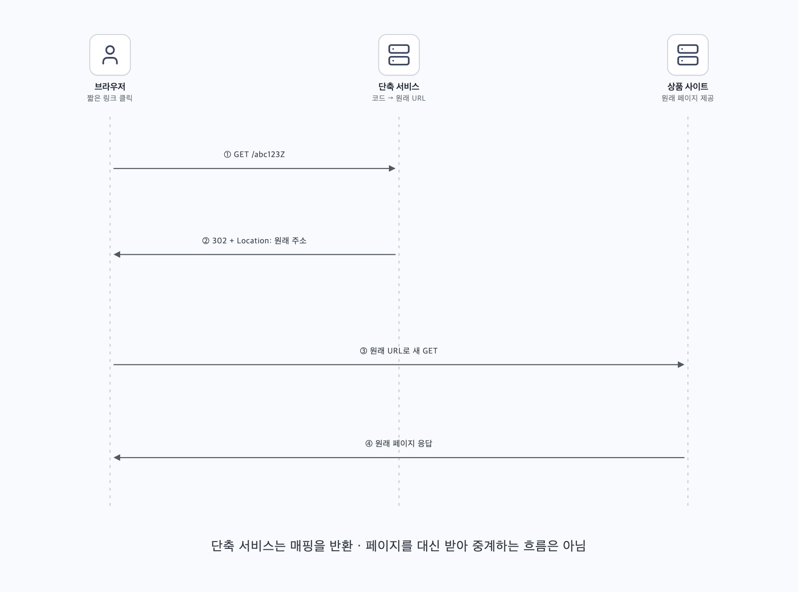
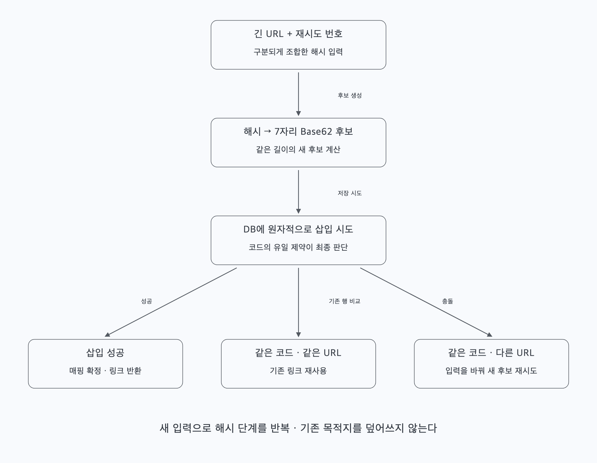
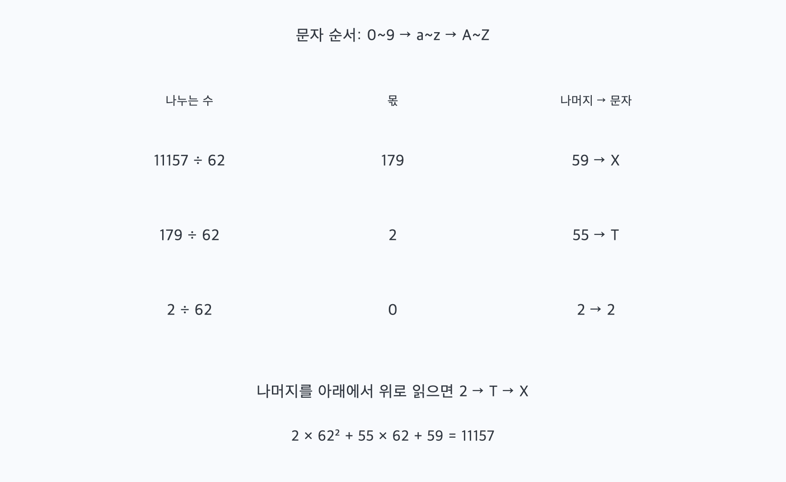
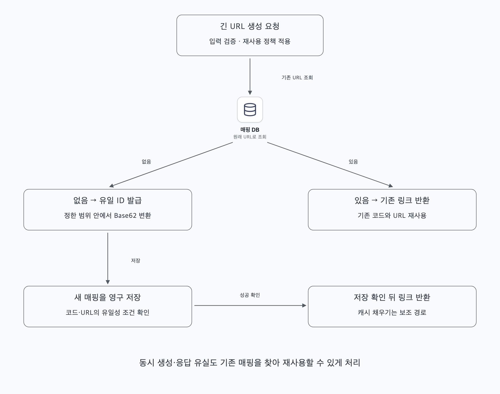
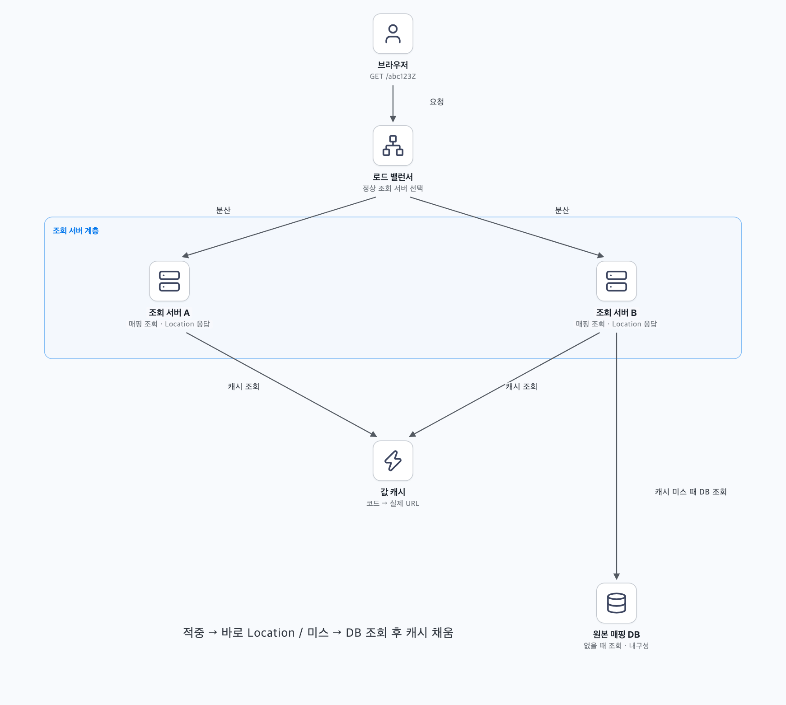

# 긴 주소를 한 번 저장하고 짧은 코드로 다시 찾는다

## 1. 무엇을 짧게 만들고 무엇을 그대로 둘까?

상품 행사 페이지의 긴 URL을 메시지에 넣으려고 한다. 사용자는 긴 주소를 등록해 짧은 링크를 받고, 그 링크를 누른 사람은 원래 상품 페이지로 이동해야 한다. 이 서비스가 원래 페이지의 내용을 대신 저장하는 것은 아니다. ‘짧은 코드 → 원래 URL’의 대응 관계를 보관하고 찾는다.

이 장의 요구사항은 매일 1억 개 생성, 숫자·영문자만 사용하는 짧은 코드, 리다이렉션, 높은 가용성·확장성·장애 감내다. 발급한 매핑은 사용자가 수정하거나 삭제하지 못한다. 긴 URL에도 숫자·영문자만 허용한다는 뜻은 아니다. 제한 대상은 서비스가 만드는 단축 코드다.

같은 긴 주소를 다시 등록할 때 새 링크를 만들지, 기존 링크를 돌려줄지도 정해야 한다. 책의 생성 흐름을 따라 여기서는 같은 URL 문자열이면 기존 링크를 재사용하는 정책으로 설명한다. 행사별 클릭을 따로 집계해야 한다면 재사용 범위를 바꿀 수 있다. 이 선택은 코드 유일성과는 별개의 제품 정책이다.

## 2. 하루 1억 개를 10년 저장하면 얼마나 커질까?

1년을 365일로 계산하면 생성량과 저장량의 기준은 다음과 같다. 단순화를 위해 생성 요청마다 새 매핑 하나가 생긴다고 보수적으로 잡는다.

| 항목 | 계산 | 결과 |
| --- | --- | --- |
| 평균 생성 요청 | 1억 ÷ 86,400초 | 약 1,157회/초, 책에서는 약 1,160 |
| 10년의 매핑 수 | 1억 × 365 × 10 | 3,650억 개 |
| 긴 URL 본문만의 저장량 | 3,650억 × 평균 100바이트 | 36.5TB |

여기서 TB는 10^12바이트로 계산했다. 평균 100자는 언제나 100바이트인 것은 아니다. 책의 추정처럼 저장된 URL이 평균 100바이트라고 가정한 값이다. 실제 용량에는 키·ID·행·인덱스·복제본·백업과 여유 공간을 더해야 한다. 예를 들어 같은 URL 본문을 세 벌 보관하는 것만으로 109.5TB다.

리다이렉션은 읽기다. 책은 읽기:쓰기를 10:1로 가정해 평균 읽기를 약 11,600회/초로 추정한다. 이 비율은 요구사항에서 자동으로 나오는 사실이 아니다. 실제 클릭 패턴과 순간 최대량을 따로 확인한다. 인기 링크 하나가 퍼지면 평균보다 훨씬 많은 읽기가 특정 코드에 집중될 수 있다.

## 3. 생성과 이동을 서로 다른 API로 나눈다

생성 요청은 긴 주소를 받아 매핑을 저장하고 짧은 주소를 반환한다. 이동 요청은 코드로 원래 주소를 읽어 리다이렉션 응답을 보낸다.

```http
POST /api/v1/shorten
Content-Type: application/json

{"longUrl":"https://shop.example/products/42?campaign=summer"}
```

생성 성공 시 `https://s.example/abc123Z`처럼 서비스 도메인과 코드를 합친 링크를 반환한다. 도메인 길이도 전체 링크 길이에 포함되므로 코드 길이와 전체 URL 길이는 구분한다.

```http
GET /abc123Z

HTTP/1.1 302 Found
Location: https://shop.example/products/42?campaign=summer
Cache-Control: no-store
```

위 응답은 클릭 때마다 서비스에서 요청을 관찰하려는 정책의 한 예다. 실제로 없는 코드면 404를, URL 형식이나 허용한 스킴이 아니면 생성 단계에서 오류를 반환할 수 있다. 조회 중 DB 장애가 났다는 사실을 코드가 없다는 404와 혼동하지 않는다.

## 4. 리다이렉션은 서버가 페이지를 대신 가져오는 동작이 아니다

브라우저는 짧은 주소로 요청한다. 단축 서비스는 코드를 찾고 `Location`에 긴 주소를 담아 응답한다. 그 응답을 받은 브라우저가 원래 사이트로 새 요청을 보낸다.



단축 서비스가 원래 페이지의 HTML을 받아 브라우저에 중계하는 프록시 구조와 구분한다. 원래 사이트의 장애까지 단축 서비스가 없애 주는 것도 아니다. 이 서비스가 보장할 수 있는 것은 보관한 매핑을 찾아 올바른 이동 응답을 주는 경로다.

### 301과 302는 어떤 선택일까?

301은 영구 이동을 나타내며 별도 지시가 없으면 휴리스틱하게 캐시될 수 있다. 캐시에 유효한 이동 응답이 남아 있으면 이후 요청은 단축 서비스를 다시 거치지 않을 수 있다. 부하를 줄일 수 있지만 ‘첫 요청만 오고 이후에는 반드시 영원히 안 온다’는 보장은 아니다. 캐시 만료·클라이언트 동작·헤더에 따라 달라진다.

302는 일시 이동을 나타낸다. 클릭 때마다 단축 서비스에서 관찰하려는 정책에 더 잘 맞출 수 있지만 302라는 이유만으로 캐시가 불가능한 것은 아니다. 이 장의 예시는 `Cache-Control: no-store`를 함께 사용한다. 상태 코드의 의미와 저장·재사용 정책은 [HTTP 의미 규정](https://www.rfc-editor.org/rfc/rfc9110.html#section-15.4.2)과 [HTTP 캐시 규정](https://www.rfc-editor.org/rfc/rfc9111.html#section-5.2.2.5)을 함께 본다.

또 요청 수와 사람의 클릭 수는 다르다. 미리보기·봇·재시도도 요청을 만들고, 지역·기기 정보도 수집 방식에 따라 제한이 있다. 302를 쓰는 것만으로 정확한 사용자별 클릭 분석이 완성되는 것은 아니다.

## 5. 매핑은 영구 저장하고 인기 링크만 캐시한다

처음에는 해시 테이블에 `코드 → 긴 URL`을 넣는 방식으로 이해할 수 있다. 그러나 수천억 건을 모두 프로세스 메모리에만 두면 용량·비용뿐 아니라 재시작 후 복구도 문제가 된다. 영구 저장소에 원본 매핑을 두고, 메모리 캐시는 자주 찾는 일부 값을 맡게 한다.

책은 관계형 DB에 ID·단축 코드·긴 URL을 저장하는 모델을 사용한다. 코드 조회와 중복 방지에 필요한 인덱스·제약을 두기 쉽기 때문이다. 이 선택이 한 DB 서버에 3,650억 행을 무조건 넣을 수 있다는 뜻은 아니다. 파티셔닝·샤딩·복제와 운영 비용은 별도로 설계한다. 키-값 저장소를 택한다면 그에 맞는 유일성·일관성 조건을 검토할 수도 있다.

| 논리 필드 | 역할 |
| --- | --- |
| id | 저장 레코드의 식별자, Base62 방식에서는 코드의 원본 숫자로 쓸 수 있음 |
| short_code | 대소문자를 구분하는 조회 키, 서로 다른 URL이 같은 코드를 차지하지 않게 함 |
| long_url | 리다이렉션할 원래 주소 |

기존 URL을 재사용하려면 긴 URL로 기존 행을 찾는 조회 경로도 필요하다. 어떤 문자열을 같은 URL로 볼지 먼저 정한다. 쿼리 파라미터 순서나 경로의 대소문자를 무조건 바꾸면 다른 주소를 하나로 합칠 수 있다. 여기서는 입력을 검증한 뒤 보존한 문자열의 동일성을 기준으로 삼는다.

원래 URL의 요약 해시를 검색 키로 사용할 수도 있지만 같은 해시라는 이유만으로 원문도 같다고 확정하지 않는다. 후보 행의 실제 URL을 비교한다. 이 구분은 다음의 단축 코드 충돌과도 연결된다.

## 6. 숫자·영문자 7개면 충분할까?

알파벳을 `0~9`, `a~z`, `A~Z` 순서로 정하면 가능한 문자가 62개다. 정확히 n자리 코드는 `62^n`개다. 3,650억 개보다 큰 공간을 찾으면 다음과 같다.

| 길이 | 코드 수 |
| --- | --- |
| 6 | 56,800,235,584 |
| 7 | 3,521,614,606,208 |

따라서 전체 공간을 고르게 사용할 수 있다면 7자리로 수량을 표현할 여유가 있다. 코드 길이가 7이라고 모든 생성 방법이 이 공간을 다 쓰는 것은 아니다. 또한 공간이 충분하다는 것과 무작위·해시 후보의 충돌이 없다는 것도 다르다.

이제 두 방식을 비교한다. 첫째는 긴 URL에서 후보 코드를 만들고 충돌을 해결하는 방법이다. 둘째는 이미 유일한 숫자를 발급한 다음 Base62로 표기하는 방법이다.

## 7. 방법 A — URL을 해시한 뒤 겹치면 새 후보를 만든다

긴 URL을 해시해서 7자리 후보를 만든다. 그 코드가 비어 있으면 저장하고, 이미 있다면 저장된 원래 URL과 비교한다. 같은 URL이면 기존 링크를 쓰고 다른 URL이면 새 후보를 만든다.



책은 CRC32·MD5·SHA-1을 예로 든다. 여기서 표시 형식에 주의해야 한다. MD5·SHA-1의 16진수 문자열을 앞 7글자만 자르면 사용 문자는 16종이므로 공간은 `16^7 = 268,435,456`개다. 이를 `62^7`의 공간으로 계산하면 안 된다. CRC32도 전체가 32비트라서 3,650억 개를 유일하게 표현할 공간은 부족하다. 표현 문자열이 길다고 실제 정보량까지 큰 것은 아니다.

독립적인 예시로 충분한 폭의 해시 바이트를 정수로 해석하고 `62^7` 공간의 후보를 정한 뒤 왼쪽을 0으로 채운 7자리 Base62로 나타낼 수 있다. 이때도 충돌은 검사해야 한다. 충돌 시에는 원래 URL과 재시도 번호 등을 구분되게 합친 **입력**을 바꾸어 다시 해시한다. 이미 나온 7자리 코드 뒤에 문자를 계속 붙이는 방법과 다르며, 코드는 정한 길이를 유지한다.

‘존재하지 않는지 조회 → 삽입’ 두 단계를 다른 요청이 끼어들 수 있게 수행하면 둘 다 비었다고 판단할 수 있다. 최종 소유권은 DB의 유일 제약과 원자적인 삽입 결과로 정한다. 먼저 저장한 다른 URL을 덮어쓰면 이미 배포한 링크의 목적지가 바뀌므로 허용하면 안 된다. [유일 제약의 의미](https://www.postgresql.org/docs/current/ddl-constraints.html#DDL-CONSTRAINTS-UNIQUE-CONSTRAINTS)를 참고한다.

블룸 필터로 불필요한 사전 조회를 줄일 수는 있다. 하지만 필터는 코드 예약이나 원자적 삽입을 대신하지 않는다. 자세한 활용 범위는 [블룸 필터 심화](questions/01-bloom-filter.md)에서 생성·조회별로 살펴본다.

## 8. 방법 B — 유일한 숫자를 Base62로 표기한다

Base62는 숫자의 표기법이다. 서로 다른 정수에 같은 표현이 생기지 않게 문자 순서와 변환 규칙을 고정하면, 유일성은 숫자 ID가 제공한다. 원래 URL을 해시하는 과정과 다르다.



이 장의 문자 순서는 `0~9` → `a~z` → `A~Z`다. 나머지 10은 a, 35는 z, 36은 A, 61은 Z가 된다. 이 변환 예시는 불필요한 앞의 0을 붙이지 않는 최소 길이 표기이며 숫자 0은 문자 0으로 나타낸다. 숫자를 62로 반복해서 나누고 나머지를 역순으로 읽는다.

```text
11157 ÷ 62 = 179, 나머지 59 → X
  179 ÷ 62 =   2, 나머지 55 → T
    2 ÷ 62 =   0, 나머지  2 → 2

역순으로 읽으면 2TX
2 × 62^2 + 55 × 62 + 59 = 11157
```

문자 순서를 바꾸면 결과도 달라진다. 대문자·소문자를 동일하게 취급하는 인덱스나 URL 라우팅을 사용하면 Base62의 62개 문자를 온전히 구분하지 못하므로 저장·비교·조회 경로를 맞춰야 한다.

숫자 ID가 유일하고 정한 범위 안에 있으면 코드끼리의 해시 충돌 해결은 필요 없다. 그 대신 ID 생성기와 번호 범위 관리가 필요하다. 연속된 숫자는 변환해도 추측하기 쉬운 관계가 남는다. 링크를 안다고 접근 권한까지 얻어야 하는 것은 아니므로 비공개 콘텐츠는 원래 서비스의 인증·인가 정책을 유지한다.

### 7장의 64비트 ID를 그대로 넣으면 항상 7자리일까?

아니다. 7자리 Base62는 `0 ≤ id < 62^7`의 범위를 표현한다. 부호 있는 64비트 양수 범위 전체를 표현하려면 최대 11자리가 필요하다. 스노우플레이크의 시간 필드가 상위에 있으므로 실제 생성 개수가 적어도 숫자 값은 금방 7자리 범위를 넘을 수 있다.

7자리를 고정하려면 그 공간 안의 숫자를 유일하게 할당하는 범위 예약 등 별도 설계를 하거나, 7자리보다 긴 코드를 허용해야 한다. ID를 `62^7`로 나눈 나머지만 쓰면 서로 다른 숫자가 다시 같은 코드가 되므로 원래 유일성 보장은 사라진다. 짧을수록 좋다는 목표와 생성기의 실제 값 범위를 함께 결정한다.

## 9. 생성 요청이 왔을 때 저장까지 완료하고 응답한다

책의 Base62 흐름을 바탕으로 생성 경로를 따라가 보자.

1. 긴 URL을 검증하고 재사용 정책에 맞는 기존 매핑을 찾는다.
2. 있으면 기존 짧은 링크를 반환한다.
3. 없으면 유일한 숫자 ID를 발급받아 정한 Base62 규칙으로 코드를 만든다.
4. 코드·ID·원래 URL을 영구 저장소에 저장한다.
5. 저장 성공을 확인한 뒤 링크를 반환한다. 캐시 채우기는 원본을 대신하지 않는다.



두 요청이 같은 긴 URL을 동시에 등록하면 1단계에서 둘 다 없다고 볼 수 있다. 같은 URL에 같은 링크를 돌려주기로 했다면 코드의 유일성과 별도로 재사용 키의 유일성도 강제하거나 해당 키의 생성 경로를 조율해야 한다. 한 요청이 먼저 저장하면 다른 요청은 기존 결과를 다시 찾아 반환할 수 있다. URL 재사용을 요구하지 않는 정책이라면 두 링크를 만드는 것도 가능하다.

샤딩한 저장소에서는 한 샤드의 유일 제약이 전체 시스템의 유일성을 자동 보장하지 않는다. 같은 코드의 쓰기가 같은 권위 있는 저장 지점으로 모이게 하거나 전역 ID 할당 등 일관된 설계를 해야 한다. URL로 재사용을 찾는 경로와 코드로 읽는 경로가 달라지는 비용도 고려한다.

ID를 발급받은 뒤 저장이 실패하면 그 번호가 비어도 괜찮다. 저장은 성공했지만 응답을 잃었을 때는 URL 재사용 조회나 요청의 멱등성 키로 기존 결과를 찾을 수 있게 한다. 같은 요청을 재시도했다는 사실과 같은 URL을 여러 사용자가 등록했다는 사실은 구분한다.

## 10. 클릭 요청은 캐시에서 빠르게 찾고 없으면 DB를 읽는다

리다이렉션은 읽기 비중이 크므로 `short_code → long_url` 캐시를 둔다. 로드 밸런서는 여러 조회 서버에 요청을 나누고, 조회 서버는 캐시 적중 시 바로 Location을 만든다. 캐시 미스면 영구 저장소에서 읽고 캐시를 채운다.



매핑이 수정되지 않아도 캐시에서는 용량 때문에 항목이 밀려나거나 TTL로 만료될 수 있다. 캐시에서 없다는 것은 DB에도 없다는 뜻이 아니다. 캐시 장애 시 DB로 우회할 수 있지만 모든 요청이 한꺼번에 DB로 몰리지 않게 한도·동시성·요청 병합 등을 고려한다. 인기 코드가 동시에 만료되는 상황도 같은 문제다.

없는 코드의 반복 조회에는 짧은 음성 캐시나 블룸 필터를 쓸 수 있다. 새로 만든 코드가 아직 반영되지 않은 복제 DB를 읽고 404를 반환하는 일도 막아야 한다. 생성 직후에는 권위 있는 DB로 읽거나 일관성 정책을 정한다. 잘못된 404를 길게 캐시하면 새 링크가 계속 없는 것처럼 보일 수 있다.

## 11. 운영 기능은 핵심 매핑 경로와 연결해 설계한다

생성 API에는 계정·IP 등 기준의 처리율 제한을 두어 번호 공간·저장 용량과 쓰기 자원을 보호한다. 읽기에도 무작위 코드 탐색이나 급증에 대비할 한도와 보호 경로가 필요하다. 4장의 제한 장치는 요청을 줄이는 도구이며 용량 계획을 대신하지 않는다.

분석을 한다면 리다이렉션 경로에서 관찰한 이벤트를 큐로 보내 별도 소비자가 집계할 수 있다. 그럴 때 분석 전달 실패를 이유로 이동 자체를 막을지, 일부 분석 유실을 허용할지 정한다. 재전송으로 생긴 중복 이벤트를 어떻게 셀지도 정해야 한다. 단축 서비스에 오지 않은 캐시된 이동은 이 경로에서 관찰할 수 없다.

매핑의 내구성·복제·백업·복구를 준비하고, 생성 성공 직후 조회와 장애 전환에서도 같은 목적지를 돌려주는지 확인한다. 서비스가 매핑을 지우지 않는다고 캐시·필터·분석 데이터까지 모두 무기한 보관해야 하는 것은 아니다. 각 자료의 목적과 재생성 방법을 구분한다.

복습할 때는 긴 주소가 어디에 보관되고, 코드는 어떻게 유일해지며, 클릭 한 번에 어느 저장소를 읽는지부터 말해 보자. 블룸 필터가 들어가도 값과 진실의 기준은 여전히 별도로 필요하다.
