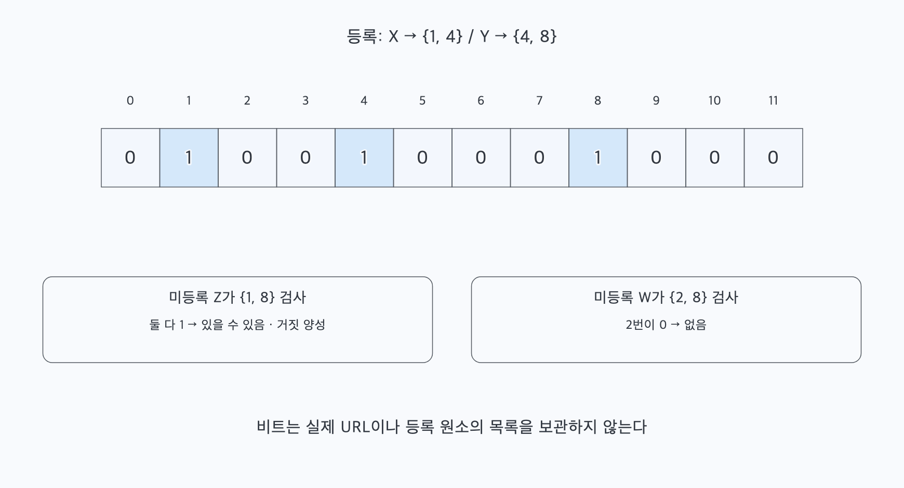
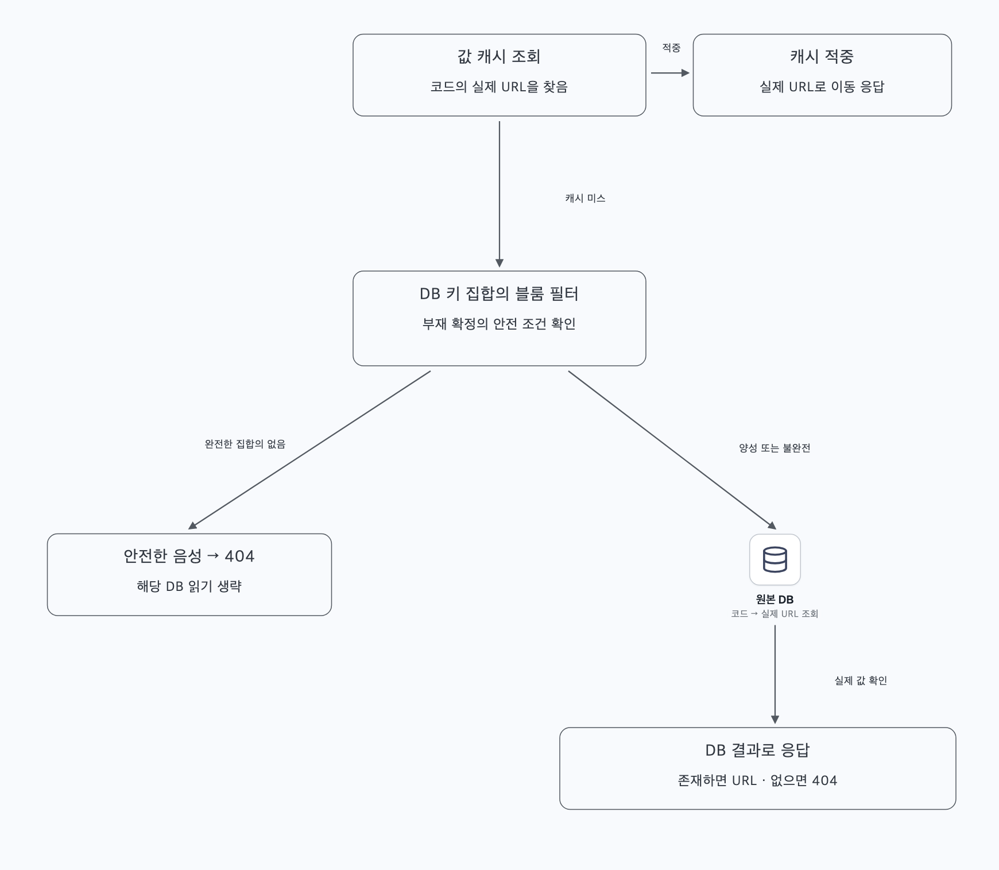
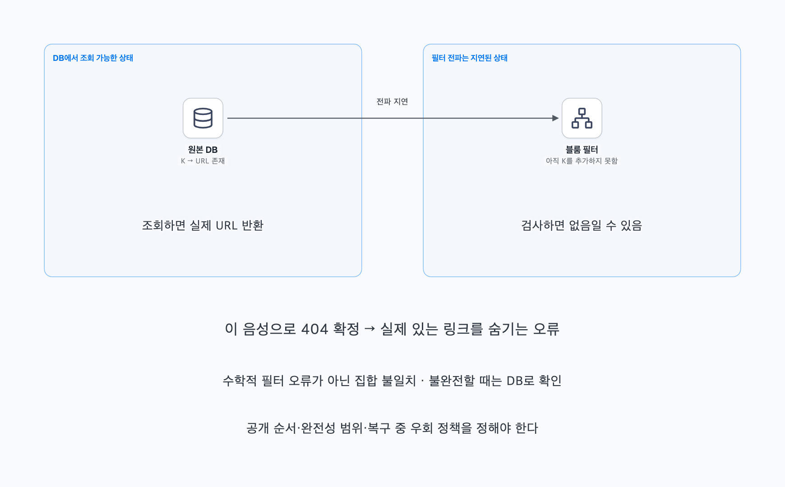

# 블룸 필터를 DB 앞에 두면 무엇을 줄일 수 있을까?

## 1. 먼저 ‘어떤 집합에 들어 있는지’를 정한다

책의 ‘DB에 그 URL이 있는지 검사’하는 단계에도 블룸 필터를 넣을 수 있다. 다만 질문을 두 가지로 나누어야 한다. 생성에서 긴 URL의 재사용 여부를 묻는 것과, 클릭에서 짧은 코드의 매핑을 묻는 것은 다른 집합 조회다.

| 사용 위치 | 필터에 넣는 원소 | 필터가 줄일 수 있는 일 |
| --- | --- | --- |
| 해시 후보의 사전 검사 | 이미 사용한 단축 코드 | 확실히 빈 후보의 사전 SELECT |
| 같은 긴 URL의 재사용 조회 | 저장된 긴 URL의 동일성 키 | 아직 등록되지 않은 URL의 사전 SELECT |
| 캐시 미스 후 리다이렉션 조회 | DB에 존재하는 단축 코드 | 존재하지 않는 코드의 DB 읽기 |

서로 다른 집합은 별도 필터로 관리하거나 명확한 구분자를 둔다. 캐시에 들어 있는 키의 집합과 DB 전체 키의 집합도 다르다. 캐시에 없다는 판정으로 DB에도 없다고 결론 내리면 안 된다.

## 2. 왜 ‘있을 수 있음’과 ‘확실히 없음’만 대답할까?

블룸 필터는 비트 배열과 여러 해시 함수를 사용한다. 원소 하나를 추가하면 그 원소로 계산한 위치들의 비트를 1로 켠다. 조회할 때 어느 위치라도 0이면 그 원소를 넣지 않았다는 것을 알 수 있다. 모두 1이어도 다른 원소들이 그 비트들을 켜 두었을 수 있다.

그림에서는 X가 1·4번, Y가 4·8번을 켰다. 등록되지 않은 Z가 우연히 1·8번을 검사하면 둘 다 1이므로 ‘있을 수 있음’으로 판정된다. 이것이 거짓 양성(false positive)이다. W가 2·8번을 검사하면 2번이 0이므로 ‘없음’이다.

올바르게 추가한 원소를 같은 규칙의 손상되지 않은 필터에서 조회할 때는 거짓 음성이 없다. 이 보장은 **그 필터에 반영된 집합**에 대한 것이다. DB의 새 키가 아직 필터에 추가되지 않았다면 그 DB 키의 존재까지 보장하지 않는다. 자료구조의 성질과 데이터 동기화는 별개의 조건이다. [블룸 필터의 원리와 수식](https://pages.cs.wisc.edu/~cao/papers/summary-cache/node8.html)을 참고한다.

## 3. 생성에서 기존 URL 확인을 줄이는 방법

생성 요청의 긴 URL을 필터에 묻는다. 필터가 DB의 전체 등록 집합을 빠짐없이 반영하고 ‘없음’이면 기존 URL을 찾는 SELECT를 생략하고 새 매핑 저장을 시도할 수 있다. ‘있을 수 있음’이면 실제 DB에서 URL을 확인해 기존 단축 코드를 가져온다.

필터는 기존 코드 값을 돌려주지 않는다. 같은 URL이 맞는지 정확히 확인하거나 기존 링크를 반환하려면 저장소 조회가 필요하다. 또 ‘없음’이라고 본 직후 다른 요청이 같은 URL을 저장할 수 있다. 기존 URL 재사용을 강제하는 경우 DB의 유일 제약이나 해당 키를 조율하는 경로는 남겨야 한다.

해시 후보를 검사할 때도 마찬가지다. ‘없음’은 사전 SELECT를 줄일 수 있지만 최종 INSERT를 생략하지는 못한다. 곧바로 원자적인 삽입을 시도하고 충돌 결과를 처리하는 방식보다 필터 조회를 하나 더 하는 것이 이득인지 측정해야 한다. 필터를 원격 서비스로 두면 그 호출도 지연과 장애 경로가 된다.

## 4. 조회에서는 캐시 미스 중 없는 코드를 걸러 낸다

캐시 적중이면 이미 긴 URL을 얻었으므로 바로 이동 응답을 만들면 된다. 캐시 미스일 때 DB 키 집합의 블룸 필터를 확인한다. 안전하게 부재 판정을 사용할 수 있는 완전한 필터의 ‘없음’이면 DB 조회 없이 404를 만들 수 있다. ‘있을 수 있음’이면 DB에서 값을 읽는다.

예를 들어 캐시 미스 100만 건 중 실제 존재하는 코드가 10%, 나머지 90%가 미등록 코드이며 거짓 양성률 p=1%라고 하자. 동기화 조건을 만족한다면 DB로 가는 양은 대략 `10% + 90% × 1% = 10.9%`, 약 10만 9천 건이다. 모든 요청의 89.1%가 줄어든다는 뜻이 아니라 이 가정의 **캐시 미스 집합**에서 계산한 것이다.

반대로 대부분의 미스가 실제 존재하는 새 링크라면 필터는 거의 전부 ‘있을 수 있음’이라고 하므로 DB 조회는 그대로다. 값 캐시의 적중률, 미등록 키의 비중, 필터 유지 비용을 함께 봐야 한다.

## 5. DB에 썼는데 필터에는 아직 없으면?

DB가 새 코드 K의 저장을 완료하고 성공을 반환했다. 필터 갱신은 비동기로 늦어졌다고 하자. 사용자가 바로 K를 클릭했는데 캐시에도 없고 필터가 ‘없음’이라고 하여 404를 반환하면 실제로 있는 링크를 잃어버린 것처럼 보인다.

이것은 필터가 자기 집합에 대해 거짓 음성을 만든 것이 아니라, DB 집합과 필터 집합이 달라 생긴 오류다. 다음과 같은 운영 조건을 선택해야 한다.

- DB에서 조회 가능해지는 키가 부재 판정에 쓰는 모든 관련 필터에 먼저 포함되도록 공개 순서를 조율할 수 있다. 저장이 나중에 실패해 필터에만 남은 키는 불필요한 DB 조회를 만들지만 실제 있는 키를 숨기지는 않는다. 분산된 필터 전파까지 맞추는 비용은 남는다.
- 완전성이 확인된 버전·범위에만 부재 최적화를 적용하고, 최신 쓰기가 아직 포함되지 않은 범위는 DB에서 확인할 수 있다.
- 필터 장애·재시작·복구·스냅샷 재생 중에는 부재 확정을 중단하고 DB 조회로 돌아간다. 이때도 DB 과부하를 막는 한도가 필요하다.

단지 ‘DB에 쓴 다음 필터에 추가’하는 두 명령을 호출했다고 그 사이의 실패나 지연이 사라지지는 않는다. 이 장의 핵심 설계에서는 필터를 필수 정답 저장소로 만들지 않고, 안전 조건이 확인될 때만 쓰는 보조 최적화로 둔다.

## 6. DB·캐시와 비교한 이점과 비용

DB는 키와 실제 URL의 원본을 보관하고 정확한 조회·제약을 제공한다. 값 캐시는 일부 키의 실제 URL을 빠르게 돌려준다. 블룸 필터는 집합 소속 가능성을 작은 공간으로 요약할 뿐이다. 어느 원소가 들어 있는지 목록을 복원하거나 긴 URL을 꺼내지 못한다.

| 자료 | 보관하는 것 | 적중·양성 시 얻는 것 | 없는 경우의 의미 |
| --- | --- | --- | --- |
| 원본 DB | 코드와 실제 URL | 실제 매핑 | 권위 있는 읽기의 결과로 부재 판단 |
| 값 캐시 | 일부 코드와 실제 URL | 실제 매핑 | 퇴출·만료된 DB 키일 수도 있음 |
| 블룸 필터 | 집합의 비트 요약 | 있을 가능성 | 포함 집합의 완전성·동기화 조건 안에서 부재 |

블룸 필터는 원본 URL을 저장하지 않으므로 매핑 DB를 대체할 수 없다. 자주 쓰는 실제 값을 반환하지도 못하므로 값 캐시도 통째로 대체하지 못한다. 일반적인 캐시-DB 구조에서도, 없는 키로 DB를 계속 두드리는 캐시 관통을 줄이는 층으로 함께 사용할 수 있다. DB를 읽을지 결정하는 힌트와 DB에서 읽을 값은 다른 역할이다.

비용은 거짓 양성 때문에 남는 DB 조회, 해시 계산, 필터 메모리, 갱신·배포·복구와 정합성 관리다. 새 원소가 예상보다 많아지면 고정 크기 필터의 거짓 양성률이 올라간다. 낮은 오차율을 원하면 더 큰 공간이 필요하다. 기본 블룸 필터에서는 다른 키가 함께 쓰는 비트를 지울 수 없어 임의 삭제도 안전하게 처리할 수 없다. 이 장의 삭제 없는 매핑은 이 점에 유리하지만 캐시 TTL처럼 필터의 일부를 마음대로 비우면 안 된다.

3,650억 개를 담는 필터도 정말 작은가?

이상적인 해시 분포를 전제로 원소 수 n, 목표 거짓 양성률 p에 필요한 비트 수는 근사적으로 `m = -n × ln(p) / (ln 2)^2`다. p=1%이면 원소당 약 9.59비트이고 해시 횟수의 최적 근사는 `(m/n) × ln 2`, 약 7회다.

3,650억 개라면 약 3.50조 비트, 약 437GB의 비트 배열이 필요하다. 이는 값 전체를 저장하는 것보다 작아도 모든 서버가 부담 없이 한 벌씩 보관할 수 있는 크기는 아니다. 실제 자료구조 부가 공간과 복제본은 추가다. 샤드·범위별 필터와 확장·재구축 계획이 필요하다. 이 계산은 앞서 설명한 연구 자료의 수식을 사용한 독립 예시이며 실제 제품의 메모리를 측정한 값이 아니다.

복습할 때는 ‘필터가 어느 집합을 요약하는가’, ‘없다는 판정을 지금 안전하게 쓸 수 있는가’, ‘있을 때 실제 값을 어디서 가져오는가’의 세 질문으로 설명해 보자.
