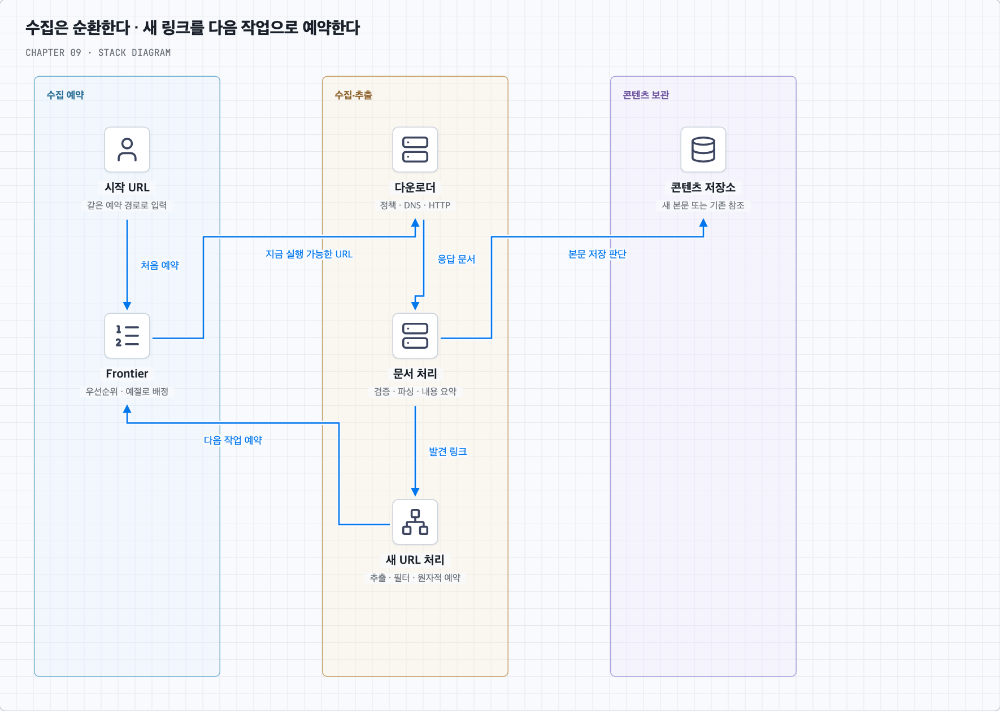
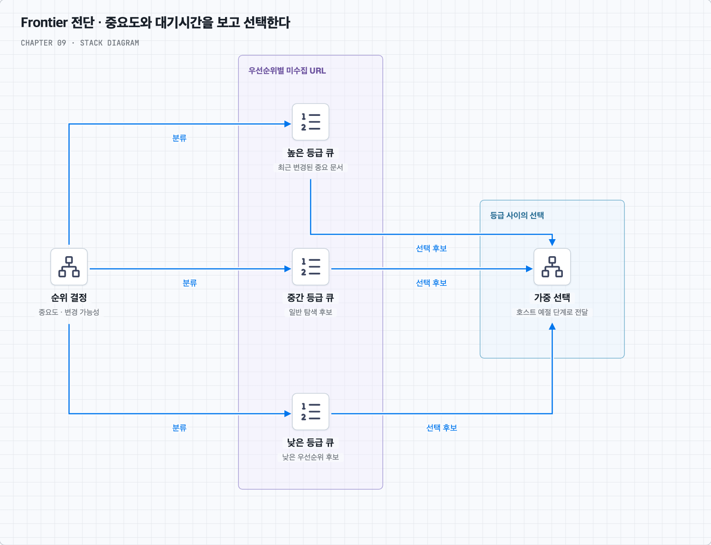
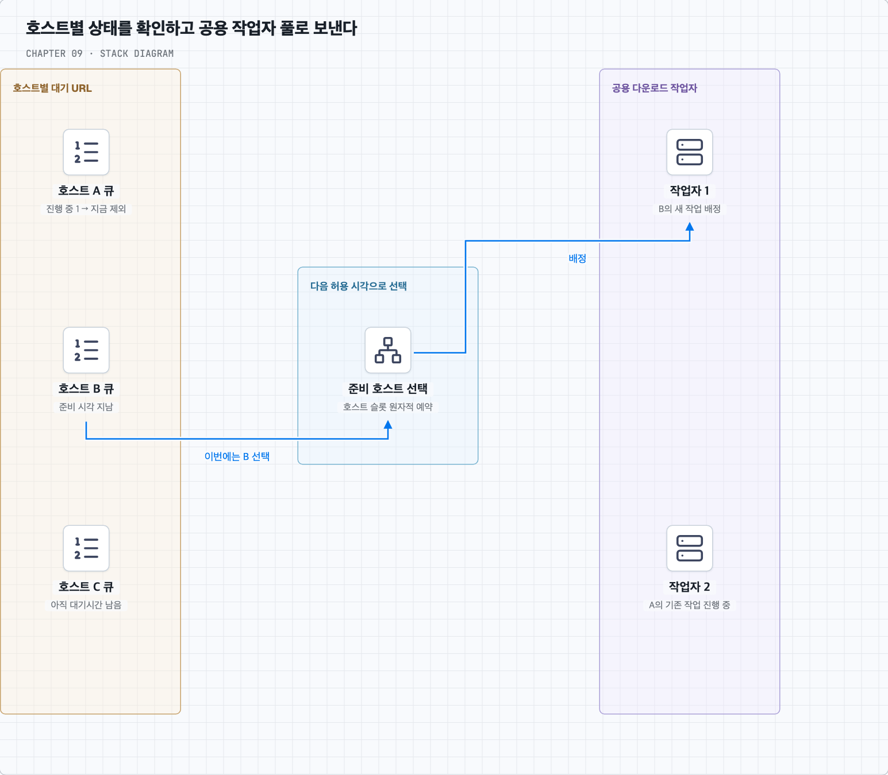
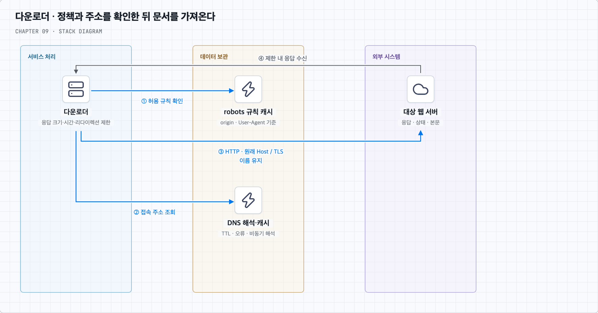
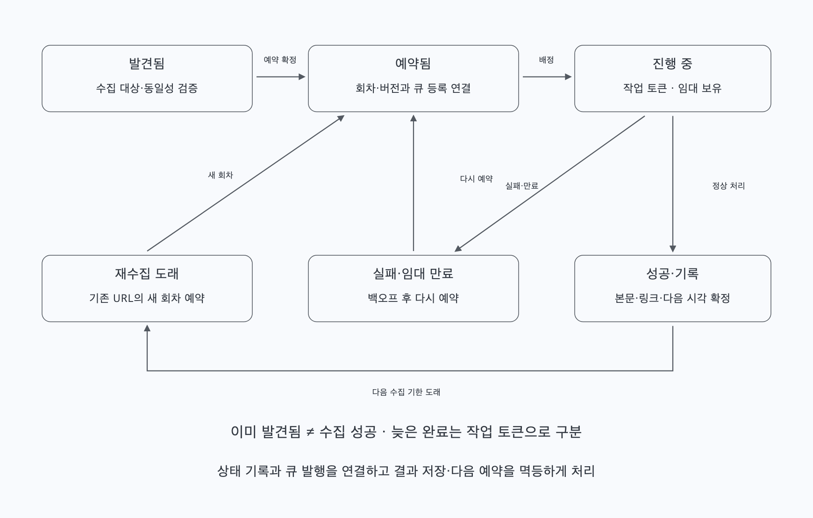
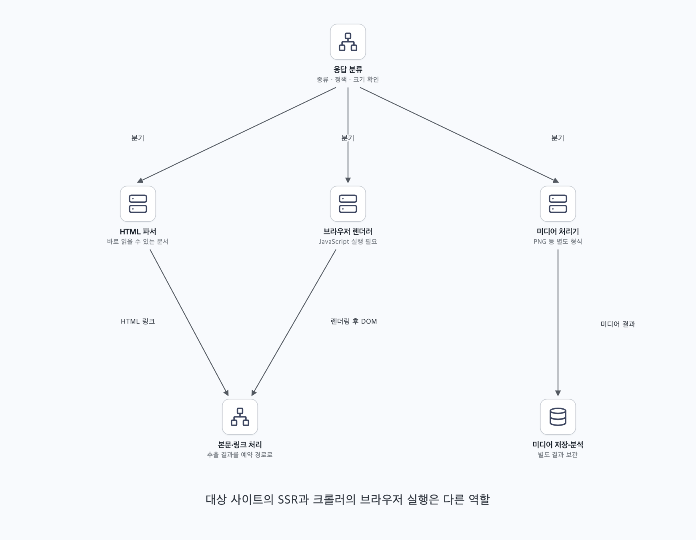
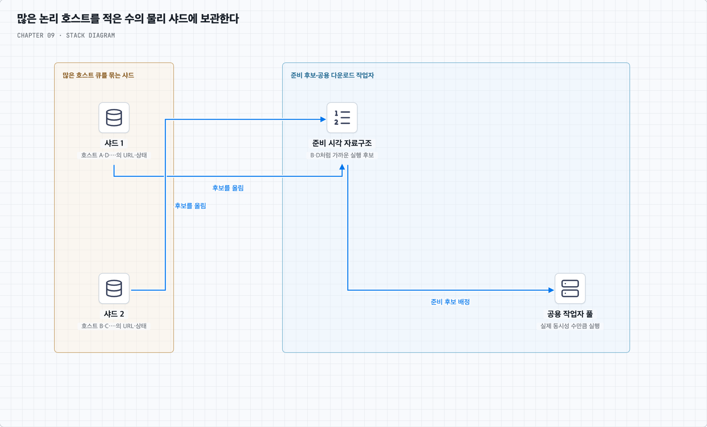
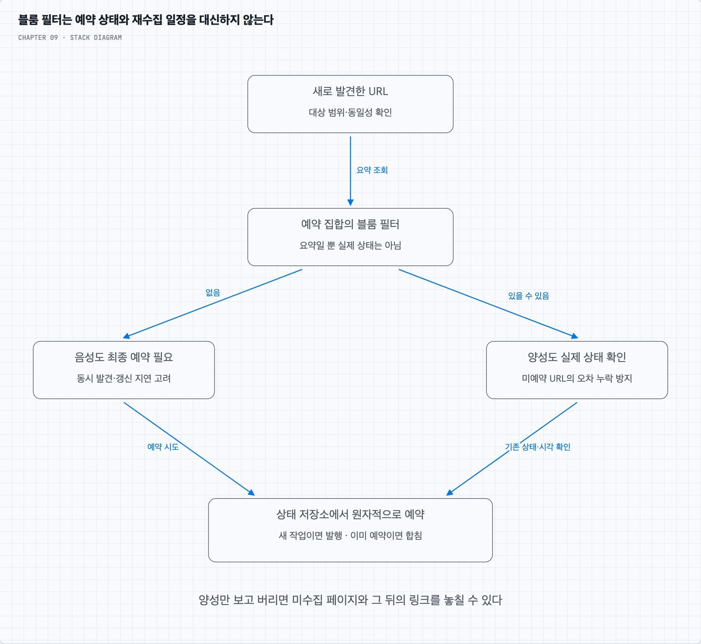
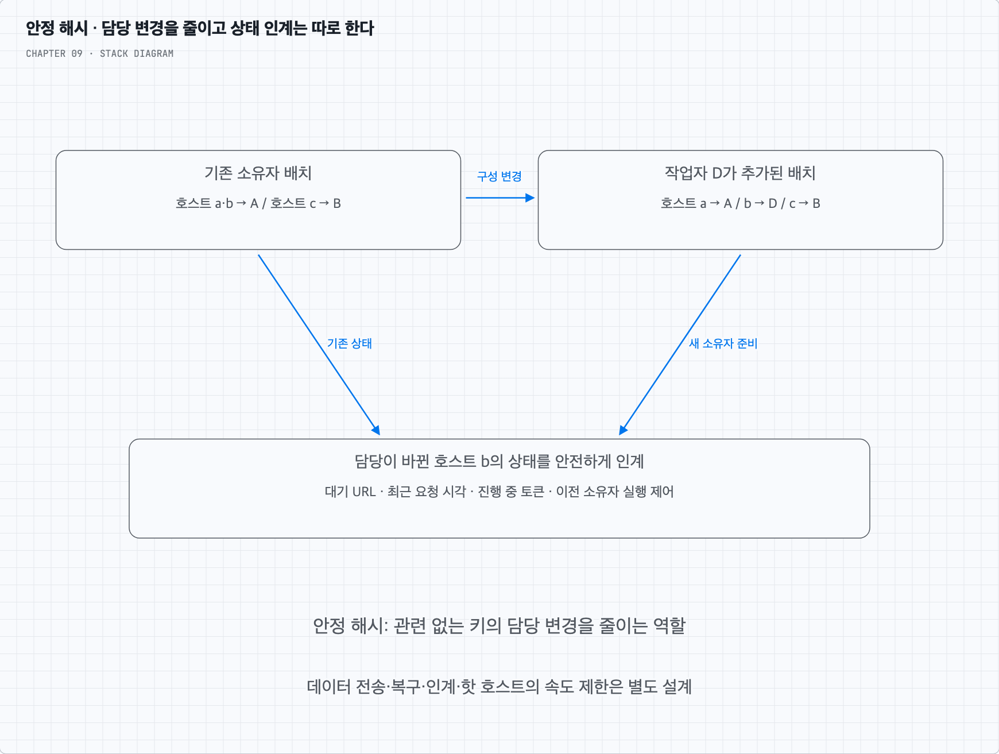

<a id="top"></a>

# 9장. 웹 크롤러 설계

검색용 페이지를 모으는 단순한 링크 탐색에서 출발해 우선순위·호스트 예절·실패 복구·재수집을 갖춘 흐름으로 확장한다. 많은 논리 큐를 운영하는 방법과 블룸 필터·안정 해시의 공통 목적도 연결한다.

책 9장과 제공된 메모를 바탕으로 재구성했다. 개념·그림·심화 질문·복습 답안을 이 README에서 함께 읽는다.

<a id="contents"></a>

## 목차

- [발견·수집·재수집의 흐름 따라 읽기](#core-concepts)
- [질문 01 · 호스트 수와 논리 큐·작업자 수](#q1)
- [질문 02 · 블룸 필터가 반복 등장하는 이유](#q2)
- [질문 03 · 안정 해시의 공통 목적](#q3)
- [스스로 답하기 · 답안 토글](#review)
- [책과 추가 설명의 범위](#sources)

---


<a id="core-concepts"></a>

## URL을 발견하는 일과 지금 가져와도 되는지를 나눈다

### 1. 링크를 따라가면 끝나는 일일까?

상품·행사 페이지를 검색할 수 있도록 웹 문서를 모은다고 하자. 처음 아는 URL을 가져오고, HTML에서 링크를 꺼내 다음 페이지를 가져오면 된다. 기본 반복은 단순하다.

```text
시작 URL → 다운로드 → 링크 추출 → 다음 URL 예약 → 반복
```

크롤링 결과는 검색 인덱싱 외에도 웹 아카이빙, 데이터 분석을 위한 웹 마이닝, 변경·장애를 찾는 웹 모니터링에 쓰인다. 목적에 따라 저장할 내용과 재방문 주기가 다르다. 이 장은 검색 인덱싱에 필요한 수집을 설계하며 검색 순위나 검색 API 자체를 구현하는 범위는 아니다.

이번 범위는 월 10억 페이지, 새 페이지와 변경 페이지의 수집, 5년 보관, 중복 콘텐츠의 불필요한 보관 생략이다. 아래 추정에서는 월 10억 건을 신규 수집과 재수집을 합친 다운로드 예산으로 해석한다. 신규 페이지만 10억 건이라면 재수집 요청을 더해 다시 계산해야 한다.

크기가 커질수록 ‘다음 링크가 무엇인가’보다 ‘어느 사이트에 언제 요청할 수 있는가’, ‘어디까지 처리했는가’, ‘이미 본 것인가’가 중요해진다. 병렬로 빨리 모으는 능력과 대상 사이트를 과부하시키지 않는 예절을 함께 설계해야 한다.

### 2. 평균 400페이지/초여도 저장량은 크다

30일을 한 달로, 페이지 본문을 평균 500KB=500,000바이트로 가정한다.

| 항목 | 계산 | 추정 |
| --- | --- | --- |
| 평균 다운로드 | 10억 ÷ (30×24×3600) | 약 386페이지/초, 책은 약 400 |
| 최대량 가정 | 반올림한 평균의 2배 | 약 800페이지/초 |
| 월 본문 저장량 | 10억×500KB | 500TB |
| 5년 본문 저장량 | 500TB×12×5 | 30PB |

TB·PB는 십진 단위다. 최대량 2배는 용량 계획용 가정이지 실제 급증의 상한이 아니다. 압축·중복 제거로 줄 수 있고, 여러 시점의 보관·메타데이터·복제·인덱스·백업은 용량을 더 쓴다. 다운로드 실패와 재시도, 브라우저가 추가로 가져오는 자원도 별도다.

평균 본문 수신량만 약 193MB/초, 약 1.54Gbps다. 동시성은 QPS와 다르다. 평균 다운로드 시간이 2초라면 400페이지/초를 유지하는 데 약 800건의 진행 중 요청이 필요하다. 호스트별 대기시간까지 감안하면 충분히 많은 요청 가능한 호스트도 있어야 한다.

### 3. 작업은 순환하지만 각 단계의 책임은 나눈다

시작 URL은 아직 링크를 모르는 상태에서 탐색을 시작할 출발점이다. 대학 사이트라면 홈페이지와 주요 목록 등을 시작점으로 삼고 도메인 범위를 제한할 수 있다. 처음부터 그 대학의 모든 URL을 알아야 하는 것은 아니다. 전체 웹에서는 주제·언어·지역별 시작점을 골라 편향을 줄이지만 링크로 연결되지 않은 모든 페이지까지 발견한다고 보장하지는 못한다.

미수집 URL 저장소(URL frontier)는 앞으로 가져올 URL을 보관하고 순서를 정한다. 다운로더는 지금 실행 가능한 작업을 받아 robots 규칙·주소 해석·HTTP 응답을 처리한다. 파서는 문서를 읽어 검증·내용 분석·링크 추출에 넘긴다. 본문은 콘텐츠 저장소에, URL별 진행 상태는 별도 상태 저장소에 보관한다.



그림의 큰 단계를 실제 처리 순서로 풀면 다음과 같다.

1. 시작 URL도 일반 발견 URL과 같은 필터·예약 경로로 넣는다.
2. Frontier가 우선순위와 호스트의 실행 가능 시각을 보고 작업을 배정한다.
3. 다운로더가 robots 정책을 확인하고, 필요하면 DNS를 조회하여 HTTP로 문서를 받는다.
4. 파서가 응답 종류·크기 등을 확인하고 HTML을 처리한다.
5. 콘텐츠 지문으로 중복 여부를 확인하고 새 본문 또는 기존 본문의 참조를 기록한다.
6. 링크를 절대 주소로 해석하고 범위·형식·정책 필터를 통과시킨다.
7. 새로 예약할 URL은 상태 저장소에서 중복 예약을 막은 뒤 Frontier에 넣는다.
8. 처리 결과와 재수집 시각을 기록하고 작업 완료를 확인한다. 실패는 정책에 따라 다시 예약한다.

논리적 모듈을 나눈다고 모두 별도 네트워크 서비스여야 하는 것은 아니다. 파싱이 다운로드를 막지 않도록 큐와 작업자 풀을 분리할 수 있으며, 규모·비용에 맞춰 같은 프로세스의 독립 작업으로 둘 수도 있다.

### 4. URL 중복과 콘텐츠 중복은 다른 문제다

동일한 상품 URL을 여러 목록 페이지에서 발견할 수 있다. 같은 수집 회차에 계속 예약하지 않게 하는 것이 URL 중복 처리다. 다른 URL이 똑같은 상품 설명을 반환한다면 이미 다운로드한 **본문**을 반복 보관하지 않는 것이 콘텐츠 중복 처리다. URL만 비교하면 후자를 알 수 없고 본문만 비교하면 다운로드 전의 중복 요청을 막을 수 없다.

URL은 정한 동일성 규칙으로 비교한다. 상대 경로는 응답 문서의 기준 URL과 유효한 base 정보를 이용해 절대 주소로 해석한다. 리다이렉션이 있었다면 최종 문서 URL도 기준에 반영해야 한다. 예를 들어 기준이 `https://shop.example/catalog/list.html`일 때 `../products/42`는 `https://shop.example/products/42`가 된다. [URI 참조 해석 규칙](https://www.rfc-editor.org/rfc/rfc3986.html#section-5)을 참고한다.

스킴·호스트의 표기와 기본 포트 등을 정규화할 수 있지만 경로 대소문자나 쿼리 순서를 임의로 바꾸면 다른 자원을 합칠 수 있다. 일반 HTTP 수집에서 서버에 보내지 않는 fragment를 제거하는 정책도, 브라우저 렌더링의 주소 상태를 구분하는 정책과 함께 정한다.

콘텐츠는 원문 바이트나 정한 정규화 결과의 해시·지문을 비교하면 매번 모든 본문을 서로 비교하는 비용을 줄일 수 있다. 무엇을 해시했는지와 충돌 처리 조건은 명시한다. 완전히 같은 바이트와 광고·시각만 다른 유사 문서는 다른 문제다. 책의 약 29%라는 수치는 소개된 자료의 관측이며 모든 시점·사이트의 고정 비율로 가정하지 않는다.

중복 본문이어도 URL별 최종 주소·상태·관찰 시각은 남길 수 있다. 같은 HTML의 상대 링크가 다른 호스트에서 다른 주소로 해석될 수도 있다. 따라서 본문을 다시 저장하지 않는 것과 링크 추출까지 무조건 건너뛰는 것은 구분한다. 추출한 상대 링크 목록을 재사용하더라도 현재 문서의 기준 URL로 해석해야 한다.

### 5. DFS보다 BFS로 출발하되 단순 FIFO를 넘어서야 한다

웹의 페이지와 링크는 유향 그래프처럼 볼 수 있다. 깊이를 따라가는 DFS는 한 사이트의 끝없는 경로나 달력에 오래 머무를 수 있다. BFS는 먼저 발견한 가까운 링크부터 넓게 살피기 쉬워 기본 출발점으로 적합하다. 그러나 BFS만으로 무한한 웹을 끝내거나 예절을 지키는 것은 아니다.

상품 목록 한 장에서 같은 사이트의 링크 1,000개가 나왔을 때 공용 FIFO를 여러 작업자가 바로 꺼내면 한 호스트에 요청이 집중될 수 있다. 또한 FIFO는 바뀐 행사 페이지와 오래된 중요하지 않은 페이지를 가치에 따라 구분하지 않는다.

따라서 Frontier를 두 판단으로 나눈다. 먼저 중요도·변경 가능성 등으로 우선순위를 정하고, 그다음 대상 호스트의 요청 간격과 진행 중 작업을 보며 실행 여부를 결정한다.



전단 큐는 중요도에 따른 선택을 담당한다. 페이지의 알려진 중요도, 트래픽·링크 구조, 변경 이력 등을 활용할 수 있다. 처음 보는 페이지는 추정치를 쓴다. 높은 등급만 계속 처리하면 낮은 등급이 영원히 밀릴 수 있으므로 가중 선택·대기시간에 따른 조정 등을 둔다. 아직 수집하지 않은 전체 웹의 정확한 PageRank를 이미 알고 있다고 가정하지 않는다.

### 6. 호스트별 간격을 지키며 작업자 풀을 공유한다

후단은 호스트별 URL과 `다음 실행 가능 시각`, `진행 중 요청 수`를 관리한다. 이 장의 기본 정책은 같은 호스트에 한 번에 한 요청을 보내고 완료 뒤 정한 간격을 둔다. 다른 호스트의 요청은 병렬로 실행할 수 있다.



A 호스트가 대기 중이면 A의 다음 URL을 무리하게 실행하는 대신 준비된 B·C의 작업을 쓴다. 모든 큐의 머리를 매번 훑기보다 실행 가능 시각으로 정렬한 준비 호스트 자료구조를 둘 수 있다. 이때 호스트별 대기열은 논리적인 구분이다. 호스트마다 전용 스레드나 메시지 브로커의 실제 큐 한 개가 반드시 필요하지는 않다.

호스트가 수억 개로 늘 때 상태를 어디에 두고, 소유권을 어떻게 옮길지는 [호스트 큐 심화](#q1)에서 구체적으로 살펴본다. 예절의 단위를 hostname·origin·사이트·IP 중 무엇으로 잡는지도 정책이다. 같은 IP를 쓰는 여러 서비스와 한 사이트의 여러 호스트를 구분해 필요하면 여러 제한을 함께 적용한다.

### 7. 다운로더는 정책·DNS·HTTP 실패를 함께 다룬다

요청 전에 해당 origin의 `/robots.txt` 규칙을 확인하고 적용한다. 자신의 User-Agent에 맞는 허용·제외 경로를 처리하고 결과를 캐시해 매 페이지마다 파일을 다시 요청하지 않게 한다. 실패를 전부 같은 의미로 처리하지 않는다. [RFC 9309](https://www.rfc-editor.org/rfc/rfc9309.html)는 4xx의 unavailable과 5xx·네트워크 오류의 unreachable, 캐시 처리 등을 구분한다. 4xx로 파일을 구할 수 없는 경우 접근을 허용할 수 있지만, 서버·네트워크 오류로 도달 불가능하면 기본적으로 전체 제외로 보고 규정의 캐시·장기 실패 예외를 적용한다. 규칙 캐시는 보통 24시간을 넘겨 사용하지 않되 규정의 예외 조건도 확인한다. `Crawl-delay`는 이 RFC의 표준 지시어가 아니므로 사이트 정책과 구현 지원 여부를 별도로 다룬다.

DNS는 호스트의 접속 주소를 찾는 단계다. 캐시 적중이면 매 요청마다 원격 조회가 필요한 것은 아니고 비동기 해석도 가능하다. TTL과 오류에 맞춰 갱신하며 고정 크론 작업만으로 모든 주소가 계속 유효하다고 가정하지 않는다. IP로 연결해도 HTTP의 Host와 HTTPS의 서버 이름 같은 원래 호스트 문맥은 유지해야 한다.



연결·응답·전체 다운로드의 제한 시간을 두고 최대 본문 크기·리다이렉션 횟수도 제한한다. 느린 요청이 슬롯을 무한히 붙잡지 않게 하되 무조건 가장 짧은 타임아웃을 쓰지는 않는다. 정상적으로 느린 사이트를 놓치거나 재시도가 급증할 수 있다.

429·503 등에는 응답의 Retry-After와 백오프 정책을 고려하고, 다시 요청할 때도 같은 호스트 예절 제한을 적용한다. 리다이렉션 대상이 바뀌면 새 호스트의 정책과 예약 경로도 확인한다. 지역별 다운로더는 왕복 지연을 줄일 수 있지만 같은 호스트의 전체 요청량이 지역 수만큼 늘어나지 않도록 조율한다.

### 8. 수집 이력이 있어도 다시 방문해야 한다

검색용 데이터는 시간이 지나면 오래된다. 행사 페이지가 자주 바뀌면 재수집 간격을 줄이고 거의 바뀌지 않는 설명 페이지는 늘릴 수 있다. 변경 이력·중요도·호스트 예절·예산을 함께 보고 다음 수집 시각을 정한다.

영구적인 ‘방문한 적 있음’ 표시만으로 모든 후속 요청을 버리면 수정 페이지를 발견하지 못한다. URL별 마지막 성공·내용 지문·다음 예정 시각을 보관하고 회차·버전으로 중복 예약과 재수집을 구분한다.

서버가 제공하는 ETag·Last-Modified를 저장해 다음에 조건부 요청을 보낼 수도 있다. 304이면 이미 가진 본문을 활용하고 확인 시각을 갱신한다. 본문을 다시 받지 않아도 요청 자체는 발생하므로 예절 슬롯을 사용한다. 조건부 요청의 지원·정확성은 대상 서버에 따라 확인한다.

### 9. 메모리 버퍼가 큐의 내구성을 대신하지는 않는다

수억 URL과 전체 콘텐츠를 모두 메모리에만 두기 어렵다. Frontier의 대부분과 URL 상태는 디스크 기반 저장소에 두고, 가까운 미래의 실행 후보·작은 배치만 메모리에 올리면 I/O를 묶어서 처리할 수 있다. 큰 본문은 분산 파일·객체 저장소 등에, 검색과 재수집을 위한 메타데이터는 별도 조회 가능한 저장소에 보관한다. 자주 읽는 일부는 캐시할 수 있다.

다만 메모리 버퍼를 주기적으로 디스크에 쓴다는 사실만으로 그 사이의 장애에서 작업이 보존되지는 않는다. 예약이 확정되었다고 표시하는 시점과 영구 기록을 맞추고, 로그·체크포인트·재생 경로를 정한다.



발견한 URL을 상태 저장소에 ‘이미 봄’으로 먼저 표시했는데 큐 등록 전에 죽으면 영원히 빠질 수 있다. 반대로 큐에만 넣고 상태 기록을 잃으면 같은 작업이 반복된다. 같은 트랜잭션에서 예약을 확정하거나 내구성 있는 발행 기록과 재전달을 조합하는 등 두 경로를 연결해야 한다.

작업자는 항목을 가져왔다고 즉시 삭제하지 않고 처리 중 임대를 둘 수 있다. 작업자 장애로 임대가 만료되면 다시 배정한다. 완료 결과와 작업 토큰을 확인해 오래된 작업자의 뒤늦은 완료가 새 상태를 덮지 못하게 한다. 임대 만료가 실제 네트워크 요청의 종료를 보장하지는 않으므로 호스트 슬롯 인계도 고려한다.

HTTP 요청과 저장은 모두 하나의 로컬 트랜잭션이 되지 않는다. 재다운로드·중복 전달을 허용하되 결과 저장·링크 예약은 작업 ID·URL 버전 등으로 멱등하게 처리할 수 있다. 데이터는 외부에 보관하고 작업자 프로세스는 재배정 가능한 형태로 두는 것이 무상태 작업자의 의미다. 시스템 전체에 상태가 없다는 뜻은 아니다.

### 10. 이상한 입력과 끝없는 탐색을 제한한다

정상적인 웹에도 깨진 HTML과 느린 응답이 있다. 관대한 HTML 파서를 쓰되 응답 종류·인코딩·크기·파싱 시간과 자원 사용을 제한한다. 검증 실패나 예외 한 건이 전체 작업자 풀을 멈추지 않게 기록·분리한다. ‘HTML이 표준을 완벽히 만족하지 않으면 모두 버린다’는 정책은 수집 누락을 늘릴 수 있다.

거미 덫은 같은 주소만 반복하는 경우뿐 아니라 날짜·세션·정렬 조합처럼 끝없이 다른 URL을 만드는 경우도 있다. 방문 URL 집합만으로는 이를 모두 막지 못한다. 경로 깊이·파라미터 조합·호스트별 탐색 예산·반복 패턴에 제한을 두고 수집 효율이 나쁜 범위를 관찰해 필터를 조정한다. 자동 탐지에 더해 사람이 확인해 제외하는 경로도 둘 수 있다.

광고·내비게이션 같은 반복 요소를 본문 분석에서 제외하면 품질과 중복 탐지에 도움이 될 수 있다. 그러나 스크립트를 전부 무의미하다고 버리기 전에 동적 콘텐츠의 역할을 확인한다. 보관할 원문, 검색에 쓸 본문, 링크 추출용 문서를 서로 다른 표현으로 관리할 수 있다.

### 11. 동적 페이지와 새 콘텐츠 형식을 추가한다

응답 HTML에 링크가 없고 JavaScript 실행 뒤 나타난다면 단순 다운로드·HTML 파싱으로는 놓칠 수 있다. 대상 사이트가 서버 측 렌더링으로 완성된 HTML을 제공하면 그대로 읽을 수 있다. 크롤러가 대상 사이트에 SSR을 적용하는 것은 아니다. 크롤러 쪽에서는 브라우저 기반 렌더링 작업을 추가해 실행 후 DOM을 처리하는 선택이 가능하다.



브라우저 실행은 CPU·메모리·추가 네트워크 요청이 비싸므로 필요한 페이지를 별도 큐와 제한된 풀로 보낼 수 있다. 렌더러가 가져오는 스크립트·이미지 등도 대상 사이트의 부하에 포함한다. 수집·렌더링·링크 처리의 관계는 [Google의 JavaScript 처리 설명](https://developers.google.com/search/docs/crawling-indexing/javascript/javascript-seo-basics)을 참고한다. 특정 검색 엔진의 구현이 모든 크롤러의 필수 구조인 것은 아니다.

PNG 같은 미디어는 Content-Type과 정책으로 별도 처리기에 전달할 수 있다. 공통 다운로드·상태·실패 처리 인터페이스를 두고 파서·본문 저장·분석 모듈을 확장하면 새 형식을 추가하기 쉽다. 논리적 분리 뒤에 필요에 따라 개별 작업자를 늘린다.

### 12. 빠른 수집보다 ‘잘 수집하고 있는지’를 관찰한다

다운로더·파서·저장소를 따로 확장하고, 링크 발견 속도가 다운로드·저장 속도를 넘으면 큐 크기와 메모리가 무한히 늘지 않게 배압과 호스트별 예산을 둔다. 데이터 저장 계층의 복제·샤딩·백업과 장애 후 상태 복구도 함께 준비한다.

관찰할 지표는 다운로드 성공률·지연·바이트, 상태 코드와 재시도, 파싱 실패, 신규 URL 발견률, 콘텐츠 중복률, Frontier 지연, 호스트별 동시성·요청 간격, 재수집 기한 초과 등이다. 페이지 수만 높이려고 같은 콘텐츠나 한 사이트를 반복 수집하면 목적에 맞지 않는다.

이제 심화 질문에서 세 가지를 연결해 보자. 호스트별 큐를 물리 자원과 어떻게 분리할지, 왜 블룸 필터가 큰 집합에 자주 쓰이는지, 안정 해시가 어떤 종류의 변경을 줄이는지가 이 장의 구성 선택을 설명한다.

[목차로 돌아가기](#contents)

---


<a id="q1"></a>

## 호스트가 수억 개면 큐와 스레드도 수억 개 필요할까?

### 1. 호스트별 순서는 필요하지만 물리 큐·스레드는 공유할 수 있다

질문의 우려는 맞다. 모든 호스트마다 메모리 큐, 운영체제 스레드, 브로커 큐를 영구 생성하면 자원과 관리 비용이 커진다. 책의 호스트별 후단 큐 그림은 같은 호스트의 요청을 모아 예절을 지키는 논리 구조로 이해하면 좋다. 이 구분을 물리 스레드와 반드시 1:1로 만들 필요는 없다.

예를 들어 URL 작업을 저장소에 `(host, priority, enqueue_order, url)` 형태로 보관할 수 있다. 한 호스트의 다음 URL은 그 호스트 범위의 머리를 읽으면 된다. 실제 저장 파일·테이블·파티션과 네트워크 연결·다운로더 풀은 여러 호스트가 공유한다.



호스트별 최소한의 대기·최근 요청 상태까지 사라지는 것은 아니다. 대기 URL이 있는 호스트의 상태는 저장소가 보관하고, 가까운 미래에 처리할 활성 호스트만 메모리 자료구조에 올린다. 유휴 호스트의 메모리 상태는 내릴 수 있으나, 예절을 지키는 데 필요한 최근 시각을 잃고 즉시 재요청하지 않게 한다.

호스트 수 H가 늘면 디스크의 메타데이터도 늘지만 스레드 수까지 H에 비례해야 하는 것은 아니다. 물리 샤드 수 P와 작업자 수 W, 메모리에 둘 활성 호스트 수 A를 별도로 관리한다. 이 구분은 비용을 없애는 기술이 아니라 저장과 실행을 서로 다른 단위로 확장하는 설계다.

### 2. 준비된 호스트를 고른 뒤 작업자에게 준다

다음은 각 호스트의 요청 완료 뒤 2초를 쉬는 예시다.

- A가 시각 0에 시작해 1에 끝나면 A의 다음 가능 시각은 3이다.
- B가 0에 시작해 0.5에 끝나면 B는 2.5부터 다시 가능하다.
- 시각 1.5에는 A·B를 기다리게 하고 준비된 다른 호스트를 처리한다.

실행 가능 시각을 기준으로 한 최소 힙이나 시간 버킷을 사용하면 모든 호스트 큐를 매번 훑지 않고 준비 후보를 찾을 수 있다. 고른 뒤에는 호스트의 진행 중 슬롯을 원자적으로 예약해야 여러 스케줄러가 동시에 같은 호스트를 선택하는 일을 막는다.

호스트별 요청은 한 번에 한 건이어도 전체는 많은 호스트를 동시에 처리하므로 충분한 병렬성을 얻을 수 있다. 네트워크 I/O는 비동기로 대기할 수 있어 진행 중 연결 수와 OS 스레드 수도 반드시 같지 않다. [Scrapy 설정](https://docs.scrapy.org/en/latest/topics/settings.html#download-slots)도 다운로드 슬롯의 동시성·지연을 별도로 다루는 구현 사례다. 이 노트의 분산 스케줄러를 그대로 제공한다는 뜻은 아니다.

### 3. 한 물리 버킷에 여러 호스트를 넣을 때의 함정

고정된 P개 버킷에 호스트를 해시해 넣으면 물리 큐 수를 제한할 수 있다. 하지만 A가 쿨다운 중이라는 이유로 같은 버킷 뒤의 준비된 B까지 멈추면 선두 항목 대기(head-of-line blocking)가 생긴다. 따라서 버킷 안에도 호스트별 머리·준비 시각을 구분하거나, 별도 준비 호스트 목록을 관리한다.

같은 호스트의 작업이 여러 지역이나 샤드로 흩어지면 각자 한 건씩 실행해도 대상 사이트에는 여러 건이 겹친다. 같은 호스트 정책의 책임 지점으로 모으거나 공유 제한 상태를 사용해야 한다. 호스트를 어느 작업자에게 주는지만 정해 놓고 요청 간격을 관리하지 않으면 충분하지 않다.

### 4. 로드 밸런서의 고정 세션과 무엇이 다를까?

앱 서버의 고정 세션은 특정 서버에 남아 있는 사용자 상태에 요청이 의존하게 할 수 있다. 여기서는 호스트 예절이라는 공유 자원을 한 책임 지점에서 조율하기 위해 작업을 모은다. 실행 서버가 영원히 고정되어야 하는 것은 아니다.

URL·준비 시각·진행 중 상태를 내구성 있게 보관하면 소유자를 바꾸고 작업자 풀도 교체할 수 있다. 이전 소유자의 요청이 아직 진행 중인지, 늦게 돌아온 작업자가 다시 실행하지 않는지 확인하며 인계한다. 임대가 만료되었다고 실제 HTTP 요청이 즉시 취소된 것은 아니다.

안정 해시는 소유자를 바꿀 때 옮겨야 하는 호스트 범위를 줄이는 수단이 될 수 있다. 안전한 상태 인계와 장애 감지는 별도로 구현한다. 따라서 ‘고정 세션처럼 보이니 확장 불가’나 ‘해시로 배정했으니 확장 완료’로 단정하지 않고 어떤 상태가 어디에 남는지 확인해야 한다.

[목차로 돌아가기](#contents)

---


<a id="q2"></a>

## 블룸 필터가 여러 설계에 자주 등장하는 이유는?

### 1. 많은 문제에 ‘이미 있는 키인가?’라는 앞단 질문이 있다

캐시에는 없는 키의 DB 조회, URL 단축기에는 이미 등록한 주소 확인, 크롤러에는 새로 발견한 URL의 예약 여부 확인이 있다. 공통점은 실제 값을 읽거나 비싼 작업을 하기 전에 큰 집합의 소속 여부를 묻는다는 것이다.

키 문자열을 전부 메모리 해시 집합에 넣으면 문자열과 자료구조의 공간을 쓴다. 블룸 필터는 비트 요약으로 공간을 줄이는 대신 ‘있을 수 있음’이라는 거짓 양성을 허용한다. 실제 URL·진행 상태·다음 수집 시각은 보관하지 못한다.

완전하게 반영한 집합에서 음성이면 정확한 저장소 조회를 줄일 수 있다. 양성이면 정말 예약했는지 상태 저장소에서 확인한다. 원리는 같아도 무엇을 요약하고 잘못된 판단의 비용이 무엇인지가 시나리오마다 다르다.

### 2. 크롤러에서는 거짓 양성 때문에 페이지를 놓칠 수 있다

아직 예약하지 않은 URL K가 우연히 양성이 되었다고 하자. ‘양성이므로 이미 방문했다’고 그냥 버리면 수집하지 않은 페이지를 놓친다. 검색 범위가 중요한 설계에서는 양성을 정확한 상태 저장소로 보내고 최종 예약은 원자적으로 결정해야 한다.



누락을 허용하는 근사적인 탐색이라면 양성 일부를 버리는 선택도 가능하지만, 그 경우는 정확한 방문 집합과 다른 품질 타협이다. 거짓 양성 1%를 모든 수집 페이지의 누락률 1%로 바로 해석할 수도 없다. 놓친 한 페이지 뒤의 링크를 발견하지 못해 영향이 더 커질 수 있기 때문이다.

### 3. ‘없음’도 예약 완료를 뜻하지는 않는다

두 작업자가 동시에 필터에서 음성을 볼 수 있다. 둘 다 큐에 넣지 않게 하려면 상태 저장소의 유일한 예약이나 같은 URL의 책임 지점에서 원자적으로 상태를 바꿔야 한다. 필터는 중복 예약을 막는 락이 아니다.

필터에 예약 표시를 넣었는데 큐 등록을 잃고 양성을 무조건 버리면 작업이 사라질 수 있다. 반대로 필터 갱신 지연은 음성 후보를 늘릴 수 있다. 정확한 상태·원자적 예약이 최종 판단을 맡으면 그 지연을 중복 저장이나 영구 누락으로 연결하지 않을 수 있다.

재수집도 구분한다. 예전에 한 번 방문한 URL을 영구 집합에 넣고 다시는 실행하지 않으면 변경을 반영하지 못한다. URL의 존재와 현재 회차의 예약 여부, 다음 실행 가능 시각은 별도의 상태다. 필터는 최초 발견 여부만 요약하고 재수집은 상태 저장소와 시간 기반 스케줄러가 처리하는 등 범위를 정한다.

### 4. 여기서 기억할 본질

블룸 필터가 자주 나오는 이유는 특정 서비스에 종속되지 않은 공간 효율적인 집합 요약이기 때문이다. 값 저장·정확한 상태·원자성·내구성은 다른 구성 요소가 제공한다. 8장의 DB 앞 필터와 마찬가지로 집합의 반영 범위·오차 허용·복구 중 우회 경로를 함께 정한다.

예시로 활성 집합 10억 원소를 목표 거짓 양성률 1%로 요약하면 이상적인 근사에서 비트 배열은 약 1.2GB다. 문자열 전체 집합보다 작을 수 있지만 복제·부가 공간은 더 들고 수집 URL이 늘면 다시 계산해야 한다. 필터가 재수집 일정까지 모두 기억하는 것은 아니다. 이 계산에는 [블룸 필터 연구 자료의 근사식](https://pages.cs.wisc.edu/~cao/papers/summary-cache/node8.html)을 사용한다.

[목차로 돌아가기](#contents)

---


<a id="q3"></a>

## 안정 해시는 어떤 문제를 만날 때 떠올리면 될까?

### 1. 변하는 서버 집합에 키의 담당을 붙이는 문제다

5장의 캐시 서버, 6장의 데이터 분할, 이 장의 호스트 스케줄러에는 공통 문제가 있다. 키의 담당 서버를 계산해 같은 키의 일을 같은 곳으로 보내고 싶은데 서버는 추가·제거된다.

단순한 `hash(key) % 서버 수`는 서버 수가 바뀔 때 관련 없는 키도 많이 재배정할 수 있다. 안정 해시는 이때 담당이 바뀌는 범위를 줄인다. 크롤러에서 키를 URL 전체 대신 hostname으로 두면 같은 호스트의 요청 간격과 대기 작업을 같은 스케줄링 소유자에게 모을 수 있다.



캐시에서는 담당이 바뀌면 캐시 미스를 감수하고 다시 채울 수 있다. 호스트 예절 상태에서는 마지막 요청 시각을 잃으면 너무 빨리 재요청할 수 있다. 같은 매핑 기술을 써도 바뀌는 키에 필요한 인계 절차가 다른 이유다.

### 2. 안정 해시만으로 해결하지 않는 것

가상 노드로 여러 키의 분포를 완화해도 인기 호스트 하나의 작업량은 클 수 있다. 그 호스트를 더 많은 다운로더에 보내는 것이 예절 위반이라면 단순 증설로 처리량을 늘릴 수 없다. 정책상 속도 제한을 유지하고 대기 작업·탐색 예산을 관리해야 한다.

또 안정 해시는 서버 장애를 감지하거나 URL 상태를 복제·저장하지 않는다. 소유자 변경 시 진행 중 작업, 임대와 이전 작업자의 늦은 실행을 처리하는 것도 별도의 일이다. 같은 키라도 모든 구성원이 다른 서버 목록을 보면 다른 담당을 계산할 수 있다.

복습할 때는 ‘구성 변경 중 관련 없는 키의 담당을 가능한 유지하고 싶은가?’를 먼저 묻는다. 그렇다면 안정 해시가 후보가 된다. 키의 실제 부하·내구성·일관성·안전한 인계까지 자동으로 따라온다고 생각하지 않는다. 5장의 링·가상 노드 원리를 이 역할에 연결하면 된다.

[목차로 돌아가기](#contents)

---


<a id="review"></a>

## 스스로 답하기

큐의 화살표를 그리는 것에서 끝내지 말고, 같은 호스트의 다음 실행 시각과 실패한 작업이 어디서 다시 시작하는지도 답한다.

<details>
<summary>01. 웹 크롤링의 대표 활용 네 가지와 이 장의 목적은?</summary>

검색 인덱싱·웹 아카이빙·웹 마이닝·웹 모니터링이다. 이 장은 검색 인덱싱을 위한 수집이며 검색 순위·검색 API 자체는 별도 범위다.

</details>

<details>
<summary>02. 기본 반복만으로 대규모 설계가 끝나지 않는 이유는?</summary>

다운로드와 링크 추출 외에도 호스트 예절·우선순위·재수집·중복·실패·작업 상태를 관리해야 하기 때문이다. 병렬 수집 속도와 대상 사이트 부담을 함께 다뤄야 한다.

</details>

<details>
<summary>03. 시작 URL은 수집 대상의 모든 URL을 미리 아는 집합인가?</summary>

아니다. 탐색의 출발점이다. 대학 홈페이지·목록 등으로 시작해 도메인을 제한할 수 있다. 전체 웹은 주제·언어·지역별 시작점을 다양화해도 모든 단절된 페이지의 발견까지 보장하지 않는다.

</details>

<details>
<summary>04. 월 10억 페이지의 평균 QPS와 최대 QPS는?</summary>

30일 기준 약 386페이지/초이며 책은 약 400으로 잡는다. 최대 800은 반올림한 평균의 2배라는 계획용 가정이지 실제 최대량 보장은 아니다.

</details>

<details>
<summary>05. 500TB/월과 30PB/5년은 무엇을 가정하는가?</summary>

페이지 평균 500KB=500,000바이트, 월 10억 다운로드와 60개월 보관의 본문만 계산한 십진 단위다. 압축·중복 제거·버전·복제·인덱스·백업 등은 별도로 반영한다.

</details>

<details>
<summary>06. 400페이지/초, 평균 2초라면 진행 중 요청 수는?</summary>

안정적인 평균 관계로 약 800건이다. QPS와 동시성은 다르다. 호스트별 쿨다운과 편중을 감안하면 충분한 준비 호스트도 필요하다.

</details>

<details>
<summary>07. Frontier가 단순히 URL 목록만 보관하는가?</summary>

대기 URL을 보관하면서 우선순위·실행 가능 시각·호스트 슬롯에 맞춰 배정한다. 중요한 URL이라도 그 호스트가 대기 중이면 바로 다운로드하지 않는다.

</details>

<details>
<summary>08. URL 중복과 콘텐츠 중복의 차이는?</summary>

URL 중복은 같은 URL의 반복 예약·요청을 줄인다. 콘텐츠 중복은 다른 URL이 반환한 같은 본문의 반복 보관·처리를 줄인다. 서로 다른 시점에 판단한다.

</details>

<details>
<summary>09. 중복 본문이면 URL 메타데이터와 링크도 전부 버려도 되는가?</summary>

일반화할 수 없다. URL별 관찰·주소·상태는 남길 수 있고 같은 HTML의 상대 링크가 현재 기준 URL에 따라 다른 곳을 가리킬 수 있다. 본문 저장 생략과 링크 탐색 생략을 구분한다.

</details>

<details>
<summary>10. 기준 URL이 /catalog/list.html이고 링크가 ../products/42이면?</summary>

https://shop.example/catalog/list.html을 기준으로 하면 https://shop.example/products/42다. 응답의 최종 URL과 유효한 base 정보도 고려한다.

</details>

<details>
<summary>11. URL 정규화에서 쿼리 순서나 경로 대소문자를 무조건 바꿔도 되는가?</summary>

안 된다. 서버가 다른 자원으로 해석할 수 있다. 어떤 차이를 같은 URL로 볼지 정하고 URL 참조 규칙과 브라우저 상태의 의미도 구분한다.

</details>

<details>
<summary>12. DFS보다 BFS를 기본으로 삼는 이유와 한계는?</summary>

끝없이 깊은 한 경로에 머무는 일을 줄이고 가까운 링크부터 넓게 탐색하기 쉽다. 그러나 무한 URL·호스트 요청 집중·페이지 중요도 문제는 BFS만으로 해결하지 못한다.

</details>

<details>
<summary>13. 전단 우선순위 큐와 후단 호스트 큐의 역할은?</summary>

전단은 중요도·변경 가능성 등으로 후보를 선택한다. 후단은 같은 호스트의 요청 간격과 진행 중 작업을 관리해 지금 실행할 수 있는지를 정한다.

</details>

<details>
<summary>14. 높은 우선순위만 계속 고르면?</summary>

낮은 등급이 계속 밀릴 수 있다. 가중 선택·대기시간 조정 등 공정성을 고려한다. 미수집 웹 전체의 정확한 PageRank를 이미 알고 있다고 가정하지 않는다.

</details>

<details>
<summary>15. 호스트별 큐가 있으면 호스트마다 스레드 한 개가 필요한가?</summary>

아니다. 논리 대기열은 저장소의 호스트별 레코드로 표현하고 물리 샤드·공용 스케줄러·작업자 풀을 공유할 수 있다. 호스트 메타데이터 비용 자체는 남는다.

</details>

<details>
<summary>16. 준비 시각 자료구조를 쓰는 이유는?</summary>

대기 중인 모든 호스트 큐를 매번 훑지 않고 실행 가능한 후보를 고르기 위해서다. 고른 뒤에는 진행 중 슬롯을 원자적으로 예약해야 한다.

</details>

<details>
<summary>17. 완료 후 2초 간격 정책에서 A가 0에 시작해 1에 끝나면?</summary>

다음 시작 가능 시각은 3이다. B가 0.5에 끝났다면 2.5다. 시작 간격 2초라는 다른 정책과 구분한다.

</details>

<details>
<summary>18. 고정 버킷 큐 하나에 여러 호스트를 섞으면 어떤 문제가 있는가?</summary>

머리의 A가 대기 중일 때 뒤의 준비된 B도 막히는 선두 항목 대기가 생길 수 있다. 버킷 안에서 호스트별 머리와 준비 시각을 구분하는 구조가 필요하다.

</details>

<details>
<summary>19. 여러 지역이 각자 호스트당 한 건씩 보내면 충분히 예의 바른가?</summary>

지역 수만큼 겹칠 수 있다. 같은 호스트의 전체 예산과 책임 지점을 조율하거나 공유 제한 상태를 사용해야 한다.

</details>

<details>
<summary>20. 이 호스트 배정은 고정 세션과 똑같이 확장 불가능한가?</summary>

호스트 예절이라는 공유 상태를 모으려는 배정이다. 상태를 외부에 보관하고 안전하게 소유권을 인계하면 작업자를 교체·확장할 수 있다. 로컬 상태에 영구 의존하는 구현인지가 중요하다.

</details>

<details>
<summary>21. robots.txt를 매 페이지마다 다시 받아야 하는가?</summary>

정책에 따라 캐시하고 갱신한다. RFC는 보통 24시간을 넘겨 캐시를 사용하지 않도록 하되 unreachable 같은 예외를 둔다. User-Agent와 origin에 맞는 규칙을 적용한다.

</details>

<details>
<summary>22. robots.txt의 4xx와 5xx·네트워크 실패는 같은가?</summary>

RFC는 4xx의 unavailable과 서버·네트워크 오류의 unreachable을 구분한다. 전자는 접근을 허용할 수 있고 후자는 기본적으로 전체 제외로 보며 캐시·장기 실패 예외 조건을 적용한다.

</details>

<details>
<summary>23. Crawl-delay는 RFC 9309의 표준 지시어인가?</summary>

아니다. 사이트 정책과 구현이 지원하는지를 별도로 확인한다. 호스트 요청 간격은 크롤러 스케줄러에서도 관리한다.

</details>

<details>
<summary>24. URL을 IP로 변환한 뒤 호스트 이름은 잊어도 되는가?</summary>

아니다. DNS는 접속 주소를 구하는 단계다. HTTP Host·HTTPS 서버 이름 등 원래 호스트 문맥을 유지해야 한다. 캐시·비동기 해석·TTL에 맞춘 갱신도 고려한다.

</details>

<details>
<summary>25. 타임아웃은 무조건 짧을수록 좋은가?</summary>

무한 대기는 막아야 하지만 너무 짧으면 정상적으로 느린 사이트를 놓치고 재시도를 늘릴 수 있다. 연결·본문·전체 예산과 백오프, 호스트 슬롯을 함께 정한다.

</details>

<details>
<summary>26. 이미 방문한 URL을 영구히 제외하면 신선도는?</summary>

변경 페이지를 다시 읽지 못한다. URL 존재와 현재 회차 예약을 구분하고 마지막 성공·지문·다음 수집 시각으로 새 회차를 예약한다.

</details>

<details>
<summary>27. 304 응답이면 호스트 요청 횟수는 줄어드는가?</summary>

본문 전송은 줄일 수 있지만 조건부 요청 자체는 발생한다. 이미 보관한 본문을 활용하고 확인 시각을 갱신하며 예절 슬롯도 사용한다.

</details>

<details>
<summary>28. 메모리 큐를 주기적으로 디스크에 쓰면 작업 유실이 없어지는가?</summary>

그 사이 갑작스러운 장애가 나면 잃을 수 있다. 예약 확정과 영구 기록 시점을 맞추고 로그·체크포인트·재생·발행 기록을 설계해야 한다.

</details>

<details>
<summary>29. 먼저 이미 봄을 표시하고 큐 등록 전에 죽으면?</summary>

나중에 같은 URL을 버리면서 작업을 영구히 놓칠 수 있다. 상태 예약과 큐 발행을 연결하고 재전달·멱등성을 설계해야 한다.

</details>

<details>
<summary>30. 임대 만료 뒤 작업을 다시 배정할 때 주의할 점은?</summary>

이전 작업자가 아직 요청 중이거나 뒤늦게 완료할 수 있다. 작업 토큰·버전을 검증해 새 상태를 덮지 못하게 하고, 호스트 슬롯 인계 시 실제 진행 중 요청도 고려한다.

</details>

<details>
<summary>31. 무상태 작업자는 크롤링 상태가 어디에도 없다는 뜻인가?</summary>

아니다. URL·큐·지문·다음 시각·결과는 외부의 내구성 저장소에 남는다. 작업자 프로세스는 교체·재배정 가능하도록 한다.

</details>

<details>
<summary>32. 방문 집합만 있으면 거미 덫을 막을 수 있는가?</summary>

끝없이 서로 다른 날짜·세션·조합 URL을 만들면 집합만으로는 부족하다. 깊이·반복 패턴·파라미터·호스트별 탐색 예산과 관찰·수동 필터를 함께 사용한다.

</details>

<details>
<summary>33. 깨진 HTML을 모두 버리거나 스크립트를 모두 제거해도 되는가?</summary>

수집 범위와 동적 링크를 놓칠 수 있다. 관대한 파서에 자원·시간·크기 제한을 두고 원문·본문 분석·링크 추출 표현을 목적별로 관리한다.

</details>

<details>
<summary>34. 대상 사이트 SSR과 크롤러 브라우저 렌더링의 차이는?</summary>

대상 사이트가 완성된 HTML을 주면 그대로 파싱할 수 있다. 크롤러가 JavaScript 실행 뒤 DOM을 읽으려면 별도 브라우저 작업을 둘 수 있다. 대상 사이트에 SSR을 적용하는 일과 다르다.

</details>

<details>
<summary>35. 브라우저 렌더링을 모든 페이지에 무조건 적용하면?</summary>

CPU·메모리와 추가 자원 요청 비용이 크다. 필요한 페이지를 분류해 제한된 풀로 처리하고 그 추가 요청도 대상 사이트 부하 예산에 포함한다.

</details>

<details>
<summary>36. PNG 같은 새 형식을 지원하기 쉽게 하려면?</summary>

공통 다운로드·상태·실패 인터페이스를 두고 Content-Type·정책에 따라 처리기를 분기한다. 파서·저장·분석 모듈과 실행 풀을 필요에 따라 확장한다.

</details>

<details>
<summary>37. 블룸 필터가 여러 장에 등장하는 공통 이유는?</summary>

큰 집합에서 이미 있는 키인지 묻는 앞단 검사가 많기 때문이다. 비트 요약으로 공간을 아끼되 값·정확한 상태·원자성과 내구성은 다른 계층이 맡는다.

</details>

<details>
<summary>38. 방문 필터의 양성을 그냥 버리면?</summary>

거짓 양성으로 미수집 URL을 놓칠 수 있다. 그 페이지 뒤의 링크도 못 발견할 수 있어 필터 오차율과 전체 수집 누락률을 동일하게 볼 수 없다.

</details>

<details>
<summary>39. 정확한 탐색에서 블룸 필터의 양성·음성은 어떻게 쓰는가?</summary>

양성은 상태 저장소에서 확인한다. 음성도 원자적 예약을 대신하지 않는다. 최종 판단은 현재 회차·상태를 아는 저장소가 맡으며 반영 지연·복구를 고려한다.

</details>

<details>
<summary>40. 활성 URL 10억 개를 p=1% 필터로 요약하면?</summary>

이상적인 근사에서 비트 배열 약 1.2GB다. 복제·부가 공간과 더 커지는 집합은 별도다. URL 값이나 재수집 일정을 담는 공간은 아니다.

</details>

<details>
<summary>41. 안정 해시를 떠올릴 공통 조건은?</summary>

키를 담당 서버에 붙여 두되 서버 추가·제거 때 관련 없는 키의 담당 변경을 줄이고 싶을 때다. 크롤러에서는 hostname을 키로 삼아 호스트 예절 책임을 모을 수 있다.

</details>

<details>
<summary>42. 안정 해시가 상태 인계·장애 감지·핫 호스트를 해결하는가?</summary>

아니다. 변경 범위를 줄일 뿐이다. 최근 요청 시각과 진행 작업의 인계·복제·장애 감지, 인기 호스트의 정책상 속도 제한은 별도 설계다.

</details>

<details>
<summary>43. 크롤러의 성공을 페이지 수 하나로만 판단하면?</summary>

같은 콘텐츠나 한 사이트를 반복 수집하는 낭비를 숨길 수 있다. 신선도·중복률·신규 발견·오류·호스트 간격·큐 지연·파싱 품질 등을 함께 관찰한다.

</details>

[목차로 돌아가기](#contents)

---


<a id="sources"></a>

## 책과 추가 설명의 범위

### 책을 대조한 범위

『가상 면접 사례로 배우는 대규모 시스템 설계 기초 1』 9장 「웹 크롤러 설계」의 141–163쪽을 확인했다. 활용 목적·범위·규모 추정, 시작 URL·Frontier·다운로더·DNS·파싱·콘텐츠 저장·중복·URL 필터, BFS와 예절·우선순위·신선도, 성능·안정성·확장·함정·동적 페이지와 운영 관찰을 반영했다.

상품·행사 페이지, 호스트 A·B·C, 완료 후 2초의 간격, URL 상태 전이와 샤드·작업자 풀은 학습용 독립 예시다. 도식은 책의 순환·전단/후단 큐 구성을 참고해 새로 만들었다.

### 덧붙인 조건

- 월 10억 건을 신규·재수집을 합친 다운로드 예산으로 해석했다. 평균 500KB, 30일/월, 최대량 2배 등은 계산용 가정이다. 30PB에는 압축·중복 제거·복제·메타데이터 등을 반영하지 않았다.
- 약 29% 중복이라는 책의 인용 수치를 보편적인 현재 비율로 사용하지 않았다. 콘텐츠 저장 생략과 링크 탐색 생략도 구분했다.
- 파서 분리는 논리적 책임·실행 풀 분리로 설명했다. 반드시 처음부터 다른 네트워크 서비스여야 하는 것은 아니다.
- 호스트별 논리 대기열과 물리 큐·샤드·OS 스레드를 구분했다. 준비 시각·진행 중 슬롯의 원자적 예약과 소유권 인계를 보완했다.
- URL의 최초 발견·현재 회차 예약·수집 성공·재수집 시각은 다른 상태다. 메모리 버퍼의 주기적 저장만으로 갑작스러운 장애의 무손실을 보장하지 않는다.
- DNS가 항상 동기 병목이라는 단정 대신 캐시·비동기 처리·TTL을 설명했다. robots 오류·캐시 규칙은 RFC로 보완했다.
- 블룸 필터의 양성으로 무조건 버리는 근사 탐색과 정확한 상태 확인을 구분했다. 안정 해시는 담당 변경을 줄이는 기술이며 상태·실행을 안전하게 인계하는 프로토콜을 대신하지 않는다.
- 대상 사이트의 서버 측 렌더링과 크롤러의 브라우저 렌더링을 구분했다. 수집·렌더링·본문 분석·새 링크 추출에 서로 다른 비용이 든다.

### 추가 원문

- [RFC 9309 — Robots Exclusion Protocol](https://www.rfc-editor.org/rfc/rfc9309.html): User-Agent별 규칙, unavailable/unreachable의 차이, 캐시·갱신을 대조했다. 이 문서의 Crawl-delay는 표준 지시어로 가정하지 않는다.
- [RFC 3986 §5 — Reference Resolution](https://www.rfc-editor.org/rfc/rfc3986.html#section-5): 기준 URI를 이용한 상대 참조 해석을 확인했다.
- [RFC 9110 — HTTP Semantics](https://www.rfc-editor.org/rfc/rfc9110.html): 조건부 요청·304·재시도 관련 응답의 의미를 참고한다.
- [Scrapy — Settings](https://docs.scrapy.org/en/latest/topics/settings.html#download-slots): 다운로드 슬롯별 동시성·지연과 DNS 캐시·해석 설정을 확인하는 구현 사례다. 특정 버전의 기본값을 이 설계의 요구로 삼지는 않았다.
- [Scrapy — Jobs](https://docs.scrapy.org/en/latest/topics/jobs.html): 예약·중복 상태의 영속화 사례이며, 정상 종료 후 재개와 갑작스러운 장애 복구의 보장은 구분해야 한다.
- [Google — JavaScript SEO basics](https://developers.google.com/search/docs/crawling-indexing/javascript/javascript-seo-basics): 수집·렌더링·처리와 링크 발견의 관계를 참고했다. 이 장의 구조가 Google 내부 시스템을 재현한 것은 아니다.
- [블룸 필터 연구 자료 — 수학적 근사](https://pages.cs.wisc.edu/~cao/papers/summary-cache/node8.html): 10억 원소·거짓 양성률 1%의 비트 배열 크기를 독립 계산했다.
- [stack-diagram](https://stacks.caru.moe/): 기존 장의 HTML·PNG 형식을 참고했다. 큐·상태·순환 배치는 이 장의 흐름에 맞춰 구성했다.

### 검증 범위

규모·저장량·수신량·동시성·블룸 필터 크기를 계산하고, 상대 URL 해석, 호스트별 한 요청·완료 후 간격, 동시 예약 중복 방지, 임대 만료 뒤 재배정과 늦은 완료의 거부를 작은 독립 모형으로 확인한다.

그림과 설명의 상태·화살표, 실제 답안 토글·내부 링크·모바일 화면·마크다운 표기를 확인한다. 실제 웹을 크롤링하거나 수십억 페이지 규모의 처리량·내구성·사이트별 동작을 측정한 결과는 아니다.

[목차로 돌아가기](#contents)

---
