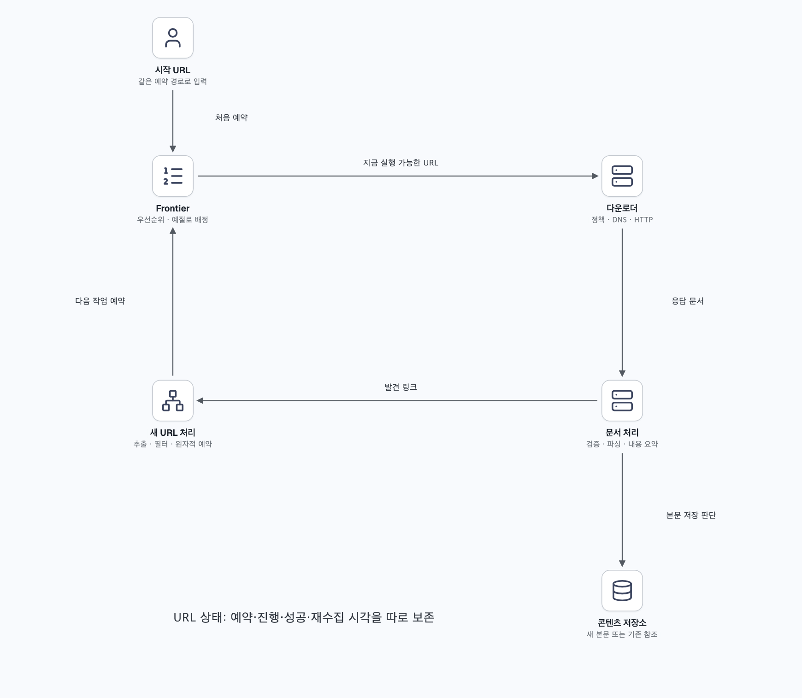
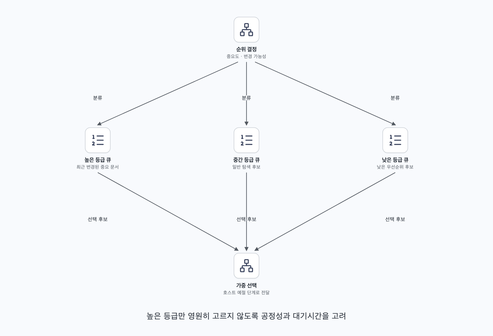
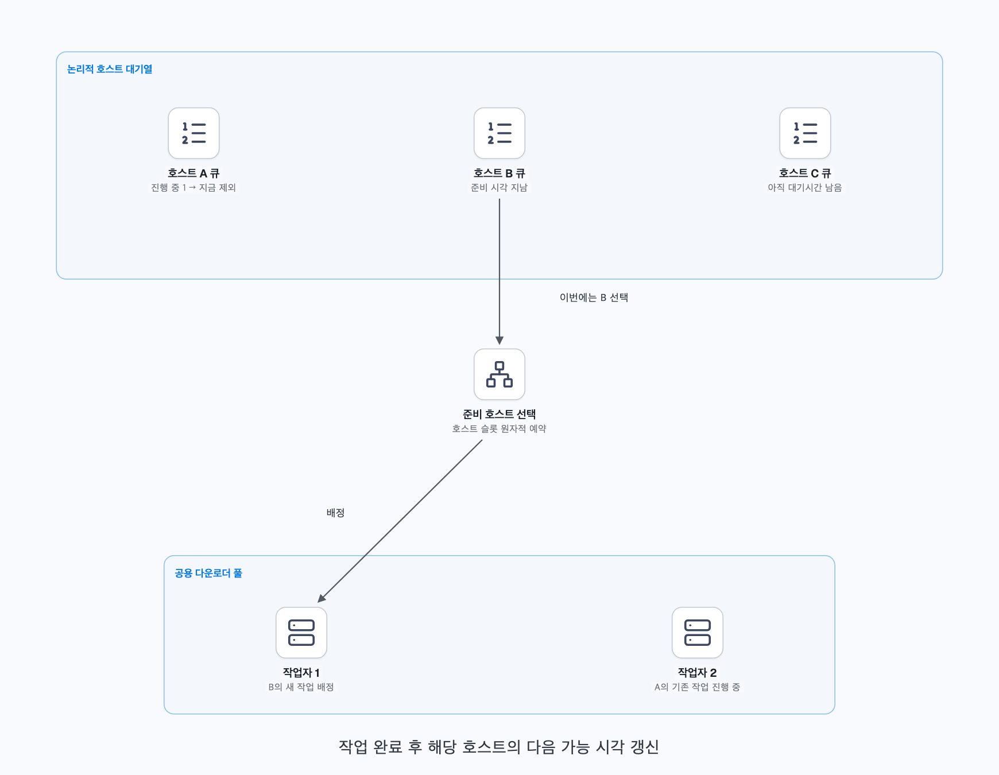
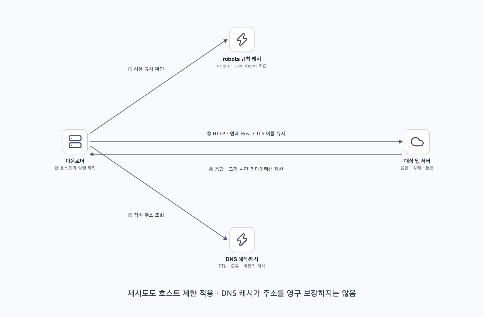
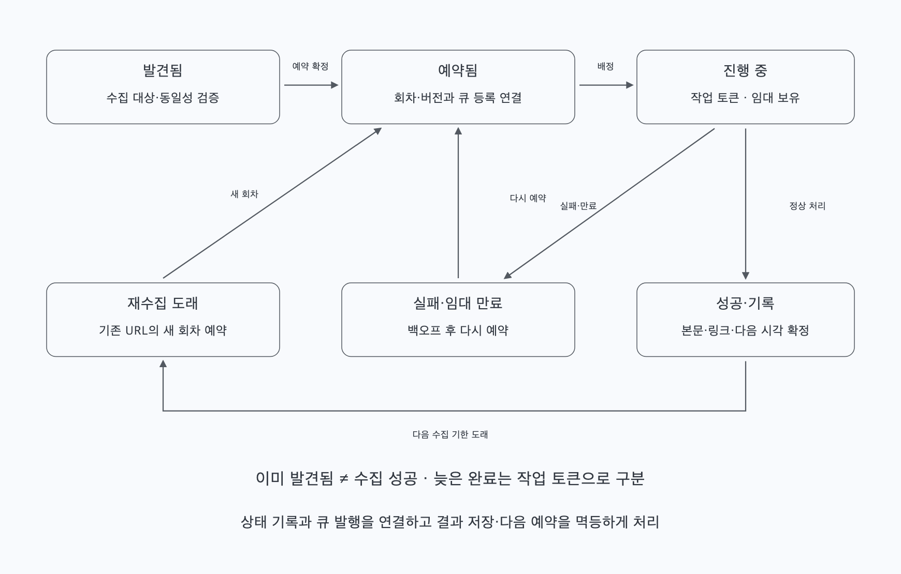
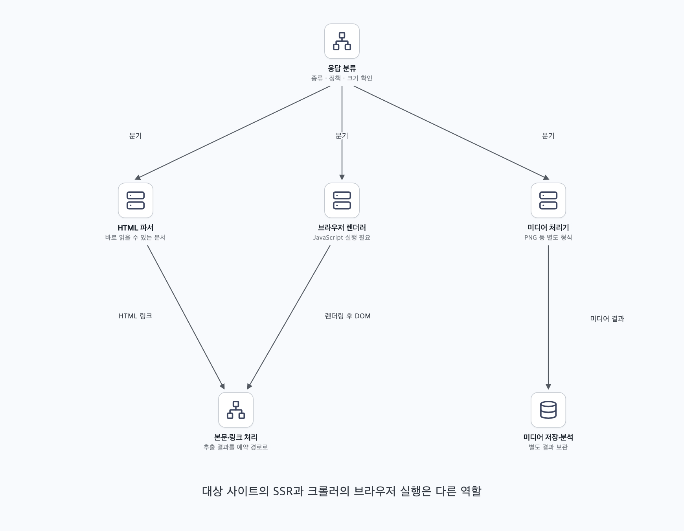

# URL을 발견하는 일과 지금 가져와도 되는지를 나눈다

## 1. 링크를 따라가면 끝나는 일일까?

상품·행사 페이지를 검색할 수 있도록 웹 문서를 모은다고 하자. 처음 아는 URL을 가져오고, HTML에서 링크를 꺼내 다음 페이지를 가져오면 된다. 기본 반복은 단순하다.

```text
시작 URL → 다운로드 → 링크 추출 → 다음 URL 예약 → 반복
```

크롤링 결과는 검색 인덱싱 외에도 웹 아카이빙, 데이터 분석을 위한 웹 마이닝, 변경·장애를 찾는 웹 모니터링에 쓰인다. 목적에 따라 저장할 내용과 재방문 주기가 다르다. 이 장은 검색 인덱싱에 필요한 수집을 설계하며 검색 순위나 검색 API 자체를 구현하는 범위는 아니다.

이번 범위는 월 10억 페이지, 새 페이지와 변경 페이지의 수집, 5년 보관, 중복 콘텐츠의 불필요한 보관 생략이다. 아래 추정에서는 월 10억 건을 신규 수집과 재수집을 합친 다운로드 예산으로 해석한다. 신규 페이지만 10억 건이라면 재수집 요청을 더해 다시 계산해야 한다.

크기가 커질수록 ‘다음 링크가 무엇인가’보다 ‘어느 사이트에 언제 요청할 수 있는가’, ‘어디까지 처리했는가’, ‘이미 본 것인가’가 중요해진다. 병렬로 빨리 모으는 능력과 대상 사이트를 과부하시키지 않는 예절을 함께 설계해야 한다.

## 2. 평균 400페이지/초여도 저장량은 크다

30일을 한 달로, 페이지 본문을 평균 500KB=500,000바이트로 가정한다.

| 항목 | 계산 | 추정 |
| --- | --- | --- |
| 평균 다운로드 | 10억 ÷ (30×24×3600) | 약 386페이지/초, 책은 약 400 |
| 최대량 가정 | 반올림한 평균의 2배 | 약 800페이지/초 |
| 월 본문 저장량 | 10억×500KB | 500TB |
| 5년 본문 저장량 | 500TB×12×5 | 30PB |

TB·PB는 십진 단위다. 최대량 2배는 용량 계획용 가정이지 실제 급증의 상한이 아니다. 압축·중복 제거로 줄 수 있고, 여러 시점의 보관·메타데이터·복제·인덱스·백업은 용량을 더 쓴다. 다운로드 실패와 재시도, 브라우저가 추가로 가져오는 자원도 별도다.

평균 본문 수신량만 약 193MB/초, 약 1.54Gbps다. 동시성은 QPS와 다르다. 평균 다운로드 시간이 2초라면 400페이지/초를 유지하는 데 약 800건의 진행 중 요청이 필요하다. 호스트별 대기시간까지 감안하면 충분히 많은 요청 가능한 호스트도 있어야 한다.

## 3. 작업은 순환하지만 각 단계의 책임은 나눈다

시작 URL은 아직 링크를 모르는 상태에서 탐색을 시작할 출발점이다. 대학 사이트라면 홈페이지와 주요 목록 등을 시작점으로 삼고 도메인 범위를 제한할 수 있다. 처음부터 그 대학의 모든 URL을 알아야 하는 것은 아니다. 전체 웹에서는 주제·언어·지역별 시작점을 골라 편향을 줄이지만 링크로 연결되지 않은 모든 페이지까지 발견한다고 보장하지는 못한다.

미수집 URL 저장소(URL frontier)는 앞으로 가져올 URL을 보관하고 순서를 정한다. 다운로더는 지금 실행 가능한 작업을 받아 robots 규칙·주소 해석·HTTP 응답을 처리한다. 파서는 문서를 읽어 검증·내용 분석·링크 추출에 넘긴다. 본문은 콘텐츠 저장소에, URL별 진행 상태는 별도 상태 저장소에 보관한다.



그림의 큰 단계를 실제 처리 순서로 풀면 다음과 같다.

1. 시작 URL도 일반 발견 URL과 같은 필터·예약 경로로 넣는다.
2. Frontier가 우선순위와 호스트의 실행 가능 시각을 보고 작업을 배정한다.
3. 다운로더가 robots 정책을 확인하고, 필요하면 DNS를 조회하여 HTTP로 문서를 받는다.
4. 파서가 응답 종류·크기 등을 확인하고 HTML을 처리한다.
5. 콘텐츠 지문으로 중복 여부를 확인하고 새 본문 또는 기존 본문의 참조를 기록한다.
6. 링크를 절대 주소로 해석하고 범위·형식·정책 필터를 통과시킨다.
7. 새로 예약할 URL은 상태 저장소에서 중복 예약을 막은 뒤 Frontier에 넣는다.
8. 처리 결과와 재수집 시각을 기록하고 작업 완료를 확인한다. 실패는 정책에 따라 다시 예약한다.

논리적 모듈을 나눈다고 모두 별도 네트워크 서비스여야 하는 것은 아니다. 파싱이 다운로드를 막지 않도록 큐와 작업자 풀을 분리할 수 있으며, 규모·비용에 맞춰 같은 프로세스의 독립 작업으로 둘 수도 있다.

## 4. URL 중복과 콘텐츠 중복은 다른 문제다

동일한 상품 URL을 여러 목록 페이지에서 발견할 수 있다. 같은 수집 회차에 계속 예약하지 않게 하는 것이 URL 중복 처리다. 다른 URL이 똑같은 상품 설명을 반환한다면 이미 다운로드한 **본문**을 반복 보관하지 않는 것이 콘텐츠 중복 처리다. URL만 비교하면 후자를 알 수 없고 본문만 비교하면 다운로드 전의 중복 요청을 막을 수 없다.

URL은 정한 동일성 규칙으로 비교한다. 상대 경로는 응답 문서의 기준 URL과 유효한 base 정보를 이용해 절대 주소로 해석한다. 리다이렉션이 있었다면 최종 문서 URL도 기준에 반영해야 한다. 예를 들어 기준이 `https://shop.example/catalog/list.html`일 때 `../products/42`는 `https://shop.example/products/42`가 된다. [URI 참조 해석 규칙](https://www.rfc-editor.org/rfc/rfc3986.html#section-5)을 참고한다.

스킴·호스트의 표기와 기본 포트 등을 정규화할 수 있지만 경로 대소문자나 쿼리 순서를 임의로 바꾸면 다른 자원을 합칠 수 있다. 일반 HTTP 수집에서 서버에 보내지 않는 fragment를 제거하는 정책도, 브라우저 렌더링의 주소 상태를 구분하는 정책과 함께 정한다.

콘텐츠는 원문 바이트나 정한 정규화 결과의 해시·지문을 비교하면 매번 모든 본문을 서로 비교하는 비용을 줄일 수 있다. 무엇을 해시했는지와 충돌 처리 조건은 명시한다. 완전히 같은 바이트와 광고·시각만 다른 유사 문서는 다른 문제다. 책의 약 29%라는 수치는 소개된 자료의 관측이며 모든 시점·사이트의 고정 비율로 가정하지 않는다.

중복 본문이어도 URL별 최종 주소·상태·관찰 시각은 남길 수 있다. 같은 HTML의 상대 링크가 다른 호스트에서 다른 주소로 해석될 수도 있다. 따라서 본문을 다시 저장하지 않는 것과 링크 추출까지 무조건 건너뛰는 것은 구분한다. 추출한 상대 링크 목록을 재사용하더라도 현재 문서의 기준 URL로 해석해야 한다.

## 5. DFS보다 BFS로 출발하되 단순 FIFO를 넘어서야 한다

웹의 페이지와 링크는 유향 그래프처럼 볼 수 있다. 깊이를 따라가는 DFS는 한 사이트의 끝없는 경로나 달력에 오래 머무를 수 있다. BFS는 먼저 발견한 가까운 링크부터 넓게 살피기 쉬워 기본 출발점으로 적합하다. 그러나 BFS만으로 무한한 웹을 끝내거나 예절을 지키는 것은 아니다.

상품 목록 한 장에서 같은 사이트의 링크 1,000개가 나왔을 때 공용 FIFO를 여러 작업자가 바로 꺼내면 한 호스트에 요청이 집중될 수 있다. 또한 FIFO는 바뀐 행사 페이지와 오래된 중요하지 않은 페이지를 가치에 따라 구분하지 않는다.

따라서 Frontier를 두 판단으로 나눈다. 먼저 중요도·변경 가능성 등으로 우선순위를 정하고, 그다음 대상 호스트의 요청 간격과 진행 중 작업을 보며 실행 여부를 결정한다.



전단 큐는 중요도에 따른 선택을 담당한다. 페이지의 알려진 중요도, 트래픽·링크 구조, 변경 이력 등을 활용할 수 있다. 처음 보는 페이지는 추정치를 쓴다. 높은 등급만 계속 처리하면 낮은 등급이 영원히 밀릴 수 있으므로 가중 선택·대기시간에 따른 조정 등을 둔다. 아직 수집하지 않은 전체 웹의 정확한 PageRank를 이미 알고 있다고 가정하지 않는다.

## 6. 호스트별 간격을 지키며 작업자 풀을 공유한다

후단은 호스트별 URL과 `다음 실행 가능 시각`, `진행 중 요청 수`를 관리한다. 이 장의 기본 정책은 같은 호스트에 한 번에 한 요청을 보내고 완료 뒤 정한 간격을 둔다. 다른 호스트의 요청은 병렬로 실행할 수 있다.



A 호스트가 대기 중이면 A의 다음 URL을 무리하게 실행하는 대신 준비된 B·C의 작업을 쓴다. 모든 큐의 머리를 매번 훑기보다 실행 가능 시각으로 정렬한 준비 호스트 자료구조를 둘 수 있다. 이때 호스트별 대기열은 논리적인 구분이다. 호스트마다 전용 스레드나 메시지 브로커의 실제 큐 한 개가 반드시 필요하지는 않다.

호스트가 수억 개로 늘 때 상태를 어디에 두고, 소유권을 어떻게 옮길지는 [호스트 큐 심화](questions/01-host-queues.md)에서 구체적으로 살펴본다. 예절의 단위를 hostname·origin·사이트·IP 중 무엇으로 잡는지도 정책이다. 같은 IP를 쓰는 여러 서비스와 한 사이트의 여러 호스트를 구분해 필요하면 여러 제한을 함께 적용한다.

## 7. 다운로더는 정책·DNS·HTTP 실패를 함께 다룬다

요청 전에 해당 origin의 `/robots.txt` 규칙을 확인하고 적용한다. 자신의 User-Agent에 맞는 허용·제외 경로를 처리하고 결과를 캐시해 매 페이지마다 파일을 다시 요청하지 않게 한다. 실패를 전부 같은 의미로 처리하지 않는다. [RFC 9309](https://www.rfc-editor.org/rfc/rfc9309.html)는 4xx의 unavailable과 5xx·네트워크 오류의 unreachable, 캐시 처리 등을 구분한다. 4xx로 파일을 구할 수 없는 경우 접근을 허용할 수 있지만, 서버·네트워크 오류로 도달 불가능하면 기본적으로 전체 제외로 보고 규정의 캐시·장기 실패 예외를 적용한다. 규칙 캐시는 보통 24시간을 넘겨 사용하지 않되 규정의 예외 조건도 확인한다. `Crawl-delay`는 이 RFC의 표준 지시어가 아니므로 사이트 정책과 구현 지원 여부를 별도로 다룬다.

DNS는 호스트의 접속 주소를 찾는 단계다. 캐시 적중이면 매 요청마다 원격 조회가 필요한 것은 아니고 비동기 해석도 가능하다. TTL과 오류에 맞춰 갱신하며 고정 크론 작업만으로 모든 주소가 계속 유효하다고 가정하지 않는다. IP로 연결해도 HTTP의 Host와 HTTPS의 서버 이름 같은 원래 호스트 문맥은 유지해야 한다.



연결·응답·전체 다운로드의 제한 시간을 두고 최대 본문 크기·리다이렉션 횟수도 제한한다. 느린 요청이 슬롯을 무한히 붙잡지 않게 하되 무조건 가장 짧은 타임아웃을 쓰지는 않는다. 정상적으로 느린 사이트를 놓치거나 재시도가 급증할 수 있다.

429·503 등에는 응답의 Retry-After와 백오프 정책을 고려하고, 다시 요청할 때도 같은 호스트 예절 제한을 적용한다. 리다이렉션 대상이 바뀌면 새 호스트의 정책과 예약 경로도 확인한다. 지역별 다운로더는 왕복 지연을 줄일 수 있지만 같은 호스트의 전체 요청량이 지역 수만큼 늘어나지 않도록 조율한다.

## 8. 수집 이력이 있어도 다시 방문해야 한다

검색용 데이터는 시간이 지나면 오래된다. 행사 페이지가 자주 바뀌면 재수집 간격을 줄이고 거의 바뀌지 않는 설명 페이지는 늘릴 수 있다. 변경 이력·중요도·호스트 예절·예산을 함께 보고 다음 수집 시각을 정한다.

영구적인 ‘방문한 적 있음’ 표시만으로 모든 후속 요청을 버리면 수정 페이지를 발견하지 못한다. URL별 마지막 성공·내용 지문·다음 예정 시각을 보관하고 회차·버전으로 중복 예약과 재수집을 구분한다.

서버가 제공하는 ETag·Last-Modified를 저장해 다음에 조건부 요청을 보낼 수도 있다. 304이면 이미 가진 본문을 활용하고 확인 시각을 갱신한다. 본문을 다시 받지 않아도 요청 자체는 발생하므로 예절 슬롯을 사용한다. 조건부 요청의 지원·정확성은 대상 서버에 따라 확인한다.

## 9. 메모리 버퍼가 큐의 내구성을 대신하지는 않는다

수억 URL과 전체 콘텐츠를 모두 메모리에만 두기 어렵다. Frontier의 대부분과 URL 상태는 디스크 기반 저장소에 두고, 가까운 미래의 실행 후보·작은 배치만 메모리에 올리면 I/O를 묶어서 처리할 수 있다. 큰 본문은 분산 파일·객체 저장소 등에, 검색과 재수집을 위한 메타데이터는 별도 조회 가능한 저장소에 보관한다. 자주 읽는 일부는 캐시할 수 있다.

다만 메모리 버퍼를 주기적으로 디스크에 쓴다는 사실만으로 그 사이의 장애에서 작업이 보존되지는 않는다. 예약이 확정되었다고 표시하는 시점과 영구 기록을 맞추고, 로그·체크포인트·재생 경로를 정한다.



발견한 URL을 상태 저장소에 ‘이미 봄’으로 먼저 표시했는데 큐 등록 전에 죽으면 영원히 빠질 수 있다. 반대로 큐에만 넣고 상태 기록을 잃으면 같은 작업이 반복된다. 같은 트랜잭션에서 예약을 확정하거나 내구성 있는 발행 기록과 재전달을 조합하는 등 두 경로를 연결해야 한다.

작업자는 항목을 가져왔다고 즉시 삭제하지 않고 처리 중 임대를 둘 수 있다. 작업자 장애로 임대가 만료되면 다시 배정한다. 완료 결과와 작업 토큰을 확인해 오래된 작업자의 뒤늦은 완료가 새 상태를 덮지 못하게 한다. 임대 만료가 실제 네트워크 요청의 종료를 보장하지는 않으므로 호스트 슬롯 인계도 고려한다.

HTTP 요청과 저장은 모두 하나의 로컬 트랜잭션이 되지 않는다. 재다운로드·중복 전달을 허용하되 결과 저장·링크 예약은 작업 ID·URL 버전 등으로 멱등하게 처리할 수 있다. 데이터는 외부에 보관하고 작업자 프로세스는 재배정 가능한 형태로 두는 것이 무상태 작업자의 의미다. 시스템 전체에 상태가 없다는 뜻은 아니다.

## 10. 이상한 입력과 끝없는 탐색을 제한한다

정상적인 웹에도 깨진 HTML과 느린 응답이 있다. 관대한 HTML 파서를 쓰되 응답 종류·인코딩·크기·파싱 시간과 자원 사용을 제한한다. 검증 실패나 예외 한 건이 전체 작업자 풀을 멈추지 않게 기록·분리한다. ‘HTML이 표준을 완벽히 만족하지 않으면 모두 버린다’는 정책은 수집 누락을 늘릴 수 있다.

거미 덫은 같은 주소만 반복하는 경우뿐 아니라 날짜·세션·정렬 조합처럼 끝없이 다른 URL을 만드는 경우도 있다. 방문 URL 집합만으로는 이를 모두 막지 못한다. 경로 깊이·파라미터 조합·호스트별 탐색 예산·반복 패턴에 제한을 두고 수집 효율이 나쁜 범위를 관찰해 필터를 조정한다. 자동 탐지에 더해 사람이 확인해 제외하는 경로도 둘 수 있다.

광고·내비게이션 같은 반복 요소를 본문 분석에서 제외하면 품질과 중복 탐지에 도움이 될 수 있다. 그러나 스크립트를 전부 무의미하다고 버리기 전에 동적 콘텐츠의 역할을 확인한다. 보관할 원문, 검색에 쓸 본문, 링크 추출용 문서를 서로 다른 표현으로 관리할 수 있다.

## 11. 동적 페이지와 새 콘텐츠 형식을 추가한다

응답 HTML에 링크가 없고 JavaScript 실행 뒤 나타난다면 단순 다운로드·HTML 파싱으로는 놓칠 수 있다. 대상 사이트가 서버 측 렌더링으로 완성된 HTML을 제공하면 그대로 읽을 수 있다. 크롤러가 대상 사이트에 SSR을 적용하는 것은 아니다. 크롤러 쪽에서는 브라우저 기반 렌더링 작업을 추가해 실행 후 DOM을 처리하는 선택이 가능하다.



브라우저 실행은 CPU·메모리·추가 네트워크 요청이 비싸므로 필요한 페이지를 별도 큐와 제한된 풀로 보낼 수 있다. 렌더러가 가져오는 스크립트·이미지 등도 대상 사이트의 부하에 포함한다. 수집·렌더링·링크 처리의 관계는 [Google의 JavaScript 처리 설명](https://developers.google.com/search/docs/crawling-indexing/javascript/javascript-seo-basics)을 참고한다. 특정 검색 엔진의 구현이 모든 크롤러의 필수 구조인 것은 아니다.

PNG 같은 미디어는 Content-Type과 정책으로 별도 처리기에 전달할 수 있다. 공통 다운로드·상태·실패 처리 인터페이스를 두고 파서·본문 저장·분석 모듈을 확장하면 새 형식을 추가하기 쉽다. 논리적 분리 뒤에 필요에 따라 개별 작업자를 늘린다.

## 12. 빠른 수집보다 ‘잘 수집하고 있는지’를 관찰한다

다운로더·파서·저장소를 따로 확장하고, 링크 발견 속도가 다운로드·저장 속도를 넘으면 큐 크기와 메모리가 무한히 늘지 않게 배압과 호스트별 예산을 둔다. 데이터 저장 계층의 복제·샤딩·백업과 장애 후 상태 복구도 함께 준비한다.

관찰할 지표는 다운로드 성공률·지연·바이트, 상태 코드와 재시도, 파싱 실패, 신규 URL 발견률, 콘텐츠 중복률, Frontier 지연, 호스트별 동시성·요청 간격, 재수집 기한 초과 등이다. 페이지 수만 높이려고 같은 콘텐츠나 한 사이트를 반복 수집하면 목적에 맞지 않는다.

이제 심화 질문에서 세 가지를 연결해 보자. 호스트별 큐를 물리 자원과 어떻게 분리할지, 왜 블룸 필터가 큰 집합에 자주 쓰이는지, 안정 해시가 어떤 종류의 변경을 줄이는지가 이 장의 구성 선택을 설명한다.
