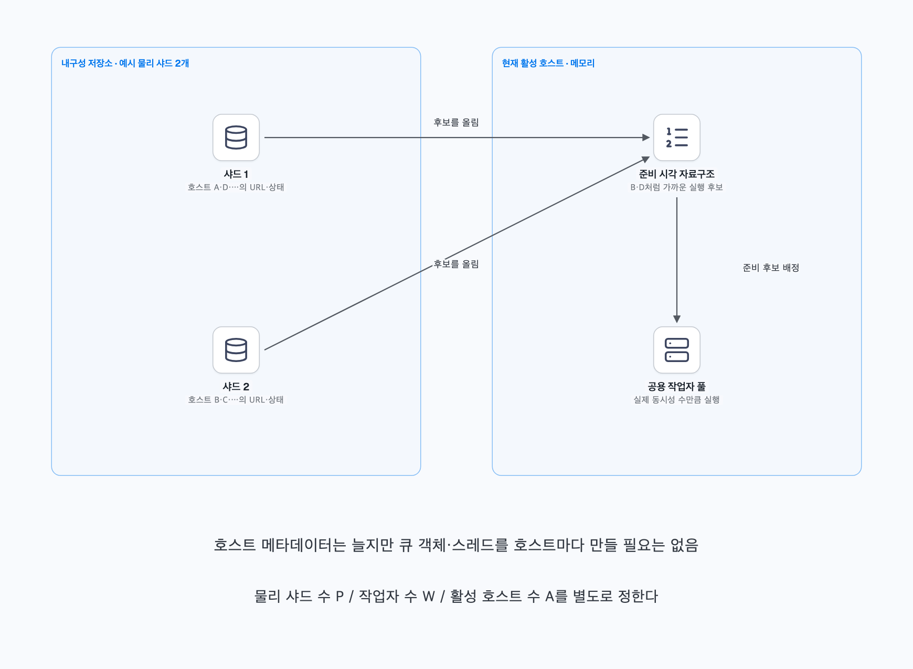

# 호스트가 수억 개면 큐와 스레드도 수억 개 필요할까?

## 1. 호스트별 순서는 필요하지만 물리 큐·스레드는 공유할 수 있다

질문의 우려는 맞다. 모든 호스트마다 메모리 큐, 운영체제 스레드, 브로커 큐를 영구 생성하면 자원과 관리 비용이 커진다. 책의 호스트별 후단 큐 그림은 같은 호스트의 요청을 모아 예절을 지키는 논리 구조로 이해하면 좋다. 이 구분을 물리 스레드와 반드시 1:1로 만들 필요는 없다.

예를 들어 URL 작업을 저장소에 `(host, priority, enqueue_order, url)` 형태로 보관할 수 있다. 한 호스트의 다음 URL은 그 호스트 범위의 머리를 읽으면 된다. 실제 저장 파일·테이블·파티션과 네트워크 연결·다운로더 풀은 여러 호스트가 공유한다.

호스트별 최소한의 대기·최근 요청 상태까지 사라지는 것은 아니다. 대기 URL이 있는 호스트의 상태는 저장소가 보관하고, 가까운 미래에 처리할 활성 호스트만 메모리 자료구조에 올린다. 유휴 호스트의 메모리 상태는 내릴 수 있으나, 예절을 지키는 데 필요한 최근 시각을 잃고 즉시 재요청하지 않게 한다.

호스트 수 H가 늘면 디스크의 메타데이터도 늘지만 스레드 수까지 H에 비례해야 하는 것은 아니다. 물리 샤드 수 P와 작업자 수 W, 메모리에 둘 활성 호스트 수 A를 별도로 관리한다. 이 구분은 비용을 없애는 기술이 아니라 저장과 실행을 서로 다른 단위로 확장하는 설계다.

## 2. 준비된 호스트를 고른 뒤 작업자에게 준다

다음은 각 호스트의 요청 완료 뒤 2초를 쉬는 예시다.

- A가 시각 0에 시작해 1에 끝나면 A의 다음 가능 시각은 3이다.
- B가 0에 시작해 0.5에 끝나면 B는 2.5부터 다시 가능하다.
- 시각 1.5에는 A·B를 기다리게 하고 준비된 다른 호스트를 처리한다.

실행 가능 시각을 기준으로 한 최소 힙이나 시간 버킷을 사용하면 모든 호스트 큐를 매번 훑지 않고 준비 후보를 찾을 수 있다. 고른 뒤에는 호스트의 진행 중 슬롯을 원자적으로 예약해야 여러 스케줄러가 동시에 같은 호스트를 선택하는 일을 막는다.

호스트별 요청은 한 번에 한 건이어도 전체는 많은 호스트를 동시에 처리하므로 충분한 병렬성을 얻을 수 있다. 네트워크 I/O는 비동기로 대기할 수 있어 진행 중 연결 수와 OS 스레드 수도 반드시 같지 않다. [Scrapy 설정](https://docs.scrapy.org/en/latest/topics/settings.html#download-slots)도 다운로드 슬롯의 동시성·지연을 별도로 다루는 구현 사례다. 이 노트의 분산 스케줄러를 그대로 제공한다는 뜻은 아니다.

## 3. 한 물리 버킷에 여러 호스트를 넣을 때의 함정

고정된 P개 버킷에 호스트를 해시해 넣으면 물리 큐 수를 제한할 수 있다. 하지만 A가 쿨다운 중이라는 이유로 같은 버킷 뒤의 준비된 B까지 멈추면 선두 항목 대기(head-of-line blocking)가 생긴다. 따라서 버킷 안에도 호스트별 머리·준비 시각을 구분하거나, 별도 준비 호스트 목록을 관리한다.

같은 호스트의 작업이 여러 지역이나 샤드로 흩어지면 각자 한 건씩 실행해도 대상 사이트에는 여러 건이 겹친다. 같은 호스트 정책의 책임 지점으로 모으거나 공유 제한 상태를 사용해야 한다. 호스트를 어느 작업자에게 주는지만 정해 놓고 요청 간격을 관리하지 않으면 충분하지 않다.

## 4. 로드 밸런서의 고정 세션과 무엇이 다를까?

앱 서버의 고정 세션은 특정 서버에 남아 있는 사용자 상태에 요청이 의존하게 할 수 있다. 여기서는 호스트 예절이라는 공유 자원을 한 책임 지점에서 조율하기 위해 작업을 모은다. 실행 서버가 영원히 고정되어야 하는 것은 아니다.

URL·준비 시각·진행 중 상태를 내구성 있게 보관하면 소유자를 바꾸고 작업자 풀도 교체할 수 있다. 이전 소유자의 요청이 아직 진행 중인지, 늦게 돌아온 작업자가 다시 실행하지 않는지 확인하며 인계한다. 임대가 만료되었다고 실제 HTTP 요청이 즉시 취소된 것은 아니다.

안정 해시는 소유자를 바꿀 때 옮겨야 하는 호스트 범위를 줄이는 수단이 될 수 있다. 안전한 상태 인계와 장애 감지는 별도로 구현한다. 따라서 ‘고정 세션처럼 보이니 확장 불가’나 ‘해시로 배정했으니 확장 완료’로 단정하지 않고 어떤 상태가 어디에 남는지 확인해야 한다.
