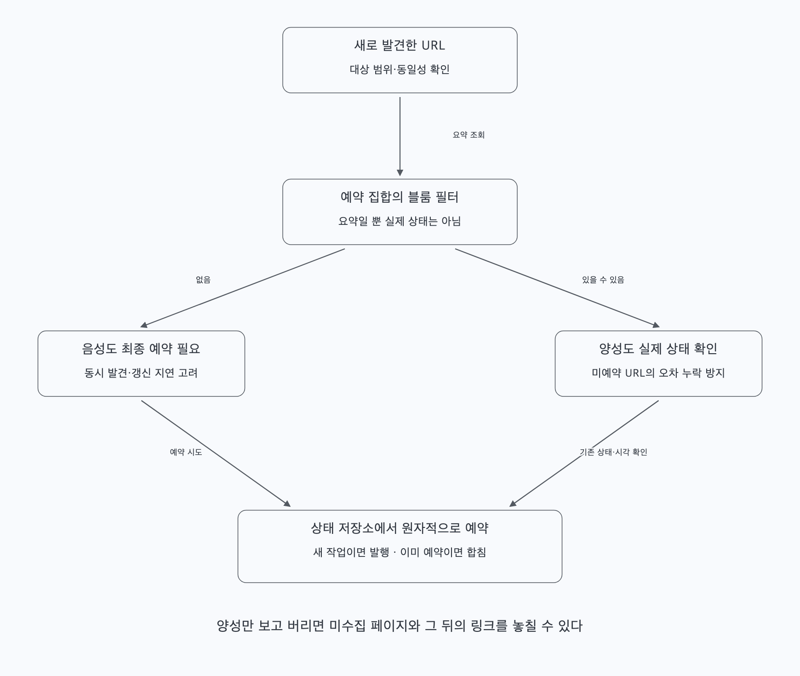

# 블룸 필터가 여러 설계에 자주 등장하는 이유는?

## 1. 많은 문제에 ‘이미 있는 키인가?’라는 앞단 질문이 있다

캐시에는 없는 키의 DB 조회, URL 단축기에는 이미 등록한 주소 확인, 크롤러에는 새로 발견한 URL의 예약 여부 확인이 있다. 공통점은 실제 값을 읽거나 비싼 작업을 하기 전에 큰 집합의 소속 여부를 묻는다는 것이다.

키 문자열을 전부 메모리 해시 집합에 넣으면 문자열과 자료구조의 공간을 쓴다. 블룸 필터는 비트 요약으로 공간을 줄이는 대신 ‘있을 수 있음’이라는 거짓 양성을 허용한다. 실제 URL·진행 상태·다음 수집 시각은 보관하지 못한다.

완전하게 반영한 집합에서 음성이면 정확한 저장소 조회를 줄일 수 있다. 양성이면 정말 예약했는지 상태 저장소에서 확인한다. 원리는 같아도 무엇을 요약하고 잘못된 판단의 비용이 무엇인지가 시나리오마다 다르다.

## 2. 크롤러에서는 거짓 양성 때문에 페이지를 놓칠 수 있다

아직 예약하지 않은 URL K가 우연히 양성이 되었다고 하자. ‘양성이므로 이미 방문했다’고 그냥 버리면 수집하지 않은 페이지를 놓친다. 검색 범위가 중요한 설계에서는 양성을 정확한 상태 저장소로 보내고 최종 예약은 원자적으로 결정해야 한다.

누락을 허용하는 근사적인 탐색이라면 양성 일부를 버리는 선택도 가능하지만, 그 경우는 정확한 방문 집합과 다른 품질 타협이다. 거짓 양성 1%를 모든 수집 페이지의 누락률 1%로 바로 해석할 수도 없다. 놓친 한 페이지 뒤의 링크를 발견하지 못해 영향이 더 커질 수 있기 때문이다.

## 3. ‘없음’도 예약 완료를 뜻하지는 않는다

두 작업자가 동시에 필터에서 음성을 볼 수 있다. 둘 다 큐에 넣지 않게 하려면 상태 저장소의 유일한 예약이나 같은 URL의 책임 지점에서 원자적으로 상태를 바꿔야 한다. 필터는 중복 예약을 막는 락이 아니다.

필터에 예약 표시를 넣었는데 큐 등록을 잃고 양성을 무조건 버리면 작업이 사라질 수 있다. 반대로 필터 갱신 지연은 음성 후보를 늘릴 수 있다. 정확한 상태·원자적 예약이 최종 판단을 맡으면 그 지연을 중복 저장이나 영구 누락으로 연결하지 않을 수 있다.

재수집도 구분한다. 예전에 한 번 방문한 URL을 영구 집합에 넣고 다시는 실행하지 않으면 변경을 반영하지 못한다. URL의 존재와 현재 회차의 예약 여부, 다음 실행 가능 시각은 별도의 상태다. 필터는 최초 발견 여부만 요약하고 재수집은 상태 저장소와 시간 기반 스케줄러가 처리하는 등 범위를 정한다.

## 4. 여기서 기억할 본질

블룸 필터가 자주 나오는 이유는 특정 서비스에 종속되지 않은 공간 효율적인 집합 요약이기 때문이다. 값 저장·정확한 상태·원자성·내구성은 다른 구성 요소가 제공한다. 8장의 DB 앞 필터와 마찬가지로 집합의 반영 범위·오차 허용·복구 중 우회 경로를 함께 정한다.

예시로 활성 집합 10억 원소를 목표 거짓 양성률 1%로 요약하면 이상적인 근사에서 비트 배열은 약 1.2GB다. 문자열 전체 집합보다 작을 수 있지만 복제·부가 공간은 더 들고 수집 URL이 늘면 다시 계산해야 한다. 필터가 재수집 일정까지 모두 기억하는 것은 아니다. 이 계산에는 [블룸 필터 연구 자료의 근사식](https://pages.cs.wisc.edu/~cao/papers/summary-cache/node8.html)을 사용한다.
