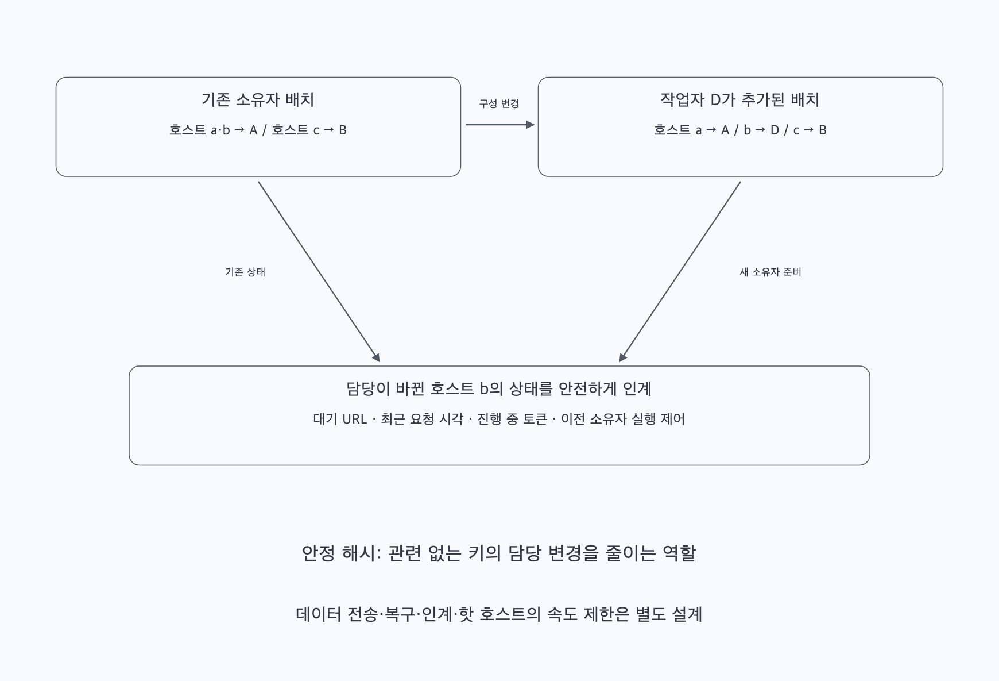

# 안정 해시는 어떤 문제를 만날 때 떠올리면 될까?

## 1. 변하는 서버 집합에 키의 담당을 붙이는 문제다

5장의 캐시 서버, 6장의 데이터 분할, 이 장의 호스트 스케줄러에는 공통 문제가 있다. 키의 담당 서버를 계산해 같은 키의 일을 같은 곳으로 보내고 싶은데 서버는 추가·제거된다.

단순한 `hash(key) % 서버 수`는 서버 수가 바뀔 때 관련 없는 키도 많이 재배정할 수 있다. 안정 해시는 이때 담당이 바뀌는 범위를 줄인다. 크롤러에서 키를 URL 전체 대신 hostname으로 두면 같은 호스트의 요청 간격과 대기 작업을 같은 스케줄링 소유자에게 모을 수 있다.

캐시에서는 담당이 바뀌면 캐시 미스를 감수하고 다시 채울 수 있다. 호스트 예절 상태에서는 마지막 요청 시각을 잃으면 너무 빨리 재요청할 수 있다. 같은 매핑 기술을 써도 바뀌는 키에 필요한 인계 절차가 다른 이유다.

## 2. 안정 해시만으로 해결하지 않는 것

가상 노드로 여러 키의 분포를 완화해도 인기 호스트 하나의 작업량은 클 수 있다. 그 호스트를 더 많은 다운로더에 보내는 것이 예절 위반이라면 단순 증설로 처리량을 늘릴 수 없다. 정책상 속도 제한을 유지하고 대기 작업·탐색 예산을 관리해야 한다.

또 안정 해시는 서버 장애를 감지하거나 URL 상태를 복제·저장하지 않는다. 소유자 변경 시 진행 중 작업, 임대와 이전 작업자의 늦은 실행을 처리하는 것도 별도의 일이다. 같은 키라도 모든 구성원이 다른 서버 목록을 보면 다른 담당을 계산할 수 있다.

복습할 때는 ‘구성 변경 중 관련 없는 키의 담당을 가능한 유지하고 싶은가?’를 먼저 묻는다. 그렇다면 안정 해시가 후보가 된다. 키의 실제 부하·내구성·일관성·안전한 인계까지 자동으로 따라온다고 생각하지 않는다. 5장의 링·가상 노드 원리를 이 역할에 연결하면 된다.
