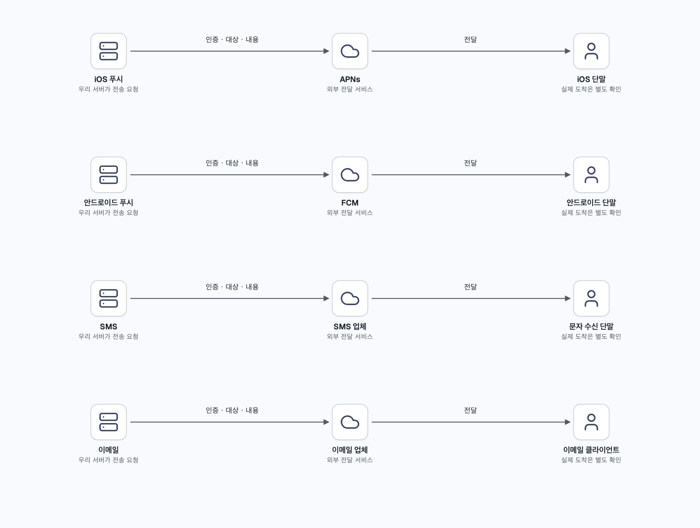
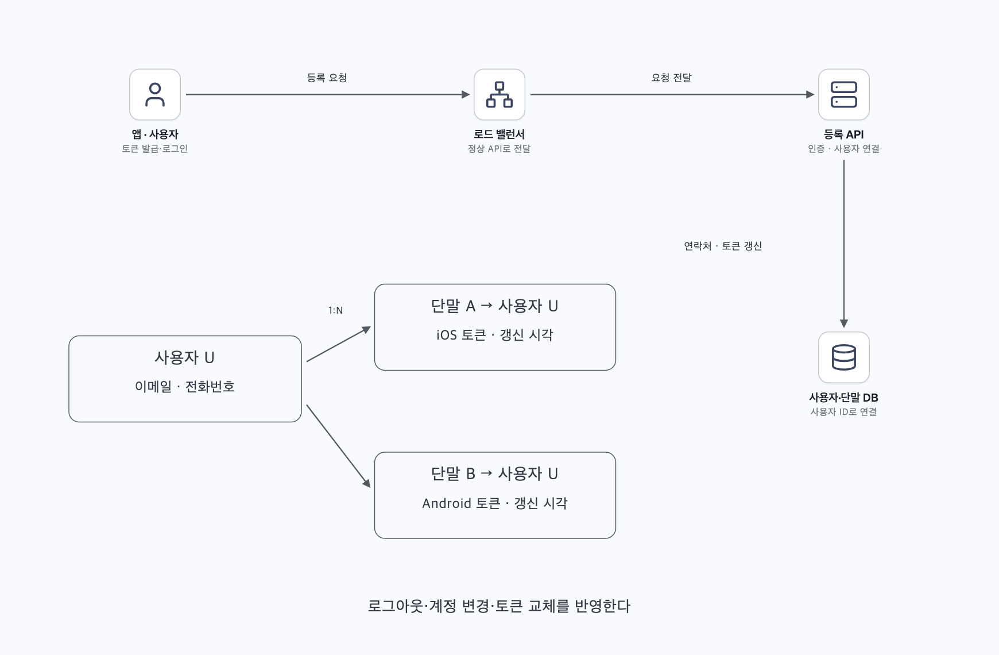
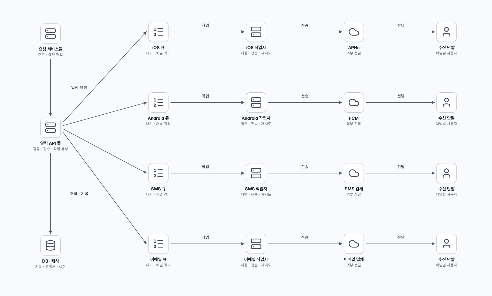
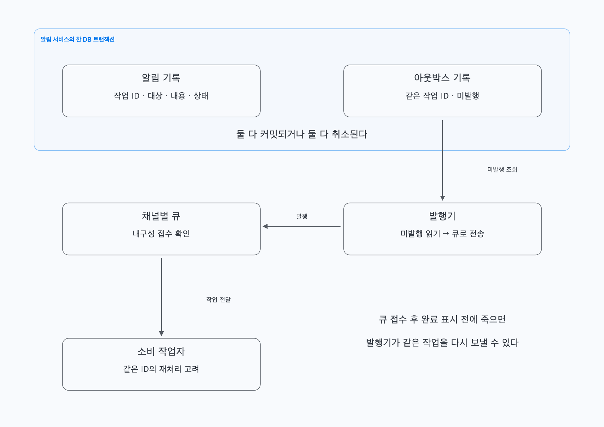
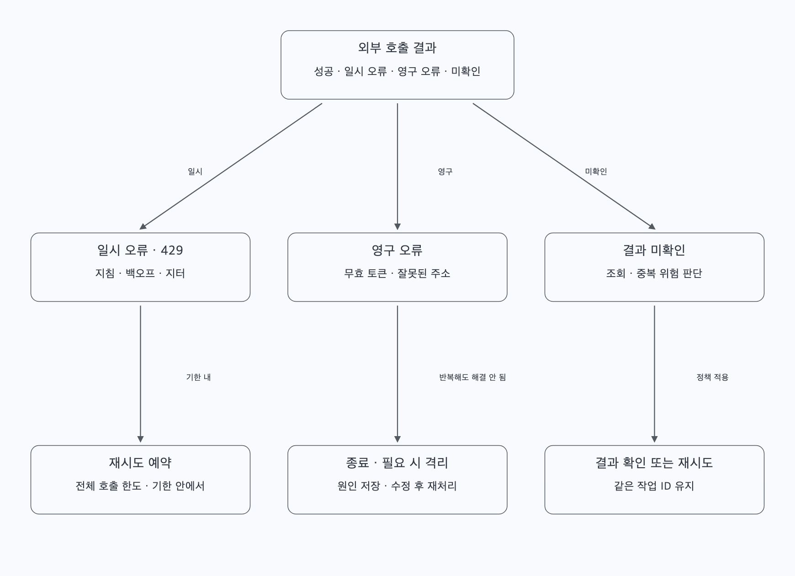
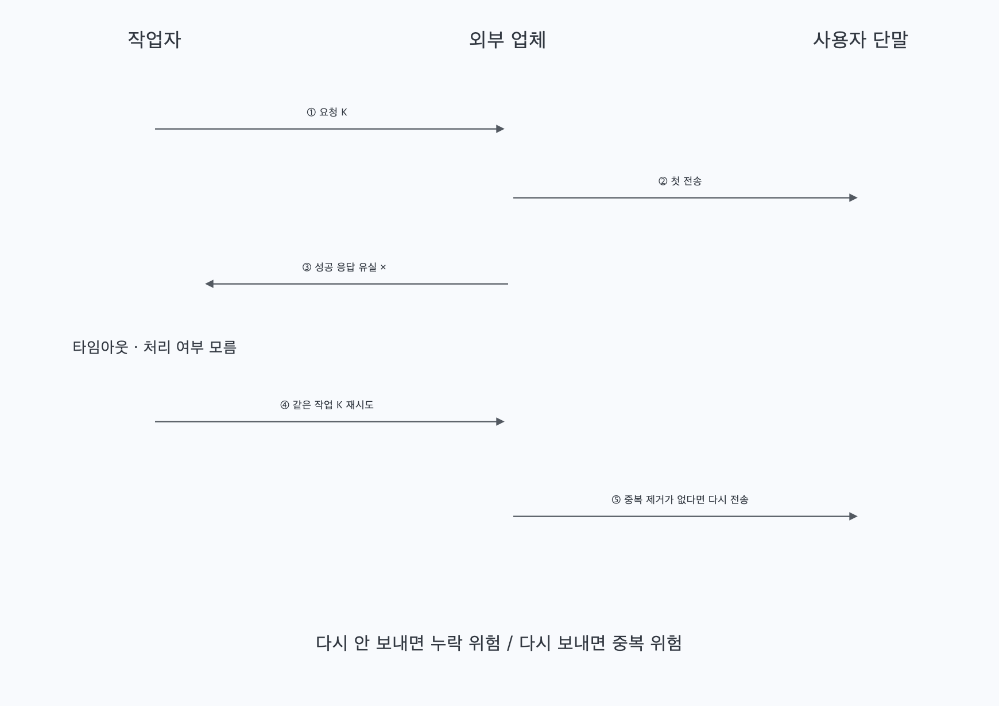
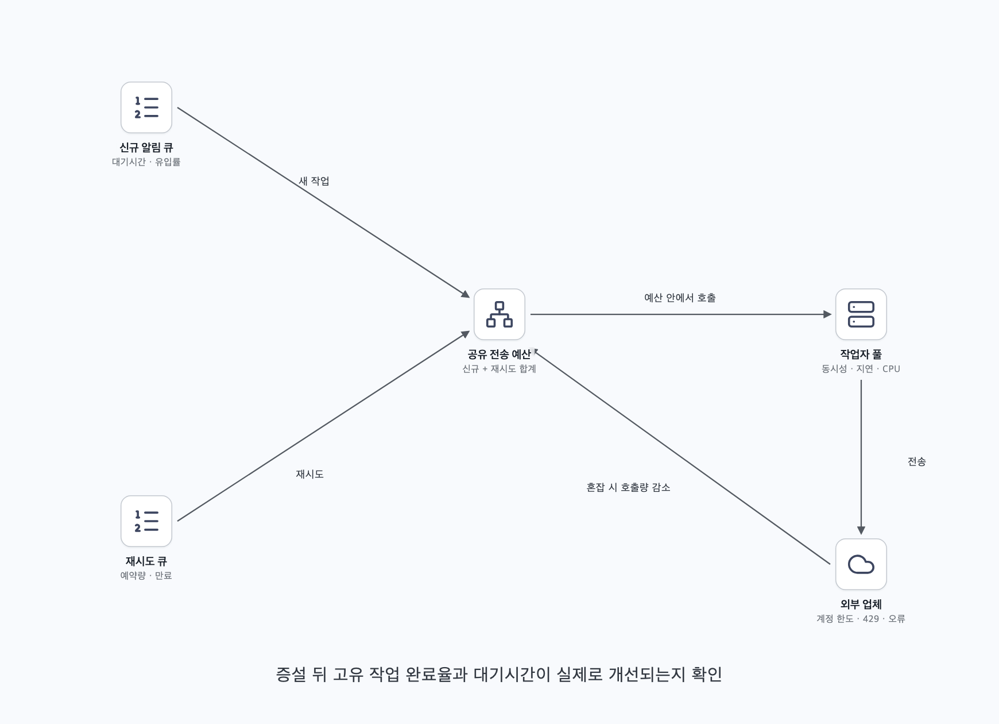

# 10장. 알림 시스템 설계

주문 안내가 사용자에게 도착하는 경로에서 출발해 접수·큐·외부 전송·결과 확인을 나눈다. 장애 때 생기는 누락과 중복, 외부 업체가 느려졌을 때의 대응을 따라간다.

책 10장과 제공된 메모를 바탕으로 재구성했다. 개념·그림·심화 질문·복습 답안을 이 README에서 함께 읽는다.

## 목차

- [접수에서 외부 전송과 결과 추적까지](#core-concepts)
- [질문 01 · 정확히 한 번 전달의 경계](#q1)
- [질문 02 · 큐 적체와 작업자 증설](#q2)
- [스스로 답하기 · 답안 토글](#review)
- [책과 추가 설명의 범위](#sources)

---

## 주문 알림이 사용자에게 도착하기까지

### 1. 무엇을 언제까지 전달해야 하는가

상품 주문이 완료되면 앱에는 푸시 알림을, 배송이 시작되면 문자와 이메일을 보낸다고 가정한다. 주문 서버가 알림을 요청한 순간부터 사용자가 확인할 때까지는 여러 시스템을 거친다. 이 장은 그 사이에서 요청을 잃지 않고, 부하와 실패를 다루는 구조를 설계한다.

지원 채널은 모바일 푸시·SMS·이메일이며 iOS·안드로이드·노트북·데스크톱 사용자를 고려한다. 앱이 알림 생성을 요청하거나 서버의 예약 작업이 요청할 수 있다. 사용자는 수신을 끌 수 있다. 단말 안에서 직접 예약하는 로컬 알림과 서버가 외부 업체를 통해 보내는 원격 알림은 다르며, 이후 설명은 서버 측 원격 알림을 중심으로 한다.

책은 하루 모바일 푸시 1,000만 건, SMS 100만 건, 이메일 500만 건을 가정한다. 하루 86,400초로 나누면 평균 약 116·12·58건/초다. 합계는 약 185건/초지만 행사 시작 시각의 집중 요청은 평균보다 훨씬 클 수 있다. 한 사용자에게 단말이 여러 개라면 전송 작업도 늘고, 재시도 역시 외부 호출량에 포함된다.

가능한 빨리 보내되 높은 부하에서 약간 늦어도 되는 **연성 실시간** 요구다. 그렇다고 지연이 무한정 허용되는 것은 아니다. 주문 알림과 마케팅 알림의 우선순위·허용 지연·만료 시각을 먼저 정해야 한다.

### 2. 채널마다 마지막 전달자가 다르다

iOS에서는 우리 서버인 알림 제공자가 단말 토큰과 메시지 내용을 담은 페이로드를 APNs에 보낸다. APNs는 Apple Push Notification service이며 해당 앱·단말로 알림을 전달한다. 안드로이드는 같은 역할에 FCM을 사용한다. SMS와 이메일은 각각 해당 전송 업체에 요청한다. 웹·데스크톱에서의 수신은 이메일이나 해당 플랫폼이 지원하는 푸시 경로를 선택한다. 모바일 푸시 경로를 모든 플랫폼에 그대로 적용하지 않는다.

여기서 외부 업체가 요청을 수락했다는 응답은 사용자가 읽었다는 뜻이 아니다. APNs는 최선형 전달 서비스이므로 단말 상태·만료 등에 따라 실제 도착하지 않을 수 있다. SMS도 접수·통신사 전달·배달 확인이 구분된다. 따라서 “알림 성공”이라는 상태 하나로 전체 과정을 표현하면 장애 지점을 찾기 어렵다. [APNs 전송 문서](https://developer.apple.com/documentation/usernotifications/sending-notification-requests-to-apns), [Twilio 메시지 상태](https://www.twilio.com/docs/messaging/api/message-resource#message-status-values)

### 3. 먼저 사용자와 연락할 경로를 알아야 한다

앱이 설치되고 사용자가 로그인하면 단말에서 받은 푸시 토큰을 API 서버에 등록한다. API 서버는 인증된 사용자와 토큰을 연결해 저장한다. 이메일 주소·전화번호·채널별 수신 설정도 필요한 범위에서 저장한다.

사용자 한 명은 여러 단말을 쓸 수 있으므로 사용자와 단말은 1:N 관계다. 예를 들어 사용자 테이블은 사용자 ID·이메일·전화번호를, 단말 테이블은 사용자 ID·플랫폼·앱 구분·단말 토큰·갱신 시각을 가진다. 알림 설정은 사용자·채널·알림 종류별로 분리할 수 있다.

푸시 토큰은 영구적인 사용자 ID가 아니다. 토큰 갱신 시 서버에도 새 값을 보내고, 로그아웃·계정 변경 시 연결을 정리한다. 외부 업체가 토큰 무효를 알려주면 다시 사용하지 않도록 처리한다. 오래된 연결을 방치하면 다른 계정의 단말에 알림이 갈 수 있다. [Apple의 앱 등록 절차](https://developer.apple.com/documentation/usernotifications/registering-your-app-with-apns)

### 4. 한 알림 서버가 전부 처리하면 어디서 막힐까

처음에는 주문 서버 → 알림 서버 → 외부 업체 → 사용자라는 구성이 가능하다. 알림 서버가 연락처를 읽고 문장을 만든 뒤 외부 API를 호출한다. 그러나 이메일 업체가 느려지는 동안 다른 알림 요청도 기다릴 수 있고, 한 서버가 죽으면 접수부터 전송까지 멈춘다. DB·캐시까지 같은 서버에 있다면 역할별 증설도 어렵다.

먼저 DB와 캐시를 분리하고 알림 API 서버를 여러 대 둔다. 사용자·단말·설정·알림 기록은 DB에 보관하고, 자주 읽는 정보와 템플릿은 캐시로 조회 비용을 줄인다. 그다음 외부 전송은 작업 서버로 넘긴다. API 서버와 작업 서버 사이에 큐를 두면 외부 업체가 잠시 느려져도 접수와 전송을 분리할 수 있다.

흐름은 다음과 같다.

1. 주문 서비스가 알림 API를 호출한다. API 서버는 호출 권한·수신자·메시지 종류를 검증한다.
2. 캐시와 DB에서 연락처·설정·템플릿 정보를 얻는다.
3. 전송 의무를 내구성 있게 기록하고 채널별 작업을 발행한다. 기록과 큐 발행 사이의 실패는 다음 절에서 다룬다.
4. 각 채널의 작업자가 큐에서 작업을 가져온다. iOS와 안드로이드 푸시·SMS·이메일은 독립적으로 처리량을 조절한다.
5. 작업자는 수신 설정·만료·전송 한도를 확인하고 외부 업체에 보낸다.
6. 외부 응답과 이후 확인 가능한 결과를 기록한다. 재시도할 작업은 다시 예약한다.

큐는 순간 부하를 흡수하고 장애 영향을 분리한다. 다만 처리 능력을 초과하는 유입이 계속되면 결국 가득 차므로 저장 한도·허용 지연·접수 제한도 필요하다. 큐 자체와 DB도 복제·복구 가능한 구성이 필요하며 API 서버만 여러 대 둔다고 전체 단일 장애 지점이 없어지지는 않는다.

### 5. 접수했다고 답했는데 큐에는 없다면

알림 기록을 DB에 넣고 큐에 보내는 두 작업을 따로 하면 틈이 생긴다. DB 저장 직후 서버가 죽으면 기록만 있고 전송 작업은 없다. 반대로 먼저 큐에 넣으면 DB 저장 실패 후에도 전송될 수 있다.

한 가지 해결은 **트랜잭션 아웃박스 패턴**이다. 알림 기록과 “나중에 큐로 보낼 작업”을 같은 DB 트랜잭션으로 저장한다. 둘 다 커밋된 다음 접수 성공을 응답한다. 별도 발행기가 미발행 작업을 읽어 큐에 보내고, 큐의 접수 확인 뒤 발행 완료를 기록한다.

발행기가 큐 접수 후 완료 표시 전에 죽으면 같은 작업을 다시 발행할 수 있다. 아웃박스는 DB와 큐 사이의 누락을 막기 위한 장치이며 중복 제거까지 자동으로 해결하지 않는다. 작업 ID를 유지하고 소비자가 같은 작업의 재처리를 알아볼 수 있어야 한다. [AWS의 아웃박스 설명](https://docs.aws.amazon.com/prescriptive-guidance/latest/cloud-design-patterns/transactional-outbox.html)

주문 DB에 주문을 저장하는 일과 알림 API 호출 사이에도 같은 문제가 생긴다. 주문 완료 알림이 반드시 필요하다면 주문 서비스 역시 자신의 DB에서 주문과 알림 요청 의무를 함께 남기는 방식 등을 고려한다. 서로 다른 서비스의 DB를 하나의 로컬 트랜잭션처럼 취급해서는 안 된다.

큐의 발행 확인은 브로커가 요청을 받았다는 뜻이고, 소비자의 처리가 끝났다는 확인은 별개다. 작업자는 결과나 다음 재시도 의무를 안전하게 남긴 뒤 원래 작업을 완료 처리해야 한다. 큐의 내구성·복제 설정도 확인한다. [RabbitMQ의 두 확인 방식](https://www.rabbitmq.com/docs/confirms)

### 6. 같은 주문 알림도 종류와 수신자에 맞게 만든다

“주문 {주문번호}의 배송이 시작되었다”처럼 공통 문장과 변수를 분리한 것이 알림 템플릿이다. 채널별 글자 길이·스타일·링크를 따로 정한다. 재시도할 때 주문 상태나 템플릿이 바뀌어 내용까지 달라지지 않도록 사용할 변수와 템플릿 버전 또는 완성된 내용을 기록하는 정책을 정한다.

알림 설정은 채널뿐 아니라 주문 안내·마케팅 같은 종류별로 관리한다. 접수 때 거르더라도 큐에서 기다리는 동안 사용자가 수신을 끌 수 있으므로 전송 직전에도 최신 설정을 확인한다. 이미 외부 업체에 넘긴 알림까지 취소된다고 보장할 수는 없다. 캐시 갱신 지연과 설정 변경이 적용되는 경계를 함께 정의한다.

또한 한 사용자가 받는 알림 빈도를 제한한다. 이것은 외부 업체의 API 호출량 제한과 목적이 다르다. 전자는 사용자 피로를 줄이고, 후자는 전송 업체와 우리 시스템을 보호한다. 재시도가 새로운 알림으로 세어지지 않도록 논리적 알림과 전송 시도를 구분한다.

### 7. 실패했다고 모두 같은 방식으로 다시 보내지는 않는다

배송 안내 전송이 실패했다면 먼저 원인을 나눈다. 일시적 과부하·네트워크 장애는 기다린 뒤 다시 시도할 수 있다. 잘못된 주소나 무효 토큰은 같은 값으로 반복해도 해결되지 않는다. 타임아웃은 특히 주의해야 한다. 업체가 처리하지 못했는지, 처리했지만 응답만 잃었는지 구분되지 않을 수 있다.

일시적 오류에는 재시도 간격을 점점 늘리고 무작위 지연을 더한다. 이를 백오프와 지터라 한다. 업체가 재시도 시점을 알려주면 그 지침을 따른다. 재시도 요청도 전체 전송 한도에 포함해야 한다. 즉시 반복하면 장애 중인 업체에 부하가 더 몰린다. [FCM 대규모 전송 지침](https://firebase.google.com/docs/cloud-messaging/scale-fcm)

시도 횟수·전체 기한·알림 만료를 넘으면 자동 반복을 멈추고 실패 원인을 보관한다. 처리하지 못한 메시지를 격리하는 DLQ는 조사와 재처리를 위한 대기 장소다. 개발자 통지도 건별 폭주를 피하도록 집계한다. 주소를 고치거나 장애가 해소된 뒤 재처리할 때도 원래 작업 ID와 만료·수신 설정을 확인한다. 만료된 인증번호를 뒤늦게 보내는 것은 복구가 아니다.

### 8. 기록을 나눠야 어디까지 갔는지 알 수 있다

한 주문 이벤트로 여러 채널과 여러 단말에 보낼 수 있다. 원래 알림 ID, 채널·대상별 전송 작업 ID, 매번 호출할 때의 시도 ID를 구분한다. 같은 사용자에게 휴대전화와 태블릿으로 한 번씩 보낸 것은 정책상 두 대상에 보낸 것이며, 한 단말에 같은 작업을 재전송한 것과 다르다.

| 기록할 단계 | 알 수 있는 사실 | 아직 보장하지 못하는 사실 |
| --- | --- | --- |
| 접수·내구성 기록 | 시스템이 처리할 의무를 받음 | 큐 발행·외부 전송 완료 |
| 큐 대기·작업 중 | 전송 대기 또는 시도 중 | 외부 업체 접수 |
| 외부 업체 접수 | 업체가 해당 요청을 수락함 | 단말 도착·표시·읽음 |
| 배달 결과 | 채널이 제공하는 범위의 배달 확인 | 사용자가 내용을 읽음 |
| 열람·클릭 이벤트 | 계측 가능한 사용자 행동 | 모든 사용자의 실제 인지 |

응답을 잃으면 결과 미확인 상태도 필요하다. 업체의 결과 콜백은 늦게 오거나 중복·역순으로 올 수 있으므로 이벤트 식별자와 상태 변경 규칙을 둔다. 늦게 온 “접수됨” 이벤트로 이미 기록한 배달 결과를 덮어쓰지 않는다. 업체마다 제공하는 배달·열람 정보가 다르므로 없는 정보를 성공으로 추정하지 않는다.

클릭률·열람률·앱 사용 전환율은 사용자 반응을 이해하는 지표다. 이벤트 수집 자체의 누락·중복도 고려하며, 큐 처리 성공률과 사용자 반응률을 서로 다른 지표로 본다.

### 9. 외부 전송 권한은 신뢰할 수 있는 서버가 가진다

앱에 들어 있는 비밀값은 추출될 수 있다. APNs·FCM 등의 전송 자격 증명을 앱에 넣고 그 값만으로 임의 수신자에게 보낼 수 있게 해서는 안 된다. 클라이언트 요청은 우리 API에서 인증·권한 검사를 하고, 외부 전송 자격 증명은 신뢰할 수 있는 서버에서 관리한다. 단말 토큰은 전달 경로를 가리키며 발신 권한을 대신하지 않는다. [FCM 서버 환경](https://firebase.google.com/docs/cloud-messaging/server-environment)

채널별 외부 업체 호출부를 분리하면 업체 교체나 국가별 경로 선택도 쉬워진다. 다만 오류 코드·전송 한도·결과 확인 방식은 업체마다 다르다. 타임아웃 직후 다른 업체로 바꾸어 보내면 첫 업체도 이미 처리했을 수 있으므로 중복 위험을 평가해야 한다.

### 10. 운영할 때는 큐 길이 다음을 본다

큐가 쌓이면 먼저 가장 오래 기다린 작업의 나이와 유입률·처리율을 본다. 작업자 CPU·동시 실행 수, DB 지연, 외부 API 지연·429·오류율, 재시도 비중을 함께 관찰한다. 작업자가 부족한지 외부 업체가 받아주지 못하는지에 따라 대응이 달라진다.

채널과 중요도별로 처리 예산을 분리하면 마케팅 이메일 적체가 주문 푸시를 막는 일을 줄일 수 있다. 외부 장애 때는 호출 속도를 낮추고, 필요하면 일정 시간 새 호출을 쉬면서 회복을 확인한다. 접수 제한이 필요해지면 호출자에게 명확하게 알려야 한다. 작업자 증설의 판단은 뒤의 두 번째 질문에서 수치로 확인한다.

[목차로 돌아가기](#contents)

---

## 질문 01. 왜 같은 알림의 중복을 완전히 막기 어려울까?

### 1. 보냈지만 응답을 받지 못한 순간

작업자가 배송 안내를 업체에 보냈다. 업체는 정상 접수해 사용자에게 보냈지만, 성공 응답이 네트워크에서 사라졌다. 작업자는 타임아웃만 본다. 이때 다시 보내면 두 번 갈 수 있고, 다시 보내지 않으면 실제로 업체가 못 받았던 경우 알림이 빠진다.

작업자의 DB에 보냈다고 먼저 기록하면 기록 직후 죽었을 때 실제 전송이 누락된다. 실제 전송 뒤에 기록하면 전송 후 기록 전에 죽었을 때 재전송될 수 있다. DB의 상태 변경과 외부 업체의 전송 효과가 한 원자적 작업이 아니기 때문이다.

[You Cannot Have Exactly-Once Delivery](https://bravenewgeek.com/you-cannot-have-exactly-once-delivery/)는 이런 확인과 재전송 문제를 설명한다. 다만 “어떤 범위에서도 정확히 한 번 처리가 불가능하다”로 확대해서 읽으면 안 된다. 저자의 [후속 글](https://bravenewgeek.com/you-cannot-have-exactly-once-delivery-redux/)도 전달과 처리 효과의 범위를 구분한다.

### 2. 우리 DB 안에서 막을 수 있는 중복

같은 전송 작업에 안정적인 ID를 붙이고, 중복 기록과 비즈니스 변경을 같은 DB 트랜잭션으로 처리하면 그 DB 안의 효과를 한 번으로 제한할 수 있다. 예를 들어 동일 알림의 접수 기록을 유일 제약으로 한 번만 만든다. “이미 있는지 조회한 뒤 저장”을 별도 연산으로 하면 여러 서버가 동시에 통과할 수 있으므로 원자적 조건부 변경이 필요하다.

작업 실행권을 한 작업자가 원자적으로 확보하면 동시 중복 호출도 줄일 수 있다. 그러나 임대가 만료되어 다른 작업자가 가져간 시점에 이전 외부 요청이 아직 진행 중일 수도 있다. 로컬 잠금이나 실행권만으로 외부 전송까지 정확히 한 번이 되지는 않는다.

### 3. 외부 업체와 협력할 수 있는 범위

업체가 멱등성 키를 지원한다면 같은 작업의 재시도에 같은 키와 같은 요청 내용을 사용한다. 업체가 보장하는 대상·보관 기간·동시 호출 처리 조건 안에서는 중복 효과를 줄이거나 막을 수 있다. 결과 조회 API가 있으면 결과 미확인 작업을 조회한 뒤 재시도하는 방법도 있다.

단순 요청 추적 ID나 최신 알림으로 합치는 기능을 멱등성 보장과 혼동해서는 안 된다. 업체가 중복 제거를 지원하지 않으면 우리 DB의 중복 제거만으로 업체의 두 번째 전송을 취소할 수 없다. APNs 접수부터 단말 표시·사용자 확인까지도 별도 경계다.

정리하면 내구성 기록·아웃박스·재시도로 누락 위험을 줄이고, 작업 ID·원자적 중복 제거·업체의 멱등성 지원으로 중복 위험을 줄인다. 이때 “어느 저장소의 어떤 효과를 한 번으로 보장하는가”를 명시한다. 사용자 단말의 최종 표시까지 무조건 한 번이라고 약속하지 않는다.

[목차로 돌아가기](#contents)

---

## 질문 02. 큐가 쌓이면 작업 서버부터 늘려도 될까?

### 1. 늘리면 좋아지는 병목과 그대로인 병목

사용자의 지적처럼 외부 업체에서 막혔다면 작업자를 늘리는 것이 오히려 재시도 폭증으로 이어질 수 있다. 큐 길이는 밀렸다는 증거이며 원인을 알려주는 지표는 아니다.

| 관찰한 상황 | 가능한 원인 | 먼저 할 대응 |
| --- | --- | --- |
| 작업자 CPU·동시성 한계, 업체 응답 정상, 한도 여유 | 우리 쪽 처리 능력 부족 | 병렬성·작업자 증설과 DB 여유 확인 |
| 업체 429·Retry-After 증가 | 업체 한도 초과 | 전체 호출 속도 감소·재시도 분산 |
| 업체 지연·5xx 증가 | 업체 장애·과부하 | 동시 호출 제한·백오프·회복 관찰 |
| DB 조회 지연, 작업자 대기 증가 | 공통 저장소 병목 | 조회·연결·캐시 개선, DB 보호 |
| 재시도 비중과 오래된 작업 증가 | 실패의 반복·처리 기한 초과 | 원인 분류·만료·격리·접수량 조절 |

여러 작업자가 각자 “초당 100건”을 허용하면 작업자 10대는 1,000건을 보낼 수 있다. 업체 계약 한도가 계정 전체 기준이라면 공유 제한기나 작업자별 예산 분배로 합계를 맞춘다. 신규 작업과 재시도도 같은 예산을 사용한다. 이때 제한기의 동시성 문제는 4장의 원자적 판정과 연결된다.

### 2. 간단한 숫자로 확인하기

새 알림이 초당 100건 들어오고 작업자들이 초당 50건밖에 처리하지 못한다고 하자. 업체는 초당 500건을 받을 수 있다. 작업자를 늘려 실제 완료 처리율을 초당 150건으로 만들면 초당 50건씩 적체가 줄어든다. 대기 6,000건은 일정한 조건에서 약 120초에 해소된다.

이번에는 업체가 초당 80건만 받아준다고 하자. 작업자를 아무리 늘려도 새 알림 100건을 계속 소화하지 못한다. 초당 최소 20건씩 쌓인다. 호출 수만 늘리면 429와 재시도가 증가해 회복이 더 늦어질 수 있다.

일정한 유입과 처리율을 가정할 때 적체 해소 시간은 `대기 건수 ÷ (완료 처리율 − 새 유입률)`로 근사한다. 완료 처리율이 새 유입률보다 클 때만 쓸 수 있다. 여기서 완료는 같은 작업의 여러 시도를 중복 계산한 호출 횟수가 아니라 처리 의무를 마친 작업 수다. 영구 실패·만료로 종료한 작업은 성공 전달과 따로 집계해야 한다.

실제 처리 능력은 작업자 수 외에도 외부 한도·호출 지연·DB·네트워크에 제한된다. 장애 후 재시도가 몰리는 구간에는 단순 평균보다 실패율과 재시도 예약량이 중요하다. 위 숫자는 용량 판단을 위한 가정이며 실제 서비스 벤치마크가 아니다.

### 3. 어떤 지표로 증설 결과를 판단할까

큐 길이와 가장 오래된 작업의 대기시간이 줄어드는지, 고유 작업의 완료율이 오르는지 확인한다. 동시에 업체의 429·타임아웃·오류율, 재시도 비중, 비용, DB 지연이 악화되지 않아야 한다. 업체 접수율과 실제 제공되는 배달 결과도 구분해 본다.

즉 작업자가 병목이고 나머지 경로에 여유가 있을 때 증설한다. 업체가 병목이면 한도 협의·전송 속도 조절·우선순위·만료·허용 가능한 지연·새 접수 제한을 검토한다. 단순히 작업자 수에 비례해 전송량이 늘어난다고 가정하지 않는다.

[목차로 돌아가기](#contents)

---

## 스스로 답하기

답을 말한 뒤 토글을 열어 비교한다.

01. 연성 실시간인데 왜 알림 만료가 필요한가?

약간의 지연을 허용한다는 뜻이며 언제까지나 유효하다는 뜻은 아니다. 인증번호·행사 안내 등은 기한이 지나면 보내지 않고 만료 결과를 기록해야 한다.

02. 하루 1,600만 건을 평균 초당 약 185건으로 계산하면 용량 설계가 끝나는가?

아니다. 행사 시각의 피크·단말별 전송 확대·재시도·채널별 한도를 따로 고려해야 한다.

03. 알림 제공자와 APNs·FCM의 역할은 어떻게 다른가?

우리 알림 제공자는 대상·내용을 만들고 인증된 요청을 보낸다. APNs·FCM은 해당 플랫폼의 단말로 푸시를 전달하는 외부 서비스다.

04. 단말 토큰만 알면 전송 권한도 있는가?

아니다. 토큰은 수신 앱·단말의 경로다. 발신은 별도의 서버 자격 증명과 우리 API의 인증·권한 검사를 거쳐야 한다.

05. 사용자와 단말이 1:N인 이유는 무엇인가?

한 사용자가 휴대전화·태블릿 등 여러 단말을 쓸 수 있다. 각 토큰과 사용자 연결을 따로 관리하고 변경·로그아웃·무효 토큰을 반영해야 한다.

06. API 서버와 전송 작업자 사이에 큐를 두는 이유는 무엇인가?

외부 전송 지연을 접수 경로에서 분리하고 순간 부하를 완충하며 채널별 처리량과 장애 영향을 나누기 위해서다. 지속적인 처리량 부족까지 해결하지는 않는다.

07. DB에 알림을 저장한 뒤 큐 발행 전에 죽으면 어떻게 되는가?

기록만 있고 전송되지 않을 수 있다. 같은 DB 트랜잭션에 아웃박스를 저장하고 발행기가 재시도하도록 연결할 수 있다.

08. 아웃박스가 큐의 중복 발행도 없애는가?

아니다. 큐 접수 후 완료 표시 전에 죽으면 재발행될 수 있다. 안정적인 작업 ID와 소비자의 중복 처리가 필요하다.

09. 주문 DB 저장과 알림 API 호출의 실패 틈은 누가 다루는가?

주문 서비스도 자신의 주문 저장과 알림 요청 의무를 연결해야 한다. 알림 서버의 아웃박스만으로 다른 서비스의 저장과 호출을 원자적으로 만들 수 없다.

10. 발행 확인과 소비 완료 확인은 같은가?

아니다. 전자는 브로커 접수 경계이고 후자는 소비 처리 경계다. 둘 다 사용자 단말의 수신 확인을 뜻하지 않는다.

11. 같은 주문을 두 단말에 보낸 것은 중복인가?

정책이 두 단말 전송이라면 각각 별도 대상 작업이다. 알림 ID·대상별 작업 ID·시도 ID를 나누어 같은 대상에 대한 재전송과 구분한다.

12. 수신 설정을 접수 때 확인하면 충분한가?

대기 중 설정이 바뀔 수 있어 전송 직전 재확인이 필요하다. 이미 외부에 보낸 요청의 취소까지 보장하지는 못하므로 적용 경계를 정한다.

13. 알림 템플릿은 재시도와 어떤 관계가 있는가?

재시도 중 변수나 템플릿이 바뀌면 다른 내용이 갈 수 있다. 템플릿 버전과 변수 또는 완성된 내용을 고정하는 정책을 둔다.

14. 수신자 빈도 제한과 업체 API 제한은 왜 분리하는가?

전자는 사용자 피로를 줄이고 후자는 전송 경로의 한도를 지킨다. 하나의 알림에 대한 재시도와 새로운 알림도 구분한다.

15. 무효 토큰과 429를 똑같이 재시도해도 되는가?

아니다. 무효 토큰은 연결 정리 등 수정이 필요하고, 429는 업체 지침에 따라 속도를 낮추고 대기해야 한다.

16. 백오프에 지터를 더하는 이유는 무엇인가?

여러 작업자가 같은 시각에 재시도하여 다시 부하를 집중시키는 것을 줄이기 위해서다. 재시도도 전체 전송 한도 안에 둔다.

17. DLQ에 넣은 작업은 자동으로 영원히 재시도하면 되는가?

아니다. 실패 원인을 조사하고 만료·수신 설정·원래 작업 ID를 확인한 뒤 필요한 작업만 재처리한다.

18. 타임아웃은 왜 전송 실패로 확정할 수 없는가?

업체가 처리했지만 성공 응답만 사라졌을 수 있다. 다시 보내면 중복, 보내지 않으면 누락 위험이 있어 결과 미확인 상태와 정책이 필요하다.

19. 보냈다는 상태를 먼저 저장하면 중복 문제가 해결되는가?

저장 직후 전송 전에 죽으면 누락된다. 전송 후 저장하면 그 사이 장애 때 중복될 수 있다. 로컬 DB와 외부 효과의 경계가 다르기 때문이다.

20. 로컬 중복 제거가 외부 전송까지 보장하는가?

아니다. DB 안의 변경은 원자적으로 한 번 처리할 수 있어도 외부 호출은 별도다. 업체의 멱등성 지원과 보장 범위를 확인해야 한다.

21. 업체가 요청 ID를 돌려주면 정확히 한 번인가?

추적용 ID만으로는 보장되지 않는다. 같은 키를 재전송했을 때의 중복 효과·보관 기간·동시성 조건이 명시되어야 한다.

22. APNs 접수 성공을 사용자 열람으로 기록해도 되는가?

아니다. 업체 접수·배달·표시·열람은 다른 단계다. 채널이 제공하지 않는 확인 정보를 추정해서 성공으로 기록하지 않는다.

23. 결과 콜백이 역순으로 오면 어떻게 하는가?

이벤트 식별자와 상태 변경 규칙으로 중복을 제거하고 늦은 중간 상태가 이미 받은 배달 결과를 덮어쓰지 않도록 한다.

24. 큐가 길 때 어떤 지표를 함께 볼 것인가?

가장 오래된 작업의 나이·유입률·고유 작업 완료율·작업자 자원·DB 지연·업체 지연과 429·오류·재시도 비중을 본다.

25. 초당 100건 유입, 업체 한도 80건이면 증설로 해결되는가?

같은 업체의 한도가 유지되면 불가능하다. 최소 초당 20건씩 쌓이므로 속도·우선순위·접수량·한도 자체를 조정해야 한다.

26. 6,000건 대기, 초당 100건 유입, 150건 완료이면 해소 시간은?

일정한 조건이라면 초당 50건씩 줄어 120초다. 완료율이 유입률보다 높다는 전제가 필요하며 재시도 호출을 별도 완료로 세면 안 된다.

27. 작업자별 한도가 같으면 전체 업체 한도도 지켜지는가?

아니다. 작업자 수만큼 합계가 늘 수 있다. 공유 제한기나 예산 분배로 신규 호출과 재시도를 합한 전체 호출량을 제어한다.

28. 업체 장애 후 다른 업체로 즉시 보내면 안전한가?

첫 업체가 이미 처리했으나 응답만 잃었을 수 있다. 전환 전에 결과 확인과 중복 위험을 평가해야 한다.

29. 알림 확인률이 낮으면 작업자를 늘려야 하는가?

전송 처리 문제인지 사용자 반응 문제인지 먼저 구분한다. 큐 지연·접수·배달 지표와 클릭·열람·앱 전환 지표는 목적이 다르다.

30. 개선된 시스템에도 단일 장애 지점이 남을 수 있는가?

그렇다. API 서버를 늘려도 DB·큐·공통 제한기·자격 증명 경로 등이 단일 구성이라면 장애가 전파될 수 있어 복제와 복구를 검토한다.

[목차로 돌아가기](#contents)

---

## 책 대조 범위와 출처

제공된 책 사진 10장 165~181쪽(IMG_0823~IMG_0839)과 사용자 메모를 대조했다. 채널·연락처 등록·단일 서버의 한계·채널별 큐와 작업자·안정성·템플릿·설정·제한·재시도·모니터링의 순서를 바탕으로 재구성했다. 문장과 그림은 복습을 위한 자체 설명이며 책 그림의 복제본이 아니다.

일일 전송량은 책의 시간 단위를 따른다. 아웃박스·결과 미확인·멱등성 범위·콜백 순서·재시도 예산·작업자 증설 판단은 실패 경계를 이해하기 위한 보충 설명이다. “소실되면 안 된다”는 목표는 내구성 있게 접수한 처리 의무와 실제 단말 수신을 구분했다. “앱 키·시크릿으로 보안”은 신뢰할 수 있는 서버의 전송 자격 증명과 API 권한 검사로 구체화했다.

- [APNs 전송 요청](https://developer.apple.com/documentation/usernotifications/sending-notification-requests-to-apns): 요청과 최선형 전달 특성.
- [APNs 앱 등록](https://developer.apple.com/documentation/usernotifications/registering-your-app-with-apns): 앱·단말별 토큰과 서버 등록.
- [FCM 서버 환경](https://firebase.google.com/docs/cloud-messaging/server-environment): 신뢰할 수 있는 발신 서버와 자격 증명.
- [FCM 대규모 전송](https://firebase.google.com/docs/cloud-messaging/scale-fcm): 혼잡 제어·429·백오프와 재시도 분산.
- [Twilio 메시지 상태](https://www.twilio.com/docs/messaging/api/message-resource#message-status-values): 접수·전송·배달 결과 구분.
- [RabbitMQ 확인 방식](https://www.rabbitmq.com/docs/confirms): 발행 확인과 소비 확인의 경계.
- [AWS 트랜잭션 아웃박스](https://docs.aws.amazon.com/prescriptive-guidance/latest/cloud-design-patterns/transactional-outbox.html): DB와 메시지 발행의 이중 쓰기 문제.
- [You Cannot Have Exactly-Once Delivery](https://bravenewgeek.com/you-cannot-have-exactly-once-delivery/)와 [후속 글](https://bravenewgeek.com/you-cannot-have-exactly-once-delivery-redux/): 전달과 처리 효과의 보장 범위를 구분하여 읽는다.
- [stack-diagram](https://stacks.caru.moe/): 기존 장과 동일하게 그림의 구성 방식과 아이콘 표현을 참고했다.

평균 처리량·적체 해소 수치는 설명용 계산이다. 특정 업체의 현재 계약 한도나 실측 성능을 뜻하지 않는다. 실제 설계에서는 채널·계정·지역별 한도와 제공되는 배달 확인 기능을 별도로 확인해야 한다.

[목차로 돌아가기](#contents)

---
