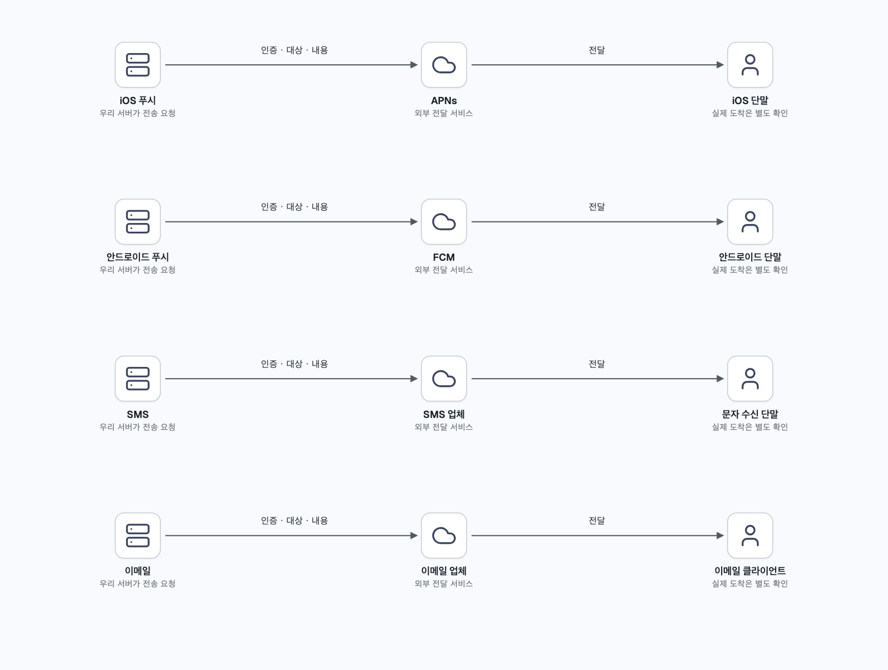
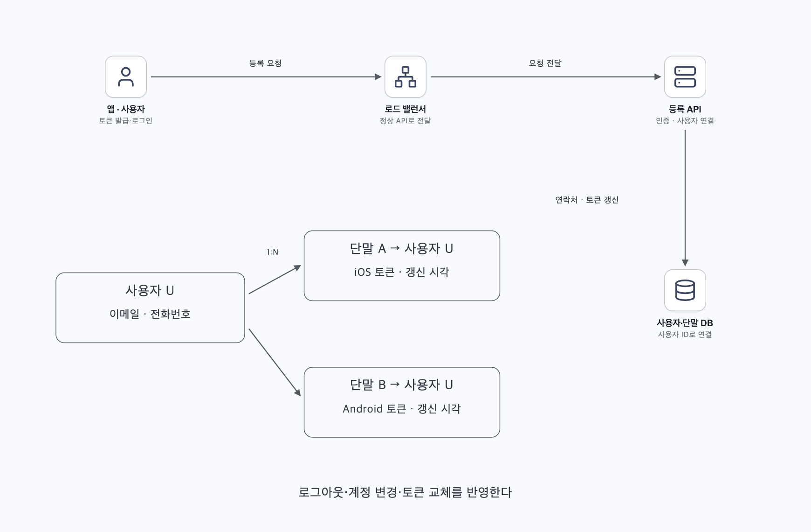
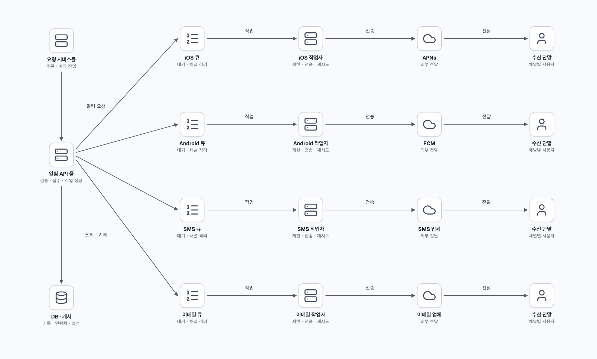
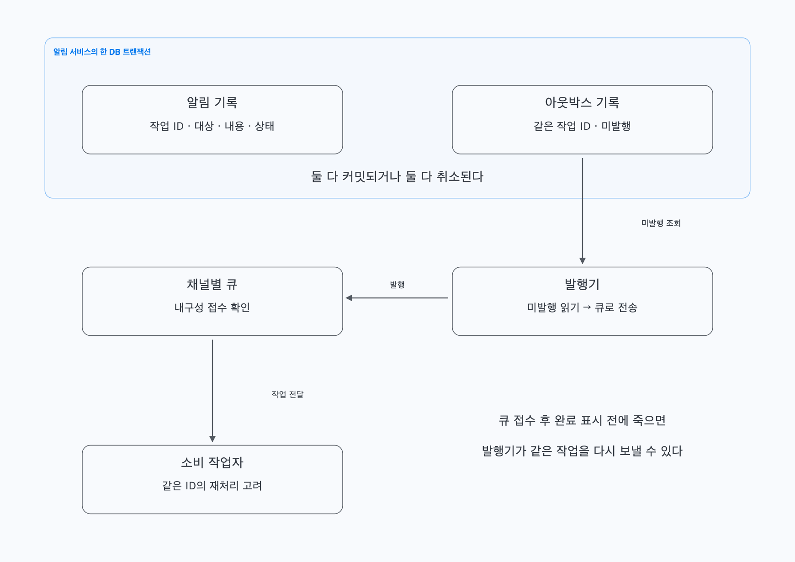
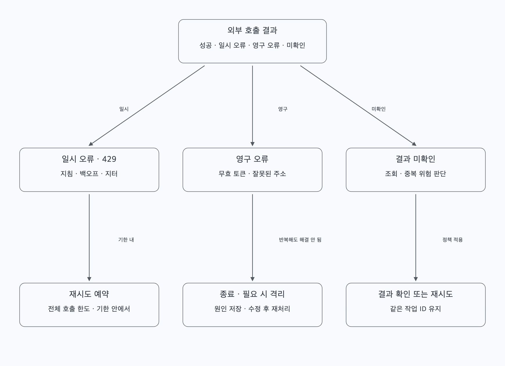

# 주문 알림이 사용자에게 도착하기까지

## 1. 무엇을 언제까지 전달해야 하는가

상품 주문이 완료되면 앱에는 푸시 알림을, 배송이 시작되면 문자와 이메일을 보낸다고 가정한다. 주문 서버가 알림을 요청한 순간부터 사용자가 확인할 때까지는 여러 시스템을 거친다. 이 장은 그 사이에서 요청을 잃지 않고, 부하와 실패를 다루는 구조를 설계한다.

지원 채널은 모바일 푸시·SMS·이메일이며 iOS·안드로이드·노트북·데스크톱 사용자를 고려한다. 앱이 알림 생성을 요청하거나 서버의 예약 작업이 요청할 수 있다. 사용자는 수신을 끌 수 있다. 단말 안에서 직접 예약하는 로컬 알림과 서버가 외부 업체를 통해 보내는 원격 알림은 다르며, 이후 설명은 서버 측 원격 알림을 중심으로 한다.

책은 하루 모바일 푸시 1,000만 건, SMS 100만 건, 이메일 500만 건을 가정한다. 하루 86,400초로 나누면 평균 약 116·12·58건/초다. 합계는 약 185건/초지만 행사 시작 시각의 집중 요청은 평균보다 훨씬 클 수 있다. 한 사용자에게 단말이 여러 개라면 전송 작업도 늘고, 재시도 역시 외부 호출량에 포함된다.

가능한 빨리 보내되 높은 부하에서 약간 늦어도 되는 **연성 실시간** 요구다. 그렇다고 지연이 무한정 허용되는 것은 아니다. 주문 알림과 마케팅 알림의 우선순위·허용 지연·만료 시각을 먼저 정해야 한다.

## 2. 채널마다 마지막 전달자가 다르다

iOS에서는 우리 서버인 알림 제공자가 단말 토큰과 메시지 내용을 담은 페이로드를 APNs에 보낸다. APNs는 Apple Push Notification service이며 해당 앱·단말로 알림을 전달한다. 안드로이드는 같은 역할에 FCM을 사용한다. SMS와 이메일은 각각 해당 전송 업체에 요청한다. 웹·데스크톱에서의 수신은 이메일이나 해당 플랫폼이 지원하는 푸시 경로를 선택한다. 모바일 푸시 경로를 모든 플랫폼에 그대로 적용하지 않는다.

여기서 외부 업체가 요청을 수락했다는 응답은 사용자가 읽었다는 뜻이 아니다. APNs는 최선형 전달 서비스이므로 단말 상태·만료 등에 따라 실제 도착하지 않을 수 있다. SMS도 접수·통신사 전달·배달 확인이 구분된다. 따라서 “알림 성공”이라는 상태 하나로 전체 과정을 표현하면 장애 지점을 찾기 어렵다. [APNs 전송 문서](https://developer.apple.com/documentation/usernotifications/sending-notification-requests-to-apns), [Twilio 메시지 상태](https://www.twilio.com/docs/messaging/api/message-resource#message-status-values)

## 3. 먼저 사용자와 연락할 경로를 알아야 한다

앱이 설치되고 사용자가 로그인하면 단말에서 받은 푸시 토큰을 API 서버에 등록한다. API 서버는 인증된 사용자와 토큰을 연결해 저장한다. 이메일 주소·전화번호·채널별 수신 설정도 필요한 범위에서 저장한다.

사용자 한 명은 여러 단말을 쓸 수 있으므로 사용자와 단말은 1:N 관계다. 예를 들어 사용자 테이블은 사용자 ID·이메일·전화번호를, 단말 테이블은 사용자 ID·플랫폼·앱 구분·단말 토큰·갱신 시각을 가진다. 알림 설정은 사용자·채널·알림 종류별로 분리할 수 있다.

푸시 토큰은 영구적인 사용자 ID가 아니다. 토큰 갱신 시 서버에도 새 값을 보내고, 로그아웃·계정 변경 시 연결을 정리한다. 외부 업체가 토큰 무효를 알려주면 다시 사용하지 않도록 처리한다. 오래된 연결을 방치하면 다른 계정의 단말에 알림이 갈 수 있다. [Apple의 앱 등록 절차](https://developer.apple.com/documentation/usernotifications/registering-your-app-with-apns)

## 4. 한 알림 서버가 전부 처리하면 어디서 막힐까

처음에는 주문 서버 → 알림 서버 → 외부 업체 → 사용자라는 구성이 가능하다. 알림 서버가 연락처를 읽고 문장을 만든 뒤 외부 API를 호출한다. 그러나 이메일 업체가 느려지는 동안 다른 알림 요청도 기다릴 수 있고, 한 서버가 죽으면 접수부터 전송까지 멈춘다. DB·캐시까지 같은 서버에 있다면 역할별 증설도 어렵다.

먼저 DB와 캐시를 분리하고 알림 API 서버를 여러 대 둔다. 사용자·단말·설정·알림 기록은 DB에 보관하고, 자주 읽는 정보와 템플릿은 캐시로 조회 비용을 줄인다. 그다음 외부 전송은 작업 서버로 넘긴다. API 서버와 작업 서버 사이에 큐를 두면 외부 업체가 잠시 느려져도 접수와 전송을 분리할 수 있다.

흐름은 다음과 같다.

1. 주문 서비스가 알림 API를 호출한다. API 서버는 호출 권한·수신자·메시지 종류를 검증한다.
2. 캐시와 DB에서 연락처·설정·템플릿 정보를 얻는다.
3. 전송 의무를 내구성 있게 기록하고 채널별 작업을 발행한다. 기록과 큐 발행 사이의 실패는 다음 절에서 다룬다.
4. 각 채널의 작업자가 큐에서 작업을 가져온다. iOS와 안드로이드 푸시·SMS·이메일은 독립적으로 처리량을 조절한다.
5. 작업자는 수신 설정·만료·전송 한도를 확인하고 외부 업체에 보낸다.
6. 외부 응답과 이후 확인 가능한 결과를 기록한다. 재시도할 작업은 다시 예약한다.

큐는 순간 부하를 흡수하고 장애 영향을 분리한다. 다만 처리 능력을 초과하는 유입이 계속되면 결국 가득 차므로 저장 한도·허용 지연·접수 제한도 필요하다. 큐 자체와 DB도 복제·복구 가능한 구성이 필요하며 API 서버만 여러 대 둔다고 전체 단일 장애 지점이 없어지지는 않는다.

## 5. 접수했다고 답했는데 큐에는 없다면

알림 기록을 DB에 넣고 큐에 보내는 두 작업을 따로 하면 틈이 생긴다. DB 저장 직후 서버가 죽으면 기록만 있고 전송 작업은 없다. 반대로 먼저 큐에 넣으면 DB 저장 실패 후에도 전송될 수 있다.

한 가지 해결은 **트랜잭션 아웃박스 패턴**이다. 알림 기록과 “나중에 큐로 보낼 작업”을 같은 DB 트랜잭션으로 저장한다. 둘 다 커밋된 다음 접수 성공을 응답한다. 별도 발행기가 미발행 작업을 읽어 큐에 보내고, 큐의 접수 확인 뒤 발행 완료를 기록한다.

발행기가 큐 접수 후 완료 표시 전에 죽으면 같은 작업을 다시 발행할 수 있다. 아웃박스는 DB와 큐 사이의 누락을 막기 위한 장치이며 중복 제거까지 자동으로 해결하지 않는다. 작업 ID를 유지하고 소비자가 같은 작업의 재처리를 알아볼 수 있어야 한다. [AWS의 아웃박스 설명](https://docs.aws.amazon.com/prescriptive-guidance/latest/cloud-design-patterns/transactional-outbox.html)

주문 DB에 주문을 저장하는 일과 알림 API 호출 사이에도 같은 문제가 생긴다. 주문 완료 알림이 반드시 필요하다면 주문 서비스 역시 자신의 DB에서 주문과 알림 요청 의무를 함께 남기는 방식 등을 고려한다. 서로 다른 서비스의 DB를 하나의 로컬 트랜잭션처럼 취급해서는 안 된다.

큐의 발행 확인은 브로커가 요청을 받았다는 뜻이고, 소비자의 처리가 끝났다는 확인은 별개다. 작업자는 결과나 다음 재시도 의무를 안전하게 남긴 뒤 원래 작업을 완료 처리해야 한다. 큐의 내구성·복제 설정도 확인한다. [RabbitMQ의 두 확인 방식](https://www.rabbitmq.com/docs/confirms)

## 6. 같은 주문 알림도 종류와 수신자에 맞게 만든다

“주문 {주문번호}의 배송이 시작되었다”처럼 공통 문장과 변수를 분리한 것이 알림 템플릿이다. 채널별 글자 길이·스타일·링크를 따로 정한다. 재시도할 때 주문 상태나 템플릿이 바뀌어 내용까지 달라지지 않도록 사용할 변수와 템플릿 버전 또는 완성된 내용을 기록하는 정책을 정한다.

알림 설정은 채널뿐 아니라 주문 안내·마케팅 같은 종류별로 관리한다. 접수 때 거르더라도 큐에서 기다리는 동안 사용자가 수신을 끌 수 있으므로 전송 직전에도 최신 설정을 확인한다. 이미 외부 업체에 넘긴 알림까지 취소된다고 보장할 수는 없다. 캐시 갱신 지연과 설정 변경이 적용되는 경계를 함께 정의한다.

또한 한 사용자가 받는 알림 빈도를 제한한다. 이것은 외부 업체의 API 호출량 제한과 목적이 다르다. 전자는 사용자 피로를 줄이고, 후자는 전송 업체와 우리 시스템을 보호한다. 재시도가 새로운 알림으로 세어지지 않도록 논리적 알림과 전송 시도를 구분한다.

## 7. 실패했다고 모두 같은 방식으로 다시 보내지는 않는다

배송 안내 전송이 실패했다면 먼저 원인을 나눈다. 일시적 과부하·네트워크 장애는 기다린 뒤 다시 시도할 수 있다. 잘못된 주소나 무효 토큰은 같은 값으로 반복해도 해결되지 않는다. 타임아웃은 특히 주의해야 한다. 업체가 처리하지 못했는지, 처리했지만 응답만 잃었는지 구분되지 않을 수 있다.

일시적 오류에는 재시도 간격을 점점 늘리고 무작위 지연을 더한다. 이를 백오프와 지터라 한다. 업체가 재시도 시점을 알려주면 그 지침을 따른다. 재시도 요청도 전체 전송 한도에 포함해야 한다. 즉시 반복하면 장애 중인 업체에 부하가 더 몰린다. [FCM 대규모 전송 지침](https://firebase.google.com/docs/cloud-messaging/scale-fcm)

시도 횟수·전체 기한·알림 만료를 넘으면 자동 반복을 멈추고 실패 원인을 보관한다. 처리하지 못한 메시지를 격리하는 DLQ는 조사와 재처리를 위한 대기 장소다. 개발자 통지도 건별 폭주를 피하도록 집계한다. 주소를 고치거나 장애가 해소된 뒤 재처리할 때도 원래 작업 ID와 만료·수신 설정을 확인한다. 만료된 인증번호를 뒤늦게 보내는 것은 복구가 아니다.

## 8. 기록을 나눠야 어디까지 갔는지 알 수 있다

한 주문 이벤트로 여러 채널과 여러 단말에 보낼 수 있다. 원래 알림 ID, 채널·대상별 전송 작업 ID, 매번 호출할 때의 시도 ID를 구분한다. 같은 사용자에게 휴대전화와 태블릿으로 한 번씩 보낸 것은 정책상 두 대상에 보낸 것이며, 한 단말에 같은 작업을 재전송한 것과 다르다.

| 기록할 단계 | 알 수 있는 사실 | 아직 보장하지 못하는 사실 |
| --- | --- | --- |
| 접수·내구성 기록 | 시스템이 처리할 의무를 받음 | 큐 발행·외부 전송 완료 |
| 큐 대기·작업 중 | 전송 대기 또는 시도 중 | 외부 업체 접수 |
| 외부 업체 접수 | 업체가 해당 요청을 수락함 | 단말 도착·표시·읽음 |
| 배달 결과 | 채널이 제공하는 범위의 배달 확인 | 사용자가 내용을 읽음 |
| 열람·클릭 이벤트 | 계측 가능한 사용자 행동 | 모든 사용자의 실제 인지 |

응답을 잃으면 결과 미확인 상태도 필요하다. 업체의 결과 콜백은 늦게 오거나 중복·역순으로 올 수 있으므로 이벤트 식별자와 상태 변경 규칙을 둔다. 늦게 온 “접수됨” 이벤트로 이미 기록한 배달 결과를 덮어쓰지 않는다. 업체마다 제공하는 배달·열람 정보가 다르므로 없는 정보를 성공으로 추정하지 않는다.

클릭률·열람률·앱 사용 전환율은 사용자 반응을 이해하는 지표다. 이벤트 수집 자체의 누락·중복도 고려하며, 큐 처리 성공률과 사용자 반응률을 서로 다른 지표로 본다.

## 9. 외부 전송 권한은 신뢰할 수 있는 서버가 가진다

앱에 들어 있는 비밀값은 추출될 수 있다. APNs·FCM 등의 전송 자격 증명을 앱에 넣고 그 값만으로 임의 수신자에게 보낼 수 있게 해서는 안 된다. 클라이언트 요청은 우리 API에서 인증·권한 검사를 하고, 외부 전송 자격 증명은 신뢰할 수 있는 서버에서 관리한다. 단말 토큰은 전달 경로를 가리키며 발신 권한을 대신하지 않는다. [FCM 서버 환경](https://firebase.google.com/docs/cloud-messaging/server-environment)

채널별 외부 업체 호출부를 분리하면 업체 교체나 국가별 경로 선택도 쉬워진다. 다만 오류 코드·전송 한도·결과 확인 방식은 업체마다 다르다. 타임아웃 직후 다른 업체로 바꾸어 보내면 첫 업체도 이미 처리했을 수 있으므로 중복 위험을 평가해야 한다.

## 10. 운영할 때는 큐 길이 다음을 본다

큐가 쌓이면 먼저 가장 오래 기다린 작업의 나이와 유입률·처리율을 본다. 작업자 CPU·동시 실행 수, DB 지연, 외부 API 지연·429·오류율, 재시도 비중을 함께 관찰한다. 작업자가 부족한지 외부 업체가 받아주지 못하는지에 따라 대응이 달라진다.

채널과 중요도별로 처리 예산을 분리하면 마케팅 이메일 적체가 주문 푸시를 막는 일을 줄일 수 있다. 외부 장애 때는 호출 속도를 낮추고, 필요하면 일정 시간 새 호출을 쉬면서 회복을 확인한다. 접수 제한이 필요해지면 호출자에게 명확하게 알려야 한다. 작업자 증설의 판단은 뒤의 두 번째 질문에서 수치로 확인한다.
