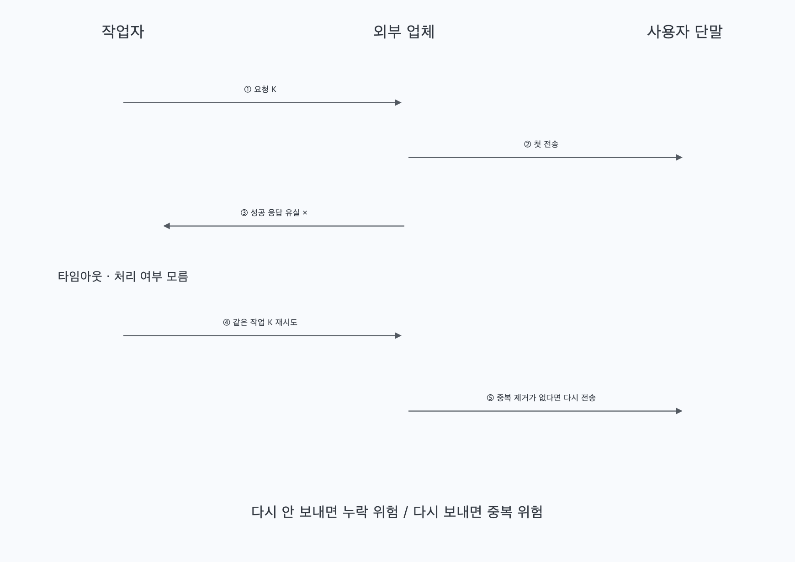

# 질문 01. 왜 같은 알림의 중복을 완전히 막기 어려울까?

## 1. 보냈지만 응답을 받지 못한 순간

작업자가 배송 안내를 업체에 보냈다. 업체는 정상 접수해 사용자에게 보냈지만, 성공 응답이 네트워크에서 사라졌다. 작업자는 타임아웃만 본다. 이때 다시 보내면 두 번 갈 수 있고, 다시 보내지 않으면 실제로 업체가 못 받았던 경우 알림이 빠진다.

작업자의 DB에 보냈다고 먼저 기록하면 기록 직후 죽었을 때 실제 전송이 누락된다. 실제 전송 뒤에 기록하면 전송 후 기록 전에 죽었을 때 재전송될 수 있다. DB의 상태 변경과 외부 업체의 전송 효과가 한 원자적 작업이 아니기 때문이다.

[You Cannot Have Exactly-Once Delivery](https://bravenewgeek.com/you-cannot-have-exactly-once-delivery/)는 이런 확인과 재전송 문제를 설명한다. 다만 “어떤 범위에서도 정확히 한 번 처리가 불가능하다”로 확대해서 읽으면 안 된다. 저자의 [후속 글](https://bravenewgeek.com/you-cannot-have-exactly-once-delivery-redux/)도 전달과 처리 효과의 범위를 구분한다.

## 2. 우리 DB 안에서 막을 수 있는 중복

같은 전송 작업에 안정적인 ID를 붙이고, 중복 기록과 비즈니스 변경을 같은 DB 트랜잭션으로 처리하면 그 DB 안의 효과를 한 번으로 제한할 수 있다. 예를 들어 동일 알림의 접수 기록을 유일 제약으로 한 번만 만든다. “이미 있는지 조회한 뒤 저장”을 별도 연산으로 하면 여러 서버가 동시에 통과할 수 있으므로 원자적 조건부 변경이 필요하다.

작업 실행권을 한 작업자가 원자적으로 확보하면 동시 중복 호출도 줄일 수 있다. 그러나 임대가 만료되어 다른 작업자가 가져간 시점에 이전 외부 요청이 아직 진행 중일 수도 있다. 로컬 잠금이나 실행권만으로 외부 전송까지 정확히 한 번이 되지는 않는다.

## 3. 외부 업체와 협력할 수 있는 범위

업체가 멱등성 키를 지원한다면 같은 작업의 재시도에 같은 키와 같은 요청 내용을 사용한다. 업체가 보장하는 대상·보관 기간·동시 호출 처리 조건 안에서는 중복 효과를 줄이거나 막을 수 있다. 결과 조회 API가 있으면 결과 미확인 작업을 조회한 뒤 재시도하는 방법도 있다.

단순 요청 추적 ID나 최신 알림으로 합치는 기능을 멱등성 보장과 혼동해서는 안 된다. 업체가 중복 제거를 지원하지 않으면 우리 DB의 중복 제거만으로 업체의 두 번째 전송을 취소할 수 없다. APNs 접수부터 단말 표시·사용자 확인까지도 별도 경계다.

정리하면 내구성 기록·아웃박스·재시도로 누락 위험을 줄이고, 작업 ID·원자적 중복 제거·업체의 멱등성 지원으로 중복 위험을 줄인다. 이때 “어느 저장소의 어떤 효과를 한 번으로 보장하는가”를 명시한다. 사용자 단말의 최종 표시까지 무조건 한 번이라고 약속하지 않는다.
