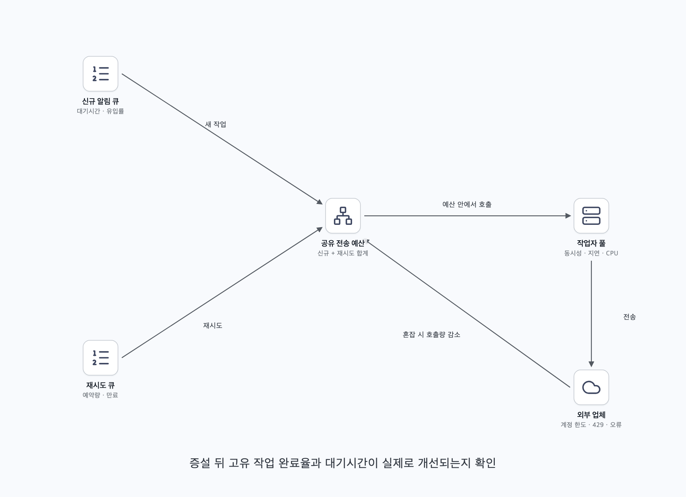

# 질문 02. 큐가 쌓이면 작업 서버부터 늘려도 될까?

## 1. 늘리면 좋아지는 병목과 그대로인 병목

사용자의 지적처럼 외부 업체에서 막혔다면 작업자를 늘리는 것이 오히려 재시도 폭증으로 이어질 수 있다. 큐 길이는 밀렸다는 증거이며 원인을 알려주는 지표는 아니다.

| 관찰한 상황 | 가능한 원인 | 먼저 할 대응 |
| --- | --- | --- |
| 작업자 CPU·동시성 한계, 업체 응답 정상, 한도 여유 | 우리 쪽 처리 능력 부족 | 병렬성·작업자 증설과 DB 여유 확인 |
| 업체 429·Retry-After 증가 | 업체 한도 초과 | 전체 호출 속도 감소·재시도 분산 |
| 업체 지연·5xx 증가 | 업체 장애·과부하 | 동시 호출 제한·백오프·회복 관찰 |
| DB 조회 지연, 작업자 대기 증가 | 공통 저장소 병목 | 조회·연결·캐시 개선, DB 보호 |
| 재시도 비중과 오래된 작업 증가 | 실패의 반복·처리 기한 초과 | 원인 분류·만료·격리·접수량 조절 |

여러 작업자가 각자 “초당 100건”을 허용하면 작업자 10대는 1,000건을 보낼 수 있다. 업체 계약 한도가 계정 전체 기준이라면 공유 제한기나 작업자별 예산 분배로 합계를 맞춘다. 신규 작업과 재시도도 같은 예산을 사용한다. 이때 제한기의 동시성 문제는 4장의 원자적 판정과 연결된다.

## 2. 간단한 숫자로 확인하기

새 알림이 초당 100건 들어오고 작업자들이 초당 50건밖에 처리하지 못한다고 하자. 업체는 초당 500건을 받을 수 있다. 작업자를 늘려 실제 완료 처리율을 초당 150건으로 만들면 초당 50건씩 적체가 줄어든다. 대기 6,000건은 일정한 조건에서 약 120초에 해소된다.

이번에는 업체가 초당 80건만 받아준다고 하자. 작업자를 아무리 늘려도 새 알림 100건을 계속 소화하지 못한다. 초당 최소 20건씩 쌓인다. 호출 수만 늘리면 429와 재시도가 증가해 회복이 더 늦어질 수 있다.

일정한 유입과 처리율을 가정할 때 적체 해소 시간은 `대기 건수 ÷ (완료 처리율 − 새 유입률)`로 근사한다. 완료 처리율이 새 유입률보다 클 때만 쓸 수 있다. 여기서 완료는 같은 작업의 여러 시도를 중복 계산한 호출 횟수가 아니라 처리 의무를 마친 작업 수다. 영구 실패·만료로 종료한 작업은 성공 전달과 따로 집계해야 한다.

실제 처리 능력은 작업자 수 외에도 외부 한도·호출 지연·DB·네트워크에 제한된다. 장애 후 재시도가 몰리는 구간에는 단순 평균보다 실패율과 재시도 예약량이 중요하다. 위 숫자는 용량 판단을 위한 가정이며 실제 서비스 벤치마크가 아니다.

## 3. 어떤 지표로 증설 결과를 판단할까

큐 길이와 가장 오래된 작업의 대기시간이 줄어드는지, 고유 작업의 완료율이 오르는지 확인한다. 동시에 업체의 429·타임아웃·오류율, 재시도 비중, 비용, DB 지연이 악화되지 않아야 한다. 업체 접수율과 실제 제공되는 배달 결과도 구분해 본다.

즉 작업자가 병목이고 나머지 경로에 여유가 있을 때 증설한다. 업체가 병목이면 한도 협의·전송 속도 조절·우선순위·만료·허용 가능한 지연·새 접수 제한을 검토한다. 단순히 작업자 수에 비례해 전송량이 늘어난다고 가정하지 않는다.
