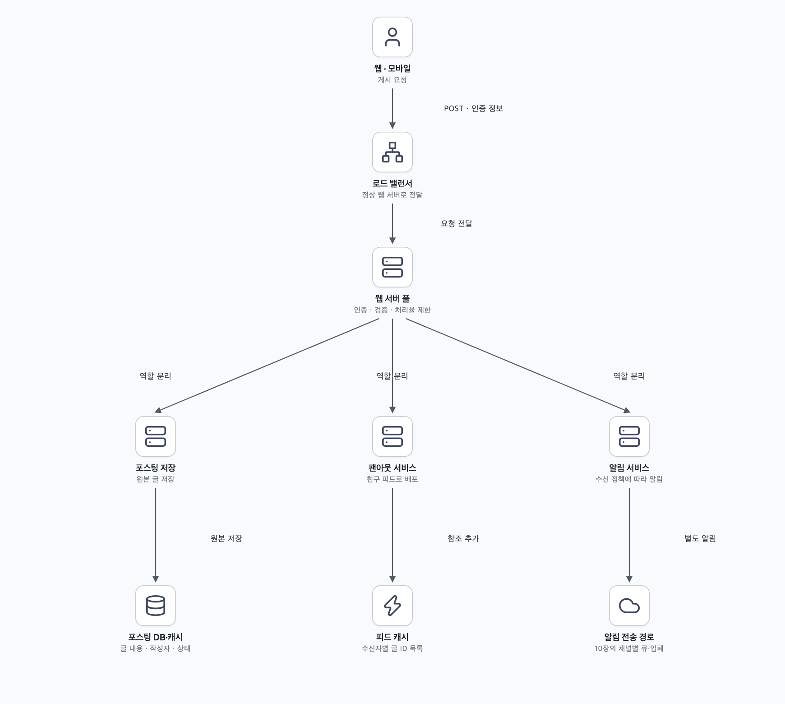
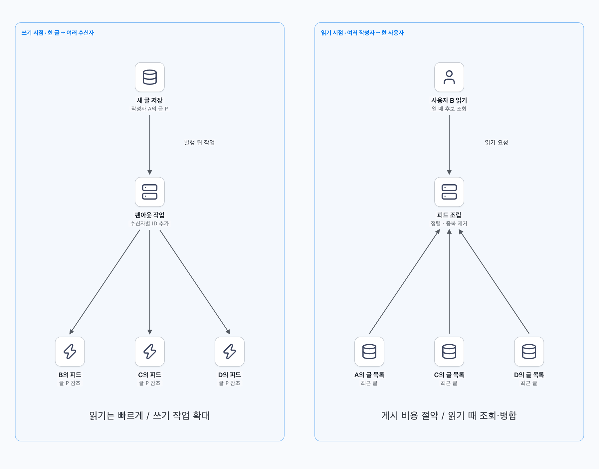
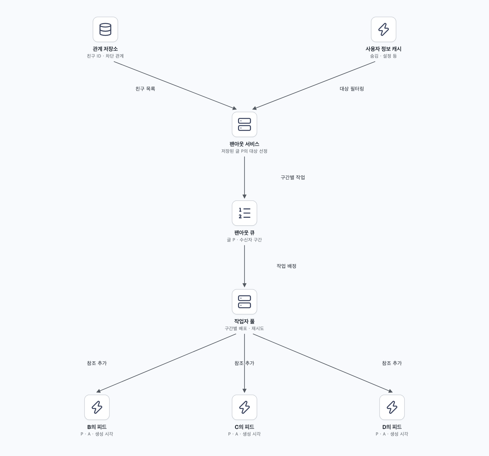
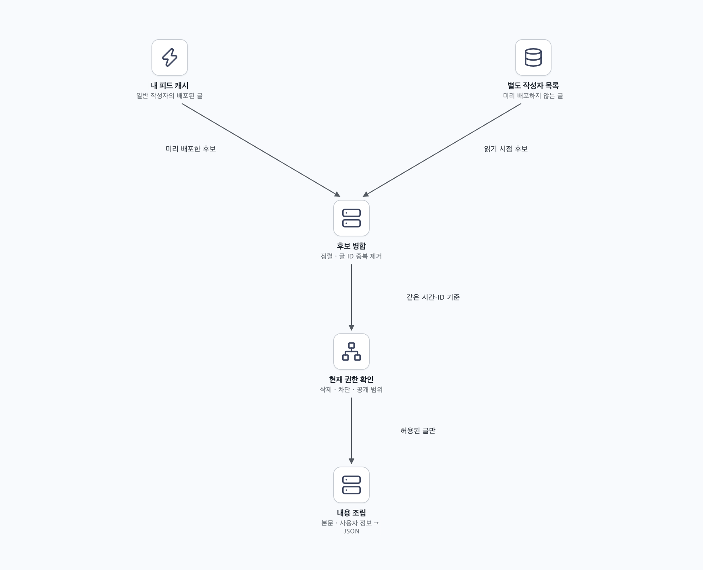
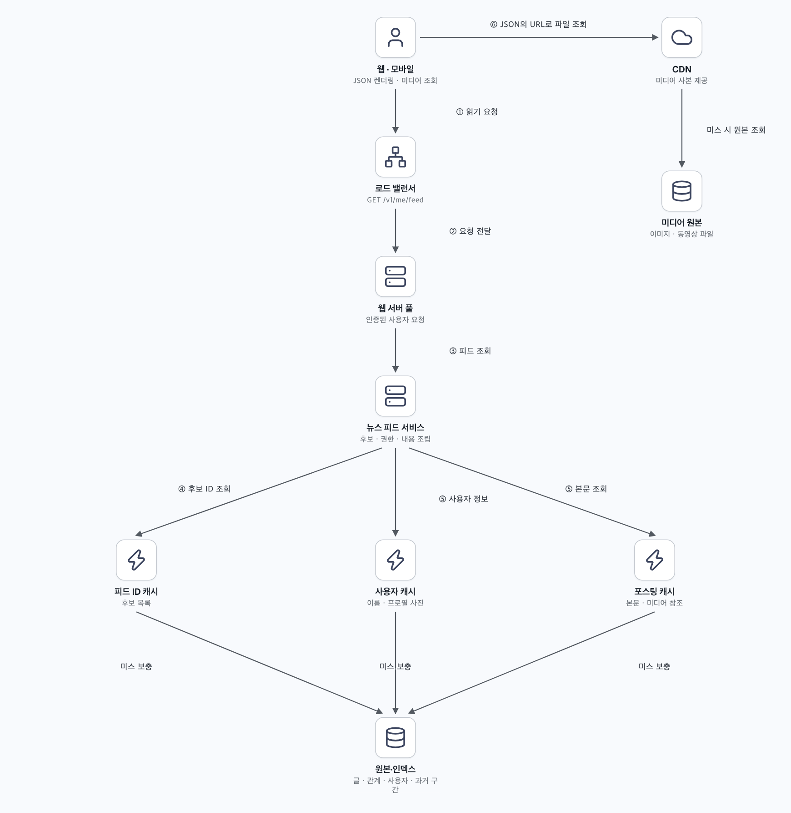
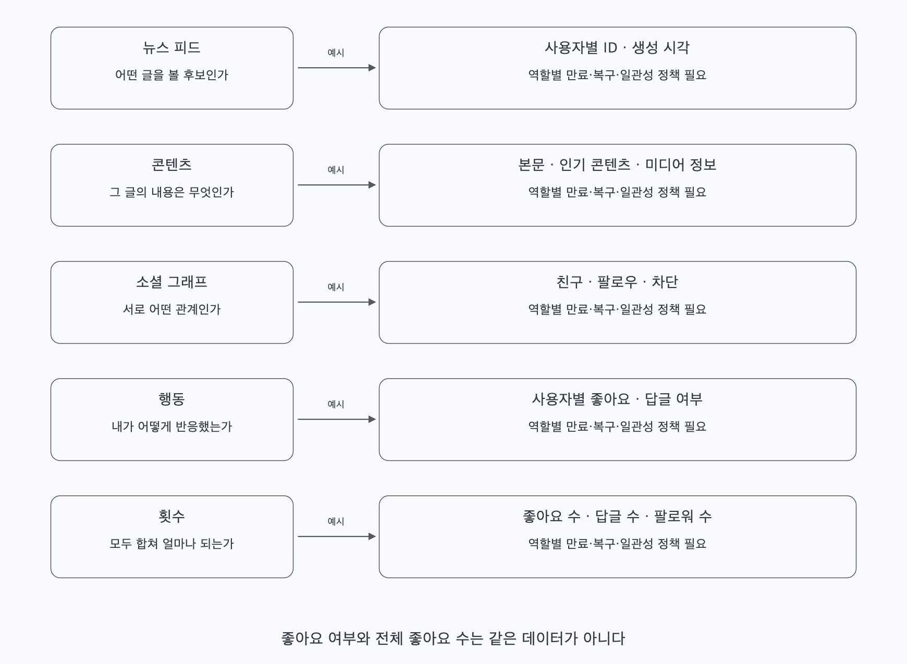

# 글을 올린 뒤 친구의 화면에 보이기까지

## 1. 피드를 만든다는 것은 무엇인가

상품을 구매한 사용자가 사진과 함께 후기를 올리고, 친구들이 자신의 홈 화면에서 그 글을 본다고 가정한다. 작성자 한 명의 글 목록을 보여주는 일과 친구 여러 명의 글을 모아 보여주는 일은 다르다. 이 장에서 설계하는 것은 두 번째인 개인별 뉴스 피드다.

모바일과 웹을 지원하며 텍스트·이미지·동영상이 포함된 글을 게시할 수 있다. 사용자는 최대 5,000명의 친구를 가지며, 하루 방문자는 1,000만 명이다. 피드는 관련성 점수가 아닌 생성 시각의 역순으로 표시한다. 좋아요·댓글·추천 순위·실시간 화면 갱신을 모두 처음부터 설계 범위에 넣지는 않는다.

방문자 수가 곧 API 호출 수는 아니다. 읽기 QPS는 대략 `일일 방문자 × 1인당 읽기 횟수 ÷ 86,400`으로 추정하고 피크를 따로 잡는다. 예를 들어 한 사람이 하루 10회 읽는다고 추가 가정하면 평균 약 1,157회/초다. 게시 횟수·평균 친구 수·활성 사용자 비율·미디어 크기는 주어지지 않았으므로 저장 용량과 팬아웃 작업량을 확정할 수 없다.

이제 문제를 둘로 나눈다. **발행**은 글의 원본을 저장하고 친구가 그 글을 발견할 수 있게 하는 일이다. **읽기**는 현재 사용자에게 보여줄 글을 고르고 내용을 채워 반환하는 일이다. 발행 때 어디까지 미리 해 두느냐가 읽기 비용을 결정한다.

## 2. 게시 API와 읽기 API를 나눈다

책의 예시는 `POST /v1/me/feed`로 글을 올리고 `GET /v1/me/feed`로 자신의 뉴스 피드를 읽는다. 게시 요청에는 본문과 미디어 참조를, 읽기 요청에는 페이지 크기와 다음 페이지 위치를 나타내는 커서를 둘 수 있다. 인증 정보는 Authorization 헤더로 전달한다. `/me`가 가리키는 사용자는 서버가 인증 결과로 결정한다.

글을 올리는 웹 서버는 인증·게시 권한·입력 검증·처리율 제한을 수행한다. 클라이언트가 보낸 작성자 ID를 그대로 믿으면 다른 사용자 이름으로 글을 올릴 수 있다. 사용자별 게시 빈도 제한은 스팸과 자원 고갈을 줄이는 데 필요하며, 유해 콘텐츠 판단 자체를 대신하지는 않는다.

같은 게시 요청이 네트워크 오류로 반복될 수 있으므로 재요청을 같은 글로 식별하는 요청 ID 등을 고려한다. “글 저장 성공”과 “친구 전체 피드에 배포 완료”도 응답 의미를 구분해야 한다.

## 3. 발행 경로에서 세 가지 일을 분리한다

글이 저장되면 포스팅 저장 서비스는 원본 DB에 글을 남기고 포스팅 캐시를 갱신하거나 무효화한다. 포스팅 전송 서비스는 친구들의 피드에 글의 참조를 넣는다. 알림 서비스는 정책에 따라 푸시·이메일 등의 알림을 보낸다. 피드에 넣는 일과 단말에 푸시 알림을 보내는 일은 서로 다른 작업이다.

그림은 역할을 나눈 논리 구조다. 웹 서버가 세 서비스를 독립적으로 호출하고 모두 성공하기를 기대하면 일부만 완료될 수 있다. 먼저 글을 내구성 있게 저장하고, 저장된 글에 대한 이벤트로 팬아웃과 알림을 시작하는 방식이 가능하다. DB 저장과 이벤트 발행 사이의 누락은 10장에서 설명한 아웃박스 등으로 연결한다. 캐시 갱신도 DB와 저절로 하나의 트랜잭션이 되지는 않는다.

포스팅 원본에는 글 ID·작성자 ID·생성 시각·본문·미디어 참조·공개 범위·수정 버전·삭제 상태 등을 둔다. 미디어 파일 자체는 별도 원본 저장소에 두고 글에는 위치를 가리키는 정보를 남긴다. 친구마다 본문 전체를 복사할 필요는 없다.

## 4. 읽을 때마다 친구 글을 모으면 어떤 비용이 생길까

가장 직접적인 방법은 사용자가 피드를 열 때 친구 목록을 얻고 각 친구의 최근 글을 가져와 합치는 것이다. 게시할 때에는 작성자의 글만 저장하면 된다. 이런 방식을 **읽기 시점 팬아웃** 또는 요청 기반 모델이라 한다.

게시 비용은 작고 방문하지 않는 친구의 피드를 미리 만들지 않아도 된다. 그러나 친구 5,000명의 글을 매번 따로 가져오면 조회·네트워크·병합 비용이 커진다. 캐시와 일괄 조회로 줄일 수 있어도 읽기 경로의 작업이 사라지는 것은 아니다.

반대로 글이 올라올 때 친구별 피드 목록에 글 ID를 넣어 두면 읽는 순간에는 이미 모인 목록을 가져오면 된다. 이것이 **쓰기 시점 팬아웃**이다. 여기서 팬아웃은 한 게시물을 여러 수신자의 피드로 퍼뜨리는 과정이다.

쓰기 시점 방식은 읽기를 빠르게 하지만 글 하나가 여러 번의 피드 쓰기로 확대된다. 친구가 많은 작성자일수록 배포 작업이 많고, 오랫동안 접속하지 않는 친구의 피드까지 갱신하면 낭비가 된다. 읽기 시점 방식은 그 쓰기 확대를 피하지만 인기 작성자의 글에 대한 조회 집중과 느린 읽기 문제가 남을 수 있다.

| 비교 기준 | 쓰기 시점 | 읽기 시점 |
| --- | --- | --- |
| 게시 직후 | 수신자별 목록 갱신 작업 생성 | 작성자 글 저장 중심 |
| 피드 읽기 | 미리 모은 후보 목록 조회 | 친구별 후보 조회·병합 |
| 비활성 수신자 | 사용하지 않을 목록도 갱신할 수 있음 | 읽지 않으면 조합 비용 없음 |
| 집중 부하 | 많은 수신자에게 배포하는 쓰기 | 다수 조회와 인기 글의 읽기 |

둘 중 하나가 모든 사용자에게 항상 유리하지는 않다. 대략적인 작업량을 비교하고 어떤 지연을 허용할지 정해야 한다.

## 5. 쓰기 시점 팬아웃을 큐와 작업자로 처리한다

일반 사용자의 글은 미리 배포해 읽기를 빠르게 한다고 정하자. 글 저장 뒤 팬아웃 서비스가 친구 ID 목록을 가져온다. 책은 이 관계 저장소를 그래프 데이터베이스로 표현한다. 친구·차단·업데이트 숨김 등의 관계를 확인해 대상자를 고른다. 사용자 정보와 설정은 사용자 캐시에서 조회할 수 있다.

친구 목록과 글 ID를 작업으로 만들어 큐에 넣고, 팬아웃 작업자들이 수신자별 피드 캐시에 참조를 추가한다. 친구가 많으면 한 메시지에 무제한으로 넣기보다 수신자 구간을 나누어 처리할 수 있다. 각 구간의 진행 상태를 남기면 중간 실패 후 전체를 처음부터 반복하는 비용을 줄일 수 있다.

사용자 B의 피드 항목은 예를 들어 글 ID P와 작성자 A, 정렬에 필요한 생성 시각을 가진다. 본문은 포스팅 캐시에서 한 번 관리한다. 여러 사용자의 피드에 같은 글이 있어도 내용 수정 시 본문을 수천 군데 복사 갱신할 필요가 줄어든다.

큐의 재전달로 같은 작업이 실행될 수 있으므로 수신자와 글 ID의 조합을 기준으로 중복 추가를 막는다. 작업이 도착한 순서가 글의 생성 순서와 같다고 가정하지 않고 생성 시각과 고유 ID 등으로 정렬한다. 큐에 늦게 도착한 옛 글이 새 글보다 위에 나타나서는 안 된다.

또한 이 구조는 비동기다. 작성자가 게시 성공을 받았어도 친구 전원에게 배포가 끝났다는 뜻은 아니다. 반영 지연을 관찰하고 허용 범위를 정한다. 작성자가 자기 글을 바로 확인해야 한다면 자기 글 목록을 함께 읽는 등 별도 경로를 둘 수 있다.

## 6. 친구 관계는 어떤 DB로 저장해야 할까

그래프라는 말은 사용자와 관계를 정점·간선으로 표현한다는 뜻이다. 친구 목록, 특정 두 사람의 친구 여부, 차단 여부 등이 필요한 조회다. 관계형 DB에서도 사용자 ID 두 개와 관계 종류를 저장하고 인덱스를 두어 처리할 수 있다. 그래프 데이터 모델을 쓴다는 이유만으로 특정 종류의 DB 제품이 필수인 것은 아니다.

책의 참고 자료인 TAO는 객체와 관계를 다루는 API, 캐시, 영속 저장소를 함께 설계한 사례다. 2013년 공개 설명에서는 MySQL을 영속 저장에 사용한다. 따라서 “소셜 그래프는 관계형 DB로 구현할 수 없다”는 결론을 내리면 안 된다. 이 사례는 현재 Facebook 전체 피드의 구현을 그대로 보여주는 설계도도 아니다. [Meta의 TAO 설명](https://engineering.fb.com/2013/06/25/core-infra/tao-the-power-of-the-graph/), [TAO 논문 발표 페이지](https://www.usenix.org/conference/atc13/technical-sessions/presentation/bronson)

## 7. 대상자가 특별히 많은 작성자는 읽을 때 합친다

책은 일반 사용자에게 쓰기 시점 방식을, 유명인처럼 팔로워가 많은 사용자에게 읽기 시점 방식을 적용하는 혼합 모델을 설명한다. 여기서 대규모 팔로워는 기본 요구인 친구 최대 5,000명에서 확장한 사례다. 친구만 있는 서비스라면 실제 분포와 비용을 확인한 뒤 혼합 방식이 필요한지 판단한다.

혼합 모델에서는 일반 친구의 글은 내 피드 캐시에서 읽는다. 미리 배포하지 않는 작성자의 글은 그 작성자의 최근 글 목록에서 읽는다. 둘을 생성 시각 역순으로 합치고 글 ID로 중복을 제거한다.

유명인 기준을 단순 팔로워 수 한 가지로 정할 필요는 없다. 글 작성 빈도·활성 수신자 수·읽기 빈도·배포 지연·캐시 비용도 영향을 준다. 비활성 사용자에게 배포를 줄였다면 복귀할 때 피드를 보충하는 경로가 필요하다. 팬아웃 전략을 바꾸는 동안에도 중복·누락이 생기지 않게 전환 구간을 다뤄야 한다.

혼합 모델이 단점을 모두 없애 주지는 않는다. 읽을 때 합칠 후보가 많아지면 조회 비용과 인기 작성자에 대한 읽기 부하가 커진다. 후보 수·조회 동시성·실패 시 응답 정책도 정해야 한다.

## 8. 읽기에서는 ID 목록에 내용을 채운다

사용자가 홈 화면을 열면 로드 밸런서가 무상태 웹 서버로 요청을 보낸다. 웹 서버는 인증된 사용자의 피드를 뉴스 피드 서비스에 요청한다. 서비스는 피드 캐시에서 최근 글 ID 목록을 얻고, 혼합 모델이라면 미리 배포하지 않은 작성자의 후보도 합친다.

이 목록만으로는 화면에 표시할 이름·프로필 사진·본문이 없다. 사용자 캐시와 포스팅 캐시에서 필요한 데이터를 가져와 채운다. 항목마다 별도로 원격 호출하기보다 대상 ID를 모아 일괄 조회하고, 캐시에 없는 항목(캐시 미스)만 원본 저장소에서 보충한다. 샤드가 여러 개면 대상 샤드별로 묶되 호출 동시성과 한도를 둔다.

삭제된 글이나 현재 권한으로 볼 수 없는 글은 응답에서 제외한다. 후보가 빠져 페이지가 덜 찼다면 정해진 비용 한도 안에서 다음 후보를 더 조회할 수 있다. 조립한 JSON에는 글·작성자 정보와 미디어 URL을 넣고, 클라이언트가 이를 렌더링한다.

이미지와 동영상 바이트는 보통 클라이언트가 CDN에서 별도로 받는다. CDN은 원본 미디어 저장소 앞에서 사본을 제공하는 계층이며 모든 원본을 영구 보관하는 저장소와 같지 않다. 피드 JSON 응답과 미디어 다운로드를 분리하면 웹 서버가 대용량 파일을 매번 중계하지 않아도 된다. 비공개 미디어는 CDN·원본 경로에도 접근 제어가 필요하다.

## 9. 캐시는 데이터의 역할에 따라 나눈다

피드 ID 목록과 본문은 쓰임새가 다르다. 전자는 “내가 볼 후보가 무엇인가”, 후자는 “이 글에 무엇이 들어 있는가”에 답한다. 이 구분을 따라 책은 캐시를 다섯 영역으로 나눈다.

| 영역 | 보관하는 예 | 쓰는 시점 |
| --- | --- | --- |
| 뉴스 피드 | 사용자별 최근 글 ID·정렬 정보 | 읽기 후보 선택·팬아웃 추가 |
| 콘텐츠 | 글 본문·미디어 메타데이터, 인기 콘텐츠 | 피드 본문 조립 |
| 소셜 그래프 | 친구·팔로우·차단 등의 관계 | 배포 대상 선정·권한 확인 |
| 행동 | 내가 특정 글에 좋아요를 눌렀는지, 답글 여부 | 사용자별 표시 상태 조립 |
| 횟수 | 좋아요·답글·팔로워 수 | 요약 숫자 표시 |

행동은 특정 사용자와 글 사이의 상태이고, 횟수는 여러 사용자의 행동을 합한 값이다. 내가 좋아요를 눌렀다는 상태와 전체 좋아요 수는 다른 데이터다. 재시도마다 무조건 횟수만 증가시키면 중복 집계되므로 원본 행동의 중복 처리도 고려한다.

이 다섯 가지는 논리적 구분이며 반드시 각각 독립된 물리 서버 한 대를 뜻하지 않는다. 접근 패턴·장애 영향·메모리 경쟁에 따라 분리한다. “가능한 많이 캐시”보다 무엇을 잃어도 재구성할 수 있는지, 허용되는 오래된 값이 무엇인지가 먼저다.

## 10. 최근 일부만 캐시한다면 나머지는 어디에 있을까

대부분의 사용자는 수천 개의 글을 끝까지 읽지 않는다. 사용자별 최근 K개 정도만 피드 캐시에 두면 메모리를 제한할 수 있다. 예를 들어 1,000만 명에게 800개씩 16바이트 참조만 보관해도 약 128GB다. 여기에 자료구조·키·복제·정렬 정보 등이 더해진다. 이 숫자는 설명용 가정이며 방문자 수가 전체 계정 수라는 뜻은 아니다.

캐시에서 사라진 글이 원본에서도 삭제되는 것은 아니다. 글과 관계 원본을 바탕으로 재구성하거나 별도의 내구성 피드 인덱스에서 오래된 구간을 조회할 수 있다. 어느 쪽을 택할지 정하지 않고 피드 캐시만 유일한 기록으로 쓰면 캐시 장애 때 복구할 근거가 없어진다.

재구성 시 한꺼번에 원본 DB를 두드리지 않도록 같은 사용자의 중복 재구성을 합치고 동시성을 제한한다. 최근 캐시와 과거 조회 경로를 이어 주는 페이지네이션도 필요하다. 피드 전체를 매 요청마다 다시 만드는 것과 캐시 미스 때 필요한 구간을 복구하는 것은 비용이 다르다.

## 11. 저장·수정·삭제의 반영 속도는 같지 않다

새 글의 친구 피드 반영, 본문 수정, 친구 해제, 차단, 삭제는 서로 다른 변경이다. 좋아요 숫자가 조금 늦게 바뀌는 것과 차단한 사람에게 비공개 글이 계속 보이는 것을 같은 수준의 지연으로 취급하면 안 된다.

배포 시점의 필터링은 불필요한 작업을 줄이지만 최종 읽기 권한을 영구 보장하지 않는다. 최신 관계·공개 범위·삭제 상태를 읽기 경로에서 확인하고, 권한 판단에 필요한 상태를 확인할 수 없을 때 오래된 허용 값으로 비공개 콘텐츠를 노출하지 않도록 정책을 정한다. 피드 캐시의 ID를 청소하는 일과 접근을 차단하는 일은 분리한다.

삭제·차단 반영, 캐시 재구성, 다음 페이지 중복은 뒤의 두 번째 질문에서 실제 흐름으로 살펴본다.

## 12. 규모를 늘릴 때 어디를 관찰할까

피크 읽기·게시 QPS, 새 글이 친구 피드에 보이기까지의 지연, 큐의 가장 오래된 작업, 수신자별 중복, 캐시 적중률·미스 복구량, 샤드별 부하를 함께 본다. 읽기 응답의 평균뿐 아니라 p95·p99 지연을 보면 일부 사용자가 겪는 느린 새로고침도 드러난다.

웹 계층은 로그인 세션과 진행 상태를 특정 서버 메모리에만 묶지 않아야 증설과 장애 전환이 쉽다. 글은 작성자별 조회, 피드는 수신자별 조회에 맞게 샤딩할 수 있고 두 경로의 분할 기준이 같을 필요는 없다. SQL·NoSQL 선택은 관계 조회·정렬·트랜잭션·운영 조건에 따라 결정한다. 읽기 복제본은 읽기를 분산하지만 복제 지연으로 자기 글이나 최근 권한 변경이 늦게 보일 수 있다.

여러 데이터 센터를 쓰면 가까운 곳에서 읽어 지연을 줄일 수 있지만 글·관계·삭제 상태·피드 인덱스의 복제와 장애 전환을 함께 다뤄야 한다. 큐가 서비스를 분리해도 공통 DB나 한 인기 키가 병목이면 작업자 증설만으로 해결되지 않는다. 샤딩과 단일 핫키의 차이는 다음 질문에서 구분한다.
