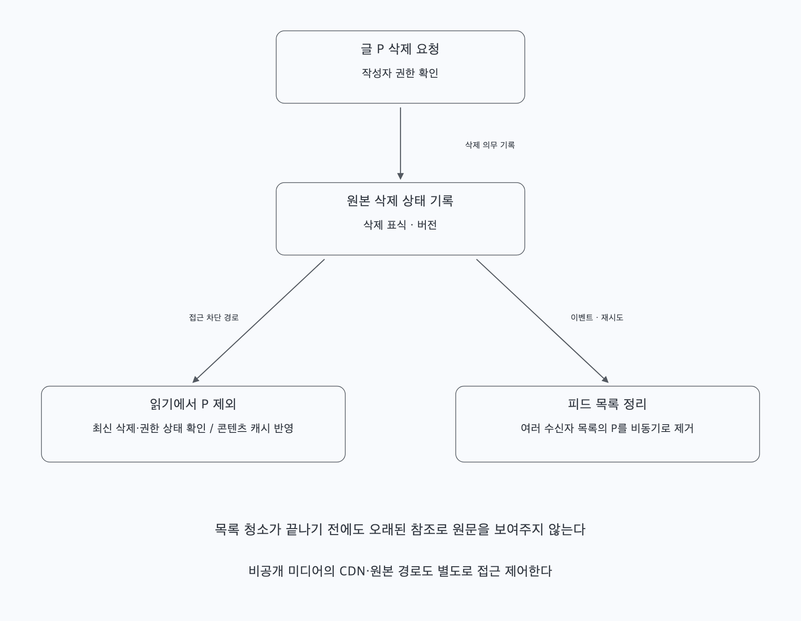
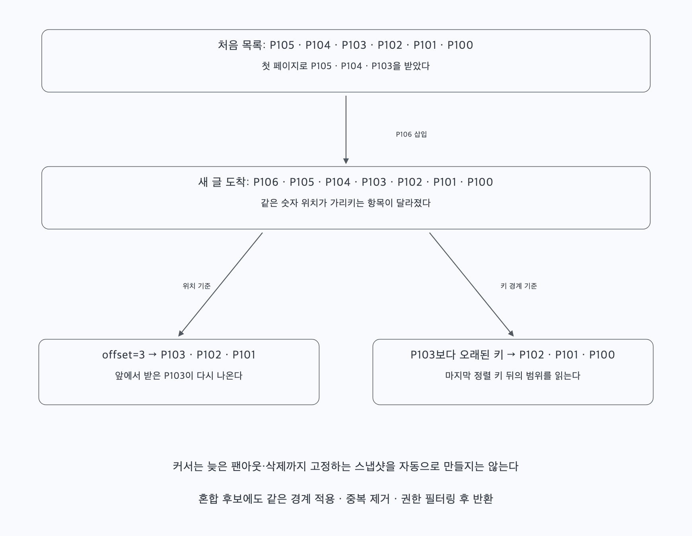

# 질문 02. 캐시된 피드에서 삭제·차단·다음 페이지를 어떻게 다룰까?

## 1. ID 목록을 지우는 동안에도 원문 접근은 막아야 한다

작성자가 글 P를 삭제했다고 하자. DB의 삭제 상태는 바뀌었지만 수천 명의 피드 캐시에는 P가 남아 있을 수 있다. 모든 목록의 청소가 끝날 때까지 P를 보여주어서는 안 된다. 원본 삭제 상태를 반영하고 콘텐츠 캐시를 무효화하며, 읽기에서 삭제·권한 상태를 확인해 P를 제외한다. 목록 정리는 비동기로 진행할 수 있다.

삭제 직전의 팬아웃 작업이 뒤늦게 도착하거나, 오래된 읽기 결과가 캐시에 다시 들어오는 경우도 있다. 삭제 표식과 버전, 캐시 갱신·무효화 순서를 설계해 늦은 작업이 삭제를 되돌리지 않게 한다. 단순히 캐시 한 번을 지우는 것만으로 모든 경쟁을 해결하지는 못한다.

친구 해제·차단·공개 범위 변경도 같다. 팬아웃 때 허용된 대상이 지금도 허용된다는 뜻은 아니다. 최신 권한 상태를 신뢰할 수 있게 확인하는 경로와 변경 전파 정책이 필요하다. 비공개 미디어가 있으면 글 JSON만 숨겨도 이미 발급한 URL로 계속 접근될 수 있으므로 CDN·원본 인증과 URL 만료·회수 정책까지 다룬다. 이미 단말에 받은 복사본을 서버가 거두어들일 수 있다고 보장하지 않는다.

## 2. 오래된 캐시를 원본이라고 생각하지 않는다

피드 목록이 유실되면 글·관계 원본이나 내구성 인덱스에서 복구한다. 그 사이 새 팬아웃이 들어오는데 과거 조회 결과로 목록을 통째로 덮어쓰면 새 글이 사라질 수 있다. 재구성 시작 기준과 버전, 진행 중 변경분의 병합 또는 다시 적용하는 절차가 필요하다.

본문 수정도 피드마다 내용을 복사해 두는 것보다 글 ID로 최신 본문을 조회하는 편이 갱신 범위를 줄인다. 그래도 포스팅 캐시의 오래된 값은 별도로 무효화해야 한다. 최근 수정 직후 읽기에 어떤 일관성을 제공할지 정한다.

## 3. 새 글이 들어오면 offset이 가리키는 위치가 바뀐다

첫 화면에서 P105·P104·P103을 받았다고 하자. 다음 요청 전에 P106이 맨 앞에 추가되면 `offset=3`은 P103부터 시작해 이전 글을 다시 보여준다. 앞부분 삭제가 발생하면 반대로 아직 못 본 글을 건너뛸 수도 있다.

마지막 항목의 정렬 키보다 오래된 글을 가져오는 커서를 사용할 수 있다. 생성 시각이 같을 수 있으므로 `(생성 시각, 글 ID)`처럼 동률을 가르는 기준을 정한다. 다음 페이지는 마지막 키보다 엄격히 작은 후보를 조회한다. 글 ID 숫자만으로 모든 서버의 정확한 실제 생성 순서가 보장된다고 가정하지 않는다.

혼합 피드도 배포 목록과 읽기 시점 목록에 같은 경계를 적용하고, 중복을 제거한 뒤 권한을 확인한다. 필터링 때문에 추가 후보를 읽었다면 다음 커서는 내부에서 어디까지 탐색했는지와 응답 정책이 일치해야 하며, 보이지 않는 후보를 반복해서 읽느라 진행이 멈추지 않게 한다.

커서가 자동으로 동일한 시점의 스냅샷을 만드는 것은 아니다. 늦게 도착한 글이 이미 지나간 구간에 삽입되거나 공개 범위가 바뀌면 여러 페이지에 걸친 완전한 고정 결과는 보장되지 않는다. 새로고침으로 최신 글을 다시 읽는 정책과, 필요하다면 별도의 스냅샷·버전 정책을 구분한다.
