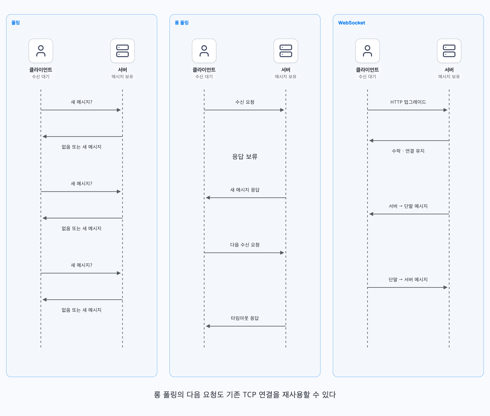
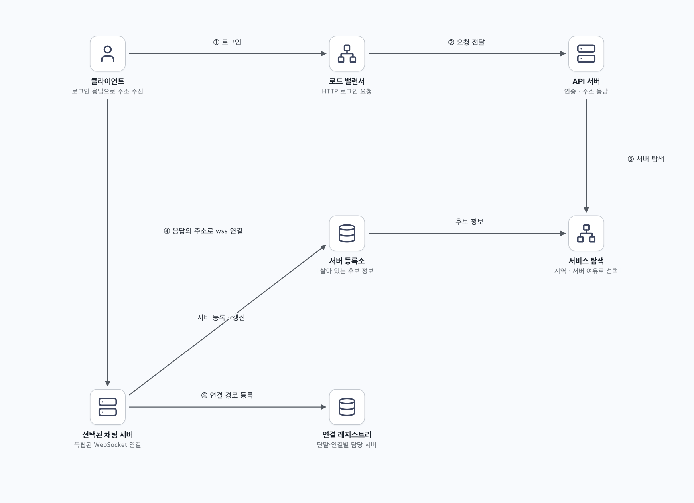
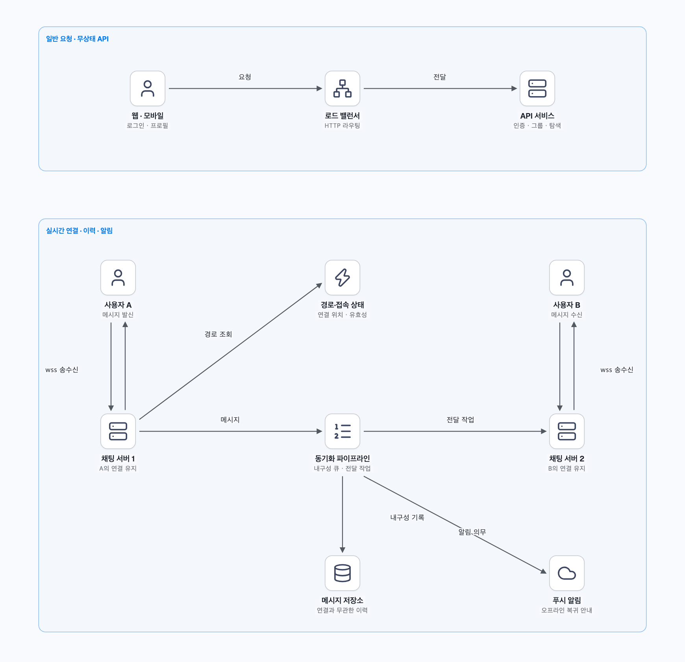
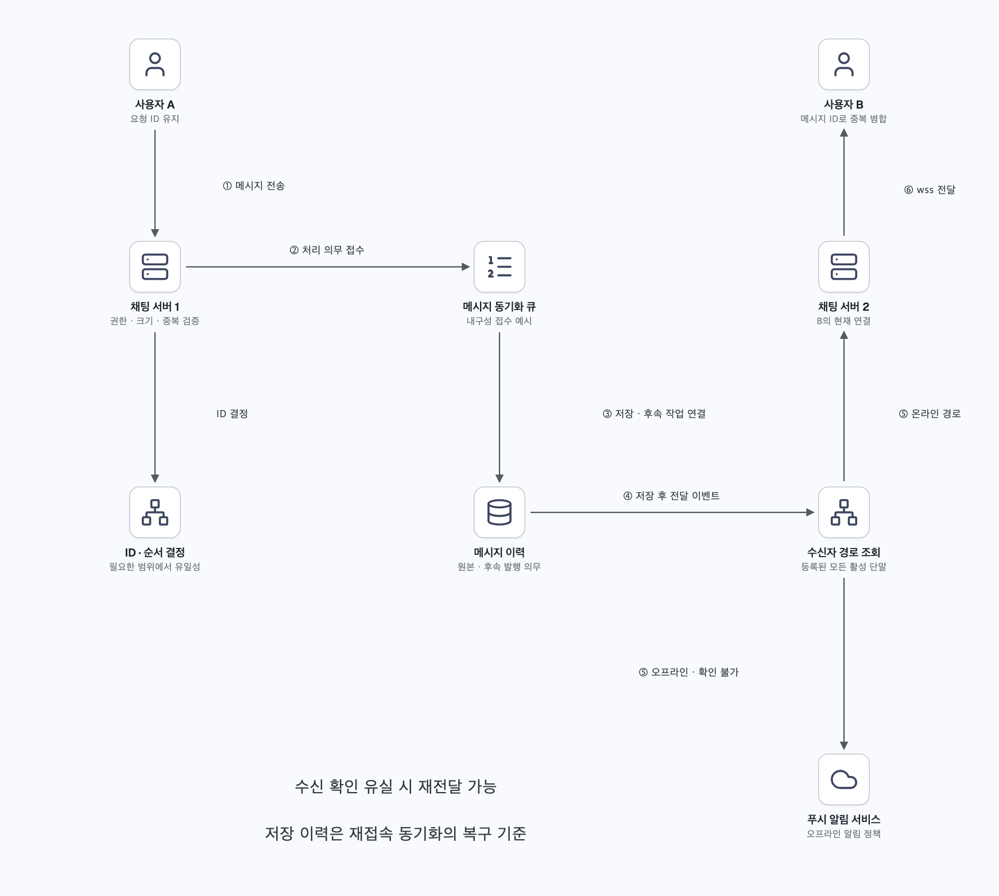
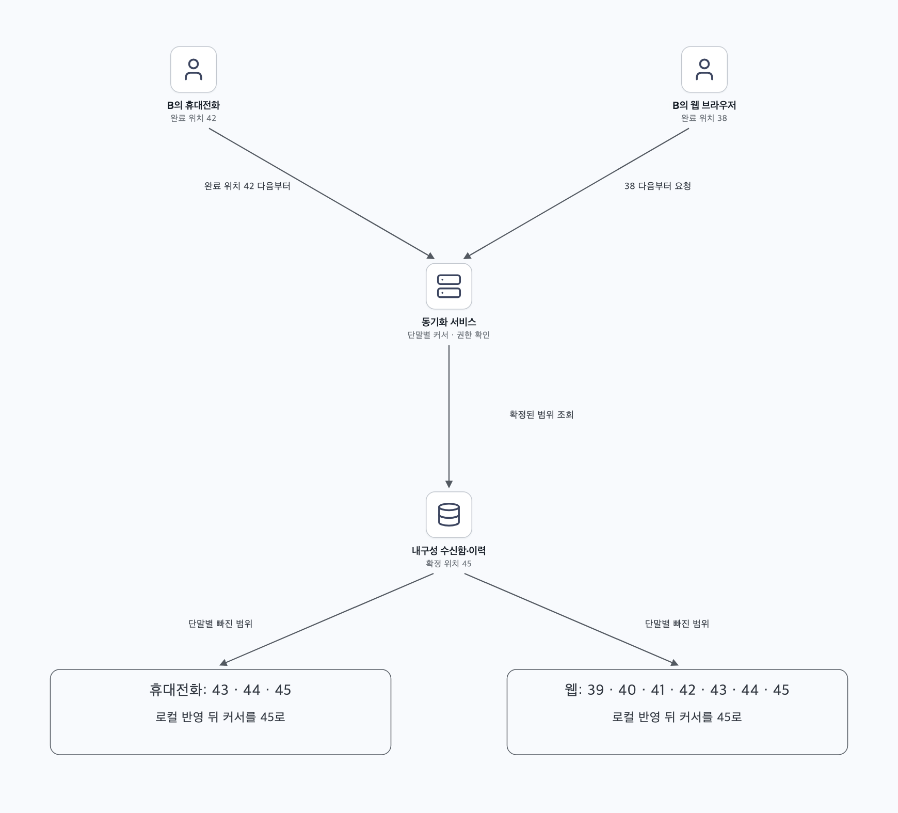
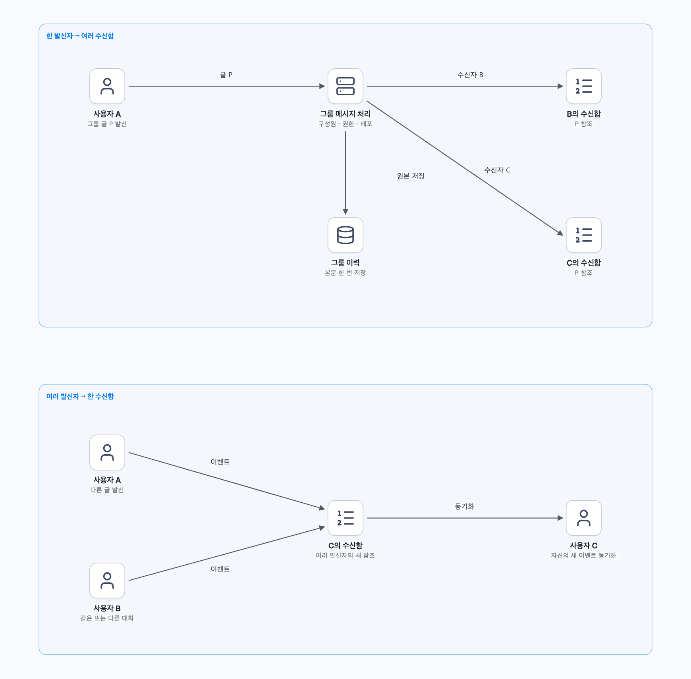
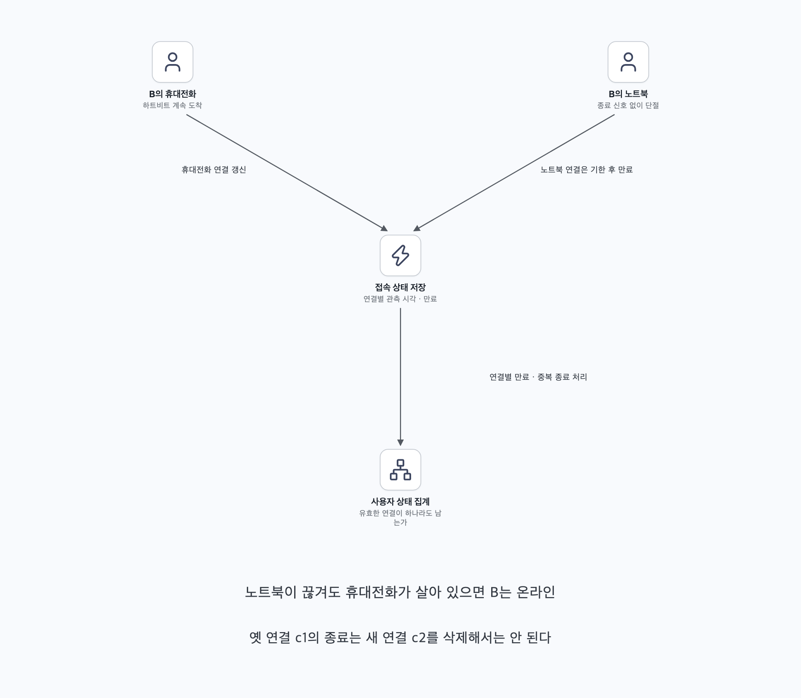
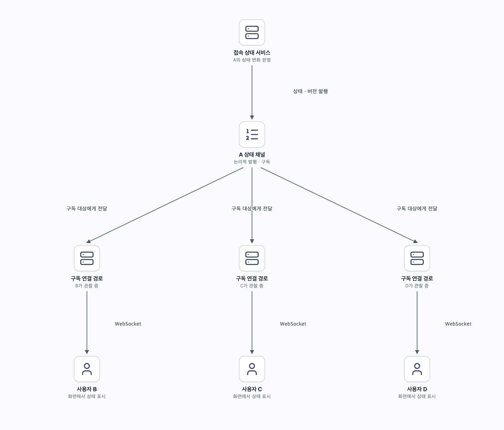

# 보낸 메시지를 저장하고 모든 단말에 전달하기

## 1. 연결되어 있을 때와 끊겼을 때를 함께 설계한다

상품 구매를 논의하는 사용자 A와 B가 채팅한다고 가정한다. A가 보낸 메시지는 B가 온라인이면 빠르게 도착해야 한다. B가 접속하지 않았다면 사라지는 대신 저장되어야 하며, B가 휴대전화와 웹을 함께 사용하면 두 단말 모두 같은 대화를 볼 수 있어야 한다.

책의 기본 범위는 모바일·웹, 1:1 채팅, 최대 100명의 그룹, 접속 상태 표시, 푸시 알림, 계정 하나의 여러 단말 동시 사용이다. 일일 활성 사용자는 5,000만 명이며 메시지는 100,000자 이하로 제한한다. 채팅 이력은 영구 보관하고, 종단 간 암호화는 이번 기본 설계 범위에서 제외한다.

일일 활성 사용자 수는 동시 연결 수가 아니다. 피크 접속 비율·사용자당 단말 수·메시지 발송 빈도를 추가로 알아야 한다. 100,000자도 100KB와 같은 뜻은 아니다. 문자 수의 기준과 인코딩에 따른 바이트 제한을 따로 정해 프레임·요청 크기와 메모리 사용을 통제한다.

필요한 동작은 메시지 수신, 수신자 결정, 내구성 저장, 온라인 전달, 오프라인 보관과 재접속 동기화다. 연결이 살아 있다는 사실만으로 메시지가 저장되거나 사용자에게 읽혔다고 판단해서는 안 된다.

## 2. HTTP 연결 재사용만으로 실시간 수신이 되지는 않는다

로그인·프로필 조회처럼 요청에 응답하는 기능에는 HTTP가 충분하다. HTTP/1.1의 지속 연결은 여러 요청에서 연결을 재사용하는 기능이다. 매번 `Keep-Alive` 헤더를 넣어야만 연결을 유지하는 것도 아니며, 이 기능만으로 서버가 임의의 채팅 메시지를 클라이언트로 보내는 통로가 생기지는 않는다. [HTTP/1.1 지속 연결 규정](https://www.rfc-editor.org/rfc/rfc9112.html#name-persistence)

가장 단순한 수신 방법은 클라이언트가 “새 메시지가 있는가?”를 반복해서 묻는 **폴링**이다. 구현은 쉽지만 메시지가 없을 때도 요청이 발생한다. 주기를 길게 잡으면 수신 지연이 늘고 짧게 잡으면 요청 비용이 커진다.

**롱 폴링**은 서버가 새 메시지나 타임아웃까지 HTTP 응답을 보류한다. 응답을 받은 클라이언트는 다음 수신 요청을 보낸다. 응답마다 TCP 연결을 반드시 종료해야 하는 것은 아니지만, 새로운 HTTP 수신 요청은 필요하다. 대기 요청의 시간 제한·프록시 동작·재시도를 관리해야 한다.

발신자가 서버 1에 보내고 수신자의 대기 요청은 서버 2에 있을 수 있다. 서버 간 전달이나 공유 저장소가 없으면 서버 1의 메시지를 서버 2가 모른다. 이것은 분산 라우팅 문제이며 롱 폴링 자체가 원리상 불가능하다는 뜻은 아니다. 연결 종료 역시 오류나 타임아웃으로 뒤늦게 감지될 수 있어 즉시 알 수 있다고 가정하지 않는다.

## 3. 채팅에는 양방향 연결을 쓰고 나머지는 분리한다

WebSocket은 연결 하나에서 양쪽이 메시지를 보낼 수 있다. 책의 HTTP/1.1 예시에서는 클라이언트가 업그레이드 핸드셰이크를 시작하고 서버가 수락한 뒤 WebSocket 프레임을 주고받는다. 실제 서비스에서는 TLS로 보호하는 `wss`를 사용하고 연결 시 인증·권한을 검증한다. [WebSocket 표준 RFC 6455](https://www.rfc-editor.org/rfc/rfc6455.html)

이후 A의 발신과 B의 수신을 같은 프로토콜로 처리할 수 있다. 다만 연결이 끊겼다가 재개될 때의 복구·중복 제거·이력 조회는 애플리케이션이 설계해야 한다. 한 연결 안의 전달 순서와 여러 서버·여러 연결에 걸친 대화 순서는 별개다.

회원가입·로그인·그룹 관리·이력 조회에는 HTTP API를 둘 수 있다. WebSocket을 선택했다고 모든 기능을 같은 연결에 넣어야 하는 것은 아니다. 로드 밸런서·프록시도 업그레이드와 긴 연결, 유휴 시간 제한을 지원해야 한다.

## 4. 로그인 뒤 연결할 서버를 찾는다

로그인 요청은 로드 밸런서를 거쳐 무상태 API 서버로 간다. 인증 후 서비스 탐색 기능이 지역·현재 연결 수·서버 여유 등을 보고 적절한 채팅 서버의 접속 주소를 알려준다. 클라이언트는 그 서버와 WebSocket을 맺는다. 기존 연결이 서버에 남아 있으므로 HTTP 요청마다 서버를 새로 고르는 방식과 다르다.

ZooKeeper 같은 조정 서비스를 서버 등록과 살아 있는 후보 확인에 사용할 수 있다. 그러나 도구 자체가 지리적 거리와 부하를 평가해 최적 서버를 자동으로 정해 주는 것은 아니다. 선택 정책은 서비스 탐색 계층이 구현한다. ZooKeeper의 임시 노드는 세션 종료에 따라 사라지는 등록에 활용할 수 있으며 장애 감지도 즉각적이지는 않다. [ZooKeeper 프로그래머 가이드](https://zookeeper.apache.org/doc/r3.8.5/zookeeperProgrammers.html)

연결 후에는 사용자·단말·연결 ID와 담당 채팅 서버를 연결 레지스트리에 기록한다. 서비스 탐색은 “새로 어디에 접속할까”, 연결 레지스트리는 “이 수신자의 현재 연결은 어디에 있나”에 답한다. 사용자 B의 두 단말이 서로 다른 서버에 있을 수 있으므로 사용자 ID 하나를 서버 한 대와만 연결해서는 안 된다.

## 5. 전체 구성에서 연결 상태와 영속 데이터를 나눈다

채팅 서버는 자신에게 붙은 연결을 유지하고 메시지를 중계한다. 접속 상태 서비스는 온라인 여부와 마지막 활동을 관리한다. API 서버는 인증·프로필·그룹 설정 등을 처리하고, 알림 서비스는 오프라인 사용자에게 푸시를 요청한다. 메시지 저장소는 연결과 무관하게 이력을 보관한다.

웹/API 서버를 무상태로 만든다는 것은 처리할 데이터가 전혀 없다는 뜻이 아니다. 특정 API 서버 메모리에만 로그인과 진행 상태를 묶지 않는다는 뜻이다. 채팅 연결 계층에는 연결 상태가 필요하며, DB·접속 상태 저장소·큐도 각자의 상태를 갖는다. “채팅 서버만 유일하게 상태를 가진다”는 표현은 연결 계층과 일반 API를 비교하는 맥락으로 이해한다.

책은 동시 연결 100만 개에 연결당 10KB를 가정하면 약 10GB라는 계산을 제시한다. 이는 연결 메모리의 단순 예시다. TLS·버퍼·운영체제 자원·메시지 처리·네트워크·하트비트 비용을 더해야 한다. 한 대에 연결을 몰면 장애 영향도 커지므로 피크 부하와 장애 시 남은 서버의 여유를 기준으로 분산한다.

## 6. 이력 저장은 조회 방식에서 출발한다

프로필·설정·그룹 구성원처럼 관계와 변경의 원자성이 중요한 데이터에는 관계형 DB를 사용할 수 있다. 채팅 이력은 계속 추가되며 최근 대화의 범위 조회가 많고, 특정 메시지로 이동하거나 오래된 기록을 찾는 요청도 있다. 영구 보관이라면 시간이 지날수록 데이터와 인덱스가 커진다.

책은 이력에 분산 키-값 저장소를 선택한다. 실제로는 단순 `get(key)`뿐 아니라 대화별로 정렬된 메시지의 범위를 효율적으로 조회할 수 있어야 한다. 파티션과 정렬 키를 지원하는 넓은 행 모델 등 접근 패턴에 맞는 저장소를 검토한다. NoSQL이라는 이름만으로 모든 제품이 이 조건을 만족하지는 않는다.

관계형 DB도 적절한 복합 인덱스·파티션·캐시로 이력을 처리할 수 있다. 오래된 데이터의 무작위 I/O와 큰 인덱스 문제는 작업량·메모리·저장 구조에 달렸으며 관계형 DB에서만 생기는 본질적 결함은 아니다. 키-값 저장소도 핫 파티션과 운영 비용을 겪을 수 있다.

예를 들어 Discord의 2023년 공개 사례는 채널과 시간 구간으로 메시지를 나누고, 부하가 몰린 파티션에서 지연을 겪은 경험을 설명한다. 특정 제품을 선택하면 자동으로 해결된다고 기억하지 않는다. [Discord 메시지 저장 사례](https://discord.com/blog/how-discord-stores-trillions-of-messages)

## 7. 메시지 모델과 순서의 범위를 정한다

책의 1:1 메시지는 메시지 ID·발신자 ID·수신자 ID·내용·생성 시각을 가진다. 그룹 메시지는 채널 ID와 메시지 ID를 복합 키로 쓰고 채널 ID로 데이터를 모은다. 실무에서는 1:1에도 대화 ID를 두어 양방향 메시지를 같은 대화 이력으로 조회할 수 있다.

| 모델 | 주요 키와 필드 | 주된 조회 |
| --- | --- | --- |
| 책의 1:1 메시지 | message_id, message_from, message_to, content, created_at | 메시지 식별·사용자별 동기화용 인덱스 필요 |
| 책의 그룹 메시지 | channel_id + message_id, user_id, content, created_at | 채널의 최근 메시지·특정 구간 |
| 확장한 이력 모델 | conversation_id + 시간 구간 + 정렬 키 | 큰 대화도 구간별로 나누어 조회 |
| 사용자별 수신함 | 사용자 ID + 동기화 위치, 메시지 참조 | 여러 대화의 새 이벤트 동기화 |
| 단말별 진행 상태 | 사용자 ID + 단말 ID + 스트림 범위 | 단말별 마지막 안전한 동기화 위치 |

한 채널에 모든 이력을 영원히 모으면 파티션이 끝없이 커질 수 있다. 시간 구간 등으로 나누면 크기를 제한할 수 있지만 과거 페이지와 특정 메시지 조회가 어느 구간인지 찾는 경로가 필요하다. 사용자별 수신함은 논리적 모델이며 사용자마다 전용 물리 큐를 한 개씩 만든다는 뜻은 아니다.

`created_at`만으로는 같은 시각의 메시지 순서를 결정할 수 없다. 전역 고유 ID와 정렬 기준을 두거나, 대화·채널 안에서 서버가 순번을 정할 수 있다. 스노우플레이크는 대략 시간순으로 정렬되는 고유 ID를 제공하지만 여러 서버의 실제 수신·저장 완료 순서를 엄격하게 일치시키지는 않는다. 정확한 대화 순서가 필요하면 같은 대화의 직렬 처리·순번 확정과 장애 시 승계 정책을 설계한다. ID가 정렬 가능하다는 사실과 누락 없는 동기화는 뒤의 첫 번째 질문에서 나눈다.

검색도 별도 문제다. ID로 메시지 한 건을 찾는 것과 본문에 특정 단어가 있는 메시지를 찾는 것은 다르다. 후자는 검색 인덱스가 필요할 수 있고 원본과 인덱스의 반영 지연·접근 권한을 다뤄야 한다. [Discord의 검색 인덱스 사례](https://discord.com/blog/how-discord-indexes-trillions-of-messages)

## 8. 1:1 메시지는 저장된 뒤 온라인·오프라인 경로로 나뉜다

A가 “이 상품을 같이 살까요?”를 보낸다. A의 채팅 서버는 인증된 발신자와 대화 참여 권한·크기를 확인하고 메시지 ID를 부여한다. 책은 메시지 동기화 큐를 거쳐 이력 저장과 수신자 전달로 이어지는 흐름을 보여준다.

복습할 때는 다음 경계를 함께 기억한다.

1. 클라이언트는 같은 논리 메시지의 재전송에 같은 요청 ID를 사용한다. 서버는 발신자·단말 등의 범위에서 중복 요청을 판별한다.
2. 서버는 메시지 처리 의무를 내구성 있게 접수한다. 큐의 영속 로그를 먼저 기준으로 삼을지, 이력 DB와 아웃박스를 먼저 저장할지는 설계 선택이다. 어느 경우든 유실 가능한 메모리에만 둔 채 영구 저장 성공이라고 응답하지 않는다.
3. 저장 작업자는 이력을 기록하고 사용자별 동기화 이벤트를 연결한다. 저장 후 후속 발행 사이에 죽어도 빠지지 않도록 의무를 남기고 재시도한다. 이력 저장과 수신함 갱신이 서로 다른 저장소라면 저절로 원자적이지 않다.
4. B의 현재 연결을 찾아 해당 채팅 서버로 전달한다. B가 여러 단말을 쓰면 각 활성 연결로 보내고 A의 다른 단말도 대화를 동기화할 수 있게 한다.
5. 연결이 없거나 전달을 확인하지 못하면 저장 이력을 재접속 때 조회할 수 있게 유지한다. 오프라인 알림 정책에 따라 푸시를 요청한다. 푸시는 이력을 대신하는 전달 보장이 아니다.
6. 수신 단말은 받은 데이터를 로컬에 반영하고 확인을 보낸다. 확인을 받기 전 서버가 죽거나 응답이 유실될 수 있으므로 같은 메시지를 다시 받아도 화면에 중복 표시하지 않게 한다.

서버 접수·이력 저장·수신 단말 반영·사용자 읽음은 다른 상태다. 응답 이름과 완료 기준을 분리해야 “보냈다고 표시됐는데 왜 안 보이는가”를 조사할 수 있다.

## 9. 여러 단말은 각자 뒤처진 부분을 따라잡는다

B의 휴대전화는 최신 메시지를 받았어도, 잠자던 노트북은 오래된 위치에 있을 수 있다. 책의 `cur_max_message_id`는 단말이 관측한 가장 큰 메시지 ID를 추적한다. 현재 사용자에게 해당하는 메시지 중 그보다 큰 것을 조회하면 간단히 새 메시지를 찾을 수 있다는 모델이다.

이 방법은 그 위치 이전의 관련 메시지가 빠짐없이 반영되었다는 조건이 있어야 안전하다. ID 102를 먼저 보고 커서를 올린 뒤 ID 101이 늦게 저장되면 101을 놓칠 수 있다. 가장 큰 관측값을 곧바로 완전한 처리 경계로 삼지 않는다.

안전한 방법의 하나는 사용자별 내구성 수신함에 확정된 이벤트 순서를 두고 단말별로 완료한 위치를 기록하는 것이다. 채널별 순번만 있다면 채널별 커서가 필요하며 서로 다른 채널의 42와 43을 하나의 전역 순서처럼 비교하지 않는다. 어느 모델이든 모든 단말이 하나의 소비 위치를 공유해 한 단말이 읽은 것을 다른 단말에 주지 않는 구조는 피한다.

수신 단말은 메시지를 로컬에 저장한 뒤 진행 위치를 갱신한다. 로컬 저장 전에 커서만 올리면 재시작 후 이력은 없는데 이미 읽었다고 간주할 수 있다. 다시 받은 메시지는 안정적인 메시지 ID로 합친다. 단말 반영과 사람이 읽었다는 표시는 별도로 관리한다.

## 10. 100명 그룹에는 수신함 팬아웃을 적용할 수 있다

A·B·C가 있는 그룹에서 A가 보내면 B와 C의 논리 수신함에 참조를 추가한다. 본문은 그룹 이력에 한 번 저장하고 수신함에는 같은 메시지를 가리키는 ID를 넣는 방식이 가능하다. 이렇게 하면 각 사용자는 자기 수신함에서 여러 대화의 새 메시지를 모아 동기화할 수 있다.

최대 100명 그룹에서 발신자를 제외하면 메시지 하나당 최대 99명의 사용자에게 추가하는 비용이 생긴다. 단말 수가 여러 개면 온라인 전달 횟수는 더 늘 수 있다. 작은 그룹의 단순성을 택하는 것이며, 전체 그룹의 총 메시지량까지 무조건 작다는 뜻은 아니다.

대상 결정 시점의 그룹 구성원과 신규 참여자의 과거 이력 열람 범위, 나간 사용자의 이후 메시지 접근을 정한다. 재시도 중 최신 구성원 목록을 무조건 다시 읽으면 처음과 다른 대상에게 전달될 수 있으므로 메시지의 권한 경계와 구성원 버전을 연결하는 정책이 필요하다.

그룹이 훨씬 커지면 수신자별 복사 비용을 줄이려고 채널 로그를 읽을 때 가져오는 방식이나 혼합 방식을 검토한다. 이는 11장의 팬아웃 비용과 같은 종류의 선택이지만 이번 기본 범위는 최대 100명이다.

## 11. 온라인 표시는 연결에서 얻은 추정 상태다

연결을 맺은 뒤 사용자·단말·연결 ID와 마지막 신호 시각을 등록한다. 정상 로그아웃이면 해당 연결을 해제한다. 앱 강제 종료·네트워크 단절은 정상 종료 신호가 없을 수 있어 하트비트와 만료 시간을 이용해 살아 있는지 추정한다.

책의 주기적 하트비트는 예시이며 5초가 모든 서비스의 정답은 아니다. 간격이 짧으면 탐지는 빨라지지만 배터리·트래픽 비용이 늘고 일시 지연을 장애로 오인하기 쉽다. 일정한 유예 후 만료시키며 클라이언트가 보낸 시각만 믿지 않고 서버가 관측한 시각을 기준으로 한다.

여러 단말이 있으면 하나가 로그아웃했다고 사용자 전체를 오프라인으로 만들면 안 된다. 유효한 연결이 하나라도 남아 있는지 집계한다. 재접속 후 이전 연결의 늦은 종료 이벤트가 오더라도 새 연결을 지우지 않도록 연결 ID·세대 정보를 비교한다. 온라인은 상대가 화면을 보고 있거나 읽을 준비가 되었다는 보장이 아니다.

접속 상태 서비스는 연결 경유 신호를 받을 수도 있고 별도 실시간 경로를 가질 수도 있다. 하트비트 감지·연결 경로·사용자 온라인 표시·최근 활동 시각은 목적을 나누어 관리한다.

## 12. 상태 변화도 관심 있는 사용자에게만 보낸다

A가 온라인으로 바뀌면 접속 상태 서비스가 A를 관찰하는 구독자들에게 변경을 전달한다. 채팅 서버는 그 이벤트를 클라이언트의 WebSocket으로 보낸다. 하트비트마다 모든 친구에게 알리기보다 실제 상태 변화와 필요한 최근 활동 갱신을 중심으로 전파한다.

구독이 많은 그룹에서는 사용자의 잦은 변화가 많은 알림으로 확대된다. 대화나 친구 목록 화면에 있는 동안만 구독하거나, 들어갈 때 현재 상태를 조회한 뒤 변화만 받는 방법을 쓸 수 있다. 구독 연결이 끊기면 이벤트를 놓칠 수 있으므로 재접속 시 현재 상태를 다시 읽는다. 상태 버전을 비교하면 늦게 온 과거 이벤트로 화면이 되돌아가는 것을 줄일 수 있다.

사용자별 수신함·메시지 원본은 복구해야 할 내구성 데이터지만, 접속 상태 알림은 최신 상태를 다시 읽어 복구할 수 있는 데이터다. 모든 종류의 이벤트를 같은 보관·재전송 정책으로 다룰 필요는 없다.

## 13. 서버 장애 뒤에는 재접속과 동기화가 이어진다

채팅 서버가 죽으면 기존 WebSocket을 다른 서버로 그대로 옮길 수는 없다. 클라이언트가 재접속하고, 서비스 탐색이 살아 있는 서버를 배정한다. 동시에 몰리는 재접속에는 백오프와 무작위 지연을 더한다. 새 연결 등록 후 단말의 마지막 안전한 동기화 위치에서 빠진 메시지를 가져온다.

재연결 중 발신자는 확인받지 못한 메시지를 같은 요청 ID로 재전송한다. 서버가 이미 저장한 메시지는 같은 결과를 돌려주도록 중복 처리 경계를 정한다. 수신자도 같은 메시지 ID를 다시 받아 합친다. 큐가 있다는 사실만으로 정확히 한 번의 표시까지 보장되지는 않는다.

운영에서는 동시 연결 수·서버별 편차·전송과 저장 지연·큐 작업 나이·재전송과 중복률·재접속률·하트비트 만료율·뒤처진 단말의 동기화 지연을 본다. 느린 단말의 전송 버퍼를 무제한으로 키우지 않고 제한을 두며, 필요하면 재접속 후 이력으로 따라잡도록 한다.

## 14. 이후 확장도 같은 경계에서 검토한다

미디어를 지원하면 원본 저장소·압축·섬네일·CDN을 연결하고 메시지에는 파일 참조를 둔다. 최근 이력은 캐시로 읽되 영구 이력을 캐시에만 맡기지 않는다. 지역 분산은 연결 지연과 앱 로딩을 줄일 수 있지만 사용자·대화의 배치, 지역 장애, 메시지 순서·복제 지연을 함께 다뤄야 한다.

종단 간 암호화는 TLS와 다르다. TLS는 통신 구간을 보호하고, 종단 간 암호화는 서버가 평문을 읽지 못하도록 단말 사이에서 내용을 암호화한다. 도입하면 여러 단말의 키 배포·새 단말의 과거 이력·검색·푸시 내용까지 다시 설계해야 한다. 기본 범위 밖이어도 단순한 옵션 하나로 끝나는 변경은 아니라는 점을 기억한다.

영구 보관 요구는 무한 메모리 사용을 뜻하지 않는다. 오래된 기록의 저장 계층·색인·백업·복구·증설 비용을 계획하고, 요구가 바뀌었을 때 삭제·보관 정책을 적용할 경로도 분리해 둔다.
