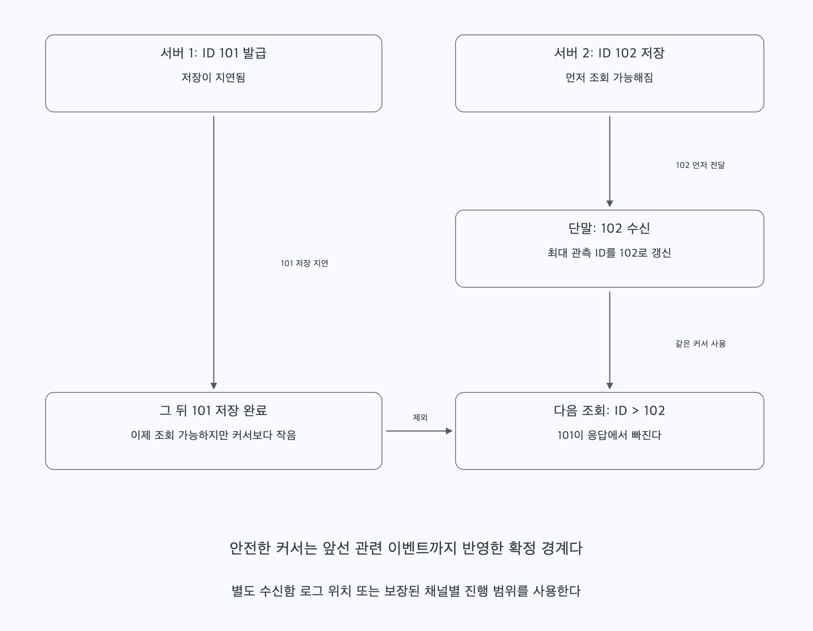

# 질문 01. 가장 큰 메시지 ID만 기억하면 동기화가 안전할까?

## 1. 유일성·정렬·완전한 처리 경계는 다르다

서버 1이 메시지 ID 101을 발급한 뒤 저장이 지연된다. 서버 2는 ID 102를 발급하고 먼저 저장한다. 단말이 102를 받아 최대 관측값을 102로 올린 뒤 101이 저장되면, 다음의 `ID > 102` 조회는 101을 돌려주지 않는다.

두 ID가 고유하고 정렬 가능해도 이 누락은 생긴다. 스노우플레이크의 시계·서버 비트·일련번호는 ID 충돌 방지를 위한 구성이지 모든 저장소에 이전 ID가 보인다는 증명은 아니다. 같은 채널에서 순번을 발급해도 커밋 순서를 제어하지 않으면 같은 문제가 남는다.

## 2. 단말이 기억할 것은 완료한 범위다

한 가지 방법은 사용자별 수신함 로그의 확정된 위치를 쓰는 것이다. 이력과 수신함 발행 의무를 연결해 두고, 수신함에 내구성 있게 추가된 이벤트를 정해진 순서로 제공한다. ID 101의 이벤트가 늦게 추가되더라도 로그의 새 위치에 붙으므로 다음 동기화에서 받을 수 있다. 화면의 대화 순서는 메시지 자체의 정렬 기준으로 복원한다.

단말은 전달된 범위가 로컬 저장까지 끝난 뒤 그 위치를 커서로 기록한다. 병렬로 처리했다면 가장 큰 완료 위치가 아니라 앞선 관련 항목도 모두 처리된 안전한 경계까지만 전진한다. 저장 실패 구간을 건너뛰고 커서만 올리지 않는다.

여러 파티션의 로그라면 파티션별 위치나 이를 묶은 서버 발급 토큰이 필요하다. 채널별 순번을 쓰면 채널별로 추적한다. 서로 다른 범위의 숫자를 단순 최댓값으로 합치지 않는다. 전역 메시지 ID에는 다른 사용자 메시지 때문에 빈 숫자가 있을 수 있으므로 “다음 숫자가 연속인지”만으로 누락을 판정할 수도 없다.

## 3. 책의 단순 모델은 어떤 조건에서 쓸 수 있을까

현재 커서 이하의 관련 메시지가 모두 저장되어 조회 가능하고 단말에도 반영되었다는 조건이 성립하면 ID 기반 조회가 가능하다. 다만 늦은 저장·복제 지연·조회 페이지 처리·동시 쓰기를 포함해 그 조건을 보장해야 한다.

구간을 겹쳐 다시 조회하고 메시지 ID로 중복을 제거하면 일정한 지연에는 대응할 수 있다. 그러나 얼마든지 늦게 저장될 수 있는데 유한한 재조회 구간만 둔다면 완전한 누락 방지를 보장하지 못한다. 별도 복구·대조 경로나 확정된 로그 경계가 필요한 이유다.

정리하면 메시지 ID는 메시지를 식별하고 표시 순서를 정하는 데 쓸 수 있다. 동기화 커서는 단말이 어떤 이벤트 범위를 안전하게 반영했는지 나타낸다. 둘을 같은 값으로 쓸 때는 그에 필요한 저장·조회 보장을 설명해야 한다.
