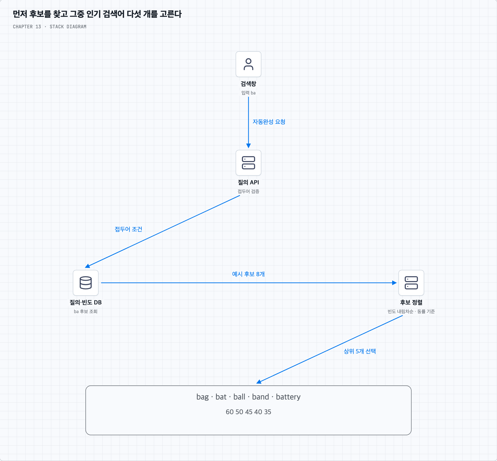
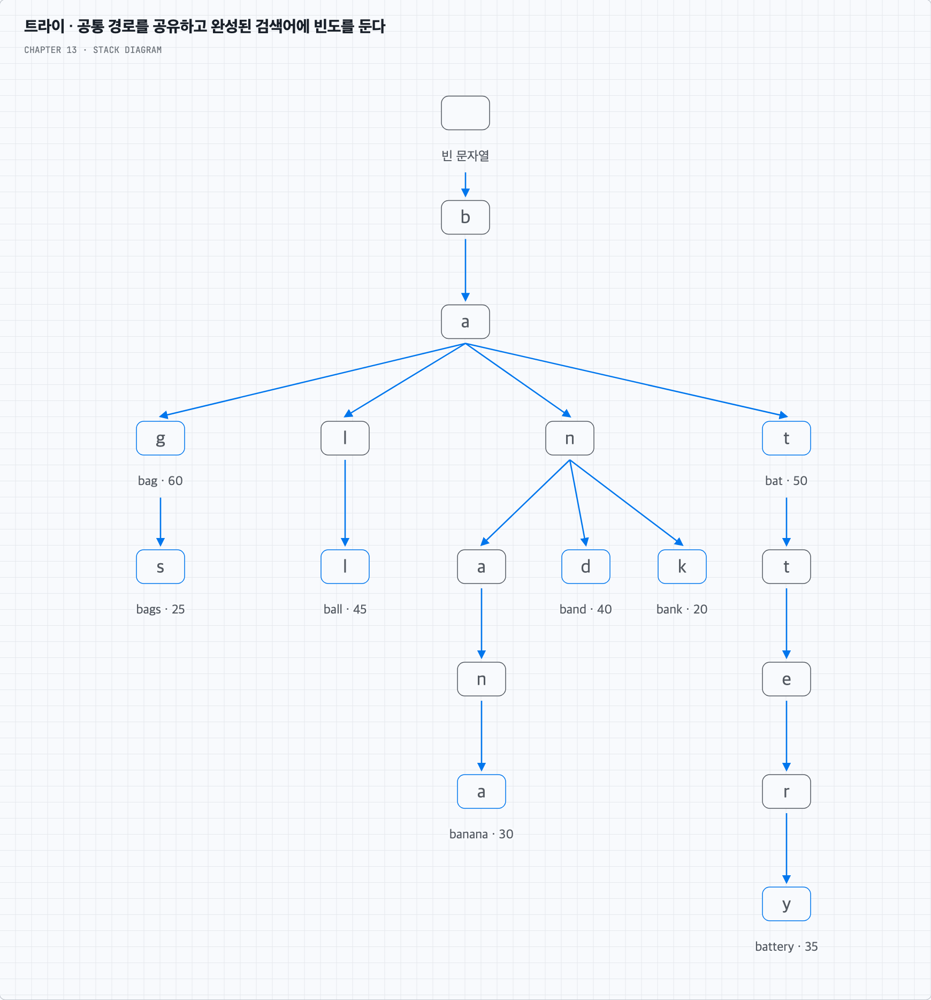
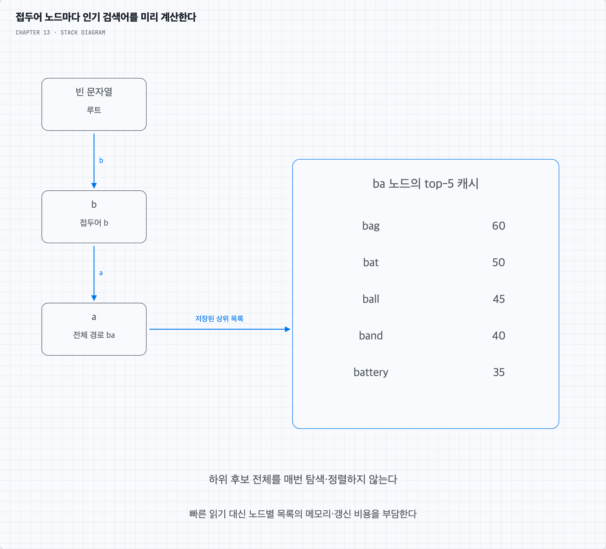
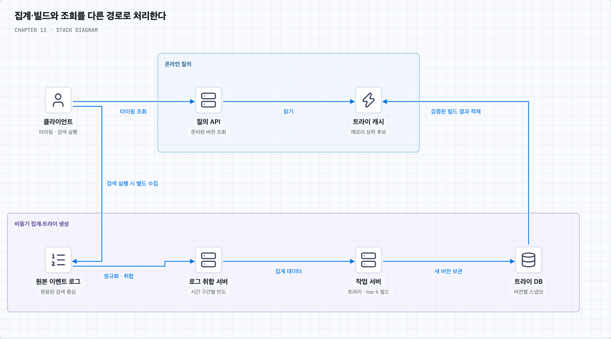
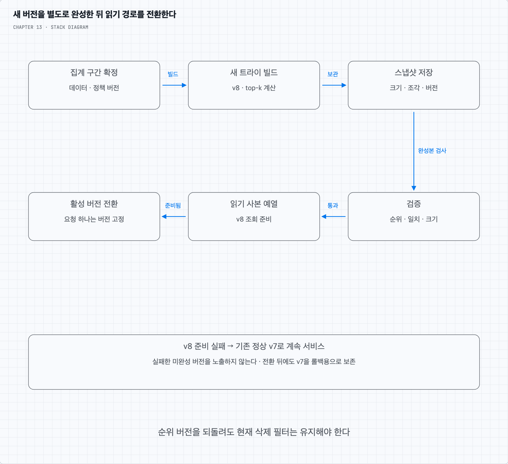
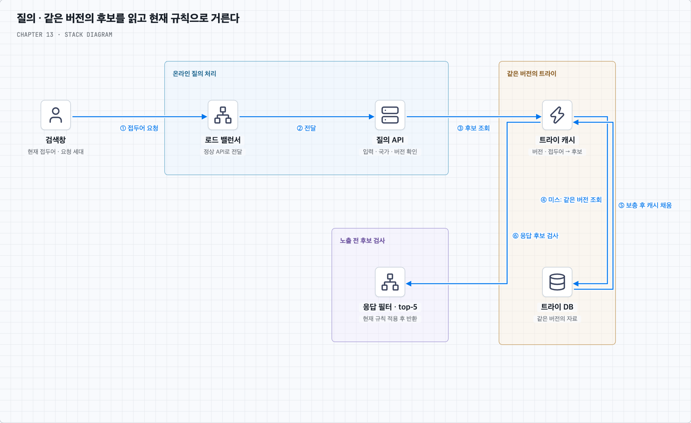
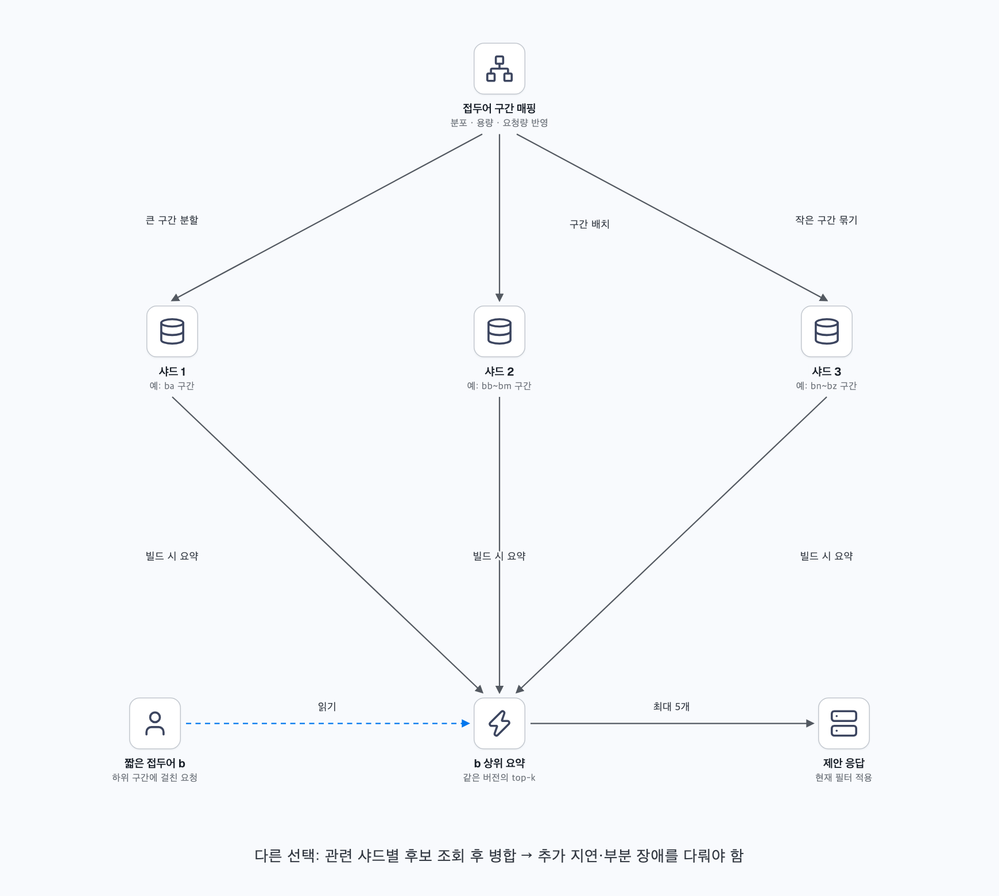
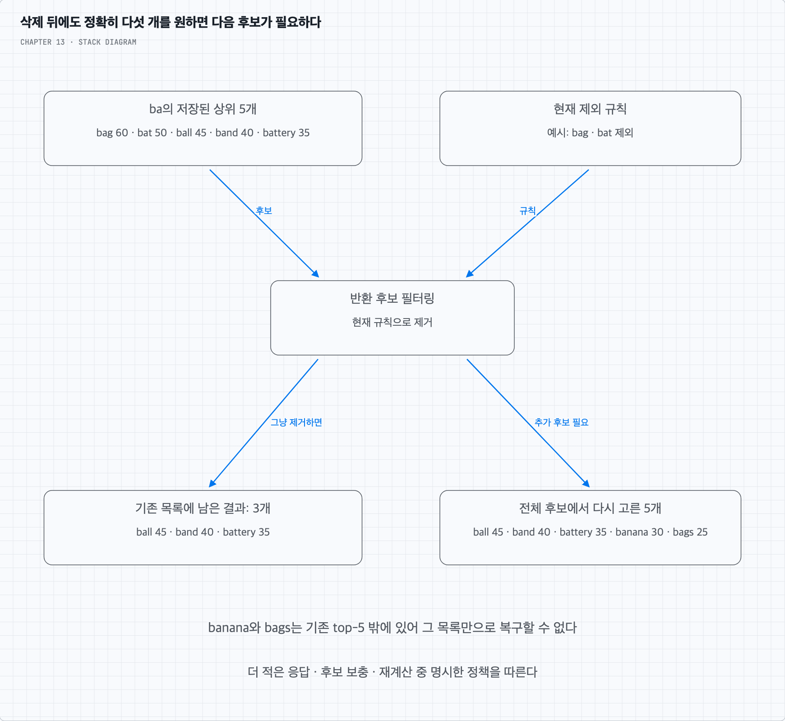

<a id="top"></a>

# 13장. 검색어 자동완성 시스템

접두어에 맞는 인기 검색어 다섯 개를 고르는 문제에서 출발한다. 트라이와 상위 후보 캐시로 읽기를 줄이고, 집계·빌드·버전 교체·삭제·샤딩의 조건을 따라간다.

책 13장과 제공된 메모를 바탕으로 재구성했다. 개념·그림·심화 질문·복습 답안을 이 README에서 함께 읽는다.

<a id="contents"></a>

## 목차

- [빈도 테이블에서 트라이·집계·샤딩까지](#core-concepts)
- [질문 01 · O(1)의 조건과 미리 계산하는 비용](#q1)
- [질문 02 · 삭제 필터와 샤드 top-k 병합](#q2)
- [스스로 답하기 · 답안 토글](#review)
- [책과 추가 설명의 범위](#sources)

---


<a id="core-concepts"></a>

## 접두어를 입력하면 인기 검색어 다섯 개를 보여주기

### 1. 어떤 검색어를 추천할 것인가

상품을 찾는 사용자가 검색창에 `ba`를 입력하면 `bag`, `bat`, `ball`처럼 같은 문자열로 시작하는 검색어를 보여준다고 가정한다. 이 장의 연관성은 입력한 접두어와의 일치다. 뜻이 비슷하지만 접두어가 다른 단어까지 찾는 의미 검색은 기본 범위에 넣지 않는다.

영어 소문자 `a`–`z`를 대상으로, 같은 접두어에 맞는 검색어를 질의 빈도 내림차순으로 최대 5개 반환한다. 후보가 5개 미만이면 있는 만큼만 표시한다. 동률이면 문자열 순서 등 일관된 기준을 둔다. 맞춤법 검사·자동수정은 제외하며 다국어·국가별 순위·실시간 추이는 후반의 확장 항목이다.

일일 활성 사용자는 1,000만 명이다. 책은 빠른 응답을 위해 100ms 이내의 응답 목표를 제시한다. 실제 운영에서는 서버 처리와 네트워크·화면 표시 중 어느 범위를 재는지 정하고 평균뿐 아니라 p95·p99도 관찰한다. 많은 읽기 요청을 감당하고 일부 서버나 네트워크가 실패해도 응답할 수 있어야 한다.

### 2. 검색 실행 한 번이 자동완성 요청 한 번은 아니다

책은 사용자 한 명이 하루 10번 검색하고 검색어 평균 길이가 20자이며, 글자를 입력할 때마다 자동완성 요청을 보낸다고 가정한다. 그러면 하루 요청 수는 `1,000만 × 10 × 20 = 20억`건이고, 평균은 약 23,148 QPS다. 책의 근삿값은 약 24,000 QPS이며 피크를 두 배인 약 48,000 QPS로 잡는다. 모두 추가 가정에 따른 용량 추정이다.

실행된 검색은 하루 1억 번이지만 자동완성 조회는 그보다 많다. 최근 입력만 요청하도록 묶는 방식이나 브라우저 캐시를 쓰면 실제 조회량은 달라진다. 따라서 검색 실행 수, 자동완성 조회 수, 수집 로그 수를 따로 계산해야 한다.

책의 하루 약 0.4GB 신규 데이터는 `1,000만 × 10 × 20바이트 × 20%`라는 단순 가정의 결과다. 이는 새 검색어 문자열 크기의 추정이며 전체 요청 로그·빈도 필드·인덱스·트라이 노드·복제·백업 크기가 아니다. 영어 ASCII 문자열의 바이트 계산을 다국어에 그대로 적용할 수도 없다.

### 3. 처음에는 질의와 빈도를 테이블로 관리한다

완료된 검색을 세어 질의-빈도 테이블을 만든다. 다음 값은 이후 그림에서 함께 쓰는 예시이며 실제 서비스 데이터가 아니다.

| 검색어 | 빈도 | 검색어 | 빈도 |
| --- | ---: | --- | ---: |
| bag | 60 | bat | 50 |
| ball | 45 | band | 40 |
| battery | 35 | banana | 30 |
| bags | 25 | bank | 20 |

사용자가 `ba`를 입력하면 다음과 같은 쿼리를 생각할 수 있다.

```sql
SELECT query, frequency
FROM query_frequency
WHERE query LIKE :prefix_pattern
ORDER BY frequency DESC, query ASC
LIMIT 5;
```

`:prefix_pattern`에는 검증한 접두어와 `%`를 붙인 값을 바인딩한다. 이 범위의 입력은 소문자만 허용하며, 입력을 그대로 SQL 문장에 이어 붙이지 않는다. 결과는 `bag`, `bat`, `ball`, `band`, `battery`다.

작은 데이터에는 이 방식이 충분할 수 있다. 접두어 조건에 맞는 인덱스를 사용할 수도 있어 매번 전체 테이블을 읽는다고 단정하면 안 된다. 다만 접두어와 맞는 후보가 많으면 그중 빈도가 높은 5개를 고르는 비용이 남는다. 접두어용 인덱스가 빈도 순 정렬까지 자동으로 해결하지는 않는다. PostgreSQL도 조건과 로캘에 따라 앞부분이 고정된 LIKE 검색에 B-tree 인덱스를 사용할 수 있다고 설명한다. [PostgreSQL 인덱스 문서](https://www.postgresql.org/docs/current/indexes-types.html)



### 4. 트라이로 같은 접두어를 가진 검색어를 모은다

DB 조회가 읽기 병목이 되면 접두어별 후보를 찾기 쉬운 자료구조를 검토한다. **트라이**는 문자열의 공통 앞부분을 경로로 공유하는 트리다. 루트는 빈 문자열이며, 단순한 문자 트라이에서 간선 하나를 따라갈 때 글자 하나가 더해진다. 영어 소문자만 다루면 한 노드는 최대 26개의 자식을 가질 수 있다.

루트에서 `b` → `a`로 가면 경로 전체가 접두어 `ba`를 뜻한다. 노드에 저장한 글자 하나와 루트부터의 전체 접두어를 구분한다. 그 아래 `g`로 가면 `bag`가 된다. 완성된 검색어에는 종료 표시와 빈도를 둔다.



`bat`는 그 자체로 완성된 검색어이면서 `battery`의 접두어이기도 하다. 따라서 자식이 있는지로만 완성된 검색어를 판단하면 안 된다. 트라이는 공통 경로를 공유하지만 노드·포인터·자식 배열 비용도 있어 원문 문자열보다 항상 작다는 뜻은 아니다.

### 5. 노드를 빨리 찾아도 그 아래를 모두 훑으면 느리다

접두어 길이를 p라 하면 해당 노드까지 가는 데 O(p)가 든다. 단순 구현은 그 아래 노드들을 탐색해 완성된 후보를 모은 다음 빈도 순으로 정렬한다. 방문할 하위 노드 수를 V, 완성된 후보 수를 C라고 하면 대략 `O(p + V + C log C)`가 된다. 짧은 접두어에는 많은 검색어가 매달리므로 이 비용이 커질 수 있다.

이를 줄이려면 접두어 노드마다 인기 검색어 5개를 미리 계산해 둔다. `ba` 노드에는 `bag:60`, `bat:50`, `ball:45`, `band:40`, `battery:35`를 저장한다. 읽을 때는 `ba`까지 간 뒤 그 목록만 가져온다.



읽기 비용은 하위 후보 전체 수 대신 접두어 길이와 반환 개수에 좌우된다. 대신 노드마다 목록을 보관하는 메모리와, 빈도가 바뀔 때 관련 접두어의 목록을 다시 계산하는 비용을 부담한다. 같은 검색어의 ID·점수 참조를 여러 접두어에 넣는 방식으로 문자열 복사를 줄일 수 있다.

책은 길이를 제한하고 k를 고정하면 O(1)로 볼 수 있다고 설명한다. 정확히는 접두어 탐색과 상위 목록 읽기가 `O(p + k)`이고 반환 문자열의 크기도 비용에 포함된다. p와 k 및 출력 크기의 상한을 고정한 모델에서 일정한 상한으로 보는 것이다. 첫 몇 글자만 잘라 임의로 긴 입력에도 같은 결과를 내면 정확성은 달라진다. 첫 번째 질문에서 이 조건을 더 살펴본다.

### 6. 인기 순위 계산을 읽기 요청에서 떼어 낸다

타이핑할 때마다 트라이를 수정하면 읽기와 갱신이 경쟁한다. `battery`의 빈도가 바뀌면 단말 노드뿐 아니라 `b`, `ba`, `bat` 등 그 검색어를 후보로 갖는 상위 노드의 목록에도 영향을 준다. 트라이를 직접 바꾸는 작업을 매 조회 경로에 넣기보다 수집·집계·빌드를 비동기로 분리한다.



데이터 수집 서비스는 집계할 검색 이벤트를 받고, 질의 서비스는 이미 만들어진 자료로 자동완성 결과를 반환한다. 원본 로그 → 집계 데이터 → 트라이 스냅샷 → 읽기 캐시로 이어진다. 책은 인기 순위가 급격히 바뀌지 않는 서비스에서 주 단위 빌드를 예로 든다. 모든 서비스에 적절한 주기라는 뜻은 아니다.

Elasticsearch의 completion 기능도 빠른 조회를 위해 메모리 자료구조를 사용하고 빌드 비용을 부담한다고 설명한다. 이는 미리 만든 검색 구조로 읽기를 빠르게 하는 교환 관계의 제품 사례다. 이 장의 단순 트라이가 그 제품의 내부 구현과 같다는 뜻은 아니다. [Elasticsearch completion 설명](https://www.elastic.co/docs/reference/elasticsearch/rest-apis/search-suggesters#completion-suggester)

### 7. 수집하는 이벤트를 먼저 정의한다

사용자가 `b`, `ba`, `bag`를 차례로 입력했다고 하자. 이것을 모두 검색 실행으로 세면 짧은 접두어의 빈도가 부풀고, 같은 검색을 여러 번 센다. 자동완성 조회 로그, 실제 제출된 검색어, 제안을 선택한 클릭은 다른 이벤트다. 기본 인기 순위에는 완료된 검색을 센다고 정하고 나머지는 지연·클릭률 같은 별도 분석에 쓸 수 있다.

원본 이벤트에는 검색어·서버 관측 시각·이벤트 ID·필요한 지역/언어 범위 등을 남긴다. 대량 로그는 추가 중심으로 저장하고 집계 경로에 적재한다. 책의 “로그에 인덱스를 걸지 않는다”는 원본 분석 로그의 쓰기 경로를 단순화하는 설명이다. 조회용 테이블·시간 파티션·검색 인덱스까지 모두 금지한다는 뜻은 아니다.

로그 취합 서버는 형식을 통일하고 시간 구간별 빈도를 만든다. 같은 이벤트가 재전달되거나 배치가 재실행될 때 빈도가 중복 증가하지 않도록 이벤트 중복 제거 또는 결과 구간을 멱등하게 교체하는 방법을 정한다. 지연 도착 이벤트를 어느 집계 구간에 반영할지도 결정한다.

모든 조회 로그를 남기는 비용이 크면 N개 중 하나를 고르는 샘플링을 고려한다. 다만 관측용 샘플링과 순위용 집계의 정확도는 다르다. 균등한 확률 표본은 전체 경향을 추정할 수 있어도 희귀 검색어와 비슷한 빈도의 순서에는 오차가 크다. 특정 국가·단말만 덜 수집하면 순위가 편향될 수 있으므로 표본의 범위를 명시한다.

### 8. 새 트라이를 만들고 검증한 뒤 교체한다

작업 서버는 정해진 집계 구간의 데이터를 읽어 트라이와 노드별 상위 목록을 만든다. 접두어 일치·순위·동률 기준·금지어 제외·메모리 크기 등을 확인하고 버전을 붙여 지속성 저장소에 보관한다. 빌드 중인 트라이를 바로 읽기 서비스에 노출하지 않는다.



문서 저장소에는 직렬화한 트라이 또는 나눈 조각을 저장할 수 있다. 큰 트라이 전체를 언제나 문서 한 개에 넣을 수 있다고 가정하면 안 된다. 제품의 문서 크기 제한과 조각별 로딩 비용을 확인한다. 키-값 방식은 `(버전, 접두어)`를 키로 하고 상위 후보·점수 등을 값으로 저장하는 형태가 가능하다. 전체 트리 탐색을 저장소 조회로 대체한 접두어 테이블로도 이해할 수 있다.

새 버전을 읽기 사본에 미리 적재하고 검증한 뒤 활성 버전을 전환한다. 요청 하나가 서로 다른 버전의 샤드·캐시를 섞지 않게 버전을 고정한다. 모든 서버가 같은 순간에 전환될 필요는 없지만 요청별 일관성과 롤백 가능한 이전 버전은 필요하다. 빌드 실패나 새 버전 적재 실패 시 이전 정상 스냅샷으로 계속 서비스할 수 있다. 교체 중에는 이전 버전과 새 버전을 함께 적재할 메모리·저장 공간도 필요하다.

변경이 드문 자료에는 이 방식이 단순하다. 반대로 실시간 노드 갱신을 택하면 빈도 변경에 따른 상위 후보 재선정·읽기와의 동시성·점수 감소·삭제를 직접 다뤄야 한다. 단말 노드의 숫자만 바꿔서는 상위 접두어 캐시가 자동 갱신되지 않는다.

### 9. 질의 서비스는 읽기 경로를 짧게 유지한다

사용자가 `ba`를 입력하면 로드 밸런서가 API 서버로 전달한다. API는 입력 길이·문자 집합을 확인하고, 해당 버전의 접두어 데이터를 캐시에서 읽는다. 캐시에 없으면 지속성 저장소에서 같은 버전의 데이터를 가져와 캐시를 채운다. 후보에 현재 필터 규칙을 적용하고 빈도 순으로 최대 5개를 반환한다.



캐시 키에는 접두어 외에 결과가 달라지는 언어·국가·순위 버전 같은 범위를 포함한다. 메모리 축출·노드 장애·새 버전 전환으로 미스가 날 수 있다. 같은 키의 동시 미스가 원본을 압도하지 않도록 보충 요청을 합치고, 원본 조회의 동시성과 시간을 제한한다.

고가용성을 위해 읽기 사본과 캐시를 분산한다. 새 순위가 조금 늦어도 되는 경우 이전 정상 스냅샷으로 응답하고, 준비된 결과가 없으면 빈 제안 등 명시한 축소 응답을 줄 수 있다. 하나의 자동완성 장애가 전체 검색을 막지 않게 분리한다. 오래된 순위의 허용과 삭제 필터의 허용은 같은 정책이 아니다.

### 10. 화면에서도 요청과 응답의 낭비를 줄인다

페이지 전체를 새로 받지 않고 비동기 HTTP 요청으로 제안을 가져온다. 책의 AJAX는 이 방식을 가리킨다. 입력이 잠시 멈춘 뒤 최신 접두어를 보내는 디바운스, 최근 접두어 결과의 브라우저 캐시, 동일 요청 합치기를 고려할 수 있다. 기다리는 시간을 늘리면 서버 요청은 줄지만 체감 응답이 느려질 수 있다.

`b` 요청보다 나중에 보낸 `ba` 요청이 먼저 도착할 수 있다. 클라이언트는 현재 입력과 요청 세대가 맞는 응답만 화면에 적용해야 한다. 이전 요청을 취소해도 이미 처리 중인 응답이 올 수 있으므로 화면 적용 시점의 확인이 필요하다.

브라우저 캐시는 네트워크 왕복을 줄이지만 새 순위·삭제 규칙 반영을 늦출 수 있다. 결과의 변동 주기와 언어·국가 범위, 허용되는 오래된 값에 맞춰 키와 TTL을 정한다. 책의 브라우저 캐시 예시 값을 모든 서비스의 공통 TTL로 복사하지 않는다.

### 11. 삭제 필터는 정기 빌드보다 빠르게 적용한다

노출하면 안 되는 검색어가 발견되면 다음 주 빌드까지 기다릴 수 없다. 트라이와 분리한 필터 규칙을 갱신해 응답 후보에서 제외하고, 이후 새 스냅샷에서도 제거한다. 캐시 앞에 필터 계층을 둔다는 그림은 조회 요청뿐 아니라 반환되는 후보에도 규칙을 적용하는 것으로 이해한다.

이미 상위 5개만 가져온 뒤 두 개를 지우면 3개만 남는다. 정확히 5개를 계속 보여주려면 추가 후보 조회나 더 넓은 후보 목록·재빌드 등이 필요하다. 필터가 지운 다음 순위를 원래 5개 목록만 보고 알아낼 수는 없다. 더 많이 캐시해도 제거 대상 수에 제한이 없으면 항상 5개가 남는다고 보장할 수 없다.

브라우저·중간 캐시가 오래된 응답을 API를 거치지 않고 보여주는 경로도 확인한다. 신속한 삭제가 필요하면 캐시 수명·무효화·필터 버전을 함께 설계한다. 서버에서 제외해도 이미 단말에 전달된 데이터 자체를 회수할 수 있다는 뜻은 아니다. 두 번째 질문에서 예시로 살펴본다.

### 12. 샤딩은 데이터 크기와 요청 편차를 함께 본다

첫 글자로 나누면 `a`–`z`의 26개 논리 구간이 생긴다. 책의 26대 한계는 한 글자 구간을 서버 한 대에 고정하는 단순 배치의 한계다. 복제나 가상 샤드까지 포함해 서버 수가 원리적으로 26대에 묶이는 것은 아니다.

검색어가 많은 구간은 `ba`, `bb`처럼 더 쪼개고 작은 구간은 묶는다. 과거 검색어 분포와 요청량을 바탕으로 접두어 구간 → 샤드 매핑을 유지한다. 단어 수가 균등해도 인기 접두어 요청은 한쪽에 몰릴 수 있다. 인기 접두어의 읽기는 사본·로컬 캐시로 흡수하고, 매핑 변경 때 버전과 복구 경로를 관리한다.



여러 하위 샤드에 걸치는 짧은 접두어는 별도 상위 요약에 top-k를 미리 저장하거나 여러 샤드 결과를 합친다. 후자는 네트워크·병합·일부 샤드 장애 비용이 추가된다. 어느 경로를 쓰는지 정하지 않고 “하위 구간을 나누면 된다”로 끝내지 않는다.

### 13. 국가·언어와 최신 인기어는 별도의 확장이다

국가마다 인기 순위가 다르면 국가·언어별 집계와 스냅샷을 분리하거나 문맥별 점수를 둔다. 기본 영문자 트라이의 26개 자식 배열을 유니코드 전체 크기로 늘리는 것은 비효율적일 수 있어 드문 자식을 맵으로 저장하는 등의 표현을 검토한다.

유니코드를 저장할 수 있다는 것만으로 다국어 입력이 완성되지는 않는다. 같은 글자가 서로 다른 코드 포인트 조합으로 표현될 수 있어 수집·조회·필터가 같은 정규화 정책을 사용해야 한다. 언어별 대소문자·단어 경계·한글 조합 중 입력을 언제 질의할지도 정한다. 정규화는 맞춤법 자동수정과 다르다. [Unicode 정규화 설명](https://unicode.org/faq/normalization.html)

주 단위 스냅샷은 방금 생긴 유행어를 즉시 반영하지 못한다. 실시간성이 필요하면 스트림 집계와 짧은 갱신 주기, 최근 검색에 높은 가중치를 주는 점수를 고려한다. 샤딩은 빌드 대상을 나누지만 집계 지연·순위 변경·캐시 전파·지연 도착 이벤트까지 자동으로 해결하지 않는다.

기존 배치 결과와 최근 변화 후보를 함께 쓰는 방식도 가능하다. 다만 서로 다른 집계 구간을 합칠 때 같은 이벤트를 두 번 세지 않고, 점수 감소와 시간 만료에 따라 top-k를 다시 선정해야 한다. “최근 점수만 더한다”는 설명으로 끝내지 않는다.

### 14. 운영에서는 지연과 순위의 신선함을 같이 본다

접두어별 QPS·p95/p99 응답 지연·캐시 적중률·미스 보충량·샤드 부하 편차를 관찰한다. 수집 지연·중복 이벤트·빌드 시간·스냅샷 나이·적재 실패·필터 전파 지연도 본다. 서버가 빨라도 제안이 오래되거나 현재 입력과 맞지 않으면 사용자에게는 잘못된 응답이다.

빈 제안 비율·제안 선택률·검색 실행으로 이어지는 비율은 품질 지표로 사용할 수 있다. 단순 인기 순위는 빈도 조작에 영향을 받을 수 있으므로 어떤 검색 이벤트를 세고 비정상 반복을 어떻게 제한하는지도 집계 정책에 포함한다. 관측용 로그가 순위용 이벤트와 섞여 다시 빈도를 부풀리지 않도록 경로를 분리한다.

[목차로 돌아가기](#contents)

---


<a id="q1"></a>

## 질문 01. 트라이와 top-k 캐시가 있으면 정말 O(1)일까?

### 1. 무엇에 대해 일정한지를 말해야 한다

검색어 전체 수를 N, 입력 접두어 길이를 p, 반환 개수를 k라 하자. 단순 문자 트라이는 접두어를 찾을 때 p번의 경로 이동이 필요하다. 그 노드에 상위 k개가 이미 있다면 목록을 읽는 데 O(k)가 든다. 읽기 비용은 대략 `O(p + k)`이며 반환 문자열 전체 길이가 R이면 직렬화·전송에 드는 O(R)도 별개로 남는다.

p≤50, k=5, 결과 길이도 제한한다면 N이 늘어도 이 부분의 단계 수는 정해진 상한 안에 있다. 책의 O(1)은 이런 고정된 상한의 모델로 이해할 수 있다. 네트워크 왕복·캐시 미스·필터·여러 샤드 병합까지 모두 0이거나 일정한 실제 응답시간이라는 뜻은 아니다.

### 2. 입력을 잘라 버리면 다른 검색이 된다

`ba`의 상위 목록에 `bag`와 `battery`가 있다고 하자. 사용자는 `bat`를 입력했는데 앞의 두 글자만 조회하면 `bag`도 후보에 남는다. 긴 입력을 무시하고 짧은 접두어 결과를 그대로 돌려주어서는 안 된다.

허용 검색어와 입력 길이를 처음부터 제한하고 범위를 넘으면 제안을 주지 않는 정책은 가능하다. 더 긴 입력도 지원하려면 실제 전체 접두어를 검사해야 한다. 짧은 접두어의 상위 목록을 가져와 필터링하는 방식은 일치하지 않는 단어를 뺄 수 있어도 그 목록 밖의 진짜 상위 후보를 복구하지 못할 수 있다.

### 3. 빠른 읽기의 비용은 빌드와 메모리로 옮겨 간다

트라이 노드가 T개이고 각 노드에 k개의 참조를 둔다면 상위 목록 공간은 최대 O(Tk)다. 검색어가 거의 공유되지 않으면 노드 수도 커진다. 고정 26칸 배열은 조회가 단순한 대신 빈 칸 메모리를 쓰고, 맵이나 압축 경로는 다른 비용을 갖는다.

빈도가 증가하거나 감소하면 그 검색어가 속한 여러 접두어의 순위가 바뀔 수 있다. 특히 현재 5위가 삭제·하락했을 때 6위를 알아내려면 원래 후보 정보가 필요하다. 저장된 5개의 점수만 수정한다고 항상 정확한 새 top-5가 생기지는 않는다.

읽기를 빠르게 하려고 미리 계산하는 구조를 선택했고, 빌드 주기를 늦춰 그 비용을 모아 처리한 것이다. 요구하는 신선함이 달라지면 읽기·갱신·메모리 사이의 선택도 달라진다.

[목차로 돌아가기](#contents)

---


<a id="q2"></a>

## 질문 02. 필터와 샤딩 뒤에도 상위 다섯 개가 유지될까?

### 1. 결과에서 지우는 것과 다음 후보를 찾는 것은 다르다

`ba`의 상위 5개가 `bag:60`, `bat:50`, `ball:45`, `band:40`, `battery:35`라고 하자. `bag`와 `bat`를 제외해야 한다면 원래 목록에는 3개만 남는다. 전체 후보를 기준으로 한 다음 두 개는 `banana:30`, `bags:25`이지만 기존 top-5에는 없다.



선택지는 더 적은 개수를 반환하거나, 넓은 후보 목록을 읽거나, 현재 필터를 반영해 top-k를 재계산하는 것이다. 금지어를 결과에 포함시키면서 무조건 5개를 채우지는 않는다. 후보가 부족할 때의 응답 정책을 명확하게 정한다.

삭제 규칙은 새 트라이와 이전 정상 버전 모두에 적용해야 한다. 빌드 장애 때 이전 버전으로 되돌렸다고 삭제 대상이 다시 보이면 안 된다. 브라우저 캐시가 서버의 현재 필터를 우회하는 경로까지 포함해 허용 지연을 정한다.

### 2. 서로 다른 샤드의 top-5를 합치면 언제 정확할까

각 검색어가 정확히 한 샤드에 있고, 모든 샤드가 같은 집계 버전·동일한 점수·동률 기준을 쓴다고 하자. 필터도 동일한 기준으로 이미 적용되어 있다면 각 샤드의 top-5를 모아 전체 top-5를 고를 수 있다.

어떤 후보가 자기 샤드의 6위라면 그보다 앞선 5개가 같은 샤드 안에 이미 있다. 따라서 그 후보가 전체 5위 안에 들어갈 수 없다. 이 조건에서는 모든 후보를 가져올 필요가 없다.

하지만 후보를 받은 뒤 필터를 적용하거나 샤드 간 중복 검색어를 합쳐야 하면 상황이 달라진다. 지역별 점수를 합산해야 하는데 일부 샤드가 다른 시점의 점수를 반환하는 경우도 단순한 증명이 적용되지 않는다. 추가 후보 조회·일관된 집계·중복 제거 정책을 설계해야 한다.

### 3. 일부 샤드의 실패는 순위의 완전성을 바꾼다

짧은 접두어를 여러 샤드에 질의했는데 하나가 응답하지 않았다면, 남은 결과만으로 만든 목록은 전체의 정확한 top-5라고 보장할 수 없다. 제한 시간 뒤 부분 결과를 줄지, 이전 정상 요약을 줄지, 빈 응답을 줄지 정한다.

상위 접두어의 top-k 요약을 미리 만들어 별도로 서비스하면 매 요청의 샤드 팬아웃을 줄일 수 있다. 대신 그 요약도 같은 스냅샷과 필터에 맞게 갱신해야 한다. 샤딩은 후보 조회와 순위 계산의 경계를 없애는 장치가 아니다.

[목차로 돌아가기](#contents)

---


<a id="review"></a>

## 스스로 답하기

먼저 흐름과 조건을 말한 뒤 토글의 실제 답안을 확인한다.

<details>
<summary>01. 이 장의 연관성은 의미가 비슷한 검색어까지 포함하는가?</summary>

기본 설계는 입력 문자열과 접두어가 일치하는 검색어를 인기순으로 고른다. 의미 검색·오타 수정은 별도 범위다.

</details>

<details>
<summary>02. 후보가 세 개뿐이어도 반드시 다섯 개를 만들어야 하는가?</summary>

최대 다섯 개를 반환한다. 일치·필터 조건을 만족하는 후보가 부족하면 있는 만큼 또는 정한 축소 응답을 준다.

</details>

<details>
<summary>03. 질의 빈도가 같을 때는 어떻게 정렬하는가?</summary>

문자열 순서 등 일관된 동률 기준을 정하고 빌드·조회·샤드 병합에서 동일하게 쓴다.

</details>

<details>
<summary>04. DAU 1,000만 명만으로 QPS를 알 수 있는가?</summary>

아니다. 1인당 검색 횟수·입력 길이·요청 정책이 필요하다. 책은 하루 10회·평균 20자·매 입력 요청을 추가 가정한다.

</details>

<details>
<summary>05. 책의 약 24,000 평균 QPS는 어떻게 계산하는가?</summary>

1,000만 × 10 × 20 ÷ 86,400은 약 23,148이다. 책은 약 24,000으로 근사하고 피크를 두 배인 약 48,000으로 잡는다.

</details>

<details>
<summary>06. 0.4GB/일은 실제 전체 저장량인가?</summary>

새 검색어 문자열의 단순 가정값이다. 원본 로그·노드·인덱스·빈도·복제·백업을 포함하지 않는다.

</details>

<details>
<summary>07. 검색 실행과 자동완성 조회를 왜 구분하는가?</summary>

한 검색을 입력하는 동안 여러 접두어 조회가 생긴다. 모두 실행 빈도로 세면 짧은 접두어가 부풀고 한 검색을 여러 번 집계한다.

</details>

<details>
<summary>08. LIKE 접두어 검색은 언제나 전체 테이블 스캔인가?</summary>

아니다. 제품·로캘·인덱스 조건에 따라 앞부분이 고정된 패턴에 인덱스를 쓸 수 있다. 다만 빈도 순 상위 후보 선택 비용은 남을 수 있다.

</details>

<details>
<summary>09. 접두어 인덱스 하나가 인기순 정렬까지 해결하는가?</summary>

접두어 순서와 빈도 순서는 다르다. 후보 수·실행 계획·복합 인덱스의 조건을 실제로 검토해야 한다.

</details>

<details>
<summary>10. 트라이 노드의 글자와 경로 전체는 어떻게 다른가?</summary>

단순 트라이의 노드·간선은 한 글자 이동을 나타내고 루트부터의 전체 경로가 접두어 또는 완성된 검색어를 나타낸다.

</details>

<details>
<summary>11. bat에 자식이 있으면 완성된 단어가 아닌가?</summary>

bat 자체도 검색어이고 battery의 접두어일 수 있다. 종료 표시와 빈도를 별도로 둔다.

</details>

<details>
<summary>12. 트라이는 언제나 원문 문자열보다 작게 저장되는가?</summary>

공통 접두어를 공유하지만 노드·자식 배열·포인터·상위 목록 비용이 있다. 항상 작다고 보장하지 않는다.

</details>

<details>
<summary>13. 접두어 노드만 빨리 찾으면 top-5 조회도 빠른가?</summary>

단순 구현은 그 아래 후보들을 탐색·정렬해야 한다. 짧은 접두어에 많은 후보가 있으면 이 부분이 병목이다.

</details>

<details>
<summary>14. 노드별 top-k 캐시는 어떤 비용을 줄이는가?</summary>

접두어 아래 전체 후보 탐색·정렬을 읽기 경로에서 제거한다. 메모리와 빌드·갱신 비용은 늘어난다.

</details>

<details>
<summary>15. 최적화한 트라이의 읽기 복잡도는 무엇인가?</summary>

접두어 탐색과 목록 읽기는 대략 O(p+k)다. 출력 문자열 크기와 네트워크·필터·캐시 미스 비용은 별도로 고려한다.

</details>

<details>
<summary>16. 책의 O(1)은 어떤 조건인가?</summary>

접두어 길이·k·출력 길이의 상한을 고정해 전체 검색어 수와 무관한 일정 상한으로 보는 모델이다.

</details>

<details>
<summary>17. 긴 입력을 짧은 접두어로 잘라 조회하면 같은 결과인가?</summary>

아니다. bat를 ba로 조회하면 bag처럼 일치하지 않는 후보가 남고, 실제 후보가 상위 목록 밖에 있을 수도 있다.

</details>

<details>
<summary>18. top-k 캐시의 공간은 무엇에 비례하는가?</summary>

노드 T개에 최대 k개 참조를 두면 O(Tk)다. 문자열을 반복 복사하기보다 참조를 보관할 수 있다.

</details>

<details>
<summary>19. battery 빈도가 변하면 단말 노드만 갱신하면 되는가?</summary>

그 검색어가 후보인 b·ba·bat 등 상위 접두어의 순위도 바뀔 수 있다. 관련 목록을 재선정해야 한다.

</details>

<details>
<summary>20. 수집 서비스와 질의 서비스를 나누는 이유는 무엇인가?</summary>

집계·빌드의 무거운 변경을 짧은 읽기 경로에서 분리하고 각각 독립적으로 확장하기 위해서다.

</details>

<details>
<summary>21. 원본 로그에 인덱스를 안 건다는 말은 모든 인덱스를 금지하는가?</summary>

추가 중심 분석 로그를 단순하게 적재하는 설명이다. 조회용 집계 테이블·시간 분할·검색 인덱스까지 금지하는 뜻은 아니다.

</details>

<details>
<summary>22. 같은 배치나 이벤트가 재실행될 때 무엇을 막아야 하는가?</summary>

빈도의 중복 증가를 막아야 한다. 이벤트 중복 제거 또는 구간 집계 결과의 멱등 교체 등을 설계한다.

</details>

<details>
<summary>23. 샘플링하면 인기 순위가 언제나 정확히 유지되는가?</summary>

아니다. 추정 오차와 희귀 항목 손실이 있고 국가·단말별 표본 편향도 생길 수 있다. 관측용과 순위용 수집을 구분한다.

</details>

<details>
<summary>24. 트라이 스냅샷을 빌드 중에 바로 서비스해도 되는가?</summary>

미완성 자료를 노출할 수 있다. 별도로 생성·검증·저장·예열한 뒤 버전을 전환한다.

</details>

<details>
<summary>25. 새 스냅샷 버전은 왜 캐시와 요청에도 필요할까?</summary>

요청 하나가 서로 다른 집계 시점의 샤드·캐시를 섞지 않고 롤백·적재 상태를 추적할 수 있게 한다.

</details>

<details>
<summary>26. 전체 트라이를 문서 한 개에 직렬화하면 항상 가능한가?</summary>

제품의 문서 크기와 적재 비용 제한을 확인해야 한다. 조각·샤드·버전 단위 저장이 필요할 수 있다.

</details>

<details>
<summary>27. 접두어를 키로 저장하는 방식의 값에는 무엇을 넣는가?</summary>

같은 버전의 상위 후보 ID·문자열 참조·점수 등을 둘 수 있다. 버전·언어·국가도 키 범위에 포함한다.

</details>

<details>
<summary>28. 캐시 미스가 몰릴 때 원본을 어떻게 보호하는가?</summary>

같은 키의 보충 요청을 합치고 조회 동시성·시간을 제한한다. 적재 실패 때 이전 정상 자료나 정한 축소 응답을 사용할 수 있다.

</details>

<details>
<summary>29. 빌드 실패가 자동완성 전체 장애가 되어야 하는가?</summary>

아니다. 이전 정상 스냅샷으로 계속 읽을 수 있게 분리한다. 다만 현재 삭제 필터는 롤백 뒤에도 적용한다.

</details>

<details>
<summary>30. 디바운스의 장점과 비용은 무엇인가?</summary>

연속 입력을 묶어 요청량을 줄이지만 기다리는 시간만큼 체감 응답이 늦을 수 있다.

</details>

<details>
<summary>31. 늦게 온 b 응답이 ba 화면을 덮지 않게 하려면?</summary>

현재 입력과 요청 세대를 비교해 맞는 응답만 적용한다. 취소 요청만으로 모든 과거 응답을 없앴다고 가정하지 않는다.

</details>

<details>
<summary>32. 브라우저 캐시는 왜 삭제와 함께 검토하는가?</summary>

서버를 거치지 않고 오래된 결과를 보여줄 수 있다. TTL·무효화·필터 버전·허용 지연을 함께 정한다.

</details>

<details>
<summary>33. 상위 다섯 개에서 두 개를 지우면 다음 두 개를 알 수 있는가?</summary>

기존 목록만으로는 모른다. 추가 후보 조회·넓은 목록·재빌드가 필요하거나 더 적은 응답을 허용해야 한다.

</details>

<details>
<summary>34. 조금 더 많은 후보를 캐시하면 임의의 필터 뒤에도 항상 다섯 개가 남는가?</summary>

제거 대상 수에 제한이 없으면 보장하지 못한다. 정확한 조건과 후보 보충 경로가 필요하다.

</details>

<details>
<summary>35. 첫 글자 샤딩은 물리 서버 수를 영원히 26대로 제한하는가?</summary>

한 구간을 한 서버에 고정한 단순 배치의 한계다. 구간 분할·복제·가상 샤드로 확장할 수 있다.

</details>

<details>
<summary>36. 글자 수나 검색어 수가 같으면 부하도 균등한가?</summary>

인기 접두어의 요청량이 다를 수 있다. 데이터 크기와 조회 부하를 따로 관찰하고 큰 구간 분할·인기 결과 복제를 고려한다.

</details>

<details>
<summary>37. 하위 샤드를 나누면 짧은 접두어는 어디서 처리하는가?</summary>

미리 만든 상위 요약을 읽거나 관련 샤드의 후보를 합친다. 어느 경로인지와 부분 장애 정책을 정해야 한다.

</details>

<details>
<summary>38. 각 샤드 top-5로 전체 top-5를 구할 수 있는 조건은?</summary>

후보가 중복 없이 분할되고 같은 버전·점수·동률 기준과 필터를 적용하면 가능하다. 자기 샤드 6위는 전체 5위 안에 들어갈 수 없다.

</details>

<details>
<summary>39. 샤드 하나가 실패해도 남은 결과가 정확한 전체 순위인가?</summary>

그 샤드의 후보를 모르므로 보장할 수 없다. 부분 결과·이전 요약·빈 응답 중 정한 축소 정책을 따른다.

</details>

<details>
<summary>40. 유니코드를 저장하면 다국어 자동완성이 완성되는가?</summary>

정규화·언어별 처리·조합 중 입력·국가별 순위·자식 표현도 필요하다. 저장 형식만의 문제가 아니다.

</details>

<details>
<summary>41. 다국어 정규화와 자동수정은 같은가?</summary>

정규화는 동등한 문자 표현을 일관되게 다루는 것이며 오타를 다른 검색어로 바꾸는 기능과 다르다.

</details>

<details>
<summary>42. 샤딩만 하면 실시간 인기어를 반영할 수 있는가?</summary>

빌드 대상은 줄일 수 있지만 집계·점수 갱신·지연 도착·캐시 전파는 별도다. 스트림과 갱신 주기·시간 가중치를 함께 설계한다.

</details>

<details>
<summary>43. 시간 가중치가 있으면 점수를 계속 더하기만 하면 되는가?</summary>

오래된 구간의 만료·점수 감소·배치와 실시간 중복을 다뤄야 하고 순위도 다시 선정해야 한다.

</details>

<details>
<summary>44. 응답이 빠르다는 지표만 보면 충분한가?</summary>

스냅샷 나이·집계 지연·필터 전파·빈 결과·선택률·현재 입력과의 일치도 함께 봐야 한다.

</details>

[목차로 돌아가기](#contents)

---


<a id="sources"></a>

## 책 대조 범위와 출처

제공된 책 사진 13장 223–244쪽(IMG_0882–IMG_0903)과 사용자 메모를 대조했다. 요구사항·규모 추정 → 빈도 테이블 → 트라이·상위 목록 캐시 → 수집·집계·빌드 → 질의 서비스 → 갱신·삭제·샤딩 → 국가·다국어·실시간 확장의 흐름으로 재구성했다. 그림과 문장은 복습을 위한 자체 설명이다.

O(1)의 고정 상한 전제, 자동완성 조회와 검색 실행의 구분, 집계 재처리·표본 오차, 스냅샷 검증·버전 전환·롤백, 캐시 미스 집중, 응답 역전, 삭제 후 후보 보충, 샤드 top-k 병합 조건은 보충 설명이다. 샤딩의 26대 한계는 단순한 첫 글자 고정 배치의 조건으로 한정했다.

- [PostgreSQL 인덱스 문서](https://www.postgresql.org/docs/current/indexes-types.html): 접두어 LIKE 조건에 B-tree 인덱스를 사용할 수 있는 조건과 로캘 관련 제약을 확인했다. 접두어 조회와 빈도 정렬을 구분하는 데 사용했다.
- [Elasticsearch completion 설명](https://www.elastic.co/docs/reference/elasticsearch/rest-apis/search-suggesters#completion-suggester): 조회를 빠르게 하기 위한 메모리 검색 구조와 빌드 비용의 제품 사례다. 본문의 단순 트라이와 동일한 구현으로 일반화하지 않는다.
- [Unicode 정규화 FAQ](https://unicode.org/faq/normalization.html): 같은 문자의 조합 표현을 일관되게 다루는 배경이다. 정규화와 맞춤법 자동수정을 구분한다.
- [1장 규모 확장](../01-scaling/README.md): 캐시·DB·샤딩·장애 경계를 연결한다.
- [11장 뉴스 피드](../11-news-feed/README.md): 미리 계산한 후보·현재 필터·분산 조회의 교환 관계를 연결한다.
- [stack-diagram](https://stacks.caru.moe/): 기존 장과 같은 그림 구성 방식과 아이콘 표현을 참고했다.

책의 24,000 평균 QPS·48,000 피크 QPS는 가정에 따른 근삿값이다. 하루 0.4GB는 문자열 중심의 단순 추정이며 실제 로그·트라이·복제 용량과 다르다. bag 등의 단어·빈도와 버전·샤드 배치는 설명용 예시다. 알고리즘 예시 검증은 제품 벤치마크나 실제 분산 장애 시험을 대신하지 않는다.

[목차로 돌아가기](#contents)

---
