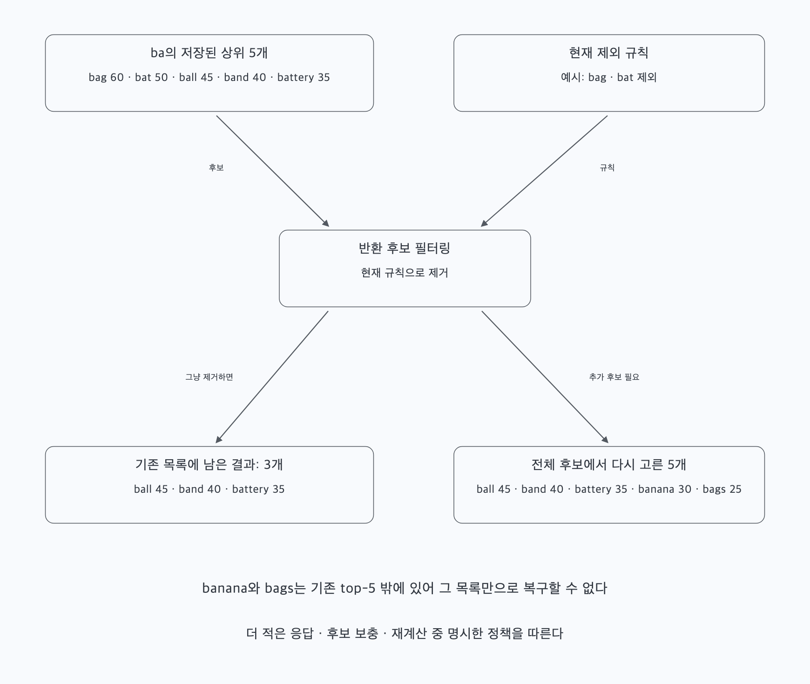

# 질문 02. 필터와 샤딩 뒤에도 상위 다섯 개가 유지될까?

## 1. 결과에서 지우는 것과 다음 후보를 찾는 것은 다르다

`ba`의 상위 5개가 `bag:60`, `bat:50`, `ball:45`, `band:40`, `battery:35`라고 하자. `bag`와 `bat`를 제외해야 한다면 원래 목록에는 3개만 남는다. 전체 후보를 기준으로 한 다음 두 개는 `banana:30`, `bags:25`이지만 기존 top-5에는 없다.

선택지는 더 적은 개수를 반환하거나, 넓은 후보 목록을 읽거나, 현재 필터를 반영해 top-k를 재계산하는 것이다. 금지어를 결과에 포함시키면서 무조건 5개를 채우지는 않는다. 후보가 부족할 때의 응답 정책을 명확하게 정한다.

삭제 규칙은 새 트라이와 이전 정상 버전 모두에 적용해야 한다. 빌드 장애 때 이전 버전으로 되돌렸다고 삭제 대상이 다시 보이면 안 된다. 브라우저 캐시가 서버의 현재 필터를 우회하는 경로까지 포함해 허용 지연을 정한다.

## 2. 서로 다른 샤드의 top-5를 합치면 언제 정확할까

각 검색어가 정확히 한 샤드에 있고, 모든 샤드가 같은 집계 버전·동일한 점수·동률 기준을 쓴다고 하자. 필터도 동일한 기준으로 이미 적용되어 있다면 각 샤드의 top-5를 모아 전체 top-5를 고를 수 있다.

어떤 후보가 자기 샤드의 6위라면 그보다 앞선 5개가 같은 샤드 안에 이미 있다. 따라서 그 후보가 전체 5위 안에 들어갈 수 없다. 이 조건에서는 모든 후보를 가져올 필요가 없다.

하지만 후보를 받은 뒤 필터를 적용하거나 샤드 간 중복 검색어를 합쳐야 하면 상황이 달라진다. 지역별 점수를 합산해야 하는데 일부 샤드가 다른 시점의 점수를 반환하는 경우도 단순한 증명이 적용되지 않는다. 추가 후보 조회·일관된 집계·중복 제거 정책을 설계해야 한다.

## 3. 일부 샤드의 실패는 순위의 완전성을 바꾼다

짧은 접두어를 여러 샤드에 질의했는데 하나가 응답하지 않았다면, 남은 결과만으로 만든 목록은 전체의 정확한 top-5라고 보장할 수 없다. 제한 시간 뒤 부분 결과를 줄지, 이전 정상 요약을 줄지, 빈 응답을 줄지 정한다.

상위 접두어의 top-k 요약을 미리 만들어 별도로 서비스하면 매 요청의 샤드 팬아웃을 줄일 수 있다. 대신 그 요약도 같은 스냅샷과 필터에 맞게 갱신해야 한다. 샤딩은 후보 조회와 순위 계산의 경계를 없애는 장치가 아니다.
