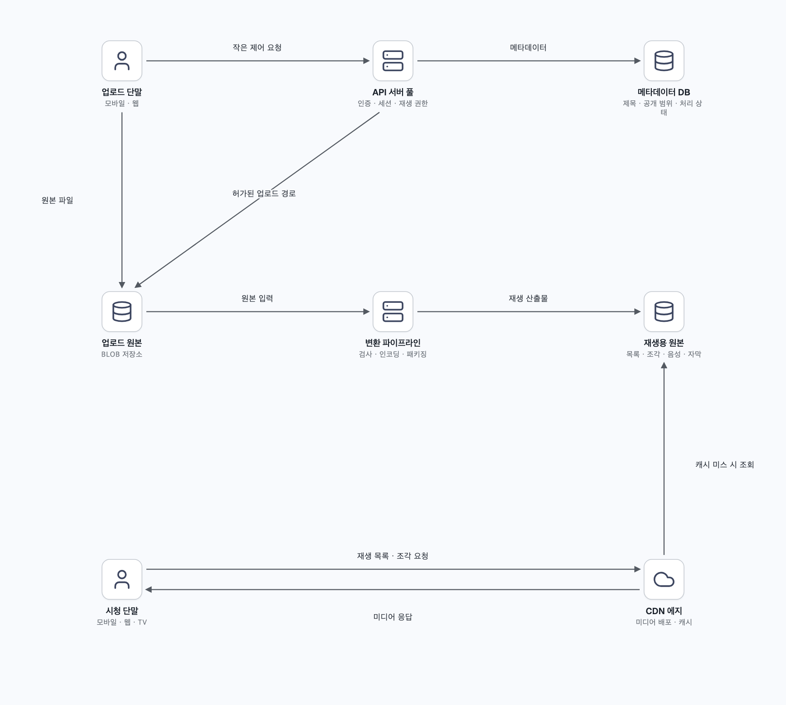
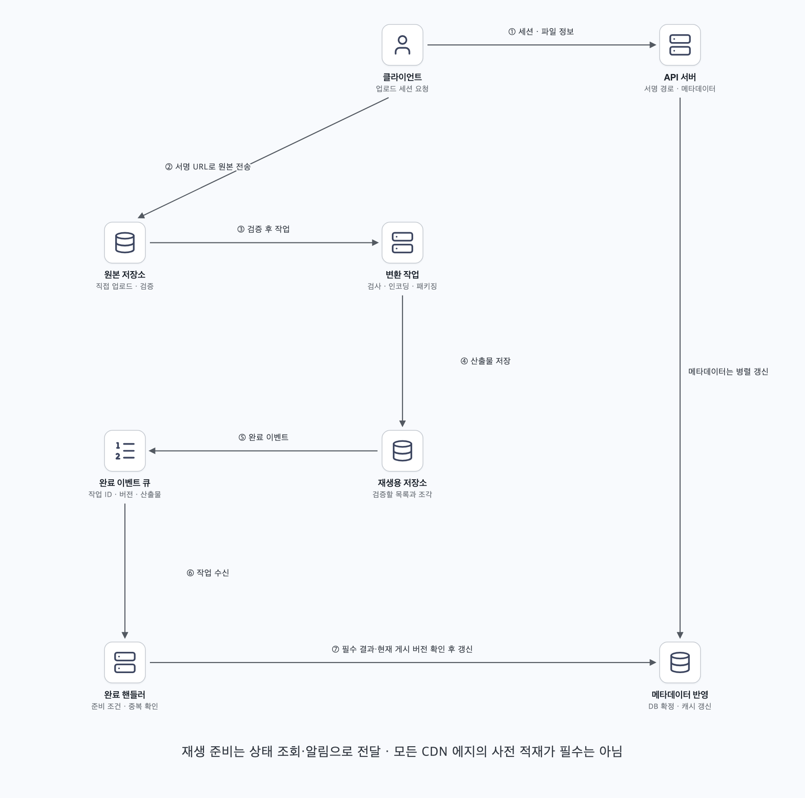
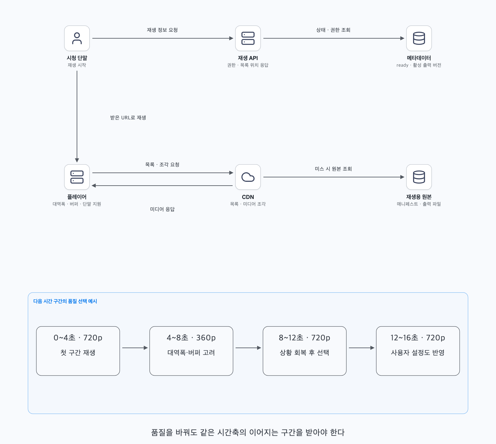
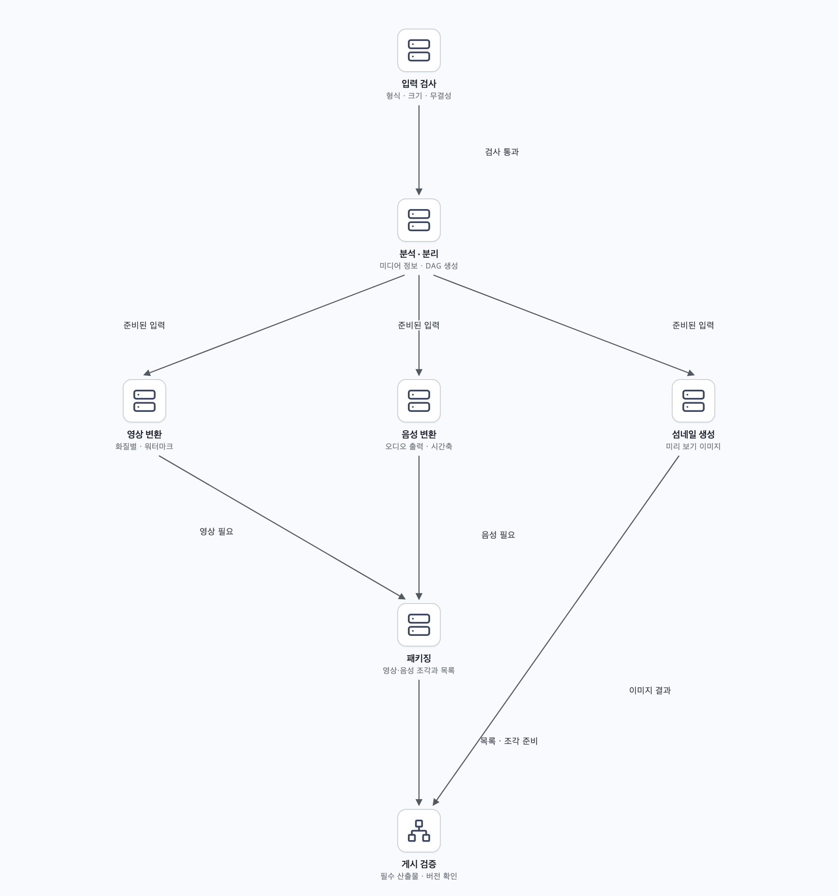
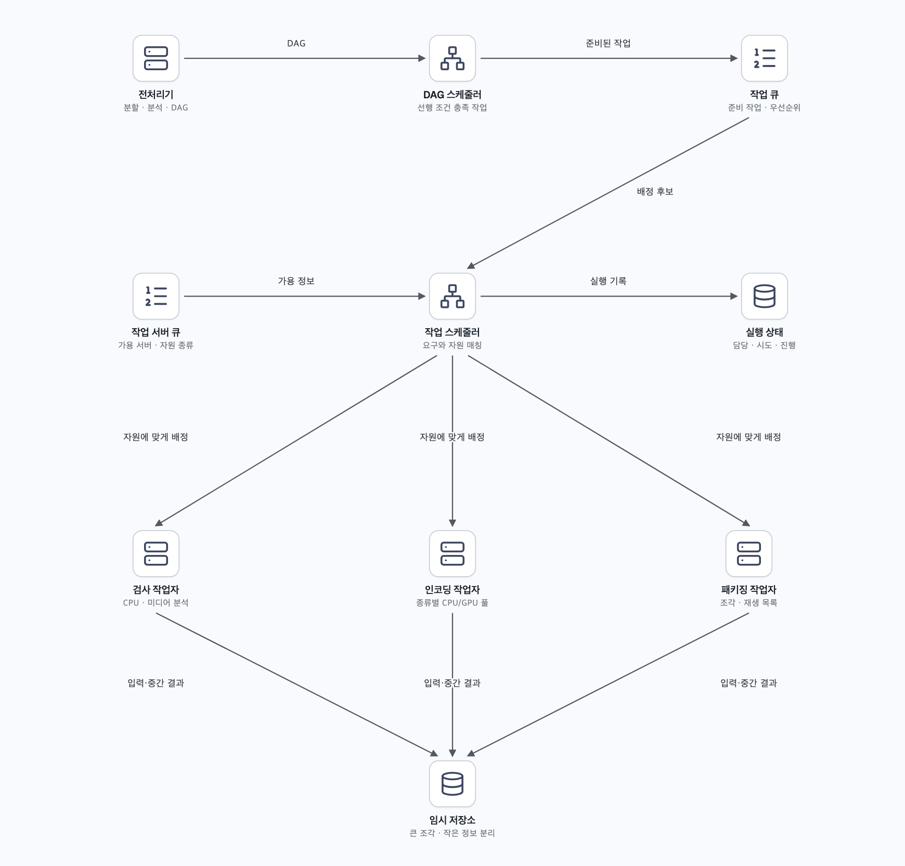
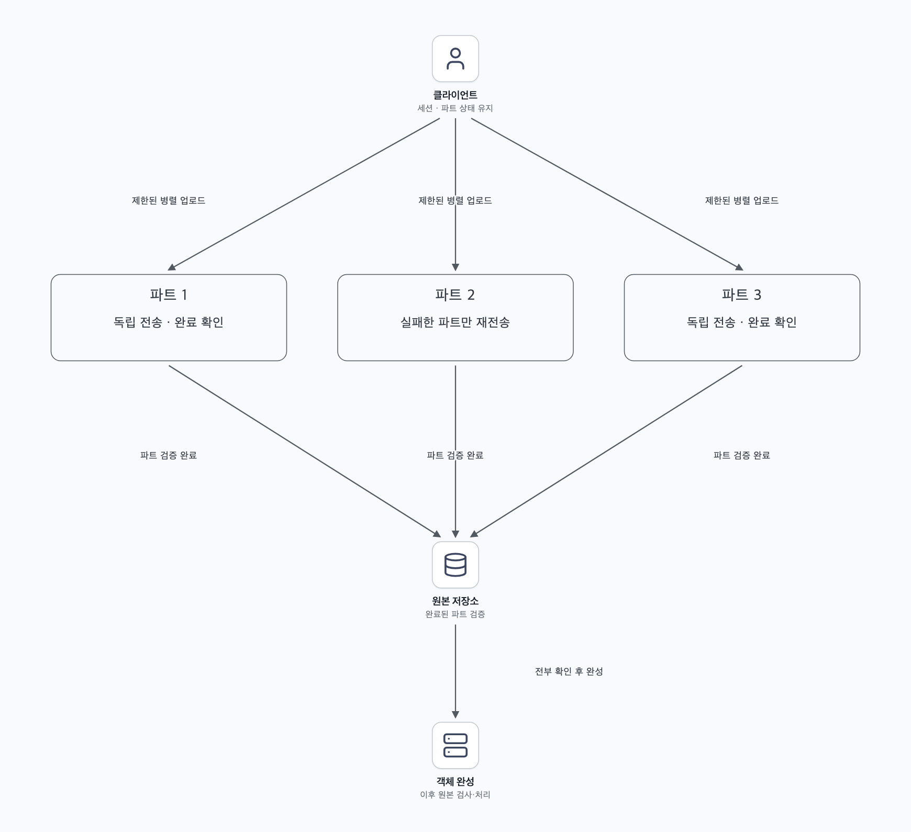
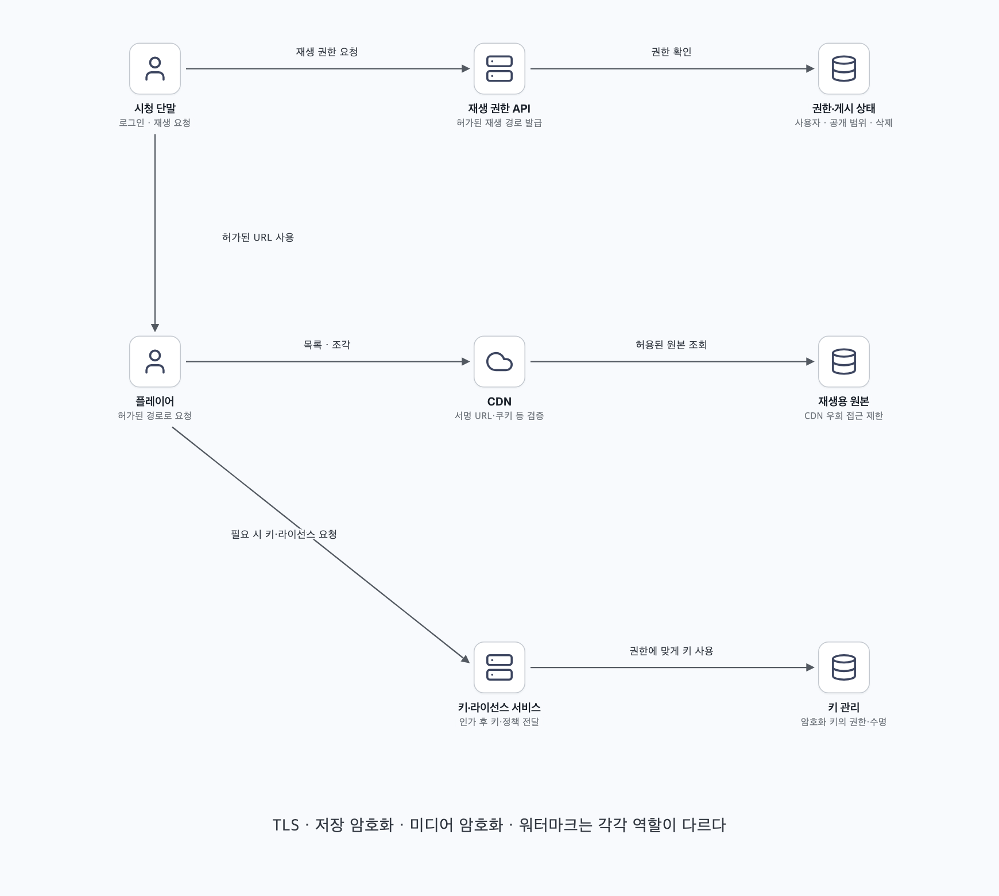
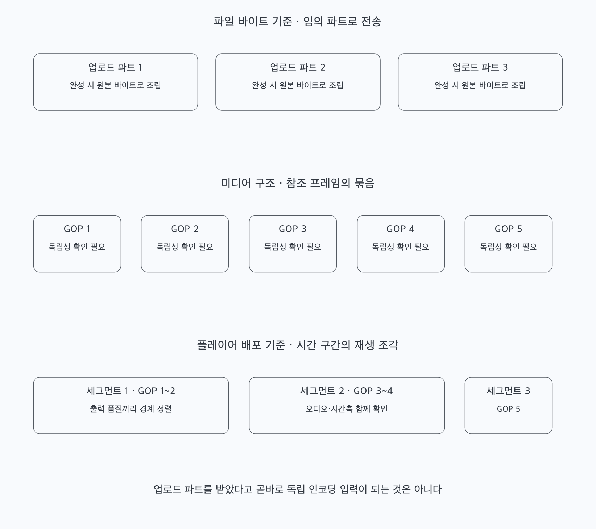
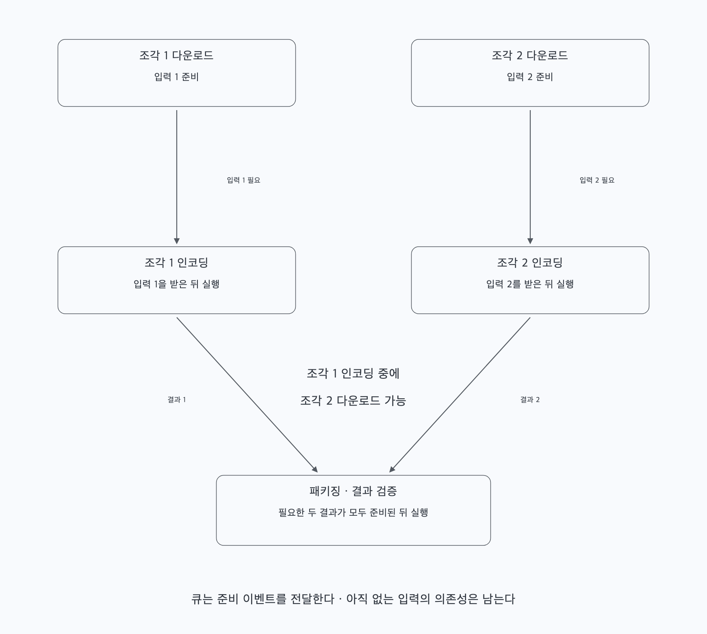
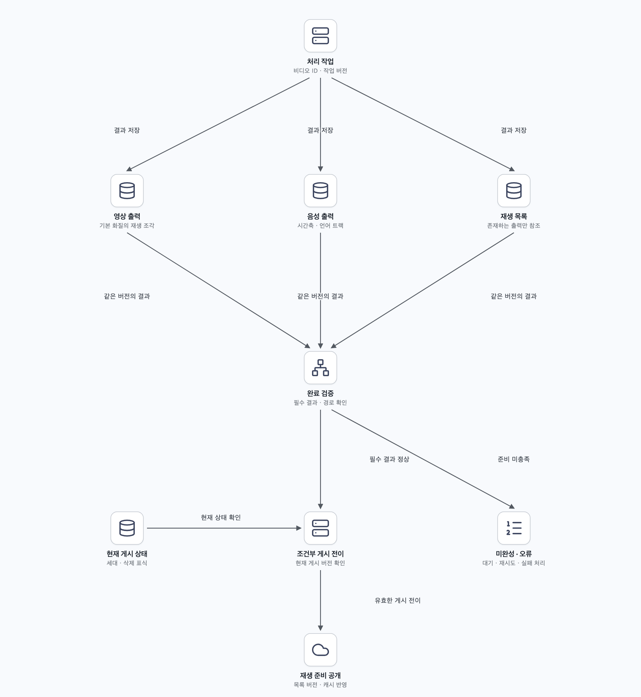

# 14장. 유튜브 설계

원본 비디오를 올리고 모바일·웹·TV에서 재생하기까지의 흐름을 따라간다. 파일 수신·변환·게시·미디어 전송을 나누고 병렬 처리·재시도·보호·비용의 조건을 살펴본다.

책 14장과 제공된 메모를 바탕으로 재구성했다. 개념·그림·심화 질문·복습 답안을 이 README에서 함께 읽는다.

## 목차

- [업로드에서 변환·재생·복구까지](#core-concepts)
- [질문 01 · GOP·업로드 파트와 병렬 처리](#q1)
- [질문 02 · 재생 준비와 멱등한 완료 처리](#q2)
- [질문 03 · CDN·원본 전송과 변환 비용](#q3)
- [스스로 답하기 · 답안 토글](#review)
- [책과 추가 설명의 범위](#sources)

---

## 비디오를 올리고 끊김 없이 재생하기

### 1. 유튜브 전체가 아니라 업로드와 녹화 영상 재생을 설계한다

사용자가 상품 사용법을 촬영해 올리고 다른 사람이 모바일·웹·TV에서 시청한다고 가정한다. 추천·댓글·광고·검색·구독까지 모두 설계하기보다, 업로드한 비디오를 여러 단말에서 재생하는 주문형 비디오(VOD)에 집중한다. 라이브 스트리밍은 마지막 확장 항목으로 남긴다.

일일 활성 사용자는 500만 명이며 평균 시청 시간은 30분이다. 파일은 최대 1GB, 다국어를 지원하고 폭넓은 입력 형식·해상도를 수용한다. 빠른 업로드·원활한 재생·품질 선택·낮은 비용·높은 가용성과 확장성·안정성이 목표이며 암호화가 필요하다.

“대부분의 형식 지원”은 무한한 조합을 약속한다는 뜻이 아니다. 입력 허용 형식, 생성할 출력 코덱·해상도·비트레이트, 단말별 재생 지원을 정하고 검증한다. 다국어는 제목·설명뿐 아니라 자막과 여러 오디오 트랙의 선택까지 범위를 구체화할 수 있다. 업로드 1GB 제한의 바이트 기준도 명시한다.

### 2. 용량은 업로드 원본·변환 결과·전송량을 나눠 계산한다

책은 하루 평균 5개 시청, 사용자 10%가 하루 한 개 업로드, 평균 원본 크기 300MB를 추가로 가정한다. 원본 증가는 `500만 × 10% × 300MB = 150TB/일`이다. 여러 해상도·코덱 출력과 임시 파일·복제·백업은 여기에 더해진다.

하루 시청 시간은 `500만 × 30분 = 1억 5천만 분`이다. 이를 하루 전체에 나누면 평균 동시 시청자는 약 10만 4천 명이며, 피크와 다중 세션은 별도로 추정한다. 평균 전송 비트레이트를 3Mbps라고 추가 가정하면 하루 미디어 전송량은 약 3.375PB다.

책의 파일 개수 기준으로 하루 5개의 300MB 영상을 모두 전송한다고 가정하면 약 7.5PB가 된다. 두 계산은 비트레이트·시청 구간·전송 크기 가정이 다르다. 업로드 파일 크기나 화질 이름만으로 재생 트래픽을 확정하지 않는다. 금액은 전송량과 적용 계약 단가로 계산하며 책에 나온 과거 CDN 가격을 현재 가격으로 사용하지 않는다.

### 3. API 경로와 대용량 파일 경로를 분리한다

API 서버는 인증·업로드 세션·제목과 공개 범위·처리 상태·재생 권한 같은 작은 요청을 처리한다. 비디오 바이트는 업로드 원본용 BLOB 저장소와 재생용 CDN을 통해 이동시킨다. BLOB은 비디오처럼 큰 이진 데이터를 객체로 보관하는 저장소다.

업로드 원본과 변환 결과는 객체 저장소에 지속적으로 남기고 CDN은 그 앞에서 배포·캐시를 담당한다. 논리적으로 저장소를 나눈다는 뜻이며 반드시 다른 업체를 써야 하는 것은 아니다. CDN이 비디오를 영구 보관하는 유일한 원본이라고 생각하지 않는다.

클라우드 객체 저장소·관리형 큐·트랜스코딩·CDN을 이용하면 서비스 전체의 설계에 집중할 수 있다. 그렇다고 내구성 설정·권한·비용·장애 복구까지 없어지는 것은 아니다. 무상태 API와 메타데이터 DB의 복제·샤딩은 별도로 확장한다.

### 4. 업로드를 허가하고 파일과 메타데이터를 각각 받는다

먼저 클라이언트가 API에 업로드를 요청한다. API는 사용자·용량 정책을 확인하고 비디오 ID·업로드 세션·대상 객체 키를 만든다. 클라이언트는 제한된 시간 동안 지정한 위치에 쓸 수 있는 사전 서명 URL 등을 받아 원본 저장소로 직접 올린다.

제목·설명·언어·공개 범위는 파일 전송과 병렬로 API에 저장할 수 있다. 이때 사용자 편집 필드와 트랜스코딩 상태를 분리해 완료 작업이 최신 제목을 오래된 값으로 덮어쓰지 않게 한다. 파일 수신 전의 메타데이터가 존재한다고 재생 가능한 것은 아니다.

사전 서명 URL은 특정 객체·동작·만료 범위를 위임하는 수단이다. URL을 가진 사람이 그 권한을 사용할 수 있고, 일반적으로 일회용이라는 보장은 없다. 같은 키의 덮어쓰기도 고려해 업로드별 키와 버전을 구분한다. 클라이언트의 완료 통지만 믿지 않고 실제 객체의 소유 세션·크기·체크섬·형식을 확인한다. 검증한 객체 버전으로 처리 입력을 고정해 뒤늦은 덮어쓰기가 입력 내용을 바꾸지 않게 한다. URL 자체가 1GB 제한이나 안전한 파일 형식을 자동 검증하지는 않는다. [S3 사전 서명 URL 설명](https://docs.aws.amazon.com/AmazonS3/latest/userguide/using-presigned-url.html)

### 5. 업로드 완료와 재생 준비 완료는 다르다

파일이 확인되면 처리 작업을 내구성 있게 접수한다. 작업 서버는 원본을 가져와 검사·트랜스코딩·패키징을 수행한다. 생성한 비디오 조각과 재생 목록은 변환 결과 저장소에 기록하고, 완료 이벤트를 받은 핸들러가 필요한 산출물을 확인해 메타데이터를 갱신한다.

책의 CDN 배포와 완료 처리 병렬 흐름은 독립적인 작업을 겹치는 방식이다. 어느 한쪽에서 완료 이벤트가 왔다는 이유만으로 파일 접근까지 모두 준비되었다고 판단하면 안 된다. 요구한 재생 형식·해상도의 파일과 재생 목록이 원본 경로에서 조회 가능하고, 게시 조건을 충족한 뒤 준비 상태를 노출한다. 모든 CDN 에지를 미리 채우는 것이 준비의 필수 조건은 아니다.

상태는 예를 들어 `uploading → uploaded → processing → ready`로 나누고 검증·변환 실패는 별도로 표시한다. 일부 기본 화질만 준비되면 먼저 공개하는 정책도 가능하지만, 아직 없는 화질을 재생 목록에 넣어서는 안 된다. 업로드 완료 알림과 재생 준비 알림도 구분한다.

상태 변경과 캐시 갱신은 자동으로 하나의 트랜잭션이 되지 않는다. DB의 게시 기준과 캐시 무효화·갱신을 연결하고, 클라이언트는 상태 조회나 알림으로 준비를 확인한다. 이벤트 중복·순서 역전·삭제와의 경쟁은 두 번째 질문에서 다룬다.

### 6. 원본을 왜 다시 인코딩할까

사용자가 올린 원본은 단말마다 코덱·해상도·비트레이트가 다르다. 하나의 파일을 그대로 보내면 재생하지 못하거나 현재 네트워크에서 너무 클 수 있다. **트랜스코딩**은 서비스가 정한 재생용 조합으로 변환하는 과정이다. 이미 압축된 원본을 다시 변환할 수도 있으며 원본이 항상 비압축 데이터인 것은 아니다.

**코덱**은 미디어를 압축·복원하는 방식이고, **컨테이너**는 영상·음성·자막·메타데이터를 담는 형식이다. MP4 같은 확장자만으로 안에 어떤 코덱이 있는지 모두 알 수 없다. 재생 호환성은 컨테이너뿐 아니라 코덱·프로파일·오디오·단말의 디코딩 지원에도 달린다.

여러 해상도와 비트레이트를 만들면 단말과 네트워크에 맞춰 선택할 수 있다. 원본보다 높은 해상도로 늘린다고 없던 세부 정보가 생기지는 않는다. 또 개별 출력은 작아도 여러 출력의 총합은 원본보다 커질 수 있다. 더 효율적인 압축으로 전송량을 줄이는 대신 인코딩 시간과 계산 비용이 늘어날 수 있다.

### 7. 스트리밍은 재생 목록과 짧은 조각을 차례로 받는다

HLS·MPEG-DASH 같은 HTTP 기반 적응형 스트리밍은 여러 품질의 미디어와 이를 설명하는 목록을 사용한다. HLS의 플레이리스트, DASH의 MPD 같은 매니페스트는 어떤 품질·음성·자막과 미디어 조각이 있는지 알려준다. 전송 프로토콜과 코덱은 다른 층이므로 지원 단말·플레이어와 함께 선택한다. 책에는 Smooth Streaming 등도 나오지만 기본 설명은 HTTP 적응형 재생에 집중한다.

1. 단말이 API에서 비디오 메타데이터·재생 권한·재생 목록 위치를 받는다.
2. 플레이어가 CDN에서 매니페스트와 필요한 품질의 목록을 읽는다.
3. 현재 대역폭·버퍼·단말 지원을 보고 미디어 조각을 요청한다.
4. 받은 조각을 버퍼에 쌓고 재생한다. 이후 구간은 상황에 따라 다른 품질로 요청할 수 있다.
5. 사용자가 수동 품질을 고르면 그 정책을 반영하되, 지원하지 않는 코덱이나 부족한 대역폭이 없어지는 것은 아니다.

이런 **적응형 비트레이트** 방식에서는 플레이어가 품질 선택의 주체가 된다. 원활한 전환을 위해 출력들 사이의 시간축·조각 경계·디코딩 시작점을 맞춰야 한다. 고화질과 무중단을 모든 네트워크에서 동시에 보장할 수는 없으므로 시작 지연·버퍼링·선택 품질의 교환을 정한다. [Apple HLS 개요](https://developer.apple.com/library/archive/referencelibrary/GettingStarted/AboutHTTPLiveStreaming/about/about.html), [RFC 8216](https://www.rfc-editor.org/rfc/rfc8216.html)

가까운 에지는 전송 지연을 줄일 수 있지만 캐시 미스·원본 접근·혼잡·단말 네트워크·초기 버퍼 때문에 항상 지연이 낮다는 보장은 없다. API 서버는 미디어 바이트를 매번 중계하지 않아도 재생 권한과 상태 요청을 처리한다.

### 8. GOP·업로드 파트·재생 세그먼트를 구분한다

비디오는 프레임 사이의 참조를 이용해 압축할 수 있다. **GOP**는 이런 프레임들의 묶음이다. 모든 GOP가 외부 참조 없이 단독 디코딩된다고 가정해서는 안 된다. 독립 처리·품질 전환을 하려면 키 프레임·닫힌 GOP 등 필요한 경계를 맞추는 설정을 고려한다. [MediaConvert GOP 설명](https://docs.aws.amazon.com/mediaconvert/latest/ug/video-quality.html)

반면 객체 저장소의 멀티파트 업로드는 파일 바이트를 나누어 보내는 전송 방식이다. 파트 경계가 프레임이나 GOP 경계와 같을 필요는 없다. 재생 세그먼트는 플레이어가 일정 시간의 미디어로 받는 출력 단위다. 하나에 여러 GOP가 들어갈 수도 있다.

책은 클라이언트가 GOP를 나누어 병렬 업로드하는 최적화를 설명한다. 클라이언트의 미디어 분석 기능이 부족하면 일반 멀티파트로 올리고 서버가 미디어 구조를 분석하는 방법도 있다. GOP로 분할하는 경우에는 헤더·오디오 동기화·참조 관계를 보존할 수 있어야 한다. 첫 번째 질문의 그림에서 세 단위를 비교한다.

### 9. 처리 파이프라인을 DAG로 표현한다

검사·비디오 변환·오디오 변환·자막 처리·섬네일·워터마크를 한 덩어리 함수로 만들면 재사용과 병렬화가 어렵다. 선행 작업의 결과를 받아 실행하는 관계를 **유향 비순환 그래프**(DAG)로 나타낸다. 노드는 작업이고 간선은 입력 의존성이다.

원본 검사와 분석이 끝나면 영상·음성·섬네일 작업을 독립적으로 실행할 수 있다. 여러 해상도 인코딩도 자원이 허용하면 병렬로 수행한다. 패키징은 자신에게 필요한 영상·음성 결과를 기다리고, 게시 검증은 필요한 파일과 목록을 확인한다. 워터마크는 포함할 출력의 인코딩 전후 관계에 맞춰 DAG에 넣는다.

서비스 개발자는 허용된 작업 조합과 의존성을 정의한다. 업로드 사용자가 임의 코드를 실행하는 기능과는 구분한다. DAG는 무엇이 먼저 필요한지 표현하며, 실제 병렬도는 CPU·GPU·메모리·디스크·네트워크와 비용 한도에 제한된다.

### 10. 전처리·스케줄링·실행·임시 저장의 역할을 나눈다

전처리기는 파일 구조와 메타데이터를 분석하고 필요한 미디어 분할과 DAG를 만든다. 복구에 필요한 입력 조각·작업 정의·진행 상태를 남겨 중간 실패 때 사용할 수 있게 한다. 작고 자주 읽는 메타데이터는 캐시에, 큰 비디오·오디오 조각은 BLOB 저장소에 둘 수 있다.

DAG 스케줄러는 선행 조건이 충족된 작업을 준비 상태로 만든다. 자원 관리자는 다음 정보를 바탕으로 실제 배정을 수행한다.

| 구성 | 역할 |
| --- | --- |
| 작업 큐 | 실행 가능한 작업·우선순위 보관 |
| 작업 서버 큐 | 사용 가능한 서버와 작업 종류·자원 정보 |
| 실행 큐·상태 | 실행 중인 작업·시도·담당 서버 추적 |
| 작업 스케줄러 | 작업 요구와 사용 가능 자원을 맞춰 배정 |
| 작업 실행 서버 | 검사·인코딩·패키징 등 맡은 작업 수행 |

작업자는 결과를 저장하고 완료 상태를 기록한다. 다음 작업은 그 입력과 완료 조건이 확인되어야 실행 가능하다. 임시 파일은 최종 산출물과 필요한 복구 의무가 확정된 뒤 정리하며, 버려진 업로드와 고아 작업에도 만료·정리 정책을 둔다. 단순히 어떤 작업 하나가 끝났다는 이유로 재시도에 필요한 입력을 삭제하지 않는다.

### 11. 업로드 속도는 분할 재시도와 근거리 경로로 개선한다

파일을 여러 파트로 나누어 제한된 동시성으로 올리면 대역폭을 활용하고 실패한 파트만 재전송할 수 있다. API는 업로드 ID·파트 번호·완료 상태를 추적하고, 모든 파트가 검증된 뒤 객체 완성을 요청한다. 업로드 동시성이 지나치면 단말·네트워크·저장소를 오히려 압박할 수 있다.

객체 저장소의 멀티파트 기능은 독립적인 파트 업로드와 조립을 제공한다. 재개하려면 업로드 세션과 완료된 파트 정보가 필요하며, 중단된 파트는 명시적으로 정리해야 할 수 있다. [S3 멀티파트 업로드](https://docs.aws.amazon.com/AmazonS3/latest/userguide/mpuoverview.html)

사용자 근처의 업로드 엔드포인트나 저장 지역을 선택하면 긴 네트워크 왕복을 줄일 수 있다. 다만 업로드를 받는 지역과 트랜스코딩·재생 원본 지역이 다르면 지역 간 전송과 복제 비용이 생긴다. 재생용 CDN을 쓴다는 사실만으로 같은 경로가 업로드도 가속하는 것은 아니다.

### 12. 큐는 의존성을 없애지 않고 준비된 조각을 겹쳐 처리한다

다운로드가 끝나야만 인코딩을 시작하는 단일 호출 구조라면 한 작업이 다른 작업을 붙잡고 기다린다. 내구성 큐로 완료 이벤트를 넘기면 생산자와 소비자를 독립적으로 확장하고, 먼저 준비된 조각을 다음 단계로 보낼 수 있다.

하지만 인코딩할 입력 자체가 아직 없다면 큐가 대신 만들어 주지는 않는다. 조각 1이 준비되면 그 조각을 인코딩하는 동안 조각 2를 내려받는 식으로 작업을 겹친다. 입력 전체가 필요한 작업은 여전히 전체를 기다려야 한다. 동기 호출 대기를 줄이는 것과 데이터 의존성을 제거하는 것은 다르다.

이벤트는 파일 전체 바이트 대신 작업 ID·입력 위치·버전·처리 종류 같은 참조를 담는다. 작업자의 장애나 확인 응답 유실로 재전달될 수 있으므로 같은 작업이 다시 실행되어도 게시 결과가 중복되거나 오래된 결과로 바뀌지 않도록 한다. 첫 번째 질문에서 병렬화의 경계를 살펴본다.

### 13. 암호화·접근 제어·워터마크는 역할이 다르다

전송 중에는 TLS, 저장 데이터에는 저장소 암호화와 키 관리를 적용할 수 있다. 유료·비공개 콘텐츠에는 재생 권한을 검사하고 CDN의 서명 URL·쿠키 등으로 제한한다. 원본 저장소에 직접 접근해 이 제한을 우회할 수 없도록 경로도 통제한다. [CloudFront 비공개 콘텐츠 설명](https://docs.aws.amazon.com/AmazonCloudFront/latest/DeveloperGuide/PrivateContent.html)

미디어 자체를 AES 등으로 암호화해 배포하면 복호화 키를 받을 권한과 키 수명도 관리해야 한다. DRM은 지원 단말·라이선스·키 전달과 재생 정책을 다루는 체계다. AES라는 알고리즘 이름만으로 DRM이나 사용자별 권한이 완성되는 것은 아니다. 워터마크는 출처·소유권 표시나 추적을 돕지만 다운로드를 물리적으로 막는 기능은 아니다.

암호화를 서버가 원문을 볼 수 없는 종단 간 암호화로 요구한다면 서버 트랜스코딩과의 양립 방식을 다시 정해야 한다. 이번 구성은 서버가 권한을 가지고 원본을 읽어 변환하는 VOD 서비스다.

### 14. 오류는 같은 작업의 안전한 재처리로 복구한다

파일 손상·지원하지 않는 입력처럼 같은 조건으로 반복해도 해결되지 않는 오류는 실패 이유를 기록하고 사용자에게 알린다. 일시적 네트워크·서버 장애는 제한된 횟수와 기한 안에서 백오프를 두어 재시도한다. 큐의 재전달과 작업자의 재실행을 정상 복구 과정으로 설계한다.

| 실패 지점 | 복구 방향과 확인할 조건 |
| --- | --- |
| 업로드 | 완료된 파트는 유지하고 실패 파트 재전송·무결성 확인 |
| 클라이언트 분할 | 원본 업로드 후 서버 전처리로 대체할 수 있는지 판단 |
| 전처리·DAG 생성 | 입력·정책 버전으로 재생성, 중복 DAG 구분 |
| DAG 스케줄러 | 내구성 작업 상태에서 준비 작업 재스케줄 |
| 자원 관리자 큐 | 복제본·로그로 복구, 실행 상태와 대조 |
| 작업 서버 | 다른 서버가 같은 작업 재시도, 결과 버전·시도 구분 |
| 완료 처리 | 필수 산출물 확인 후 조건부 상태 전이, 중복 이벤트 처리 |
| API·캐시 | 정상 서버로 우회, 캐시 미스가 원본을 압도하지 않게 제한 |
| 메타데이터 DB | 장애 감지·복제 지연을 고려한 승격, 단일 쓰기 권한 유지 |
| CDN·원본 경로 | 오류·적중률 관찰, 여유가 있는 대체 경로만 제한적으로 사용 |

주 서버 승격은 이름만 바꾸는 작업이 아니다. 이전 주 서버가 계속 쓰지 못하게 하고 새 주 서버의 데이터·복구 기준을 확인해야 한다. DB 복구 후에도 이미 큐에 있던 완료·삭제 작업과 상태를 대조한다.

### 15. 비용은 트래픽을 다른 곳으로 보내는 것만으로 줄지 않는다

인기 비디오는 CDN 캐시의 재사용 이점이 크다. 비인기 비디오를 직접 서버에서 제공하는 방식도 비교할 수 있지만 원본 인터넷 전송료·요청·서버 용량·지역 간 전송·장애 대응 비용이 추가된다. CDN을 통과하지 않으면 그 비용이 사라지는 대신 다른 비용이 생긴다. 캐시 적중률이 높아도 CDN에서 사용자에게 보내는 바이트 자체는 남는다.

모든 해상도를 미리 만들지 않고 기본 품질만 생성한 뒤 수요에 따라 추가 변환하는 방식은 계산·저장 비용을 줄일 수 있다. 반대로 첫 시청자가 변환을 기다리고 동시 요청이 몰릴 수 있다. 즉시 재생이 목표라면 최소 재생본을 먼저 준비하는 등 시작 지연의 조건을 정한다.

CDN 자체 구축과 ISP 제휴는 높은 규모·운영 역량이 있을 때의 장기 선택이다. 책의 기본 범위처럼 클라우드를 이용하는 면접 설계에서 곧바로 직접 구축을 전제하지 않는다. 비용의 수치 비교는 세 번째 질문에서 가정과 단가를 나누어 설명한다.

### 16. 게시 중단·라이브·운영 지표까지 경계를 이어 간다

비디오 삭제·비공개 전환은 메타데이터만 지우는 것으로 끝나지 않는다. 새 재생 권한 발급을 중단하고 원본·출력·목록·CDN 캐시·키/라이선스 경로에 정책을 반영한다. 늦게 끝난 트랜스코딩 작업이 삭제된 영상을 다시 공개하지 않게 게시 버전을 검사한다. 이미 사용자 단말에 내려간 복사본을 서버가 회수할 수 있다고 보장하지 않는다.

라이브는 입력이 계속 생기며 실시간 인코딩·짧은 지연·계속 바뀌는 목록·새 조각 배포를 다룬다. VOD의 완성된 파일 전체 처리를 그대로 재사용할 수는 없다. 낮은 지연과 버퍼 안정성, 장애 뒤 이어 보는 정책을 별도로 정한다.

업로드 성공률·재개율·원본 수신부터 ready까지의 시간·작업 큐 나이·화질별 변환 실패·중복 작업 비용을 본다. 재생 시작 시간·버퍼링 비율·재생 오류·품질 전환·단말별 호환성·CDN 적중률·원본 트래픽·전송 단가도 관찰한다. 전체 평균뿐 아니라 지역·클라이언트·콘텐츠별 편차를 봐야 빠른 업로드와 원활한 재생을 함께 판단할 수 있다.

[목차로 돌아가기](#contents)

---

## 질문 01. GOP를 나누고 큐를 넣으면 모든 단계가 기다리지 않아도 될까?

### 1. 세 가지 조각은 목적이 다르다

업로드 파트는 파일 바이트의 일부다. 객체 저장소는 파트를 다시 조립해 원본 파일을 만든다. 중간 파트만으로는 미디어 헤더나 앞 프레임이 없어 영상으로 해석할 수 없을 수 있다.

GOP는 압축 프레임들의 구조다. 독립적인 디코딩이 가능한 경계인지 확인해야 하며, 비디오만 잘라 오디오·타임스탬프를 잃으면 최종 재생이 깨진다. 재생 세그먼트는 플레이어에게 배포할 시간 구간의 미디어다. 서로 다른 품질에서 전환하려면 해당 시점의 경계와 디코딩 조건을 맞춘다.

따라서 임의의 바이트 파트를 전송한 직후 그대로 독립 인코딩 작업으로 넘기는 것은 일반적인 해결책이 아니다. 미디어 구조를 분석한 조각과 필요한 부가 정보가 준비된 경우에만 단계별 파이프라인 처리를 검토한다.

### 2. 큐를 쓰면 호출 결합은 줄지만 입력 의존성은 남는다

예를 들어 조각 1의 내려받기가 끝났고 조각 2는 진행 중이라고 하자. 인코더가 조각 1만으로 처리할 수 있으면 1의 완료 이벤트를 큐에서 받아 먼저 인코딩할 수 있다. 같은 시간에 다운로드 작업자는 조각 2를 받는다.

이때 “인코더가 다운로드 완료를 기다리지 않는다”는 말은 파일 전체나 동기 호출의 반환을 기다릴 필요가 줄었다는 뜻이다. 자기 입력 조각이 준비되기 전부터 인코딩한다는 뜻은 아니다. 두 조각을 합친 결과가 필요한 패키징은 필요한 입력을 모두 기다린다.

### 3. 병렬도가 높아도 총 시간은 무한히 줄지 않는다

독립 해상도나 조각은 자원 한도 안에서 병렬로 처리할 수 있다. 하지만 검사·분석·최종 검증 같은 선행·후행 작업, 가장 느린 필수 작업, 원본 저장소와 네트워크 병목은 남는다. 작업 큐가 길다는 사실만으로 서버를 늘리지 않고 병목과 비용·동시성 한도를 확인한다.

분할 실패 시 전체 원본을 서버에 올려 분할하도록 하는 대안도 있다. 재전송으로 이미 검증한 데이터를 다시 보내는 비용과 클라이언트 지원 범위를 비교한다. 성능 최적화는 복구 가능한 입력과 정확한 결과를 유지하는 범위에서 적용한다.

[목차로 돌아가기](#contents)

---

## 질문 02. 완료 이벤트를 받으면 바로 ready로 바꿔도 될까?

### 1. 파일과 상태가 별개로 움직인다

360p 변환 완료 이벤트를 받았지만 오디오·재생 목록이 아직 없거나 목록이 가리키는 파일 경로가 잘못되었다면 사용자는 재생할 수 없다. 완료 이벤트는 어느 작업의 어떤 버전이 끝났다는 신호로 다루고, 서비스의 게시 조건과 구분한다.

기본 화질로 먼저 공개할 정책이라면 그 재생에 필요한 산출물만 필수로 정의할 수 있다. 1080p가 나중에 완성되면 검증한 뒤 목록에 추가한다. 아직 없는 파일을 목록에 먼저 광고하지 않는다.

### 2. 한 번의 원자적 객체 쓰기가 모든 파일의 게시를 뜻하지 않는다

비디오·오디오·목록은 여러 객체다. 새 작업 버전의 별도 경로에 결과를 쓰고 검증한 뒤, 완성된 재생 목록과 메타데이터의 활성 버전을 공개하는 방법을 고려한다. 저장소가 제공하지 않는 여러 객체·DB의 단일 트랜잭션을 가정해서는 안 된다.

완료 핸들러는 비디오 ID·입력/출력 버전·필수 작업 상태와 삭제 여부를 확인해 조건부로 ready 전이를 수행한다. DB 갱신과 알림 발행 사이의 의무는 아웃박스 등으로 연결하고 캐시를 무효화하거나 갱신한다. 모든 에지에 미리 복사했는지 대신, 해당 배포 경로에서 필요한 원본을 가져올 수 있는지 확인한다.

### 3. 재시도와 늦은 완료가 기존 상태를 되돌리지 않게 한다

작업 서버가 출력 파일을 저장한 뒤 완료 기록 전에 죽으면 같은 작업이 다시 실행될 수 있다. `(비디오 ID, 작업 버전, 작업 종류, 출력 규격)` 같은 논리 작업 키를 유지하고 결과를 멱등하게 확정한다. 실행 시도는 따로 구분해 오래된 작업자가 새 결과를 덮어쓰지 못하게 한다.

객체 저장소 이벤트도 중복을 고려해야 한다. 예를 들어 S3 이벤트 알림은 최소 한 번 전달을 전제로 한다. 이를 정확히 한 번의 작업 실행으로 읽으면 안 된다. [S3 이벤트 알림](https://docs.aws.amazon.com/AmazonS3/latest/userguide/EventNotifications.html)

사용자가 삭제한 뒤 옛 작업이 완료되어도 게시 상태가 부활하면 안 된다. 삭제 표식과 게시 세대·상태 조건을 확인해 늦은 결과를 비활성 상태로 두고 정리한다. 임시 파일 정리 역시 최종 확정과 재시도 의무를 확인한 뒤 수행한다. 같은 작업이 여러 번 완료되거나 이벤트 순서가 바뀌어도 게시 결과가 일관되게 유지되어야 한다.

[목차로 돌아가기](#contents)

---

## 질문 03. 비인기 비디오를 직접 보내면 CDN보다 항상 저렴할까?

### 1. 같은 시청 시간을 서로 다른 용량으로 계산할 수 있다

500만 명이 하루 30분 시청하고 평균 전송률이 3Mbps라면 하루 바이트는 `500만 × 1,800초 × 3,000,000bit/s ÷ 8`로 약 3.375PB다. 책처럼 300MB 파일을 하루 5개씩 모두 전송한다고 잡으면 7.5PB다. 입력 가정이 다른 것이므로 둘 중 하나를 실제 서비스 측정값으로 고정하지 않는다.

1GB 업로드 제한도 시청 시 1GB를 전송한다는 뜻은 아니다. 실제로 받은 구간·품질·되감기·선행 다운로드·오디오·재시도에 따라 전송량이 달라진다. 비용을 줄이려면 재생 지표와 함께 전송 바이트를 측정한다.

### 2. 비용이 없어지는 대신 다른 경로로 옮겨질 수 있다

| 비용 항목 | CDN 경유 | 직접 제공 |
| --- | --- | --- |
| 사용자 전송 | CDN 전송 단가·지역·계약 | 원본 인터넷 전송 단가·대역폭 |
| 원본 접근 | 캐시 미스·재검증·원본 가져오기 | 대다수 요청을 직접 감당 |
| 요청·연산 | CDN 요청·보안·로그 등 | 서버·로드 밸런서·TLS·연결 처리 |
| 장애·운영 | CDN 설정·원본 보호·필요 시 대체 | 지역 배치·증설·보호·운영 직접 부담 |
| 미디어 저장·변환 | 별도 원본·출력·변환 비용 존재 | 같은 비용이 여전히 존재 |

같은 기간·지역·바이트에서 전송·요청·원본·서버·운영 비용을 합산해 비교한다. CDN 적중률이 높으면 원본 부하는 줄지만 사용자에게 나가는 CDN 바이트는 남는다. 비인기 콘텐츠라도 CDN이 더 저렴하거나 운영 부담이 작을 수 있고, 반대 경우도 가능하다. 현재 계약과 서비스 품질을 확인해야 한다.

### 3. 필요할 때 인코딩하는 선택도 지연을 지불한다

모든 변형을 미리 만들면 사용되지 않는 출력에 계산·저장 비용을 쓴다. 수요가 생긴 후 만들면 낭비는 줄지만 첫 요청의 대기와 중복 변환 위험이 생긴다. 기본 재생본은 준비해 두고 추가 고화질·코덱만 지연 생성하거나, 같은 출력을 요청한 사용자의 변환 작업을 합치는 방법이 가능하다.

직접 CDN을 만들고 ISP와 제휴하는 선택은 단순한 캐시 서버 추가가 아니다. 충분한 규모·지역 운영·망·장애 대응 역량이 필요하다. 면접의 클라우드 활용 범위 안에서는 관리형 경로로 시작하고 실제 트래픽과 비용에서 근거가 생겼을 때 대안을 비교한다.

[목차로 돌아가기](#contents)

---

## 스스로 답하기

흐름과 실패 조건을 먼저 설명한 뒤 토글의 실제 답안을 확인한다.

01. 이번 설계의 기본 범위는 무엇인가?

모바일·웹·TV에서 녹화 비디오를 올리고 재생하는 VOD다. 추천·광고·댓글·라이브 전체를 한 번에 설계하지 않는다.

02. 500만 DAU와 30분 시청으로 평균 동시 시청을 어떻게 추정하는가?

총 1억 5천만 분을 하루 1,440분으로 나누면 약 10만 4천 명이다. 피크와 다중 세션은 별도로 고려한다.

03. 평균 원본 300MB·하루 10% 업로드라면 증가량은?

500만 × 10% × 300MB = 약 150TB/일이다. 변환 출력·임시 파일·복제·백업은 제외한 원본 추정이다.

04. 평균 3Mbps·30분 시청의 하루 전송량은?

500만 × 1,800초 × 3,000,000 ÷ 8로 약 3.375PB다. 평균 비트레이트라는 추가 가정이 있다.

05. 책의 7.5PB 전송 추정과 3.375PB는 왜 다른가?

책의 하루 5개·300MB 전체 전송 가정과 평균 3Mbps·30분 가정이 다르다. 실제 시청 구간과 비트레이트를 측정해야 한다.

06. API와 파일 경로를 나누는 이유는 무엇인가?

인증·메타데이터·상태 같은 작은 요청과 대용량 업로드·재생을 분리해 API가 매번 미디어 바이트를 중계하지 않게 한다.

07. 원본 저장소·변환 저장소·CDN은 어떤 차이가 있는가?

업로드 원본과 재생용 산출물은 지속 저장하고 CDN은 배포·캐시를 담당한다. CDN을 유일한 영구 원본으로 보지 않는다.

08. 사전 서명 URL은 무엇을 제한하는가?

발급 주체 권한 안에서 지정 객체·동작·만료 등에 대한 접근을 위임한다. URL 보유자가 권한을 사용할 수 있어 취급과 범위를 관리한다.

09. 사전 서명 URL이면 일회용·1GB 검증도 자동인가?

아니다. 반복 사용·동일 키 덮어쓰기를 고려하고 실제 객체 크기·체크섬·형식과 업로드 세션을 서버에서 확인한다.

10. 파일 업로드와 메타데이터 저장을 병렬화할 때 무엇을 조심하는가?

제목·공개 범위 편집과 처리 상태를 분리하고 완료 핸들러가 사용자 최신 편집을 덮어쓰지 않게 한다. 메타데이터 존재가 재생 준비는 아니다.

11. uploaded와 ready는 같은가?

원본 수신과 재생용 파일·목록·게시 조건 충족은 다른 단계다. 완료 의미와 상태를 구분한다.

12. 모든 CDN 에지를 채워야 ready인가?

아니다. 필요한 산출물과 배포 가능한 원본 경로를 검증한다. 에지는 요청 시 가져올 수 있지만 초기 미스 지연은 고려한다.

13. 코덱과 컨테이너는 어떻게 다른가?

코덱은 압축·복원 방식이고 컨테이너는 영상·음성·자막 등을 담는 형식이다. 확장자만으로 코덱과 단말 호환성을 확정하지 않는다.

14. 원본은 항상 비압축 영상인가?

사용자가 올린 원본도 이미 압축되어 있을 수 있다. 서비스의 출력 규격을 만들려고 다시 변환할 수 있다.

15. 트랜스코딩하면 총 저장량이 항상 줄어드는가?

개별 출력은 작아도 여러 화질·코덱의 합계는 원본보다 커질 수 있다. 계산 시간과 전송 절감도 함께 본다.

16. 프로토콜 HLS·DASH와 영상 코덱은 같은 층인가?

아니다. 목록·조각 전달과 재생 절차, 미디어 압축 형식을 구분하고 단말·플레이어가 지원하는 조합을 고른다.

17. 매니페스트에는 무엇이 들어 있는가?

품질·음성·자막과 미디어 조각의 위치·구성 정보다. HLS 플레이리스트나 DASH MPD 등이 해당한다.

18. 적응형 비트레이트에서 누가 다음 품질을 고르는가?

일반적으로 플레이어가 대역폭·버퍼·단말 지원·사용자 설정을 보고 다음 구간 품질을 선택한다.

19. 품질 전환 때 해상도 파일만 여러 개 있으면 충분한가?

시간축·조각 경계·독립 디코딩 조건·오디오 동기화도 맞아야 한다.

20. 가까운 CDN이면 무조건 버퍼링이 없는가?

캐시 미스·원본 지연·혼잡·단말 망 상태와 버퍼 정책이 남는다. 가까움은 도움이 되지만 무조건 보장은 아니다.

21. GOP는 무엇이고 독립 처리가 항상 가능한가?

참조 관계를 가진 압축 프레임 묶음이다. 외부 참조·키 프레임·닫힌 GOP 등 조건을 확인해야 한다.

22. 업로드 파트와 GOP·재생 세그먼트는 같은가?

파트는 바이트 전송 단위, GOP는 압축 프레임 구조, 세그먼트는 재생 시간 구간이다. 경계가 서로 같을 필요는 없다.

23. 임의 바이트 파트를 받으면 곧바로 독립 인코딩할 수 있는가?

헤더·참조 프레임·오디오 정보가 없을 수 있다. 미디어 처리가 가능한 입력 구조와 부가 정보를 먼저 준비해야 한다.

24. DAG의 노드와 간선은 무엇인가?

노드는 검사·변환·패키징 같은 작업이고 간선은 선행 입력 의존성이다. 필요한 입력이 끝난 작업만 실행할 수 있다.

25. DAG가 있으면 모든 작업이 병렬인가?

독립 작업만 자원 한도 안에서 병렬화한다. 선행 검사·최종 패키징·필수 결과 검증의 의존성은 남는다.

26. 전처리기는 무엇을 하는가?

원본 분석·필요한 분할·DAG 생성과 복구용 메타데이터·입력 조각 보관 등을 수행한다.

27. DAG 스케줄러와 자원 관리자는 어떻게 다른가?

전자는 의존성이 충족된 작업을 준비하고, 후자는 작업 요구와 사용 가능한 서버·자원을 맞춰 실행을 배정한다.

28. 작업 큐·작업 서버 큐·실행 상태는 무엇을 보관하는가?

실행 가능한 작업·가용 작업자·실행 중인 작업과 시도 및 담당을 각각 추적한다.

29. 큰 비디오 조각과 작은 작업 메타데이터는 어디에 둘 수 있는가?

큰 조각은 BLOB 저장소, 작고 자주 읽는 정보는 캐시·작업 상태 저장소를 쓸 수 있다. 복구 기준은 내구성 있게 남긴다.

30. 임시 입력은 어떤 작업 하나가 끝나면 바로 지워도 되는가?

후속 작업·재시도·최종 확정에 필요할 수 있다. 남은 의무와 보존 기한을 확인한 뒤 정리한다.

31. 멀티파트의 일부가 실패하면 전체를 처음부터 올리는가?

완료 파트를 추적하고 실패 파트만 재전송할 수 있다. 모든 파트 검증 후 객체 완성을 요청한다.

32. 파트 병렬도를 무제한으로 늘리면 좋은가?

단말·망·저장소 한도와 재시도 비용을 압박할 수 있다. 대역폭과 지연에 맞춰 동시성을 제한한다.

33. 근처 업로드 센터와 재생 CDN은 같은 최적화인가?

다른 경로다. 업로드 엔드포인트의 지역과 변환·원본 지역 간 전송 비용을 따로 보고 CDN이 업로드도 자동 가속한다고 가정하지 않는다.

34. 큐를 넣으면 인코더는 자기 입력을 기다리지 않아도 되는가?

아니다. 준비된 조각은 먼저 처리할 수 있지만 그 조각과 필요한 부가 정보가 없으면 기다려야 한다.

35. 조각 1 인코딩과 조각 2 다운로드를 겹칠 조건은 무엇인가?

조각 1이 독립적으로 처리 가능한 입력과 메타데이터를 갖추고 있어야 한다. 최종 결합은 필요한 모든 결과를 기다린다.

36. 큐 메시지에는 비디오 전체를 넣는가?

보통 작업·버전·입력 위치·처리 종류 등 참조를 넣고 큰 바이트는 객체 저장소에서 읽는다.

37. TLS·저장 암호화·미디어 암호화는 어떻게 다른가?

전송 구간·보관 데이터·배포 미디어를 각각 보호한다. 키 관리와 실제 재생 권한을 함께 설계한다.

38. AES·DRM·워터마크는 서로 대신할 수 있는가?

AES는 암호 알고리즘, DRM은 키·라이선스·재생 정책의 체계, 워터마크는 표시·추적 수단이다. 하나만으로 나머지가 자동 구현되지 않는다.

39. CDN을 제한해도 원본이 공개라면 무엇이 문제인가?

원본 URL로 접근해 CDN 권한 검사를 우회할 수 있다. 매니페스트·조각·원본·키 경로를 함께 통제해야 한다.

40. 종단 간 암호화 요구는 서버 트랜스코딩과 어떤 관계인가?

서버가 원문을 읽을 수 없게 하면 변환 위치와 키 접근 방식을 재설계해야 한다. 단순 저장 암호화와 다르다.

41. 완료 이벤트 하나를 받으면 바로 ready로 바꿔도 되는가?

그 작업 버전과 필수 비디오·오디오·목록·게시 조건을 확인해야 한다. 아직 없는 화질을 목록에 포함하지 않는다.

42. 출력 파일 저장 후 완료 기록 전에 작업자가 죽으면?

같은 작업이 다시 실행될 수 있다. 논리 작업 키·출력 버전·실행 시도를 구분하고 결과와 게시를 멱등하게 확정한다.

43. 객체 저장소 이벤트가 정확히 한 번의 실행을 보장하는가?

예를 들어 S3 알림은 최소 한 번 전달을 전제로 하므로 중복 완료와 재실행을 고려한다.

44. 삭제 후 옛 트랜스코딩이 끝나면 어떻게 하는가?

게시 버전·삭제 표식·상태 조건을 확인해 재공개를 막고 오래된 산출물은 비활성 상태로 정리한다.

45. 복구 불가능한 입력 오류도 계속 재시도하는가?

같은 입력으로 해결되지 않으면 실패 이유를 기록하고 사용자에게 알린다. 일시 오류만 횟수·기한·백오프를 두어 재시도한다.

46. DB 승격 시 무엇을 확인해야 하는가?

이전 주 서버의 쓰기 차단·복제 지연·새 주 서버의 데이터와 복구 기준을 확인해 두 주 서버가 동시에 쓰지 않게 한다.

47. 비인기 비디오를 원본 서버에서 보내면 항상 싼가?

원본 전송료·서버·지역·연결 처리·장애 대응 비용까지 비교해야 한다. CDN 비용이 다른 경로로 이동할 수 있다.

48. 수요 기반 인코딩은 어떤 대가를 지불하는가?

사용되지 않을 출력의 비용을 줄이는 대신 첫 재생 대기와 중복 변환 위험을 부담한다. 기본 재생본을 먼저 만들 수 있다.

49. 라이브는 완성된 VOD 파일 처리와 무엇이 다른가?

계속 생기는 입력·짧은 지연·갱신되는 목록·연속 조각 배포·장애 후 이어 보기를 다룬다.

50. 어떤 지표로 업로드와 재생 품질을 확인하는가?

업로드·재개 성공률·ready 지연·큐 나이·변환 실패와 비용, 재생 시작·버퍼링·품질 전환·지역/단말별 오류·CDN/원본 트래픽을 함께 본다.

[목차로 돌아가기](#contents)

---

## 책 대조 범위와 출처

제공된 책 사진 14장 247~275쪽(IMG_0906~IMG_0934)과 사용자 메모를 대조했다. 요구사항·규모 추정 → 원본 업로드와 메타데이터 → 스트리밍 → 트랜스코딩·DAG·자원 관리 → 속도·보호·비용 → 오류·확장 순서로 재구성했다. 문장과 그림은 복습을 위한 자체 설명이다.

GOP·업로드 파트·재생 세그먼트의 차이, 큐와 입력 의존성, ready의 게시 조건, 멱등한 완료·삭제와의 경쟁, CDN과 지속 원본의 구분, 암호화와 권한, 직접 제공 비용의 조건은 보충 설명이다. 책의 과거 서비스 통계·클라우드 단가는 현재 값으로 인용하지 않았다.

- [S3 사전 서명 URL](https://docs.aws.amazon.com/AmazonS3/latest/userguide/using-presigned-url.html): 객체·동작·만료 범위와 반복 사용·덮어쓰기 조건.
- [S3 멀티파트 업로드](https://docs.aws.amazon.com/AmazonS3/latest/userguide/mpuoverview.html): 바이트 파트의 독립 업로드·실패 파트 재전송·완성과 정리.
- [S3 이벤트 알림](https://docs.aws.amazon.com/AmazonS3/latest/userguide/EventNotifications.html): 최소 한 번 전달과 중복 처리의 경계.
- [Apple HLS 개요](https://developer.apple.com/library/archive/referencelibrary/GettingStarted/AboutHTTPLiveStreaming/about/about.html): 보관 문서에서 변형·목록·세그먼트·적응형 재생의 기본 흐름을 참고했다. 오래된 코덱·세그먼트 길이 예시를 모든 현재 단말의 필수 설정으로 사용하지 않았다.
- [RFC 8216](https://www.rfc-editor.org/rfc/rfc8216.html): HLS 목록·미디어 세그먼트·클라이언트 동작을 설명하는 RFC다. 최신 제품별 지원 전체를 대신하는 자료는 아니다.
- [MediaConvert GOP 설명](https://docs.aws.amazon.com/mediaconvert/latest/ug/video-quality.html): 프레임 참조와 GOP·품질·호환성의 관계.
- [CloudFront 비공개 콘텐츠](https://docs.aws.amazon.com/AmazonCloudFront/latest/DeveloperGuide/PrivateContent.html): CDN 서명 접근과 원본 우회 방지.
- [10장 알림 시스템](../10-notification/README.md): 아웃박스·재시도·중복 처리 경계를 연결한다.
- [stack-diagram](https://stacks.caru.moe/): 기존 장과 같은 그림 구성 방식과 아이콘 표현을 참고했다.

비디오 크기·업로드 비율·시청 횟수·평균 비트레이트는 계산의 가정이다. 3.375PB와 7.5PB는 서로 다른 가정에 따른 전송량이며 실제 서비스 관측값이 아니다. 워크플로 예시 검증은 실제 클라우드 장애·코덱 호환성·성능 벤치마크를 대신하지 않는다.

[목차로 돌아가기](#contents)

---
