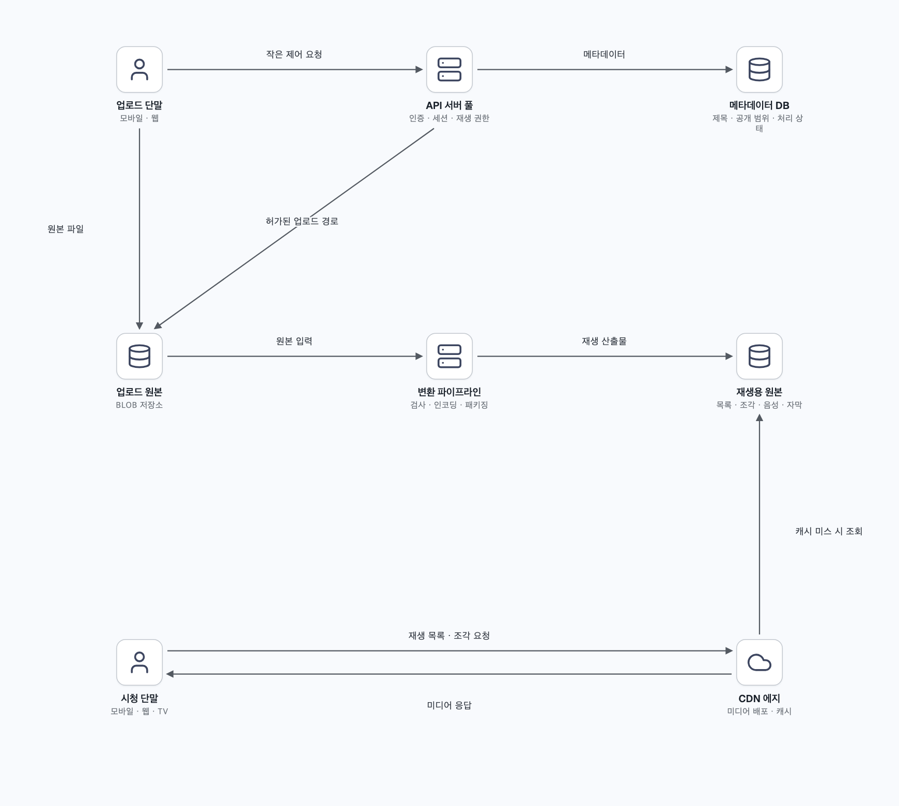
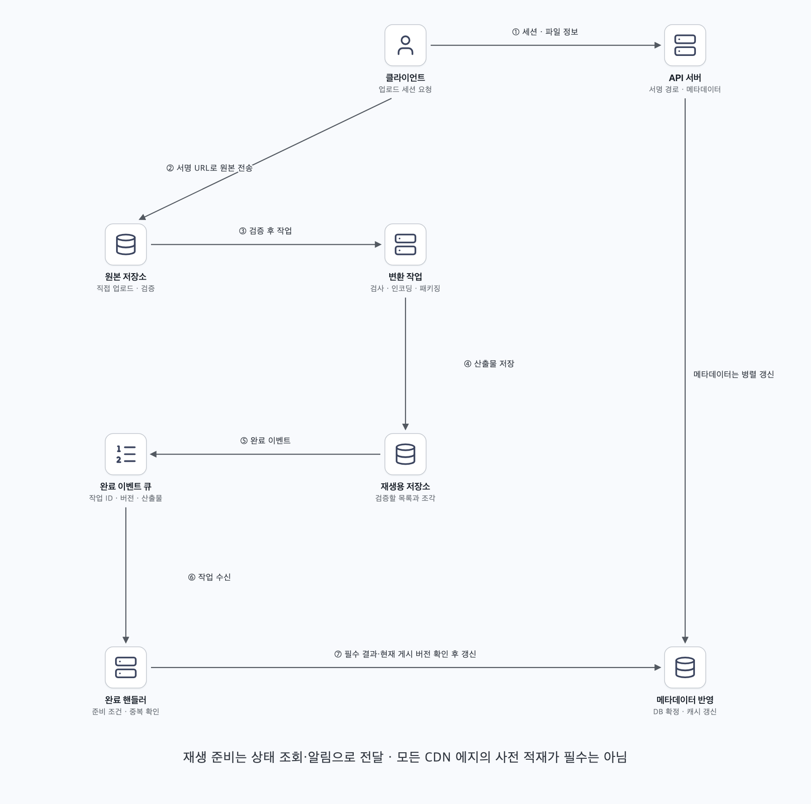
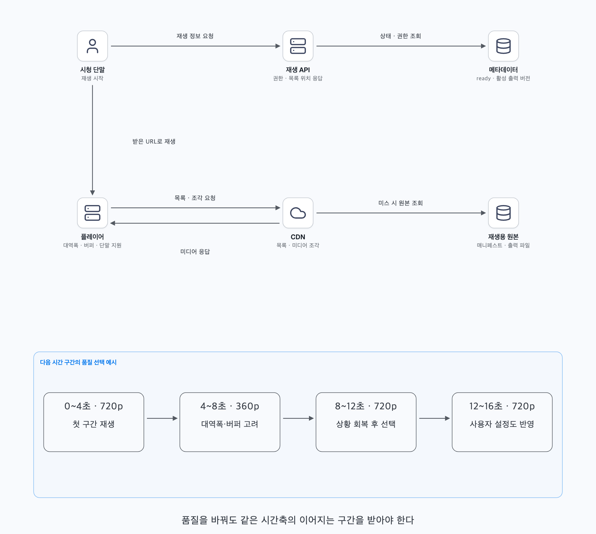
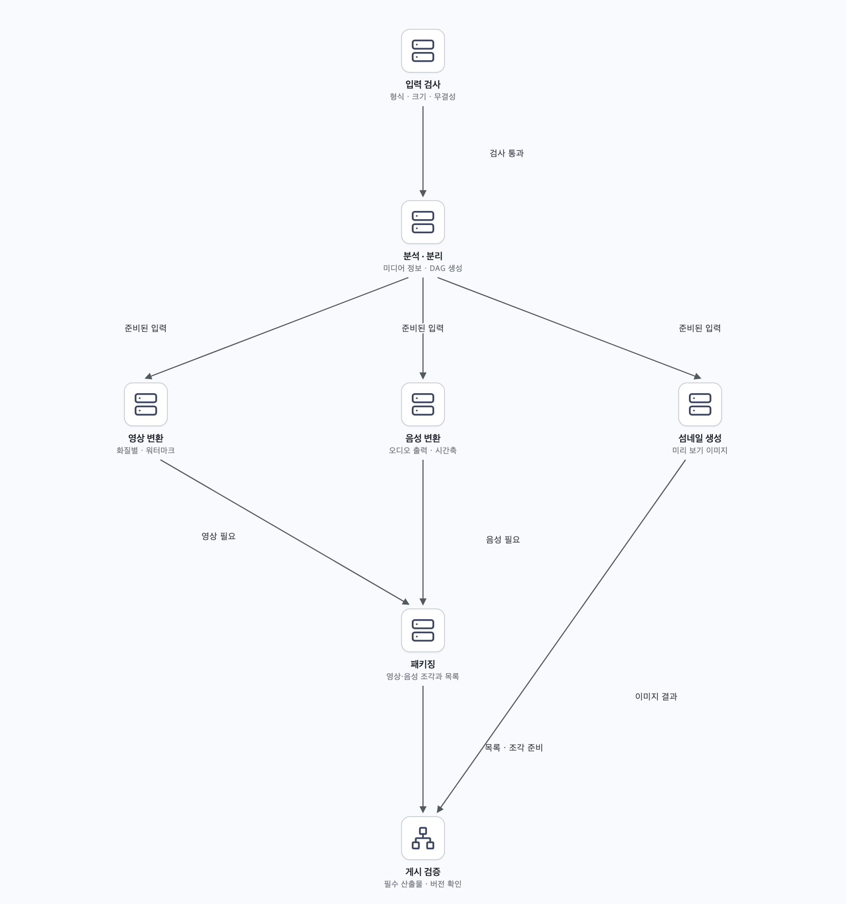
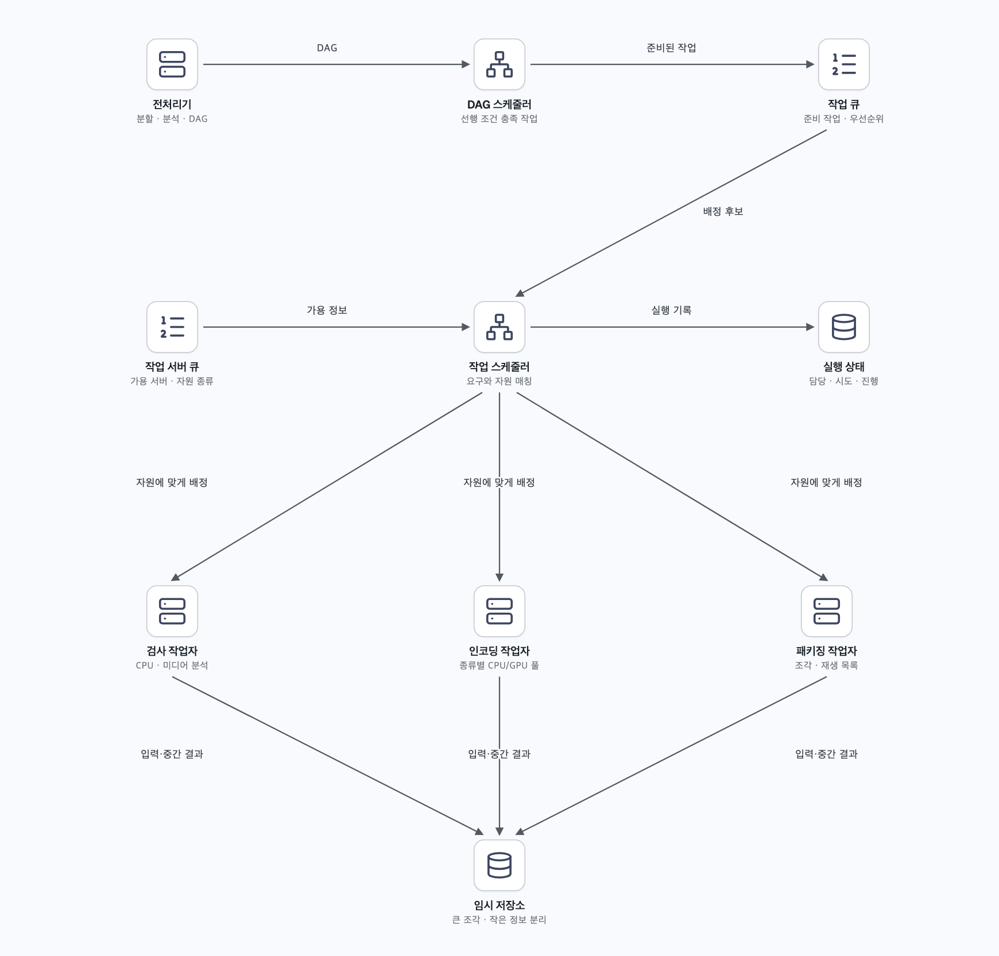
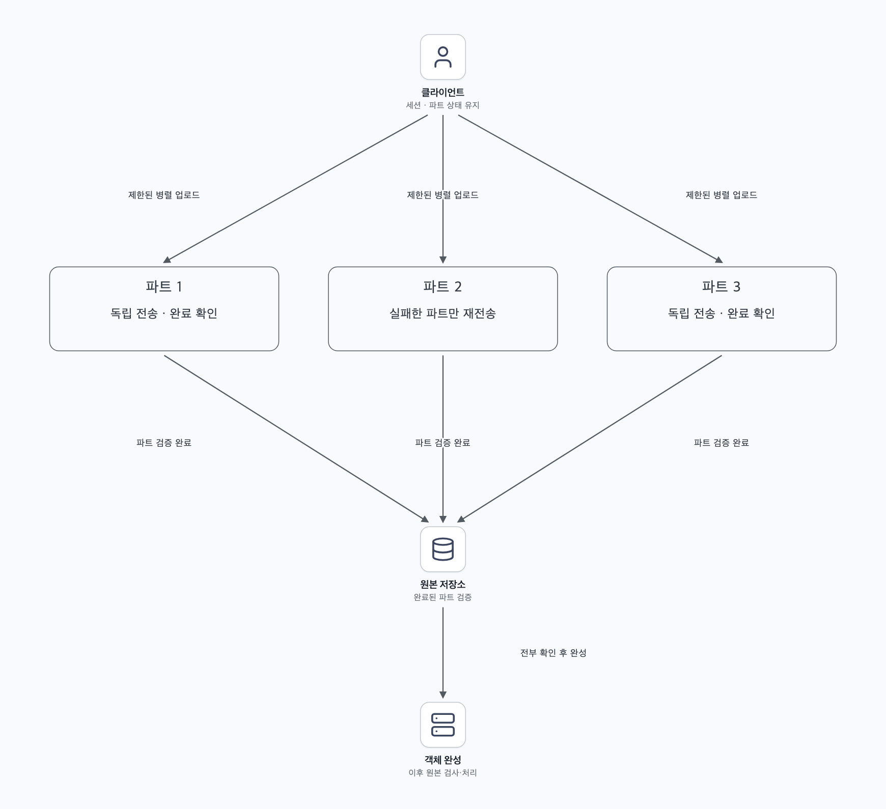
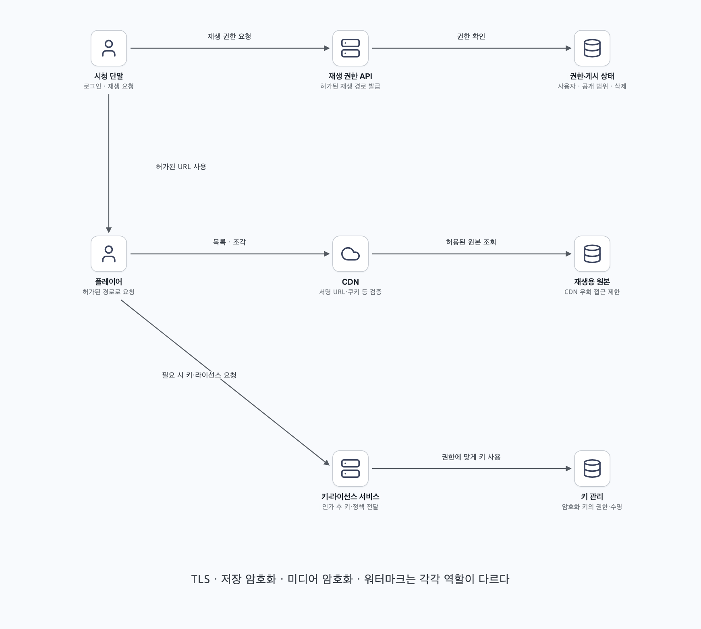

# 비디오를 올리고 끊김 없이 재생하기

## 1. 유튜브 전체가 아니라 업로드와 녹화 영상 재생을 설계한다

사용자가 상품 사용법을 촬영해 올리고 다른 사람이 모바일·웹·TV에서 시청한다고 가정한다. 추천·댓글·광고·검색·구독까지 모두 설계하기보다, 업로드한 비디오를 여러 단말에서 재생하는 주문형 비디오(VOD)에 집중한다. 라이브 스트리밍은 마지막 확장 항목으로 남긴다.

일일 활성 사용자는 500만 명이며 평균 시청 시간은 30분이다. 파일은 최대 1GB, 다국어를 지원하고 폭넓은 입력 형식·해상도를 수용한다. 빠른 업로드·원활한 재생·품질 선택·낮은 비용·높은 가용성과 확장성·안정성이 목표이며 암호화가 필요하다.

“대부분의 형식 지원”은 무한한 조합을 약속한다는 뜻이 아니다. 입력 허용 형식, 생성할 출력 코덱·해상도·비트레이트, 단말별 재생 지원을 정하고 검증한다. 다국어는 제목·설명뿐 아니라 자막과 여러 오디오 트랙의 선택까지 범위를 구체화할 수 있다. 업로드 1GB 제한의 바이트 기준도 명시한다.

## 2. 용량은 업로드 원본·변환 결과·전송량을 나눠 계산한다

책은 하루 평균 5개 시청, 사용자 10%가 하루 한 개 업로드, 평균 원본 크기 300MB를 추가로 가정한다. 원본 증가는 `500만 × 10% × 300MB = 150TB/일`이다. 여러 해상도·코덱 출력과 임시 파일·복제·백업은 여기에 더해진다.

하루 시청 시간은 `500만 × 30분 = 1억 5천만 분`이다. 이를 하루 전체에 나누면 평균 동시 시청자는 약 10만 4천 명이며, 피크와 다중 세션은 별도로 추정한다. 평균 전송 비트레이트를 3Mbps라고 추가 가정하면 하루 미디어 전송량은 약 3.375PB다.

책의 파일 개수 기준으로 하루 5개의 300MB 영상을 모두 전송한다고 가정하면 약 7.5PB가 된다. 두 계산은 비트레이트·시청 구간·전송 크기 가정이 다르다. 업로드 파일 크기나 화질 이름만으로 재생 트래픽을 확정하지 않는다. 금액은 전송량과 적용 계약 단가로 계산하며 책에 나온 과거 CDN 가격을 현재 가격으로 사용하지 않는다.

## 3. API 경로와 대용량 파일 경로를 분리한다

API 서버는 인증·업로드 세션·제목과 공개 범위·처리 상태·재생 권한 같은 작은 요청을 처리한다. 비디오 바이트는 업로드 원본용 BLOB 저장소와 재생용 CDN을 통해 이동시킨다. BLOB은 비디오처럼 큰 이진 데이터를 객체로 보관하는 저장소다.

업로드 원본과 변환 결과는 객체 저장소에 지속적으로 남기고 CDN은 그 앞에서 배포·캐시를 담당한다. 논리적으로 저장소를 나눈다는 뜻이며 반드시 다른 업체를 써야 하는 것은 아니다. CDN이 비디오를 영구 보관하는 유일한 원본이라고 생각하지 않는다.

클라우드 객체 저장소·관리형 큐·트랜스코딩·CDN을 이용하면 서비스 전체의 설계에 집중할 수 있다. 그렇다고 내구성 설정·권한·비용·장애 복구까지 없어지는 것은 아니다. 무상태 API와 메타데이터 DB의 복제·샤딩은 별도로 확장한다.

## 4. 업로드를 허가하고 파일과 메타데이터를 각각 받는다

먼저 클라이언트가 API에 업로드를 요청한다. API는 사용자·용량 정책을 확인하고 비디오 ID·업로드 세션·대상 객체 키를 만든다. 클라이언트는 제한된 시간 동안 지정한 위치에 쓸 수 있는 사전 서명 URL 등을 받아 원본 저장소로 직접 올린다.

제목·설명·언어·공개 범위는 파일 전송과 병렬로 API에 저장할 수 있다. 이때 사용자 편집 필드와 트랜스코딩 상태를 분리해 완료 작업이 최신 제목을 오래된 값으로 덮어쓰지 않게 한다. 파일 수신 전의 메타데이터가 존재한다고 재생 가능한 것은 아니다.

사전 서명 URL은 특정 객체·동작·만료 범위를 위임하는 수단이다. URL을 가진 사람이 그 권한을 사용할 수 있고, 일반적으로 일회용이라는 보장은 없다. 같은 키의 덮어쓰기도 고려해 업로드별 키와 버전을 구분한다. 클라이언트의 완료 통지만 믿지 않고 실제 객체의 소유 세션·크기·체크섬·형식을 확인한다. 검증한 객체 버전으로 처리 입력을 고정해 뒤늦은 덮어쓰기가 입력 내용을 바꾸지 않게 한다. URL 자체가 1GB 제한이나 안전한 파일 형식을 자동 검증하지는 않는다. [S3 사전 서명 URL 설명](https://docs.aws.amazon.com/AmazonS3/latest/userguide/using-presigned-url.html)

## 5. 업로드 완료와 재생 준비 완료는 다르다

파일이 확인되면 처리 작업을 내구성 있게 접수한다. 작업 서버는 원본을 가져와 검사·트랜스코딩·패키징을 수행한다. 생성한 비디오 조각과 재생 목록은 변환 결과 저장소에 기록하고, 완료 이벤트를 받은 핸들러가 필요한 산출물을 확인해 메타데이터를 갱신한다.

책의 CDN 배포와 완료 처리 병렬 흐름은 독립적인 작업을 겹치는 방식이다. 어느 한쪽에서 완료 이벤트가 왔다는 이유만으로 파일 접근까지 모두 준비되었다고 판단하면 안 된다. 요구한 재생 형식·해상도의 파일과 재생 목록이 원본 경로에서 조회 가능하고, 게시 조건을 충족한 뒤 준비 상태를 노출한다. 모든 CDN 에지를 미리 채우는 것이 준비의 필수 조건은 아니다.

상태는 예를 들어 `uploading → uploaded → processing → ready`로 나누고 검증·변환 실패는 별도로 표시한다. 일부 기본 화질만 준비되면 먼저 공개하는 정책도 가능하지만, 아직 없는 화질을 재생 목록에 넣어서는 안 된다. 업로드 완료 알림과 재생 준비 알림도 구분한다.

상태 변경과 캐시 갱신은 자동으로 하나의 트랜잭션이 되지 않는다. DB의 게시 기준과 캐시 무효화·갱신을 연결하고, 클라이언트는 상태 조회나 알림으로 준비를 확인한다. 이벤트 중복·순서 역전·삭제와의 경쟁은 두 번째 질문에서 다룬다.

## 6. 원본을 왜 다시 인코딩할까

사용자가 올린 원본은 단말마다 코덱·해상도·비트레이트가 다르다. 하나의 파일을 그대로 보내면 재생하지 못하거나 현재 네트워크에서 너무 클 수 있다. **트랜스코딩**은 서비스가 정한 재생용 조합으로 변환하는 과정이다. 이미 압축된 원본을 다시 변환할 수도 있으며 원본이 항상 비압축 데이터인 것은 아니다.

**코덱**은 미디어를 압축·복원하는 방식이고, **컨테이너**는 영상·음성·자막·메타데이터를 담는 형식이다. MP4 같은 확장자만으로 안에 어떤 코덱이 있는지 모두 알 수 없다. 재생 호환성은 컨테이너뿐 아니라 코덱·프로파일·오디오·단말의 디코딩 지원에도 달린다.

여러 해상도와 비트레이트를 만들면 단말과 네트워크에 맞춰 선택할 수 있다. 원본보다 높은 해상도로 늘린다고 없던 세부 정보가 생기지는 않는다. 또 개별 출력은 작아도 여러 출력의 총합은 원본보다 커질 수 있다. 더 효율적인 압축으로 전송량을 줄이는 대신 인코딩 시간과 계산 비용이 늘어날 수 있다.

## 7. 스트리밍은 재생 목록과 짧은 조각을 차례로 받는다

HLS·MPEG-DASH 같은 HTTP 기반 적응형 스트리밍은 여러 품질의 미디어와 이를 설명하는 목록을 사용한다. HLS의 플레이리스트, DASH의 MPD 같은 매니페스트는 어떤 품질·음성·자막과 미디어 조각이 있는지 알려준다. 전송 프로토콜과 코덱은 다른 층이므로 지원 단말·플레이어와 함께 선택한다. 책에는 Smooth Streaming 등도 나오지만 기본 설명은 HTTP 적응형 재생에 집중한다.

1. 단말이 API에서 비디오 메타데이터·재생 권한·재생 목록 위치를 받는다.
2. 플레이어가 CDN에서 매니페스트와 필요한 품질의 목록을 읽는다.
3. 현재 대역폭·버퍼·단말 지원을 보고 미디어 조각을 요청한다.
4. 받은 조각을 버퍼에 쌓고 재생한다. 이후 구간은 상황에 따라 다른 품질로 요청할 수 있다.
5. 사용자가 수동 품질을 고르면 그 정책을 반영하되, 지원하지 않는 코덱이나 부족한 대역폭이 없어지는 것은 아니다.

이런 **적응형 비트레이트** 방식에서는 플레이어가 품질 선택의 주체가 된다. 원활한 전환을 위해 출력들 사이의 시간축·조각 경계·디코딩 시작점을 맞춰야 한다. 고화질과 무중단을 모든 네트워크에서 동시에 보장할 수는 없으므로 시작 지연·버퍼링·선택 품질의 교환을 정한다. [Apple HLS 개요](https://developer.apple.com/library/archive/referencelibrary/GettingStarted/AboutHTTPLiveStreaming/about/about.html), [RFC 8216](https://www.rfc-editor.org/rfc/rfc8216.html)

가까운 에지는 전송 지연을 줄일 수 있지만 캐시 미스·원본 접근·혼잡·단말 네트워크·초기 버퍼 때문에 항상 지연이 낮다는 보장은 없다. API 서버는 미디어 바이트를 매번 중계하지 않아도 재생 권한과 상태 요청을 처리한다.

## 8. GOP·업로드 파트·재생 세그먼트를 구분한다

비디오는 프레임 사이의 참조를 이용해 압축할 수 있다. **GOP**는 이런 프레임들의 묶음이다. 모든 GOP가 외부 참조 없이 단독 디코딩된다고 가정해서는 안 된다. 독립 처리·품질 전환을 하려면 키 프레임·닫힌 GOP 등 필요한 경계를 맞추는 설정을 고려한다. [MediaConvert GOP 설명](https://docs.aws.amazon.com/mediaconvert/latest/ug/video-quality.html)

반면 객체 저장소의 멀티파트 업로드는 파일 바이트를 나누어 보내는 전송 방식이다. 파트 경계가 프레임이나 GOP 경계와 같을 필요는 없다. 재생 세그먼트는 플레이어가 일정 시간의 미디어로 받는 출력 단위다. 하나에 여러 GOP가 들어갈 수도 있다.

책은 클라이언트가 GOP를 나누어 병렬 업로드하는 최적화를 설명한다. 클라이언트의 미디어 분석 기능이 부족하면 일반 멀티파트로 올리고 서버가 미디어 구조를 분석하는 방법도 있다. GOP로 분할하는 경우에는 헤더·오디오 동기화·참조 관계를 보존할 수 있어야 한다. 첫 번째 질문의 그림에서 세 단위를 비교한다.

## 9. 처리 파이프라인을 DAG로 표현한다

검사·비디오 변환·오디오 변환·자막 처리·섬네일·워터마크를 한 덩어리 함수로 만들면 재사용과 병렬화가 어렵다. 선행 작업의 결과를 받아 실행하는 관계를 **유향 비순환 그래프**(DAG)로 나타낸다. 노드는 작업이고 간선은 입력 의존성이다.

원본 검사와 분석이 끝나면 영상·음성·섬네일 작업을 독립적으로 실행할 수 있다. 여러 해상도 인코딩도 자원이 허용하면 병렬로 수행한다. 패키징은 자신에게 필요한 영상·음성 결과를 기다리고, 게시 검증은 필요한 파일과 목록을 확인한다. 워터마크는 포함할 출력의 인코딩 전후 관계에 맞춰 DAG에 넣는다.

서비스 개발자는 허용된 작업 조합과 의존성을 정의한다. 업로드 사용자가 임의 코드를 실행하는 기능과는 구분한다. DAG는 무엇이 먼저 필요한지 표현하며, 실제 병렬도는 CPU·GPU·메모리·디스크·네트워크와 비용 한도에 제한된다.

## 10. 전처리·스케줄링·실행·임시 저장의 역할을 나눈다

전처리기는 파일 구조와 메타데이터를 분석하고 필요한 미디어 분할과 DAG를 만든다. 복구에 필요한 입력 조각·작업 정의·진행 상태를 남겨 중간 실패 때 사용할 수 있게 한다. 작고 자주 읽는 메타데이터는 캐시에, 큰 비디오·오디오 조각은 BLOB 저장소에 둘 수 있다.

DAG 스케줄러는 선행 조건이 충족된 작업을 준비 상태로 만든다. 자원 관리자는 다음 정보를 바탕으로 실제 배정을 수행한다.

| 구성 | 역할 |
| --- | --- |
| 작업 큐 | 실행 가능한 작업·우선순위 보관 |
| 작업 서버 큐 | 사용 가능한 서버와 작업 종류·자원 정보 |
| 실행 큐·상태 | 실행 중인 작업·시도·담당 서버 추적 |
| 작업 스케줄러 | 작업 요구와 사용 가능 자원을 맞춰 배정 |
| 작업 실행 서버 | 검사·인코딩·패키징 등 맡은 작업 수행 |

작업자는 결과를 저장하고 완료 상태를 기록한다. 다음 작업은 그 입력과 완료 조건이 확인되어야 실행 가능하다. 임시 파일은 최종 산출물과 필요한 복구 의무가 확정된 뒤 정리하며, 버려진 업로드와 고아 작업에도 만료·정리 정책을 둔다. 단순히 어떤 작업 하나가 끝났다는 이유로 재시도에 필요한 입력을 삭제하지 않는다.

## 11. 업로드 속도는 분할 재시도와 근거리 경로로 개선한다

파일을 여러 파트로 나누어 제한된 동시성으로 올리면 대역폭을 활용하고 실패한 파트만 재전송할 수 있다. API는 업로드 ID·파트 번호·완료 상태를 추적하고, 모든 파트가 검증된 뒤 객체 완성을 요청한다. 업로드 동시성이 지나치면 단말·네트워크·저장소를 오히려 압박할 수 있다.

객체 저장소의 멀티파트 기능은 독립적인 파트 업로드와 조립을 제공한다. 재개하려면 업로드 세션과 완료된 파트 정보가 필요하며, 중단된 파트는 명시적으로 정리해야 할 수 있다. [S3 멀티파트 업로드](https://docs.aws.amazon.com/AmazonS3/latest/userguide/mpuoverview.html)

사용자 근처의 업로드 엔드포인트나 저장 지역을 선택하면 긴 네트워크 왕복을 줄일 수 있다. 다만 업로드를 받는 지역과 트랜스코딩·재생 원본 지역이 다르면 지역 간 전송과 복제 비용이 생긴다. 재생용 CDN을 쓴다는 사실만으로 같은 경로가 업로드도 가속하는 것은 아니다.

## 12. 큐는 의존성을 없애지 않고 준비된 조각을 겹쳐 처리한다

다운로드가 끝나야만 인코딩을 시작하는 단일 호출 구조라면 한 작업이 다른 작업을 붙잡고 기다린다. 내구성 큐로 완료 이벤트를 넘기면 생산자와 소비자를 독립적으로 확장하고, 먼저 준비된 조각을 다음 단계로 보낼 수 있다.

하지만 인코딩할 입력 자체가 아직 없다면 큐가 대신 만들어 주지는 않는다. 조각 1이 준비되면 그 조각을 인코딩하는 동안 조각 2를 내려받는 식으로 작업을 겹친다. 입력 전체가 필요한 작업은 여전히 전체를 기다려야 한다. 동기 호출 대기를 줄이는 것과 데이터 의존성을 제거하는 것은 다르다.

이벤트는 파일 전체 바이트 대신 작업 ID·입력 위치·버전·처리 종류 같은 참조를 담는다. 작업자의 장애나 확인 응답 유실로 재전달될 수 있으므로 같은 작업이 다시 실행되어도 게시 결과가 중복되거나 오래된 결과로 바뀌지 않도록 한다. 첫 번째 질문에서 병렬화의 경계를 살펴본다.

## 13. 암호화·접근 제어·워터마크는 역할이 다르다

전송 중에는 TLS, 저장 데이터에는 저장소 암호화와 키 관리를 적용할 수 있다. 유료·비공개 콘텐츠에는 재생 권한을 검사하고 CDN의 서명 URL·쿠키 등으로 제한한다. 원본 저장소에 직접 접근해 이 제한을 우회할 수 없도록 경로도 통제한다. [CloudFront 비공개 콘텐츠 설명](https://docs.aws.amazon.com/AmazonCloudFront/latest/DeveloperGuide/PrivateContent.html)

미디어 자체를 AES 등으로 암호화해 배포하면 복호화 키를 받을 권한과 키 수명도 관리해야 한다. DRM은 지원 단말·라이선스·키 전달과 재생 정책을 다루는 체계다. AES라는 알고리즘 이름만으로 DRM이나 사용자별 권한이 완성되는 것은 아니다. 워터마크는 출처·소유권 표시나 추적을 돕지만 다운로드를 물리적으로 막는 기능은 아니다.

암호화를 서버가 원문을 볼 수 없는 종단 간 암호화로 요구한다면 서버 트랜스코딩과의 양립 방식을 다시 정해야 한다. 이번 구성은 서버가 권한을 가지고 원본을 읽어 변환하는 VOD 서비스다.

## 14. 오류는 같은 작업의 안전한 재처리로 복구한다

파일 손상·지원하지 않는 입력처럼 같은 조건으로 반복해도 해결되지 않는 오류는 실패 이유를 기록하고 사용자에게 알린다. 일시적 네트워크·서버 장애는 제한된 횟수와 기한 안에서 백오프를 두어 재시도한다. 큐의 재전달과 작업자의 재실행을 정상 복구 과정으로 설계한다.

| 실패 지점 | 복구 방향과 확인할 조건 |
| --- | --- |
| 업로드 | 완료된 파트는 유지하고 실패 파트 재전송·무결성 확인 |
| 클라이언트 분할 | 원본 업로드 후 서버 전처리로 대체할 수 있는지 판단 |
| 전처리·DAG 생성 | 입력·정책 버전으로 재생성, 중복 DAG 구분 |
| DAG 스케줄러 | 내구성 작업 상태에서 준비 작업 재스케줄 |
| 자원 관리자 큐 | 복제본·로그로 복구, 실행 상태와 대조 |
| 작업 서버 | 다른 서버가 같은 작업 재시도, 결과 버전·시도 구분 |
| 완료 처리 | 필수 산출물 확인 후 조건부 상태 전이, 중복 이벤트 처리 |
| API·캐시 | 정상 서버로 우회, 캐시 미스가 원본을 압도하지 않게 제한 |
| 메타데이터 DB | 장애 감지·복제 지연을 고려한 승격, 단일 쓰기 권한 유지 |
| CDN·원본 경로 | 오류·적중률 관찰, 여유가 있는 대체 경로만 제한적으로 사용 |

주 서버 승격은 이름만 바꾸는 작업이 아니다. 이전 주 서버가 계속 쓰지 못하게 하고 새 주 서버의 데이터·복구 기준을 확인해야 한다. DB 복구 후에도 이미 큐에 있던 완료·삭제 작업과 상태를 대조한다.

## 15. 비용은 트래픽을 다른 곳으로 보내는 것만으로 줄지 않는다

인기 비디오는 CDN 캐시의 재사용 이점이 크다. 비인기 비디오를 직접 서버에서 제공하는 방식도 비교할 수 있지만 원본 인터넷 전송료·요청·서버 용량·지역 간 전송·장애 대응 비용이 추가된다. CDN을 통과하지 않으면 그 비용이 사라지는 대신 다른 비용이 생긴다. 캐시 적중률이 높아도 CDN에서 사용자에게 보내는 바이트 자체는 남는다.

모든 해상도를 미리 만들지 않고 기본 품질만 생성한 뒤 수요에 따라 추가 변환하는 방식은 계산·저장 비용을 줄일 수 있다. 반대로 첫 시청자가 변환을 기다리고 동시 요청이 몰릴 수 있다. 즉시 재생이 목표라면 최소 재생본을 먼저 준비하는 등 시작 지연의 조건을 정한다.

CDN 자체 구축과 ISP 제휴는 높은 규모·운영 역량이 있을 때의 장기 선택이다. 책의 기본 범위처럼 클라우드를 이용하는 면접 설계에서 곧바로 직접 구축을 전제하지 않는다. 비용의 수치 비교는 세 번째 질문에서 가정과 단가를 나누어 설명한다.

## 16. 게시 중단·라이브·운영 지표까지 경계를 이어 간다

비디오 삭제·비공개 전환은 메타데이터만 지우는 것으로 끝나지 않는다. 새 재생 권한 발급을 중단하고 원본·출력·목록·CDN 캐시·키/라이선스 경로에 정책을 반영한다. 늦게 끝난 트랜스코딩 작업이 삭제된 영상을 다시 공개하지 않게 게시 버전을 검사한다. 이미 사용자 단말에 내려간 복사본을 서버가 회수할 수 있다고 보장하지 않는다.

라이브는 입력이 계속 생기며 실시간 인코딩·짧은 지연·계속 바뀌는 목록·새 조각 배포를 다룬다. VOD의 완성된 파일 전체 처리를 그대로 재사용할 수는 없다. 낮은 지연과 버퍼 안정성, 장애 뒤 이어 보는 정책을 별도로 정한다.

업로드 성공률·재개율·원본 수신부터 ready까지의 시간·작업 큐 나이·화질별 변환 실패·중복 작업 비용을 본다. 재생 시작 시간·버퍼링 비율·재생 오류·품질 전환·단말별 호환성·CDN 적중률·원본 트래픽·전송 단가도 관찰한다. 전체 평균뿐 아니라 지역·클라이언트·콘텐츠별 편차를 봐야 빠른 업로드와 원활한 재생을 함께 판단할 수 있다.
