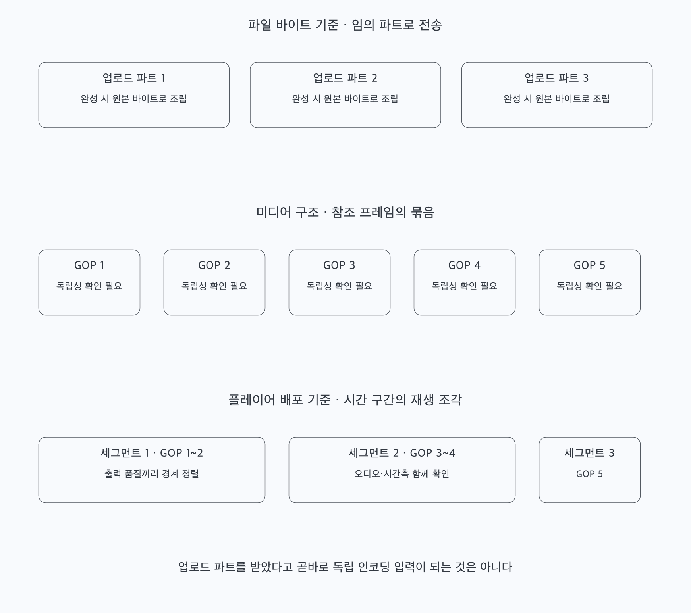
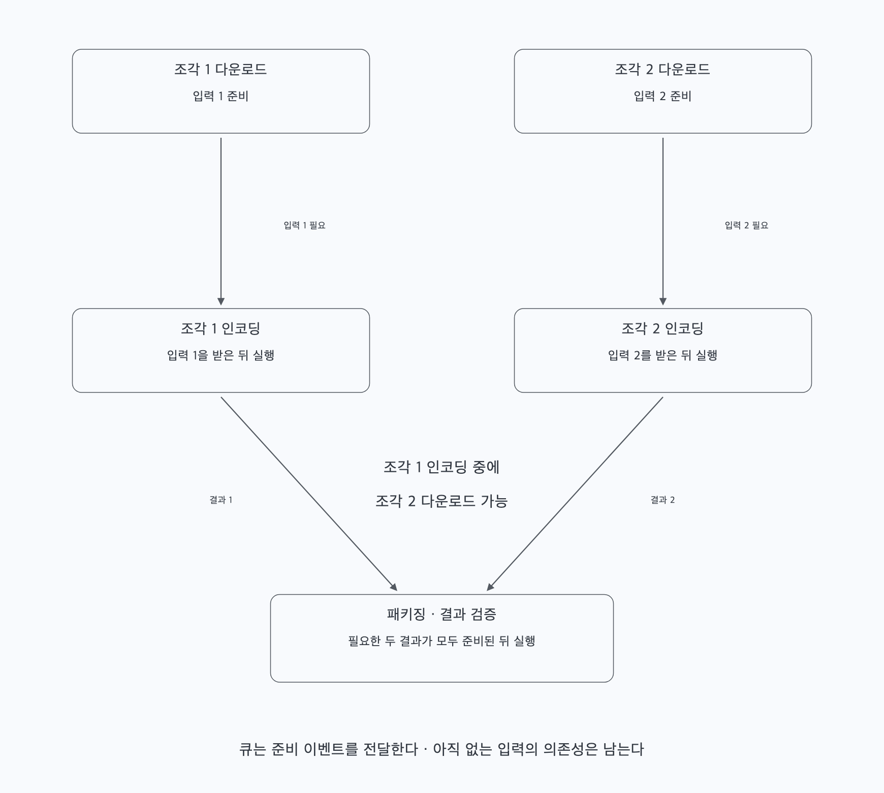

# 질문 01. GOP를 나누고 큐를 넣으면 모든 단계가 기다리지 않아도 될까?

## 1. 세 가지 조각은 목적이 다르다

업로드 파트는 파일 바이트의 일부다. 객체 저장소는 파트를 다시 조립해 원본 파일을 만든다. 중간 파트만으로는 미디어 헤더나 앞 프레임이 없어 영상으로 해석할 수 없을 수 있다.

GOP는 압축 프레임들의 구조다. 독립적인 디코딩이 가능한 경계인지 확인해야 하며, 비디오만 잘라 오디오·타임스탬프를 잃으면 최종 재생이 깨진다. 재생 세그먼트는 플레이어에게 배포할 시간 구간의 미디어다. 서로 다른 품질에서 전환하려면 해당 시점의 경계와 디코딩 조건을 맞춘다.

따라서 임의의 바이트 파트를 전송한 직후 그대로 독립 인코딩 작업으로 넘기는 것은 일반적인 해결책이 아니다. 미디어 구조를 분석한 조각과 필요한 부가 정보가 준비된 경우에만 단계별 파이프라인 처리를 검토한다.

## 2. 큐를 쓰면 호출 결합은 줄지만 입력 의존성은 남는다

예를 들어 조각 1의 내려받기가 끝났고 조각 2는 진행 중이라고 하자. 인코더가 조각 1만으로 처리할 수 있으면 1의 완료 이벤트를 큐에서 받아 먼저 인코딩할 수 있다. 같은 시간에 다운로드 작업자는 조각 2를 받는다.

이때 “인코더가 다운로드 완료를 기다리지 않는다”는 말은 파일 전체나 동기 호출의 반환을 기다릴 필요가 줄었다는 뜻이다. 자기 입력 조각이 준비되기 전부터 인코딩한다는 뜻은 아니다. 두 조각을 합친 결과가 필요한 패키징은 필요한 입력을 모두 기다린다.

## 3. 병렬도가 높아도 총 시간은 무한히 줄지 않는다

독립 해상도나 조각은 자원 한도 안에서 병렬로 처리할 수 있다. 하지만 검사·분석·최종 검증 같은 선행·후행 작업, 가장 느린 필수 작업, 원본 저장소와 네트워크 병목은 남는다. 작업 큐가 길다는 사실만으로 서버를 늘리지 않고 병목과 비용·동시성 한도를 확인한다.

분할 실패 시 전체 원본을 서버에 올려 분할하도록 하는 대안도 있다. 재전송으로 이미 검증한 데이터를 다시 보내는 비용과 클라이언트 지원 범위를 비교한다. 성능 최적화는 복구 가능한 입력과 정확한 결과를 유지하는 범위에서 적용한다.
