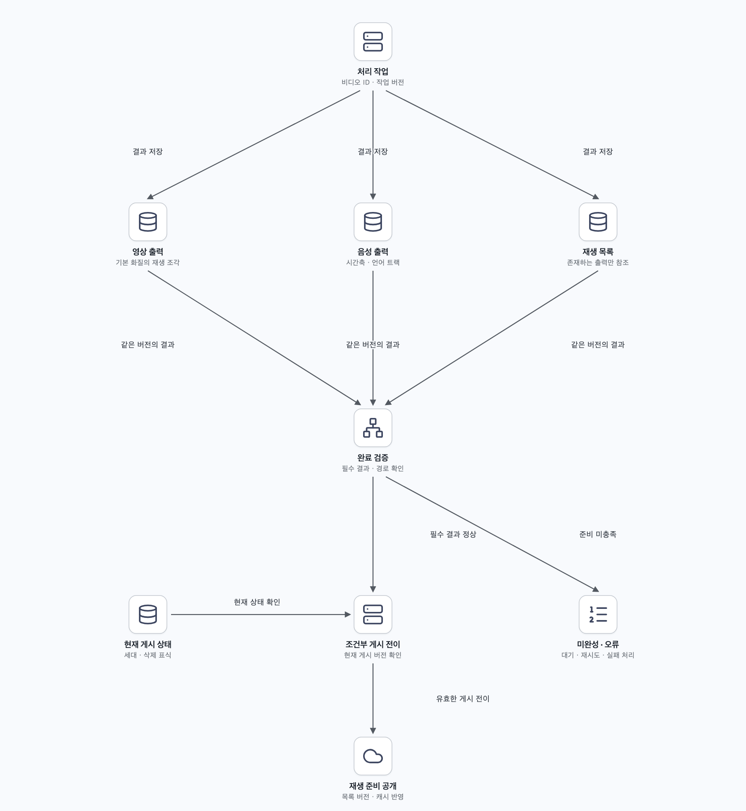

# 질문 02. 완료 이벤트를 받으면 바로 ready로 바꿔도 될까?

## 1. 파일과 상태가 별개로 움직인다

360p 변환 완료 이벤트를 받았지만 오디오·재생 목록이 아직 없거나 목록이 가리키는 파일 경로가 잘못되었다면 사용자는 재생할 수 없다. 완료 이벤트는 어느 작업의 어떤 버전이 끝났다는 신호로 다루고, 서비스의 게시 조건과 구분한다.

기본 화질로 먼저 공개할 정책이라면 그 재생에 필요한 산출물만 필수로 정의할 수 있다. 1080p가 나중에 완성되면 검증한 뒤 목록에 추가한다. 아직 없는 파일을 목록에 먼저 광고하지 않는다.

## 2. 한 번의 원자적 객체 쓰기가 모든 파일의 게시를 뜻하지 않는다

비디오·오디오·목록은 여러 객체다. 새 작업 버전의 별도 경로에 결과를 쓰고 검증한 뒤, 완성된 재생 목록과 메타데이터의 활성 버전을 공개하는 방법을 고려한다. 저장소가 제공하지 않는 여러 객체·DB의 단일 트랜잭션을 가정해서는 안 된다.

완료 핸들러는 비디오 ID·입력/출력 버전·필수 작업 상태와 삭제 여부를 확인해 조건부로 ready 전이를 수행한다. DB 갱신과 알림 발행 사이의 의무는 아웃박스 등으로 연결하고 캐시를 무효화하거나 갱신한다. 모든 에지에 미리 복사했는지 대신, 해당 배포 경로에서 필요한 원본을 가져올 수 있는지 확인한다.

## 3. 재시도와 늦은 완료가 기존 상태를 되돌리지 않게 한다

작업 서버가 출력 파일을 저장한 뒤 완료 기록 전에 죽으면 같은 작업이 다시 실행될 수 있다. `(비디오 ID, 작업 버전, 작업 종류, 출력 규격)` 같은 논리 작업 키를 유지하고 결과를 멱등하게 확정한다. 실행 시도는 따로 구분해 오래된 작업자가 새 결과를 덮어쓰지 못하게 한다.

객체 저장소 이벤트도 중복을 고려해야 한다. 예를 들어 S3 이벤트 알림은 최소 한 번 전달을 전제로 한다. 이를 정확히 한 번의 작업 실행으로 읽으면 안 된다. [S3 이벤트 알림](https://docs.aws.amazon.com/AmazonS3/latest/userguide/EventNotifications.html)

사용자가 삭제한 뒤 옛 작업이 완료되어도 게시 상태가 부활하면 안 된다. 삭제 표식과 게시 세대·상태 조건을 확인해 늦은 결과를 비활성 상태로 두고 정리한다. 임시 파일 정리 역시 최종 확정과 재시도 의무를 확인한 뒤 수행한다. 같은 작업이 여러 번 완료되거나 이벤트 순서가 바뀌어도 게시 결과가 일관되게 유지되어야 한다.
