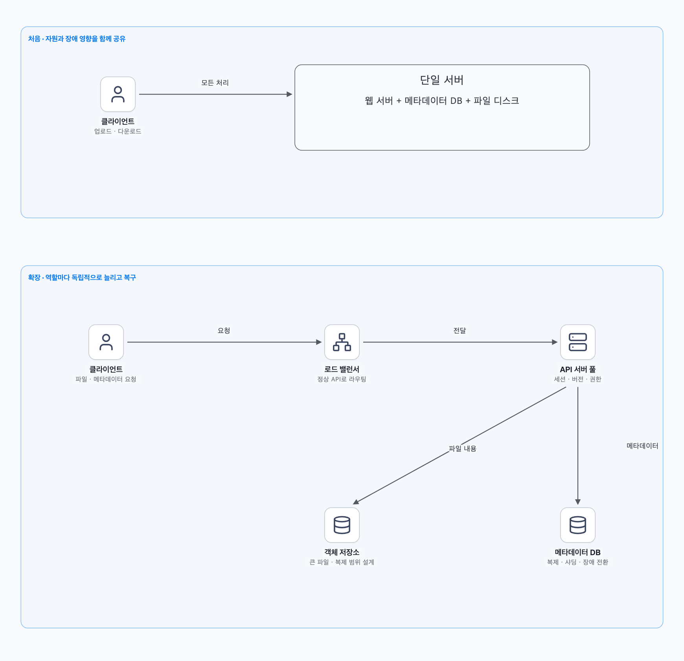
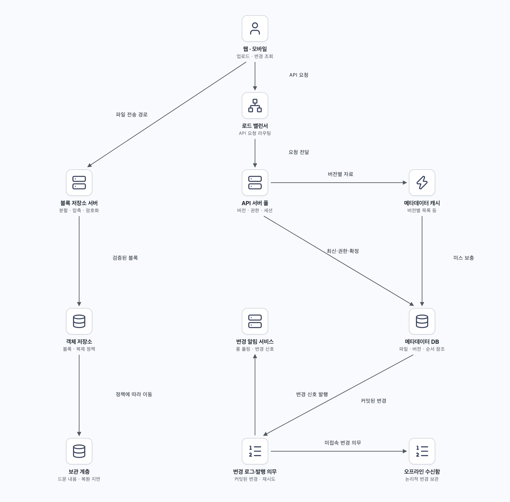
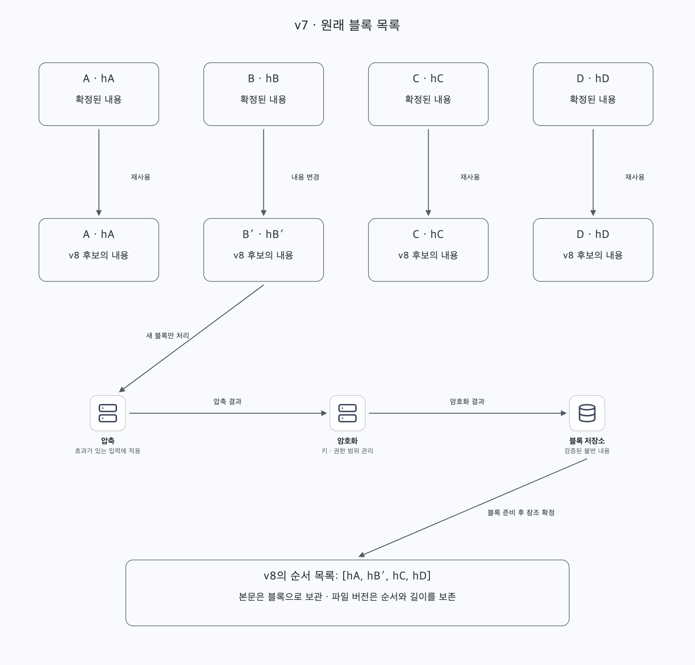
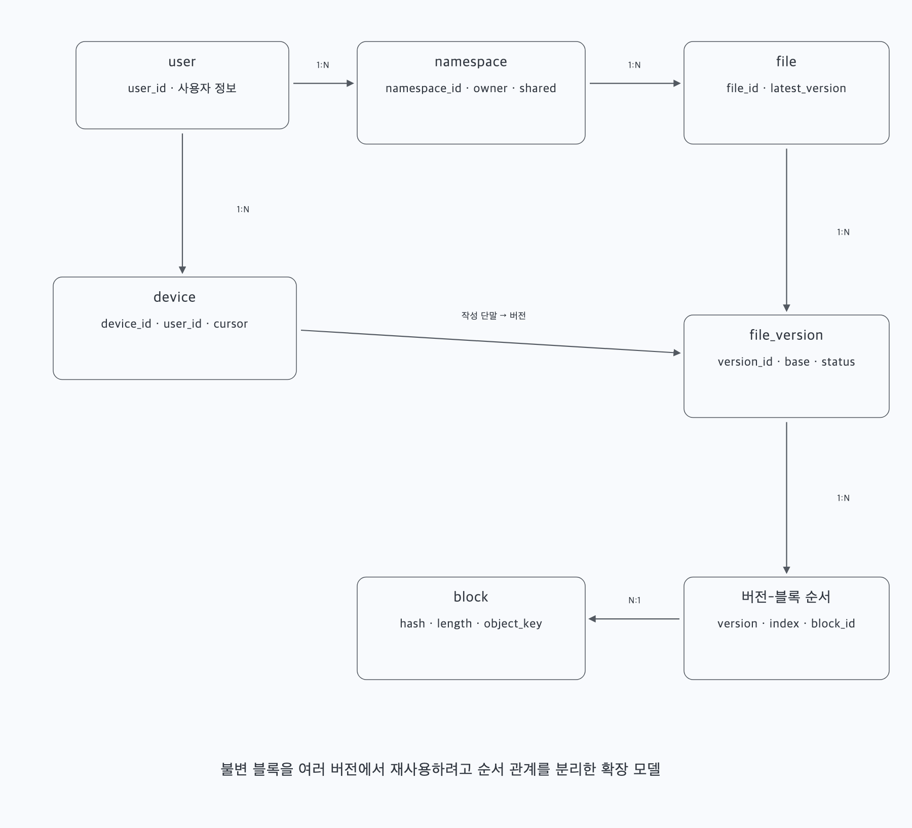
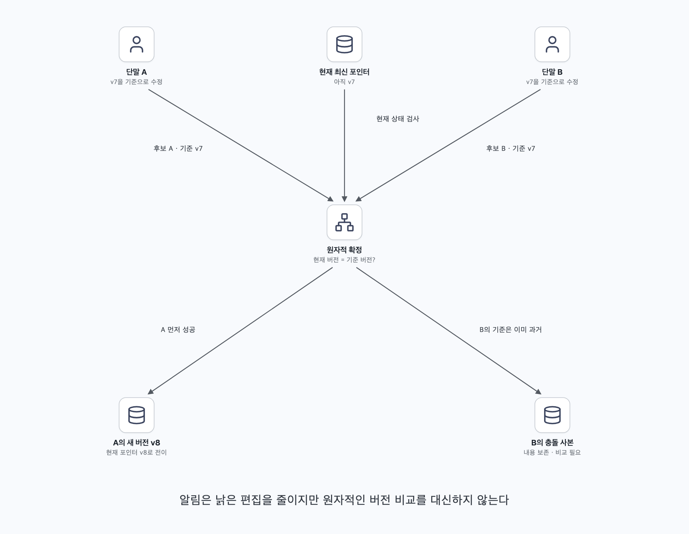
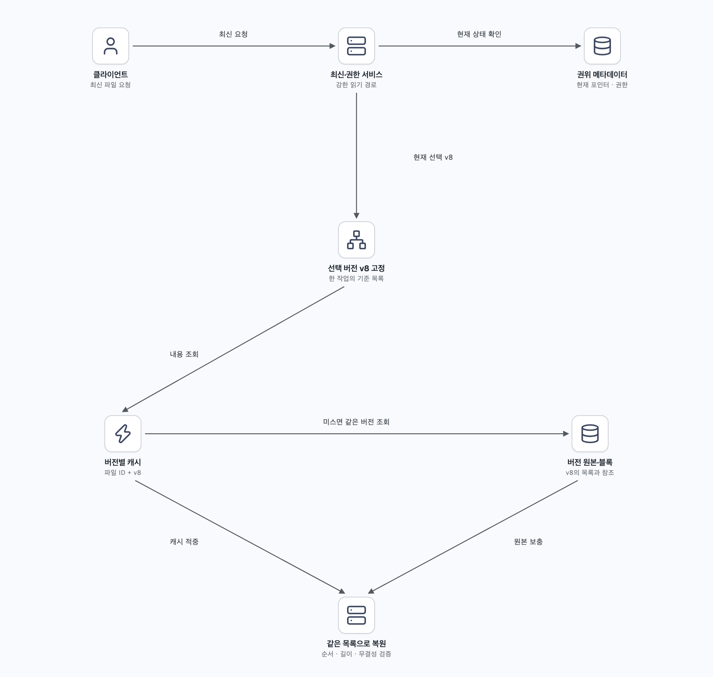
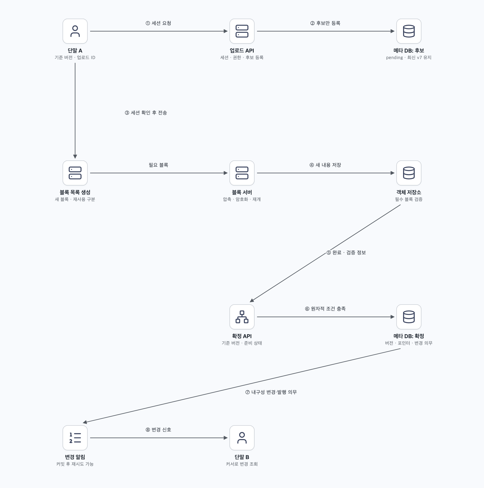
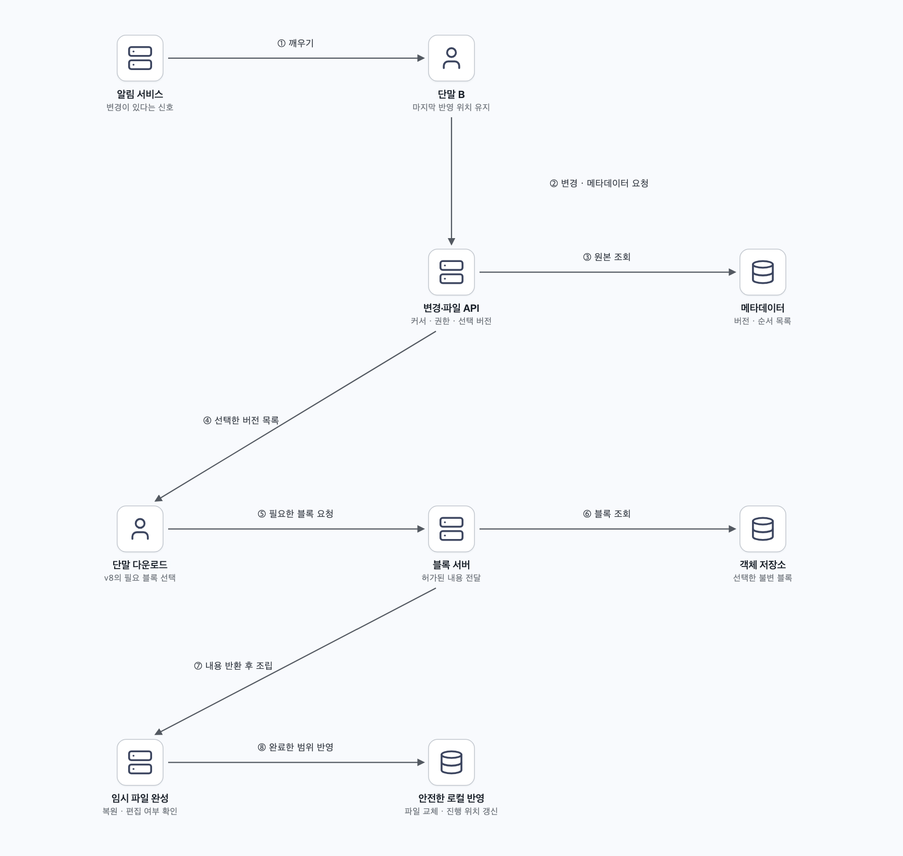
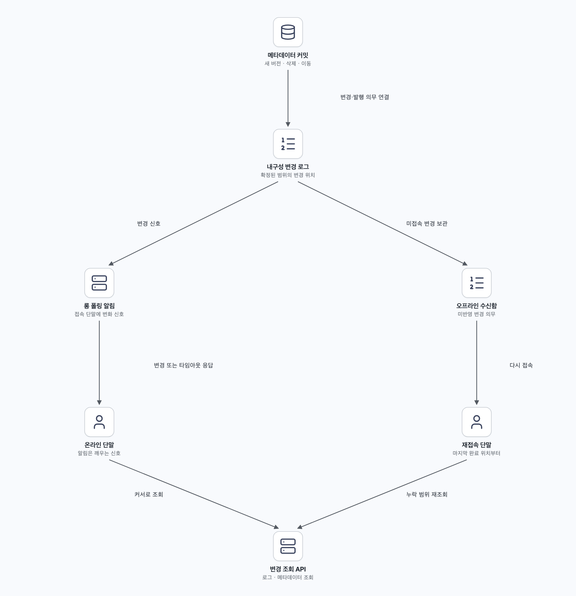
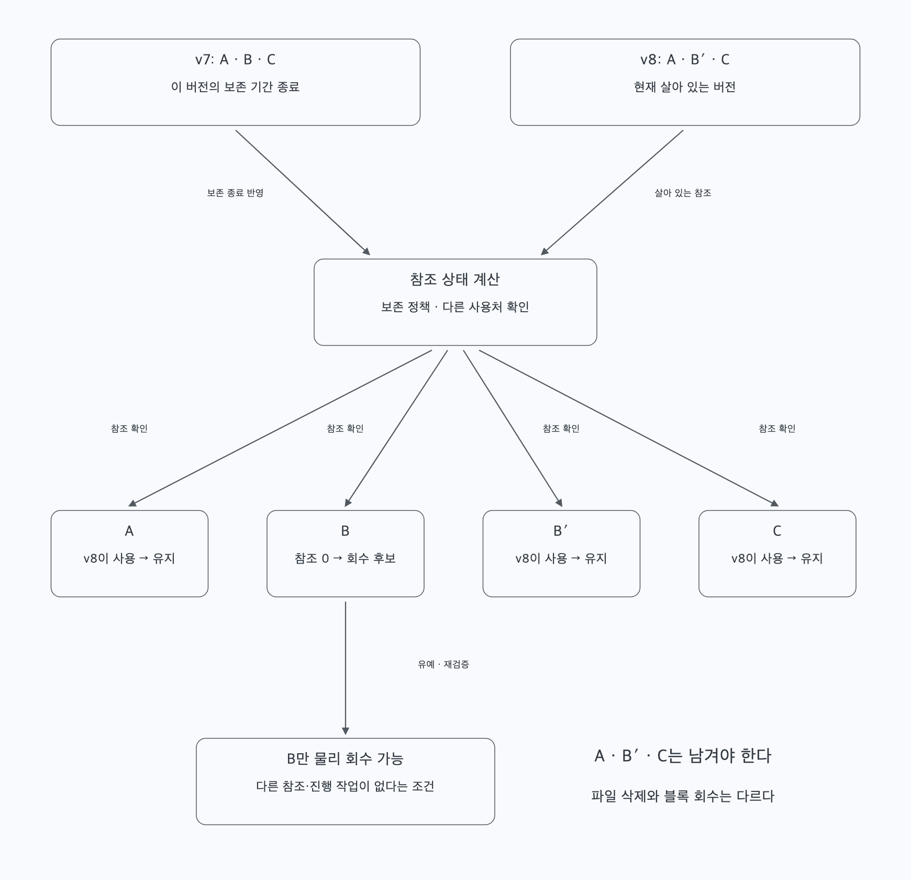

# 파일 한 개를 여러 단말에서 같은 버전으로 맞추기

## 1. 파일 보관과 동기화를 함께 설계한다

상품 사진과 가격표 파일을 사용자의 웹·모바일에서 관리한다고 가정한다. 한 단말에서 파일을 올리거나 수정하면 다른 단말이 그 사실을 알아야 하고, 파일 일부만 바뀌었다면 전체를 다시 보내지 않고 싶다. 오프라인에서 수정한 내용도 연결이 복구된 뒤 처리해야 한다.

기본 범위는 업로드·다운로드·파일 동기화·변경 알림이다. 책의 파일 변경 이력·공유도 다루며 구글 문서의 실시간 공동 편집은 제외한다. 파일은 최대 10GB, 일일 활성 사용자는 1,000만 명이며 암호화·안정성·빠른 동기화·대역폭 절약·확장성과 가용성이 필요하다.

웹은 사용자가 고른 파일과 허용한 영역을 중심으로 동작하고, 모바일은 백그라운드 실행·배터리·망 상태에 제약이 있다. 모든 플랫폼이 임의의 로컬 파일 시스템을 항상 감시할 수 있다고 가정하지 않는다. 플랫폼별로 허용되는 감지·재개·알림 경로를 정한다.

## 2. 저장 한도와 실제 변경량은 다른 수치다

책은 가입자 5,000만 명, DAU 1,000만 명, 사용자별 무료 공간 10GB, 활성 사용자당 하루 2개 업로드·평균 파일 500KB, 읽기:쓰기 1:1을 가정한다. 여기서 사용자 저장 할당량 10GB와 파일 하나의 최대 크기 10GB는 별개의 제한이다.

가입자 할당량을 모두 합하면 약 500PB지만 모두 실제로 사용 중이라는 뜻은 아니다. 하루 업로드 원본은 `1,000만 × 2 × 500KB = 약 10TB`다. 평균 업로드 API 요청은 약 231 QPS이고 책은 약 240 QPS, 피크를 약 480 QPS로 근사한다.

블록 분할·재시도·메타데이터·변경 조회·롱 폴링은 추가 요청을 만든다. 버전 보관과 복제는 저장량을 늘리고 델타 전송·중복 제거는 줄일 수 있다. 업로드 API 횟수만으로 객체 저장소 QPS나 네트워크·저장 비용까지 확정하지 않는다.

## 3. 한 서버에서 시작하고 역할을 나눈다

처음에는 웹 서버·메타데이터 DB·파일 디스크를 한 서버에 둘 수 있다. API는 파일을 받고 DB에는 사용자·로그인·경로·파일 정보를 기록한다. 단순하지만 디스크가 차고, 파일 I/O와 API가 자원을 공유하며, 서버 장애가 전체 기능과 데이터에 영향을 준다.

파일을 여러 서버에 나누면 용량은 늘지만 어느 서버에 있는지 찾고 장애 때 복구해야 한다. 책은 대용량 객체 저장소를 이용하는 쪽으로 확장한다. 로드 밸런서 뒤에 무상태 API 서버를 늘리고 메타데이터 DB와 파일 저장소를 분리한다. DB 분리는 역할별 확장의 시작이며 DB를 한 대만 두면 여전히 단일 장애 지점이다. 복제·샤딩·장애 전환을 추가로 설계한다.

## 4. 객체 저장소의 복제 범위를 구분한다

S3 같은 객체 저장소를 쓰면 큰 파일 보관과 내구성 운영을 맡길 수 있다. 다만 저장 클래스마다 가용 영역(AZ) 범위가 다르다. S3 Standard 같은 다중 AZ 저장과 단일 AZ 클래스는 같은 장애 범위를 견디지 않는다. [S3 저장 클래스](https://docs.aws.amazon.com/AmazonS3/latest/userguide/storage-class-intro.html)

다른 지역에도 보관하려면 지역 간 복제와 장애 전환을 따로 구성한다. S3의 지역 간 복제는 비동기이므로 막 확정한 파일이 다른 지역에 아직 없을 수 있다. 지역을 두 개 쓴다는 이유만으로 모든 장애에서 즉시 무손실 복구를 약속하지 않는다. 어느 데이터까지 복구할지, 얼마나 빨리 전환할지와 최신 쓰기 중단 조건을 정한다. [S3 복제 문서](https://docs.aws.amazon.com/AmazonS3/latest/userguide/replication.html)

블록·메타데이터·암호화 키·변경 로그가 함께 복구되어야 파일을 재구성할 수 있다. 데이터 복제와 실수로 삭제한 파일의 복구도 다르다. 객체 버전·백업·보존 정책을 별도로 둔다. S3 Versioning 역시 명시적으로 켜야 하는 기능이며 애플리케이션 파일 버전 모델과 자동으로 같아지는 것은 아니다. [S3 Versioning](https://docs.aws.amazon.com/AmazonS3/latest/userguide/Versioning.html)

## 5. API는 전송 세션과 파일 버전을 다룬다

책은 단순 업로드, 이어 올리기, 다운로드, 변경 이력 API를 제시한다. 다음은 개념을 설명하기 위한 자체 API 예시이며 실제 Google Drive API 명세는 아니다.

| API 역할 | 예시 입력·응답 | 필요한 조건 |
| --- | --- | --- |
| 업로드 시작 | 파일 ID 또는 생성 위치·기준 버전 → 업로드 ID | 사용자·공간·파일 크기·권한 확인 |
| 조각 전송·재개 | 업로드 ID·조각 위치·체크섬 | 이미 받은 조각 확인·실패 구간 재전송 |
| 업로드 확정 | 완성된 블록 목록·기준 버전 → 새 버전 또는 충돌 | 블록 준비와 원자적 버전 비교 |
| 다운로드 | 파일 ID·선택 버전 → 블록 목록/전송 경로 | 해당 버전 접근 권한 확인 |
| 변경 이력 | 파일 ID·페이지 정보 → 버전 목록 | 이력 보존 범위·권한 |
| 단말 동기화 | 변경 커서 → 변경 목록·다음 위치 | 단말별 진행 상태·범위 검증 |

작은 파일은 단순 업로드로, 큰 파일이나 불안정한 망은 이어 올리기로 처리할 수 있다. 세션 생성 → 조각 전송 → 수신 위치 확인 → 완료 확정의 절차를 둔다. 재시도에도 같은 업로드 ID와 논리 요청 ID를 유지한다. 전송 조각과 재사용 가능한 파일 블록은 목적이 다르므로 경계가 반드시 같을 필요는 없다.

경로만으로 파일을 식별하면 이름 변경·폴더 이동과 동시 수정에 취약하다. 안정적인 파일 ID와 버전을 중심으로 처리하고 경로는 네임스페이스와 폴더 안의 이름으로 해석한다. 통신은 TLS로 보호하고 모든 API에서 권한을 확인한다.

## 6. 전체 구성은 파일 바이트와 동기화 제어를 나눈다

블록 저장소 서버는 파일 분할·블록 처리·저장을 담당한다. API 서버는 사용자·메타데이터·버전 확정·변경 조회를 처리한다. 메타데이터 캐시는 조회를 돕고, 변경 알림 서비스는 다른 단말에 변경이 있다는 사실을 알린다. 오프라인 사용자 큐는 나중에 따라잡을 변경 의무를 보관하는 논리적 구성이다.

객체 저장소에는 큰 블록, 메타데이터 DB에는 파일과 버전·블록의 관계를 둔다. 자주 쓰는 데이터는 캐시하고 오래된 파일은 접근 지연을 허용하는 저장 계층으로 옮길 수 있다. 단, 보관 계층의 복원 시간이 즉시 다운로드 목표와 충돌하지 않도록 한다.

그림의 서버·큐는 역할을 나타낸다. 모든 사용자마다 전용 물리 큐를 만들거나 서비스 하나를 서버 한 대에 고정한다는 뜻은 아니다.

## 7. 블록 목록으로 파일을 재구성한다

파일을 블록 A·B·C·D로 나누고 각 블록의 해시·길이·저장 위치를 관리한다. 파일 버전은 이 블록들을 어떤 순서로 이어 붙일지 기록한다. 순서가 바뀌면 다른 파일이며, 같은 블록이 반복되면 그 반복도 유지해야 한다. 책은 최대 4MB 정도의 블록을 예로 든다. 작은 블록은 세밀한 재사용에 유리할 수 있지만 해시·참조·요청 수가 늘므로 크기를 조정해야 한다.

B만 바뀌었다면 다음 버전은 A·B′·C·D를 참조하고 새 B′만 업로드할 수 있다. 이것이 **델타 동기화**의 기본 생각이다. 전송할 데이터가 줄지만 블록 경계·수정 형태에 따라 절감 정도가 달라진다. 고정 크기 블록에서 앞부분에 데이터를 삽입하면 뒤쪽 경계가 밀려 많은 블록이 바뀔 수 있다.

블록 처리에서는 일반적으로 압축 후 암호화해야 압축의 효과를 얻기 쉽다. 이미 압축된 파일은 추가 절감이 작을 수 있다. TLS·저장 암호화·키 관리를 적용하고, 종단 간 암호화를 요구한다면 서버가 평문으로 분할·중복 제거할 수 있는지 다시 결정한다.

해시는 내용 식별·무결성 확인에 쓰이며 접근 권한이 아니다. 사용자가 블록 해시를 안다는 이유만으로 다른 사람의 블록을 내려받게 해서는 안 된다. 중복 제거 범위도 계정·네임스페이스·신뢰 영역에 맞게 정한다. Dropbox의 공개 자료도 블록 목록·메타데이터와 암호화된 내용 저장을 구분한다. 이는 해당 서비스의 공개 사례이며 모든 파일 서비스가 같은 형식을 써야 한다는 뜻은 아니다. [Dropbox 파일 동기화 사례](https://dropbox.tech/infrastructure/streaming-file-synchronization)

## 8. 메타데이터에는 파일·버전·단말의 관계가 필요하다

책의 중심 테이블은 user·device·namespace·file·file_version·block이다. 네임스페이스는 사용자의 루트나 공유 영역처럼 파일 이름과 경로를 해석할 범위를 나타낸다. 사용자 한 명의 단말 여러 개가 같은 범위의 변경을 각각 따라갈 수 있다.

| 데이터 | 핵심 역할 |
| --- | --- |
| user | 계정·사용자 정보 |
| device | 단말 ID·사용자 연결·최근 접속·동기화 위치 |
| namespace | 소유·공유 범위와 루트 |
| file | 파일 ID·이름·폴더 여부·최신 확정 버전 |
| file_version | 파일별 변경 버전·기준 버전·상태·작성 단말 |
| block | 내용 해시·길이·저장 위치·암호화 정보 |
| 버전-블록 순서 관계 | 어느 버전이 어떤 블록을 몇 번째로 참조하는가 |

책은 block에 버전과 순서를 연결한 단순 모델을 사용한다. 여러 버전이 같은 블록을 재사용하려면 블록 자체와 버전별 순서 관계를 분리할 수 있다. 폴더 상위 관계·권한·업로드 세션·변경 로그·삭제 표식도 실제 설계에서 추가로 관리한다.

대용량 파일 내용은 DB에 모두 넣지 않고 버전별 블록 참조를 저장한다. 내용이 완성된 버전은 불변으로 두고 file의 최신 포인터만 새 버전으로 바꾸면 이력과 다운로드의 기준을 잡기 쉽다.

## 9. 충돌은 기준 버전과 최신 버전을 원자적으로 비교한다

A와 B가 같은 가격표 v7을 내려받아 각각 수정했다고 하자. A의 새 내용이 먼저 확정되어 v8이 되었다면, B가 v7을 기준으로 올린 변경은 충돌이다. 여기서 먼저란 사용자 단말의 시계나 업로드 시작 시각이 아니라 서버가 원자적으로 확정한 순서다.

메타데이터 DB에서 최신 포인터가 아직 v7일 때만 새 버전으로 바꾸는 조건부 갱신을 한다. 버전 기록·최신 포인터·변경 로그/후속 알림 의무를 트랜잭션으로 연결한다. 별도로 “현재 v7인지 조회한 뒤 무조건 저장”하면 두 서버가 동시에 통과할 수 있다.

B의 내용은 버리지 않고 충돌 사본으로 보관하거나 사용자가 비교하도록 한다. 이 장은 일반 파일 동기화이므로 내용 자동 병합을 보장하지 않는다. 공유 폴더의 이름 변경·이동·삭제 충돌에도 해당 객체와 이름 공간의 조건을 정해야 한다.

알림이 빨리 도착하면 낡은 버전에서 수정할 가능성은 줄어든다. 그러나 오프라인 편집·알림 지연·동시 요청이 있으므로 알림 자체가 충돌을 방지하는 잠금이나 원자적 검사를 대신하지는 않는다.

## 10. 강한 일관성의 대상은 서버의 확정 버전이다

기본 설계는 파일별 최신 확정 버전의 읽기와 변경을 일관된 순서로 처리하는 메타데이터 경로를 둔다. 성공 응답 뒤의 최신 읽기는 확정된 버전을 보도록 하며 오래된 복제본이나 캐시를 최신이라고 반환하지 않는다. DB·읽기 격리·리더 경로가 실제로 그 보장을 제공하도록 구성해야 한다.

오프라인 단말은 이미 받은 v7을 계속 갖고 있을 수 있다. 서버가 v8을 확정했다고 네트워크가 끊긴 단말의 디스크를 즉시 바꿀 수는 없다. UI는 로컬 변경·동기화 대기·최근 동기화 시점을 구분한다. “모든 단말의 파일이 매 순간 같아야 한다”와 중앙 최신 버전에 대한 강한 일관성은 같은 요구가 아니다.

최신 메타데이터 원본에 접근할 수 없으면 최신 버전 확정이나 최신 읽기를 거절해야 할 수 있다. 로컬 사본 열기는 허용하더라도 그것을 최신 서버 상태라고 표시하지 않는다. 강한 일관성과 오프라인 사용·가용성의 경계를 명시한다.

메모리 캐시가 본질적으로 최종 일관성만 지원하는 것도 아니고, NoSQL이 모두 ACID를 지원하지 않는 것도 아니다. 예를 들어 DynamoDB는 ACID 트랜잭션을 제공한다. 제품·범위·읽기 모드·트랜잭션 제약을 확인하고 선택한다. [DynamoDB 트랜잭션 문서](https://docs.aws.amazon.com/amazondynamodb/latest/developerguide/transactions.html)

## 11. 최신 포인터와 불변 버전 캐시는 다르게 다룬다

DB 갱신 후 캐시를 한 번 지우는 것만으로 모든 오래된 읽기가 사라지는 것은 아니다. 이전 DB 값을 읽던 요청이 무효화 뒤 캐시에 다시 쓸 수 있고, 무효화 이벤트가 유실되거나 복제본이 뒤처질 수 있다.

이 장에서 설명할 수 있는 단순한 선택은 최신 포인터·권한을 강한 읽기 경로에서 확인하고, `(파일 ID, 버전 ID)`로 고정된 블록 목록과 내용은 캐시하는 것이다. v8을 선택했다면 v8의 참조만 읽고 v7·v8 블록을 임의로 섞지 않는다. 버전 키가 다르면 과거 내용 자체를 무조건 지울 필요도 줄어든다.

이는 메타데이터 읽기 부하와 왕복 비용을 지불하는 선택이다. 더 빠른 최신 포인터 캐시를 쓰려면 리더·버전 검증·임대 등 어떤 프로토콜로 오래된 응답을 막는지 설명해야 한다. 짧은 TTL이나 사후 무효화만으로 엄격한 최신 읽기를 보장한다고 말하지 않는다.

S3는 버킷의 객체 PUT·DELETE에 강한 읽기 일관성을 제공하고 단일 키 갱신은 원자적이라고 설명한다. 그래도 여러 블록과 메타데이터 DB를 하나의 파일 버전으로 공개하는 트랜잭션까지 대신하지는 않는다. [S3 데이터 일관성 모델](https://docs.aws.amazon.com/AmazonS3/latest/userguide/Welcome.html#ConsistencyModel)

## 12. 업로드는 준비 단계와 공개 단계를 분리한다

책의 흐름은 새 메타데이터 등록과 파일 내용 전송을 나누고, 블록이 올라오면 상태를 완료로 바꾼 뒤 연결된 다른 단말에 알리는 방식이다. 준비 중 버전과 현재 확정 버전을 구분하면 업로드가 오래 걸려도 기존 파일을 깨뜨리지 않을 수 있다.

1. 단말 A가 파일 ID·기준 버전·크기·업로드 요청 ID로 세션을 만든다. 새 버전 후보를 `pending`으로 기록하고 기존 최신 버전은 유지한다.
2. 단말이나 블록 서버가 파일을 분할하고 블록 목록·해시를 만든다. 허용된 범위 안에서 재사용 가능한 블록을 확인한다.
3. 필요한 새 블록만 압축·암호화해 객체 저장소에 올린다. 실패 구간은 재개하고 저장된 바이트·체크섬·세션을 검증한다.
4. 모든 필수 블록이 준비되면 API에 확정을 요청한다. 완료 콜백과 단말 요청이 반복될 수 있으므로 같은 요청을 중복 처리하지 않는다.
5. 서버는 크기·권한·삭제 상태·기준 버전을 다시 검사한다. 원자적 조건을 만족하면 버전과 순서 있는 블록 목록을 확정하고 최신 포인터·변경 기록을 갱신한다.
6. DB 변경과 후속 이벤트 의무를 아웃박스 등으로 연결한다. 알림 서비스는 다른 단말에 변경이 있다는 신호를 보낸다.
7. 단말 B는 변경 로그·메타데이터를 읽고 새 블록을 받아 동기화한다. 알림 시점에 B의 다운로드까지 끝났다는 뜻은 아니다.

DB와 객체 저장소는 별개다. 내용 준비 전에 최신 포인터를 공개하지 않고, 확정 실패로 남은 업로드 블록은 유예 후 정리한다. 반대로 파일만 저장하고 변경 이벤트가 빠지는 일이 없도록 공개 의무를 내구성 있게 남긴다.

## 13. 다운로드는 선택한 버전의 블록을 끝까지 조립한다

단말 B는 알림을 받거나 새로 접속했을 때 자신의 변경 커서로 API를 조회한다. 최신 버전·순서 있는 블록 목록·권한을 확인하고, 이미 가진 유효한 블록과 새로 필요한 블록을 나눈다. 블록 서버나 허가된 다운로드 경로에서 필요한 내용만 가져온다.

블록을 복호화·압축 해제하고 원래 순서로 합쳐 길이·해시를 검증한다. 미완성 바이트로 기존 파일을 덮어쓰지 않고 임시 파일에 완성한 뒤 로컬 파일 교체와 진행 상태를 안전하게 반영한다. 다운로드 도중 서버 최신 버전이 v9가 되어도 v8을 선택한 작업이 v9의 블록을 섞어서는 안 된다. 이후 변경을 따라잡으면 된다. 선택한 버전의 읽기가 끝날 때까지 필요한 블록을 보존하는 참조·유예 정책도 필요하다.

로컬 사용자가 다운로드 중 파일을 수정했다면 동기화 작업이 그 편집을 조용히 덮어쓰지 않도록 로컬 기준 버전·변경 여부를 확인한다. 웹·모바일의 파일 접근 API와 원자적 교체 기능이 다르므로 플랫폼에 맞게 구현한다.

## 14. 알림은 깨우는 신호이고 변경 로그가 복구 기준이다

책은 파일 동기화에 롱 폴링을 선택한다. 단말이 “내 범위에 변경이 생겼는가?”를 요청하고, 서버는 변경 또는 타임아웃까지 응답을 보류한다. 응답 후 단말은 메타데이터를 조회하고 다시 대기한다. 알림은 작은 변경 신호이며 실제 파일 바이트를 담지 않는다.

고빈도 양방향 채팅만큼 지속적인 메시지 교환이 필요하지 않다는 선택이지 WebSocket을 쓰면 틀린 설계라는 뜻은 아니다. 롱 폴링도 열린 요청·프록시 시간 제한·로드 밸런서·재요청 비용이 있다. 요청이 끝났다고 TCP 연결까지 반드시 닫아야 하는 것은 아니다.

오프라인 사용자 큐는 장기 미접속의 변경을 보존하는 논리적 수신함으로 이해할 수 있다. 알림을 한 번 놓쳤다고 변경까지 잃으면 안 되므로 파일 버전과 내구성 변경 로그를 기준으로 재조회한다. 단말마다 완료한 위치를 따로 가지고, 로컬 적용이 끝난 범위까지만 커서를 전진시킨다. 여러 단말이 하나의 소비 위치를 공유해 한 단말이 다른 단말의 변경을 소모해 버리지 않게 한다.

실제 Google Drive API도 변경 목록과 페이지 토큰을 이용한 추적 경로를 제공한다. 이는 변경 조회 개념의 제품 사례이며 책의 내부 구현을 입증하는 자료는 아니다. [Google Drive 변경 조회](https://developers.google.com/workspace/drive/api/guides/manage-changes)

너무 오래 미접속해 로그 보존 범위를 벗어났다면 전체 목록 스냅샷과 이어지는 변경을 대조한다. 초기 전체 조회 사이에 생긴 변경을 놓치지 않도록 스냅샷 기준과 변경 로그 시작 위치를 연결한다. 숫자가 가장 큰 파일 버전을 무조건 동기화 커서로 쓰지 않고, 해당 범위에서 완료가 확정된 변경 위치를 사용한다.

## 15. 이력·중복 제거·삭제를 같은 참조 구조로 다룬다

새 버전이 이전 버전의 블록을 공유하면 저장과 전송을 줄일 수 있다. 하지만 현재 파일을 지워도 보존 중인 과거 버전이나 다른 파일이 같은 블록을 참조할 수 있다. 파일 하나가 사라졌다고 공통 블록을 즉시 삭제해서는 안 된다.

모든 이력을 영구 보관하면 비용이 계속 늘어난다. 오래된 버전의 개수·기간 제한, 중요한 변경 보존, 접근이 드문 파일의 보관 계층을 정책으로 정한다. 오래된 계층은 복원 지연과 조회 비용이 있으므로 사용자가 기대하는 복구 속도와 함께 선택한다.

실제 블록 회수는 살아 있는 파일 버전·보관 이력·진행 중 업로드·다운로드·복구 의무가 더는 참조하지 않는지 확인한 뒤 수행한다. 참조 카운터를 쓴다면 재시도와 동시 갱신을 안전하게 처리해야 한다. 삭제 표식과 유예 기간·대조 작업으로 잘못된 회수를 방지할 수 있다. 논리 삭제와 물리 회수, 권한 취소는 서로 다른 단계다.

## 16. 장애 때는 메타데이터·블록·진행 상태를 대조한다

| 장애 지점 | 복구 방향과 주의점 |
| --- | --- |
| 로드 밸런서·API | 정상 사본으로 우회, 업로드 ID·요청 ID로 재시도 |
| 블록 서버 | 다른 서버가 세션·완료 블록을 이어 처리, 중복 저장 제어 |
| 객체 저장소·지역 | 같은 저장 클래스/지역의 범위와 복제 지연 확인, 검증된 사본으로 전환 |
| 메타데이터 캐시 | 원본 조회와 재적재, 미스 집중 제한, 최신 읽기 보장 유지 |
| 메타데이터 주 DB | 이전 쓰기 주체 차단·복제 지연 확인 후 승격, 커밋·로그 대조 |
| 읽기 복제본 | 정상 읽기 경로로 전환하되 최신 읽기를 오래된 사본으로 대체하지 않음 |
| 알림 서비스 | 다른 사본에 재연결, 변경 커서로 미수신 범위 조회 |
| 장기 오프라인 큐 | 내구성 사본·변경 로그에서 복구, 필요 시 전체 재동기화 |
| 로컬 단말 | 임시 파일·완료 위치·미반영 편집을 대조해 재개, 충돌 사본 보존 |

네트워크가 끊겼다가 복구되면 재시도가 한꺼번에 몰릴 수 있어 백오프·무작위 지연·동시성 한도를 둔다. 서버만 증설해도 원본 DB·스토리지·네트워크가 병목이면 해결되지 않는다. 전송 실패가 영구 오류인지 일시 오류인지도 구분한다.

## 17. 동기화 속도와 정확성을 함께 관찰한다

업로드·다운로드 성공률과 재개 비율, 변경 확정부터 다른 단말 적용까지의 지연, 블록 재사용률·전송 절감량·검증 실패·충돌률을 본다. 메타데이터 커밋 지연·캐시 미스·롱 폴링 연결·변경 로그 지연·지역 복제 지연·고아 블록 회수도 관찰한다.

폴더·공유·권한 변경도 파일 내용만큼 중요하다. 현재 권한을 확인해 블록 해시나 오래된 경로로 우회 접근하지 못하게 하고, 로컬에 이미 내려간 사본을 서버가 회수할 수 있다고 보장하지 않는다. 일반 파일 동기화는 서로의 편집을 보존하고 충돌을 드러내는 설계이며, 실시간 문서 공동 편집은 별도의 문제로 남긴다.
