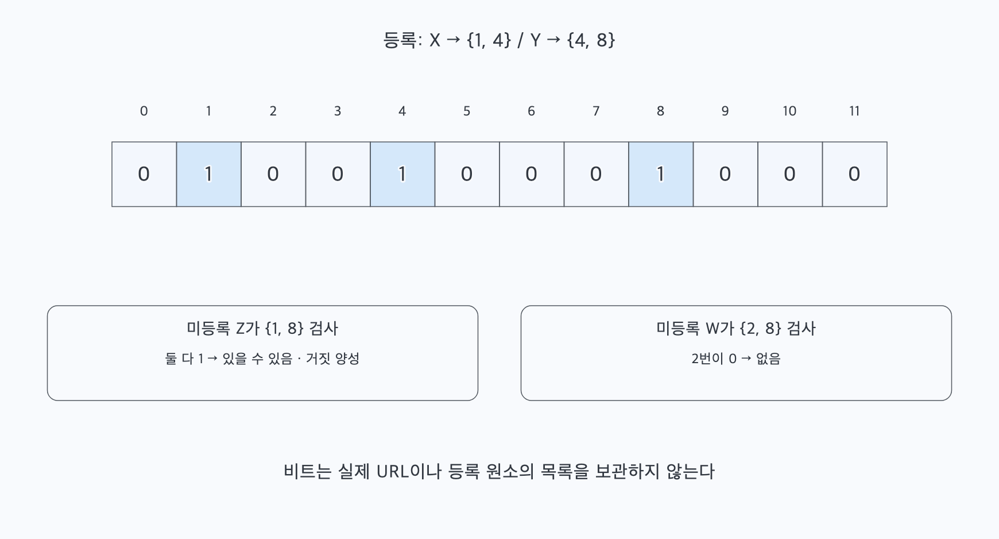
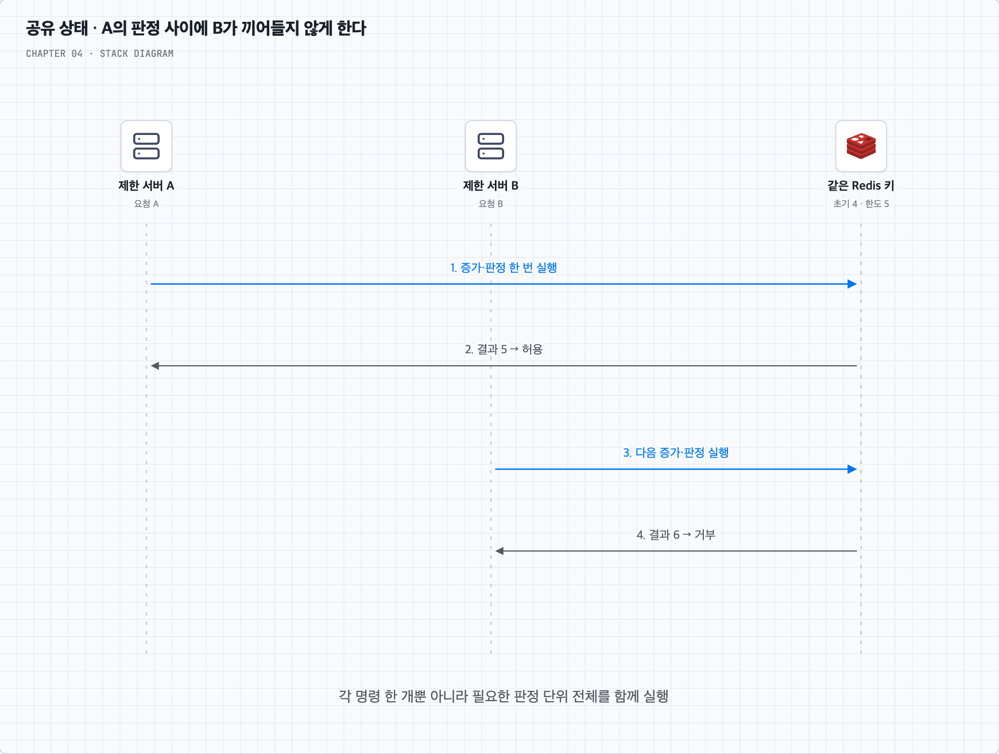
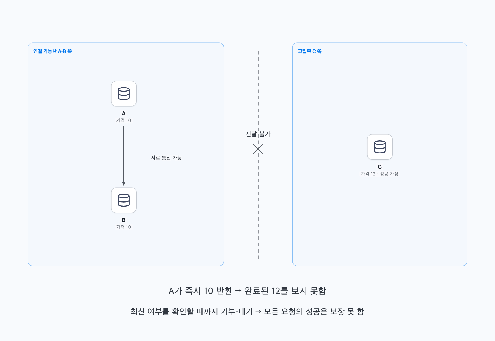
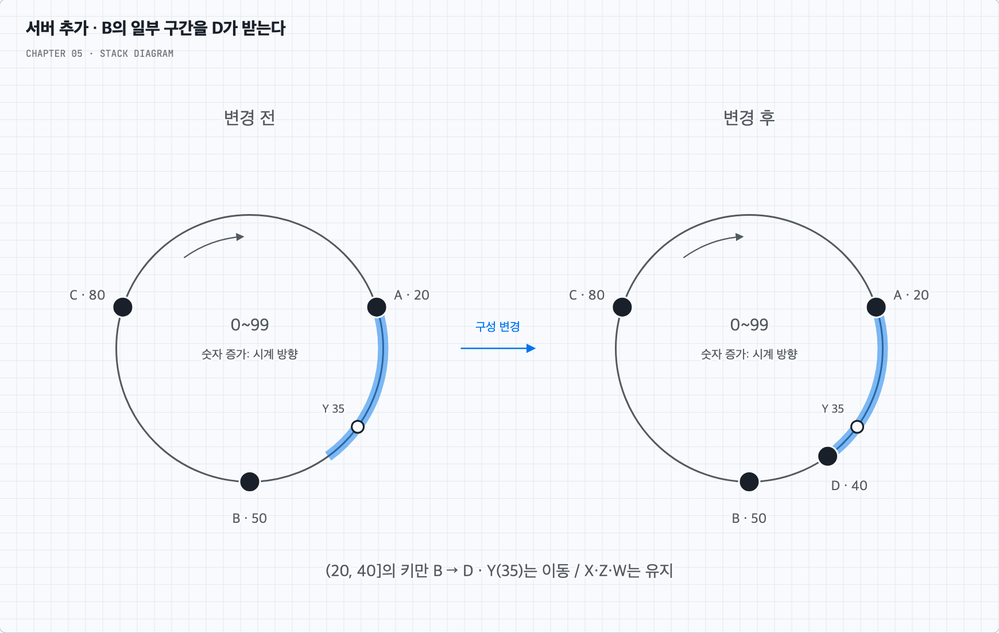
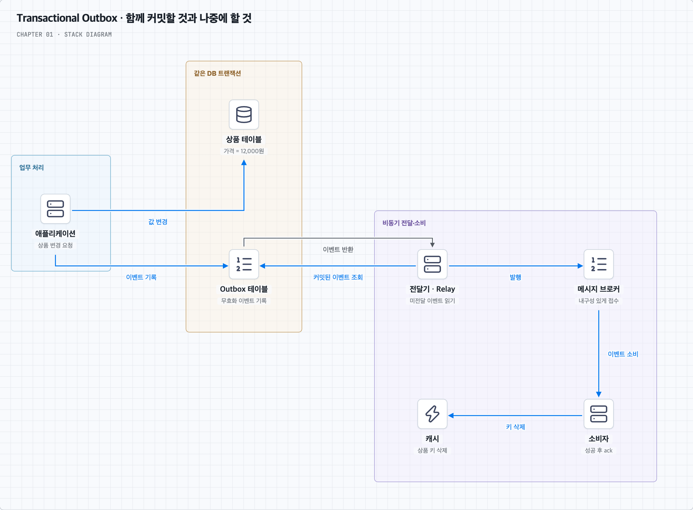
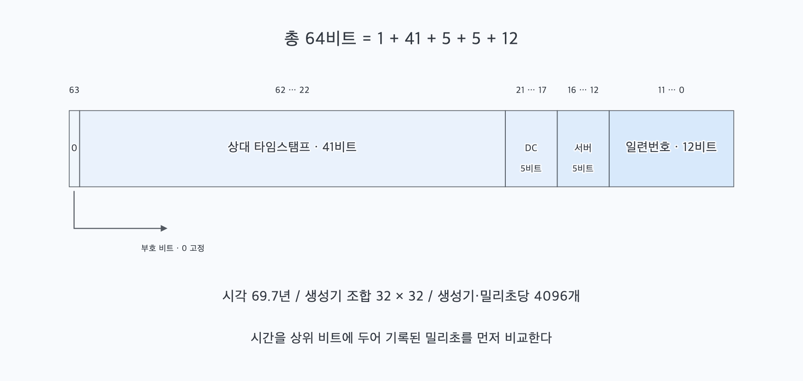

# 1–15장을 관통하는 컴퓨터공학 기초

여러 시나리오에서 다시 만나는 것은 **유한한 자원으로 요청을 처리하고, 상태를 보관하며, 실패 뒤에도 약속한 결과를 지키는 문제**다. 서비스 이름이 달라져도 이 문제들은 반복된다.

<a id="overview"></a>

## 한눈에 보는 공통 지식

| 반복해서 만나는 문제 | 바탕이 되는 CS 지식 | 기억할 판단 |
| --- | --- | --- |
| 요청이 늘어나면 어디서 막히는가? | 비용 모델·병목·CPU/메모리/I/O | 요청 수와 요청 한 건의 비용을 함께 본다. |
| 평균은 괜찮은데 응답이 늦는가? | 대기행렬·동시 처리량·지연 분포 | 처리 시간에 대기 시간이 더해진다. 평균만으로 느린 요청을 숨기지 않는다. |
| 응답이 없으면 처리도 안 된 것인가? | 네트워크·부분 실패·타임아웃 | 응답 유실과 실행 실패를 구별할 수 없는 순간이 있다. |
| 많은 데이터에서 어떻게 적게 읽는가? | 자료구조·인덱스·지역성 | 필요한 데이터를 찾는 방식과 실제로 읽는 바이트 수를 줄인다. |
| 둘이 동시에 같은 값을 바꾸면? | 동시성·원자성·트랜잭션 | 확인과 변경을 하나의 보호 범위 안에서 처리한다. |
| 서버를 늘리면 상태는 어디로 가는가? | 상태 소유권·분할·라우팅 | 요청을 나누는 일과 데이터를 나누는 일은 다르다. |
| 복사본이 서로 다른 값을 가지면? | 복제·일관성·분산 조정 | 무엇을 최신으로 인정하며 언제 성공을 반환할지 정한다. |
| 같은 읽기를 반복해서 계산해야 하는가? | 캐시·지역성·사전 계산 | 읽기 비용을 줄이는 대신 갱신·저장·낡은 값의 비용을 부담한다. |
| 일이 들어오는 속도가 더 빠르면? | 큐·흐름 제어·과부하 | 큐는 시간을 벌어 준다. 지속적인 처리 능력 부족은 별도로 해결한다. |
| 같은 요청이 다시 오면? | 멱등성·중복 처리·순서 | 재전송을 허용하면서 결과가 중복되지 않도록 설계한다. |
| 성공 직후 서버가 꺼지면? | 영속성·로그·복구 | 성공이라고 답하기 전에 어디까지 안전하게 기록할지 정한다. |
| 실제로 제대로 작동하는지 어떻게 아는가? | 관측·장애 영역·보호 경계 | 지연·오류·포화와 함께 결과의 정확성, 복구 가능성, 접근 권한을 확인한다. |

이 문서는 책 1–15장을 그 공통 원리로 다시 묶는다. 비디오 인코딩·재생 포맷처럼 특정 서비스에 필요한 지식은 각 장에 두고, 여기서는 운영체제·네트워크·자료구조·데이터베이스·분산 시스템의 기반을 복습한다. 2장의 규모 추정과 3장의 요구사항 확정도 포함한다. 각 장의 사례를 공통 원리로 다시 설명할 수 있는 상태를 목표로 한다.

개인 노션의 CS 압축 복습·통합 학습 노트와 토스 기출·복원본으로 정리한 학습 자료도 대조했다. 기출의 공식 출제 여부나 모범답안을 주장하는 문서는 아니며, 문제 원문·개인 평가 기록 대신 다른 서비스에도 적용할 수 있는 원리만 재구성했다. 제품별 보장 범위는 연결한 공식 문서와 함께 확인한다.

처음에는 위 표의 ‘기억할 판단’을 읽고, 설명이 막히는 항목만 본문으로 내려간다. 마지막의 답안 토글은 책을 덮고 설명해 보는 데 사용한다.

<a id="contents"></a>

## 읽는 순서

1. [요청 한 건이 자원을 쓰고 기다리는 과정](#resources)
2. [네트워크를 건너면 성공 여부가 불확실해진다](#network)
3. [자료구조는 불필요한 탐색과 I/O를 줄인다](#data-access)
4. [같은 상태의 동시 변경과 순서를 다룬다](#concurrency)
5. [상태를 나누고 복사하면 조정이 필요하다](#distribution)
6. [원본에서 파생한 값을 다시 사용한다](#derived-data)
7. [일을 미뤄도 과부하와 중복은 남는다](#queues)
8. [기록을 남기고 복구하며 운영 중에 확인한다](#recovery)
9. [반복해서 등장하는 여섯 기법](#techniques): [블룸 필터](#bloom-filter) · [Redis Lua](#redis-lua) · [CAP](#cap-reality) · [안정 해시](#consistent-hashing) · [아웃박스](#transactional-outbox) · [스노우플레이크](#snowflake)
10. [CS·기출 학습에서 연결되는 판단](#study-connections)
11. [한 번의 주문으로 원리를 이어 보기](#walkthrough)
12. [책을 덮고 스스로 답하기](#review)
13. [각 장에서 공통 원리로 돌아오는 길](#chapters)

<a id="resources"></a>

## 1. 요청 한 건이 자원을 쓰고 기다리는 과정

상품 조회가 느려졌다고 하자. 서버 수부터 늘리기 전에 요청 한 건이 무엇을 하는지 나눈다. CPU로 결과를 계산하는가, 메모리를 많이 잡는가, DB·디스크·네트워크 응답을 기다리는가? 이 구분이 운영체제의 자원 관리와 성능 분석으로 이어진다.

CPU 작업이 병목이면 병렬 실행 가능한 코어와 계산량을 본다. I/O 대기가 길면 연결 수, 동시 진행 가능한 작업 수와 느린 상대를 본다. 비동기 I/O는 기다리는 동안 다른 일을 진행하게 하지만, 같은 CPU 계산 자체를 더 적게 하지는 않는다. 스레드를 늘려도 공유 자원의 경쟁·스케줄링 비용이 늘 수 있다. 연결 1만 개를 유지한다는 말과 CPU 작업 1만 개를 동시에 실행한다는 말도 다르다. 운영체제의 CPU·메모리·동시성·영속성은 이 판단의 기반이다. [OSTEP](https://pages.cs.wisc.edu/~remzi/OSTEP/)

규모 추정은 이 비용에 요청량을 곱하는 과정이다. 예를 들어 일간 사용자 100만 명이 각각 하루 20번 조회하면 하루 2천만 요청, 평균 약 231요청/초다. 실제 설계에는 피크, 한 화면이 만드는 추가 요청, 재시도를 더한다. DAU는 동시 접속자 수가 아니다.

한 요청이 평균 200ms 동안 시스템에 머물고 초당 1,000건을 안정적으로 처리한다면, 그 경계 안에서 진행 중인 요청은 평균 약 200건이다. **리틀의 법칙**은 같은 시스템 경계와 안정적인 장기 평균을 전제로 `평균 진행 중 요청 수 = 평균 처리율 × 평균 체류 시간`으로 연결한다. 여기서 체류 시간에는 대기도 포함한다. 200건이라는 숫자가 곧 필요한 스레드·CPU 코어 수라는 뜻은 아니다. [MIT 대기행렬 강의](https://web.mit.edu/1.041/www/lectures/L8-queuing-models-2024sp.pdf)

이제 평균 지연뿐 아니라 p95·p99를 본다. p99는 측정한 요청의 99%가 그 시간 이내에 끝났다는 경계다. 여러 서비스를 순서대로 호출하면 각 구간의 지연이 누적되고, 병렬로 호출해 모두 기다리면 느린 구간이 완료 시간을 좌우할 수 있다. 일부 계산만 빨라져도 전체가 같은 비율로 빨라지지 않는다.

### CPU가 한가해도 요청은 밀릴 수 있다

외부 API를 기다리는 동안 스레드와 DB 연결을 붙잡으면 CPU 사용률이 낮아도 풀이 고갈된다. 새 요청은 연결을 기다리다가 타임아웃을 받고, 같은 풀을 쓰는 다른 API도 느려진다. 연결 풀은 연결 생성 비용을 줄이는 장치이면서 동시에 하류로 들어가는 동시 작업의 예산이다. 애플리케이션 8대가 각각 30개 연결을 열면 DB에는 최대 240개가 향한다. 서버 증설이 DB의 여유를 늘려 주지는 않는다.

연결 10개를 각 작업이 평균 0.2초 점유하면, 다른 병목이 없다는 이상적인 조건에서 초당 약 50건이다. 대기 시간을 줄이려면 풀 크기뿐 아니라 **연결을 잡고 있는 시간**을 줄여야 한다. 요청 추적에서는 풀 획득 대기·SQL 실행·외부 호출·직렬화를 나누고, 병렬 호출의 시간을 단순 합산하지 않는다.

프로세스는 독립된 가상 주소 공간을 갖고, 같은 프로세스의 스레드는 힙 등을 공유하면서 각자의 스택·레지스터 상태를 갖는다. 공유하므로 전달은 쉬워지지만 동기화가 필요하다. 문맥 교환·잠금 경쟁 때문에 스레드를 무한히 늘릴 수 없다. 가상 메모리도 물리 메모리를 무한히 만들어 주지 않으며, 페이지 폴트로 저장장치 접근이 필요해지면 지연이 커질 수 있다.

메모리는 `요청당 보유 바이트 × 동시 진행 요청 수`로도 추정한다. 큰 파일을 스트리밍하더라도 먼저 전체 파일을 메모리에 올렸다면 절약 효과가 없다. GC 역시 아직 참조 중인 대용량 객체를 회수해 주지 않는다. 느린 수신자에게 스트리밍하는 동안 DB 커서·연결까지 계속 점유하는지도 본다.

**남길 판단:** 요청량, 요청당 CPU·메모리·I/O 비용, 기다리는 자원, 느린 요청의 비율을 함께 설명할 수 있어야 한다.

<a id="network"></a>

## 2. 네트워크를 건너면 성공 여부가 불확실해진다

사용자는 DNS로 주소 정보를 얻고 HTTP 요청을 보낸다. DNS는 주소를 찾는 절차이고, HTTP는 요청·응답의 규칙이며, TLS는 통신을 보호한다. 대역폭은 일정 시간에 보낼 수 있는 데이터 양이고, 지연시간은 응답까지 걸리는 시간이다. 대역폭을 늘려도 물리적 거리와 왕복·처리 지연이 모두 사라지지는 않는다. 연결 재사용은 연결 설정 비용을 줄인다. 같은 연결을 오래 쓴다는 사실만으로 애플리케이션의 실시간 양방향 메시지 교환까지 정의되지는 않는다. 요청 주도 방식과 지속 연결 방식은 필요한 통신 패턴에 따라 선택한다.

상품 주문을 DB에 저장한 직후 응답이 사라졌다고 하자. 클라이언트는 타임아웃을 받지만 주문은 이미 존재한다. 반대로 요청이 서버에 도착하지 않았을 수도 있다. 원격 호출에서는 상대의 실행과 내 응답 수신이 하나의 원자적 사건이 아니다. **부분 실패**는 시스템 일부만 실패하거나 연락할 수 없어 나머지의 상태가 불확실한 상황을 포함한다.

타임아웃은 무한히 자원을 붙잡고 기다리지 않기 위한 제한이다. 상대 작업의 취소·롤백을 증명하지 않는다. 재시도에는 횟수·전체 기한·백오프·무작위 지연을 두고, 부작용이 있는 요청에는 같은 논리적 요청임을 식별할 방법이 필요하다. 여러 계층이 각각 재시도하면 호출 수가 크게 증폭될 수도 있다. [AWS의 타임아웃·재시도 설명](https://aws.amazon.com/builders-library/timeouts-retries-and-backoff-with-jitter/)

하트비트나 연결 끊김으로 얻는 장애 정보도 일정 시간 안에 연락했는지에 대한 관측이다. 느린 서버, 끊긴 네트워크, 종료된 프로세스를 항상 즉시 구분할 수는 없다. 그래서 장애 감지 뒤의 재접속·담당 변경·미완료 작업 확인까지 함께 설계한다.

### 무엇을 기다리다 실패했는지 구분한다

풀 획득 제한, 연결 설정 제한, 읽기 대기 제한, 요청 전체 기한은 서로 다르다. 읽기 타임아웃이 매 구간의 무응답 시간을 제한하는 설정이라면, 조금씩 계속 오는 응답은 전체 기한을 넘길 수도 있다. DNS·TLS 시간이 어느 제한에 포함되는지도 사용하는 클라이언트에서 확인한다.

TCP는 연결 안의 바이트를 순서대로 신뢰성 있게 전달하지만, TCP 확인 응답이 주문 커밋을 뜻하지는 않는다. HTTP의 멱등성도 ‘여러 번 수행한 의도된 효과가 한 번과 같다’는 의미이며 응답 내용이 항상 같다는 뜻은 아니다. POST 주문 생성에 같은 요청 키와 결과 보존을 도입하는 것은 별도의 애플리케이션 계약이다. [TCP 표준](https://www.rfc-editor.org/rfc/rfc9293.html), [HTTP 멱등 메서드](https://www.rfc-editor.org/rfc/rfc9110.html#section-9.2.2)

**남길 판단:** 원격 호출마다 실행, 영속 기록, 응답 수신 중 어디까지 확인했는지 구분한다.

<a id="data-access"></a>

## 3. 자료구조는 불필요한 탐색과 I/O를 줄인다

상품 1개를 찾으려고 모든 상품을 읽는다면 데이터가 커질수록 비용이 늘어난다. 먼저 접근 패턴을 정한다. 정확한 ID로 찾는가, 가격 범위를 찾는가, 최신순 일부를 읽는가, 접두어로 후보를 찾는가? 저장소 제품 이름보다 이 질문이 앞선다.

해시 테이블은 적절한 해시·부하율을 전제로 키 조회의 평균 비용이 작지만, 정렬된 범위 탐색을 제공하는 구조는 아니다. 서로 다른 입력의 해시가 같을 수 있으므로 해시값만으로 모든 입력의 고유성이나 내용의 동일성을 무조건 증명하지 않는다. 정렬된 트리 인덱스는 동등·범위·순서 기반 조회에 활용한다. PostgreSQL의 B-tree 인덱스도 동등 비교와 범위 조건, 정렬된 조회를 지원한다. 다만 인덱스는 공간을 쓰고 갱신 시 유지 비용이 든다. [PostgreSQL 인덱스 유형](https://www.postgresql.org/docs/current/indexes-types.html)

큐는 처리 대기 순서를, 우선순위 큐는 다음에 꺼낼 대상을 관리한다. 트라이는 문자열의 접두어를 공유한다. 이런 자료구조를 외울 때는 구현 이름과 함께 **어떤 연산을 싸게 만들고 무엇을 더 저장하는지**를 붙인다. 시간 복잡도가 작아도 한 번에 읽는 바이트가 크거나 원격 왕복이 많으면 느릴 수 있다.

메모리에 모든 데이터를 둘 수 없으므로 자주 접근하는 부분을 메모리에 유지한다. 최근 사용한 데이터나 가까운 데이터를 다시 쓰는 경향이 지역성이다. 인접한 데이터를 묶어 읽거나 순차적으로 기록하면 흩어진 작은 I/O를 줄일 수 있지만, 나중의 병합·정리 비용이 생길 수 있다. 저장 계층의 구현과 접근 패턴을 함께 봐야 한다.

블룸 필터는 값 자체를 돌려주는 캐시가 아니라 집합 포함 여부를 적은 메모리로 검사하는 구조다. 표준적인 올바른 구성에서는 등록한 원소를 없다고 판정하지 않지만, 없는 원소를 있다고 할 수는 있다. 이때 ‘등록한 집합’이 실제 DB의 최신 데이터를 모두 포함하는지는 별도 문제다. 필터 갱신을 놓쳤다면 DB의 최신 값을 없다고 오판할 수 있다. [Redis 블룸 필터 설명](https://redis.io/docs/latest/data-types/probabilistic/bloom-filter/)

### 인덱스는 실제 질의에서 출발한다

`WHERE seller_id = ? ORDER BY created_at DESC, product_id DESC LIMIT 20`인 목록이라면 `(seller_id, created_at DESC, product_id DESC)` 같은 복합 인덱스를 검토한다. 값 종류가 많다는 이유만으로 다른 열을 맨 앞에 두면 이 질의의 탐색·정렬을 줄이지 못할 수 있다. 선두 열 조건과 정렬 방향, 실제 선택 비율을 함께 본다. DB의 최적화에 따라 예외가 있으므로 실행 계획의 예상·실제 행 수, 반복 횟수, 정렬, I/O로 확인한다. `EXPLAIN ANALYZE`는 실제 실행하므로 변경 질의는 특히 안전한 환경에서 확인한다. [복합 인덱스](https://www.postgresql.org/docs/current/indexes-multicolumn.html), [실행 계획 읽기](https://www.postgresql.org/docs/current/using-explain.html)

목록 20개를 읽고 각 상품의 집계 정보를 따로 조회하면 21번의 왕복이 생긴다. 이것이 N+1 문제다. 필요한 ID를 모아 일괄 조회하면 왕복을 줄일 수 있지만 집계·조인 비용까지 없어지지는 않는다. 깊은 OFFSET은 앞부분을 건너뛰는 비용이 커질 수 있어 마지막으로 본 `(created_at, product_id)`를 기준으로 다음 범위를 읽는 방식을 검토한다. 같은 시각의 항목을 구별할 고유 ID와 정렬 키 변경 시의 정책도 필요하다.

**남길 판단:** 어떤 연산을 빠르게 해야 하는지, 탐색 횟수·I/O·공간·갱신 비용이 어떻게 바뀌는지 설명한다.

<a id="concurrency"></a>

## 4. 같은 상태의 동시 변경과 순서를 다룬다

재고가 1개 남았다고 하자. A와 B가 각각 ‘재고 1개’를 읽고 주문을 승인하면 재고를 초과해 판매할 수 있다. 두 요청의 읽기가 각각 정확했어도, **확인과 변경 사이에 다른 작업이 끼어들 수 있으면** 전체 판단은 잘못될 수 있다. 이것이 경쟁 조건을 이해하는 출발점이다.

조건 확인과 차감을 원자적으로 묶고, 실제로 차감에 성공한 요청만 주문을 확정한다. 같은 보호 범위 안에서 직렬화하는 잠금, 기대한 버전일 때만 변경하는 조건부 갱신, 고유성 제약 등이 해결 수단이 된다. 여러 애플리케이션 서버가 같은 DB를 바꾼다면 한 프로세스 안의 잠금만으로는 충분하지 않다. 잠금 범위·유지 시간·획득 순서에 따라 대기와 교착 상태도 고려한다.

주문 생성과 재고 차감까지 함께 지켜야 한다면 트랜잭션의 범위를 정한다. ACID의 원자성은 그 범위의 전부 반영·전부 취소에 관한 약속이고, 격리성은 동시에 실행한 트랜잭션이 서로 어떤 영향을 관찰할지 다룬다. ACID의 일관성은 애플리케이션과 DB가 제약·불변 조건을 지키는 관점이고, 지속성은 확정한 변경을 약속한 장애 범위에서 남기는 성질이다. 트랜잭션을 썼다는 사실만으로 모든 경쟁 조건이 사라지지 않는다. 격리 수준·제약·실패 후 재시도가 중요하다. [PostgreSQL 트랜잭션 격리](https://www.postgresql.org/docs/current/transaction-iso.html)

DB 밖의 캐시·메시지 큐·외부 결제 API까지 같은 트랜잭션에 들어간다고 가정하면 안 된다. DB 안에서 성공한 것과 외부 시스템에 반영된 것은 각각 확인해야 한다.

순서도 범위를 정한다. ID의 유일성, 시각에 따른 대략적인 정렬, 한 상품의 변경 순서, 커밋 완료 순서는 서로 다른 보장이다. 서버들의 벽시계는 어긋나거나 뒤로 조정될 수 있다. 따라서 시각만으로 동시 변경의 승자나 빠짐없는 복구 지점을 정하지 않는다. 필요한 범위의 버전·순번과 그 순번이 언제 확정되는지를 정한다.

### 잠금·격리·중복 방지는 다른 질문에 답한다

뮤텍스는 한 번에 하나의 실행 흐름이 임계 구역을 사용하도록 하고, 계수 세마포어는 동시에 허용할 작업 수를 제한한다. 프로세스마다 세마포어 20개를 둔 서버 10대는 전체 20개가 아니라 최대 200개를 허용할 수 있다. 보호 범위가 프로세스인지 DB인지 전체 서비스인지 확인한다.

교착 상태는 상호 배제·점유 대기·비선점·순환 대기가 함께 가능한 상황에서 생긴다. 두 계좌나 두 상품을 잠글 때 모두 같은 ID 순서로 획득하면 그 경로의 순환 대기를 없앨 수 있다. 잠금 대기가 길다는 사실만으로 교착은 아니며, 타임아웃으로 포기하는 것은 복구 수단이지 순환 구조를 없앴다는 증거가 아니다.

MVCC는 여러 버전을 이용해 읽기와 쓰기의 충돌을 줄이는 기반이다. 스냅샷에서 읽었다고 이후 쓰기까지 자동으로 안전한 것은 아니다. 재고 차감은 `UPDATE inventory SET stock = stock - 1 WHERE product_id = ? AND stock > 0`처럼 조건과 변경을 묶고, 영향받은 행 수를 확인하는 식으로 설계한다. 주문 생성까지 함께 성공해야 한다면 같은 DB 트랜잭션으로 묶는다. 격리 수준별 동작은 제품마다 확인한다. [MVCC](https://www.postgresql.org/docs/current/mvcc-intro.html), [잠금과 교착](https://www.postgresql.org/docs/current/explicit-locking.html)

`UNIQUE(request_id)`는 같은 요청의 중복 생성을, `UNIQUE(user_id, event_id)`는 같은 사용자의 같은 행사 중복 참여를 막는 식으로 목적이 다르다. NOT NULL·CHECK·외래 키도 각각 값 존재·허용 범위·참조 관계를 보호한다. 어떤 제약도 혼자서 전역 정원, 공정한 도착 순서, 외부 지급의 중복까지 모두 해결하지 않는다. 추첨·지급처럼 재시도 때 결과가 바뀌면 안 되는 작업은 결정한 결과와 진행 상태를 저장하고 같은 논리적 요청에서 재사용한다.

**남길 판단:** 지켜야 할 불변 조건, 원자적으로 바꿀 범위, 순서가 필요한 범위를 먼저 적는다.

<a id="distribution"></a>

## 5. 상태를 나누고 복사하면 조정이 필요하다

웹 서버를 여러 대로 늘렸는데 로그인 정보를 한 서버의 메모리에만 두면 다른 서버가 다음 요청을 처리하기 어렵다. 요청 처리 서버는 교체할 수 있게 만들고, 계속 유지해야 하는 상태는 적절한 저장소나 연결 담당 경로에서 관리한다. 무상태 서버는 필요한 상태가 시스템 어디에도 없다는 뜻이 아니다.

로드 밸런싱은 요청을 분산하는 일이고, **분할·샤딩**은 데이터의 담당을 나누는 일이다. 어느 키가 어느 서버에 속하는지에 대한 라우팅 규칙이 필요하다. 안정 해시는 서버 구성이 바뀔 때 담당이 바뀌는 키를 줄이는 방법이다. 한 인기 상품으로 몰리는 요청 자체를 여러 키로 바꾸지는 않으므로 핫키는 별도로 다룬다. 데이터 개수가 균등한 것과 요청 비용이 균등한 것도 다르다.

이제 담당 서버 장애에 대비해 사본을 둔다. **복제**는 같은 데이터의 사본을 늘리는 것이므로, 서로 다른 데이터를 나누는 샤딩과 목적이 다르다. 복제하면 언제 성공이라고 답할지, 어떤 사본에서 읽을지, 뒤처진 사본을 어떻게 고칠지 정해야 한다. 사본 수를 늘리는 만큼 전송·저장·복구 비용도 생긴다.

여기서 일관성 모델이 필요해진다. 최신 쓰기의 완료 뒤 시작한 읽기가 그 이전 값으로 돌아가지 않아야 하는가? 자기 쓰기만은 바로 읽어야 하는가? 잠시 다른 값이 보이더라도 갱신이 멈추고 복구가 진행되면 수렴하면 되는가? 같은 서비스 안에서도 재고 확정과 상품 설명 화면에 다른 약속을 할 수 있다.

네트워크가 갈라져 양쪽이 통신할 수 없는 동안, 모든 도달 가능한 비고장 노드의 요청을 계속 성공시키면서 하나의 최신 상태를 보는 보장까지 유지할 수는 없다. CAP의 가용성은 평소의 가동률이나 ‘일부 정상 서버가 계속 서비스함’보다 강한 요구다. 강한 일관성을 지키는 시스템도 정상적인 다수 쪽에서 계속 서비스할 수 있다. [FoundationDB의 CAP 해설](https://apple.github.io/foundationdb/cap-theorem.html)

누가 현재 쓰기 담당인지, 어떤 변경 순서를 유효하게 인정할지 조정해야 할 때 리더 선출·합의가 등장한다. 단순히 사본 여러 개에 써 두거나 `R + W > N`을 만족시킨다는 말만으로 동시 쓰기·실패한 쓰기·담당 변경까지 해결되지는 않는다. 복제, 정족수, 합의를 같은 뜻으로 외우지 않는다.

**남길 판단:** 데이터 담당, 사본 배치, 성공 확인 조건, 읽기의 약속, 담당 변경 절차를 구분한다.

<a id="derived-data"></a>

## 6. 원본에서 파생한 값을 다시 사용한다

상품 조회 때마다 원본 DB를 읽고 같은 계산을 하면 비용이 반복된다. 자주 읽는 상품 정보나 미리 계산한 상품 목록을 저장해 다시 사용하면 조회가 짧아진다. 캐시와 사전 계산은 모두 반복되는 읽기·계산을 다른 시점의 비용으로 옮기는 방법이다.

캐시 적중률이 90%이고 조회가 초당 2,000건이면 단순 계산상 원본 조회는 초당 200건이다. 다만 이것은 모든 조회가 같은 경로를 쓰고 적중이 원본 접근을 완전히 피한다는 가정이다. 캐시가 한꺼번에 비면 원본에 2,000건이 몰릴 수 있다. 제한된 메모리에 무엇을 남기고 무엇을 내보낼지, 같은 키의 미스를 어떻게 합칠지, 원본을 어떻게 보호할지도 정한다.

가격을 바꿨는데 캐시에는 옛 가격이 남으면, 읽기를 빠르게 만든 대가로 일관성 문제가 생긴다. 만료·무효화·새 버전 교체는 서로 다른 정책이다. DB 커밋 뒤 캐시를 지워도, 이전 값을 읽던 요청이 늦게 캐시를 다시 채울 수 있다. TTL은 낡은 값이 남는 시간을 제한하는 수단일 수 있지만, 그동안의 최신 읽기까지 보장하지 않는다.

미리 계산한 목록에도 같은 문제가 있다. 읽기 때 계산하면 읽기가 비싸고, 변경 때 미리 반영하면 쓰기가 여러 곳으로 퍼진다. 이것이 계산 시점과 읽기·쓰기 증폭의 절충이다. 파생 데이터가 원본보다 늦게 바뀔 수 있다면 허용 지연, 재계산 방법, 삭제·권한 변경의 처리도 정한다.

불변 버전의 내용은 계속 재사용하기 쉽다. 반면 ‘지금 최신 버전은 무엇인가’라는 포인터는 바뀌므로 더 엄격한 확인이 필요할 수 있다. 같은 캐시라는 이름 아래 이 둘을 동일하게 취급하지 않는다.

**남길 판단:** 어떤 반복 비용을 줄였는지, 원본은 무엇인지, 갱신과 미스가 몰릴 때 무엇이 일어나는지 설명한다.

<a id="queues"></a>

## 7. 일을 미뤄도 과부하와 중복은 남는다

주문은 빨리 접수하되 후속 작업은 잠시 늦어도 된다고 하자. 해야 할 일을 내구성 있는 큐에 넣고 작업자가 나중에 처리하면 요청 처리와 작업 처리를 분리할 수 있다. 이때 ‘접수 완료’와 ‘업무 처리 완료’를 API와 상태에서 구분한다.

하지만 초당 2,000건이 들어오고 1,000건밖에 처리하지 못하면 10초 동안 약 1만 건이 추가로 쌓인다. 유입이 계속 처리 능력을 넘으면 대기 시간과 저장 공간이 계속 늘어난다. 큐 길이 제한, 너무 오래된 작업의 처리, 유입 제한, 우선순위와 상류에 속도를 낮추도록 하는 역압이 필요하다. 작업자를 늘릴지는 하류 DB·외부 API의 처리 여유를 보고 결정한다. [Google SRE의 과부하 처리](https://sre.google/sre-book/handling-overload/)

작업자가 주문 후속 처리를 끝낸 뒤 완료 확인을 보내기 전에 죽을 수도 있다. 큐가 작업을 다시 전달하면 같은 작업이 두 번 실행될 수 있다. 한편 너무 일찍 확인하면 작업이 사라질 수 있다. 전달 확인만으로 업무 결과가 정확히 한 번 발생했다는 보장까지 얻지는 못한다.

그래서 논리적 요청 ID를 유지하고, 같은 ID의 처리 여부와 업무 변경을 가능한 한 같은 원자적 범위에서 기록한다. 이것이 재시도를 안전하게 만드는 멱등성 설계의 한 형태다. 부작용을 가진 외부 API까지 포함하면 그 API의 중복 방지 계약과 보존 기간도 필요하다. [AWS의 멱등 API 설명](https://aws.amazon.com/builders-library/making-retries-safe-with-idempotent-APIs/)

DB 주문은 커밋됐는데 큐 발행 전에 프로세스가 죽는 틈도 있다. 트랜잭션 아웃박스는 주문 변경과 ‘발행할 이벤트’를 같은 DB 트랜잭션에 남기고, 전달기가 나중에 발행하는 방식이다. 발행 후 확인이 사라지면 중복 발행은 여전히 가능하므로 소비자의 중복 처리도 함께 설계한다.

큐의 선입선출도 범위가 있다. 여러 파티션·작업자에서 꺼낸 순서와 처리 완료 순서는 달라질 수 있다. 한 상품의 변경 순서만 필요하다면 그 범위의 직렬 처리·버전 검사를 고려한다. 전역 순서를 요구하면 병렬성과 조정 비용이 달라진다.

### 유입량·진행 중 작업·실패 전파를 따로 제어한다

초당 요청 수를 제한하는 처리율 제한과 동시에 진행 중인 작업 수를 제한하는 동시성 제한은 다르다. 초당 100건이어도 한 건이 10초 걸리면 많은 작업이 동시에 자원을 점유한다. 오래 기다리는 외부 서비스에는 전체 기한과 동시성 예산을 함께 둔다.

벌크헤드는 기능이나 외부 의존성별로 풀·실행 예산을 분리해 한쪽 고갈이 번지는 범위를 줄인다. 서킷 브레이커는 실패가 누적된 상대에게 새 호출을 잠시 차단하고 제한된 탐색 호출로 복구를 확인한다. 이미 실행 중인 호출을 취소하거나 동시 요청 수를 자동 제한하는 장치는 아니다. 큐·풀을 분리해도 최종 DB가 공유된다면 그 전체 예산을 확인한다. [벌크헤드](https://learn.microsoft.com/en-us/azure/architecture/patterns/bulkhead), [서킷 브레이커](https://learn.microsoft.com/en-us/azure/architecture/patterns/circuit-breaker)

**남길 판단:** 유입 속도와 처리 속도, 접수·처리 완료의 경계, 재전달·중복·순서의 범위를 함께 정한다.

<a id="recovery"></a>

## 8. 기록을 남기고 복구하며 운영 중에 확인한다

메모리에 주문을 만들었다고 답한 직후 프로세스가 꺼지면 어떻게 될까? 성공을 알리기 전에 어떤 기록을 어디에 남겼는지가 중요하다. 영속성은 단순히 변수나 버퍼를 갱신했다는 사실과 다르며, 실제로 견뎌야 하는 장애 범위를 정해야 한다.

로그를 먼저 안전하게 남기고 이후 데이터 구조를 반영하면, 중단 뒤 기록을 재생해 복구할 수 있다. WAL은 데이터 파일의 변경보다 해당 변경의 로그를 먼저 영속화하는 원리를 사용한다. 로그가 있다고 모든 기록을 영원히 재생해야 하는 것은 아니며, 체크포인트 등으로 복구의 출발점을 좁힌다. [PostgreSQL WAL 설명](https://www.postgresql.org/docs/current/wal-intro.html)

여러 단계를 거치는 작업은 진행 상태와 최종 공개 시점을 구분한다. 필요한 데이터가 준비된 뒤 새 버전을 원자적으로 공개하면, 읽는 쪽이 반쯤 완성된 결과를 최신으로 보지 않게 할 수 있다. 재시작한 작업자는 기록된 단계부터 안전하게 재처리하고, 확정되지 않은 임시 결과는 나중에 정리한다. 알림을 놓쳐도 변경 이력과 단말별 진행 위치로 복구할 수 있다.

복제는 백업과 같지 않다. 잘못된 삭제나 손상도 사본에 전파될 수 있다. 서로 다른 장애 영역에 사본을 두는 것, 과거 상태를 보존하는 것, 실제 복구 절차를 검증하는 것은 각각 필요하다. ‘얼마나 최근 데이터까지 잃어도 되는가’와 ‘얼마나 빨리 복구해야 하는가’를 정해야 비용과 구조를 판단할 수 있다.

가용성 목표도 측정 방법을 정한다. 시간 기준 99.9% 가용성을 30일에 적용하면 허용 중단 시간은 약 43.2분이다. 성공 요청의 비율로 측정하는 목표라면 계산 기준이 달라진다. 어떤 요청과 구간을 성공으로 셀지 정해야 수치가 의미를 갖는다.

운영 중에는 지연·트래픽·오류·포화를 함께 본다. 포화는 CPU뿐 아니라 연결 풀·메모리·디스크·큐·하류 처리 한도에서도 생긴다. 평균 지연만 보면 일부 느린 요청이 가려질 수 있고, 큐 길이만 보면 일이 오래 멈췄는지 알기 어렵다. 가장 오래 기다린 작업의 나이, 복제 지연, 중복 처리, 누락·충돌과 실제 사용자 결과도 확인한다. [Google SRE의 모니터링 원칙](https://sre.google/sre-book/monitoring-distributed-systems/)

접근 권한과 자원 제한도 처리 경계에서 지킨다. 암호화된 연결이라도 요청한 상품·주문을 볼 권한은 별도로 확인한다. 예측하기 어려운 ID도 권한 검사를 대신하지 않는다. 입력 크기·페이지 크기·타임아웃·처리율을 제한해 한 요청이 유한한 자원을 고갈시키지 않게 한다.

### 운영 중 데이터 이전도 복구 문제다

기존 저장소를 새 저장소로 바꿀 때 복사와 이중 쓰기를 켰다는 사실만으로 안전해지지 않는다. 오래된 백필이 새 값을 덮거나, 삭제된 값을 옛 저장소에서 다시 읽어 되살릴 수 있다. 남은 TTL 대신 원래 TTL 전체를 다시 주면 수명도 늘어난다. 값뿐 아니라 버전·삭제 표시·원래 만료 시점의 의미를 옮겨야 한다.

버전 비교 후 쓰기가 안전하려면 저장소가 그 비교와 변경을 원자적으로 지원해야 한다. CRUD만 제공하는 인터페이스에 CAS·Lua·전체 키 열거 기능이 있다고 가정하지 않는다. 모든 구버전 서버·배치의 쓰기가 끝났는지 확인하고, 마지막 옛 쓰기 이후 모든 관련 키의 수명이 상한 안에 끝난다는 조건이 있어야 TTL 대기 전략을 사용할 수 있다. 새 저장소에만 기록하기 시작한 뒤의 롤백도 최신 변경을 되돌려 동기화하는 절차가 필요하다.

**남길 판단:** 성공 기록, 복구 기준, 공개 시점, 장애 영역, 운영 지표와 권한 경계를 설명한다.

<a id="techniques"></a>

## 반복해서 등장하는 여섯 기법

앞에서는 자원·상태·실패의 공통 문제를 살폈다. 이제 책에서 반복 등장한 도구를 그 문제에 연결한다. 이름을 외우기보다 **줄이는 비용, 보호하는 범위, 남는 실패**를 함께 기억한다.

<a id="bloom-filter"></a>

### 1. 블룸 필터 — 없는 키를 싸게 걸러 원본 조회를 줄인다

존재하지 않는 상품 ID 조회가 많으면 캐시에 없어 매번 DB로 향한다. 모든 상품 ID를 그대로 메모리에 저장하기 부담스러울 때, 등록 여부를 작은 비트 배열로 요약할 수 있다.

상품 X를 등록할 때 여러 해시로 비트 위치를 구해 모두 1로 만든다. 조회할 때 그 위치 중 하나라도 0이면 등록하지 않은 키다. 모두 1이어도 다른 상품들이 우연히 같은 비트를 채웠을 수 있어 ‘있을 수 있음’만 알 수 있다. 이 경우 DB에서 실제 존재와 값을 확인한다.



그림에서 X·Y가 채운 비트만으로 등록하지 않은 Z도 양성으로 나올 수 있다. 이것이 거짓 양성이다. 표준 블룸 필터는 올바르게 등록된 집합에 대해 거짓 음성을 만들지 않지만, DB 신규 쓰기를 필터에 반영하지 못했다면 **필터의 집합과 DB의 집합이 달라진다**. 이 상태에서 음성을 믿고 DB 조회를 생략하면 실제 상품을 놓친다. 재구축·교체 중 쓰기 반영과 장애 시 우회 정책도 필요하다.

비트를 단순히 0으로 지워 삭제하면 같은 비트를 공유하는 다른 키까지 없다고 판단할 수 있다. 삭제가 필요하면 재구축이나 삭제를 지원하는 변형을 검토한다. 허용할 거짓 양성률을 낮추려면 더 많은 메모리가 필요하고, 예상보다 많이 넣으면 오류율이 높아진다. 상품 내용은 보관하지 않으므로 캐시·DB를 대체하지 않으며, 크롤러에서 양성을 모두 버리면 일부 새 URL을 놓칠 수 있다.

**연결:** [8장 URL 존재 검사](../chapters/08-url-shortener/README.md) · [9장 방문 URL 검사](../chapters/09-web-crawler/README.md) · [Redis의 원리 설명](https://redis.io/docs/latest/operate/oss_and_stack/stack-with-enterprise/bloom/)

<a id="redis-lua"></a>

### 2. Redis Lua — 확인과 변경 사이에 다른 요청이 끼지 못하게 한다

한 사용자에게 한 구간 동안 5건을 허용한다고 하자. 카운터가 4일 때 두 서버가 각각 읽고 ‘아직 가능’이라 판단하면 둘 다 통과할 수 있다. 읽기·판단·변경이 분리된 것이 문제다. Lua는 프로그래밍 언어이고, **Redis가 Lua 스크립트를 다른 명령이 끼어들지 않도록 실행하는 성질**을 이용하면 이 구간을 묶을 수 있다.



그림처럼 요청 A가 먼저 5가 되어 통과하면 B는 6이 되어 거절된다. 아래 예시는 거절된 시도도 세는 고정 윈도 방식이다. 서버가 사용자와 시간 구간으로 키를 만들고, 스크립트에는 한도와 정리용 TTL을 전달한다. 시간 구간은 키로 구별하며 TTL만으로 윈도 경계를 정의하지 않는다.

```lua
-- KEYS[1]: 서버가 정한 사용자 + 고정 시간 구간의 키
-- ARGV[1]: 양의 정수 한도, ARGV[2]: 양의 정수 TTL(ms)
local limit = tonumber(ARGV[1])
local ttl = tonumber(ARGV[2])
assert(limit and limit >= 1 and limit == math.floor(limit))
assert(ttl and ttl >= 1 and ttl == math.floor(ttl))
local count = redis.call('INCR', KEYS[1])
if count == 1 then
    redis.call('PEXPIRE', KEYS[1], ttl)
end
local allowed = 0
if count <= limit then allowed = 1 end
return {allowed, count}
```

`INCR` 자체도 원자적이지만, 별도 만료 명령 전에 서버가 죽는 틈이나 여러 단계의 판단까지 혼자 묶지는 못한다. 스크립트는 이런 왕복과 끼어들기를 줄인다. 키 형식·정수 범위·기존 값의 타입을 통제하고, TTL이 필요한 구간보다 먼저 끝나지 않게 정한다.

보장 범위는 해당 Redis 실행이다. DB 주문 커밋이나 다른 Redis 노드까지 하나의 트랜잭션으로 묶이지 않는다. Cluster의 여러 키를 다루려면 같은 해시 슬롯 등 실행 제약도 확인한다. 실행 중 다른 명령을 막으므로 긴 반복문은 전체 지연을 키운다. 실행 도중 오류가 났다고 앞서 수행한 쓰기가 전부 롤백되는 것도 아니며, 장애 뒤 영속성은 별도 설정과 복제 조건에 달려 있다.

**연결:** [4장 경쟁 조건](../chapters/04-rate-limiter/README.md) · [Redis 스크립트 실행 보장](https://redis.io/docs/latest/develop/programmability/eval-intro/) · [Redis Lua API](https://redis.io/docs/latest/develop/programmability/lua-api/)

<a id="cap-reality"></a>

### 3. CAP — 연락할 수 없는 사본들이 어떤 약속을 지킬 것인가

상품 가격이 10인 사본 A·B와, 12로 갱신된 사본 C가 있다고 하자. C의 쓰기가 완료된 뒤 네트워크가 갈라져 A·B가 C와 연락하지 못한다. 이때 A에 온 읽기는 최신 쓰기 12가 있는지 확인할 수 없다.



CAP의 C를 선형화 가능성으로 보면, 완료된 쓰기 뒤 시작한 읽기가 그 쓰기 이전으로 돌아가지 않는 단일 객체 같은 동작을 요구한다. A가 10을 성공 응답하면 그 약속을 깨뜨릴 수 있다. 확인할 수 있을 때까지 기다리거나 거절하면, 모든 비고장 노드에 도달한 요청이 응답을 얻어야 한다는 CAP의 A를 만족하지 못한다. 오류를 즉시 돌려준다고 이 가용성을 충족하는 것은 아니다.

현실에서 P는 골라서 제거하는 기능이 아니다. 지연이 긴 것인지 단절인지 즉시 확신할 수 없고, 원격 사본은 실제로 통신하지 못할 수 있다. 그래서 ‘셋 중 아무 둘’보다 **분리된 동안 어떤 연산을 어느 쪽에서 허용할지**가 설계 질문이다. 다수 쪽에서 리더·정족수 조건을 만족해 서비스를 이어 가고 소수 쪽은 중단할 수 있다. 이것은 전체 서비스가 반드시 멈춘다는 뜻도, CAP의 A를 충족한다는 뜻도 아니다.

재고 확정은 확인 불가능한 쪽에서 거절하고 상품 설명 조회는 낡은 값임을 감수하는 등 연산별 계약을 정할 수 있다. 분리가 끝나도 동시에 발생한 변경의 충돌·복구 문제는 남는다. 평상시의 지연·비용 절충까지 CAP 하나로 모두 설명하지 않는다.

**연결:** [6장 분산 저장소](../chapters/06-key-value-store/README.md) · [FoundationDB의 현실적인 CAP 해설](https://apple.github.io/foundationdb/cap-theorem.html)

<a id="consistent-hashing"></a>

### 4. 안정 해시 — 서버 구성이 바뀔 때 담당 변경을 줄인다

`hash(key) % N`으로 캐시 서버를 정하면 N이 바뀔 때 많은 키의 담당이 달라진다. 기존 데이터가 남아 있어도 새 담당에는 없어서 캐시 미스가 몰릴 수 있다. 안정 해시는 키와 서버를 같은 원형 공간에 놓고 키에서 시계 방향으로 처음 만나는 서버를 담당으로 정한다.



단순한 0–99 링에서 A가 20, B가 50, C가 80에 있다면 키 35는 B의 담당이다. D를 40에 추가하면 `(20, 40]` 구간은 D로 옮기고 나머지는 유지한다. 균등 배치를 가정해 기존 n대에 1대를 추가하면 평균적으로 전체의 약 `1 / (n + 1)`이 새 서버로 이동하는 식이다. 실제 분포와 용량에 따라 달라진다.

가상 노드는 한 물리 서버를 링의 여러 위치에 나타내 구간 편차를 줄인다. 같은 데이터의 사본을 만드는 복제와는 다르다. 가상 노드를 늘리면 관리할 위치 정보도 늘며, 한 상품 키에 요청이 몰리는 문제는 그대로다. 라우팅 표의 버전, 이전 중 읽기·쓰기, 실제 데이터 복사와 실패 복구도 별도로 설계한다. 캐시·샤드·작업 담당처럼 **키의 담당을 안정적으로 정해야 하는 곳**에서 이 원리를 재사용한다.

**연결:** [5장 안정 해시](../chapters/05-consistent-hashing/README.md) · [6장 파티션과 복제](../chapters/06-key-value-store/README.md)

<a id="transactional-outbox"></a>

### 5. 트랜잭션 아웃박스 — 변경과 후속 작업의 발행 의무를 함께 남긴다

상품 가격을 DB에서 바꾸고 캐시 무효화 이벤트를 큐에 보내려 한다. DB 커밋 직후 프로세스가 죽으면 이벤트가 사라진다. 큐부터 보내면 DB가 롤백됐는데 이벤트만 실행될 수 있다. 서로 다른 두 시스템에 쓰는 순서를 바꾸는 것만으로 이 틈은 닫히지 않는다.

가격 변경과 ‘이 상품의 이 버전이 변경됐다’는 이벤트 행을 **같은 DB 트랜잭션**에 기록한다. 별도의 전달기가 커밋된 아웃박스 행을 읽어 큐에 보내고 전송 상태를 기록한다. 폴링이나 DB 변경 로그 기반 전달을 선택할 수 있다. 전송 장애가 나도 보낼 의무가 DB에 남아 다시 시도할 수 있다.



그러나 큐가 접수한 뒤 전달 상태를 기록하기 전에 전달기가 죽으면 같은 이벤트가 다시 발행된다. 소비자는 이벤트 ID의 처리 기록과 업무 변경을 같은 원자적 범위에 기록하는 등 재처리를 견뎌야 한다. 처리 기록만 먼저 남기고 업무 변경이 실패하면 누락되므로 둘의 관계가 중요하다. 외부 지급 API처럼 같은 DB 범위에 넣을 수 없는 효과에는 상대의 멱등 키·결과 조회·조정 절차가 필요하다.

가격 버전 12 뒤 11의 이벤트가 늦게 도착하는 문제도 있어 상품별 순서나 버전 검사를 정한다. 캐시 무효화를 재시도할 수 있어도 과거 값을 읽던 요청의 늦은 캐시 채움을 자동 해결하지는 않는다. 아웃박스가 묶는 것은 **원본 변경과 발행 의도**다. DB와 캐시가 즉시 동일해지거나 전달·외부 효과가 정확히 한 번 발생하는 보장은 아니다. 적체·재시도·장기 실패·보관 정리까지 운영해야 한다.

**연결:** [1장 DB·캐시 일관성](../chapters/01-scaling/README.md) · [10장 알림 재전달](../chapters/10-notification/README.md) · [AWS 아웃박스 패턴](https://docs.aws.amazon.com/prescriptive-guidance/latest/cloud-design-patterns/transactional-outbox.html)

<a id="snowflake"></a>

### 6. 스노우플레이크 — 시간·생성기·순번을 조합해 분산 발급한다

주문 ID를 매번 중앙 DB에 요청하지 않고 여러 서버에서 발급하려면, 서버끼리 같은 번호를 만들지 않을 규칙이 필요하다. 책의 스노우플레이크 구성은 64비트를 부호 1·경과 밀리초 41·데이터센터 5·서버 5·밀리초 내 순번 12로 나눈다. 이것은 스노우플레이크 계열의 한 배치이며 구현마다 비트 배치가 다를 수 있다.



같은 생성기에서 같은 밀리초에 발급할 때는 순번을 올리고, 다음 밀리초에는 다시 시작한다. 12비트는 0–4095의 4,096개다. 이를 소진하면 다음 밀리초까지 기다리거나 실패시키는 정책이 필요하며 그대로 순번을 돌리면 안 된다. 시간 41비트는 기원 시각 이후 약 69.7년을 표현한다. 이 숫자들은 표현 용량이며 실제 지속 처리 성능 보장은 아니다.

유일성을 지키려면 생성기 ID가 동시에 중복 배정되지 않아야 하고, 한 생성기의 시간·순번 변경도 동시 호출에 안전해야 한다. 재시작·오래 멈췄던 서버의 복귀·시계 역행 때 이미 쓴 조합을 다시 만들지 않도록 대기·발급 중단·식별자 임대 관리 등의 정책이 필요하다. NTP를 사용한다는 사실만으로 시계 역행과 중복을 모두 없애지는 못한다.

시간 비트가 앞이므로 대략적인 시간 정렬에는 유용하다. 하지만 서로 다른 서버의 시계 오차, 발급 후 늦어진 커밋 때문에 **ID 순서가 전역 실제 발생 순서나 DB 커밋 순서는 아니다**. 따라서 현재 보이는 최대 ID만 저장해 그보다 작은 늦은 커밋을 영원히 제외하는 복구 커서로 바로 사용하지 않는다. 유일 ID와 빠짐없는 변경 순번은 요구가 다르다.

**연결:** [7장 유일 ID](../chapters/07-unique-id/README.md) · [Twitter 원 구현의 시계·순번 처리](https://github.com/twitter-archive/snowflake/blob/snowflake-2010/src/main/scala/com/twitter/service/snowflake/IdWorker.scala)

<a id="study-connections"></a>

## CS·기출 학습에서 연결되는 판단

노션에 정리한 목록 조회·알림 대상자·지급·선착순·저장소 이전 문제는 서비스 이름을 떼면 아래 판단으로 돌아온다. 특정 문제의 답을 암기하기보다 먼저 보장할 결과를 적고, 가능한 API와 실패 시점을 대입한다.

| 학습에서 반복한 상황 | 다른 설계에서도 가져갈 판단 | 돌아볼 절 |
| --- | --- | --- |
| 목록은 느린데 상세 조회는 빠르다 | 실제 목록 질의·정렬·집계·N+1을 확인한다. 열의 고유 값 수만으로 인덱스를 고르지 않는다. | [자료구조와 접근 비용](#data-access) |
| 여러 조건에 겹치는 수신자를 찾는다 | 문자열 매칭과 사용자 집합 조회를 나눈다. 작업 내 집합 중복 제거, 재시도 중복 방지, 외부 전송 중복은 범위가 다르다. | [큐와 멱등성](#queues) |
| 한 번만 지급하거나 정원 안에서 접수한다 | 요청 키·업무 고유성·전역 수량·공정한 순서는 별개다. 조건부 상태 변경과 결과 보존을 설계한다. | [동시성](#concurrency) |
| 요청이 몰리자 다른 API까지 느려진다 | CPU 외에 풀·잠금·하류 예산을 본다. 서버·작업자 증설이 공유 병목을 더 압박할 수 있다. | [자원](#resources) · [흐름 제어](#queues) |
| 무중단으로 저장소를 교체한다 | 쓰기 주체·삭제·만료·순서·롤백을 확인한다. 제공하지 않는 원자적 연산을 해결책의 전제로 삼지 않는다. | [운영 중 이전](#recovery) |

<a id="walkthrough"></a>

## 한 번의 주문으로 원리를 이어 보기

사용자가 상품을 보고 주문하는 짧은 흐름만으로도 공통 원리를 연결할 수 있다.

1. 예상 요청량과 응답 크기를 계산하고, CPU·DB·네트워크 중 어디서 비용이 드는지 확인한다.
2. 상품 ID 조회에 맞는 인덱스를 쓰고, 반복 조회는 캐시로 줄인다. 가격 변경 후의 낡은 값과 캐시 미스 폭증도 고려한다.
3. 여러 웹 서버가 요청을 받아도 로그인·주문 상태를 이어서 확인할 수 있게 한다. 데이터를 나눌 때는 상품·주문의 담당과 함께 처리할 범위를 정한다.
4. 주문 ID를 부여하고 재고 확인·차감·주문 생성의 불변 조건을 트랜잭션·조건부 갱신·제약으로 보호한다.
5. 약속한 영속 기록이 완료된 뒤 성공을 반환한다. 복제본에서 직후 조회할 때 무엇을 보장할지도 정한다.
6. 후속 작업의 발행 의무를 아웃박스에 함께 기록한다. 큐가 접수한 것과 후속 작업이 끝난 것을 구분한다.
7. 응답이 사라져도 같은 요청 ID로 조회·재시도할 수 있게 한다. 작업자의 재처리에서도 중복된 업무 결과를 막는다.
8. 지연·오류·포화·누락을 관찰하고, 장애 뒤에는 기록을 근거로 복구한다. 모든 조회와 변경에서 권한을 확인한다.

이 흐름에서 자신 있게 답해야 할 것은 다음 다섯 질문이다.

- 이 요청의 비용은 어디서 발생하는가?
- 이 데이터의 원본과 현재 담당은 누구인가?
- 어떤 상태 변경이 함께 확정돼야 하는가?
- 응답이 사라지거나 같은 요청이 다시 오면 어떻게 되는가?
- 실패 뒤 어떤 기록으로 어디까지 복구할 수 있는가?

<a id="review"></a>

## 책을 덮고 스스로 답하기

<details>
<summary>1. 사용자가 10배가 되면 서버도 10배 필요한가?</summary>

요청 빈도·요청당 비용·피크·캐시 적중률과 현재 병목에 따라 달라진다. 웹 서버를 늘려도 공유 DB가 병목이면 처리량이 같은 비율로 늘지 않는다. 먼저 자원별 비용과 병렬화할 수 있는 범위를 본다.

</details>

<details>
<summary>2. 초당 1,000건, 평균 응답 200ms라면 무엇을 추정할 수 있는가?</summary>

안정적인 장기 평균과 같은 측정 경계를 전제로 시스템 안에 진행 중인 요청이 평균 약 200건임을 추정할 수 있다. 이 수치만으로 필요한 코어·스레드 수나 피크 동시 요청 수를 확정할 수는 없다.

</details>

<details>
<summary>3. 비동기 처리와 병렬 처리는 어떻게 다른가?</summary>

비동기는 완료를 기다리느라 호출 흐름을 붙잡지 않는 방식이고, 병렬 처리는 여러 계산을 실제로 동시에 실행하는 것이다. 한 코어에서도 I/O를 비동기로 겹칠 수 있지만 CPU 계산량이 자동으로 줄어들지는 않는다.

</details>

<details>
<summary>4. 인덱스가 있는데도 조회가 느릴 수 있는 이유는?</summary>

조회 조건·정렬·자료 분포가 인덱스에 맞지 않거나, 후보·반환 데이터가 많거나, 원격 왕복과 I/O가 병목일 수 있다. 인덱스의 존재만이 아니라 실제 실행 경로와 읽는 양을 확인한다.

</details>

<details>
<summary>5. 캐시와 블룸 필터는 무엇을 각각 돌려주는가?</summary>

값 캐시는 저장해 둔 값을 돌려준다. 블룸 필터는 집합에 없거나 있을 수 있다는 포함 여부를 판단하며 원본 값을 보관하는 저장소를 대신하지 않는다. 최신 원본이 필터에 빠지지 않았는지도 따로 보장해야 한다.

</details>

<details>
<summary>6. 각각 정확히 읽은 두 요청이 왜 재고를 초과해 판매할 수 있는가?</summary>

두 요청 모두 차감 전 재고를 읽고, 확인과 차감을 별도로 실행할 수 있기 때문이다. 재고 조건과 차감을 원자적으로 보호하고 실제 성공한 요청만 주문을 확정해야 한다. 여러 서버가 있다면 서버 한 대 안의 잠금만으로는 부족하다.

</details>

<details>
<summary>7. DB 트랜잭션이 성공하면 캐시·큐·외부 API도 함께 성공한 것인가?</summary>

그 트랜잭션에 포함되지 않은 외부 효과까지 확정된 것은 아니다. 각 경계를 구분하고, DB 변경과 이벤트 발행 의무는 아웃박스 등으로 연결한다. 전달·처리 확인과 중복 처리도 필요하다.

</details>

<details>
<summary>8. 유일하고 시간순으로 정렬되는 ID가 있으면 안전한 복구 커서가 되는가?</summary>

자동으로 그렇지는 않다. ID 발급 순서와 커밋·공개 완료 순서는 달라질 수 있다. 큰 ID를 먼저 보고 그보다 작은 미완료 기록을 건너뛰면 누락된다. 복구 범위 안에서 어떤 위치까지 확정됐는지 보장해야 한다.

</details>

<details>
<summary>9. 로드 밸런싱·샤딩·복제를 각각 왜 하는가?</summary>

로드 밸런싱은 요청을 분산하고, 샤딩은 서로 다른 데이터의 담당을 나누며, 복제는 같은 데이터의 사본을 둔다. 하나를 도입했다고 다른 문제나 담당 변경·일관성·복구까지 모두 해결되는 것은 아니다.

</details>

<details>
<summary>10. 안정 해시로 키가 고르게 나뉘면 부하도 균등한가?</summary>

키마다 요청 빈도와 처리 비용이 다를 수 있다. 인기 키 하나가 전체 부하를 차지하면 키 개수가 고르게 나뉘어도 핫스팟이 남는다. 안정 해시는 주로 구성 변경 시 담당 재배치 범위를 줄인다.

</details>

<details>
<summary>11. ACID의 일관성과 복제본의 읽기 일관성은 같은 개념인가?</summary>

ACID의 일관성은 트랜잭션이 제약·불변 조건을 보존하는 관점이다. 분산 읽기의 일관성 모델은 여러 실행·복제본을 클라이언트가 어떤 순서와 최신성으로 관찰하는지에 대한 약속이다. 같은 단어를 쓰지만 범위가 다르다.

</details>

<details>
<summary>12. 정족수 교집합이 있으면 합의와 강한 일관성이 완성되는가?</summary>

교집합은 완료된 쓰기와 읽기가 겹칠 수 있는 중요한 조건이지만, 동시 쓰기·부분적으로 기록된 쓰기·버전 비교·구성 변경의 처리까지 정의하지 않는다. 합의는 참여자들이 어떤 결정·순서를 유효하게 인정할지 조정하는 별도의 문제다.

</details>

<details>
<summary>13. DB 변경 후 캐시를 지웠다면 최신 읽기가 보장되는가?</summary>

이전 값을 읽고 있던 요청이 삭제 뒤 낡은 값으로 캐시를 다시 채울 수 있다. 필요한 최신성에 맞는 버전 검증·조회 경로·무효화 정책이 필요하다. TTL만으로 만료 전 최신성을 보장하지는 못한다.

</details>

<details>
<summary>14. 큐가 길어지면 작업자를 늘리면 되는가?</summary>

병목이 작업자의 처리 능력이고 하류에 여유가 있다면 도움이 된다. 하류 DB나 외부 API가 이미 포화라면 호출만 늘릴 수 있다. 유입·완료 속도, 대기 시간, 하류 지연·오류·제한을 함께 본다.

</details>

<details>
<summary>15. 타임아웃 뒤 새 요청 ID로 다시 주문하면 무엇이 문제인가?</summary>

첫 주문이 이미 저장됐지만 응답만 사라진 상황에서 새 주문으로 인식될 수 있다. 같은 논리적 요청 ID를 유지하고, 서버가 그 ID의 업무 결과를 원자적으로 확인·기록할 수 있어야 한다. 재시도 횟수·기한·간격도 제한한다.

</details>

<details>
<summary>16. 작업자가 처리 후 확인을 보내기 전에 죽으면?</summary>

미완료로 간주한 큐가 같은 작업을 다시 전달할 수 있다. 처리 결과와 완료 확인 사이의 틈 때문에 중복이 발생하므로, 업무 결과가 반복 적용되지 않도록 멱등성과 중복 처리 범위를 설계한다.

</details>

<details>
<summary>17. 복제본이 있으면 백업과 복구 연습은 필요 없는가?</summary>

잘못된 삭제·손상도 복제될 수 있다. 사본의 장애 영역 분리, 과거 상태 보존, 복구 절차 검증을 따로 다룬다. 복구 시간과 허용 데이터 손실 범위도 명시한다.

</details>

<details>
<summary>18. 암호화와 예측하기 어려운 ID가 있으면 권한 검사를 생략해도 되는가?</summary>

통신·저장 내용을 보호하는 것과 요청자가 특정 데이터를 읽거나 바꿀 권한이 있는지는 다르다. 서버의 접근 경계에서 권한을 확인하며 캐시·다운로드 경로도 같은 정책을 지켜야 한다.

</details>

<details>
<summary>19. CPU가 낮은데 API가 느려질 수 있는 이유는?</summary>

외부 응답·DB 연결을 기다리며 스레드와 풀이 점유될 수 있다. 풀 획득 대기, 실제 SQL, 외부 호출, 직렬화를 요청 추적으로 나누고 공유 자원의 포화를 본다.

</details>

<details>
<summary>20. 애플리케이션을 10대로 늘리면 로컬 동시성 제한 20은 전체 몇 개인가?</summary>

각 서버가 독립적으로 20개를 허용한다면 최대 200개다. 하류의 전체 처리 예산을 기준으로 서버별 할당이나 공유 제어를 정해야 한다.

</details>

<details>
<summary>21. MVCC와 트랜잭션만 있으면 재고 초과 판매가 사라지는가?</summary>

스냅샷 읽기만으로 확인과 변경이 묶이지는 않는다. 재고 조건부 갱신, 영향 행 수 확인, 필요한 주문 생성의 같은 트랜잭션 처리와 적절한 격리·재시도를 설계한다.

</details>

<details>
<summary>22. 인덱스는 고유 값이 가장 많은 열부터 두면 되는가?</summary>

실제 WHERE·정렬·범위·LIMIT과 데이터 분포에 따라 다르다. 복합 인덱스의 선두 열과 실행 계획을 확인한다. 목록마다 추가 질의하는 N+1도 함께 살핀다.

</details>

<details>
<summary>23. 긴 잠금 대기와 교착 상태는 같은가?</summary>

대기는 다른 작업이 끝나면 풀릴 수 있다. 교착은 서로 가진 자원을 기다리는 순환 구조다. 일관된 잠금 획득 순서로 순환 대기를 제거하는 것과 타임아웃으로 중단하는 복구를 구분한다.

</details>

<details>
<summary>24. 블룸 필터가 양성이라면 DB 조회를 생략해도 되는가?</summary>

거짓 양성이 가능하고 값도 저장하지 않으므로 실제 존재·내용은 원본에서 확인한다. 음성으로 조회를 생략하려면 필터가 DB의 관련 최신 키를 빠짐없이 포함한다는 전제가 필요하다.

</details>

<details>
<summary>25. 블룸 필터에서 키 삭제 시 그 비트를 0으로 만들면?</summary>

다른 키가 공유하는 비트도 지워 거짓 음성이 생길 수 있다. 표준 구조의 단순 삭제는 안전하지 않으므로 재구축이나 삭제를 지원하는 변형을 검토한다.

</details>

<details>
<summary>26. Redis Lua가 DB와 캐시를 한 트랜잭션으로 만드는가?</summary>

해당 Redis 실행에서 다른 명령의 끼어들기를 막는다. DB·다른 노드·외부 API까지 묶지 않는다. 영속성·장애 전환·다중 키 제약도 별도이며 긴 실행은 다른 요청을 막는다.

</details>

<details>
<summary>27. INCR가 원자적인데 왜 스크립트를 쓰는가?</summary>

INCR 한 번의 원자성과 여러 단계의 확인·변경·만료 설정 전체의 원자성은 다르다. 필요한 단계를 Redis 실행 안에 묶되 오류 시 이전 쓰기가 자동 롤백된다고 가정하지 않는다.

</details>

<details>
<summary>28. CAP에서 일관성을 택하면 모든 서버가 멈추는가?</summary>

그렇지 않다. 리더·정족수 조건을 만족하는 쪽은 계속 처리할 수 있다. 다만 모든 비고장 노드에 도달한 요청을 성공 처리한다는 CAP 가용성은 만족하지 못할 수 있다.

</details>

<details>
<summary>29. CAP의 가용성과 월간 가동률은 같은가?</summary>

CAP는 분할 중 모든 비고장 노드에 도달한 요청의 응답에 관한 강한 요구다. 월간 성공률·가동률은 별도의 운영 목표이며 일부 정상 서버에서 계속 서비스한다는 사실과도 구분한다.

</details>

<details>
<summary>30. 안정 해시의 가상 노드는 복제본인가?</summary>

한 물리 서버를 링의 여러 위치에 나타내 담당 구간의 편차를 줄이는 장치다. 같은 데이터의 복사본을 다른 물리 서버에 두는 복제와 다르며 핫키 요청 자체를 나누지도 않는다.

</details>

<details>
<summary>31. 아웃박스를 써도 이벤트가 중복 발행되는 이유는?</summary>

큐 접수 뒤 전송 상태 기록 전에 전달기가 죽을 수 있다. 재시도 시 재발행되므로 소비자의 멱등성·처리 기록과 업무 변경의 원자적 관계가 필요하다.

</details>

<details>
<summary>32. 아웃박스가 즉시 강한 캐시 일관성을 보장하는가?</summary>

원본 변경과 발행 의도를 같은 DB에 남길 뿐 후속 전달은 지연될 수 있다. 이벤트 순서, 오래된 캐시 채움, 소비자 재처리와 버전 검사는 별도로 다뤄야 한다.

</details>

<details>
<summary>33. 스노우플레이크는 어떤 조건에서 유일한가?</summary>

시간·생성기 ID·밀리초 내 순번 조합을 재사용하지 않아야 한다. 생성기 식별자 중복, 순번 동시 변경·소진, 시계 역행과 재시작을 통제해야 한다.

</details>

<details>
<summary>34. 스노우플레이크 최대 ID를 복구 커서로 바로 쓰면?</summary>

작은 ID를 먼저 발급한 작업이 나중에 커밋될 수 있다. 큰 ID까지 보았다는 이유로 그보다 작은 모든 변경이 완료됐다고 판단하면 누락한다. 확정 순서를 표현하는 변경 이력이나 별도 복구 규칙이 필요하다.

</details>

<details>
<summary>35. 저장소 이전에서 이중 쓰기와 TTL 대기면 충분한가?</summary>

이중 쓰기는 원자적이지 않으며 지연된 쓰기·삭제 부활·만료 연장·구버전 작성자가 남을 수 있다. 마지막 옛 쓰기와 모든 관련 키의 수명 상한을 확인하고 버전·삭제·만료·롤백을 설계한다.

</details>

<details>
<summary>36. 큐에 넣으면 비효율적인 알고리즘도 해결되는가?</summary>

실행 시점과 실패 전파를 분리할 뿐 계산량과 결과 수의 비용은 남는다. 알고리즘·인덱스·일괄 처리와 하류 예산을 먼저 확인하고 지속적인 유입 초과를 제한해야 한다.

</details>

<a id="chapters"></a>

## 각 장에서 공통 원리로 돌아오는 길

앞에서 설명한 원리가 장마다 어떤 모습으로 재사용되는지 연결한다. 시나리오의 구조를 다시 외우기보다, 해당 장을 읽으며 어느 공통 문제를 풀고 있었는지 확인한다.

| 장 | 공통 원리로 가져올 부분 |
| --- | --- |
| [1장 · 규모 확장](../chapters/01-scaling/README.md#core-concepts) | 병목, 상태 분리, 캐시, 복제와 샤딩, 큐, 장애 영역 |
| 책 2장 · 개략적 규모 추정 | 단위, 평균·피크, 요청량·저장량·대역폭, 가용성 수치 |
| 책 3장 · 시스템 설계 면접 공략 | 범위·보장 확정 → 대략적 구조 → 병목·실패 분석 → 선택 이유 설명 |
| [4장 · 처리율 제한](../chapters/04-rate-limiter/README.md#core-concepts) | 유한한 자원, 시간 창·카운터, 원자적 판정, 과부하와 재시도 |
| [5장 · 안정 해시](../chapters/05-consistent-hashing/README.md#core-concepts) | 해시 기반 담당 배치, 재배치 비용, 데이터 편향과 요청 편향 |
| [6장 · 키-값 저장소](../chapters/06-key-value-store/README.md#core-concepts) | 복제, 일관성, 버전·정족수, 부분 실패, 로그·메모리·디스크 |
| [7장 · 유일 ID](../chapters/07-unique-id/README.md#core-concepts) | 유일성·정렬·실행 순서의 구별, 시계, 공유 상태와 조정 비용 |
| [8장 · URL 단축](../chapters/08-url-shortener/README.md#core-concepts) | 키와 표현, 고유성 제약, 인덱스·캐시·확률적 포함 검사 |
| [9장 · 크롤러](../chapters/09-web-crawler/README.md#core-concepts) | 그래프 탐색, 우선순위, 제한된 병렬성, 중복·작업 상태·재시작 |
| [10장 · 알림](../chapters/10-notification/README.md#core-concepts) | 비동기 전달, 아웃박스, 중복과 확인의 틈, 하류 역압 |
| [11장 · 뉴스 피드](../chapters/11-news-feed/README.md#core-concepts) | 사전 계산, 읽기·쓰기 증폭, 핫키, 파생 데이터의 갱신·삭제 |
| [12장 · 채팅](../chapters/12-chat/README.md#core-concepts) | 지속 연결, 상태 라우팅, 순서·커서, 내구성 이력과 재접속 |
| [13장 · 자동완성](../chapters/13-autocomplete/README.md#core-concepts) | 탐색 비용, 사전 계산, 배치와 온라인 경로 분리, 버전 교체 |
| [14장 · 유튜브](../chapters/14-youtube/README.md#core-concepts) | 대용량 I/O, 작업 의존성·병렬화, 임시 결과·완료 검증·공개 시점 |
| [15장 · 드라이브](../chapters/15-google-drive/README.md#core-concepts) | 불변 데이터·참조, 동시 변경, 버전 확정, 변경 이력과 복구 |

## 설명의 범위

책과 저장소의 학습 내용을 공통 CS 원리로 재구성했다. 리틀의 법칙, 운영체제의 자원 관점 등은 그 관계를 설명하기 위한 보충이다. 공식 문서·교재의 링크는 해당 설명 바로 뒤에 두었다. 특정 DB·큐·클라우드 제품이 이 보장을 모두 제공한다고 가정하지 않는다. 실제 적용에서는 제품·설정·장애 범위에 맞춰 보장과 비용을 확인한다.
